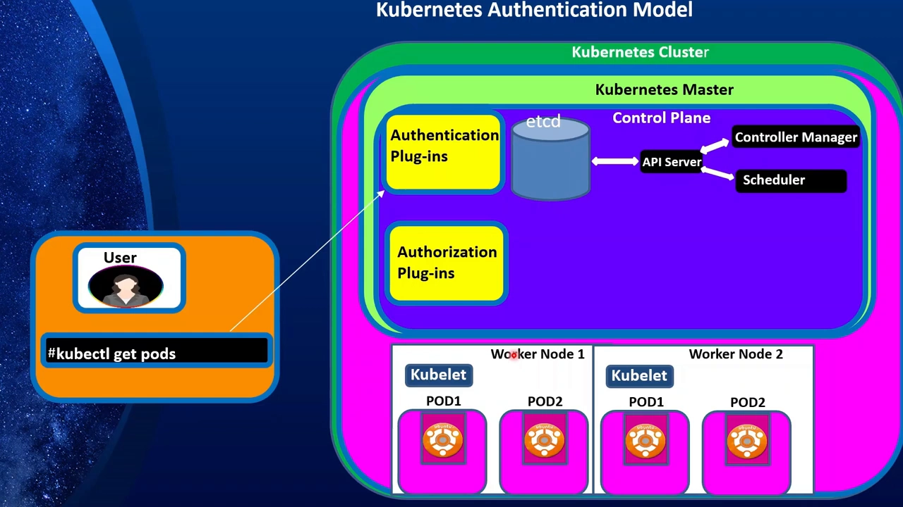
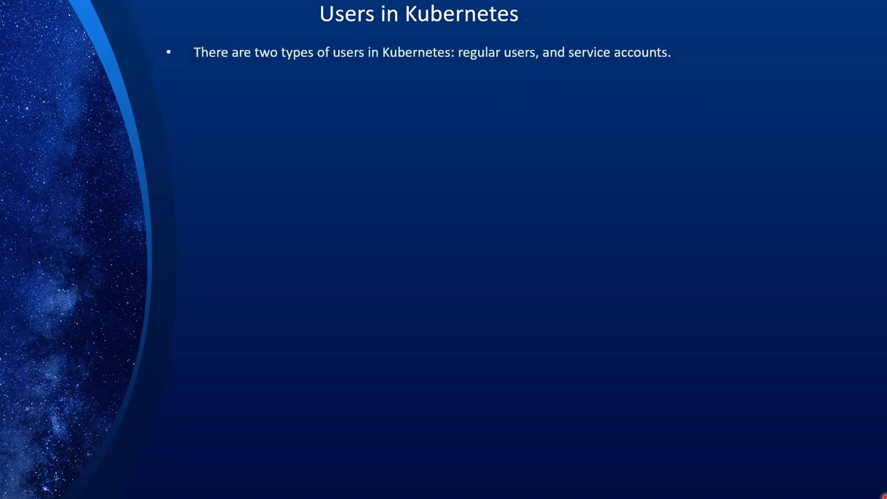
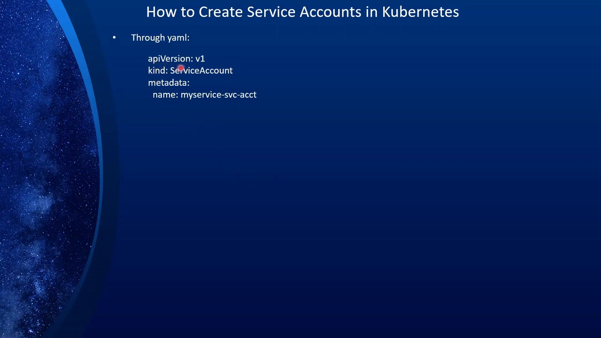
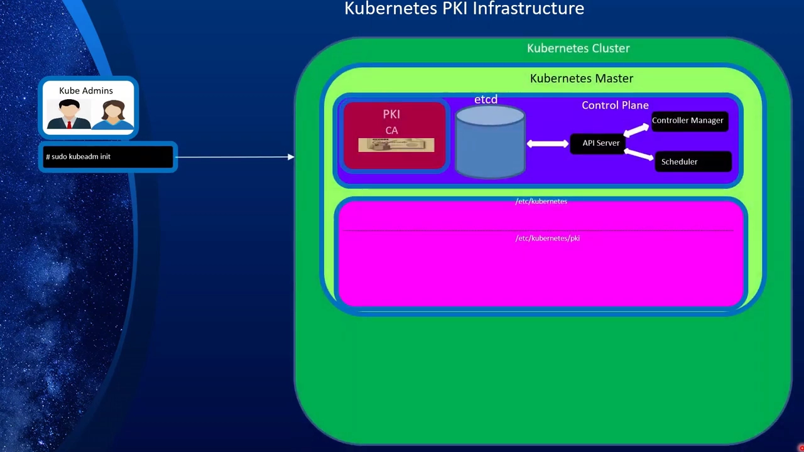
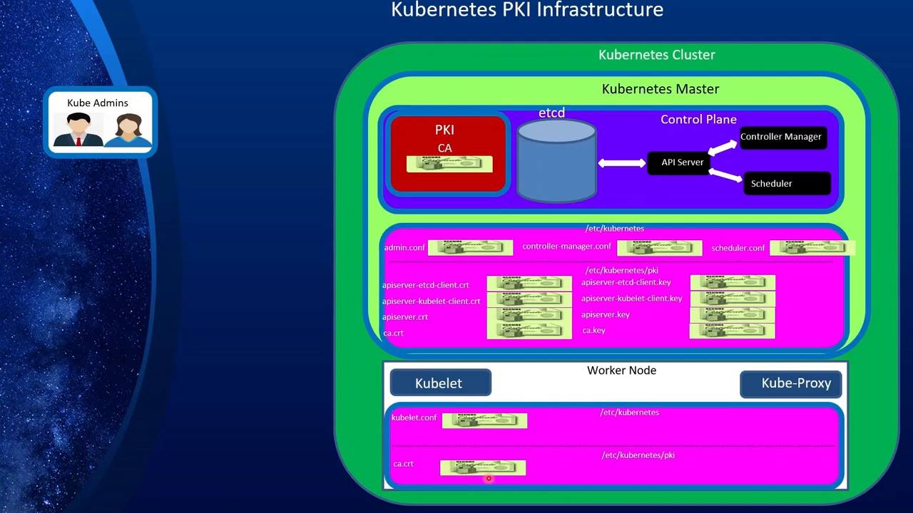
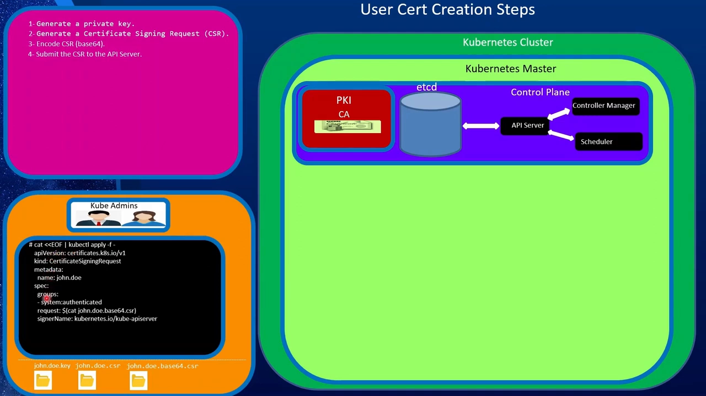
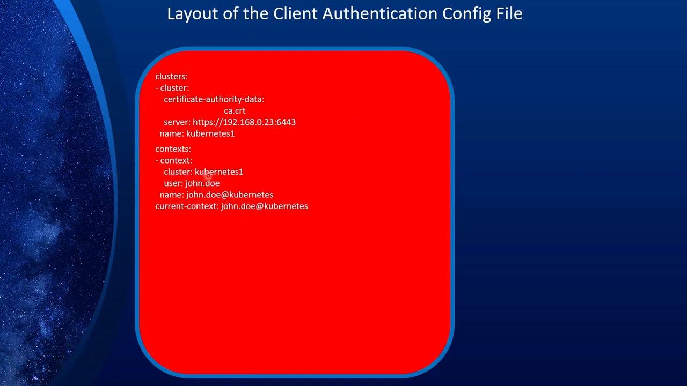
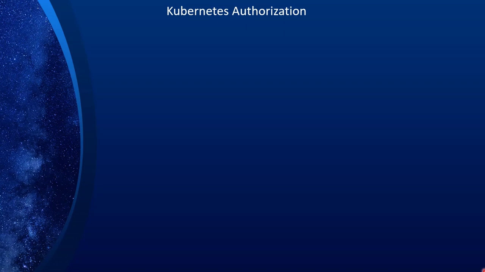

# Kubernetes 认证机制：X509 客户端证书、ServiceAccount 与 kubeconfig

> 视频来源：[Kubernetes Security, Part 3: Kubernetes Auth (Part A: Overview and X509 Client Certificate auth)](https://www.youtube.com/watch?v=WZvPIoUyErM)（YouTube，The Learning Channel）
>
> 文稿左栏为英文自动字幕，本文已翻译并重写为中文。全文按「认证与授权两道关 → 四种认证方式 → 两类用户 → ServiceAccount → PKI → 给用户签发证书 → kubeconfig → 验证与局限」的顺序重排。

## 本讲要解决的核心问题（SCQA）

**背景**：Kubernetes 里的一切操作——`kubectl get pods`、控制器改动 Pod 状态、kubelet 上报——最终都要变成对 `kube-apiserver` 的一次请求。API Server 是集群唯一入口。

**冲突**：既然人人都要走这道门，第一件事就是**证明「你是谁」**。可集群里既有真人和外部系统，也有 kubelet、控制器这样的程序组件；它们各自用什么凭据证明身份？这些凭据又是谁签发的？

**疑问**：Kubernetes 到底认哪些「身份证明」？一张证书是怎么一步步被签发、又被塞进 kubeconfig 的？而 kubelet 这类程序又靠什么认证？

**回答（中心思想）**：Kubernetes 把「**认证**（Authentication，你是谁）」和「**授权**（Authorization，你能干什么）」都设计成**可插拔的插件**。默认且最核心的认证方式是 **X509 客户端证书**：集群自带一套 **PKI**，由它签发证书，证书里的 `CN` 就是用户名、`O` 就是用户组；把证书、私钥和集群信息一起写进 **kubeconfig**，客户端才能连上 API Server。程序类身份则用 **ServiceAccount**，它的令牌存在 **Secret** 里、挂载进 Pod。

---

## 一、认证与授权：API Server 前面的两道可插拔关卡

来自用户或工作节点的任何通信，都必须先经过 API Server 的**认证模块（authentication module）**。[【跳转到 00:05】](https://www.youtube.com/watch?v=WZvPIoUyErM&t=5)

而 Kubernetes 的一个关键设计是：**认证和授权都是「可插拔（pluggable）」的**——管理员可以从多种选项里挑选、组合启用，而不是写死在代码里。对认证，可选 X509 客户端证书、OpenID Connect、静态 token 文件、webhook 等；对授权，可选 RBAC、ABAC、webhook 等。[【跳转到 00:35】](https://www.youtube.com/watch?v=WZvPIoUyErM&t=35)



请求在控制面里的走向大致是：用户（`kubectl get pods`）→ **认证插件** → **授权插件** → API Server → etcd / Controller Manager / Scheduler。换句话说，**认证与授权是请求进入集群内部逻辑之前的两道关卡**。

---

## 二、四种认证方式：证书是默认，另外三种按需启用

视频把认证方式归纳成四类：[【跳转到 01:00】](https://www.youtube.com/watch?v=WZvPIoUyErM&t=60)

1. **X509 客户端证书（默认）**：同时用于认证**用户**和**工作节点**。通过 `--client-ca-file=<CA 文件>` 启用；这个文件里放一个或多个 CA 证书，用来校验客户端出示的证书。Kubernetes 自带一套 PKI，需要时自动签发证书；如果你有企业自有的 CA，也可以接进来——但默认开箱即用时，它用自己的 PKI 和自签证书。[【跳转到 01:25】](https://www.youtube.com/watch?v=WZvPIoUyErM&t=85)
2. **OpenID Connect（OIDC）**：OAuth2 的一种「风味」，被 Azure AD、Salesforce、Google 等云端身份提供方支持，也可以自建（如 Okta）。它与 OAuth2 的关键区别是：OIDC 会在 `access token` 之外**多返回一个 `ID token`**，而这个 `ID token` 是一个 **JWT（JSON Web Token）**，其中带着关于用户的**声明（claims）**——用户名、组织单位、email 等。[【跳转到 02:15】](https://www.youtube.com/watch?v=WZvPIoUyErM&t=135)
3. **静态 token 文件（static token file）**：管理员手工为不同用户生成 token，存进一个文件，再把文件路径交给 Kubernetes；启动时用它来认证。**生产环境不用**，只适合学习或快速搭环境。[【跳转到 03:55】](https://www.youtube.com/watch?v=WZvPIoUyErM&t=235)
4. **Webhook**：和 OIDC 类似依赖**外部提供方**——LDAP、SAML、Kerberos，或另一套 x509 体系——通过 webhook 接进 Kubernetes，需要在 API Server 上配置相应参数。[【跳转到 04:20】](https://www.youtube.com/watch?v=WZvPIoUyErM&t=260)

**认证之后是授权**，授权同样是可插拔的：常用 **RBAC**（本系列有专门讲解）、**ABAC**、**Webhook**；另外还有一个 **Node 授权器（node authorizer）**，专门用来授权 kubelet。[【跳转到 05:10】](https://www.youtube.com/watch?v=WZvPIoUyErM&t=310)

---

## 三、两类用户：普通用户与 ServiceAccount

Kubernetes 里有**两类用户**：[【跳转到 05:49】](https://www.youtube.com/watch?v=WZvPIoUyErM&t=349)

- **普通用户（regular users / people）**：由 Kubernetes **之外**的系统管理。注意——**没有对象代表普通用户，也没有 API 去创建/删除用户**。他们的身份可能存在于客户端证书里，也可能在 OIDC 目录服务、LDAP 等外部系统里。
- **ServiceAccount（服务账号）**：由 Kubernetes 自己创建和维护，用于程序身份。



支持的**认证凭据类型**包括：客户端证书、bearer token、认证代理（authenticating proxy）、webhook——从而能集成 LDAP、SAML 等更多协议。[【跳转到 07:09】](https://www.youtube.com/watch?v=WZvPIoUyErM&t=429)

---

## 四、ServiceAccount：自动认证器与挂载进 Pod 的令牌

ServiceAccount 用于对 API Server 的认证与授权，也可以当作 Pod 身份来支撑 NetworkPolicy。它是一个**自动启用的认证器**，用**签过名的 bearer token** 校验请求。[【跳转到 07:34】](https://www.youtube.com/watch?v=WZvPIoUyErM&t=454)

它有两个可选参数：

- `--service-account-key-file`：签 bearer token 用的 PEM 编码密钥；若未指定，就用 API Server 的 TLS 私钥。
- `--service-account-lookup`：启用后，从 API 里被删除的 token 会被吊销。[【跳转到 07:59】](https://www.youtube.com/watch?v=WZvPIoUyErM&t=479)

**default ServiceAccount** 由 API Server 自动创建，并通过 ServiceAccount 准入控制器关联到 Pod。换句话说：**每新建一个 namespace，就自动创建名为 `default` 的 ServiceAccount；该 namespace 里没显式指定 SA 的 Pod 都会自动关联它。**[【跳转到 08:24】](https://www.youtube.com/watch?v=WZvPIoUyErM&t=504)

ServiceAccount **以 Secret 的形式保存**，包含三样东西：**CA 证书、token、namespace**。bearer token 通过卷（volume）挂载进 Pod，路径是 `/var/run/secrets/kubernetes.io/serviceaccount`；Pod 就用这里的证书和 token 去跟 API Server 通信。[【跳转到 09:14】](https://www.youtube.com/watch?v=WZvPIoUyErM&t=554)

创建 ServiceAccount 有两种方式，YAML 长这样（也可 `kubectl create serviceaccount`）：[【跳转到 09:47】](https://www.youtube.com/watch?v=WZvPIoUyErM&t=587)

```yaml
apiVersion: v1
kind: ServiceAccount
metadata:
  name: my-service-account
```

然后在 Pod 的 `spec.serviceAccountName` 里引用它；不写就落到 `default`。[【跳转到 10:12】](https://www.youtube.com/watch?v=WZvPIoUyErM&t=612)



### 4.1 动手：查认证/授权开关、建 SA、看令牌

视频随后做了一组演示：[【跳转到 10:43】](https://www.youtube.com/watch?v=WZvPIoUyErM&t=643)

- **查认证/授权模块**：在 API Server 的静态 Pod 清单里找相关参数——
  `--authorization-mode=Node,RBAC`（授权用 Node + RBAC）、`--client-ca-file`（客户端证书认证）、`--enable-bootstrap-token-auth=yes`（bootstrap token 认证）、`--oidc-*`（OIDC）、`--token-auth-file`（静态 token）。这套安装**默认只启用了客户端 CA 认证与 bootstrap token 认证**，OIDC 和静态 token 都没启用。[【跳转到 11:44】](https://www.youtube.com/watch?v=WZvPIoUyErM&t=704)
- **建 SA 看 Secret**：`kubectl apply -f` 创建 SA → `kubectl get sa <名> -o yaml` 能看到底部的 `secrets` 段 → `kubectl describe secret <名>` 能看到 **CA 证书**和 **token**（CA 用于让客户端确认「连的是对的集群」）。[【跳转到 15:04】](https://www.youtube.com/watch?v=WZvPIoUyErM&t=904)
- **挂进 Pod**：建 Deployment 并指定 `serviceAccountName` → 进 Pod `ls /var/run/secrets/kubernetes.io/serviceaccount`，能看到 `ca.crt`、`namespace`、`token` 三个文件——这就是 Pod 跟 API Server 对话时的凭据来源。[【跳转到 18:49】](https://www.youtube.com/watch?v=WZvPIoUyErM&t=1129)

---

## 五、Kubernetes 的 PKI 与证书体系

Kubernetes **同时用证书做 TLS 加密和认证**（默认用于客户端认证），控制面内部组件互访也靠证书。集群初始化时会一并建立 **PKI 基础设施**，据此生成并分发证书给各组件。默认走自签；若你有组织自有 PKI，也可以替换。[【跳转到 20:24】](https://www.youtube.com/watch?v=WZvPIoUyErM&t=1224)



证书一般放在 `/etc/kubernetes` 下，根是 `pki` 目录。几个最重要的文件：

| 文件 | 用途 |
| --- | --- |
| `admin.conf` | 集群管理员的 kubeconfig（客户端证书 + 私钥 + CA + 连接信息）。安装时被复制到管理员家目录的 `~/.kube/`。视频称它是**「通往王国的钥匙」**：一旦泄露，就应假设整个集群失守，务必只发给 Kubernetes 管理员 |
| `controller-manager.conf` | Controller Manager 跟 API Server 通信 |
| `scheduler.conf` | Scheduler 跟 API Server 通信 |
| `apiserver-etcd-client.crt`（+ key） | API Server 连 etcd |
| `apiserver-kubelet-client.crt`（+ key） | API Server 连各节点上的 kubelet |
| `apiserver.crt`（+ key、CSR） | API Server 自身的身份证书（自签、集群内受信） |
| `kubelet.conf`（各节点） | 节点上的 kubelet 连 API Server |



对开发者这类**普通用户**，管理员需要**按需签发客户端证书**（下一节），再生成一份 kubeconfig 交给用户；用户把它放进 `~/.kube/` 即可认证。[【跳转到 25:37】](https://www.youtube.com/watch?v=WZvPIoUyErM&t=1537)

---

## 六、给普通用户签发客户端证书（CSR 流程）

以新同事 **John Doe** 为例，管理员要按下列步骤走：[【跳转到 26:51】](https://www.youtube.com/watch?v=WZvPIoUyErM&t=1611)

1. **生成私钥**：[【跳转到 27:16】](https://www.youtube.com/watch?v=WZvPIoUyErM&t=1636)
   ```bash
   openssl genrsa -out john.doe.key 2048
   ```
2. **生成证书签名请求（CSR）**：[【跳转到 27:41】](https://www.youtube.com/watch?v=WZvPIoUyErM&t=1661)
   ```bash
   openssl req -new -key john.doe.key -out john.doe.csr \
     -subj "/CN=john.doe/O=marketing-dev/O=hr"
   ```
   其中 `CN` = 用户名，`O` = 组织/用户组。**强烈建议按「组」而不是「人」授权**：给整个组授权一次，比给每个人单独配权限省事得多——用证书或 OIDC 都建议这么做。[【跳转到 28:31】](https://www.youtube.com/watch?v=WZvPIoUyErM&t=1711)
3. **把 CSR 内容 Base64 编码**（去掉头尾）写进新文件，得到可用于提交的 CSR。[【跳转到 30:36】](https://www.youtube.com/watch?v=WZvPIoUyErM&t=1836)
4. **提交 CSR 给 API Server 审批**（现场生成一个 `CertificateSigningRequest` 对象并 `kubectl apply`）：[【跳转到 31:01】](https://www.youtube.com/watch?v=WZvPIoUyErM&t=1861)
   - `apiVersion: certificates.k8s.io/v1`，`kind: CertificateSigningRequest`；
   - `spec.groups: ["system:authenticated"]`（内置组：所有已认证成员都属它）；
   - `spec.request`：第 3 步的 Base64 CSR；
   - `spec.signerName: kubernetes.io/kube-apiserver-client`（默认的签名者）；
   - `spec.usages: ["client auth"]`（这是客户端证书，所以要指定 client auth）。
   - 提交后**必须在 1 小时内批准**，否则会被 API Server **垃圾回收**，得重来。[【跳转到 33:06】](https://www.youtube.com/watch?v=WZvPIoUyErM&t=1986)
5. **批准并取回证书**：[【跳转到 33:31】](https://www.youtube.com/watch?v=WZvPIoUyErM&t=2011)
   ```bash
   kubectl certificate approve john.doe
   kubectl get csr john.doe -o jsonpath='{.status.certificate}' | base64 -d > john.doe.crt
   openssl x509 -in john.doe.crt -text   # 看到 CN=john.doe、O=HR、O=marketing，2048 位公钥
   ```



---

## 七、kubeconfig：把证书、私钥和集群信息打包

拿到用户证书和私钥后，还要生成一份**认证配置文件（kubeconfig）**。它的三段结构是：[【跳转到 35:18】](https://www.youtube.com/watch?v=WZvPIoUyErM&t=2118)

- **clusters**：要连接的集群。含 `certificate-authority-data`（该集群的 CA，用来确认「连的是对的集群」）、`server`（形如 `https://<IP>:6443`）和 `name`。可以有多个。
- **contexts**：可以理解成「连接串」，把 `cluster` + `user`（+ namespace）组合在一起。可以有多个。
- **users**：用户名 + `client-certificate-data` + `client-key-data`。
- 外加 `current-context`，指定默认用哪个。



用 `kubectl config` 一步步把它拼出来：[【跳转到 47:11】](https://www.youtube.com/watch?v=WZvPIoUyErM&t=2831)

```bash
kubectl config view                                   # 看当前配置（加 --raw 才显示被脱敏的证书/私钥）
kubectl config set-cluster cluster1 \
  --server=https://<master-ip>:6443 \
  --certificate-authority=/etc/kubernetes/pki/ca.crt \
  --embed-certs=true --kubeconfig=john.doe.conf
kubectl config set-credentials john.doe \
  --client-key=john.doe.key --client-certificate=john.doe.crt \
  --embed-certs=true --kubeconfig=john.doe.conf
kubectl config set-context john.doe@cluster1 \
  --cluster=cluster1 --user=john.doe --kubeconfig=john.doe.conf
kubectl config use-context john.doe@cluster1 --kubeconfig=john.doe.conf
```

最后把 `john.doe.conf` 交给 John；他放进 `~/.kube/`（一般重命名为 `config`）就能连集群了。[【跳转到 55:56】](https://www.youtube.com/watch?v=WZvPIoUyErM&t=3356)

---

## 八、验证与局限：能连上 ≠ 有权限

拿 John 的 kubeconfig 试一下：[【跳转到 53:26】](https://www.youtube.com/watch?v=WZvPIoUyErM&t=3206)

```bash
kubectl get pods --kubeconfig john.doe.conf
# error from server (Forbidden): pods is forbidden: User "john.doe" cannot list resource "pods"
```

这个报错很关键：**认证成功了**（API Server 认出了 `john.doe`），但**授权失败了**（还没给他任何权限）。把权限授予用户/ServiceAccount 是 **RBAC** 的职责（下一讲）。

还有一个实用技巧——**冒充（impersonate）**某个用户来检查权限：[【跳转到 55:06】](https://www.youtube.com/watch?v=WZvPIoUyErM&t=3306)

```bash
kubectl auth can-i list pods --as john.doe     # 答案：no
```

这样既能确认用户权限**够用**，也能确认没给**多余的权限**。



**X509 客户端证书的适用边界**：[【跳转到 57:04】](https://www.youtube.com/watch?v=WZvPIoUyErM&t=3424)

- 对**中小组织**，它够用且简单；
- 但对**大组织**，手工创建/管理用户的开销很大；更麻烦的是：证书里编码了角色（`O` 字段），**用户角色一变就得重新签发一张证书**，难以规模化；
- 因此大组织更适合把用户管理**委托给外部系统**（如 OIDC、LDAP），并用**组**来授权。

---

## 小结

- API Server 是唯一入口，请求进来先过**认证**（你是谁）再过**授权**（你能干什么），两者**都可插拔**。
- 认证有四类方式：**X509 客户端证书（默认）**、OIDC、静态 token 文件、Webhook。
- 用户分两类：**普通用户**（K8s 之外管理，无对应对象）与 **ServiceAccount**（K8s 自动创建维护，用于程序身份）。
- ServiceAccount 用签名的 bearer token 认证，凭据存在 **Secret**（CA+token+namespace）里，并挂载到 Pod 的 `/var/run/secrets/kubernetes.io/serviceaccount`。
- 集群自带 **PKI**：`admin.conf` 是「王国的钥匙」；组件各持自己的证书。
- 给用户发证书走 **CSR 流程**：生成私钥 → CSR → Base64 → 提交 CSR 对象 → 1 小时内批准 → 取回证书；证书的 `CN` 是用户名、`O` 是组。
- kubeconfig 由 **clusters / contexts / users** 三段组成，可用 `kubectl config` 逐步生成。
- **认证成功不等于有权**：报 `Forbidden` 是没授权，交给 RBAC 解决；X509 适合中小组织，大组织改用 OIDC/LDAP 并靠组授权。

## 关键术语速查

| 术语 | 一句话解释 |
| --- | --- |
| Authentication（认证） | 证明「你是谁」；K8s 里可插拔，默认用 X509 客户端证书 |
| Authorization（授权） | 决定「你能干什么」；同样可插拔，常用 RBAC |
| Pluggable（可插拔） | 认证/授权方式可用参数选择、组合，而非写死 |
| X509 客户端证书 | 默认认证方式；`CN`=用户名，`O`=用户组 |
| OIDC / ID token / JWT | OAuth2 的扩展；额外返回 JWT 形式的 ID token，携带用户声明 |
| Static token file | 手工生成 token 存文件，仅适合学习/临时环境 |
| Webhook（认证） | 把认证交给外部系统（LDAP/SAML/Kerberos 等） |
| ServiceAccount | K8s 创建维护的程序身份；默认每 namespace 建一个 `default` |
| Bearer token | ServiceAccount 用来认证的签名令牌 |
| PKI / `admin.conf` | 集群内置的证书基础设施；`admin.conf` 是管理员凭据，泄露即集群失守 |
| CSR / CertificateSigningRequest | 证书签名请求；提交给 API Server 审批，1 小时内有效 |
| kubeconfig | 打包 clusters/contexts/users 的认证配置文件，放在 `~/.kube/` |
| `kubectl auth can-i` / impersonate | 冒充某用户检查其权限是否恰当 |
