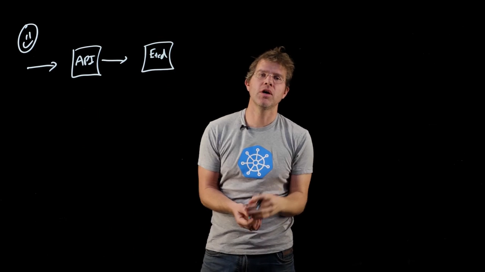
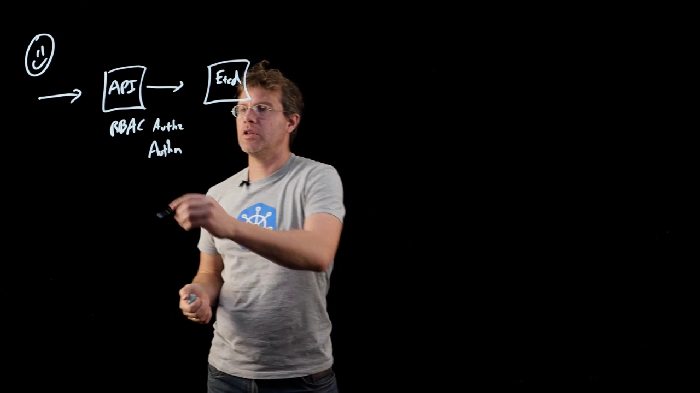
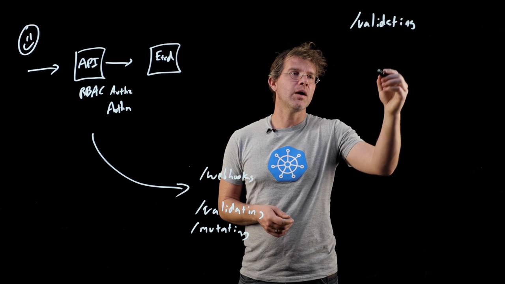
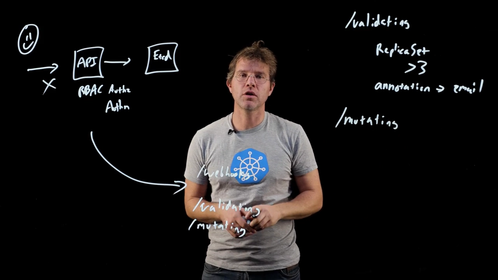
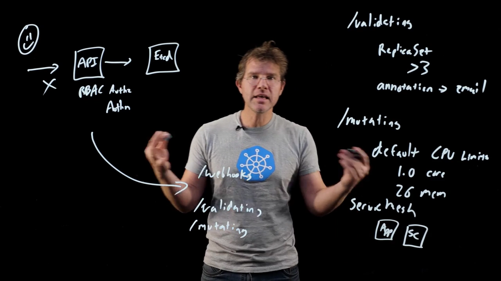

# 准入控制：在鉴权之后、落库之前，改写与拦截的两次机会

## 本讲要解决的核心问题（SCQA）

**背景**：每一次 `kubectl apply`，请求走的都是一条固定的路——**有人（或某段自动化）发出 API 调用 → 交给 `kube-apiserver` → 最终落到 etcd 数据库**。你对「鉴权」也有概念：API Server 里有一套 **RBAC** 做授权，另有一套认证（authentication），它们共同回答「**这个用户能不能在集群里做某件事**」。

**冲突**：但你会发现，很多真正想表达的规则，**根本不在「谁能做什么」这个层面**。比如「每张 ReplicaSet 至少要有 3 个副本」「集群里每个对象都得带一个『负责人邮箱』的注解」，甚至更朴素的「Pod 没写 CPU 限额就自动补上默认值」。这些规则要**钻进 API 对象内部看字段**才能判断——**认证和授权做不了这件事**。

**疑问**：这类「**看对象内容再做决定、甚至直接改写对象**」的逻辑，Kubernetes 到底在哪里实现？「改写」和「拦截」又是同一件事吗？

**回答（中心思想）**：它就是**准入控制器（admission controller）**——发生在 **authn / authz 之后、对象落库之前**的一段拦截逻辑（通常以 Webhook 形式提供，便于动态注册）。它分两类、各管一头：**校验型（validating）管「策略」，负责拦截**（如「至少 3 副本」「必须有负责人注解」）；**变更型（mutating）管「默认值与注入」，负责改写**（如补默认 CPU 限额、注入 sidecar）。

> 本讲基于 Azure 的一段短讲视频《Customizing and Extending the Kubernetes API with Admission Controllers》（约 6 分钟，[原视频](https://www.youtube.com/watch?v=P7QAfjdbogY)）整理。视频用白板把「一次请求的三段路」和「两类准入动作」串成了一张图。

---

## 一、先把请求的路看清：三段，两关

视频开头先用一张最简图把「一次请求长什么样」讲清楚（[【跳转到 00:11】](https://www.youtube.com/watch?v=P7QAfjdbogY&t=11)）：它**基本上就是三个部分**——

1. **发起方**：发出 API 调用的**人**，或者**自动化程序**；
2. **`kube-apiserver`**：请求交到 API Server 手里；
3. **etcd**：最终写入的数据库。

**这就是所有 API 请求的基本流程**。真正有意思的，是请求在 **API Server 内部**会经过什么。

API Server 内部**先做认证与授权**（RBAC 负责其中的授权部分）——于是你能规定「**这个用户能 / 不能在集群里做某些事**」。但正如开头所说，有一大类事情**必须看对象本身的内容**才能决定该不该做、该不该改——**认证和授权管不到这里，这就是准入控制器登场的地方**（[【跳转到 00:51】](https://www.youtube.com/watch?v=P7QAfjdbogY&t=51)）。

## 二、准入控制器的位置：紧跟在鉴权之后

一句话定位（[【跳转到 01:13】](https://www.youtube.com/watch?v=P7QAfjdbogY&t=73)）：**准入控制器发生在 authn 和 authz 之后**——也就是**用户已经被授权之后**，才会被调用；而且它们**通常就是 Webhook**，这样你才能**动态地注册**准入控制器。

它分为**两个基本类别**（[【跳转到 01:47】](https://www.youtube.com/watch?v=P7QAfjdbogY&t=107)）：

- **校验型（validating）**：**看对象的内容**，确保它是一个**合法的 API 对象**；
- **变更型（mutating）**：看对象的内容，并且**真的去改它**——可能**加点东西、去点东西**，在对象**「进来的路上」就把它改掉**。

从名字就能猜到分工：**Validating 是「看」和「判」，Mutating 是「改」**。

## 三、校验型：用「策略」把不合规的请求挡在门外

先看校验型。它的目标是**确保对象的某个属性被维持（ensure some property is maintained）**（[【跳转到 02:12】](https://www.youtube.com/watch?v=P7QAfjdbogY&t=132)）。而当我们谈这类「维持某个属性」时，通常谈的就是**策略（policy）**。

视频给了两个非常具体的策略例子（[【跳转到 02:17】](https://www.youtube.com/watch?v=P7QAfjdbogY&t=137)）：

- **「每一张 ReplicaSet 至少要有 3 个副本」**。这**没法用授权或认证表达**，但**可以用策略表达**；它背后的动机是**可靠性**——让人把应用多副本、别单点。
- **「我集群里的每一个对象，都必须带一个『负责人邮箱（owner e-mail）』的注解」**。这在**做自动化**时特别值钱：有了这份**标准化的元数据**，你就能方便地写程序去**提醒某人「这个资源该删了」「这个资源出问题了」**。而**唯一能确保大家都照做的办法，就是策略**——**没带这个注解，请求直接被拒**（[【跳转到 03:13】](https://www.youtube.com/watch?v=P7QAfjdbogY&t=193)）。

那这些策略怎么落地？视频提到了一个大家可能听过的项目——**Gatekeeper**：它是**由 Azure 等维护的开源项目**，用**一个校验型准入控制器**把自己接进 Kubernetes；而它内部又借了 **Open Policy Agent** 的 **Rego** 这门策略语言来表达上面这类规则。

关于「自己写」还是「用现成的」，视频给了一个务实的提醒（[【跳转到 03:41】](https://www.youtube.com/watch?v=P7QAfjdbogY&t=221)）：**自己动手写一个准入控制器可能挺复杂**；好在像 **Gatekeeper** 这样的项目会**帮你自动接入准入控制**——你**只要把它装进集群**就行。当然，随着时间推移，你也可能选择**自己写一个**校验型准入控制器。

## 四、变更型：默认值与注入，帮用户走「顺利路径」

变更型的目标和校验型「有点不一样」——**它是要真的改动 API 对象，用来实现默认值（defaulting）或增加能力（add capabilities）**（[【跳转到 04:03】](https://www.youtube.com/watch?v=P7QAfjdbogY&t=243)）。

### 4.1 经典例子：补上默认 CPU 限额

最经典的场景是「**我们来加上默认的 CPU 限额**」（[【跳转到 04:10】](https://www.youtube.com/watch?v=P7QAfjdbogY&t=250)）：当有人创建 Pod、却**没有为它指定 CPU 和内存资源**时，**变更控制器就替他设一些默认值**——比如**默认请求 1 核 CPU、2G 内存**。

为什么这么做？因为**如果你创建 Pod 时不指定资源限额，一般来说 Kubernetes 会彻底「超卖」并把集群压垮，应用会开始崩溃、跑不正常**。用变更控制器，本质上是**帮用户走「顺利路径（happy path）」**，而不是让用户把自己（的集群）带进坑里。

### 4.2 另一个热门例子：Service Mesh 的 sidecar 注入

另一个很流行的变更控制器用途是 **Service Mesh（服务网格）**（[【跳转到 05:03】](https://www.youtube.com/watch?v=P7QAfjdbogY&t=303)）。服务网格通常会有一个**和应用容器并排运行的 sidecar 容器**；而**把 sidecar 注入进去的最省事办法，就是用变更控制器去修改用户创建的 Pod，把 sidecar 加进去**。

这样做的价值在于：**你不用去教育应用开发者，也不用改动应用自身的任何配置**，就能让**他们创建的所有 Pod 都自动带上 sidecar**。

### 4.3 顺带还能「集中管理版本」

视频还补了一个同类例子（[【跳转到 05:23】](https://www.youtube.com/watch?v=P7QAfjdbogY&t=323)）：如果你需要把某个容器**从 V1 升到 V2**，只要把这个动作**集中化、标准化**到一个变更控制器里，你就能**确保所有人用的版本被你统一改掉**——而**不必要求每个人去改自己的 YAML**。

## 小结

- 一次 API 请求的基本路线是 **调用方 → `kube-apiserver` → etcd**（[最终形态](https://www.youtube.com/watch?v=P7QAfjdbogY&t=373)）。
- API Server 内部**先认证、再授权（RBAC）**，它们只回答「**谁能做什么**」；**「看对象内容再决定」的需求，交给准入控制器**。
- **准入控制器就发生在 authn / authz 之后、落库之前**，通常以 **Webhook** 形式提供，便于**动态注册**。
- **校验型（validating）**：管**策略**、负责**拦截**——例：ReplicaSet ≥ 3 副本、对象必须带负责人邮箱注解（Gatekeeper + Rego 是常见落地方式）。
- **变更型（mutating）**：管**默认值与注入**、负责**改写**——例：补默认 CPU 限额（避免集群被压垮）、注入 service mesh 的 sidecar（不用改应用）、集中管理容器版本。
- 一句话串起来：**先看门（校验策略）还是先顺手补两笔（变更默认值），都是在对象真正落进 etcd 之前完成的。**

## 关键术语速查

| 术语 | 一句话解释 |
| :--- | :--- |
| 准入控制器（Admission Controller） | 在 authn/authz 之后、对象落库之前介入的拦截逻辑，决定放行、拒绝或改写。 |
| Validating（校验型） | 看对象内容判断是否合规，用来执行**策略**；只拦不改。 |
| Mutating（变更型） | 真的修改对象，用来**补默认值**或**注入能力**（如 sidecar）。 |
| 策略（Policy） | 用鉴权表达不了、但需要强制的对象级规则，例如「ReplicaSet ≥ 3 副本」。 |
| Gatekeeper / Rego | 用校验型准入控制器把**策略引擎**接入 Kubernetes 的开源项目与策略语言。 |
| 默认值（Defaulting） | 用户没写某些字段时，由变更控制器自动补上（如默认 CPU/内存请求）。 |
| Sidecar 注入 | 用变更控制器给用户 Pod 自动加上一个旁路容器，典型用于 Service Mesh。 |
