# K8s的资源配额与限制

## 本讲要解决的核心问题（SCQA）

**背景**：在 Kubernetes 里，命名空间（Namespace）常被当成一个"项目"或一个团队的地盘来用；而单个容器的 CPU、内存该用多少，我们已经在 `resources.requests` / `resources.limits` 里学会声明了。

**冲突**：但命名空间本身默认是**没有上限**的——往里面塞多少个 Pod、用掉多少 CPU 和内存，集群默认一概不管。于是只要有一个 Pod 忘了写 `resources`，它就可能把节点的资源啃光，把别人的容器一起拖垮。

**疑问**：怎么给一整个命名空间、以及里面的每个 Pod 加上资源限制？加上限制之后，我们平时"建 Pod"的方式又会发生什么变化？

**回答（中心思想）**：K8s 用**两个对象**来做这件事——**ResourceQuota（资源配额）**管"命名空间里所有资源的**总量**"，**LimitRange（默认配额）**管"每个容器**该用多少、最多最少能用多少**"。它们最大的共同点是：**一旦超标，请求会在写入阶段被直接拒绝、返回 `Forbidden`，Pod 根本创建不出来。** 所以在设了 CPU/内存配额的命名空间里，Pod 还必须显式声明 `requests`/`limits`，否则同样会被拦下。

> 本讲基于 B 站视频《K8s的资源配额与限制》（BV1czUfYwEwz，约 28 分钟）整理。视频从"为什么要限制"讲起，依次拆解 ResourceQuota 与 LimitRange 两个对象，并配以命令行 + KubeSphere 可视化的完整实测。

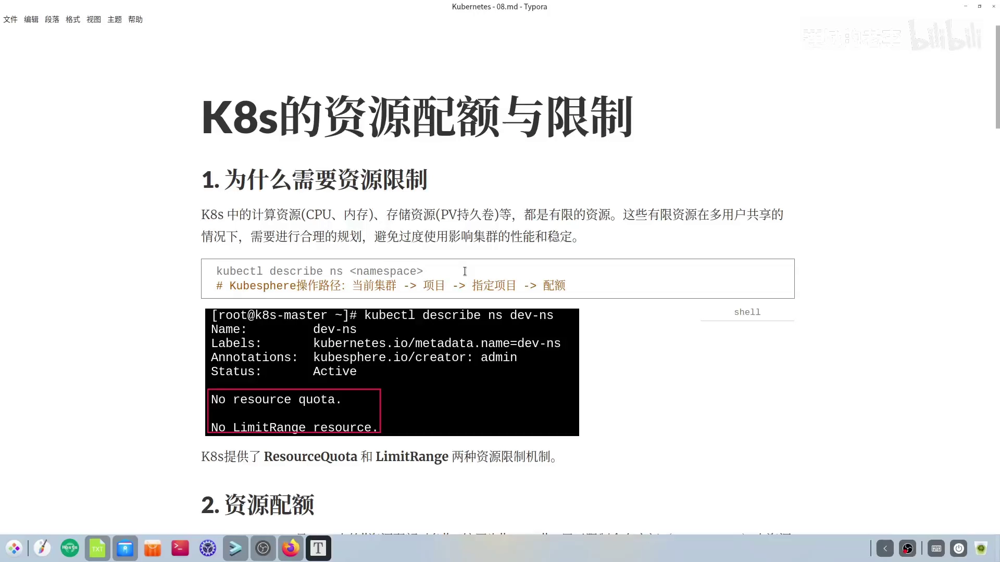

---

## 一、为什么命名空间需要资源限制

### 1.1 资源是有限的，而默认情况下没人管

在 K8s 里资源分很多类型：与我们计算相关的是**计算资源**，例如 CPU、内存；还有**存储资源**，例如 PV 持久卷（[【跳转到 00:24】](https://www.bilibili.com/video/BV1czUfYwEwz/?t=24)）。这些都是有限资源，在多用户共享的场景下必须做合理规划，否则过度使用会影响整个集群的稳定与性能。


用一个生活化的类比：这就像把一张信用卡交给孩子用，你若不给它设额度，说不定他能给你刷出一支火箭来（[【跳转到 00:49】](https://www.bilibili.com/video/BV1czUfYwEwz/?t=49)）。

而默认情况下，命名空间恰恰是**没有做任何资源限制**的。可以用 `kubectl describe` 查看一个命名空间，会看到两句话都以 `NO` 开头（[【跳转到 01:07】](https://www.bilibili.com/video/BV1czUfYwEwz/?t=67)）：

- `No resource quota` —— 没有资源配额；
- `No LimitRange` —— 没有默认配额。

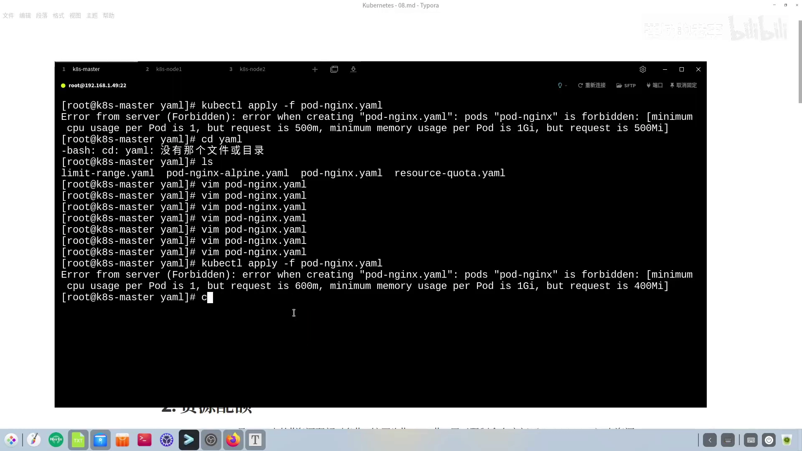

这两句话对应的正是本讲的两个主角：**ResourceQuota** 与 **LimitRange**。

### 1.2 用 KubeSphere 对照一下两个概念

在可视化的 KubeSphere 里，进入某个命名空间（项目）的「配额」页，可以看到两个栏目（[【跳转到 01:55】](https://www.bilibili.com/video/BV1czUfYwEwz/?t=115)）：

- 「**项目配额**」= 命令行里的 ResourceQuota；
- 「**默认容器配额**」= 命令行里的 LimitRange。

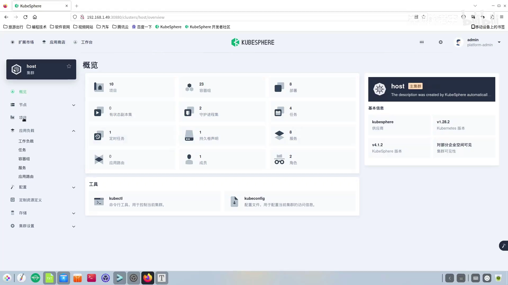

用可视化工具与命令行互相印证，是视频贯彻始终的一种讲法，后面每次改配额我们都会两边对照。

---

## 二、ResourceQuota：给命名空间上一道总量预算

### 2.1 它是什么、超了会怎样

**ResourceQuota（资源配额，可缩写为 quota）**的作用是**限制命名空间内资源的使用量**：一旦请求的资源超过配额，请求就会被拒绝并返回 `Forbidden` 错误（[【跳转到 02:32】](https://www.bilibili.com/video/BV1czUfYwEwz/?t=152)）。

关于它有三个必须记住的注意事项（[【跳转到 02:57】](https://www.bilibili.com/video/BV1czUfYwEwz/?t=177)）：

1. **命名空间与 ResourceQuota 是一对多、也可以是一对一关系**，通常选用**一对一**（一个命名空间配一个）
2. **一旦给命名空间设了 CPU/内存配额，创建 Pod 时就必须指定 CPU 和内存的资源限制**，否则也会得到 `Forbidden`；
3. **对"事先已经创建"的资源不受影响**——若命名空间里本来就跑着 Deployment 和 Pod，再挂上 ResourceQuota，这些已存在的对象不会被追溯限制（[【跳转到 03:59】](https://www.bilibili.com/video/BV1czUfYwEwz/?t=239)）。

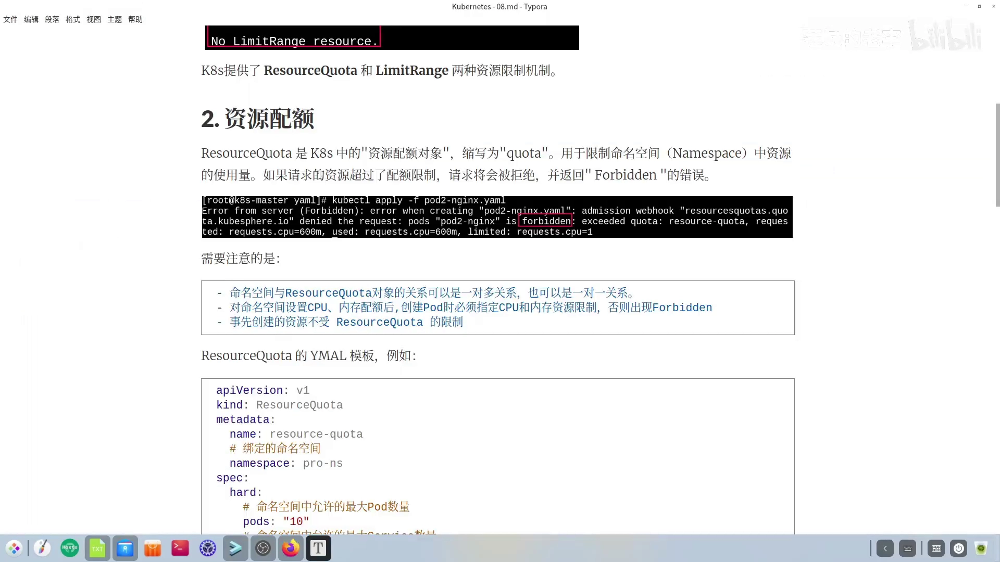

### 2.2 YAML 里到底写了什么

定义一个 ResourceQuota 对象，关键信息依次是（[【跳转到 04:09】](https://www.bilibili.com/video/BV1czUfYwEwz/?t=249)）：

- **`kind: ResourceQuota`**、**`apiVersion: v1`**；
- 它**绑定到哪一个命名空间**（决定这条配额作用在谁身上）；
- 规格里的一个大配置项 **`hard`**，其下才是具体的配额项。

`hard` 下的配置可以分成三类（[【跳转到 04:43】](https://www.bilibili.com/video/BV1czUfYwEwz/?t=283)）：

1. **数量类**：如 `pods`、`services`，指命名空间里允许的相关资源**最大数量**；
2. **计算资源类**：即 CPU、内存这些参与计算的资源，又分 `requests` 与 `limits` 两类，各自对 CPU 和 memory 设限；
3. 其它（如存储相关），本讲暂不展开。

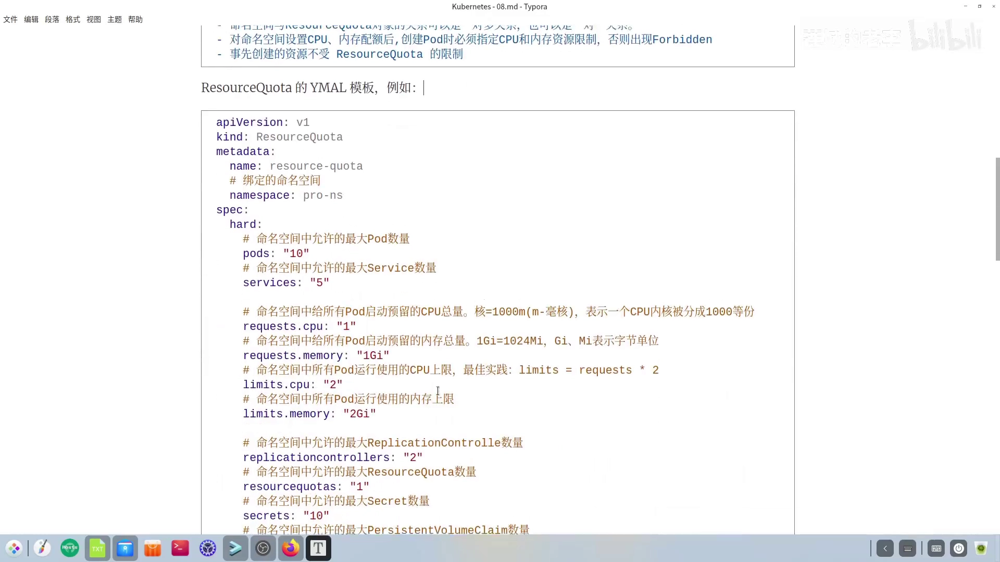

### 2.3 requests 与 limits：预留资源 vs 上限资源

计算资源配额里的 `requests` 和 `limits` 容易混淆，视频给了一个精辟的划分（[【跳转到 05:08】](https://www.bilibili.com/video/BV1czUfYwEwz/?t=308)）：

- **`requests` = 预留资源**：命名空间里**所有 Pod 启动时预留**的资源总量；
- **`limits` = 上限资源**：命名空间里**所有 Pod 运行时使用的上限**。

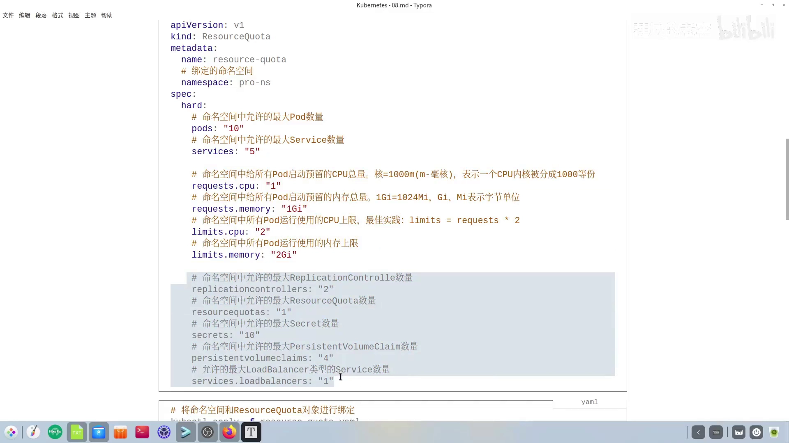

还是用生活费打比方：在外读书的学生，父母每月按标准给 2000 元，这 2000 元就是**预留**；但当月如果过生日请同学吃饭，实际花销可能超过 2000，这部分"可以花到的上限"就相当于 **limits**（[【跳转到 05:58】](https://www.bilibili.com/video/BV1czUfYwEwz/?t=358)）。

单位方面要留意两点（[【跳转到 06:23】](https://www.bilibili.com/video/BV1czUfYwEwz/?t=383)）：

- **内存**用字节单位，常见 `Gi`（吉字节）、`Mi`（兆字节），换算 1G = 1024M；
- **CPU**可以写整数（`1` 就是 1 核），也可以用 `m`（毫核），把一核分成 1000 份，所以 `500m` = 0.5 核。

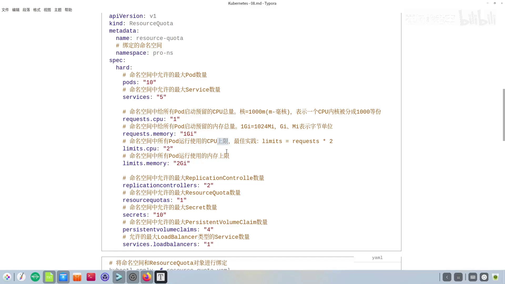

### 2.4 实建一个 quota，再制造一次"超限"

写好 `resource-quota.yaml` 后，用最朴素的一条命令即可与命名空间关联（[【跳转到 07:52】](https://www.bilibili.com/video/BV1czUfYwEwz/?t=472)）：

```bash
kubectl apply -f resource-quota.yaml
```

随后用 `kubectl describe` 查看该命名空间，会发现原来的 `No resource quota` 不见了，取而代之的是当前的配额情况；但 `No LimitRange` 还在（因为我们还没配 LimitRange）（[【跳转到 08:32】](https://www.bilibili.com/video/BV1czUfYwEwz/?t=512)）。

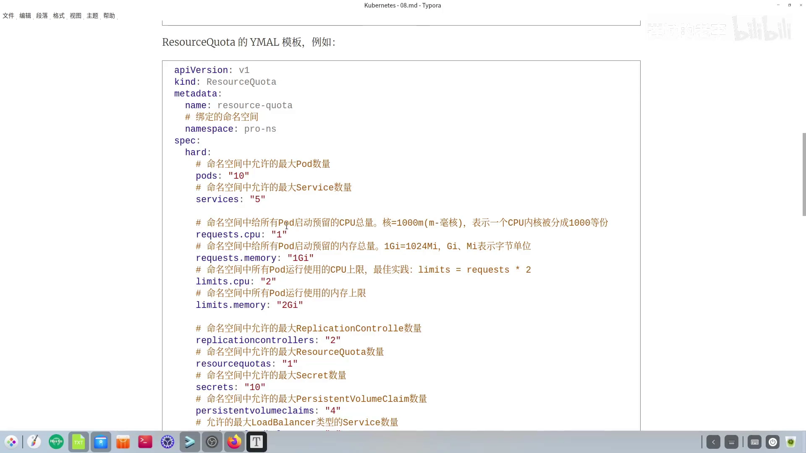

接着用一个 `pod-nginx.yaml` 验证"在配额内能建、超了就拦"。这个 Pod 自己声明了（[【跳转到 09:27】](https://www.bilibili.com/video/BV1czUfYwEwz/?t=567)）：

- `requests`：CPU 0.6 核、内存 400M；
- `limits`：CPU 0.8 核、内存 600M。

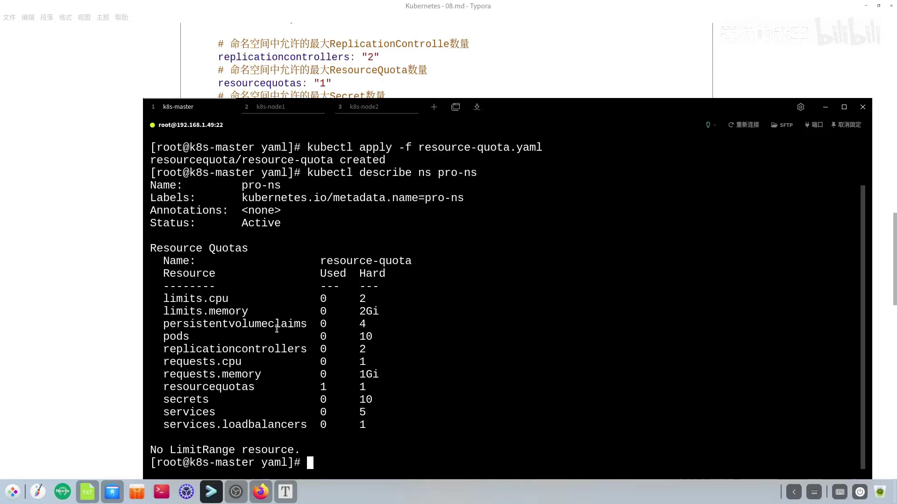

在命名空间预留 1 核、上限 2 核的前提下，这个 Pod 没超限，`kubectl apply` 顺利 `created`。

再做**超限测试**：把刚才的 Pod YAML **原样复制一份、只改名字**，然后 apply。此时两个 Pod 的预留相加是 0.6 + 0.6 = 1.2 核，**超过了配额的 1 核**，于是第二个 Pod 直接被拒（[【跳转到 11:55】](https://www.bilibili.com/video/BV1czUfYwEwz/?t=715)）：

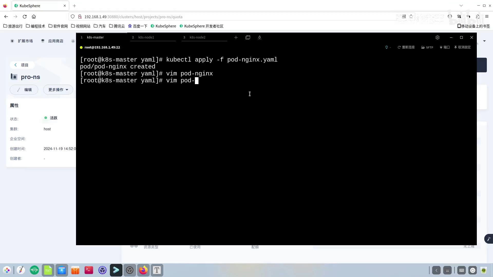

报错信息说得很清楚：ResourceQuota 里规定 `requests.cpu = 600M`，已用 600M，若再建一个就达到 1.2 核，超过了 1 核的限制。**这就是所谓"超标"。**

### 2.5 两个容易忽略的默认规则，以及"必须报备"

视频还补充了 `resources` 的两个默认行为（[【跳转到 12:50】](https://www.bilibili.com/video/BV1czUfYwEwz/?t=770)）：

- **预留（requests）不写**时，默认与**上限（limits）**的值相同；
- **上限（limits）不写**时，默认**无限制**——相当于"放飞自我"。

另外，若不想再让某个 ResourceQuota 绑定当前命名空间，执行 `kubectl delete` 即可解绑。

还有一个关键点：**在设了配额的命名空间里，Pod 必须写 `resources`。** 视频把 `pod-nginx.yaml` 里的 `resources` 整段删掉再 apply，结果又是 `Forbidden`，但原因变了——这次是要求你必须指定 `limits.cpu`、`limits.memory`、`requests.cpu`、`requests.memory`（[【跳转到 14:18】](https://www.bilibili.com/video/BV1czUfYwEwz/?t=858)）。

道理很简单：命名空间已经定下了配额，你创建 Pod 时若**不"报备"自己需要多少资源**，命名空间自然不会放行。

---

## 三、LimitRange：给容器配默认值与边界

### 3.1 为什么还需要"默认配额"

先回顾一下前面的模型：一个命名空间挂一个 `quota` 管**总量**，而每个 Pod 各自在 `resources` 里声明自己用多少。问题来了——**当 Pod 一多、且很多 Pod 的资源配置还都一样时**，就得一个个手写、写的还都一样，日后极不好维护（[【跳转到 15:49】](https://www.bilibili.com/video/BV1czUfYwEwz/?t=949)）。

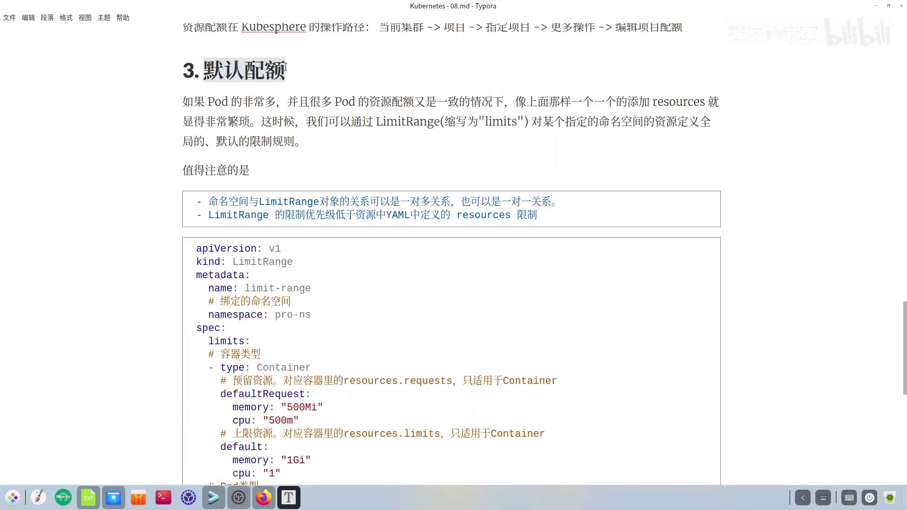

于是就需要一个能定义"**默认规则**"的对象，这就是今天第二个主角 **LimitRange（可缩写为 limits）**：它能对指定命名空间里的资源做**全局默认限制规则**（[【跳转到 16:14】](https://www.bilibili.com/video/BV1czUfYwEwz/?t=974)）。

它也有两个注意事项（[【跳转到 16:39】](https://www.bilibili.com/video/BV1czUfYwEwz/?t=999)）：

1. 命名空间与 LimitRange 同样是**一对多或一对一**关系（本讲演示一对一）；
2. **LimitRange 的优先级低于 Pod 里写的 `resources`**：两者冲突时，**以 Pod 内的 `resources` 为准**，LimitRange 只在 Pod 没写的时候补默认值。

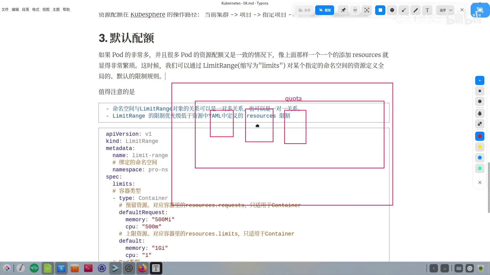

### 3.2 LimitRange 的 YAML 结构

它的规格里有一个列表式的 `limits`，列表项可以分别定义 **Container**、**Pod** 两种类型（还可以有 PVC 等其它类型，本讲先举这两种）（[【跳转到 17:04】](https://www.bilibili.com/video/BV1czUfYwEwz/?t=1024)）。

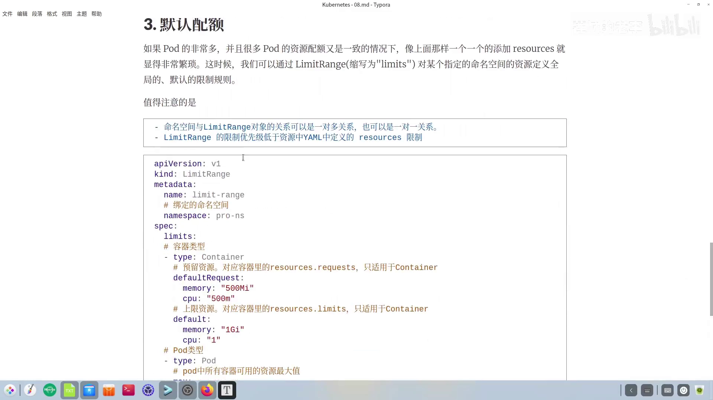

- **Container 类型**（`type: Container`）：带 `defaultRequest`（对应 `requests` 默认值）和 `default`（对应 `limits` 默认值）。注意这两个**只对容器生效**，用于给"没写 resources 的容器"补默认值；带 `default` 前缀的就是默认值（[【跳转到 17:54】](https://www.bilibili.com/video/BV1czUfYwEwz/?t=1074)）。
- **Pod 类型**（`type: Pod`）：描述 **Pod 中所有容器可用的资源最小 / 最大值**（`min` / `max`），无非也是 CPU 与内存。

### 3.3 综合实测：默认配额与配额如何一起"卡人"

写好 `limitrange.yaml` 后 apply，命名空间里第二个 `NO` 也消失了，出现了具体数值；KubeSphere 的「默认容器配额」也同步变化（[【跳转到 19:26】](https://www.bilibili.com/video/BV1czUfYwEwz/?t=1166)）。

测试用的 `pod-nginx-sidecar.yaml` **定义了两个容器**（NGINX + sidecar），**但都没写 `resources`**，因此会**采用 LimitRange 里的 `default` 默认值**；因为是两个容器，预留资源要**乘以二**（[【跳转到 20:00】](https://www.bilibili.com/video/BV1czUfYwEwz/?t=1200)）。

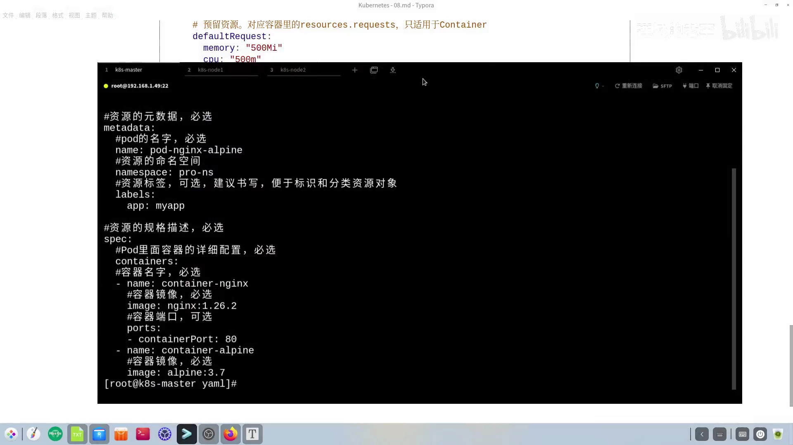

这里 Pod 级的 `min` 会对预留起到限制（[【跳转到 20:18】](https://www.bilibili.com/video/BV1czUfYwEwz/?t=1218)）：

- CPU：每个容器 500m，两个容器 = 1 核，**满足** CPU 最小值；
- 内存：每个容器 500M，两个容器 = 1000M，**但 1000M 并不等于 1G**，达不到最小值 1G。

于是 apply 直接报 `Forbidden`：容器所需的最小内存是 1G，而请求只有 1000M，**还差 24M**（[【跳转到 21:14】](https://www.bilibili.com/video/BV1czUfYwEwz/?t=1274)）。

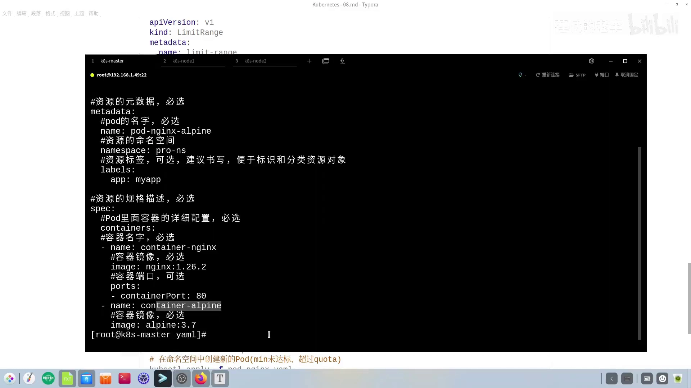

按提示把默认值从 500M 改成 512M，**并且必须重新 `kubectl apply` 那个 LimitRange 文件才会生效**（[【跳转到 21:39】](https://www.bilibili.com/video/BV1czUfYwEwz/?t=1299)）。改完再建 Pod，错误却**换到了 ResourceQuota 身上**：前面已经建过一个 Pod，占掉了部分资源，CPU 预留只剩 0.4 核，而这个双容器 Pod 需要 1 核，**预留超限**（[【跳转到 22:33】](https://www.bilibili.com/video/BV1czUfYwEwz/?t=1353)）。

于是改 `resource-quota.yaml`，把 `requests.cpu` 由 1 改成 2，重新 apply 后还剩 1.4 核可用（[【跳转到 23:52】](https://www.bilibili.com/video/BV1czUfYwEwz/?t=1432)）。再 apply Pod，又报 ResourceQuota——但这次是**上限（limits）超限**：新 Pod 两个容器需要 2 核 / 2G，而命名空间里已用 0.8 核、约 0.6G，配额上限 2 核 / 2G，只剩约 1.4 核 / 1.4G（[【跳转到 25:07】](https://www.bilibili.com/video/BV1czUfYwEwz/?t=1507)）。

最后把 `limits` 由 2 改成 4 并 apply，双容器 Pod 终于**创建成功**。此时会看到一个有趣现象：**两个容器里一个成功运行、另一个被终止**——这是 sidecar 这类容器带来的特殊性，视频留待后续的 Pod 资源专题再讲（[【跳转到 26:42】](https://www.bilibili.com/video/BV1czUfYwEwz/?t=1602)）。

整个实验做完，资源最终状态是：

- CPU 预留 2 核、上限 4 核；
- 内存预留 2G（演示中调整后）、上限 4G。

### 3.4 KubeSphere 里怎么操作

上述操作在 KubeSphere 里都有对应入口：编辑 ResourceQuota 走项目「更多操作 → 编辑项目配额」；编辑 LimitRange 走「更多操作 → 编辑默认的容器配额」（[【跳转到 27:12】](https://www.bilibili.com/video/BV1czUfYwEwz/?t=1632)）。

---

## 小结

- **为什么限制**：资源有限、多租户共享必须规划；而命名空间默认两句话都是 `NO`（`No resource quota` / `No LimitRange`），需要手动开启限制。
- **两个对象、两种粒度**：
  - **ResourceQuota** 管**命名空间总量**（含数量类与计算资源类），超额请求返回 `Forbidden`；
  - **LimitRange** 管**单个容器/ Pod 的默认值与边界**（Container 的 `default`/`defaultRequest`、Pod 的 `min`/`max`）。
- **构建资源限制时的三条要点**：命名空间与 quota 一般一对一；配了 CPU/内存配额后 Pod **必须写 `resources`**；配额**不追溯**已创建的对象。
- **优先级**：Pod 内 `resources` 优先于 LimitRange，冲突时以 `resources` 为准。
- **默认规则**：`requests` 不写默认等于 `limits`；`limits` 不写默认无限制。
- **单位**：内存 `Gi`/`Mi`（1G = 1024M）；CPU 用整数（核）或 `m`（毫核，`500m` = 0.5 核）。
- **调参心态**：配额定得太大会浪费，定得太小又会导致容器起不来；本讲所有数字（1G、1 核等）都只是演示值，**没有任何指导意义**，实战要按实际情况调整。

## 关键术语速查

| 术语 | 一句话解释 |
| --- | --- |
| ResourceQuota（quota） | 作用在命名空间上的**总量预算**，限制其可使用的资源（数量与计算资源）总和 |
| LimitRange（limits） | 作用在容器 / Pod 上的**默认值与边界**，为未声明 `resources` 的对象补默认值，并限定最小 / 最大值 |
| requests | **预留资源**：Pod 启动时预留下来的资源量 |
| limits | **上限资源**：Pod 运行时允许使用的资源上限 |
| `Forbidden` | 超过配额 / 未声明资源时，API Server 在写入阶段返回的拒绝错误，Pod 不会被创建 |
| `spec.hard` | ResourceQuota 里放具体配额项的字段（`pods`、`services`、`requests.cpu`、`limits.memory` 等） |
| `defaultRequest` / `default` | LimitRange 中 Container 类型的默认 requests / 默认 limits |
| `min` / `max` | LimitRange 中 Pod 级别的资源最小 / 最大值（针对 Pod 内所有容器之和） |
| `500m` | CPU 单位"毫核"，等于 0.5 核（`m` 把一核分成 1000 份） |
