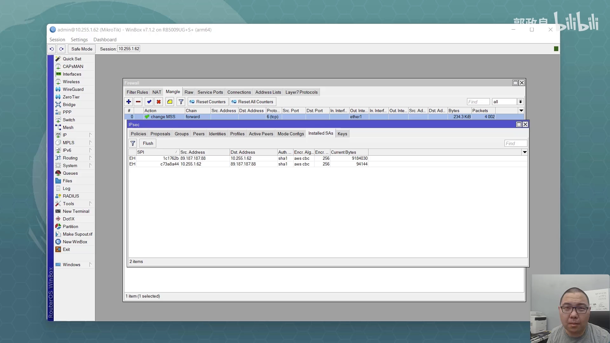
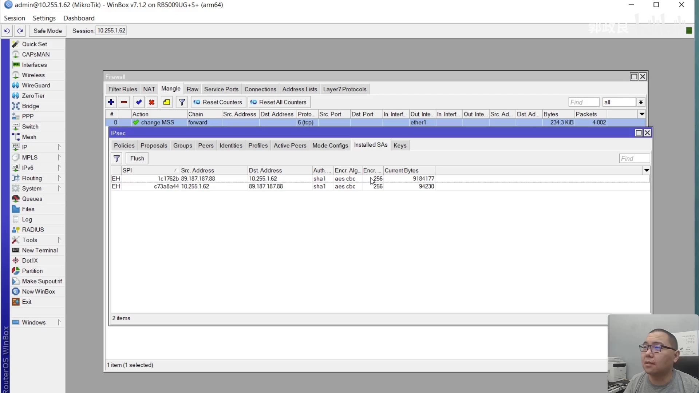
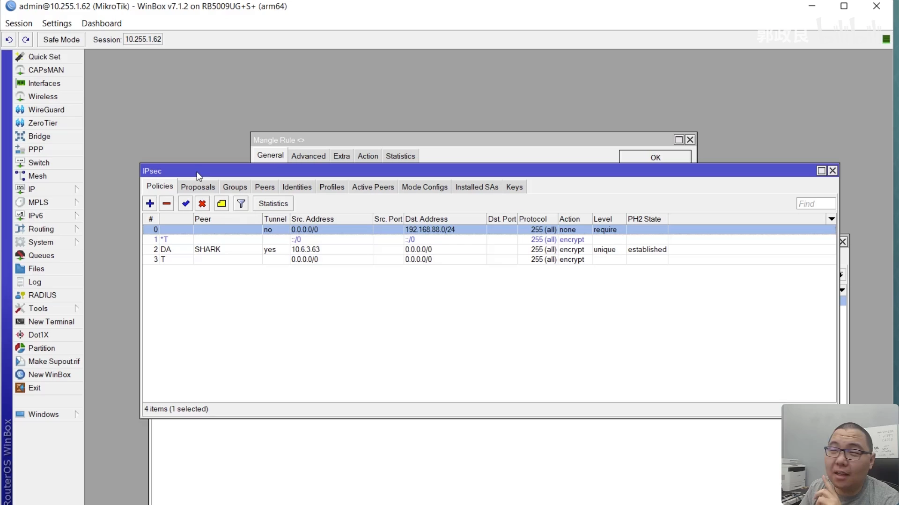
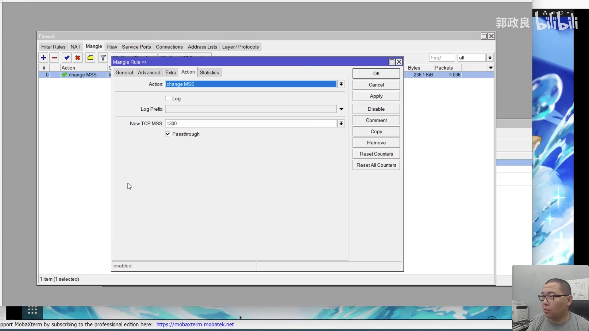
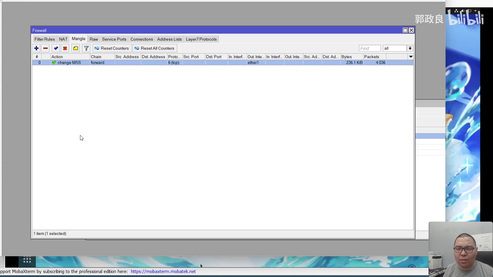
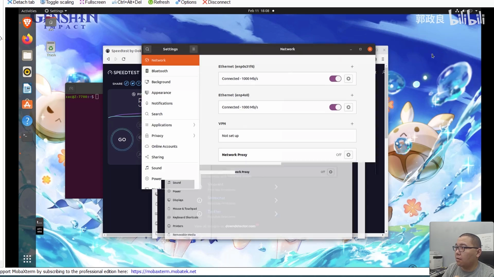

# RouterOS IPsec 排障实录：能 ping 却不能上网，问题出在 MSS

> 视频：[72. 解决RouterOS上的IPSec MTU/MSS问题，你的IPSec能ping不能上网吗？](https://www.bilibili.com/video/BV1F34y1C7b7/)｜作者：ZacGuo｜时长：20:07
> 系列：[MTU、MSS 与 PMTUD 网络黑洞](../README.md)

## 本讲要解决的核心问题（SCQA）

**背景**：在 RouterOS（ROS）上配好了 IPsec 隧道，`SA` 状态是 active，`ping` 对端也能通——按常规判断，"隧道通了"。

**冲突**：可是一打开浏览器，什么都打不开。去看 `firewall → connections`，能看到有 `established` 的连接，但很多连接建立不起来。为什么 ping 可以，其他流量就不行？

**疑问**：IPsec 是"感兴趣流量"驱动的，没有可调的隧道接口，那 MTU 该在哪里改？为什么"让 ICMP 通、靠 PMTUD 自动收敛"这条最合理的路子，在这个环境里没生效？除了改 MTU，还能怎么绕过？

**回答（中心思想）**：**这是典型的 MTU 黑洞：ICMP 的"需要分片"反馈回不到发送方，大包被中间丢弃，而 ping 的小包畅通无阻。** 最"正确"的解法是让 ICMP 不被卷进 IPsec 隧道（加一条 `action=none` 的 policy），但在作者的环境里对端不受控、这条无效；于是退而求其次，**在 `firewall mangle` 的 forward 链上对 TCP SYN 做 MSS 改写（clamp 到 1300）**，让 TCP 一开始就不发大包，网页立刻恢复。代价是理论吞吐略降，且数值需要按环境实测。

<!-- SECTION:1 -->

## 一、故障现场：SA 是 active，ping 通，网页打不开

讲者开场先说明背景：之前有小伙伴反馈，在 ROS 上用 IPsec、尤其是 IKEv2 时，"隧道是通的，但用这个隧道访问数据就不通"。他当时没细问，因为自己用 IKEv2 很少，而且**不太喜欢 IPsec 隧道**——它靠"感兴趣流量"（interesting traffic）驱动，不像其他隧道协议有独立的隧道接口，可以用路由控制数据流向，**操控性差一些**。

直到他自己也踩了这个坑。

现象非常典型：

- 隧道联通了，`SA` 有 active 状态；
- `ping` 能通；
- **但一打开浏览器，什么都打不开**；
- 也不是"完全打不开"——去看 `firewall → connections` 时，能看到**有 established 的连接，但有一些建立不成功**。

"为什么 ping 可以、其他流量不行"——这个不对称正是 MTU 问题的指纹：**ping 默认发的是小包，能过；网页/HTTPS 要发大包，过不去。**

## 二、第一反应：MTU 问题，但 IPsec 没有接口

讲者立刻想到 MTU，但马上撞上一个老问题：**IPsec 没有接口，那怎么调 MTU？** 他之前没做过这件事，于是去查资料。

查到的结论是：正常情况下，遇到 MTU 问题往往是因为 **ICMP 不通**。如果 ICMP 通，那么一旦某个包需要被打碎，发送方应该收到 ICMP 的"需要分片"通知，电脑收到后就会把包尺寸降下来——这是 TCP 的正常工作方式。

所以问题落在：**怎么让 ICMP 通？**

### 2.1 论坛方案：加一条 `action=none` 的 policy，把 ICMP 摘出隧道

ROS 论坛上有人提出：如果要做全局 IPsec，通常会做一个 `0.0.0.0/0 → 0.0.0.0/0` 全匹配的 IPsec 模板。问题是——**这些 ICMP 包可能也被扔进了 IPsec 隧道里**，还是"感兴趣流量"惹的祸。

解法是在全匹配模板**之前**再加一条 IPsec policy：

- 源地址：`0.0.0.0/0`
- 目的地址：内部 IP 地址
- **action：`none`**

含义是：**任何主机想往内网发数据，都不经过 IPsec。** 讲者的评价是"这其实是非常合理的行为，我感觉本来都不应该需要手动去做"。

### 2.2 但这条对作者无效

"但这一条对我来讲不好使，不过我在网上看到对其他人有些人是可以的。"

讲者的推断是：**这个 ICMP 问题要么不只产生在自己这一端，要么自己这端也产生了问题——也就是说服务器端也有同样的问题。** 由于他控制不了对端，这个"最正确"的方案很可惜没能解决他的问题。

## 三、退路：在 firewall mangle 里强制改 MSS

既然 ICMP 这条路走不通，就只能**强制更改 MTU 或 MSS**。讲者先花了一点时间把两者的关系讲清楚：

- **MTU**：三层的尺寸，即这个三层包从头到尾的大小，一般是 **1500**；到了二层加上以太网头就变成 **1518** 左右；
- **MSS**：TCP 的尺寸，把 IP 头和 TCP 头都去掉之后中间那段 payload 就是 MSS。

**关键关系：设定 MSS 时，它实际对应的 MTU 比它大一点**（要加上 40 字节的 IP + TCP 头）。所以"把 MSS 调到 1460 以下"才是安全的起点。

### 3.1 规则长什么样

讲者用 terminal 演示（比 WinBox 更全面）：进入 `ip firewall mangle`，然后 export 出来看规则。这条命令不长，但**会因人而异**。

规则的要点：

- **动作**：change MSS（更改 MSS）；
- **链**：`forward`（转发链）——因为流量是穿过路由器转发的；
- **新 MSS 值**：讲者设为 **1300**；
- **匹配条件**：`protocol=tcp` 且 `tcp-flags=syn`——因为 MSS 标记是在 TCP 第一次握手的第一个包（SYN）上产生的，所以要在这个包上匹配并修改；
- **out-interface**：限定为公网口。讲者说明：**没法指定具体走哪一条 IPsec 隧道**，但也不需要，可以用 IP 地址来限制；
- **passthrough=yes**：表示执行完这条 mangle 规则后，下一条是否继续执行。这是 mangle 的机制，与这个功能本身不相关。

### 3.2 效果：加完就能打开网页了

"就这么一条规则就解决了问题。在这之前，我 IPsec 隧道后面的电脑是不能打开网页的，在加完这条规则之后就可以了。"

## 四、范围要收窄：别把正常上网的 MSS 也改小

讲者的环境是测试环境，要求全局都走隧道，所以没有做太多匹配。但生产环境不一样：

**如果你那边是总公司，只需要特定数据走这条隧道，那你显然不希望把正常上网数据的 MSS 都改得这么小。** 这时应该匹配"源地址 → 目的地址"：

- **源地址**：你的内网，无论是 `192.168.x.x`、`10.x.x.x` 还是 `172.16.x.x`；
- **目的地址**：总公司的 IP 地址。

这样就把改 MSS 的范围限定住了。否则，**正常上网流量、以及通过这台路由器的其他流量（比如另外的 WireGuard 隧道）也会被改 MSS**，这显然不是想要的。

## 五、代价：MSS 越小，理论吞吐越低

讲者对性能代价说得很实在：

- **1460 和 1300 之间的区别不明显，但绝对有区别**；
- 尤其是**内网能灌满带宽**时，MSS 越小，浪费在包封装上的开销占比越高，性能损失越明显；
- 如果数据灌不满（比如 1G 带宽只跑 500M），那非常不明显，甚至感受不到；
- 但如果 1G 带宽跑满 1G 流量，**MSS/MTU 越小，性能越差**。

## 六、为什么"完美方案"是那条 policy，而不是 mangle

讲者反复强调：**mangle 改 MSS 不是完美方案。**

- **完美方案**是 IPsec 界面里那条 `action=none` 的 policy——它**把根上的问题解决了**：原则上这整个问题就不该出现，出现的原因只是 ICMP 因为某种原因不流畅（被某段防火墙拦截，或在某处被丢弃）。
- 但当你**没有全局控制能力**时（比如控制不了服务器端如何影响 TCP 分段、如何决定最大 MSS），就只能用防火墙来兜。

## 七、数值怎么定：1300 是实测结果，不是标准答案

讲者设的是 **1300**，这是他自己测出来的：

- ROS 论坛上大家说 **1320** 差不多；
- 但他设成 1320 时，**有的网站能打开、有的打不开**（少数网站会打不开）；
- 原因推测：**那个网站所处网络环境的 MSS 更小**，这边设得不够小就不通。

**结论：无论设多小，其实都有风险**，特定网站上仍可能不通。如果"一定要通、对性能要求不高"，可以继续往下调，**1200 也可以**；但原则上不用那么夸张，尤其公网访问环境不应该有那么严重的 MTU 问题。

**建议：如果遇到相同问题，可以先试 1300。**

## 八、根因：隧道协议都在"加封装"

讲者解释了为什么会出现这个情况：**但凡是隧道协议，都是在前面加封装，加得越多，浪费的尺寸就越多。**

他还举了个国内常见的例子：本地环境不是 PPPoE，但国内朋友告诉他，因为用 PPPoE，**哪怕有 1G 带宽，实际带宽大概只有 940**——"这是一个非常非常夸张的损失"（讲者补充说他不确定这个算法准不准）。

所以结论是：

- 如果网络环境里存在**多重封装**（PPPoE、其他隧道协议），产生了封装损耗，那 MSS/MTU 都要相应调小；
- 如果 **MTU 能直接调接口**，那就手动调接口 MTU 也能解决；
- 如果**不能调接口**（像 IPsec 这样），就只能在 ROS 上用 `firewall mangle` 改 MSS。

## 九、验证与对照：先在主机上试，但别在主机上改

改完之后通了吗？通了。讲者也测了速度，但强调**这个速度没什么太大意义**，因为一定程度上由 IPsec 服务提供商决定。

- 他测过 **MSS=800**：速度会受影响，但**往往是开头影响严重，之后会一点点恢复**，也能提到差不多的速度；
- 所以不用太在意 MSS 偏小；调到 1200 也可以，800 就有点夸张、没必要。

### 9.1 怎么确认"确实是 MTU 问题"

如果 ROS 在生产环境不方便动，可以先在**主机侧**做对照实验：

- **Ubuntu**：直接在"设置 → 网络"里调 MTU；
- **Windows**：在设备管理器里的网卡属性中调 MTU（不是"网络"设置里）；
- 改完**重启网卡**（关掉再打开，或拔插网线），确保 MTU 真的生效。

讲者的实测：**改成 1000 → 通了；改回 automatic → 又不通了。** 这就确认了问题就是 MTU。

### 9.2 但千万不要在主机上长期改 MTU

原因很重要：

- 主机上常见 MTU 是 1500，但**千兆或千兆以上网络可能有 jumbo frame，实际 MTU 更大**；
- 如果真的改成 1000，会**严重影响本地千兆、万兆、2.5G 网络的性能**；
- 所以**要改也要在"最窄的地方"改，也就是在路由器上改**；主机上只用来做验证。

## 十、两条思路的取舍

讲者在结尾把方案收敛成两条路：

1. **防火墙（mangle 改 MSS）**：**一定可以**，但**不是完美方案**——因为你测不到对端的 MTU/MSS 尺寸；不过它能解决绝大部分问题。
2. **IPsec 里加一条 policy（`action=none`）**：相当于像防火墙一样拦截一下，把不该进隧道的数据摘掉，**原则上这是完美方案**；但在他的网络环境里无效。

> 视频简介里作者还补充了一句：`new-mss=clamp-to-pmtu` 也是一个解决方案，但对他这个连接同样无效，所以只能手动指定 MSS 大小。

<!-- SECTION:5 -->

## 小结

- **症状指纹**：SA active、ping 通，但网页打不开、部分 connection 建不起来——"小包通、大包不通"就是 MTU 黑洞。
- **根因**：IPsec 封装让包变大，超过路径 MTU 后被丢弃；而 ICMP 的"需要分片"反馈回不到发送方，PMTUD 无法收敛。
- **IPsec 的特殊困难**：它靠"感兴趣流量"驱动，没有可调的隧道接口，MTU 无处可设，连 ICMP 都可能被卷进隧道。
- **最正确的解法**：加一条 `src=0.0.0.0/0`、`dst=内网`、`action=none` 的 IPsec policy，把 ICMP 摘出隧道——但需要能控制两端。
- **实用的解法**：`firewall mangle` 的 `forward` 链上，匹配 `tcp` + `syn`，动作 `change-mss` 设为 1300，并限定 `out-interface` 为公网口。
- **范围要收窄**：生产环境应匹配"内网源 → 总公司目的"，避免把正常上网和其他隧道的 MSS 也改小。
- **代价**：MSS 越小理论吞吐越低；带宽跑满时损失明显，跑不满时几乎感受不到。
- **数值不是标准答案**：论坛说 1320，作者实测 1300（1320 时少数网站仍打不开）；更保守可用 1200。
- **验证方法**：先在主机上把 MTU 改成 1000 做对照（通了/改回又不通即可确认），但**绝不能在主机上长期改**——会毁掉本地千兆/万兆性能，要改就在路由器上改。

## 关键术语速查

| 术语 | 一句话解释 |
| --- | --- |
| 感兴趣流量（interesting traffic） | IPsec 策略匹配到的流量才会被加密送入隧道；不像隧道接口那样可路由控制 |
| SA（Security Association） | IPsec 的安全关联，有 active 状态说明隧道已协商成功 |
| IKEv2 | IPsec 的密钥交换协议版本 2 |
| IPsec policy / template | ROS 中定义"哪些流量走 IPsec"的规则；`0.0.0.0/0 ↔ 0.0.0.0/0` 即全匹配 |
| `action=none` | policy 动作，表示匹配的流量**不**走 IPsec（用于把 ICMP 摘出隧道） |
| firewall mangle | ROS 中用于修改报文标记/字段的机制，可改 MSS |
| change MSS | mangle 动作，改写 TCP SYN/SYN-ACK 中的 MSS 值（即 MSS Clamping） |
| `passthrough` | mangle 规则执行后是否继续匹配下一条规则 |
| `clamp-to-pmtu` | ROS 的 MSS 自动钳制选项，按 PMTU 自动决定 MSS；作者环境中无效 |
| PPPoE | 常见的宽带拨号封装，本身也占开销，会进一步压缩可用 MSS |
| jumbo frame | 超过 1500 字节的以太网帧，千兆/万兆内网常见，因此不应在主机上把 MTU 改小 |