# MTU 与 MSS 的核心区别：为什么数据包不能太大，也不能太小

> 视频：[IPv4分片问题 | MTU和MSS的核心区别](https://www.bilibili.com/video/BV14GyGY8ENw/)｜作者：技术蛋老师｜时长：10:36
> 系列：[MTU、MSS 与 PMTUD 网络黑洞](../README.md)

## 本讲要解决的核心问题（SCQA）

**背景**：我们在互联网上发送的数据，最终都会被切分成一个个数据包。每个包都要加上首部（包头）才能被网络处理，包的大小因此有一个"刚刚好"的范围。

**冲突**：包做小了，首部开销占比高，传输效率上不去；包做大了，路上总有某一段链路承载不了，包过不去。可是今天网络这么发达，为什么还不能把数据当成一个"巨无霸"一次性发出去？而现实中的"1500""1460"这些数字又从哪来？

**疑问**：MTU 和 MSS 各自约束的是什么？它们分别属于哪一层？当包真的超过某条链路的承载能力时，网络会怎么处理？

**回答（中心思想）**：**MTU 是各层对"这条链路上一个包最多多大"的硬上限，MSS 是 TCP 为了让最终生成的 IP 包不超过 MTU 而给自己预留的负载上限**。两者相差的正是 IPv4 与 TCP 首部的 40 字节——这就是 1500 与 1460 的关系。一旦包超过某段链路的 MTU，网络只能靠 IP 分片硬塞过去，而分片会放大重传代价、增加设备负担，所以工程上要么用 MSS Clamping 事先把包变小，要么用 PMTUD 动态探出路径上真正能通过的大小。

<!-- SECTION:1 -->

## 一、为什么"刚刚好"这么重要：小包低效，大包过不去

讲者用一个生活场景开场：印度人坐公交车时会把交通工具上能利用的空间全部用上，追求"刚刚好"。互联网里发送的数据包同样如此。

**为什么不能把包做得特别小？** 因为大家都发极小的包，小包会产生更多额外开销（每个包都要带首部），网络传输效率难以提升。

**为什么不能走向另一个极端、一次性发一个"巨无霸"？** 因为包发出去以后，经过的路由器、交换机并不都由我们控制，总有某段链路承载不了这么大的包。于是数据必须被切分多份，**切分后每个包多大才"刚刚好"，就是 MTU 和 MSS 要回答的问题**。

<!-- SECTION:2 -->

## 二、先分清层次：同一个包，在每一层是四种东西

要理解 MTU 和 MSS，最容易踩的坑是把它们混在一起比较。正确的做法是**把它们放回五层网络模型，按所在层次区分**。

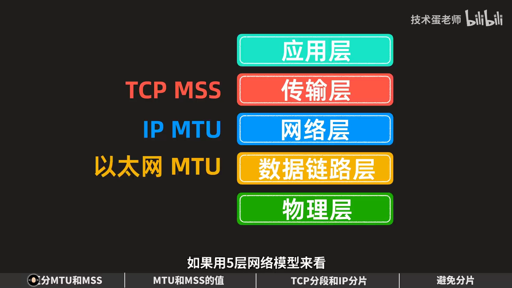

### 2.1 传输层：MSS 约束的是 TCP 的有效载荷

应用层产生的数据先交给传输层。传输层有两个大家熟悉的协议：TCP 和 UDP。如果应用选择 TCP，TCP 会给数据加上 TCP 首部，封装成 **TCP 段**；原本应用交下来的那份数据，就成了 TCP 段的有效载荷，**MSS 约束的正是这一部分**。

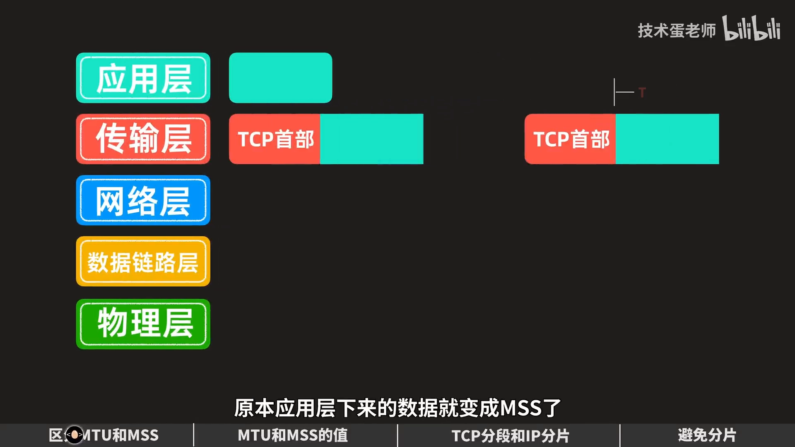

MSS 是 **Maximum Segment Size**，中文常译"最大分段大小"。这个中文名容易造成误解：**MSS 不包含 TCP 段首部**。所以对 TCP 来说，MSS 应理解为"单个 TCP 段能承载的最大有效载荷"，而不是整个段的大小。

顺带一个常见追问：**UDP 有没有 MSS？** 不能这样套用——UDP 首部里根本没有 MSS 字段，也就没有 TCP MSS 这种协商机制。

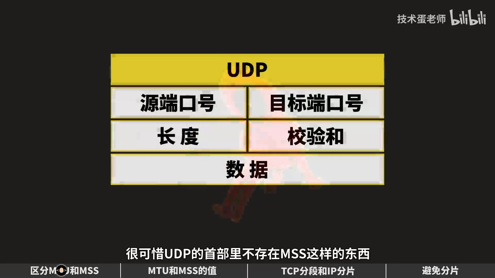

### 2.2 网络层：IP MTU 约束整个 IP 包

TCP 段继续向下进入网络层，IP 协议会在 TCP 段外面加上 IP 首部，封装成 **IP 包**。此时"IP 首部 + TCP 首部 + 负载"共同构成 IP 包，**IP MTU 约束的就是整个 IP 包的大小**。MTU 是 **Maximum Transmission Unit**，"最大传输单元"。

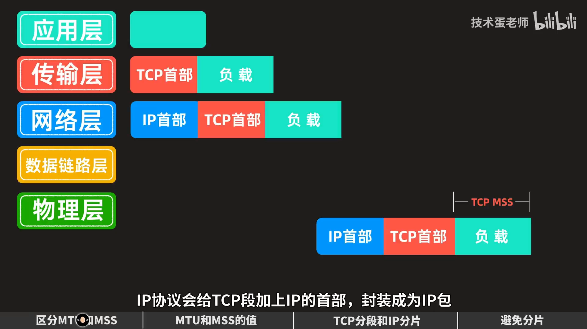

### 2.3 数据链路层：以太网 MTU 约束帧的负载

以以太网为例（暂不计前同步码和帧开始界定符），以太网会加上以太网首部与帧校验码 FCS，封装成以太网帧。**整个 IP 包是这个帧的负载，以太网 MTU 约束的就是这一部分**，所以它也常被称为物理接口 MTU。

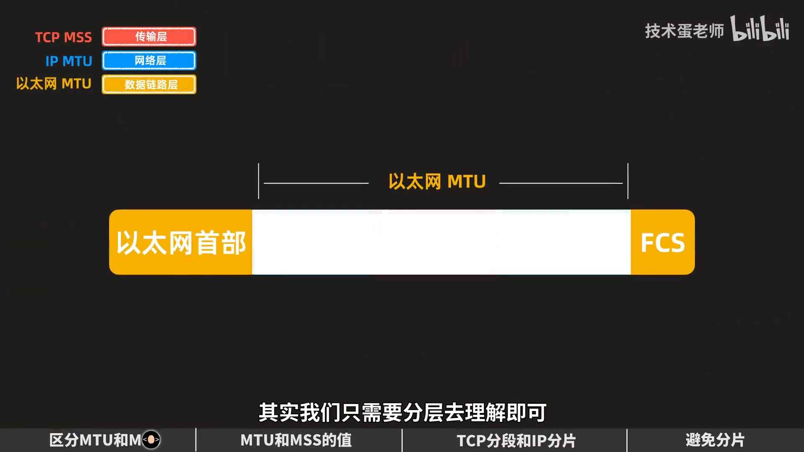

为什么 IP MTU 和以太网 MTU 在图上范围重合，却还要区分？因为**约束来自不同层次**：可以把以太网的承载空间理解成 IP 包的"容器"，IP 包不能超过容器允许的大小。在常见的以太网传输中两者数值通常一致，所以日常所说的 MTU，有时指接口的承载上限，有时用来说明 IP 包大小的上限——理清分层，就不会被不同表述绕晕。

| 术语 | 所在层 | 约束对象 | 典型值 |
| --- | --- | --- | --- |
| TCP MSS | 传输层（四层） | TCP 有效载荷（不含 TCP 首部） | 1460 |
| IP MTU | 网络层（三层） | 整个 IP 包 | 1500 |
| 以太网 MTU | 数据链路层（二层） | 以太网帧的负载（= IP 包） | 1500 |

## 三、1500 与 1460 是怎么来的

用 `ifconfig` 查看网络接口时，经常能看到以太网接口显示 `MTU:1500`。

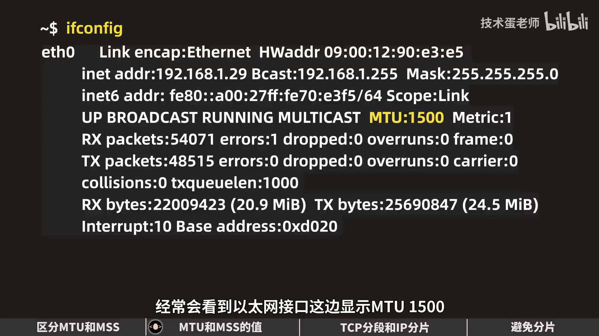

**1500 字节是这里的默认值，而且它不包含以太网首部和帧校验码 FCS**，指的是帧的负载。为提高性能，一些云服务器支持超过 1500 的 MTU，这类更大的以太网帧称为**巨型帧（Jumbo Frame）**，可以支持约八九千字节的 MTU。

回到 MTU 1500 的示例：**IPv4 首部最少 20 字节，TCP 首部最少 20 字节，1500 − 20 − 20 = 1460**，这就是 MSS 的由来。

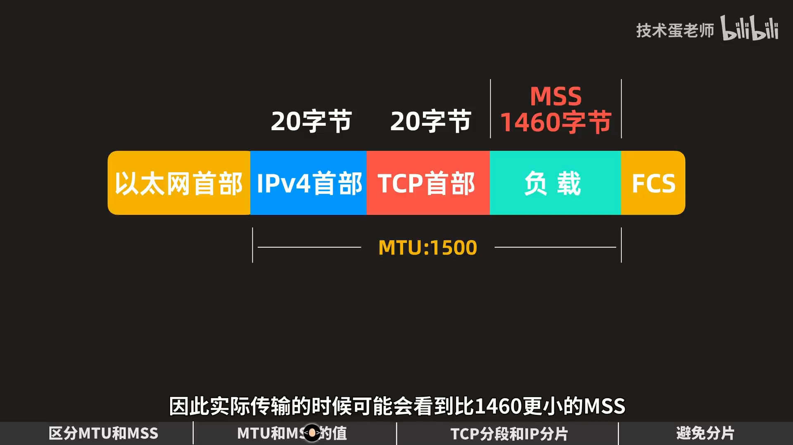

实际网络中也会看到比 1460 更小的 MSS，因为首部可能更长（例如带选项），或者路径上存在更窄的链路。

<!-- SECTION:3 -->

## 四、既然能支持 9000，为什么大家还是用 1500

看到更小的 MSS 会让人疑惑：明明设备支持更大的 MTU，为什么还退回 1500，有时 MSS 甚至比以前更小？看起来像倒退，原因却很直接：

**数据包发出去以后，网络并不只由发送方控制。** 数据要经过不属于我们的路由器和交换机。如果发送端、接收端以及路径上所有设备都由自己管理，当然可以统一使用支持大 MTU 的设备；但大多数情况下做不到——数据离开自己的路由器，就进入了不受自己控制的网络。

所以**能传多大，取决于整条路径上最窄的那一段**，而不是本地接口的能力。

## 五、MSS 是谈出来的：三次握手时的"我能收多大"

既然最终要避免包太大，TCP 就得在**分段**时就把大小控制住。讲者强调：**TCP 先分段的重要目的，是尽量避免后面的 IP 层再分片**，因此必须限制 MSS。MSS 越大，最终形成的 IP 包通常也越大，太大就可能遇到 IP 分片。

所以 TCP 在建立连接的三次握手中会通告 MSS：**客户端在 SYN 中注明 MSS，服务端在 SYN+ACK 中注明自己的 MSS**。这个值的含义像是单方面通知对方："我最多能接收这么大的 TCP 有效载荷，别发得太大。"

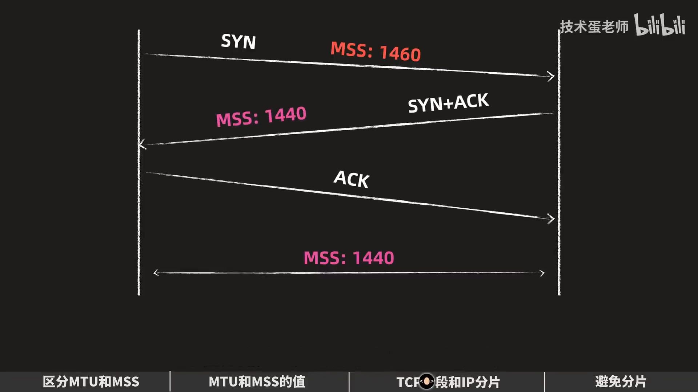

两边通告的值可能不同。讲者的例子是：客户端通告 1460、服务端通告 1440，那么服务端不会按 1460 发，而是**取两者中较小的 1440**。这样可以最大程度避免数据包在中途被分片。

但即便如此，数据包**依旧可能遇到链路上 MTU 更低的设备接口**——握手时双方都以为 1500 没问题，可路径中间某段只支持更小的值。这时就轮到 IP 分片登场了。

<!-- SECTION:4 -->

## 六、分片的代价：一个分片丢了，整段都要重传

讲者给了一个极端例子：数据包经过一个只支持 **MTU 576** 字节的接口，被迫分成三份，每个分片都要再加一个 IP 首部。原本只有 20 字节的 IPv4 首部，等于在三层额外多出了 **40 字节**（20 + 20）。

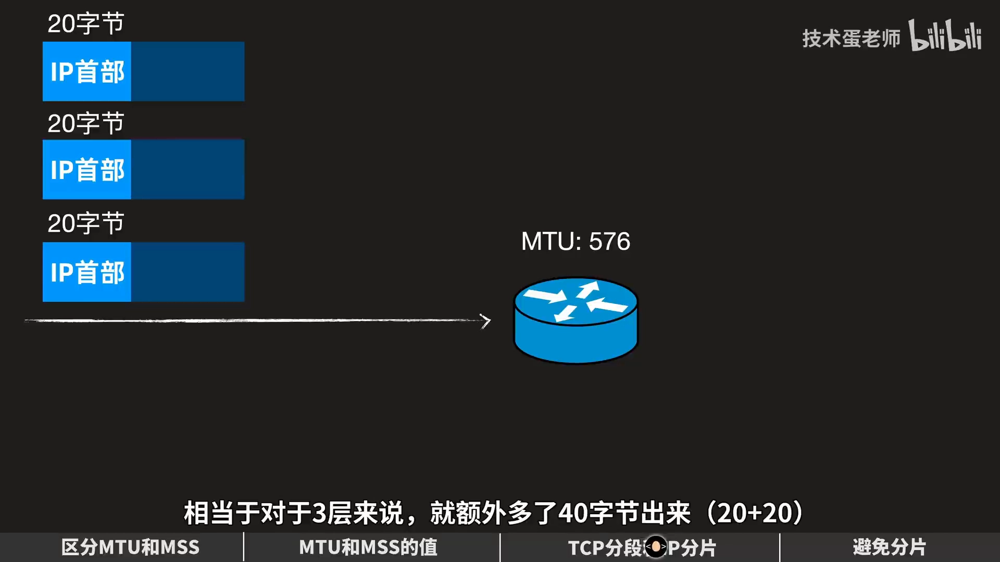

有人会觉得 40 字节挤占不了多少带宽。但真正的问题在丢包：**如果这三个分片丢了其中一个，会发生什么？**

- 你第一反应是重传，没错，确实可以重传；
- 但**负责重传的是 TCP 或四层以上的协议，网络层的 IP 本身不做重传**——IP 协议本来就是"不可靠传输"；
- 因此**只要一个分片丢失，整组分片对应的那段数据都要重传**，传输效率大幅降低；
- 而且分片本身也更容易丢包：分片越多，丢其中一片的概率越大。

### 6.1 IPv4 首部里与分片相关的三个字段

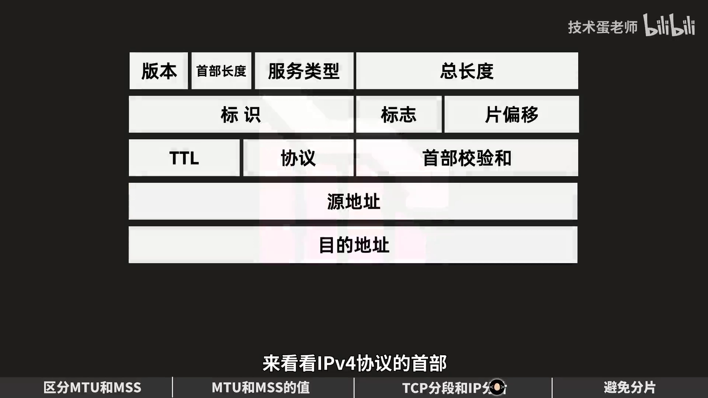

- **标识（Identification）**：给同一报文的所有分片打同一个标记，方便接收端判断"这些片属于同一个包"；
- **片偏移（Fragment Offset）**：重组时靠它排序，确定每个分片在原包中的位置；
- **标志（Flags）中的 MF 位**：MF 是 More Fragments 的缩写，**MF = 1 表示后面还有分片，MF = 0 表示这是最后一个分片**。

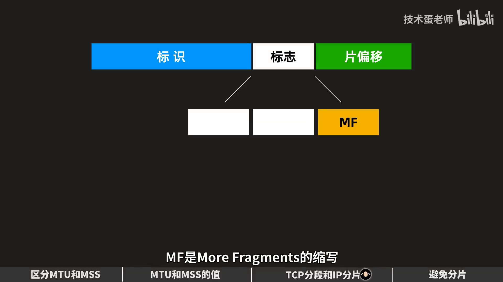

这里还有个隐蔽的问题：**路由设备如果收到中间的一个分片，它能从 MF 判断出"后面还有分片"，却不知道后面到底还有多少分片**。而路由设备的缓冲区是有限的，分片太多时很可能因缓冲区不足导致部分分片被丢弃——一旦丢一片，整组就等于白传。

### 6.2 为什么路由器不喜欢分片

处于三层的路由设备，本来的职责是**更快、更高效地转发数据包**；分片要切包、要重新计算校验和、要占内存缓冲，会增加算力和内存负担。所以网络设备的设计倾向是：**能不分片就不分片**。

## 七、两种避免分片的手段：MSS Clamping 与 PMTUD

### 7.1 MSS Clamping：在握手时就把 MSS 改小

很多路由设备提供 **MSS Clamping（MSS 钳制）** 功能：设备看到 TCP 的 SYN 或 SYN+ACK 包时，把里面的 MSS 值和链路 MTU 对比，如果这个 MSS 会导致分片，就把 MSS 调小，以适配链路 MTU。

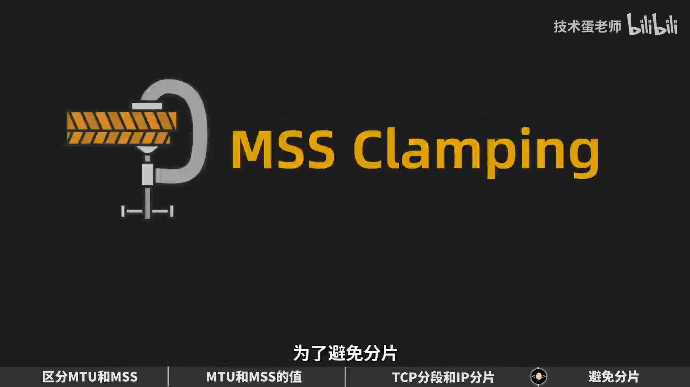

这是隧道场景里最常用的手段：隧道封装让包"变胖"，隧道两端的网关通常没有可调的接口 MTU，只能去改握手里的 MSS。**注意**：MSS 与 MTU 不能直接拿数值比大小（两者相差 40 字节首部），严格来说应该比较"IP 首部 + TCP 首部 + MSS"与链路 MTU。

### 7.2 PMTUD：用 DF 位探出路径真正能过的大小

链路上的 MTU 是怎么被确定的？这就要用到 **PMTUD（Path MTU Discovery，路径 MTU 发现）**。IPv4 首部的标志字段里有一个 **DF（Don't Fragment，"不要分片"）** 位。

- 如果设置了 DF：链路上的设备碰到超过自身 MTU 的包**不会分片**，而是直接丢掉，并**返回一条 ICMP 消息告诉发送方"这个包太大、需要分片"**；
- 发送方收到后降低包大小再发，反复尝试，**直到找到路径上能通过的最大值**。

### 7.3 IPv6 的差别：中间设备一律不分片

IPv6 的规则不一样：**IPv6 只允许发送方自己切分数据包，不允许链路上的设备分片**。因此 IPv6 不需要额外设置"是否允许分片"这种行为；如果数据包太大，链路上的设备直接丢包，并返回一条"包太大"的消息（ICMPv6 Packet Too Big），发送方据此降低大小，同样能发现路径 MTU 的最小值。

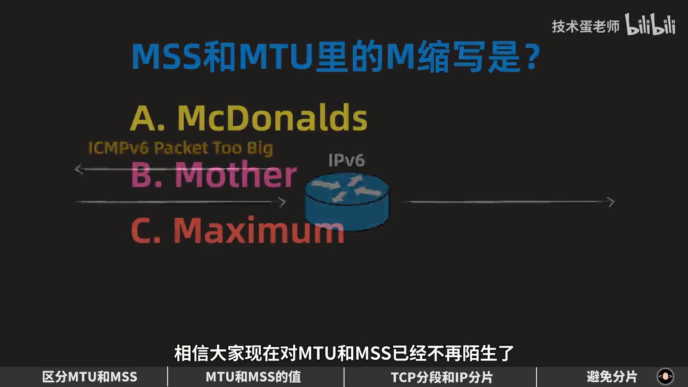

> 本讲的定位是概念课：它把 MTU、MSS、分片字段、MSS Clamping 和 PMTUD 的关系讲清楚，但没有演示黑洞故障的排查。想看"PMTUD 为什么会失效、失效后业务怎么卡死"，见本系列另外三篇：[VPN 卡死的真相](别再查带宽了！VPN连上却卡死的真相：MTU／MSS深度避坑指南.md)、[RouterOS IPsec 排障实录](72. 解决RouterOS上的IPSec MTU_MSS问题，你的IPSec能ping不能上网吗？.md)、[PMTUD 抓包实验](PROOF OF CONCEPT ｜ PMTUD ｜ PATH MTU DISCOVERY.md)。

<!-- SECTION:5 -->

## 小结

- **分层是理解一切的前提**：MSS 在四层约束 TCP 有效载荷，IP MTU 在三层约束整个 IP 包，以太网 MTU 在二层约束帧的负载。
- **1500 与 1460 相差的 40 字节是首部**：IPv4 首部最少 20 字节 + TCP 首部最少 20 字节。
- **MSS 通过三次握手通告**，两端可以通告不同值，发送方通常取较小的那个。
- **能传多大取决于路径上最窄的一段**，本地接口支持 9000（巨型帧）不代表对端和中间设备支持。
- **IP 分片的代价是重传放大**：分片本身不重传，重传靠 TCP；丢一个分片就要重传整段，分片还会消耗路由器的缓冲区和算力。
- **避免分片有两条路**：MSS Clamping 在握手阶段改小 MSS；PMTUD 用 DF 位 + ICMP 反馈探出路径 MTU。
- **IPv6 不允许中间设备分片**，只能由源端切分，靠 ICMPv6 "包太大"消息降低包大小。

## 关键术语速查

| 术语 | 一句话解释 |
| --- | --- |
| MTU（Maximum Transmission Unit） | 一条链路上单个包的最大传输单元；放到 IP 层就是整个 IP 包的上限，常见 1500 |
| MSS（Maximum Segment Size） | TCP 段能承载的最大有效载荷，不含 TCP 首部；MTU 1500 时通常为 1460 |
| 巨型帧（Jumbo Frame） | 超过 1500 字节的以太网帧，常见约 9000 字节 |
| TCP 分段 | TCP 主动把应用数据切成不超过 MSS 的段，尽量避免下层再分片 |
| IP 分片 | 包超过链路 MTU 时，由 IP 层把包切开分别发送 |
| 标识 / 片偏移 / MF | IPv4 首部中用于标识同一报文分片、排序定位、标记"后面还有分片"的字段 |
| DF（Don't Fragment） | IPv4 首部标志位，置位后中间设备不允许分片，只能丢弃并回 ICMP 报错 |
| PMTUD | 路径 MTU 发现：靠 DF + ICMP "包太大"反馈，逐步探出路径能通过的最大包 |
| MSS Clamping | 路由设备在 SYN/SYN-ACK 中把 MSS 改写为适配链路 MTU 的更小值 |
