# PMTUD 抓包实验：亲眼看发送方如何把 1500 缩到 1100

> 视频：[PROOF OF CONCEPT | PMTUD | PATH MTU DISCOVERY](https://www.youtube.com/watch?v=wleh0q5sc4I)｜作者：The Networking Baseline｜时长：25:22｜语言：英文（本文整理为中文）
> 系列：[MTU、MSS 与 PMTUD 网络黑洞](../README.md)

## 本讲要解决的核心问题（SCQA）

**背景**：PMTUD（Path MTU Discovery，路径 MTU 发现）在教材里通常被描述成一句话——"中间设备发现包太大就回 ICMP，发送方收到后把包改小"。这句话听起来理所当然，但很少有人真的看过这一来一回的报文。

**冲突**：如果只是背下这句话，很容易产生两个误解：一是以为"协商了 MSS 1460 就万事大吉"，二是以为"改小一次就结束了"。真实的 PMTUD 是**逐跳、反复、收敛**的过程，而且起作用的永远是**出接口**的 MTU，不是入接口。

**疑问**：在一台主机、三台路由器、每段链路 MTU 都不同的拓扑里，一次 FTP 传输到底会发生什么？ICMP 报文长什么样、由谁发出、携带什么信息？发送方收到之后具体改了什么？

**回答（中心思想）**：**发送方一开始按本地 MTU 发 1500 字节的包，被第一段窄链路丢弃并收到"需要分片、下一跳 MTU=1300"的 ICMP，于是降到 1300；再被第二段窄链路丢弃，收到"下一跳 MTU=1100"，于是降到 1100，传输才顺利跑完。** 抓包里可以直接看到 1514 → 1314 → 1114 的帧长变化，以及两条来自不同路由器、携带不同 MTU 值的 ICMP 报文——这就是 PMTUD 的全部机制。

<!-- SECTION:1 -->

## 一、实验拓扑：一条链路上有三段不同的 MTU

讲者用 GNS3 + VirtualBox 搭了一个最小可复现的环境：**三台 Linux 路由器（R1、R2、R3）+ 两台主机**（FTP 客户端与 FTP 服务器）。路由器都是用 Linux 机器配置成路由角色，而不是专用路由器镜像。

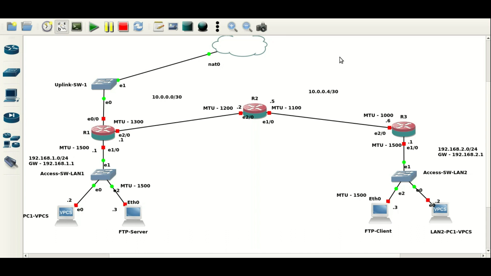

关键设计是**每一段链路的 MTU 都不一样**，而且**越往中间越窄**：

| 位置 | 接口 MTU | 说明 |
| --- | --- | --- |
| FTP 服务器 / LAN1 | 1500 | 服务器侧是标准以太网 |
| R1 → LAN1 方向 | 1500 | R1 面向服务器的一侧 |
| **R1 → R2 方向** | **1300** | 第一处"窄门" |
| **R2 → R1 方向** | **1200** | 反向链路的 MTU |
| **R2 → R3 方向** | **1100** | 第二处"窄门" |
| **R3 → R2 方向** | **1000** | 反向链路的 MTU |
| R3 → LAN2 / FTP 客户端 | 1500 | 客户端侧是标准以太网 |

> 说明：视频中讲者对个别数字的表述有口误（例如把 1500 说成 "15 engine"、把 1300 说成 "3100"），本文按**画面中 `ifconfig` 与拓扑标注的实际数值**整理。方向上的不对称（1300 对 1200、1100 对 1000）也是拓扑本身的设定。

讲者特意强调：**这次实验不使用 VPC（虚拟 PC），只用底部的 FTP 客户端和 FTP 服务器**，因为要看的是真实 TCP 传输中的 PMTUD 行为。

### 1.1 逐台核对接口 MTU

讲者在三台路由器上分别用 `ifconfig` 确认了配置：

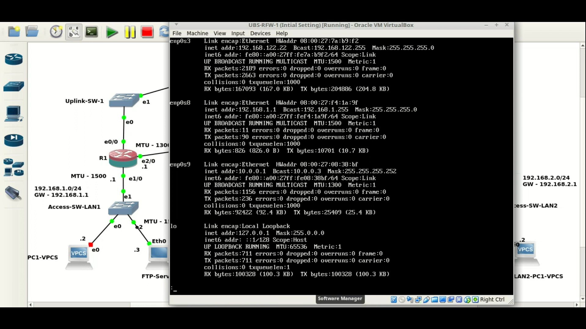

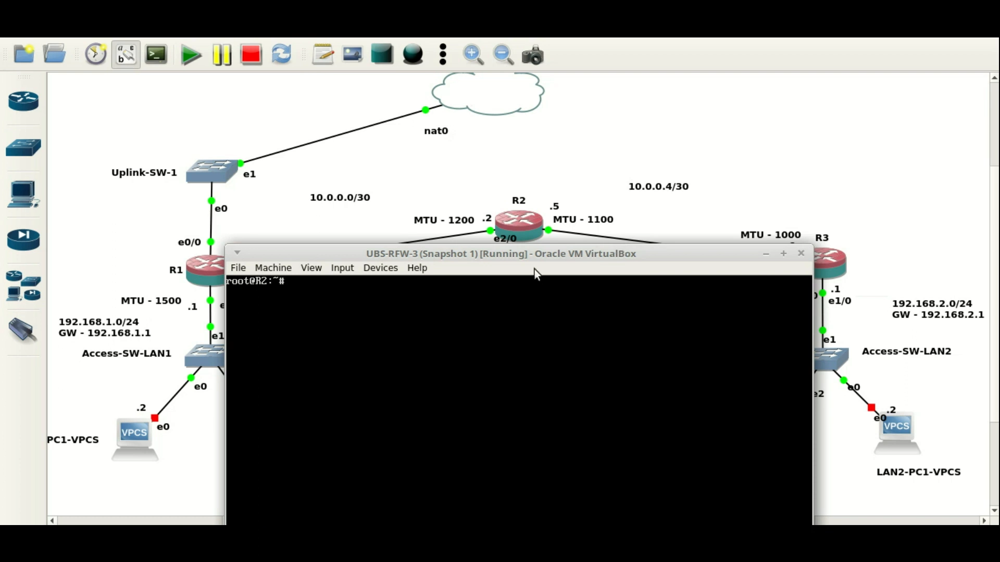

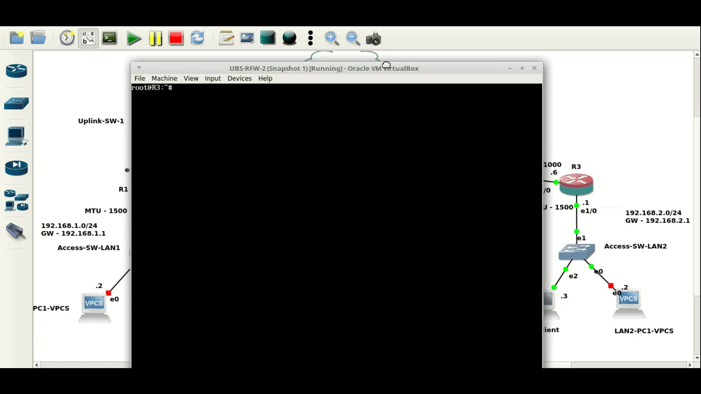

这一步不能省：**后面所有"为什么这个包被丢"的判断，都依赖这些数字。**

## 二、先想清楚：1500 的包出门就会撞墙

讲者先做了一次"纸上推演"，把预期讲明白，再去抓包验证。

TCP 握手时，两端都会通告 MSS。服务器和客户端两侧的接口都是 1500，所以协商出来的 MSS 是 **1460**（1500 − 20 字节 IP 头 − 20 字节 TCP 头）。于是服务器会按 **1500 字节的 IP 包**发送数据。

但看拓扑就知道：**这个 1500 字节的 IP 包从 R1 发往 R2 时，出接口 MTU 只有 1300**，根本发不出去。

此时取决于 **DF（Don't Fragment）位**：

- **DF = 0**：允许分片，路由器把包切开继续发；
- **DF = 1**：不允许分片，路由器**丢弃这个包，并回一条 ICMP 错误消息**给源端。

现代 TCP 通常设置 DF=1，所以走的是第二条路。讲者预期会**连续发生两次**这种情况：

1. 第一次：1500 字节的包在 R1 出接口（MTU 1300）被丢，R1 回 ICMP 告知"下一跳 MTU = 1300"；
2. 服务器降到 1300 再发，这次能过 R1，但在 R2 出接口（MTU 1100）被丢，R2 回 ICMP 告知"下一跳 MTU = 1100"；
3. 服务器降到 1100 再发，一路畅通。

### 2.1 一个常见误解：看的是"出接口"，不是"入接口"

讲者专门点出一个容易搞混的地方：**判断一个包会不会被分片/丢弃，看的是它要出去的接口 MTU，而不是它进来的接口 MTU。** MTU 里的 T 是 **Transmission（发送）**，约束的是"发出去"这个动作。

所以"包从 MTU 1500 的接口进来、从 MTU 1200 的接口出去"，决定命运的是那个 1200。

## 三、抓包位置：两处，因为两次丢包发生在两段不同链路

讲者把抓包点设在**两个地方**：一处靠近服务器侧（交换机与路由器 1 之间），一处是**路由器 1 与路由器 2 之间的链路**。

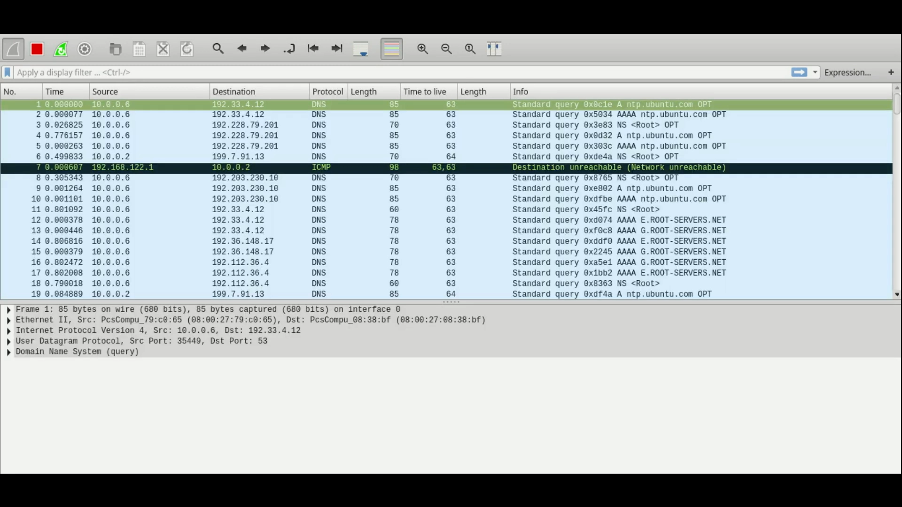

讲者的解释是：第一条 ICMP 由路由器 1（R1）发出，第二条由路由器 2（R2）发出；由于两条 ICMP 都是往服务器方向回的，在两处抓包里都能看到它们，只是出现的位置不同。

Wireshark 里加了显示过滤器（`!dns && !arp && !nbdgm && !nbns`），把无关流量过滤掉，屏幕上只留必要的报文。

## 四、动手：起 FTP 传输

客户端登录 FTP 服务器（`ftp 192.168.1.3`，服务端是 vsftpd 3.0.2），打开 `debug` 和 `hash`（每 1024 字节打印一个 `#`），切到二进制模式 `bin`，然后下载一个较大的文件。

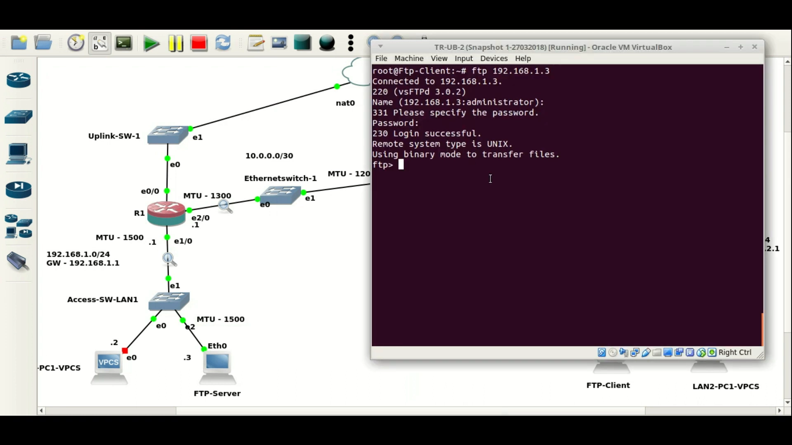

讲者说明为什么要选大文件：**文件必须足够大，才能产生足够多的满长数据包**，这样 PMTUD 的收敛过程才会明显可见。

### 4.1 先看控制连接：握手里的 MSS

在开始传输前，讲者先看控制连接（21 端口）的握手报文：**SYN 里带着 MSS 选项**，这个值取决于客户端/服务器所在链路的 MTU。双方各报自己的 MSS，最终按较小值发送。

这一步很关键，因为它解释了后面的"矛盾"：**握手时双方都按 1500 的链路报了 MSS 1460，但路径中间根本没有 1500 的链路。**

## 五、抓包实录一：1500 的包被 R1 拦下

传输一开始，服务器就按 1500 字节的 IP 包发数据。抓包里能直接看到帧长 **1514**（= 1500 IP 包 + 14 字节以太网头）。

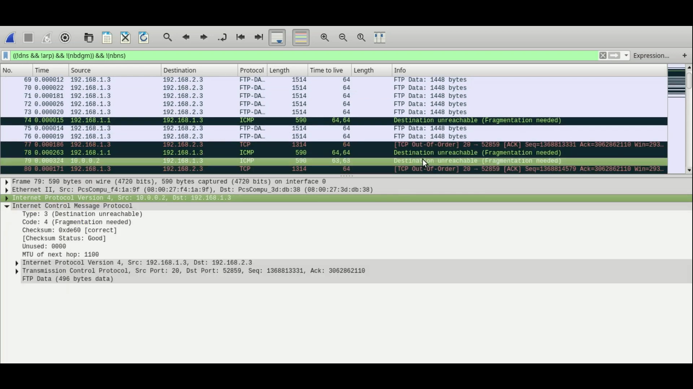

紧接着出现 ICMP 报文：**Destination unreachable (Fragmentation needed)**，源地址是 R1 侧的地址，里面带着"下一跳 MTU = 1300"的信息。

讲者带着看包详情面板：以太网 II → IPv4 → TCP → FTP，逐层确认这就是那条 1500 字节的数据包；ICMP 报文里则回引了原始 IP 头，方便源端识别"是哪个包太大了"。

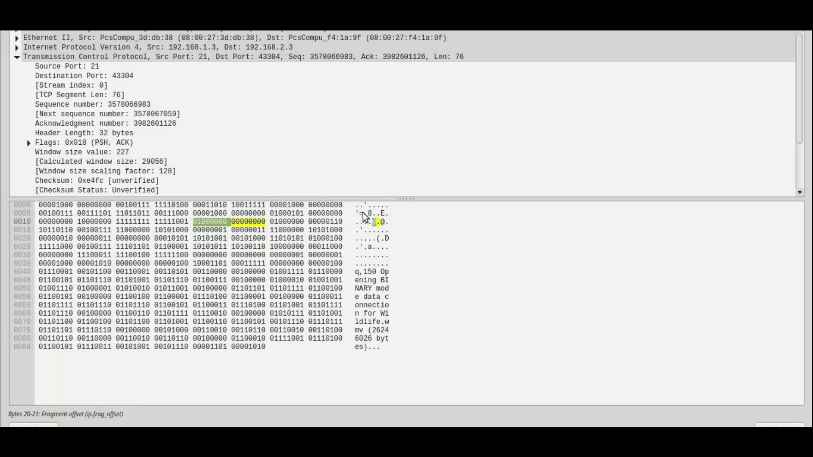

### 5.1 发送方的反应：降到 1300

服务器收到这条 ICMP 后，把发送的段改小，于是抓包里出现帧长 **1314**（= 1300 IP 包 + 14 字节以太网头）的报文。

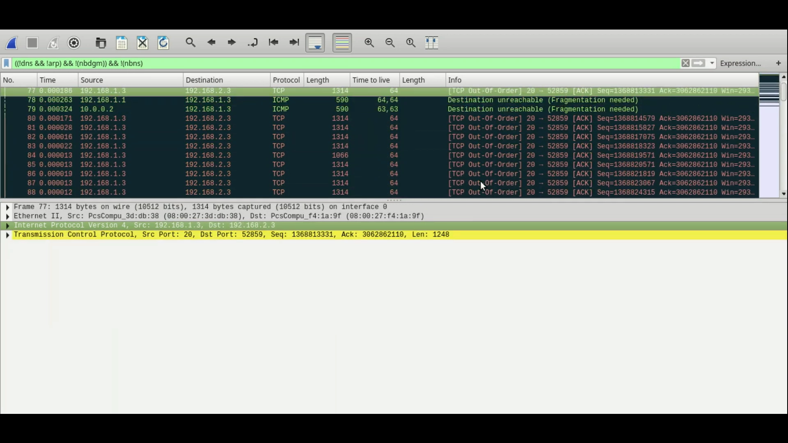

这一步说明了一个重要事实：**MSS 协商值（1460）并不会阻止发送方在运行中把段改小。** 讲者的解释是：MSS 的意义主要在握手阶段，而设备/协议栈自己会根据路径反馈调整实际发送的段大小——"我知道这条路径撑不住 1300 以上，所以自动把段缩小"。

## 六、抓包实录二：1300 的包又被 R2 拦下

1300 的包顺利通过了 R1，但到了 R2 出接口（MTU 1100）又超限了。于是出现**第二条 ICMP**，这次源地址是 R2 侧的地址（`10.0.0.2`），携带的 MTU 是 **1100**。

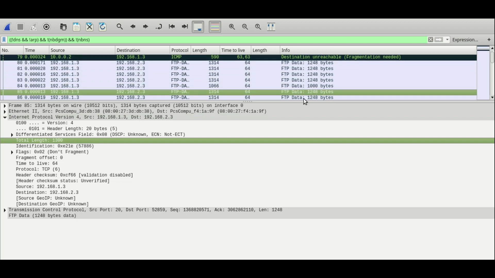

讲者在这里做了个对照：**两条 ICMP 的源地址不同**（一条来自 R1、一条来自 R2），这正是他要在两段链路上分别抓包的原因。

### 6.1 发送方再降到 1100

收到第二条 ICMP 后，服务器把包再降到 1100，抓包里出现帧长 **1114**（= 1100 IP 包 + 14 字节以太网头）。

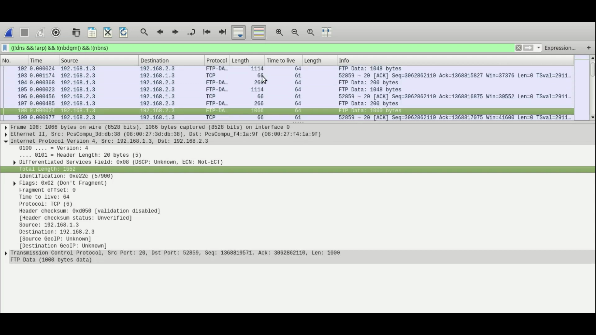

**此后所有数据包的 IP 总长都不超过 1100，传输正常完成。** 这就是 PMTUD 收敛的终点：**路径上最窄那一段的 MTU。**

### 6.2 怎么把"ICMP"和"被丢的那个包"对上

讲者演示了一个实用技巧：ICMP 报文里会**回引原始 IP 头**，其中包含 **IP Identification（标识）** 字段。用这个 ID 去抓包里找，就能确认"这条 ICMP 是在抱怨哪一个包"。

例如他提到某个被丢的包标识是 `5780`，然后据此在抓包里定位到对应的数据包，确认因果关系。这个技巧在真实排障里非常有用——**当你不确定是哪一跳在丢包时，用 ICMP 里的原始头信息反查。**

## 七、结论：PMTUD 是"逐跳、反复、持续"的过程

讲者在结尾把这次实验的结论归纳成几点：

1. **PMTUD 是逐跳收敛的**：1500 → 1300 → 1100，每一次都是被**当前这一跳**的出接口 MTU 拦下，并回一条 ICMP。
2. **起作用的是出接口 MTU**：MTU 的 T 是 Transmission，约束的是"发出去"。
3. **MSS 协商不等于路径 MTU**：握手时双方按各自 1500 的链路报 1460，但路径中间可能只有 1100，实际发送大小还是要靠 PMTUD 修正。
4. **PMTUD 是持续过程，不是一次性动作**：互联网路径会变（经过不同的 POP、链路调整），所以设备需要持续发现、持续调整。
5. **抓包是验证 PMTUD 最直接的手段**：看帧长变化（1514 → 1314 → 1114）、看 ICMP 的源地址与携带的 MTU、用 IP ID 把 ICMP 与被丢的包对应起来。

讲者还提到会另外做一期**纯理论**的 PMTUD 讲解视频，与这次实验配套观看。

<!-- SECTION:5 -->

## 小结

- **实验设计**：三台 Linux 路由器串成一条链，每段链路 MTU 不同（1500 / 1300 / 1200 / 1100 / 1000 / 1500），越往中间越窄。
- **预期**：1500 的包在 R1 出接口（1300）被丢 → 降到 1300 → 在 R2 出接口（1100）被丢 → 降到 1100 → 通过。
- **抓包证据**：帧长 1514 → 1314 → 1114，正好对应 IP 包 1500 → 1300 → 1100（各加 14 字节以太网头）。
- **两条 ICMP 来自不同路由器**：第一条由 R1 发出（通告 MTU 1300），第二条由 R2 发出（通告 MTU 1100）。
- **关键判断依据是出接口 MTU**，不是入接口——MTU 的 T 是 Transmission。
- **MSS 协商值不会阻止运行中调整**：握手报 1460，实际仍会按路径反馈降到 1300、1100。
- **实用技巧**：ICMP 回引原始 IP 头，用 IP Identification 可以反查"是哪条 ICMP 在抱怨哪个包"。
- **PMTUD 是持续过程**：路径会变，所以发现机制必须持续工作；一旦 ICMP 被过滤，就会退化成黑洞（见本系列另两篇）。

## 关键术语速查

| 术语 | 一句话解释 |
| --- | --- |
| PMTUD（Path MTU Discovery） | 路径 MTU 发现：靠 ICMP "需要分片/包太大"反馈，逐跳把发送大小收敛到路径最小值 |
| MTU | 接口允许承载的最大 IP 包长度；判断是否超限看的是**出接口** |
| MSS | TCP 握手时通告的最大段大小，以太网 1500 链路典型为 1460 |
| DF（Don't Fragment） | IPv4 标志位；DF=1 时超 MTU 的包只能丢弃并回 ICMP |
| ICMP Fragmentation Needed | IPv4 中"需要分片"的 ICMP 错误，携带下一跳 MTU，是 PMTUD 的驱动信号 |
| IP Identification（标识） | IPv4 首部字段，用于标识同一报文的分片；也可用来把 ICMP 与被丢的原包对应起来 |
| 帧长 vs IP 长度 | Wireshark 里的 Length 是帧长（含 14 字节以太网头），1514 对应 1500 字节 IP 包 |
| 逐跳收敛 | PMTUD 不是一次算完，而是每次被某一跳拦下就降一次，直到通过 |