# VPN 连上却卡死：MTU、PMTU 与 MSS 的"隐形坑"

> 视频：[别再查带宽了！VPN连上却卡死的真相：MTU／MSS深度避坑指南](https://www.bilibili.com/video/BV1dz61B9Ed2/)｜作者：staylightblow｜时长：16:09
> 系列：[MTU、MSS 与 PMTUD 网络黑洞](../README.md)

## 本讲要解决的核心问题（SCQA）

**背景**：IPsec VPN 已经建立、认证成功、路由可达，`ping` 也通，可业务一跑就卡——网页转圈、文件传输中断、SSH 敲命令没反应。

**冲突**：很多人第一反应是查带宽、查设备性能、查加密开销，结果都正常。真正的问题往往不在"管道有多粗"，而在于**报文在隧道里"变胖"了，超过了路径上某一段的承载能力，然后被悄悄丢掉**。

**疑问**：为什么小包能通、大包就死？MTU、PMTU、MSS 到底各管什么？为什么"回 ICMP 让源端自动变小"这套机制在现实中经常失效？工程上该在哪里、用什么手段把这个坑填掉？

**回答（中心思想）**：**MTU 是接口视角的上限，PMTU 是路径视角的最小值，MSS 是 TCP 视角的负载上限——隧道封装让内层"看起来合规"的包在外层超限，而 PMTUD 的反馈链路（ICMP）又常常被过滤，于是形成 PMTU 黑洞。** 解决办法不是等中间设备临场处理，而是**把问题前移**：用 TCP MSS Clamping 让 TCP 一开始就收着发、用隧道接口 MTU 约束内层包、并放行必要的 ICMP；同时优先选择**路由型 IPsec**，让 MTU/MSS 的处理点清晰且一致。

<!-- SECTION:1 -->

## 一、先认症状：VPN 卡顿通常"长这样"

讲者开篇就把问题画像钉死在一张 PPT 上，四条症状几乎可以当作自查清单：

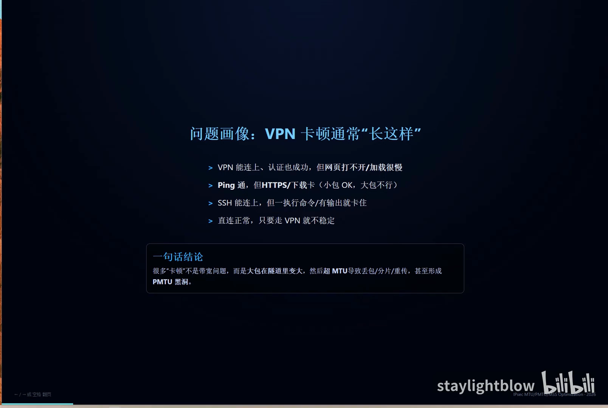

- **VPN 能连上、认证也成功，但网页打不开或加载很慢**；
- **Ping 通，但 HTTPS / 下载卡**——典型特征是"小包 OK，大包不行"；
- **SSH 能连上，但一执行命令、一有输出就卡住**——交互小包没问题，稍大的响应就卡；
- **直连正常，只要走 VPN 就不稳定**。

一句话结论：**很多"卡顿"不是带宽问题，而是大包在隧道里变大，超过 MTU 后导致丢包/分片/重传，甚至形成 PMTU 黑洞。**

## 二、三个名词各管一段：接口视角、路径视角、TCP 视角

后面所有推理都建立在这三个概念的区分上，讲者用一页表格把它们对齐：

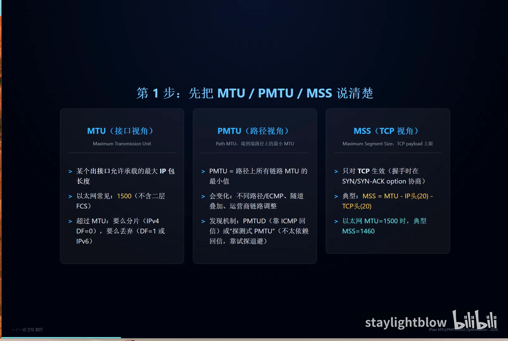

| 概念 | 视角 | 定义 | 关键性质 |
| --- | --- | --- | --- |
| **MTU**（Maximum Transmission Unit） | 接口 | 某个出接口允许承载的最大 IP 包长度 | 以太网常见 1500（不含二层 FCS）；超过则分片（IPv4 且 DF=0）或丢弃（DF=1 或 IPv6） |
| **PMTU**（Path MTU） | 路径 | 端到端路径上所有链路 MTU 的**最小值** | 会变化：不同路径/ECMP、隧道叠加、运营商链路调整；靠 PMTUD（ICMP 回信）或"探测式 PMTU"发现 |
| **MSS**（Maximum Segment Size） | TCP | TCP payload 的上限 | 只对 TCP 生效，在 SYN/SYN-ACK 的 option 里协商；典型 `MSS = MTU − IP 头(20) − TCP 头(20)`，以太网 1500 时即 1460 |

讲者用"门"和"箱子"的类比建立直觉：**MTU 像一扇门，规定一次能过多大的箱子；PMTU 是起点到终点一路上最窄的那扇门；MSS 则是装箱时箱子里最多能装多少实际货物**（还要给 IP 头、TCP 头留位置）。

## 三、主机视角：第一次发包，它凭什么决定大小

主机手上有三个信息：**本机接口 MTU、路由表、以及对端在 TCP 握手时通告的 MSS**。

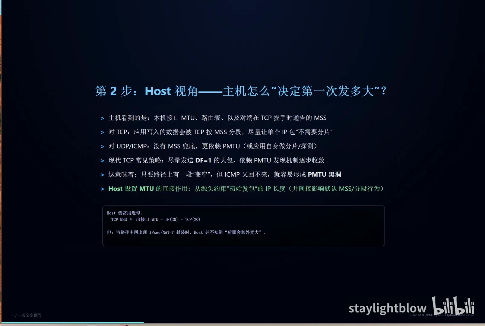

- **对 TCP**：应用写入的数据会被 TCP 按 MSS 分段，尽量让单个 IP 包"不需要分片"。现代 TCP 的常见策略是**尽量发送 DF=1 的大包**，依赖 PMTUD 逐步收敛到正确大小。
- **对 UDP/ICMP**：没有 MSS 兜底，更依赖 PMTU，或者由应用自己做分片/探测。
- **Host 侧常用近似**：`TCP MSS = 出接口 MTU − IP(20) − TCP(20)`。

这里埋下了整个问题的伏笔：**当路径中间出现 IPsec/NAT-T 封装时，Host 根本不知道"后面会额外变大"**。它按 1500/1460 老老实实发，到了网关却要再加几十上百字节。

**这也意味着：只要路径上有一段"变窄"，而 ICMP 又回不来，就容易形成 PMTU 黑洞。**

## 四、网关视角：同样是"设 MTU"，主机和网关完全是两件事

很多人把"改 MTU"当成一个动作，但讲者强调：**主机改 MTU 和网关改 MTU，约束的对象根本不同**。

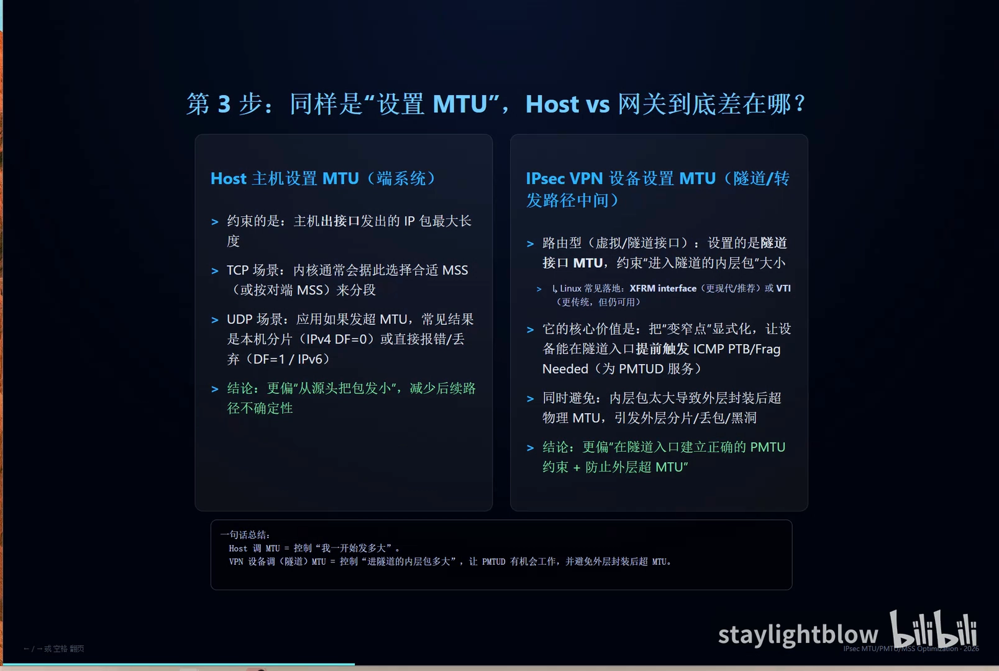

| | Host（端系统） | IPsec VPN 设备（隧道/转发路径中间） |
| --- | --- | --- |
| **约束对象** | 主机出接口发出的 IP 包最大长度 | 路由型：隧道接口 MTU，约束"进入隧道的内层包"大小 |
| **对 TCP 的影响** | 内核据此选择合适 MSS（或按对端 MSS）分段 | 让设备能在隧道入口提前触发 ICMP PTB/Frag Needed，为 PMTUD 服务 |
| **对 UDP 的影响** | 应用发超 MTU 时，常见结果是本机分片（DF=0）或报错/丢弃（DF=1/IPv6） | 避免内层包太大导致外层封装后超物理 MTU，引发外层分片/丢包/黑洞 |
| **一句话** | 控制"我一开始发多大"，从源头减少后续路径不确定性 | 控制"进隧道的内层包多大"，建立正确的 PMTU 约束 |

Linux 上路由型 IPsec 的常见落地是 **XFRM interface**（更现代、推荐），也可以用传统的 **VTI**。

### 4.1 为什么"隧道里"更容易出问题：封装开销

网关会增加封装开销，导致"内层看起来不大"的包在外层变成超 MTU 风险。


以 NAT-T + ESP 隧道为例，一个 1500 字节的内层包（含 inner IP + TCP + payload）外面还要加：

- **Outer IP 头**：20 字节；
- **UDP 头（NAT-T）**：8 字节；
- **ESP**：Hdr / IV / PAD / ICV，依算法与对齐而变，**常见 50~100 字节以上**。

这些开销发生在**路径中间**，Host 往往不感知（仍按 1500/1460 发）。如果公网/物理链路 MTU 仍是 1500，封装后就必然出现"外层超 MTU"。此时网关必须处理：分片、丢弃 + 回 ICMP，或者**前移约束（隧道 MTU、MSS clamp）**。

## 五、机制串联：丢包、分片、重传与黑洞是怎么串起来的

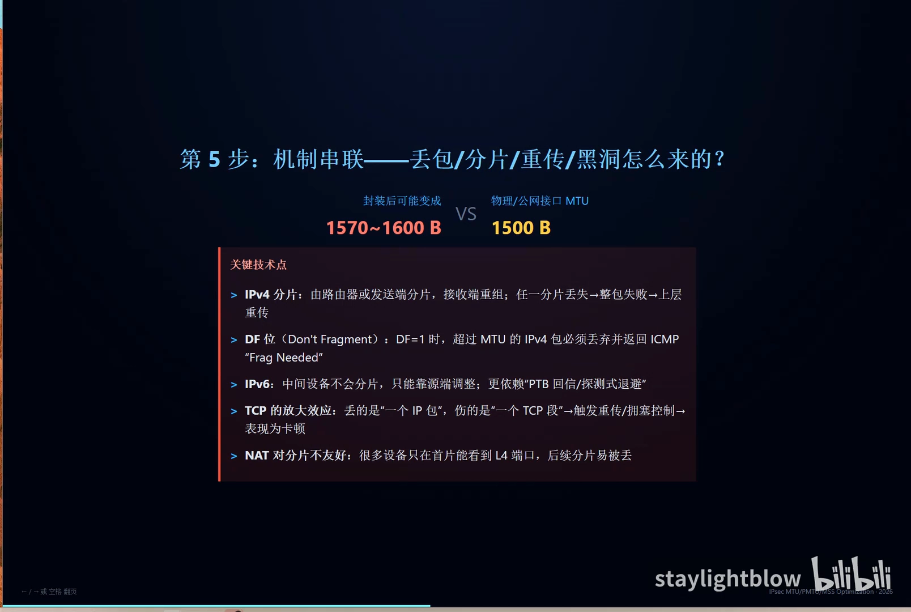

讲者把这条链路拆成四个关键技术点：

1. **IPv4 分片**：由路由器或发送端分片，接收端重组；**任一分片丢失 → 整包失败 → 上层重传**。
2. **DF 位（Don't Fragment）**：DF=1 时，超过 MTU 的 IPv4 包必须丢弃并返回 ICMP "Frag Needed"。
3. **IPv6 更硬**：中间设备不会分片，只能靠源端调整，更依赖"PTB 回信 / 探测式退避"。
4. **TCP 的放大效应**：丢的是"一个 IP 包"，伤的是"一个 TCP 段"→ 触发重传与拥塞控制 → 表现为卡顿。
5. **NAT 对分片不友好**：很多设备只在首片能看到 L4 端口，后续分片容易被丢。

### 5.1 网关当场能做什么？——手段其实很有限

当"外层包长度 > 出接口 MTU"时，设备只能二选一：**让它变小，或让它消失**。

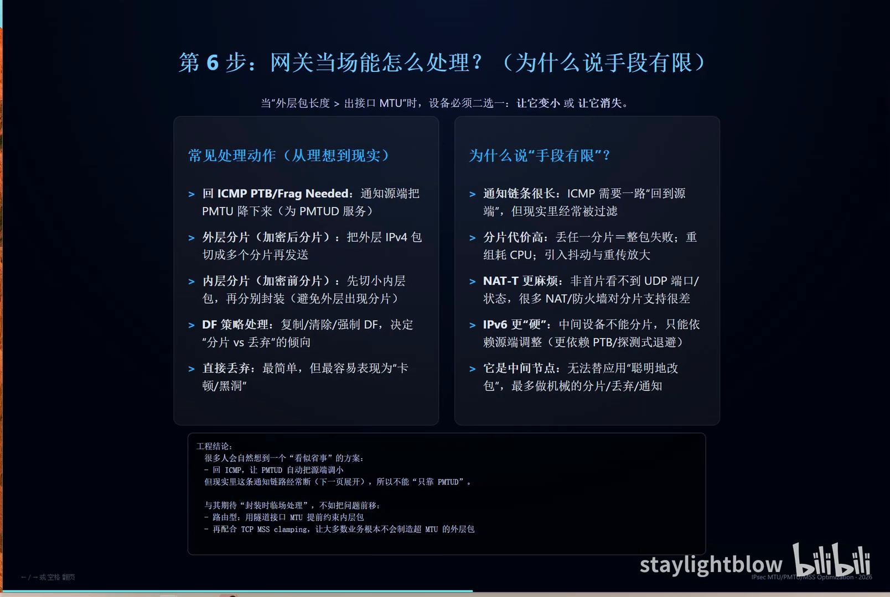

| 处理动作 | 做法 | 代价 / 局限 |
| --- | --- | --- |
| 回 ICMP PTB / Frag Needed | 通知源端把 PMTU 降下来 | 通知链条很长，ICMP 要一路回到源端，现实中经常被过滤 |
| 外层分片（加密后分片） | 把外层 IPv4 包切成多个分片发送 | 丢任一分片 = 整包失败；重组耗 CPU；引入抖动与重传放大 |
| 内层分片（加密前分片） | 先切小内层包，再分别封装 | NAT-T 更麻烦：非首片看不到 UDP 端口/状态，很多 NAT/防火墙对分片支持很差 |
| 直接丢弃 | 最简单 | 最容易表现为"卡顿/黑洞" |

讲者的判断很直接：**网关是中间节点，无法替应用"聪明地改包"，最多做机械的分片/丢弃/通知**。所以"封装时临场处理"这条思路本身就不该被寄予厚望。

## 六、为什么不能"只靠 PMTUD"

"发现包太大就回 ICMP，让源端自动缩小"——这个设计很合理，但现实里 PMTUD 的通知链路经常断。

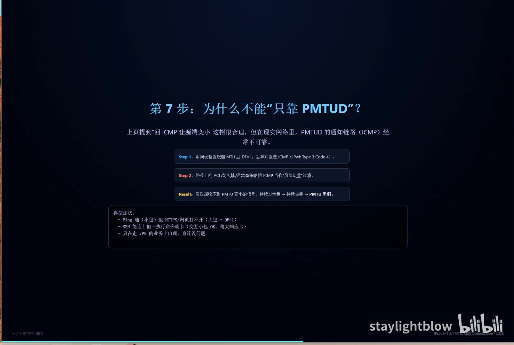

- **Step 1**：中间设备发现超 MTU 且 DF=1，丢弃并发送 ICMP（IPv4：**Type 3 Code 4**，即 Fragmentation Needed）。
- **Step 2**：路径上的 ACL / 防火墙 / 运营商策略把 ICMP 当作"风险流量"过滤掉。
- **Result**：发送端收不到"PMTU 变小"的信号，持续发大包 → 持续被丢 → **PMTU 黑洞**。

黑洞的典型症状，正好回到开篇那四条：Ping 通（小包）但 HTTPS/网页打不开（大包 + DF=1）；SSH 能连上但一执行命令就卡；只在走 VPN 的业务上出现，直连没问题。

## 七、解决思路总览：从根到枝

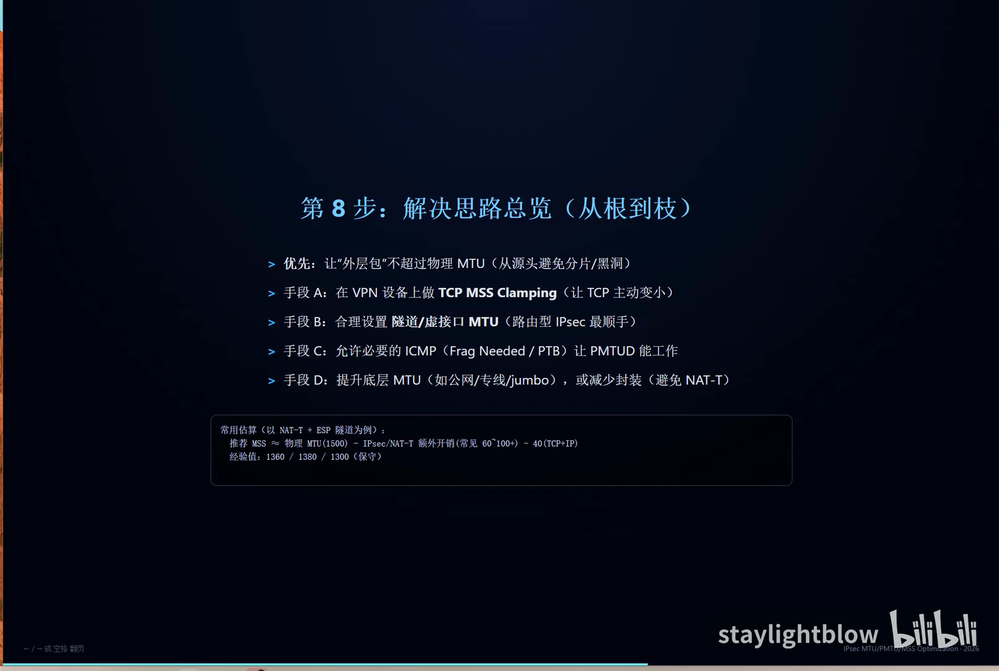

**总原则：优先让"外层包"不超过物理 MTU，从源头避免分片和黑洞。** 具体手段按优先级：

- **手段 A：在 VPN 设备上做 TCP MSS Clamping**，让 TCP 主动变小；
- **手段 B：合理设置隧道/虚接口 MTU**（路由型 IPsec 最顺手）；
- **手段 C：允许必要的 ICMP**（Frag Needed / PTB），让 PMTUD 能工作；
- **手段 D：提升底层 MTU**（公网/专线/jumbo），或**减少封装**（避免 NAT-T）。

常用估算（以 NAT-T + ESP 隧道为例）：

```
推荐 MSS ≈ 物理 MTU(1500) − IPsec/NAT-T 额外开销(常见 60~100+) − 40(TCP+IP)
经验值：1360 / 1380 / 1300（保守）
```

## 八、策略型 vs 路由型：为什么现代 IPsec 更偏"基于路由"

这些措施放在哪里，取决于 IPsec 的类型。

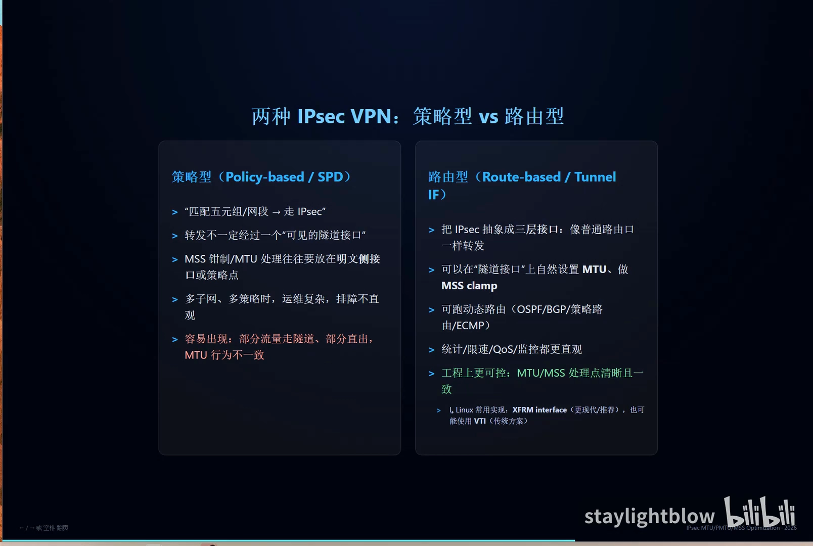

| | 策略型（Policy-based / SPD） | 路由型（Route-based / Tunnel IF） |
| --- | --- | --- |
| **工作方式** | "匹配五元组/网段 → 走 IPsec" | 把 IPsec 抽象成三层接口，像普通路由口一样转发 |
| **是否有可见隧道接口** | 转发不一定经过一个"可见的隧道接口" | 有，可在隧道接口上自然设置 MTU、做 MSS clamp |
| **MTU/MSS 放哪** | 往往要放在明文侧接口或策略点 | 直接在隧道接口上处理 |
| **运维** | 多子网、多策略时复杂，排障不直观 | 可跑动态路由（OSPF/BGP/策略路由/ECMP），统计/限速/QoS/监控更直观 |
| **典型风险** | 部分流量走隧道、部分直出，MTU 行为不一致 | 工程上更可控，处理点清晰且一致 |
| **Linux 实现** | — | XFRM interface（推荐）、VTI（传统） |

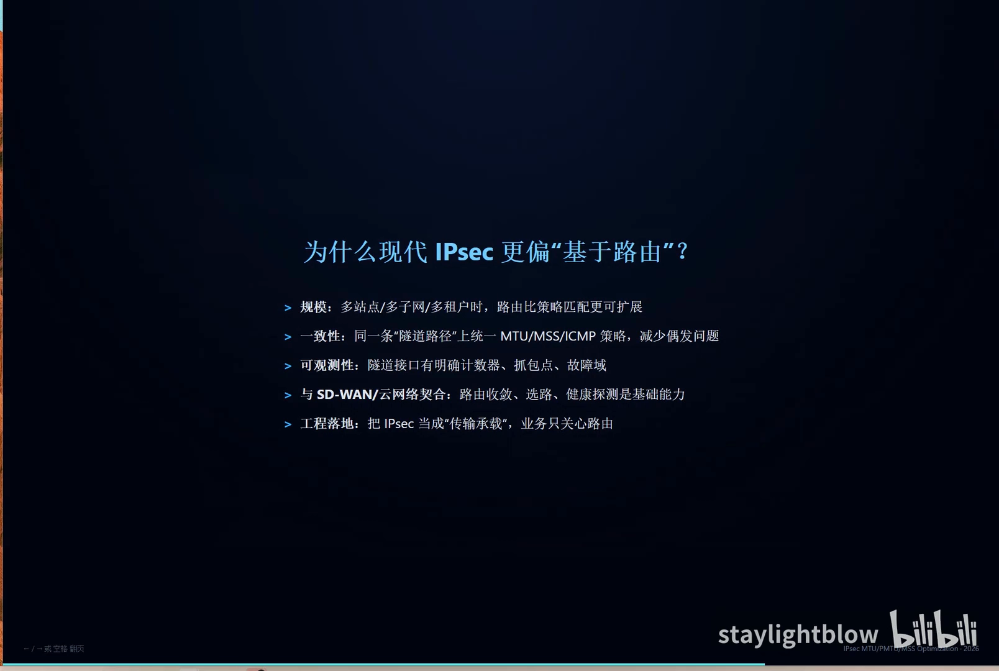

讲者给出四条理由：

1. **规模**：多站点/多子网/多租户时，路由比策略匹配更可扩展；
2. **一致性**：同一条"隧道路径"上统一 MTU/MSS/ICMP 策略，减少偶发问题；
3. **可观测性**：隧道接口有明确计数器、抓包点、故障域；
4. **与 SD-WAN/云网络契合**：路由收敛、选路、健康探测是基础能力。

工程落地的心法是：**把 IPsec 当成"传输承载"，业务只关心路由。**

## 九、落地一：TCP MSS Clamping 的原理

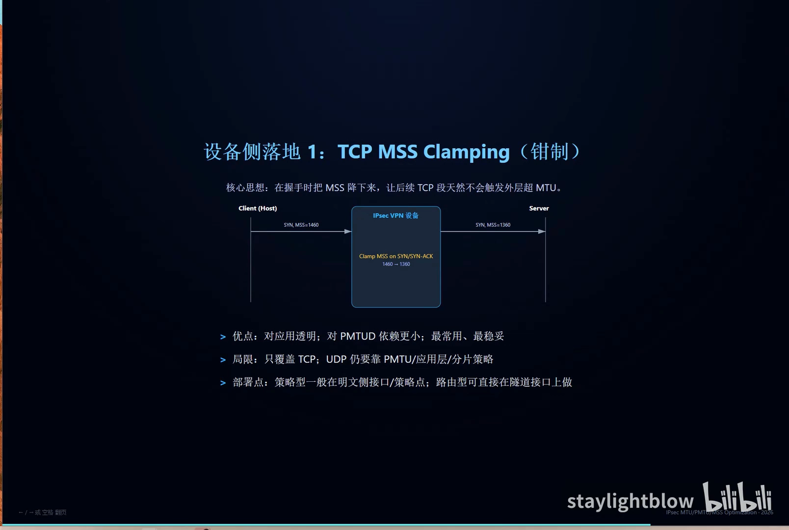

**核心思想：在握手时把 MSS 降下来，让后续 TCP 段天然不会触发外层超 MTU。**

流程是：客户端发 `SYN, MSS=1460` → VPN 设备在 SYN/SYN-ACK 上做 clamp，改成 `MSS=1360` → 服务器看到的就是 1360，后续按这个大小发。

- **优点**：对应用透明；对 PMTUD 依赖更小；最常用、最稳妥。
- **局限**：**只覆盖 TCP**；UDP 仍要靠 PMTU / 应用层 / 分片策略。
- **部署点**：策略型一般在明文侧接口/策略点；路由型可直接在隧道接口上做。

> 注意讲者对"取较小值"的表述做了限定：这是**简化说明**，不应理解为"测出了整个路径唯一的双向 MSS"。

## 十、落地二：按 VPN 类型处理 MTU 与分片

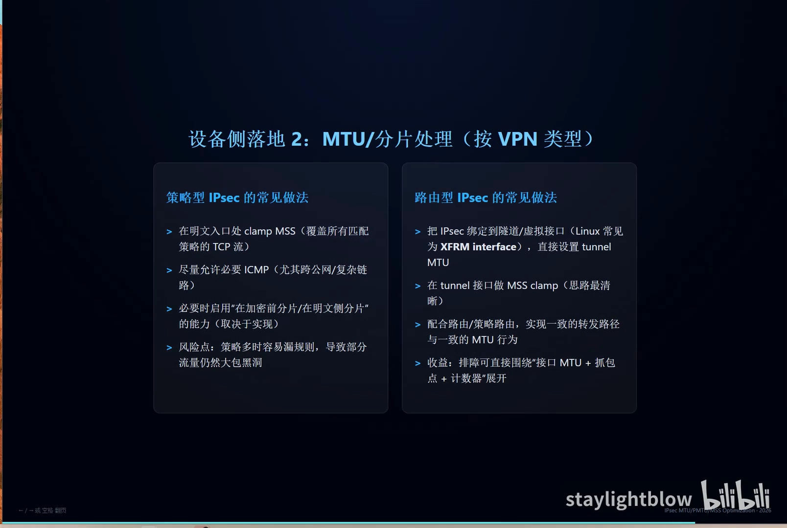

**策略型 IPsec 的常见做法**：

- 在明文入口处 clamp MSS（要覆盖所有匹配策略的 TCP 流）；
- 尽量允许必要 ICMP（尤其跨公网/复杂链路）；
- 必要时启用"在加密前分片/在明文侧分片"的能力（取决于实现）；
- **风险点**：策略多时容易漏规则，导致部分流量仍然大包黑洞。

**路由型 IPsec 的常见做法**：

- 把 IPsec 绑定到隧道/虚拟接口（Linux 常见为 XFRM interface），直接设置 tunnel MTU；
- 在 tunnel 接口做 MSS clamp（思路最清晰）；
- 配合路由/策略路由，实现一致的转发路径与一致的 MTU 行为；
- **收益**：排障可直接围绕"接口 MTU + 抓包点 + 计数器"展开。

## 十一、最佳实践与推荐数值

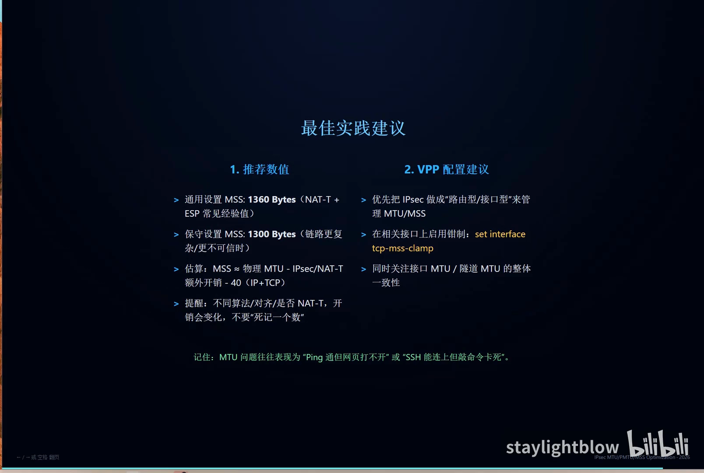

**推荐数值**：

- **通用：MSS = 1360 字节**（NAT-T + ESP 的常见经验值）；
- **保守：MSS = 1300 字节**（链路更复杂、更不可信时）；
- 估算公式：`MSS ≈ 物理 MTU − IPsec/NAT-T 额外开销 − 40（IP + TCP）`；
- **提醒**：不同算法/对齐/是否 NAT-T，开销都会变化，**不要"死记一个数"**，要结合自己的环境。

**VPP 配置建议**：

- 优先把 IPsec 做成"路由型/接口型"来管理 MTU/MSS；
- 在相关接口上启用钳制：`set interface tcp-mss-clamp`；
- 同时关注接口 MTU / 隧道 MTU 的整体一致性。

**最后的排障提示**：当 VPN 能建立、业务却很卡时，**第一件事就该查 MTU 和 MSS**，判断是否由报文大小导致丢包——而不是先去查带宽。记住那句话：**MTU 问题往往表现为"Ping 通但网页打不开"或"SSH 能连上但敲命令卡死"。**

<!-- SECTION:5 -->

## 小结

- **症状先认准**：能连上、Ping 通，但网页/下载/SSH 输出卡——"小包 OK、大包不行"就是 MTU 类问题的指纹。
- **三个概念分工明确**：MTU 是接口上限，PMTU 是路径最小值，MSS 是 TCP 负载上限（以太网 1500 → MSS 1460）。
- **隧道封装让包变胖**：NAT-T + ESP 常见增加 60~100+ 字节，1500 的内层包封装后可能到 1570~1600，超过公网 1500 的 MTU。
- **Host 和网关改 MTU 是两件事**：Host 控制"我一开始发多大"，网关控制"进隧道的内层包多大"。
- **PMTUD 靠 ICMP 反馈，而 ICMP 常被过滤**：一旦反馈断链，就是 PMTU 黑洞。
- **网关临场处理手段有限**：回 ICMP、外层分片、内层分片、直接丢弃，各有明显代价，尤其 NAT 对分片很不友好。
- **正确姿势是把问题前移**：MSS Clamping（覆盖 TCP）+ 隧道接口 MTU（约束内层包）+ 放行必要 ICMP（让 PMTUD 能工作）。
- **优先路由型 IPsec**：MTU/MSS 处理点清晰、可观测、可跑动态路由，比策略型更可控。
- **数值参考而非教条**：通用 1360、保守 1300，实际要按封装开销和环境调整。

## 关键术语速查

| 术语 | 一句话解释 |
| --- | --- |
| MTU | 某个出接口允许承载的最大 IP 包长度，以太网常见 1500（不含二层 FCS） |
| PMTU | 端到端路径上所有链路 MTU 的最小值，会随路径/ECMP/隧道叠加而变化 |
| MSS | TCP payload 上限，握手时在 SYN/SYN-ACK 的 option 中协商，以太网 1500 时典型 1460 |
| PMTUD | 路径 MTU 发现：靠 ICMP "Frag Needed / Packet Too Big" 反馈逐步收敛包大小 |
| PMTU 黑洞 | 中间设备丢弃超 MTU 的包，但 ICMP 反馈被过滤，源端持续发大包、持续被丢 |
| DF（Don't Fragment） | IPv4 标志位，DF=1 时禁止分片，超限只能丢弃并回 ICMP |
| ICMP Type 3 Code 4 | IPv4 的 "Fragmentation Needed"，PMTUD 依赖的关键反馈报文 |
| NAT-T | NAT 穿越，在 ESP 外面再套 UDP（8 字节），进一步压缩可用载荷 |
| ESP | IPsec 的封装安全载荷，含 Hdr/IV/PAD/ICV，常见开销 50~100+ 字节 |
| MSS Clamping | 在 SYN/SYN-ACK 上把通告的 MSS 改小，让 TCP 后续不会造出超 MTU 的外层包 |
| 策略型 IPsec（Policy-based） | 按五元组/网段匹配决定是否走 IPsec，没有可见隧道接口 |
| 路由型 IPsec（Route-based） | 把 IPsec 抽象成三层隧道接口（如 Linux XFRM interface / VTI），MTU/MSS 可直接在接口上管理 |
| 探测式 PMTU | 不完全依赖 ICMP 回信，通过试探与退避推断可用包大小 |