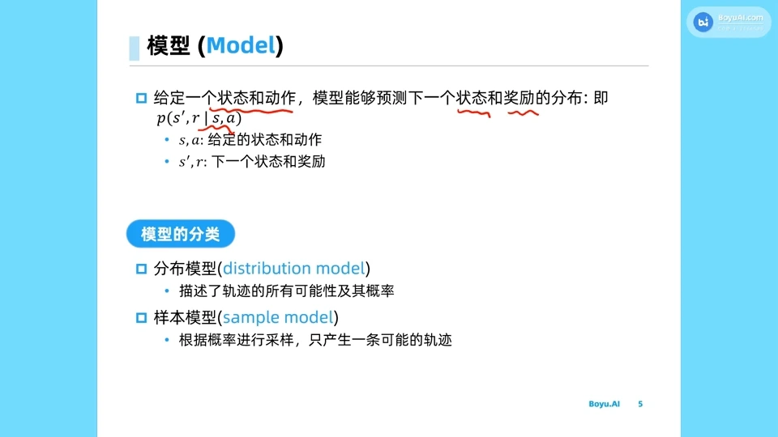
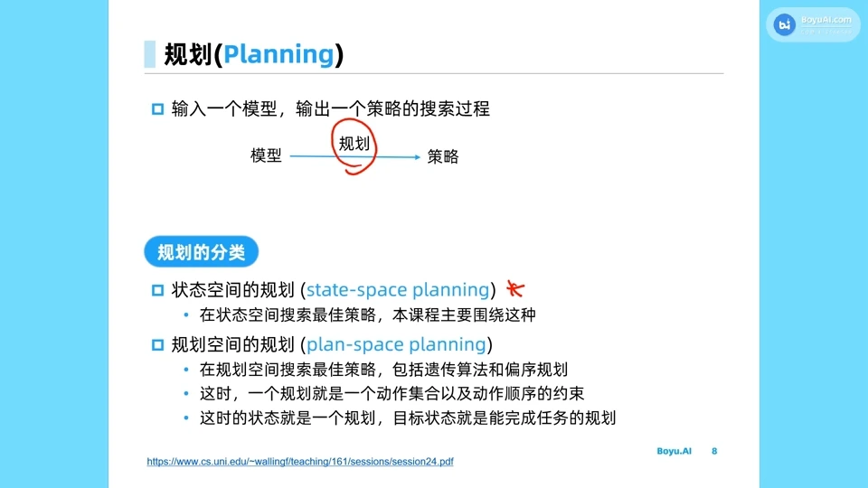
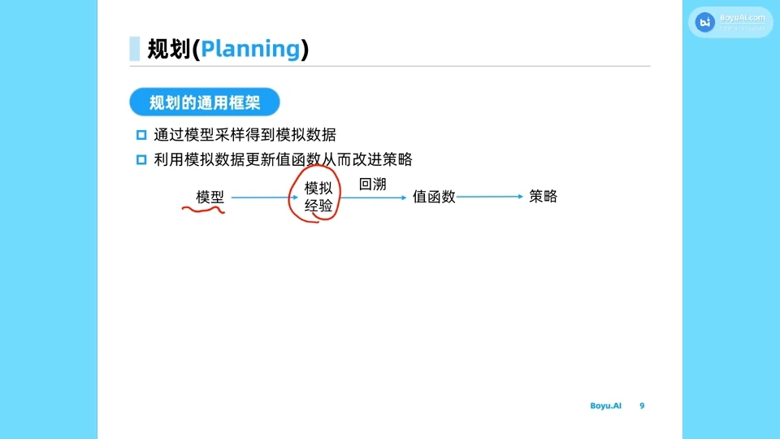
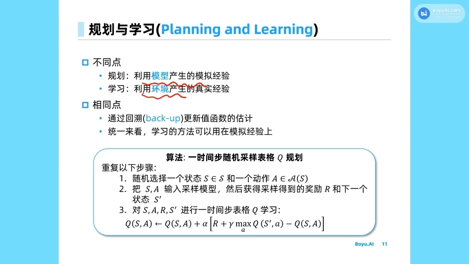
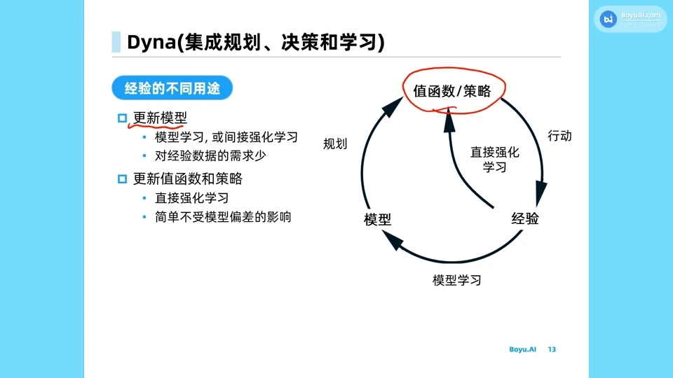
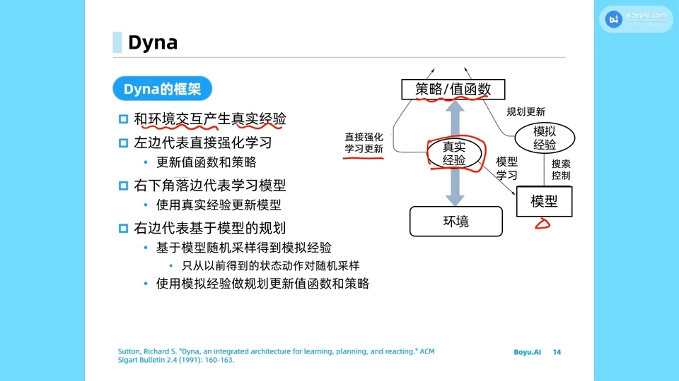
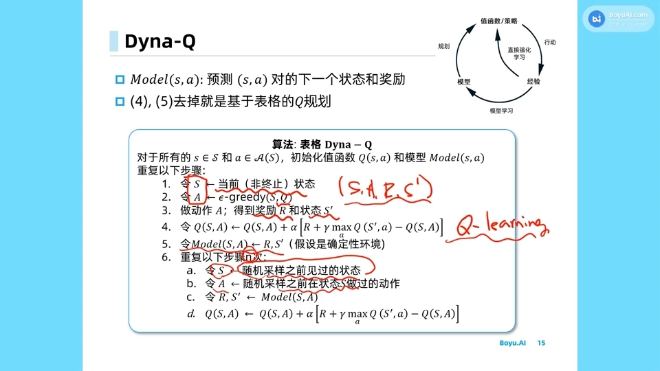
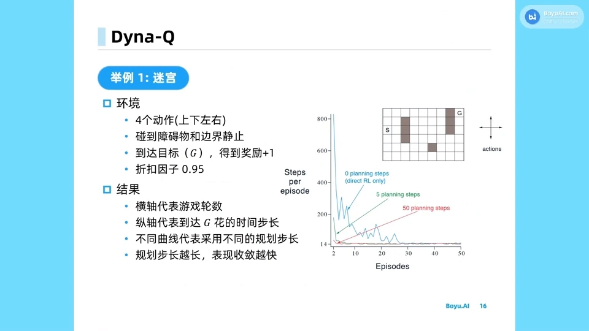
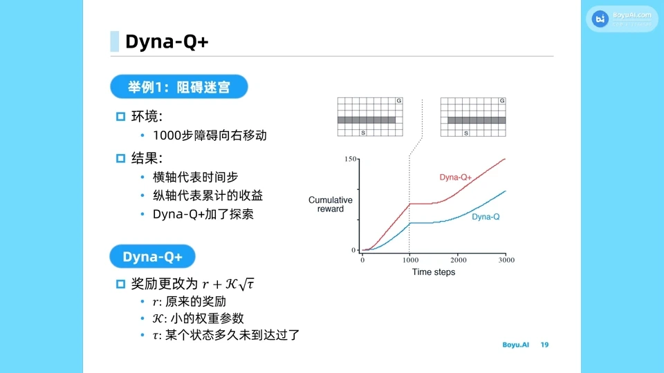

# 环境模型与规划：Dyna 架构如何把学习与规划合起来

> 本篇整理自上海交通大学张伟楠《18. 规划与学习之入门算法介绍》。视频地址：[BV1v8411W7iV](https://www.bilibili.com/video/BV1v8411W7iV/)。本篇是第 10 章的开篇：前九章的方法（值迭代、蒙特卡洛、TD、DQN 家族、策略梯度、Actor-Critic、TRPO/PPO/SAC）全部是**免模型**的，它们不碰环境模型，只靠与环境交互拿到的样本。本章换一条路——**先把环境学出来**。这一篇先讲清「模型是什么、拿它做什么、和直接学策略有什么不同」，Dyna 只是这条路上的第一个路标。



[【跳转到 01:34】](https://www.bilibili.com/video/BV1v8411W7iV/?t=94)

## 本讲要解决的核心问题（SCQA）

**背景**：第 3 章的动态规划（策略评估、策略迭代、价值迭代）算得又快又准，但它有一个前提——**环境的转移概率 $P(s'\mid s,a)$ 和奖励 $R(s,a)$ 是已知的**，可以直接对着它们做期望。现实中这个前提几乎从不成立：机器人的摩擦系数、股票的下一步价格、对手的下一手棋，我们都拿不到那张转移表。

**冲突**：正因为模型未知，第 4 章之后我们才转向**免模型方法**——蒙特卡洛用完整轨迹的平均回报代替期望，时序差分用一步采样加自举代替期望，DQN 用神经网络拟合价值，策略梯度直接对策略求梯度。这些方法确实绕开了模型，但代价是**样本**：每一步更新都要真金白银地与环境交互。在仿真里这无所谓，在真机上这就是时间、磨损和风险。

**疑问**：既然免模型方法是为了绕开「模型未知」才发明的，那能不能反过来——**把模型从数据里学出来**，然后用这个学到的模型去替代真实环境？学出来的模型该怎么用？用它做「规划」和直接学策略，到底差在哪里？

**回答（中心思想）**：模型就是一张**给定 $(s,a)$ 预测 $(s',r)$ 的预测器**。拿到它之后有两条用法，对应两种「经验」：一条是把模型采样出来的**模拟经验**喂给价值函数更新，这叫**规划（planning）**；另一条是继续用真实经验更新，这叫**学习（learning）**。两者在算法层面是同一台机器——都是回溯（backup）——只是数据来源不同。**Dyna 架构的价值就在于把这两条支路装进同一个循环**：真实经验既用来直接更新价值函数，也用来更新模型，模型再反过来生成模拟经验加速价值函数的更新。而这条路唯一的死穴是**模型误差会随推理步数复合**，所以 Dyna 里模型永远只往前推一步。

---

## 一、环境模型：给定状态和动作，预测下一个状态和奖励

### 1.1 「模型」指的是环境的模型，不是策略的模型

先说一个容易混淆的地方：在强化学习里说「模型」，**指的从来不是智能体的策略**。策略是智能体自己的行为规则，模型是对**环境**的建模。所谓环境模型，就是回答这样一个问题：

> 在给定状态 $s$ 和动作 $a$ 的情况下，接下来环境会给出什么状态、什么奖励？

形式化地写，模型给出的是下一个状态与奖励的联合分布：

$$
p(s', r \mid s, a)
$$

这就是一个**预测性模型**（predictive model）。如果这个预测性模型的输入是由它上一轮的输出决定的——也就是把预测出的 $s'$ 再喂回去预测下一个 $s''$——那它就变成了一个**动态模型**（dynamic model），可以自己往前滚出一条轨迹。

### 1.2 分布模型与样本模型：白盒与黑盒

环境的模型分两类，区别在于「你拿到的是概率，还是只能拿到样本」。

**第一类是分布模型（distribution model）**，也叫白盒模型。它把所有的条件分布都完整给你：模型内部每个组件的条件概率你都知道，可以直接拿来算。张伟楠举的例子是掷骰子——如果是分布模型，你拿到的是「这几个骰子数字总和的所有可能性及其概率」这张完整的表，可以直接算期望、做动态规划。

**第二类是样本模型（sample model）**，也叫黑盒模型。你不知道它内部的条件概率长什么样、是多少，只能不断地把 $(s,a)$ 喂进去，它采样出一个 $(s', r)$ 给你；不断喂下去，它能采样出一条轨迹。你得到的是**数据输出**，不是**概率**。

这个区分很关键，因为它决定了后面能用什么算法：

| 拿到的东西 | 能做什么 | 典型用法 |
| --- | --- | --- |
| 分布模型（概率） | 直接算期望、做动态规划、做反向传播式的推导 | 第 3 章的 DP |
| 样本模型（采样） | 只能采样出经验，再对经验做回溯 | Dyna、Q-planning、MBPO |

张伟楠也提到，白盒模型除了「采样」之外还有别的用法（比如用它的条件分布组件做动态规划，甚至做反向传播），这些是较新的研究方向；本讲关注的是**最主流的那一种用法：用模型生成模拟经验**。

### 1.3 模型的用途：造出「模拟经验」

模型的第一个、也是用得最多的用途，是**生成模拟的经验数据**（simulation experience data）。这件事的意义在于：真实经验是稀缺的，模拟经验是廉价的。只要模型在手，智能体就可以在两次真实交互之间，在「脑子里」把各种可能性演练一遍。

至于「用模型做规划」到底是怎么一回事，需要先把规划这个概念讲清楚。

---

## 二、规划：输入一个模型，输出一个策略的搜索过程

### 2.1 规划的定义

张伟楠给的定义非常简洁：

> 规划（planning）就是**输入一个模型、输出一个策略的搜索过程**。

画成图是一条直线：模型 $\to$ 规划 $\to$ 策略。这里的重点是「搜索」两个字——模型本身不会告诉你该做什么，它只会告诉你「做了会怎样」；必须有一个搜索过程，在模型上反复试算，才能把「会怎样」变成「该怎么做」。



[【跳转到 05:19】](https://www.bilibili.com/video/BV1v8411W7iV/?t=319)

### 2.2 两类规划：在状态空间里搜，还是在动作序列上搜

规划分两类，本讲主要用第一类。

**状态空间的规划（state-space planning）**：在**状态**上做搜索，推理的是状态的转换。这是本章后面所有算法（Dyna、MCTS、MPC）的框架。

**规划空间的规划（plan-space planning）**：状态本身意义不大，直接输出一个**动作序列**，然后在这个动作序列上不断细化（refinement），最终得到一个完整的规划。张伟楠举的例子是规则比较简单的棋类游戏，或者文本生成的规划——在这些问题里，「状态」本身就是由动作序列决定的，所以可以直接在动作序列上做搜索。这类规划会用到遗传算法、偏序规划之类的工具。

### 2.3 规划的通用框架：模型 → 模拟经验 → 回溯 → 价值函数 → 策略

状态空间规划的通用套路是四步：

1. 用**模型**采样，得到**模拟经验**；
2. 对模拟经验做**回溯（backup）**，更新每个状态上的**价值函数**；
3. 由价值函数导出**策略**；
4. （可选）随时打断，用当前的价值估计先做一个动作。



[【跳转到 06:34】](https://www.bilibili.com/video/BV1v8411W7iV/?t=394)

张伟楠用围棋打比方：回溯之后我们得到的是「每一个棋盘状态上黑白双方的胜率」，有了这张胜率表，在任何一个位置都能判断下一步该下哪里。最经典的例子是**动态规划**：搜索整个状态空间、生成所有状态的转移分布，再沿着这张转移图回溯，把每个节点上的价值函数更新到位，最后在每个节点上取「让下一个节点价值最高」的动作。

### 2.4 规划的三个好处：可打断、可重定向、可增量

规划相对于「一次性算完一个策略」有几个很实用的性质：

- **可以在任何时间点被打断或重定向**。下棋时走到一个新状态，马上从当前状态重新规划即可，不必从头再来。
- **可以按时间或算力预算随时叫停**，用当前已有的估计立刻做出一个动作——所以它天然是**即插即用**的。
- **小的、增量式的规划非常有效**。在很多复杂问题上，只往前多做几步规划，效果马上就有明显提升。

这三点解释了为什么后面 MCTS、MPC 这类「决策时规划」方法能在实时系统里用起来：它们不需要把全局策略算完，只需要在当下这个状态上算够用为止。

---

## 三、规划与学习：同一台机器，两种燃料

### 3.1 不同点：模拟经验 vs 真实经验

规划和学习最直接的区别在**数据来源**：

- **规划**：用**模型产生的模拟经验**直接提升策略；
- **学习**（这里指免模型的强化学习）：用**环境产生的真实经验**提升策略。

张伟楠的类比很形象：对环境建好模型之后，用模型采样、再基于采样提升策略，就好比你在大脑里建了一个「世界如何演绎」的模型，然后直接在大脑里推演，把接下来的计划定得更好——这就是规划。人生规划、职业规划都是这个意思：你懂一些世界运行的基本原理，于是在脑子里推演接下来几年该怎么走。

### 3.2 相同点：都靠回溯更新价值函数

但两者在算法层面是**同一台机器**：

- 无论是看到的数据，还是模拟出来的数据，都可以拿来做**时序差分学习**（temporal-difference learning），而 TD 就是回溯的一种基本方法；
- 所以「学习的方法可以直接用在模拟经验上」——这一句话是整章的技术支点。它意味着：**我们不需要为「有模型」重新发明一套算法，只要把免模型算法里的真实样本换成模拟样本就行。**

### 3.3 Q-planning：把 Q-learning 搬到模拟经验上

把上面这句话落到实处，就得到一个极简的算法——**Q-planning**（基于表格的 Q 规划）：

```
重复以下步骤：
  1. 随机选择一个状态 S 和一个动作 A
  2. 把 (S, A) 输入采样模型，得到采样出来的奖励 R 和下一个状态 S'
  3. 对 (S, A, R, S') 做一步表格 Q 学习：
     Q(S,A) ← Q(S,A) + α [ R + γ max_a Q(S',a) - Q(S,A) ]
```



[【跳转到 09:08】](https://www.bilibili.com/video/BV1v8411W7iV/?t=548)

注意这里的细节：这个四元组 $(S, A, R, S')$ 里，**只有 $S$ 和 $A$ 是真实的，$R$ 和 $S'$ 都是模型编出来的**。所以第 3 步虽然长得和 Q-learning 一模一样，却不能叫 Q-learning——它叫 **Q-planning**。名字的差别提醒我们：这条更新用的不是真实经验，而是模型的预测。

---

## 四、Dyna：把学习与规划装进同一个循环

### 4.1 同一份经验的两条用途，对应两种代价

Dyna 的核心洞察是：**一条真实经验可以花两次**。

- **用途一：更新模型。** 把 $(s,a,r,s')$ 存进模型，让模型更准。这条路的优点是**对经验数据的需求少**——模型学的是环境规律，规律一旦学会，就能反复用来生成无穷多模拟经验；缺点是模型会有偏差。
- **用途二：直接更新价值函数和策略。** 这就是普通的免模型强化学习。优点是**简单、不受模型偏差影响**——它永远对着真实环境学；缺点是费样本。



[【跳转到 12:11】](https://www.bilibili.com/video/BV1v8411W7iV/?t=731)

这张图值得多看两眼，因为它把整章要讲的权衡画出来了：**左边那条「直接强化学习」的路，是第 1～9 章走过的；右边那条「先学模型、再做规划」的路，是第 10 章要走的；而 Dyna 是让两条路同时走。**

### 4.2 Dyna 框架：真实经验 + 模拟经验一起用

Dyna 框架的循环是这样的：

1. 智能体与环境交互，产生**真实经验**；
2. **左边**：基于真实经验直接更新价值函数或策略（直接强化学习更新）；
3. **右下角**：用真实经验更新**模型**（模型学习）；
4. **右边**：基于模型随机采样得到**模拟经验**，用模拟经验做规划更新，更新价值函数或策略。



[【跳转到 13:26】](https://www.bilibili.com/video/BV1v8411W7iV/?t=806)

### 4.3 Dyna-Q 的伪代码

把上面四步写成算法就是 **Dyna-Q**：

```
对于所有的 s ∈ S 和 a ∈ A(s)，初始化值函数 Q(s,a) 和模型 Model(s,a)
重复以下步骤：
  1. 令 S ← 当前（非终止）状态
  2. 令 A ← ε-greedy(S, Q)
  3. 做动作 A，得到奖励 R 和状态 S'
  4. Q(S,A) ← Q(S,A) + α [ R + γ max_a Q(S',a) - Q(S,A) ]      ← 真实经验，一步 Q-learning
  5. Model(S,A) ← R, S'                                        ← 用真实经验更新模型
  6. 重复以下步骤 n 次：                                        ← 规划
       a. 令 S ← 随机采样之前见过的状态
       b. 令 A ← 随机采样之前在状态 S 下做过的动作
       c. 令 R, S' ← Model(S,A)
       d. Q(S,A) ← Q(S,A) + α [ R + γ max_a Q(S',a) - Q(S,A) ]  ← 模拟经验，一步 Q-planning
```



[【跳转到 15:26】](https://www.bilibili.com/video/BV1v8411W7iV/?t=926)

第 4 步和第 6d 步的公式**完全一样**，区别只在于数据来自真实环境还是模型——这正是第三节说的「同一台机器，两种燃料」。如果模型是确定性的，第 5 步就像存一个函数表，$Model(S,A)$ 直接返回 $r$ 和 $s'$；如果模型是参数化的函数或条件分布，就需要采样。

### 4.4 为什么只往前推一步：复合误差

伪代码第 6 步有一个容易忽略的细节：**这 $n$ 次 Q-planning 并不是沿着一条轨迹连续模拟下去**。每一次都是从「之前见过的某个状态」重新开始，随机采一个在那个状态下做过的动作，模型**只往前推理一步**。

为什么不做多步？张伟楠的回答是：**连续推理 $n$ 步之后，环境会变得非常不精确**，这叫做 **compounding error（复合误差）**。单步误差可能只有一点点，但每一步的误差都会成为下一步的输入，多步之后误差被放大到不可用的程度。所以在 Dyna-Q 里，模型永远只推一步；用只推一步产生的模拟经验去做数据扩充，就足以把 Q 表格学得更好。

> 复合误差是第 10 章最核心的技术难点，10.2 会专门展开；这里只需要记住结论：**模型推理的步数是一个必须小心控制的旋钮**。

---

## 五、实验：规划步数越多，收敛越快

### 5.1 迷宫设置

张伟楠用一个格子迷宫做实验：

- 动作是上下左右 4 个；
- 碰到障碍物或边界就停在原地；
- 到达目标 $G$ 得到奖励 $+1$；
- 折扣因子 $\gamma = 0.95$；
- 横轴是训练回合数，纵轴是每回合到达 $G$ 所需的步数（越低越好）。



[【跳转到 16:46】](https://www.bilibili.com/video/BV1v8411W7iV/?t=1006)

### 5.2 结果：规划步数越多，收敛越快

三条曲线分别是 $n=0$（纯 Q-learning，不做规划）、$n=5$、$n=50$：

- $n=0$：曲线下降最慢，需要几十个回合才把每回合步数压下来；
- $n=5$：下降明显更快；
- $n=50$：最快到达最优策略。

结论很直接：**在环境比较简单、模型容易学准的场合（比如格子迷宫），做规划是非常划算的**。

### 5.3 为什么规划有效：价值被更快地传播出去

原因在于**价值传播的速度**。不做规划时，智能体在离终点很远的地方走一步，那一步的 $Q$ 值几乎不会变化——因为价值只能从终点一格一格往回传，每一步都要求恰好采样到相邻的转移。做了规划之后，智能体可以采样到大量转移，其中经常会有离终点比较近的那些；这些转移被更新之后，它们影响的区域就会更广，价值就能更快地往远处扩散。

这也解释了 Dyna-Q 为什么要把 Q-planning 和 Q-learning 放在一起：**Q-learning 保证价值最终对准真实环境，Q-planning 负责把已有价值快速铺开。**

---

## 六、Dyna-Q+：环境会变，所以要持续探索

### 6.1 给久未访问的状态加奖励

Dyna-Q 有一个隐含假设：环境是**不变**的。如果环境在训练中途变了（比如迷宫里多了一堵墙），Dyna-Q 会一直按旧模型行动，很久都恢复不过来。

**Dyna-Q+** 的解决办法是「在奖励上做手脚」，鼓励智能体周期性地回去看看那些很久没去过的状态：

$$
r' = r + \kappa\sqrt{\tau}
$$

其中 $r$ 是原来的奖励，$\kappa$ 是一个小的权重系数，$\tau$ 是**这个状态有多久没有被到达过**。$\tau$ 越大，额外奖励越大，智能体就越有动力去访问它——这就是一种积极的探索激励。



[【跳转到 20:56】](https://www.bilibili.com/video/BV1v8411W7iV/?t=1256)

### 6.2 两个实验：障碍移动与捷径出现

**实验一（障碍移动）**：迷宫在第 1000 步时把障碍物往右移，原本的最优路线被堵死，必须从左边绕。结果 Dyna-Q 在 1000 步之后有接近 1000 步的时间是「停住」的——它按旧模型走，走不通也不知道换路；而 Dyna-Q+ 因为持续探索，累计收益上升得更快，能更快从环境变化中恢复。

**实验二（捷径出现）**：3000 步之前最优路径要从左边路口走，3000 步之后右边出现了一条更近的捷径。Dyna-Q+ 同样比 Dyna-Q 更快发现这条捷径。

这两个实验说明：**探索不只是为了「学到更多」，也是为了「发现世界变了」。**

---

## 七、这条路往后怎么走：从 Dyna 到世界模型

张伟楠这一讲只讲了「入门」：模型是什么、规划是什么、Dyna-Q 怎么把两者合起来。而这正是第 10 章的地图起点。沿着这条路往后，每一站解决的都是 Dyna 留下的一个具体问题：

| 方法 | 它解决的问题 | 在本章的位置 |
| --- | --- | --- |
| Dyna / Dyna-Q | 怎么把真实经验与模拟经验混在一起用 | 10.3 |
| MCTS / UCT | 状态空间太大、不能全局回溯时，怎么在决策时做有选择的搜索 | 10.4 |
| AlphaZero / MuZero | 模型可以是隐式的、甚至不需要知道规则 | 10.5 |
| PETS / MBPO / Dreamer | 模型不准怎么办：集成模型、短 rollout、隐空间世界模型 | 10.6 |

而 Dyna 留下的两个隐患，也正是后面所有方法要处理的：

1. **模型误差会复合**（4.4 节）——所以 MBPO 只做很短的 rollout，Dreamer 在隐空间里做想象；
2. **模型只在数据覆盖的地方可信**——所以需要不确定性估计、需要集成模型、需要控制策略不要跑到模型没见过的区域。

至于「有模型」和「免模型」到底该怎么选、各自的代价是什么，见本条的姊妹篇《用计算换样本：无模型与有模型强化学习的权衡》。

---

## 小结

- **模型是对环境的建模**，不是策略的建模；它给出 $p(s',r\mid s,a)$，即给定状态动作预测下一个状态与奖励。
- 模型分**分布模型**（白盒，能拿到概率）与**样本模型**（黑盒，只能采样出数据）两类，后者是本章算法的主要工作对象。
- **规划 = 输入模型、输出策略的搜索过程**；通用框架是「模型采样出模拟经验 → 回溯更新价值函数 → 导出策略」。
- **规划与学习的算法是同一台机器**：都靠回溯更新价值函数，区别只在数据来自模型还是来自环境。把 Q-learning 的样本换成模型样本，就得到 **Q-planning**。
- **Dyna 把两条支路装进同一个循环**：真实经验一路直接更新价值函数（简单、无模型偏差），一路更新模型再由模型做规划（省样本、但有偏差）。
- **Dyna 的规划永远只往前推一步**，因为连续推理会让**复合误差**放大到不可控——这是 10.2 的主题。
- 迷宫实验证明：规划步数越多，价值传播越快、收敛越快；**Dyna-Q+** 用 $r + \kappa\sqrt{\tau}$ 鼓励回访久未访问的状态，从而在环境变化时更快恢复。

## 关键术语速查

| 术语 | 一句话解释 |
| --- | --- |
| 环境模型（model） | 给定 $(s,a)$ 预测 $(s',r)$ 的预测器，记作 $p(s',r\mid s,a)$ |
| 分布模型（distribution model） | 白盒模型，能给出所有轨迹的可能性及其概率 |
| 样本模型（sample model） | 黑盒模型，只能按概率采样出一条可能的轨迹 |
| 规划（planning） | 输入一个模型、输出一个策略的搜索过程 |
| 状态空间规划（state-space planning） | 在状态转换上做搜索，本章算法的主框架 |
| 规划空间规划（plan-space planning） | 直接在动作序列上搜索与细化，如遗传算法、偏序规划 |
| 模拟经验（simulated experience） | 由模型采样出来的 $(s,a,r,s')$，不是真实交互得到的 |
| 回溯（backup） | 用后继状态的价值估计更新当前状态的价值 |
| Q-planning | 用模拟经验做一步表格 Q 学习；与 Q-learning 只差数据来源 |
| Dyna | 把直接强化学习、模型学习、规划三者装进同一循环的架构 |
| 复合误差（compounding error） | 模型单步误差在多步推理中被逐步放大，导致长 rollout 不可信 |
| Dyna-Q+ | 在奖励上加 $\kappa\sqrt{\tau}$ 鼓励回访久未访问状态的 Dyna-Q 变体 |