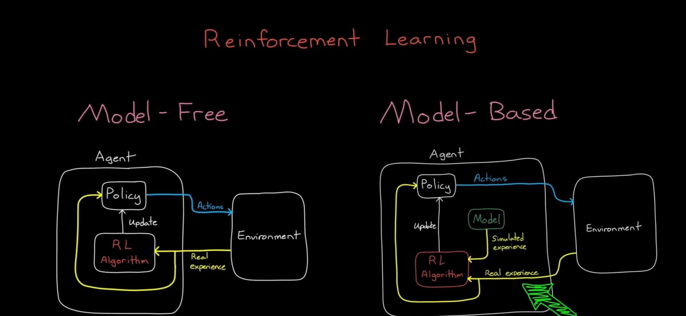
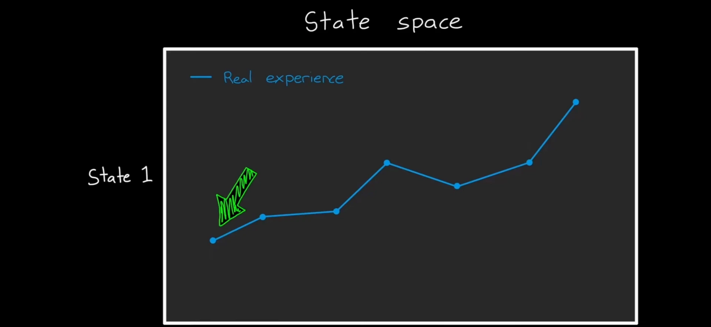
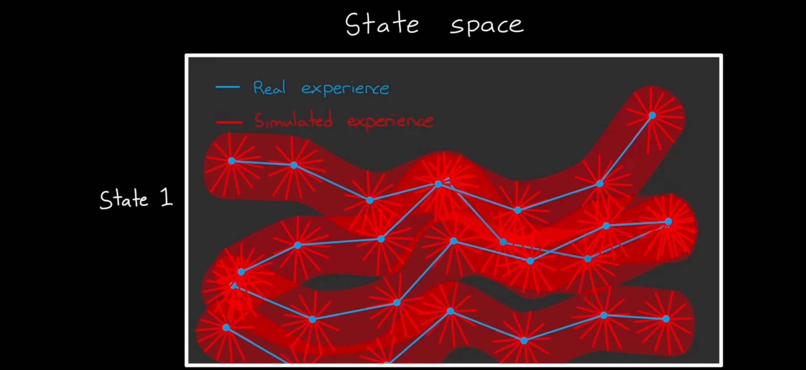
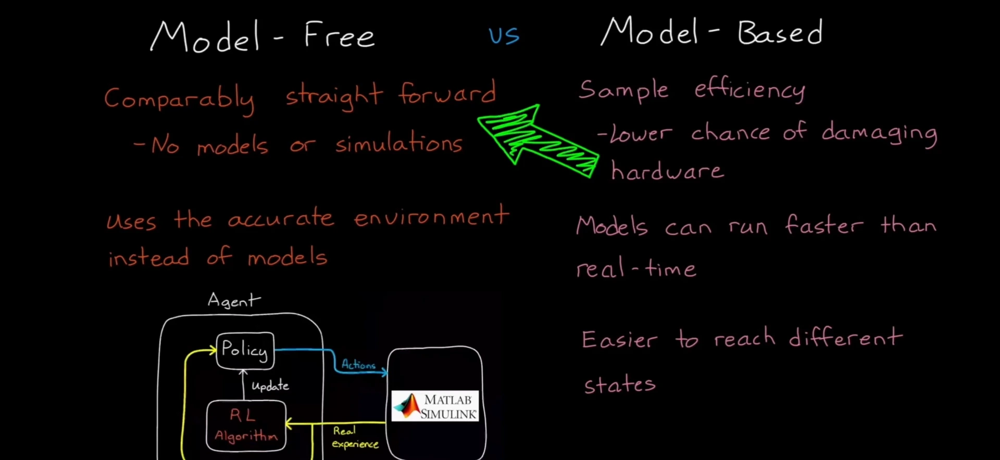
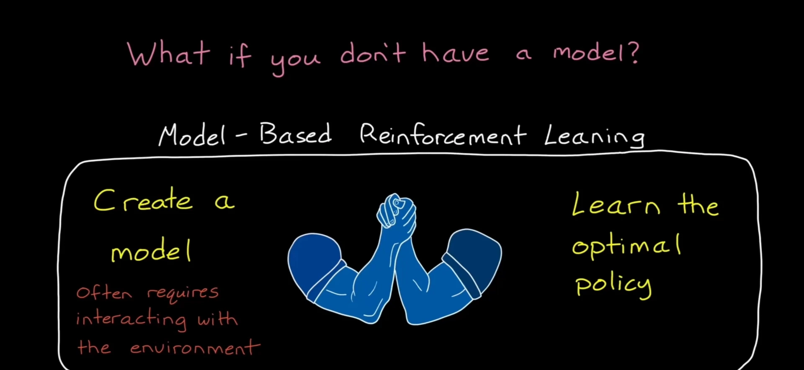
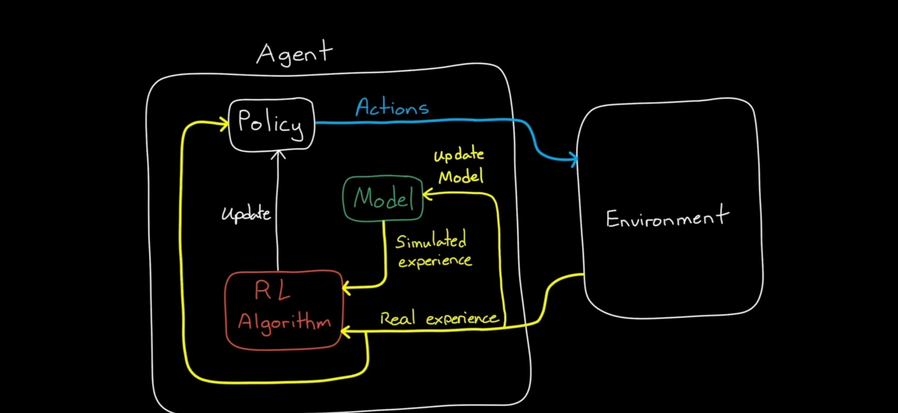
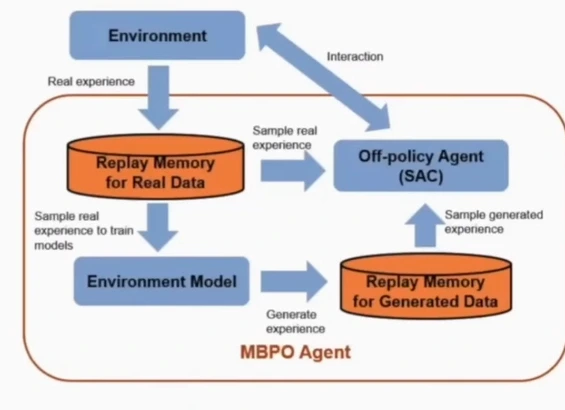
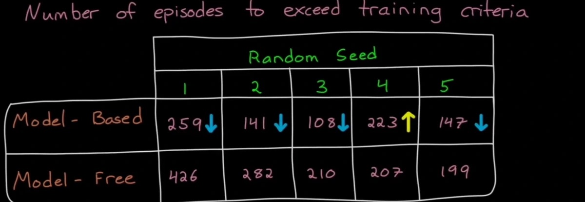

# 用计算换样本：无模型与有模型强化学习的权衡

> 本篇整理自 MATLAB Tech Talks《无模型和基于模型的强化学习有什么区别》（B 站中配版，BV1mg4y1F75N）。视频地址：[BV1mg4y1F75N](https://www.bilibili.com/video/BV1mg4y1F75N/)。姊妹篇《环境模型与规划：Dyna 架构如何把学习与规划合起来》讲的是「模型怎么用」，这一篇讲的是「什么时候值得用」——**有模型方法拿算力换样本，值不值，取决于你的样本有多贵。**

[【跳转到 01:39】](https://www.bilibili.com/video/BV1mg4y1F75N/?t=99)

## 本讲要解决的核心问题（SCQA）

**背景**：强化学习的基本套路是让智能体与环境交互、根据奖励调整策略。前九章的所有算法——从 Q-learning 到 PPO、SAC——都遵循这个套路，它们统称**无模型（model-free）**方法：智能体的全部学习材料，都来自与真实环境的直接交互。

**冲突**：真实交互是有代价的。在仿真里代价是机时，在真机上代价是时间、磨损，甚至可能是硬件损坏。而另一条路——**基于模型（model-based）**——让智能体在自己内部维护一个环境模型，用它生成大量**模拟经验**来学习，从而少碰真实环境。听起来是免费的午餐，但模型本身要学、要算，而且模型不准时会教出错误的行为。

**疑问**：既然两条路各有代价，那**到底该在什么时候选哪一条**？基于模型方法省下来的样本，是用什么换来的？模型不准的时候怎么办？

**回答（中心思想）**：核心权衡只有一句话——**基于模型的方法用更多的计算，换更少的真实交互**。它在样本效率上通常高出一截（在手推车杆实验里大约省一半回合），但代价是额外的算力开销，以及**模型偏差**带来的风险：模型不准时，智能体会学到在真实环境里行不通的行为，只能靠真实经验慢慢纠正。所以选择的判据不是「哪个算法更先进」，而是**你的样本有多贵**：样本便宜（仿真里）就用无模型，样本昂贵（真机上）就用有模型。

---

## 一、两种架构只差一个模型

### 1.1 无模型：所有经验都来自真实环境

无模型的智能体只通过与环境的直接交互来学习最优策略。它的循环很简单：

1. 策略输出一个动作；
2. 动作作用到环境上，环境返回观测和奖励（这就是**真实经验**）；
3. 强化学习算法用这条真实经验更新策略。

智能体用来学习的所有经验，全部由真实环境产生。没有模型，也没有模拟器。

### 1.2 有模型：智能体内部多了一个「世界的心智模型」

基于模型的智能体也用真实经验，但它的内部还有一个**环境模型**。这个模型能做一件无模型智能体做不到的事：**在智能体内部生成额外的、模拟出来的经验**。

用一个类比来理解这件事：智能体内部有了一个「世界如何运转」的心智模型，于是它可以**靠思考来学习，而不只是靠行动来学习**。

视频里用体育比赛打比方：A 队和 B 队从未交过手。

- **无模型的做法**：A 队只能上场真打，边打边试战术，看哪些有效，然后实时调整。要了解 B 队，就必须与 B 队真实交互。
- **有模型的做法**：A 队在头脑里建立一个「B 队怎么打球」的模型。这个模型可能不完全准确，但在两队下一次交手之前，A 队就可以先在脑子里推演不同战术、评估它们能不能奏效。**它不必直接与 B 队交互，仅靠「想」就完成了学习和提高。**

这就是基于模型方法能在**两个回合之间**就取得进步的原因——真实比赛之间，它还能在脑子里练。

### 1.3 一个容易混淆的点：「真实环境」不等于「物理世界」

视频特意澄清了「真实环境」这个词：它只是指**智能体之外的那个环境**，并不要求环境是真实的物理实体。

在强化学习里，我们经常用环境模型（比如一个仿真器）来训练智能体，只是那个模型在智能体**外面**——智能体学习的唯一途径仍然是采取动作、接收环境的响应。这时候它仍然是**无模型**的：从智能体的角度看，那个仿真器就是它的环境，它完全通过直接交互来学习。

只有当模型存在于智能体**内部**、智能体可以不采取任何动作就在内部查询它时，这才变成**基于模型**的强化学习。这个区分很重要，因为后面所有的权衡，都建立在「模型在智能体内部、可以随便查」这个前提上。

---

## 二、样本效率从哪来：模拟经验把状态空间填满

### 2.1 无模型只能覆盖真实走过的那一小块

想象一个矩形代表环境的整个状态空间，我们希望智能体探索整片区域、学到最优策略。

无模型的智能体从起始状态出发，执行真实动作，随时间推移转移到一个个状态——这些点连起来就是一条**真实轨迹**。它只能从这些经验里学习，所以它覆盖的区域就是这条轨迹周围很窄的一条带子，**远远没有覆盖状态空间的大部分面积**。

[【跳转到 03:49】](https://www.bilibili.com/video/BV1mg4y1F75N/?t=229)

### 2.2 有模型：每个真实状态上都能长出成千上万次模拟

如果智能体有环境模型，它在**每一个时间步**都可以问一句：「如果我当时采取别的动作，会发生什么？」于是从同一条真实轨迹出发，它在每个时间步都能生成成千上万次模拟——即使这些模拟只是往前看一步。

真实经验加上模拟经验合起来，覆盖的就是一大片区域，而不只是一条线。

[【跳转到 04:39】](https://www.bilibili.com/video/BV1mg4y1F75N/?t=279)

要覆盖同样大的区域，基于模型的智能体需要的**真实交互**就少得多——这就是它样本效率更高的原因。用记号写出来会更清楚：无模型方法只从真实转移集合

$$
\mathcal{D}_{\text{real}} = \{(s_t, a_t, r_t, s_{t+1})\}
$$

里学习；基于模型方法则先从 $\mathcal{D}_{\text{real}}$ 学一个模型 $\hat{f}(s,a) \approx s'$、$\hat{r}(s,a) \approx r$，再用它扩充出一个大得多的集合

$$
\mathcal{D}_{\text{sim}} = \left\{(s,\, a,\, \hat{r}(s,a),\, \hat{f}(s,a)) \mid (s,a) \in \mathcal{D}_{\text{real}}\right\}
$$

然后在这两个集合上一起学策略。**样本效率的收益，全部来自 $\mathcal{D}_{\text{sim}}$ 的规模。**

### 2.3 代价立刻出现：模拟要算

但这是有代价的：**跑模拟需要额外的算力**，比直接与真实环境交互更费计算。

所以整件事可以概括成一句话：**我们省下的样本，是用更多的计算换来的。** 这就是本篇的核心权衡，后面几节都是在展开它的两面。

---

## 三、代价之一：模型不准会教坏策略

### 3.1 模型不如现实世界准确

模型是从有限数据里拟合出来的，它不如现实世界准确。一个用着不完美心智模型的智能体，可能学到一些**在真实环境里根本行不通的行为**——因为模型告诉它「这么做很好」，而现实并非如此。

### 3.2 后果：学错—纠正—再学错的低效循环

如果模型一直不准，智能体就会不断学到错误的东西，然后靠真实环境纠正，再学错、再纠正，效率非常低。

而无模型强化学习**没有这个问题**，因为智能体始终直接从外部环境学习——它学到的每一条经验都是真的，不存在「被模型骗」这回事。

这就是权衡的另一面：**基于模型方法省样本，但它把「环境是否可信」这个问题，换成了「模型是否可信」这个问题。** 前者由现实保证，后者只能靠数据和算法保证。

---

## 四、代价之二（也是收益）：什么时候样本特别贵

### 4.1 无模型的好处：简单

相比之下，无模型强化学习简单直接：让智能体采取动作，根据观测和奖励更新策略，不必折腾模型，也不必搭任何模拟器。**简单**本身就是无模型方法最大的优点之一——少一个会出错的东西。

### 4.2 有模型的三个好处

基于模型方法需要的外部交互更少，这在几种场合特别值钱：

1. **物理系统。** 如果智能体控制的是机器人或车辆，真实动作有可能损坏硬件：智能体可能要求采取造成损坏的动作，或者仅仅是在许多连续运转中让部件磨损。少一次真实交互，就少一分风险。
2. **模型可以跑得比实时更快。** 通过运行模型，可以比实时更快地获得经验——真机上要花一分钟的动作，仿真里可能只要一毫秒。
3. **更容易把智能体放到难以进入的状态。** 在真实环境里很难（或很危险）到达的状态，在模型里可以随便去。

### 4.3 判据：样本效率重要，还是总算力重要

于是选择就变成了一个很实际的问题：

- **如果环境本身就是软件、或者已经是一个仿真**（比如真实环境的 Simulink 模型），那么**样本效率可能不如总算力重要**：多跑计算要花钱花时间，那还不如直接用无模型强化学习与环境交互。
- **如果环境是物理系统**，减少真实世界训练的次数是有价值的，**即使要以更多计算为代价**，也值得用基于模型的强化学习。

[【跳转到 07:53】](https://www.bilibili.com/video/BV1mg4y1F75N/?t=473)

---

## 五、没有模型怎么办：边学模型边学策略

### 5.1 自己建模的悖论

假如你想在物理系统上训练智能体，却事先没有环境模型，该怎么办？

一种办法是自己建一个模型交给智能体。建模这件事一直都在做，听起来不坏。**但通常建立模型本身就需要来自物理系统的数据**——你需要智能体与环境做物理交互，才能产生用来拟合模型的数据。

这就成了一个悖论：既然我们本来就要与环境交互才能得到模型，而目标又是用强化学习训练智能体，那为什么不把两者结合起来？

### 5.2 结合：一边学模型，一边学策略

答案就是**边学模型、边学策略**：智能体从环境拿到真实经验时，用这些数据**同时**更新模型和策略；于是在下一个真实回合之前，它就可以用模型生成额外的模拟经验来学习。

[【跳转到 09:08】](https://www.bilibili.com/video/BV1mg4y1F75N/?t=548)

[【跳转到 10:23】](https://www.bilibili.com/video/BV1mg4y1F75N/?t=623)

### 5.3 早期模型是垃圾，怎么办

这里有一个绕不开的问题：**学习早期大部分模型都是垃圾**。用一个不靠谱的模型训练智能体，会强化出在真实世界里表现很糟的行为。

好消息是：这些坏行为一旦在真实世界里被试出来、拿到较低的奖励，这些经验就会把策略纠正过来——**它最终还是能自我纠正**。

但自我纠正很慢，所以有一些办法可以减少智能体从「模型不准的区域」学习的几率。视频给的办法是**模型集成（ensemble）**：

- 智能体维护环境的**多个**模型（视频里是 3 个），每个都是神经网络，都用随机的权重和偏置初始化；
- 给它们相同的状态-动作输入，训练前它们会给出各不相同的随机预测；
- 训练之后，它们在**训练过的轨迹上**更容易给出一致的预测，而在其它输入上仍然输出随机的预测。

于是「一致」就成了一个廉价的可靠性信号：

- **所有模型预测一致** → 很可能说明智能体正在模拟一个它已经学会的状态，这条模拟经验可以用；
- **模型们不一致** → 这个预测很可能来自模型的随机部分，不可信。

具体怎么用有两种做法：一是**只在模型一致时才使用这条模拟经验**，不一致就丢掉；二是更简单的做法——**根本不管**，让智能体从所有模拟经验里学：一致时同一条行为会被强化多次（每个模型强化一次），不一致时会强化几个方向不同的随机行为，它们互相抵消。从统计上看，**模型一致时强化很强，模型不对时强化很弱**。

### 5.4 多模型的代价与收益

拥有多个模型给智能体提供了一条从模拟经验中更快学习的路径：**从不太准确的模拟经验中，得到更准确、但更慢的信息**。

所有这些通常会拉长训练的时间和算力开销，但它减少了真实世界所需的样本数量——又一次回到同一条权衡上。

---

## 六、实验：手推车杆上的一半回合、两倍时间

### 6.1 设置

视频用 MATLAB 的平衡车杆（cart-pole）例子做对比：

- 环境是一根自由旋转的杆子装在小车上，智能体要移动小车让杆子保持平衡；
- 基于模型的一侧训练的是 **MBPO**（Model-Based Policy Optimization，基于模型的策略优化）智能体；
- 这个智能体学习环境的**三个**神经网络模型，用它们生成模拟经验，补充从物理环境得到的真实经验；
- 基础智能体是 SAC（软演员-评论家）。

[【跳转到 12:59】](https://www.bilibili.com/video/BV1mg4y1F75N/?t=779)

### 6.2 结果：四个种子里省一半回合，一个持平

用 5 个不同的随机种子各跑一次，比较「达到训练标准所需的回合数」：

| 随机种子 | 1 | 2 | 3 | 4 | 5 |
| --- | --- | --- | --- | --- | --- |
| 基于模型（MBPO） | 259 ↓ | 141 ↓ | 108 ↓ | 223 ↑ | 147 ↓ |
| 无模型（基线） | 426 | 282 | 210 | 207 | 199 |

[【跳转到 13:42】](https://www.bilibili.com/video/BV1mg4y1F75N/?t=822)

读这张表要注意三件事：

1. **五次里有四次，基于模型的智能体用更少的回合就达到了训练标准**，大约只花了一半的回合数；
2. **有一次（种子 4）用掉的回合数差不多**，但那只是随机运气——单次实验的波动很大，不能只看一个种子；
3. **平均来看，基于模型的智能体样本效率更高**。

### 6.3 代价：运行时间大约翻倍

视频作者没有统计每个例子所需的计算量或实际耗时，但给了一个粗略的观察：**平均而言，无模型方法的运行时间大约只有基于模型方法的一半。**

也就是说，这个实验把权衡的两端都量出来了：

- **样本端**：基于模型方法省下大约一半的真实交互；
- **计算端**：基于模型方法多花大约一倍的时间。

所以「值不值」完全取决于你把这两端怎么定价——如果一次真实交互的代价远高于一倍算力（真机、危险环境、慢仿真），这笔交易就是赚的；如果真实交互很便宜（快仿真、纯软件环境），那就亏了。

---

## 七、把权衡收成一句话

回到开头的中心思想，现在可以把它说得更具体：

**基于模型强化学习 = 用计算换样本，并且用「模型可信度」替换「环境真实性」。**

- **收益**：样本效率高（实验里约省一半回合）、不磨损硬件、能跑得比实时快、能进入真实环境难以到达的状态；
- **代价**：额外的算力开销（实验里约多一倍时间）、模型偏差会让智能体学到在现实中行不通的行为、早期模型不可信需要额外机制（如集成）来兜底；
- **判据**：样本贵就用有模型，算力贵就用无模型。

而这条权衡的边界正在变得模糊：现代的世界模型方法（Dreamer 系列）已经能在隐空间里做「想象训练」，把基于模型方法的样本效率与免模型方法的最终性能同时拿到；MuZero 则把模型隐式地学进网络里，用学到的模型做树搜索。这些内容会在 10.5、10.6 展开。

---

## 小结

- **无模型**：所有经验来自真实环境，简单、不会「被模型骗」，但样本效率低。
- **有模型**：智能体内部多一个环境模型，可以生成模拟经验，**靠思考而不只是靠行动学习**。
- **「真实环境」指智能体之外的环境**；模型只有在智能体内部、可随时查询时，才叫基于模型的强化学习。
- **样本效率的来源**是模拟经验把状态空间填满：无模型只覆盖一条真实轨迹，有模型在每个真实状态上都能长出成千上万次模拟。
- **核心权衡**：用更多计算换更少真实交互。手推车杆实验里，基于模型方法约省一半回合，但运行时间约多一倍。
- **模型偏差是主要风险**：模型不准会教出坏行为，需要真实经验纠正；模型集成可以用「多个模型是否一致」作为廉价的可靠性信号。
- **选择判据是样本有多贵**：仿真里样本便宜，用无模型；真机上样本昂贵，用有模型。

## 关键术语速查

| 术语 | 一句话解释 |
| --- | --- |
| 无模型强化学习（model-free） | 不学环境模型，全部经验来自与真实环境的直接交互 |
| 基于模型的强化学习（model-based） | 智能体内部维护环境模型，用模型生成模拟经验辅助学习 |
| 真实经验（real experience） | 智能体与外部环境真实交互得到的 $(s,a,r,s')$ |
| 模拟经验（simulated experience） | 智能体内部模型生成的 $(s,a,\hat{r},\hat{s}')$ |
| 样本效率（sample efficiency） | 达到同样性能所需的真实交互次数，越少越高 |
| 模型偏差（model bias） | 模型与现实不一致导致的系统性误差，会让策略学到错误行为 |
| 模型集成（ensemble） | 同时训练多个模型，用它们是否一致来判断预测是否可信 |
| MBPO | 基于模型的策略优化：用模型生成短 rollout 补充真实数据来训练无模型算法 |
| SAC | 软演员-评论家，本实验中作为 MBPO 的基础（无模型）智能体 |