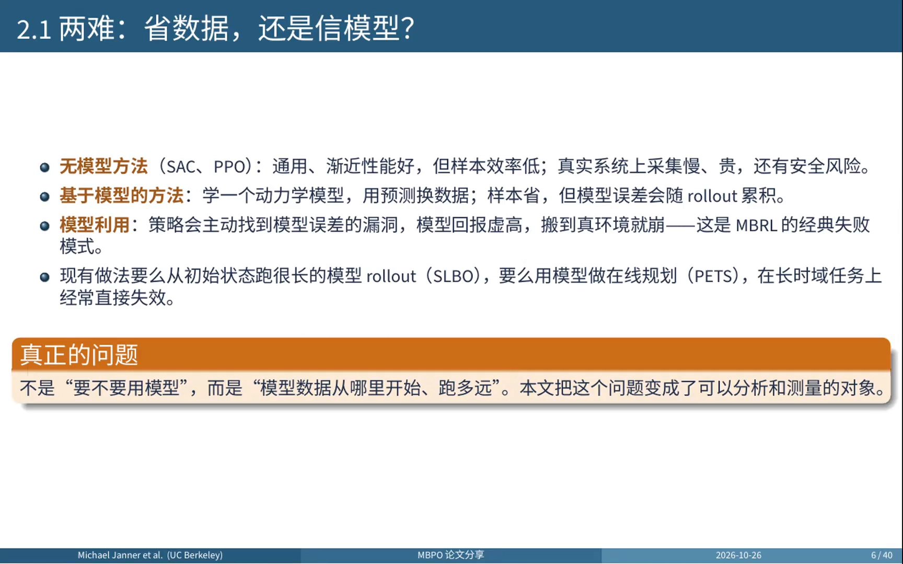
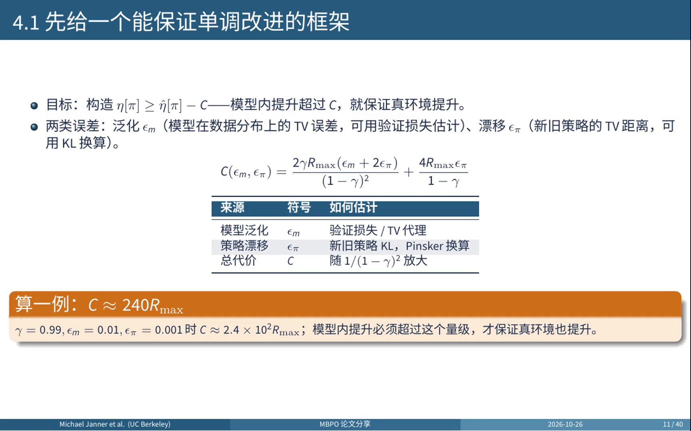
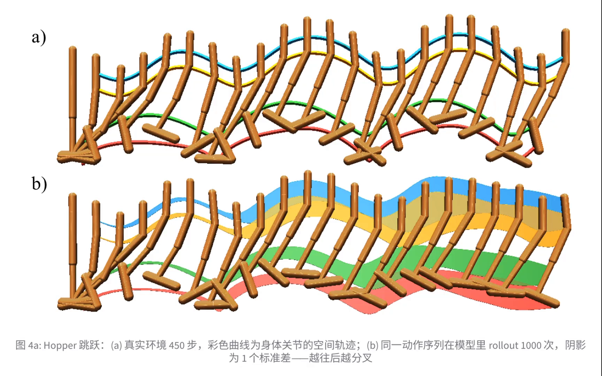
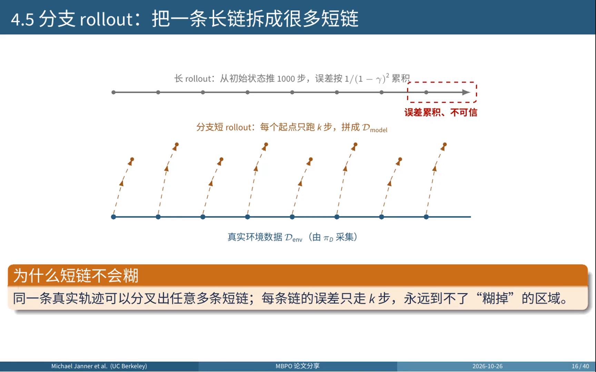
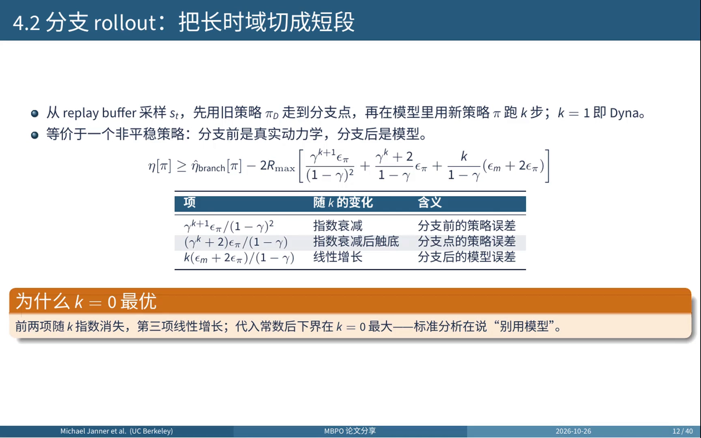
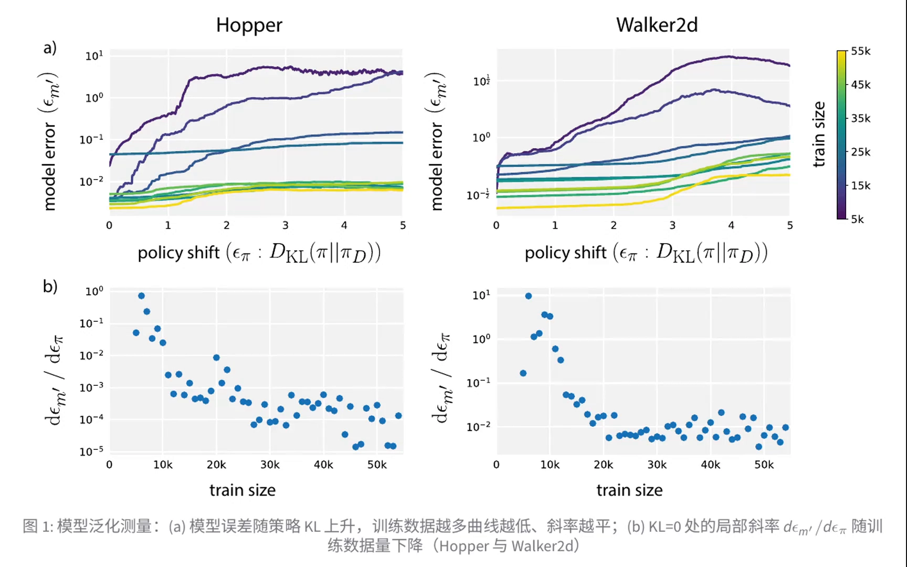
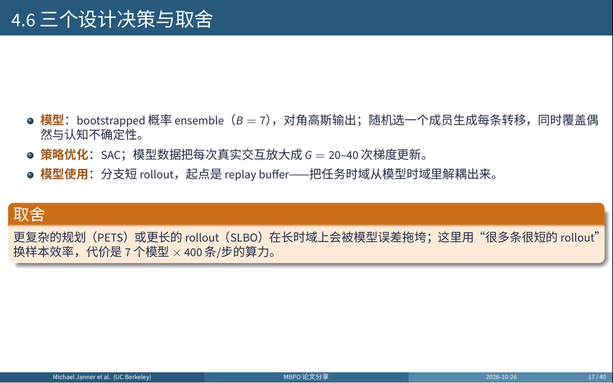
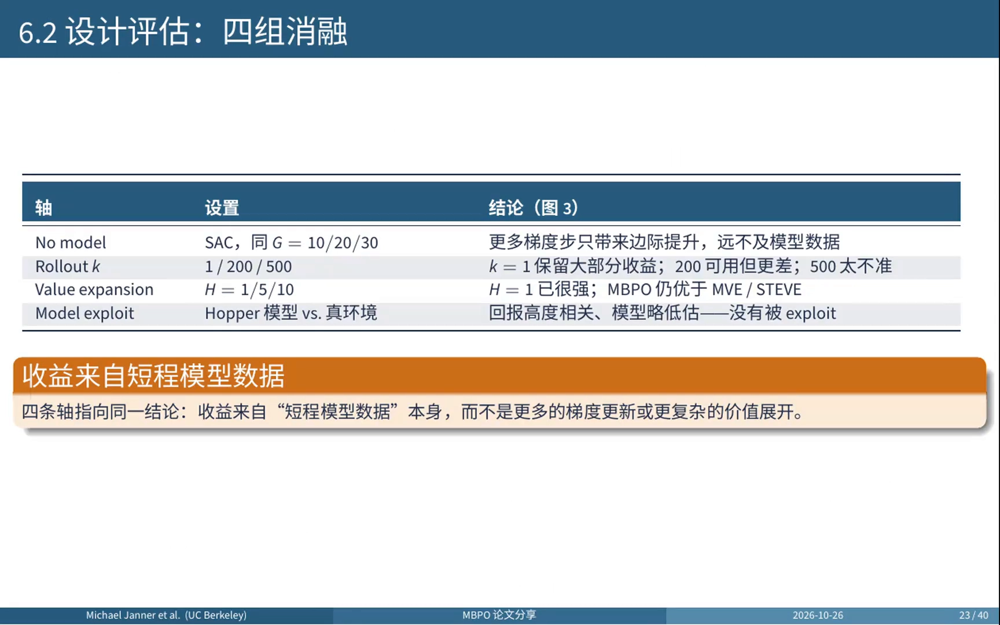
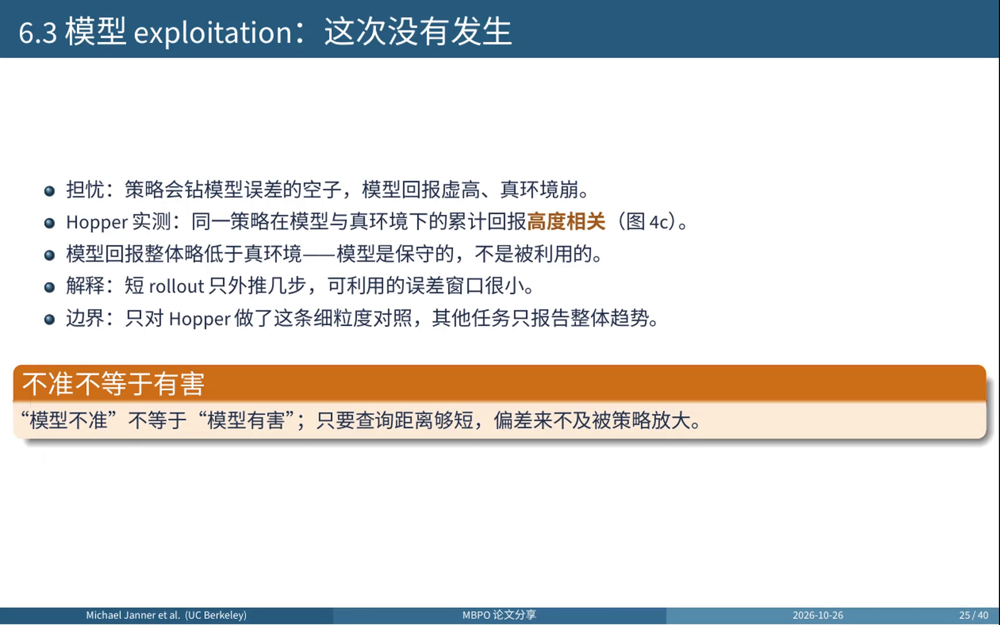

# MBPO：模型误差的平方级复合，与「只信 k 步」的定量答案

> 前提：我们用一个学到的转移模型 $\hat P(s'\mid s,a)$ 替代真实环境，靠模型生成的预测数据换样本效率。有模型与免模型的宏观权衡已在 10.1 讲清；本篇专攻一个具体问题——**单步模型误差 $\epsilon$ 经过 $H$ 步 rollout 之后到底会放大成多少**，以及 MBPO（Janner et al., NeurIPS 2019）给出的定量答案。

## 本讲要解决的核心问题（SCQA）

**背景**：基于模型的强化学习能大幅提升样本效率，方法上大体分三路——用概率模型做规划（PILCO、PETS）、用模型数据增强免模型学习（Dyna、MVE、STEVE、SLBO）、以及隐式规划。

**冲突**：模型一定有误差，而策略会主动寻找并放大这些误差。已有的做法要么从初始状态跑很长的模型 rollout（如 SLBO），要么用模型做在线规划（如 PETS）——它们在短时域上很强，但在标准的长时域任务上经常直接失效。

**疑问**：模型数据到底该怎么用？从哪里开始、跑多远？误差复合到什么程度就不能再信模型了？

**回答（中心思想）**：MBPO 把「要不要信任模型」这个是非题，改写成了**「在多远处、误差多大时信任」**这个可测量的问题。它的答案是：**不要试图把模型训得更准，而是只在它还准的那几步用它**——从 replay buffer 里的真实状态分叉，每条分支只推 $k$ 步，用大量很短的模型片段拼出训练数据。论文先用一个单调改进界证明「模型内的提升超过代价 $C$ 就保证真环境也提升」，再指出标准界在最坏假设下会得出 $k=0$（即别用模型），最后用实测的泛化斜率把这个悲观结论翻正。

---

## 一、两难：省数据，还是信模型

免模型方法（SAC、PPO）通用、渐近性能好，但样本效率低；在真实机器人上采集慢、贵，还有安全风险。基于模型的方法学一个动力学模型、用预测换数据，样本效率高，可模型误差会随着 rollout 时域累积。

更麻烦的是**模型利用（model exploitation）**：策略会主动找到模型误差的漏洞，把模型回报刷得很高，搬到真环境就崩——这是 MBRL 最典型的失败模式 [【跳转到 02:02】](https://www.bilibili.com/video/BV1TznD63E7n/?t=122)。

所以真正的问题不是要不要用模型，而是**模型数据从哪里开始、跑多远**。论文的答案可以拆成三件事：

1. 理论上给出一个带单调改进保证的 MBPO 框架：模型内的提升超过代价 $C$，就保证真环境也提升；
2. 诊断标准界在最坏情况下会得出 $k=0$；作者没有停在悲观结论，而是把新策略上的模型误差实测出来，用泛化斜率替换最坏情况假设，得到正的 $k^*$；
3. 算法：概率 ensemble + SAC + 从 replay buffer 分支的短 rollout。

---

## 二、复合误差的定量形式：代价随有效时域平方放大

### 2.1 定理一：模型内的提升必须超过代价 C

目标是构造一条形如「真实回报 ≥ 模型回报减 $C$」的界 [【跳转到 04:36】](https://www.bilibili.com/video/BV1TznD63E7n/?t=276)：

$$
\eta[\pi] \;\ge\; \hat\eta[\pi] - C(\epsilon_m, \epsilon_\pi)
$$

$C$ 由两类误差组成：

- **模型泛化误差 $\epsilon_m$**：模型在数据分布上的总变差（TV）误差，可以用验证损失估计；
- **策略漂移 $\epsilon_\pi$**：策略更新带来的分布漂移，可以用新旧策略的 KL 距离换算。

$$
C(\epsilon_m, \epsilon_\pi) \;=\; \frac{2\gamma R_{\max}\,(\epsilon_m + 2\epsilon_\pi)}{(1-\gamma)^2} \;+\; \frac{4 R_{\max}\,\epsilon_\pi}{1-\gamma}
$$

### 2.2 为什么是平方：$(1-\gamma)^{-2}$ 就是 $H^2$

朴素分析会说：$H$ 步 rollout 的累计误差是 $O(\epsilon H)$。但这个界里出现的是 $(1-\gamma)^{-2}$。

把有效时域记作 $H \approx \frac{1}{1-\gamma}$，第一项就变成 $O(\epsilon H^2)$。多出来的那个 $H$ 从哪来？**因为策略是在被误差污染过的状态上继续决策的**——误差不只是把自己叠加了 $H$ 次，它还改变了状态分布，让后续每一步的误差本身都变大。这就是复合误差比线性估计更糟的严格来源。

代入具体数字感受一下量级：当 $\gamma = 0.99$、$\epsilon_m = 0.01$、$\epsilon_\pi = 0.001$ 时，$C \approx 2.4\times 10^2 R_{\max}$，也就是**模型内的提升必须超过 240 倍的单步最大回报**，才能保证真环境也提升。

这个界很严谨，但结论非常悲观：长 rollout 会让误差累积，而这个界要求模型内的提升大到几乎不现实。

### 2.3 误差在真实数据里长什么样

论文用 Hopper 做了一次直观对照：上半部分是真实环境里一段 450 步的跳跃，彩色曲线是身体各关节在空间中的轨迹，动作干净、周期稳定；下半部分是**同一段动作序列**在模型里 rollout 1000 次，阴影是一个标准差 [【跳转到 11:40】](https://www.bilibili.com/video/BV1TznD63E7n/?t=700)。

前一两百步还能看出跳跃的节奏，越往后不同样本的分差越大，正弦形的运动逐渐糊掉。**这就是为什么长 rollout 不可信，也是为什么分支要短。**

---

## 三、分支 rollout：把一条长链拆成很多短链

### 3.1 做法

既然长链会糊，那就不要长链。分支 rollout（branched rollout）的定义是：从 replay buffer 采一个真实状态 $s_t$，先用旧策略 $\pi_D$ 走到分支点，**再在模型里用新策略 $\pi$ 跑 $k$ 步**；$k=1$ 就退化成 Dyna [【跳转到 05:01】](https://www.bilibili.com/video/BV1TznD63E7n/?t=301)。

它等价于一个**非平稳策略**：分支之前走的是真实动力学，分支之后走的是模型。

### 3.2 对应的界：三项里两项指数衰减、一项线性增长

$$
\eta[\pi] \;\ge\; \hat\eta_{\text{branch}}[\pi] - 2R_{\max}\left[\frac{\gamma^{k+1}\epsilon_\pi}{(1-\gamma)^2} + \frac{\gamma^{k}+2}{1-\gamma}\,\epsilon_\pi + \frac{k}{1-\gamma}\,(\epsilon_m + 2\epsilon_\pi)\right]
$$

三项的含义很清楚：

| 项 | 随 $k$ 的变化 | 含义 |
| :--- | :--- | :--- |
| $\gamma^{k+1}\epsilon_\pi / (1-\gamma)^2$ | 指数衰减 | 分支之前的策略误差 |
| $(\gamma^{k}+2)\epsilon_\pi / (1-\gamma)$ | 指数衰减后触底 | 分支点的策略误差 |
| $k(\epsilon_m + 2\epsilon_\pi)/(1-\gamma)$ | 线性增长 | 分支之后的模型误差 |

看起来存在一个最优的 $k$：前两项随 $k$ 指数消失，第三项随 $k$ 线性增长，中间应该有个甜点。

### 3.3 悖论：标准界算出来的最优解是 k = 0

但把常数带进去，下界反而在 $k=0$ 时最大。也就是说，**标准分析在告诉我们「别用模型，真实数据永远更好」** [【跳转到 05:26】](https://www.bilibili.com/video/BV1TznD63E7n/?t=326)。

这就是本文要解决的悖论。问题出在一个从未被验证的假设上：界里把「新策略上的模型误差」粗略放大成 $\epsilon_m + 2\epsilon_\pi$——这是**最坏情况**假设，即假设模型在新策略上的误差等于「泛化误差 + 两倍策略漂移」。

---

## 四、把结论翻正：用实测的泛化斜率替换最坏情况

### 4.1 做法：把假设变成测量

作者的做法是把新策略上的模型误差 $\epsilon_{m'}$ **真正测出来** [【跳转到 05:38】](https://www.bilibili.com/video/BV1TznD63E7n/?t=338)：

1. 在旧策略的数据上训练模型；
2. 沿着策略优化的轨迹，测每个新策略上的模型误差；
3. 结果是：误差确实随 KL 上升，但**训练数据越多，斜率越平**——说明模型在向邻近分布泛化；
4. 把这个斜率线性外推回界里，最优的 $k$ 就变成正的。

**模型的合法性从「假设」变成了「测量」。**

### 4.2 测量结果

上面一行是 Hopper 和 Walker2d，横轴是新策略相对数据采集策略的 KL，纵轴是模型误差，颜色越黄表示训练数据越多。两条规律：**数据越多，整条曲线越低，斜率越小**。

下面一行把 KL 等于零处的局部斜率单独画出来，随着数据量增加，斜率下降了一到两个数量级。这就是「模型可以外推」的直接证据，也是短 rollout 能成立的实证基础。

需要说清边界：这是两个任务、一个模型组上的测量，不是普遍定理。

---

## 五、算法：ensemble + SAC + 分支短 rollout

有了这个认识，算法就很直接 [【跳转到 06:38】](https://www.bilibili.com/video/BV1TznD63E7n/?t=398)：

1. 每个 episode 先在真实环境采 1000 步，存进环境数据集 $\mathcal{D}_{\text{env}}$；
2. 在 $\mathcal{D}_{\text{env}}$ 上用最大似然训练 $B=7$ 个概率动力学模型；
3. 每个环境步采 400 条分支 rollout，存进模型数据集 $\mathcal{D}_{\text{model}}$；
4. 在模型数据上做 20~40 次 SAC 更新。

**两套数据的分工很重要**：真实数据只用来训模型，策略只在模型数据上更新，**模型不会被自己的预测污染**。

$k$ 从一步开始随训练线性增加：Hopper 到 15，Ant 和 Humanoid 到 25，HalfCheetah 和 Walker2d 保持一步。

代价是算力：七个模型、每步 400 条 rollout、20~40 次梯度更新。这也解释了为什么 MBPO 在小规模任务上不一定划算，但在真实系统上样本往往比算力更贵。

---

## 六、实验：短程模型数据本身才是收益来源

### 6.1 主结果

全部实验都用标准全长任务（1000 步时域），覆盖六个 MuJoCo 连续控制任务，每个设置五个种子，基线包括 SAC、PPO 两个免模型方法以及 PETS、STEVE、SLBO 三个基于模型方法。

三句话概括：

- **样本效率高一个数量级**：Ant 上 30 万步的性能等于 SAC 300 万步；
- **渐近性能与最好的免模型方法相当**：Hopper 约 3300、Walker2d 约 4500、HalfCheetah 约 1.2 万（读图近似值）；
- **在高维任务上**，PETS 和 SLBO 这类方法学不动或很慢，MBPO 还能持续上升。

这意味着它同时拿到了基于模型的样本效率和免模型的渐近性能，而此前的方法通常二选一。

### 6.2 消融：收益到底来自哪里

| 消融轴 | 设置 | 结论 |
| :--- | :--- | :--- |
| no model | SAC，梯度步数 $G=10/20/30$ | 更多梯度步只带来边际提升，远不及模型数据 |
| rollout 长度 $k$ | 1 / 200 / 500 | $k=1$ 保留大部分收益；200 可用但更差；500 太不准 |
| value expansion | $H=1/5/10$ | $H=1$ 已很强，MBPO 仍优于 MVE / STEVE |
| 模型利用 | Hopper 模型 vs 真环境 | 回报高度相关、模型略低估——没有被 exploit |

四组证据指向同一个结论：**有用的是短程模型数据本身，而不是更多的梯度更新或更复杂的价值展开。** 最反直觉的地方是：在很多设置里，最简单的单步模型数据就是最难打败的基线。

---

## 七、模型利用这次没有发生

传统担忧是策略会钻模型误差的空子，模型回报虚高，一到真环境就崩。论文给了一个很漂亮的对照 [【跳转到 11:15】](https://www.bilibili.com/video/BV1TznD63E7n/?t=675)：在 Hopper 上，同一个策略在模型和真环境里的累计回报**高度相关**，而且模型整体略低于真环境——也就是说，模型是保守的，没有被利用。

作者的解释是：**短 rollout 只外推几步，误差还来不及被策略放大**。可被利用的误差窗口很小。

需要说明的是，这条细粒度对照只做了 Hopper，其他任务报告的是整体趋势——模型回报普遍低估真环境。

---

## 八、边界与可迁移的结论

MBPO 的边界很清楚 [【跳转到 12:31】](https://www.bilibili.com/video/BV1TznD63E7n/?t=751)：

- **理论上**：借用的是 TV 距离下的最坏情况界，以及 $\epsilon_m + 2\epsilon_\pi$ 的局部线性近似；**没有有限样本保证 $k^*>0$**，只在误差足够小时成立。
- **实验上**：全部是 MuJoCo 状态可观测的连续控制，没有像素输入，也没有真机验证。
- **成本上**：七个模型、每步 400 条 rollout、20~40 次梯度更新，算力开销不小。
- **调参上**：$k$ 的调度和 $G$ 仍是逐任务设定；$k=1$ 已经很强，但最优 $k$ 仍靠调。
- **性能上**：Walker2d 与 SAC 仍有可见差距，其他任务基本相当。

所以本文把「要不要信任模型」变成了「在多远处、误差多大时信任」，但**没有回答误差如何在线估计**。

三句话带走这篇论文：

1. **分析先行**：标准界会得出 $k=0$，说明瓶颈是最坏情况假设，不是模型本身；
2. **短 rollout 的收益因此可测量、可解释**；
3. **极简配方**：ensemble + SAC + 分支短 rollout，30 万步追平 SAC 300 万步。

如果只记一句话：**信任模型的方式不是把它训得更准，而是只在它还准的那几步用它。** 这个视角比某个具体数字更长寿，因为它可以直接迁移到后来的 world model、离线 MBRL 和 TDMPC 这类工作。

---

## 小结

- **复合误差是平方级的**：单步误差 $\epsilon$ 经 $H$ 步 rollout 放大到 $O(\epsilon H^2)$，多出来的那个 $H$ 来自「策略在被污染的状态上继续决策、状态分布被改变」。
- **定理一给出可用的判据**：$\eta[\pi] \ge \hat\eta[\pi] - C$，$C$ 随 $(1-\gamma)^{-2}$ 放大；$\gamma=0.99$ 时 $C$ 可达 240 倍单步最大回报，说明「模型内大幅提升」这个要求几乎不现实。
- **分支 rollout 把长链拆成短链**：从真实状态分叉、只推 $k$ 步，让每条链的误差都停留在可控范围内，任务时域与模型时域从此解耦。
- **标准界说 $k=0$，实测斜率说 $k>0$**：把「新策略上的模型误差」从最坏情况假设换成实测的泛化斜率，悲观结论被翻正。
- **模型利用可以被压住**：短 rollout 下可被利用的误差窗口很小，模型回报与真环境回报高度相关且略偏低。
- **收益来源是短程模型数据本身**，不是更多梯度更新或更复杂的价值展开。

## 关键术语速查

| 术语 | 一句话解释 |
| :--- | :--- |
| 有效时域（effective horizon） | $H\approx 1/(1-\gamma)$，折扣因子越小，实际「看得多远」越短 |
| 复合误差（compounding error） | 多步 rollout 中误差被反复注入并被状态分布变化二次放大，量级 $O(\epsilon H^2)$ |
| 模型泛化误差 $\epsilon_m$ | 模型在数据分布上的 TV 误差，可用验证损失估计 |
| 策略漂移 $\epsilon_\pi$ | 新旧策略之间的分布距离，可用 KL 换算 |
| 分支 rollout（branched rollout） | 从 replay buffer 的真实状态分叉、只在模型里推 $k$ 步的短轨迹 |
| 模型利用（model exploitation） | 策略主动找模型误差的漏洞刷高模型回报，搬到真环境就崩 |
| bootstrap 概率 ensemble | 多个在 bootstrap 数据上训练的概率网络，成员分歧用来估计认知不确定性 |
| 泛化斜率（generalization slope） | 模型误差随策略 KL 上升的局部斜率，数据越多越平，是「模型可外推」的实证指标 |