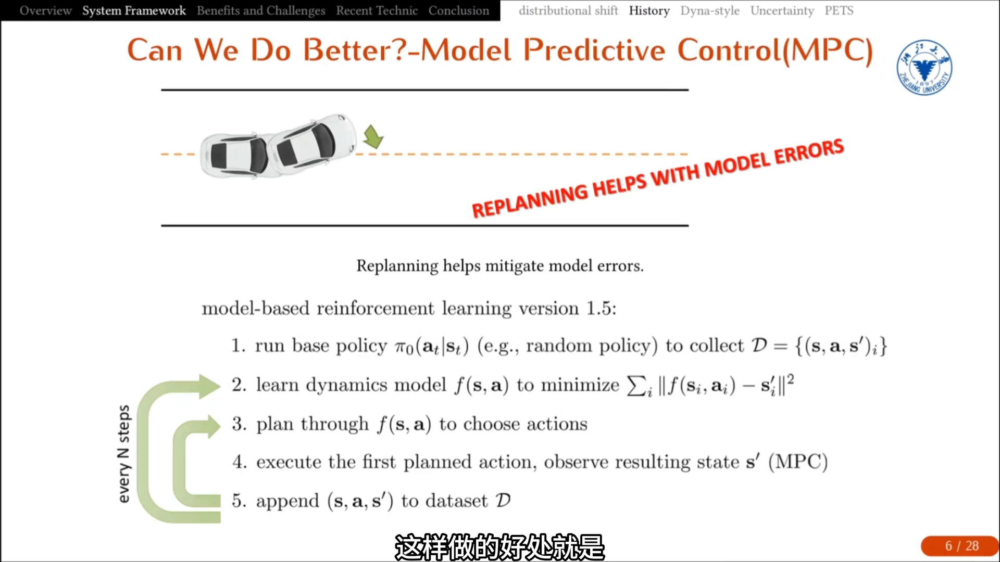
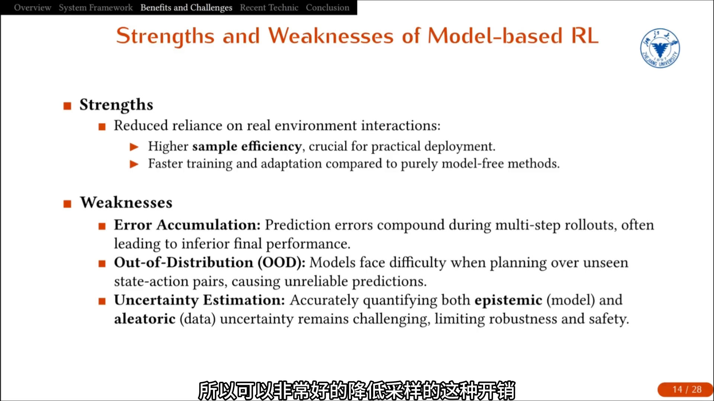
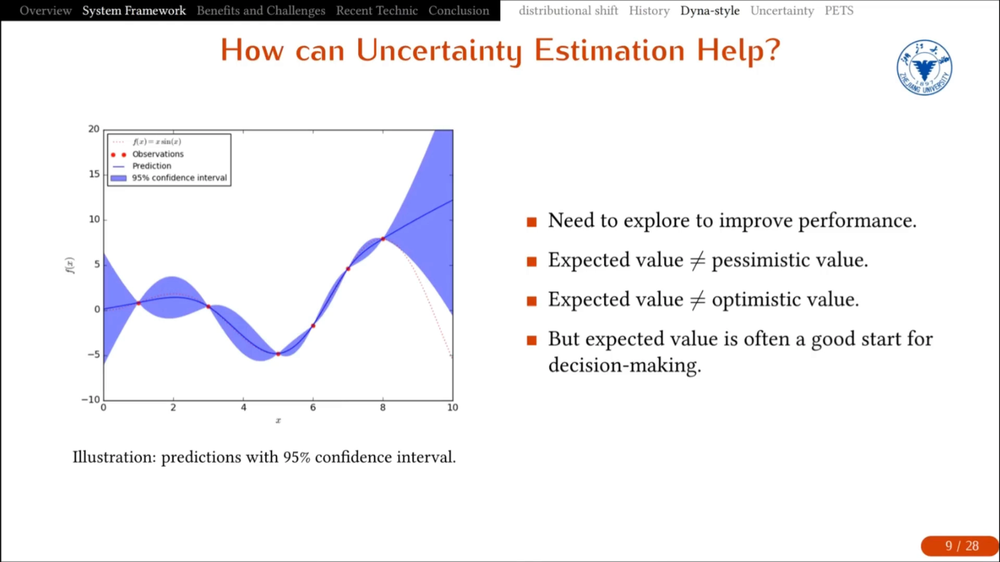
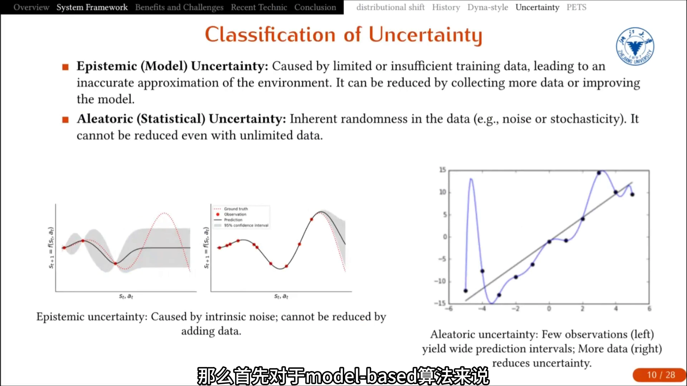
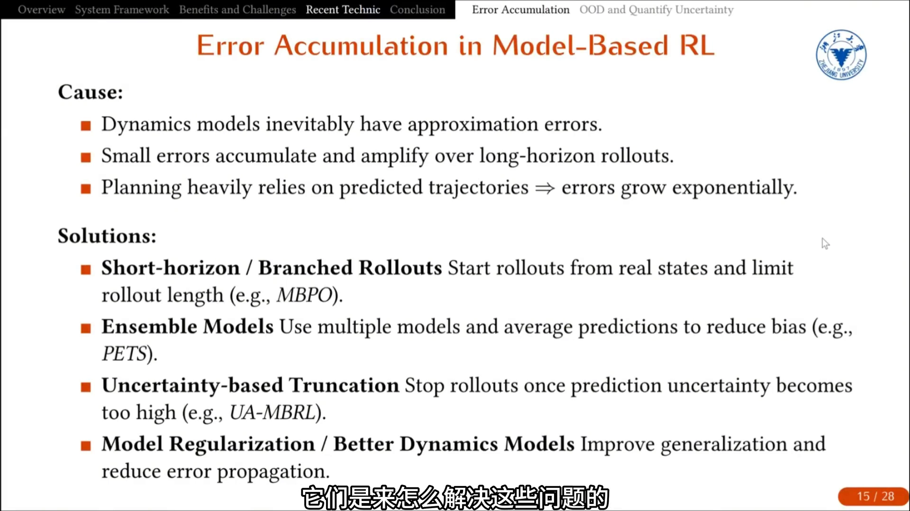
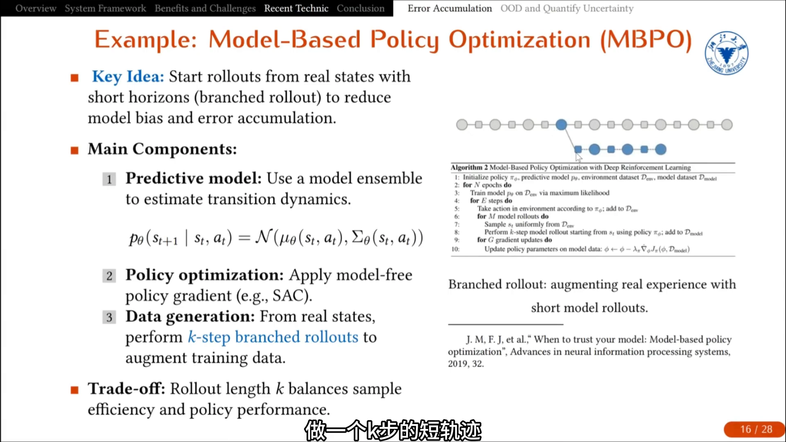
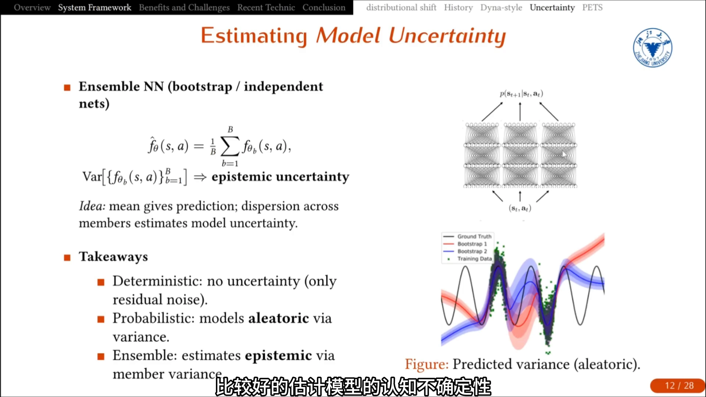
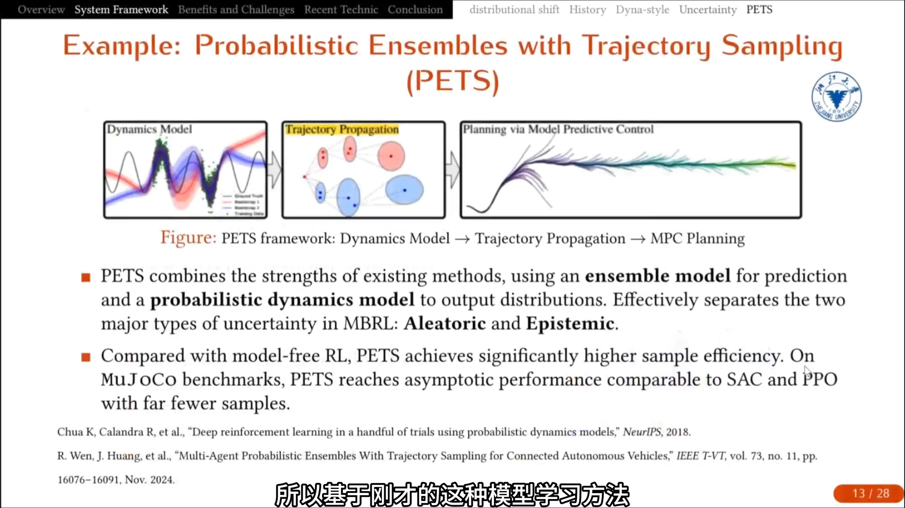
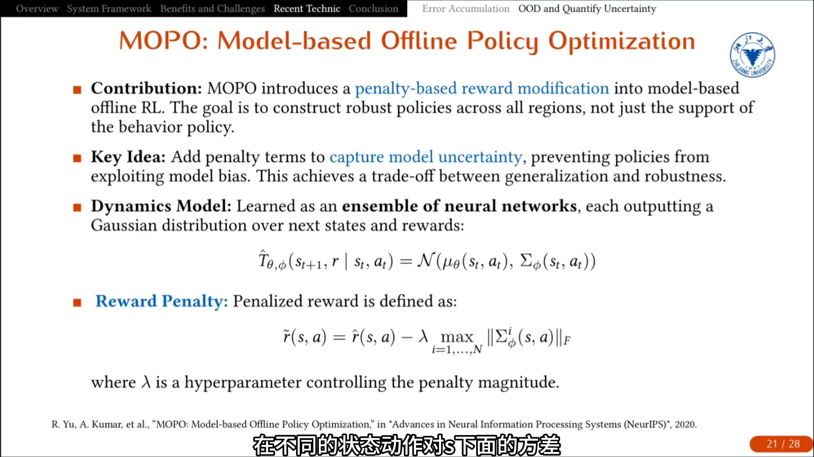
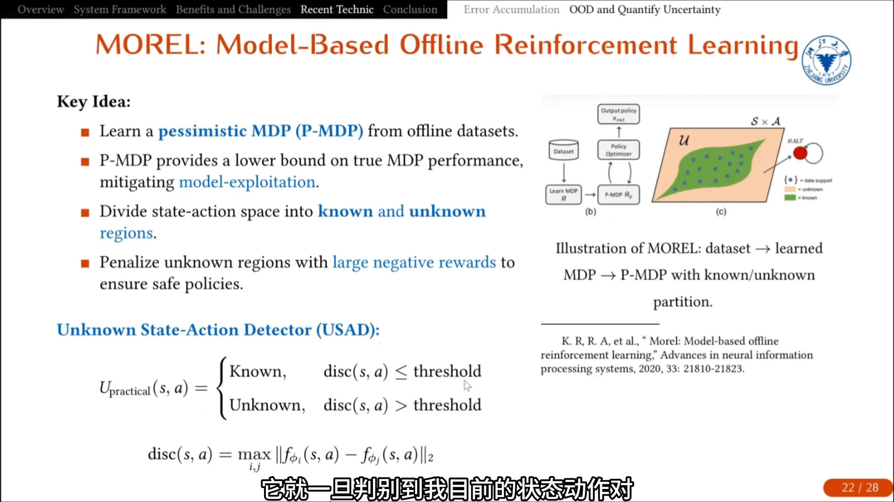

# 第10讲：基于模型的强化学习——模型误差为什么会复合放大

> 前提：我们用一个学到的转移模型 $\hat P(s'\mid s,a)$ 去替代真实环境，从而在模型里「多推几步」换取样本效率。有模型与免模型的宏观权衡（样本效率 vs 渐近性能、方法谱系）已在 10.1 讲清，本篇只深入一个具体技术问题：**模型误差为什么会随 rollout 步数复合放大，以及工程上有哪几种办法把它按住。**

## 本讲要解决的核心问题（SCQA）

**背景**：基于模型的强化学习（model-based RL, MBRL）在智能体和真实环境之间插入一个学到的环境模型，用模型的预测生成额外数据，从而大幅减少真实交互次数。它的样本效率优势非常明显，在机器人这类采集代价高的场景里几乎是刚需。

**冲突**：模型不可能完全准确。只要在模型里连续推演多步，单步的小误差就会被逐步放大；更糟的是，策略会主动往模型误差最大的方向走，把模型回报刷得很高，一搬到真环境就崩。

**疑问**：误差到底是怎么被放大的？放大之后策略会掉进什么坑？有哪些手段能把它控制住，各自要付什么代价？

**回答（中心思想）**：复合误差的根源不是「模型不够准」这一个点，而是「多步 rollout 把单步误差反复注入 + 策略被推向训练分布之外」这两件事叠加。因此所有有效的缓解手段都围绕两条主线：**要么缩短误差被注入的链条（短 rollout、重新规划、不确定性截断），要么让模型在分布外也尽量可靠、并对不可靠处施加惩罚（集成模型、不确定性惩罚、悲观 MDP）**。代价是：前者牺牲模型数据的覆盖量，后者牺牲一部分策略的激进性。

---

## 一、模型误差在长 rollout 里被逐步放大

### 1.1 最早的做法：一次性规划整条轨迹，然后误差就崩了

最早的基于模型框架非常直白：先跑一个初始策略 $\pi_0$ 采样得到数据集，用这份数据学一个转移模型，再用模型做规划、选动作，最后把执行得到的新数据加回数据集重新训模型。

问题出在「一次性规划整条轨迹」这一步。只要模型有误差，随着预测步长增加，误差会不断累积，预测结果和真实环境的偏差越来越大 [【跳转到 05:24】](https://www.bilibili.com/video/BV1iyCFBvEw7/?t=324)。

### 1.2 第一个补救：不要一次规划到底，走几步就重新规划

v1.5 版本引入了模型预测控制（model predictive control, MPC）：仍然用模型做规划，但**不把整条轨迹规划完**，而是每走 $N$ 步就重新规划一次，也就是 replanning。这样模型即使有偏差，偏差也不会被长时间放大，而是被不断修正。

直觉上可以这样理解：开环执行整条规划好的动作序列，相当于把模型的所有误差一次性兑现；闭环地每隔几步重新看一眼真实状态，相当于每一步都用真实观测把累积误差「清零」一次 [【跳转到 05:49】](https://www.bilibili.com/video/BV1iyCFBvEw7/?t=349)。

用公式说，如果单步模型误差是 $\epsilon$，朴素地看 $H$ 步 rollout 的累计误差是 $O(\epsilon H)$；但真实情况更糟——因为策略是在**被误差污染过的状态**上继续决策的，误差会改变状态分布，最终放大到 $O(\epsilon H^2)$ 甚至指数级。10.2 的第二篇（MBPO 论文精读）会给出这个平方关系的严格形式。这里先记住结论：**误差不是线性叠加，而是被状态分布的变化二次放大。**

### 1.3 Dyna-style：把真实数据和模型数据混着用

再往后的一步是把基于模型和免模型结合起来，也就是 Dyna-style 算法。真实数据在这里承担两个角色：一部分用来学模型，模型再生成仿真数据间接更新策略；另一部分真实数据直接进 buffer 做策略更新。两份 buffer 按设定比例混合。

这个思路本质上为后来的混合方法定了型：**前期用基于模型的方法快速积累经验、拿到不错的初始策略和价值函数，后期交给免模型算法**，从而避免模型误差在长时间规划里不断累积 [【跳转到 08:41】](https://www.bilibili.com/video/BV1iyCFBvEw7/?t=521)。

---

## 二、误差放大之后，策略会走进分布外区域

### 2.1 三个结构性弱点

把上面的现象归纳一下，基于模型的强化学习有三个绕不开的弱点 [【跳转到 14:35】](https://www.bilibili.com/video/BV1iyCFBvEw7/?t=875)：

- **误差累积（error accumulation）**：只要是多步规划，模型误差就会被逐步放大，导致最终性能下降。这也是很多基于模型算法收敛后性能反而不如免模型方法的原因。
- **分布外（out-of-distribution, OOD）**：模型只能用已有数据集训练，而我们不可能覆盖所有「状态-动作」对。规划时一定会走到数据集里没有的地方，那里的预测不可靠，可能准也可能不准，我们无法判断，策略因此变得不稳定。
- **不确定性估计**：固有不确定性和统计不确定性永远存在，模型永远有 bias，鲁棒性受限。

### 2.2 为什么「误差放大」和「OOD」是同一件事的两面

这两件事其实是耦合的：**rollout 越长，越容易走进训练数据没覆盖的区域；而恰恰是在这些区域，单步误差最大。** 于是长 rollout 不只是把误差多累加了几次，而是每一跳的误差本身在变大——这正是复合误差比线性估计更糟的机制。

### 2.3 先学会「知道自己不知道」

要处理 OOD，第一步是让模型能输出不确定性。看下面这张经典的拟合图：红色虚线是真实函数 $x\sin x$，红点是已有观测，蓝线是拟合出的预测，阴影是 95% 置信区间 [【跳转到 09:11】](https://www.bilibili.com/video/BV1iyCFBvEw7/?t=551)。

数据密集的中间段，不确定性低、阴影窄；数据稀疏的地方阴影迅速变宽。这说明：**期望值本身不足以支撑决策，把期望值和不确定性一起看，才知道哪一段的预测可以信、哪一段不能信。**

### 2.4 两种不确定性，只有一种能靠加数据消掉

MBRL 里把不确定性分成两类 [【跳转到 10:39】](https://www.bilibili.com/video/BV1iyCFBvEw7/?t=639)：

- **认知不确定性（epistemic）**，也叫模型不确定性：来自数据不足、模型学得不够准。随着数据增加会逐渐降低，理论上数据无穷时降到零。
- **偶然不确定性（aleatoric）**，也叫系统/固有不确定性：来自数据本身的噪声、环境的随机扰动。加多少数据都消不掉。

这个区分直接决定了建模方式的选择：

| 建模方式 | 输出 | 能刻画什么 |
| :--- | :--- | :--- |
| 确定性神经网络 | 一个点估计 | 只能反映数据里的残余噪声 |
| 概率神经网络 | 一个分布（如高斯，含均值与方差） | 能刻画偶然不确定性 |
| 集成（ensemble）神经网络 | 多个网络的预测集合 | 能刻画认知不确定性（成员间的分歧） |

---

## 三、三种缓解手段：缩短、集成、惩罚

这一节是本篇的核心。针对复合误差，视频把现有做法归成四类：**短程/分支 rollout、集成模型、基于不确定性的截断、模型正则化** [【跳转到 16:04】](https://www.bilibili.com/video/BV1iyCFBvEw7/?t=964)。下面重点讲前两类，以及「把不确定性写进目标」这一类（它和截断用的是同一个信号源）；第四类（模型正则化、更好的动力学模型）放在第五节一并交代。

### 3.1 手段一：短 rollout（MBPO 的分支推演）

既然长期推演会让误差叠加，那就**减少推演的长度**。MBPO（Model-Based Policy Optimization）的做法是：从真实数据点出发，只做 $k$ 步的短轨迹 rollout，再把这些短片段加入训练。

两个设计要点：一是**起点必须是真实状态**（来自 replay buffer），二是**只推很短的距离**。这两条一起作用，既压住了模型偏差，也压住了累积误差 [【跳转到 17:43】](https://www.bilibili.com/video/BV1iyCFBvEw7/?t=1063)。

$k$ 是一个真实的权衡：

- $k$ 太短 → 模型生成的数据太少，仿真数据有限，样本效率提升不够快；
- $k$ 太长 → 模型误差被放大，生成的数据虽然多但不可信，等于白造。

所以 $k$ 通常要针对场景调，实践中常在个位数到二十几之间（MBPO 原文里 Hopper 用到 15，Ant 和 Humanoid 用到 25）。

**代价**：模型数据的「覆盖半径」被限制在真实数据附近。样本效率的提升来自「把每个真实状态分叉出很多条短链」，而不是「在模型里跑很远」。

### 3.2 手段二：集成模型，用分歧当不确定性

第二种是让模型本身更可靠：用 bootstrap 集成（ensemble）。做法是把同一份数据集做自采样生成多组数据集，每组训练一个网络，最后求均值与方差 [【跳转到 12:19】](https://www.bilibili.com/video/BV1iyCFBvEw7/?t=739)：

$$
\hat f_\theta(s,a) = \frac{1}{B}\sum_{b=1}^{B} f_{\theta_b}(s,a),
\qquad
\mathrm{Var}\big[\{f_{\theta_b}(s,a)\}_{b=1}^{B}\big] \Rightarrow \text{认知不确定性}
$$

关键直觉：在数据密集处，不同 bootstrap 模型拟合得很像，分歧小；在数据稀疏处，它们拟合得差别很大，分歧大。**分歧大就说明这里不可信**——这正是我们需要的信号。

PETS（Probabilistic Ensembles with Trajectory Sampling）就是把这件事做完整的经典算法：模型学习用集成，规划用轨迹采样（粒子式地让每个集成成员各自推一条轨迹），再配合模型预测控制 [【跳转到 13:27】](https://www.bilibili.com/video/BV1iyCFBvEw7/?t=807)。

**代价**：算力。$B$ 个模型意味着 $B$ 倍的训练与推理开销，而且集成只降低方差、不消除偏差——如果所有成员都系统性地错，分歧反而会很小。

### 3.3 手段三：不确定性惩罚，让策略不敢去不可靠的地方

第三种是把不确定性直接写进优化目标，让策略主动避开不可靠区域。代表是 MOPO（Model-based Offline Policy Optimization）：在奖励函数里减去一个不确定性惩罚项 [【跳转到 24:22】](https://www.bilibili.com/video/BV1iyCFBvEw7/?t=1462)：

$$
\tilde r(s,a) = \hat r(s,a) - \lambda \max_{i=1,\dots,N} \big\lVert \Sigma^i_\phi(s,a) \big\rVert_F
$$

其中 $\Sigma^i_\phi(s,a)$ 是第 $i$ 个集成模型在 $(s,a)$ 处预测的协方差矩阵，$\lVert\cdot\rVert_F$ 是 Frobenius 范数（把矩阵压成一个标量），$\max$ 取各成员中最悲观的那个，$\lambda$ 控制惩罚强度。

$\lambda$ 的取舍非常直观：$\lambda$ 大 → 惩罚重、奖励小、$Q$ 值低、策略保守；$\lambda$ 小 → 惩罚轻、策略激进，可能拿到更高回报，但更容易闯进 OOD 区域、也更容易过拟合。本质上这是一个**价值下界**：用奖励减去最坏情况的不确定性。

MOReL（Model-based Offline RL）走得更硬：它学一个悲观 MDP，把「状态-动作」空间人为划成已知区域和未知区域，未知区域直接给一个非常大的负奖励，等于物理上禁止进入 [【跳转到 26:27】](https://www.bilibili.com/video/BV1iyCFBvEw7/?t=1587)：

$$
\mathrm{disc}(s,a) = \max_{i,j}\big\lVert f_{\phi_i}(s,a) - f_{\phi_j}(s,a)\big\rVert_2,
\qquad
U_{\text{practical}}(s,a)=
\begin{cases}
\text{known}, & \mathrm{disc}(s,a) \le \text{threshold}\\
\text{unknown}, & \mathrm{disc}(s,a) > \text{threshold}
\end{cases}
$$

**代价**：惩罚系数 $\lambda$、$\beta$、阈值都是人为设定的，非常主观；调大就保守、损失性能，调小就冒险、可能崩。这是这一类方法共同的软肋。

---

## 四、离线场景把 OOD 问题推到极端

为什么上面这些不确定性惩罚算法大多出现在离线强化学习里？因为 offline 的数据覆盖更差 [【跳转到 22:00】](https://www.bilibili.com/video/BV1iyCFBvEw7/?t=1320)。

- **offline**：只用事先收集好的固定数据集，训练中完全不和真实环境交互。数据覆盖有限，学到的模型不可避免偏离真实环境，对动态模型的准确性要求更高。
- **online**：虽然也用已有数据学模型，但会周期性回到真实环境采一批新数据加进数据集，用新数据不断修正模型误差。

所以离线场景下「模型偏差永远存在」这件事无法靠加数据缓解，只能靠**对不确定性的量化来设计约束、惩罚奖励或惩罚 $Q$ 值**。这也解释了为什么 MOPO、MOReL 这类算法都长在 offline 场景上。

---

## 五、绕开显式不确定性估计的两条路

前面几种方法都要显式估计不确定性，而估计本身很主观（惩罚系数要人调）。于是有一类工作干脆绕开它 [【跳转到 33:54】](https://www.bilibili.com/video/BV1iyCFBvEw7/?t=2034)：

- **RAMBO**：在模型基础上直接考虑**最坏情况下的转移概率**（鲁棒对抗强化学习），训练出的策略即使面对很高不确定性也能保持安全稳定，无需主观量化不确定性。
- **COMBO**：把保守 Q-learning（CQL）扩展到基于模型的方法里，对所有 OOD 的「状态-动作」对直接赋更低的 $Q$ 值；再加一个插值机制，把真实 rollout 和模型 rollout 混合来稳定训练。

还有一类是**悲观算法**：从所有可能的 MDP 里选最差的那个来用。它们都通过损耗一部分性能来换取「不需要主观调参也能稳定」，理论上也都能给出「最差情况下性能仍有下界」的保证。

---

## 小结

- **复合误差的机制**：单步误差 $\epsilon$ 经过 $H$ 步 rollout 不是简单叠加成 $O(\epsilon H)$，而是因为策略在被污染的状态上继续决策、状态分布被改变，放大到 $O(\epsilon H^2)$ 量级。
- **误差放大与 OOD 是一体两面**：rollout 越长越容易走出训练分布，而分布外的单步误差恰恰最大。
- **手段一（短 rollout）**：从真实状态出发只推 $k$ 步，把长链拆成很多短链。代价是模型数据覆盖半径受限，$k$ 需要在「数据量」和「可信度」之间调。
- **手段二（集成模型）**：用 bootstrap 集成成员间的分歧估计认知不确定性，PETS 是代表。代价是 $B$ 倍算力，且只降方差、不消偏差。
- **手段三（不确定性惩罚）**：把不确定性减进奖励（MOPO）或直接禁止进入未知区域（MOReL）。代价是惩罚系数主观、需要调。
- **离线场景更严重**：没有新数据来修正模型，只能靠保守化；RAMBO、COMBO 这类方法则绕开显式估计，用最坏情况或保守价值替代。
- **根本结论**：模型误差不可能被消除，只能被**限制在它还准的那几步之内**——这正是下一篇（MBPO 论文精读）要定量回答的问题。

## 关键术语速查

| 术语 | 一句话解释 |
| :--- | :--- |
| 环境模型（dynamics model） | 学出来的 $\hat P(s'\mid s,a)$ 和 $\hat r(s,a)$，用来替代真实环境做预测 |
| 复合误差（compounding error） | 多步 rollout 中单步误差被反复注入并被状态分布变化二次放大 |
| 分布外（OOD） | 规划时走到训练数据没覆盖的「状态-动作」区域，模型在那里不可靠 |
| 认知不确定性（epistemic） | 因数据不足导致的不确定性，加数据可以降低 |
| 偶然不确定性（aleatoric） | 环境本身的随机性，加多少数据都消不掉 |
| 集成模型（ensemble） | 多个 bootstrap 网络组成模型集合，成员分歧用来估计认知不确定性 |
| 分支 rollout（branched rollout） | 从真实状态分叉、只推 $k$ 步的短模型轨迹 |
| 模型利用（model exploitation） | 策略主动找模型误差的漏洞刷高模型回报，搬到真环境就崩 |
| 悲观 MDP（pessimistic MDP） | 把未知区域视为高代价，从而保证策略性能下界 |