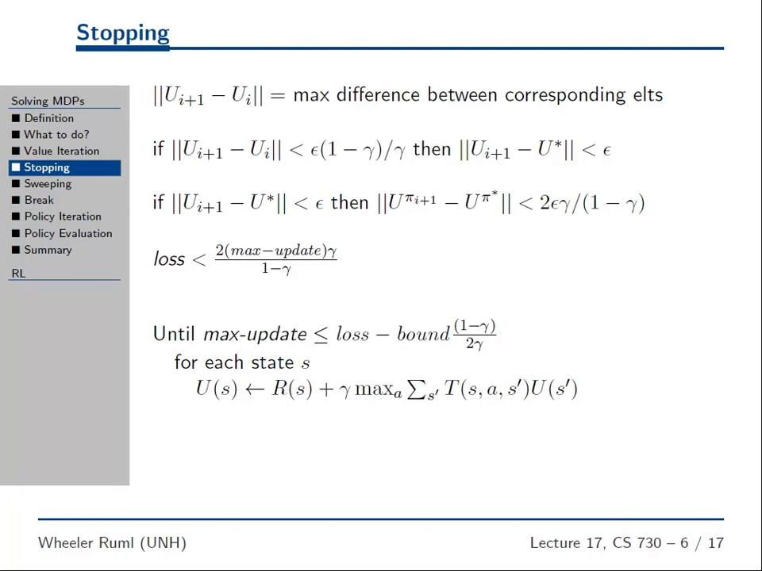
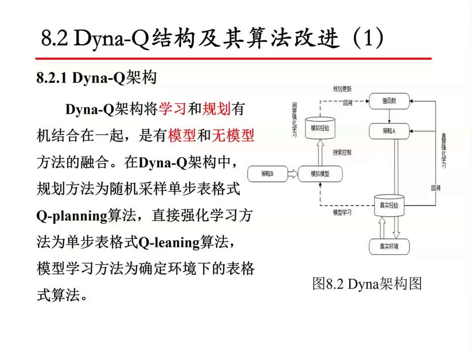
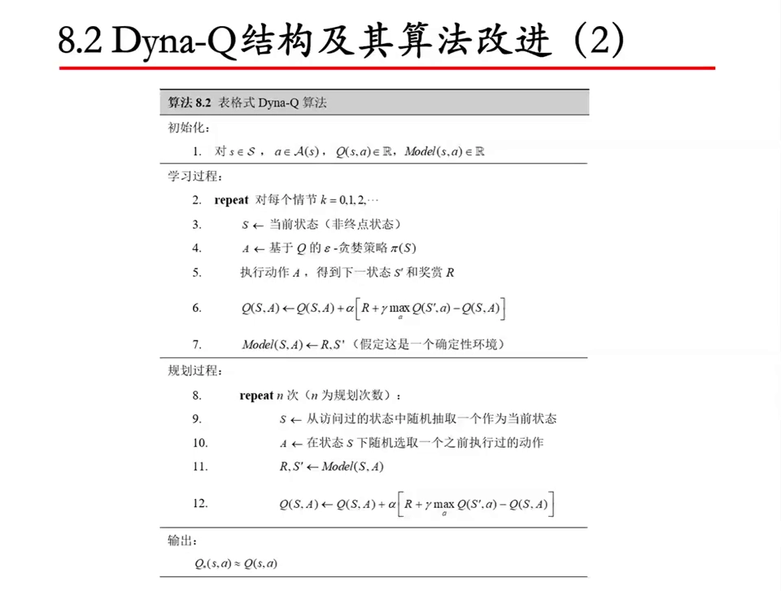
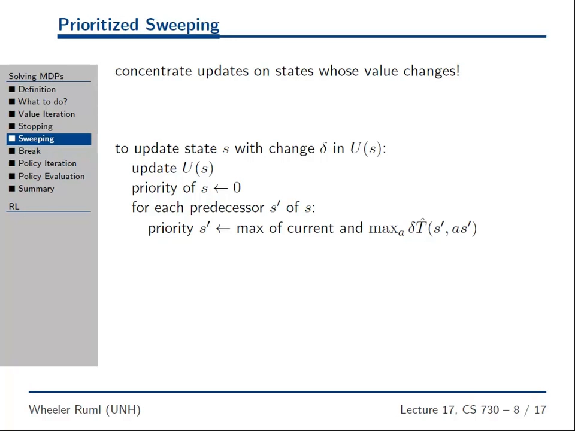
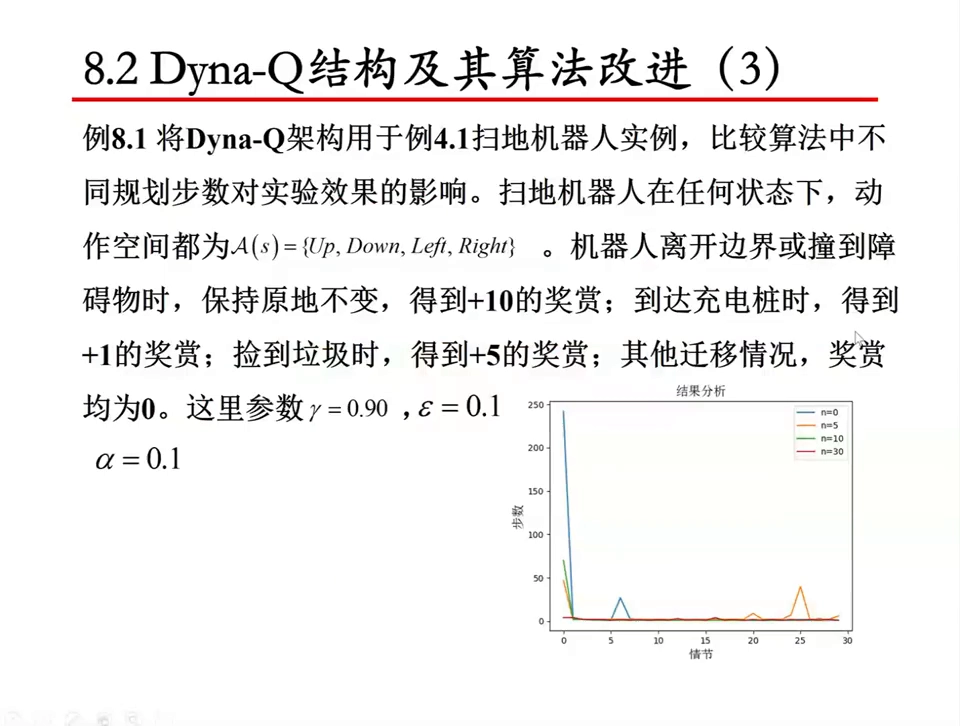
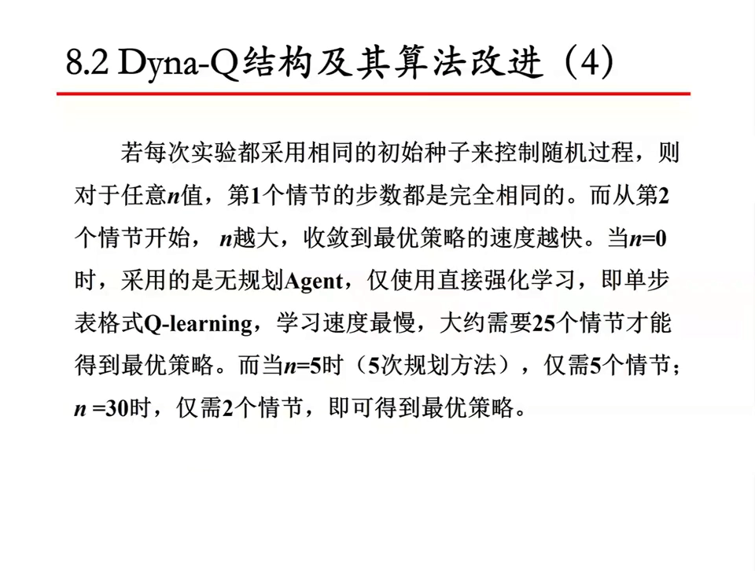
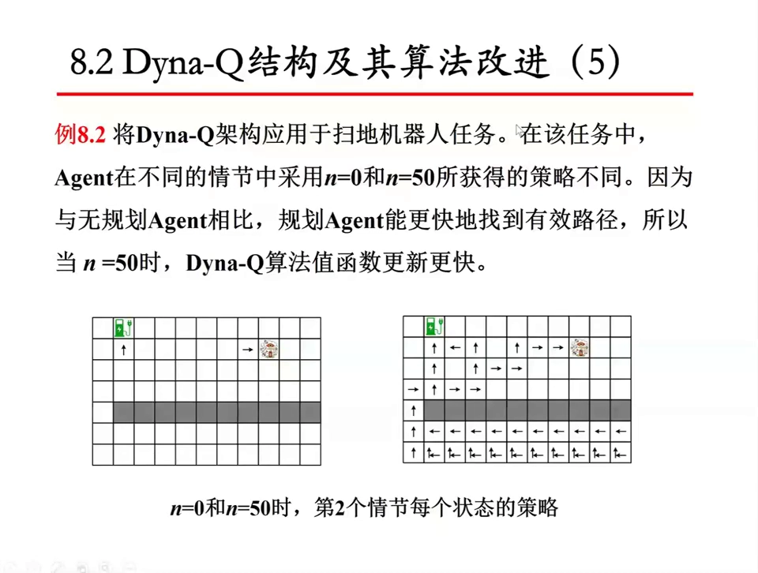

# Dyna 的工程实现与家族变体：优先遍历与模型存储

> 本篇整理自两支视频：木棉-闽师大《视36-8.2-Dyna-Q 结构及算法改进一 Dyna-Q 架构》（[BV1Hhz9YfEac](https://www.bilibili.com/video/BV1Hhz9YfEac/)）与 Wheeler Ruml 的课程讲座《Prioritized Sweeping》（[YouTube 5Xw6ICE95aU](https://www.youtube.com/watch?v=5Xw6ICE95aU)）。Dyna 框架与 Dyna-Q 的基本形式见 10.1，本篇只讲 10.1 没讲的部分：**模型到底怎么存、规划到底该更新谁**。优先遍历的完整伪代码与阈值细节依据 Sutton & Barto《Reinforcement Learning: An Introduction》第 8.4 节补足，文中已逐处注明哪些内容来自教材而非视频。

## 本讲要解决的核心问题（SCQA）

**背景**：10.1 已经给出 Dyna 的骨架——一条真实经验花两次，一次直接更新 $Q$，一次更新模型，模型再吐出 $n$ 条模拟经验做 Q-planning。骨架清楚之后，剩下的是两个非常具体的问题：那个被反复查询的「模型」在代码里长什么样？那 $n$ 次规划应该拿哪些状态去更新？

**冲突**：标准 Dyna-Q 对第二个问题的回答是「随机采样」——从访问过的状态里随便抽一个，再随便抽一个做过的动作。这个做法在格子迷宫这种小状态空间里没问题，但它把规划算力均匀地撒在了整个状态空间上：绝大多数被抽中的状态，$Q$ 值早就收敛了，更新它们等于原地踏步；而真正需要被更新的那几个状态（$Q$ 刚刚发生大变化、并且这个变化还没有往前传播的状态），被抽中的概率和其他状态一样低。规划步数 $n$ 越大，这种浪费越多。

**疑问**：能不能让规划「挑着做」——只更新那些最有可能带来大改进的状态？如果能，代价是什么？另外，Dyna 这条路上后来长出了 Dyna-Q+、优先遍历、Dyna-2 这些变体，它们各自在补哪个洞？

**回答（中心思想）**：Dyna-Q 的模型在表格型实现里就是一个字典 `Model[(s,a)] = (r, s')`，存的是**一条**转移而不是一个分布——这正是它便宜的原因，也是它在随机环境里会失真的原因。而规划应该更新的对象，可以由**贝尔曼更新的变化量**来排序：**优先遍历（prioritized sweeping）**维护一个「刚被更新过的状态」的优先队列，每次取出变化最大的状态做一次贝尔曼更新，再把这个变化量按转移概率折算、传播给它的**前驱**状态。它把「值迭代每一轮扫全部状态」换成了「只扫正在变化的那一小撮」，代价是要额外维护一张**前驱表**和一个优先队列。至于 $n$ 怎么选，木棉-闽师大的扫地机器人实验给了一组很干净的数：$n=0$ 要 25 个情节收敛，$n=5$ 要 5 个，$n=30$ 只要 2 个。



[【跳转到 05:25】](https://www.youtube.com/watch?v=5Xw6ICE95aU&t=325)

---

## 一、Dyna-Q 的两个接口：模型怎么写、经验怎么取

### 1.1 架构图上的「策略 B」：可改进的地方就在取样

10.1 讲过 Dyna 框架图的两条支路。木棉-闽师大这版架构图（图 8.2）多画了一个 10.1 没强调的方框——**策略 B**，它挂在「模拟模型」的左边，箭头指向「模拟经验」。



[【跳转到 00:55】](https://www.bilibili.com/video/BV1Hhz9YfEac/?t=55)

讲者对这个方框的解释很直接：**策略 B 就是「我们采取什么样的策略从模拟模型里提取样本」，可以是随机采样，也可以按优先级采样**。他还顺带指了一条做研究的路径——Dyna-Q 的改进「一般就改在这一块」：模型存进去、取出来这些操作本身改进空间不大，真正有意思的是「如何从模拟模型里提取经验」。

这句话把本篇后面两节的位置都定好了：**取样策略**（第三节的优先遍历）和**模型本体**（下面 1.2～1.4）。

### 1.2 表格型模型就是一个字典

表格型 Dyna-Q 的模型没有神经网络、没有概率表，就是一个字典：

```python
Model = {}                      # 键: (s, a)   值: (r, s')
Model[(s, a)] = (r, s_next)     # 每来一条真实经验就覆盖写一次
```

讲者的原话是：这个 `Model(S,A)` 里面存的就是「状态、动作」，输入一个状态和一个动作，就能得出下一个状态及其奖励。算法 8.2 里那一行 $Model(S,A) \leftarrow R, S'$ 就是这个意思。



[【跳转到 03:55】](https://www.bilibili.com/video/BV1Hhz9YfEac/?t=235)

注意第 7 步后面那个括号：**「假定这是一个确定性环境」**。这句话是整个表格型模型的关键约束——同一个 $(s,a)$ 每次都会到同一个 $(r,s')$，所以每个键只存一条记录、后来的覆盖先前的就够了。一旦环境是随机的，这个写法就开始丢信息。

### 1.3 确定性、随机与分布模型：三种存法，三种代价

同样是「模型」，实现上至少有三种存法，代价完全不同：

| 存法 | 数据结构 | 适用环境 | 代价 |
| --- | --- | --- | --- |
| 确定性样本模型 | `Model[(s,a)] = (r, s')` | 确定性环境 | 最省内存，随机环境下会失真 |
| 经验列表 / 计数表 | `Model[(s,a)] = [(r1,s1), (r2,s2), ...]` 或计数 $N(s,a,s')$ | 随机环境 | 要存多条、要采样，内存随访问次数增长 |
| 分布模型 | $\hat p(s',r \mid s,a)$ 的完整估计 | 小状态空间 | 可以直接算期望做值迭代式更新，但表会爆炸 |

中间那一行是 Sutton & Barto 教材里样本模型的标准写法（第 8.2 节）：对每个 $(s,a)$ 记住所有观察到的 $(r,s')$，需要采样时从里面**均匀抽一条**。它的好处是不用估计概率，坏处是「均匀抽」意味着模型隐含地认为过去见过的每条转移等概率——如果某个分支只见过一次，它会被反复采样，权重被高估。

第三行是分布模型，10.1 讲过它对应「白盒」。它的优点是拿到概率就能直接做期望（也就是第 3 章动态规划那种更新），缺点是存储量随状态空间平方增长，稍大一点的环境就存不下。

### 1.4 模型更新频率：每条真实经验更新一次，还是攒一批

Dyna-Q 的伪代码里，模型更新是**每条真实经验写一次**——第 5 步紧跟在第 4 步后面。这是最朴素的写法，但工程上有两个常见变体：

- **攒一批再写**：把最近若干条经验缓存起来，隔一段时间统一写进模型。好处是能顺手做统计（算计数、算均值），坏处是模型更新滞后。
- **带遗忘地写**：非平稳环境里，旧经验会污染模型，所以常用指数衰减或滑动窗口，让新经验权重更高。这个动机和 10.1 里 Dyna-Q+ 的动机是同一个——**环境会变**。

---

## 二、随机采样规划的低效：算力花在了不需要的地方

### 2.1 从值迭代的停止准则说起

Wheeler Ruml 是从上一节的值迭代讲起的。值迭代的停止准则不是「迭代到无穷」，而是看**所有状态里最大的那个更新量**：

$$
\big\lVert U_{i+1} - U_i \big\rVert = \max_s \big\lvert U_{i+1}(s) - U_i(s) \big\rvert
$$

只要这个最大更新量小于某个阈值，就可以停——因为剩余误差可以被它界住。上面那张图就是这条准则的完整版：如果 $\lVert U_{i+1} - U_i\rVert < \epsilon(1-\gamma)/\gamma$，那么 $\lVert U_{i+1} - U^*\rVert < \epsilon$；幻灯片最后给出的循环条件是「最大更新量不超过损失界乘以 $(1-\gamma)/(2\gamma)$」：

$$
\text{max-update} \;\le\; \text{loss\_bound}\cdot\frac{1-\gamma}{2\gamma}
$$

讲者由此得到一个很自然的推论：**既然「最大更新量」是衡量收敛的那个量，那么值得花算力的就是「正在大幅变化」的那些状态**。只要把这些状态的值算准，整体损失就会很小。

### 2.2 两种浪费

把这个推论套回 Dyna-Q 的随机采样规划，就能看出两处浪费：

1. **更新了不变化的状态**。随机抽中的状态里，绝大多数 $Q$ 值早就稳定了，一次 Q-planning 更新几乎不改变任何东西。
2. **反复更新同一批已经收敛的状态**。随机均匀采样没有记忆，刚更新过的状态和很久没动过的状态被抽中的概率一样。

Wheeler Ruml 的说法是：优先遍历「只更新真正在变化的状态」，这比值迭代强太多——**快上几百倍是常有的事**。

### 2.3 与 Dijkstra、A* 的类比

如果你熟悉图搜索，这个思路应该很眼熟：Dijkstra 和 A* 都不做「把所有节点扫一遍」的暴力松弛，而是维护一个优先队列，每次取出当前最值得扩展的那个节点。优先遍历做的是同一件事，只是排序依据从「到起点的距离加启发式」换成了「这次更新可能带来多大的值变化」。

区别也值得记住：**A* 从起点出发、只扩展能到达的节点，而优先遍历不区分状态会不会真的被访问**。这一点第三节末尾会作为它的一个缺陷再讲。

---

## 三、优先遍历：按 TD 误差排队的规划

### 3.1 算法骨架

优先遍历（prioritized sweeping）由 Sutton & Barto 第 8.4 节给出（本节算法细节依据教材，视频只讲了核心机制）。它把 Dyna-Q 第 6 步那个「随机抽一个状态」换成「从优先队列里取优先级最高的状态」，并且在每次更新之后**把优先级传播给前驱**。



[【跳转到 00:25】](https://www.youtube.com/watch?v=5Xw6ICE95aU&t=25)

幻灯片上的三步，翻译过来就是：

1. 从优先队列取出优先级最高的那一项（一个状态，或一个状态动作对），对它做一次贝尔曼更新，得到变化量 $\delta$；
2. $s$ 的优先级清零（它已经被处理过了）；
3. 对 $s$ 的**每一个前驱状态动作对** $(\bar s, \bar a)$，把它的优先级设为「当前优先级」与「它受这次变化影响的程度」两者中的较大值。

写成代码骨架大致是这样（教材算法的简化版，用 $Q$ 而不是 $U$）：

```python
# 初始化：Q、Model、前驱表、优先队列（最大堆）
Q, Model, predecessors = {}, {}, {}
queue = MaxHeap()                      # (优先级, (s, a))

def update(s, a):
    r, s_next = Model[(s, a)]
    delta = r + gamma * max(Q[s_next].values()) - Q[(s, a)]
    Q[(s, a)] += alpha * delta
    return abs(delta)

def prioritized_sweeping(n_planning, theta):
    for _ in range(n_planning):
        if not queue:
            break
        _, (s, a) = queue.pop_max()            # 1. 取出优先级最高的那一项
        p = update(s, a)                       # 2. 贝尔曼更新，得到变化量（该项优先级已清零）
        if p > theta:                          # 3. 变化够大才把前驱入队
            for (sp, ap) in predecessors.get(s, []):
                rp, _ = Model[(sp, ap)]
                pp = abs(rp + gamma * max(Q[s].values()) - Q[(sp, ap)])
                if pp > theta:
                    queue.push_or_raise(pp, (sp, ap))  # 3. 前驱入队；已在队列中则取较大优先级
```

真正的 Dyna-Q + 优先遍历版本还要在第 5 步之后多做一件事：算完真实经验那次更新的 TD 误差，如果它超过阈值 $\theta$，就把这个 $(S,A)$ 以该误差为优先级塞进队列。这样**每一条真实经验都会自动点燃一条回溯链**，规划算力沿着「哪里刚学到东西」这条线索走，而不是在整个状态空间里均匀撒开。

### 3.2 优先级怎么传播：为什么乘的是转移概率

第 3 步那个「影响程度」是整节最值得琢磨的地方。幻灯片上写的是（先按讲者当场更正后的形式）：

$$
\text{priority}(s') \leftarrow \max\Big(\text{priority}(s'),\; \max_a \gamma\, \hat{T}(s', a, s)\, \delta\Big)
$$

直觉是：如果状态 $s$ 的值变化了 $\delta$，那么一个能转移到 $s$ 的前驱 $s'$，它的值最多会变化 $\delta$ 乘以「从 $s'$ 出发真的落到 $s$ 的概率」。乘 $\gamma$ 是因为奖励要折扣。取 $\max_a$ 是因为前驱可以选那个最可能落到 $s$ 的动作。讲者的原话是：「这样一来，该更新的冲动就沿着状态空间往回渗透，渗透到那些有可能大幅变化的状态上。」

这个式子和 TD 误差的形式是同一件事：**变化量乘转移概率，就是前驱可能继承到的误差上界**。所以优先队列里排的不是「谁的值大」，而是「谁最可能因为别人的更新而需要更新」。

### 3.3 幻灯片上的笔误

值得单独记一笔：这张幻灯片本身有排版错误，讲者在现场逐个更正了——式子里的 $\delta$ 位置应该是 $\gamma$，$\hat{T}$ 的下标应该是 $(s', a, s)$ 而不是 $(s', as')$，那个撇号应该是逗号加「前一个」。所以看原图时不要照抄，以 3.2 节写出的形式为准。这也解释了为什么后面那句「s′ 最多变化 $\delta$ 乘以落到 $s$ 的概率」听起来比式子本身更清楚——**讲者是在解释式子想表达什么，而不是在解释式子写成了什么**。

### 3.4 收益与代价

**收益**：优先遍历把「每一轮扫全部状态」换成了「只扫正在变化的那一小撮」。Wheeler Ruml 的经验值是常比值迭代快几百倍。他还老实承认了一句：**没有理论界**。有人问「能不能证明至少快多少」，他的回答是这很难，因为实际速度取决于更新优先级的效率，甚至有过一篇论文用极其精巧的值迭代把优先遍历比了下去——「细节很重要」。

**代价**有两个，都很具体：

- **要维护前驱表**。你得知道「哪些 $(s,a)$ 的模型预测会到达 $s$」，才能把优先级往回传。确定性表格模型里这可以靠反向索引建出来，但每写一条新转移就要更新索引；模型一大，这张表的内存和更新开销都不小。
- **要维护优先队列**。每次入队、出队都是 $O(\log N)$，而且同一个 $(s,a)$ 可能反复入队，需要去重或允许重复（允许重复更简单，但队列会变长）。

### 3.5 讲者的批评：它不管你会不会去

讲完机制之后，Wheeler Ruml 花了不少时间讲优先遍历的一个**被完全忽略的问题**：它的目标是「让每个状态的值都尽快算准」，但**我们未必需要每个状态的值**。

他举了个很生活化的例子：他挺想知道 Stillings 食堂的饭好不好吃，可他中午从来不去校园那一头，真正吃饭时几乎百分之百去更近的 Philbrook；去 Stillings 的概率确实非零（他在 UNH 待了五年，只因为去那边找过一位办公室在旁边的人，才去过一次），但非常小。**那么，为什么要花算力去更新一个「可达但概率极小」的状态的值？**

严格地说，优先遍历只考虑了 $\hat{T}(s',a,s)$，也就是「从 $s'$ 到 $s$ 的转移概率」，却没有考虑「我有多大可能处在 $s'$」——**初始状态的分布、以及当前策略下的访问分布，都没有进入优先级**。所以他吐槽说，这套机制会把「我三岁时在中国理发」这种状态的值也认真更新一遍。这也正是它和 A* 这类启发式搜索的分水岭：A* 从起点出发、只扩展能到达的节点，优先遍历则任何状态都可能进队列。

这个批评不是要否定优先遍历，而是指出**优先级的定义本身是一个可以改的设计选择**：如果你关心的是「在策略实际会走到的区域上把值算准」，那优先级里就该掺进访问频率或 on-policy 相关性。这和 10.2 里「模型只在数据覆盖的地方可信」是同一个思路的两面。

---

## 四、Dyna 家族的四个成员

把 10.1 讲过的和本篇讲的放在一起，Dyna 这条线上最常被提到的四个变体可以这样对照：

| 变体 | 它解决什么问题 | 关键改动 | 代价 |
| --- | --- | --- | --- |
| Dyna-Q | 真实样本太贵，怎么用模型把一条经验放大成很多条 | 真实经验做 Q-learning，模型吐模拟经验做 Q-planning，规划 $n$ 次 | 模型有偏差；随机采样让规划算力被浪费 |
| Dyna-Q+ | 环境会变，旧模型会过期 | 奖励加上 $\kappa\sqrt{\tau}$，$\tau$ 是该状态多久没被访问过 | 探索变多，短期回报变差；$\kappa$ 要调 |
| 优先遍历 | 随机采样把算力撒在了不需要更新的状态上 | 用 TD 误差当优先级维护队列，变化量按转移概率传给前驱 | 要维护前驱表和优先队列；不区分状态是否真的会被访问 |
| Dyna-2 | 每个情节都是从头开始，情节内的经验用完就丢 | 长期记忆（跨情节保留的参数化值函数）+ 短期记忆（情节内的搜索树），搜索深度随情节内时间衰减 | 要维护两套记忆；短期记忆的生命周期和衰减率要调 |

前三个在本篇和 10.1 里都已经展开。**Dyna-2** 只在这里给一句话定位（出自 Silver、Sutton、Müller 2008 年的工作）：它观察到人下棋时既有「下了一辈子棋积累的棋感」，也有「这一盘棋里刚刚算出来的变化」，于是把这两者拆成两套记忆——长期记忆是一个参数化的值函数，跨情节持续学习；短期记忆是当前情节内的搜索树，情节结束就丢弃。它要解决的是「情节内的临时知识无法复用、情节间的永久知识又太慢」这个问题。

---

## 五、调参：$n$ 到底该取多大

### 5.1 扫地机器人实验

木棉-闽师大用第 4 章动态规划里的扫地机器人任务做了对照实验（例 8.1）：

- 动作空间是上下左右四个动作；
- 撞到边界或障碍物则原地不动，得到负奖励（幻灯片印作 $+10$，讲者口述更正为 $-10$）；
- 到达充电桩得 $+1$，捡到垃圾得 $+5$，其他迁移奖励为 $0$；
- 参数 $\gamma = 0.9$、$\epsilon = 0.1$、$\alpha = 0.1$；
- 横轴是情节数，纵轴是每个情节走的步数（越低越好），四条曲线是 $n = 0, 5, 10, 30$。



[【跳转到 10:00】](https://www.bilibili.com/video/BV1Hhz9YfEac/?t=600)

结果和 10.1 的迷宫实验一致，但数字更干净：$n=0$ 那条蓝线一开始每个情节要走 200 多步，而且降得很慢——因为它没有规划，每一步只更新一个 $Q$ 值；$n=30$ 时第一步就做了 30 次规划，值很快就稳定下来。

### 5.2 25 / 5 / 2：收敛速度的量化

讲者给了一组可以直接记住的数（相同初始种子下，第 1 个情节的步数对所有 $n$ 都相同，从第 2 个情节开始才拉开差距）：



[【跳转到 13:45】](https://www.bilibili.com/video/BV1Hhz9YfEac/?t=825)

| 规划步数 $n$ | 得到最优策略所需情节数 |
| --- | --- |
| 0（纯 Q-learning） | 约 25 |
| 5 | 5 |
| 30 | 2 |

从 25 到 5 是 5 倍，从 5 到 2 只有 2.5 倍——**收益递减**。这就是「$n$ 该取多大」的第一个答案：不是越大越好，边际收益在快速下降，而计算开销是线性的。

### 5.3 规划步数与真实步数的比例

Dyna-Q 里 $n$ 的含义是「每条真实经验之后做几次规划」，所以每与环境交互一步的计算开销大约是 $n+1$ 次 Q 更新。工程上通常按**计算预算**来定 $n$：先测出一步真实交互的耗时，再决定能负担多少次规划。木棉的讲者还提到两个可以调的旋钮：

- **学习与规划的比例不必是 1 : $n$**。可以攒 50 步真实学习再做 50 步规划（他原话是「我现在做几步强化学习、再做几步规划，这也是可以的」）。
- **$n$ 可以随时间衰减**。他的建议是「开始的时候 $n$ 可以比较大，等最优策略找到了，$n$ 再逐渐缩小、衰减到比较小」。理由是早期价值传播得越远越好，后期主要是在精修，大规模规划不划算。

### 5.4 $n$ 太大会放大模型误差

还有一个上限不是来自算力，而是来自**模型质量**。Dyna-Q 每次规划只让模型往前推一步，所以它天然避开了 10.2 讲的复合误差——单步 rollout 只承担 $O(\epsilon)$ 的单步误差，而不是 $O(\epsilon H^2)$ 的长视野放大。但「只推一步」不等于「没有误差」：$n$ 次规划会让模型里那些不准的转移被反复采样、反复强化，$Q$ 值就会朝着模型偏差的方向漂移。换句话说，$n$ 放大的是模型误差的**注入次数**，不是**注入深度**。所以 $n$ 的实用上限取决于「模型有多准」，环境越随机、模型越粗糙，$n$ 就该越小。

讲者最后还给了一个直观的证据：同一个扫地机器人任务里，$n=0$ 和 $n=50$ 的 Agent 在**第 2 个情节**时已经学出了完全不同的策略——$n=0$ 只在自己走过的少数格子上有箭头，$n=50$ 几乎整张地图都有了箭头。



[【跳转到 14:40】](https://www.bilibili.com/video/BV1Hhz9YfEac/?t=880)

这张图值得多看两眼：它把「规划到底在做什么」画出来了——**规划不是在学新东西，而是在把已经学到的价值沿着模型铺开到还没走到的地方**。也正因为如此，模型铺得越远，$n$ 越大，误差被带偏的范围也越大。

---

## 小结

- Dyna-Q 的模型在表格型实现里就是 `Model[(s,a)] = (r, s')`，**只存一条转移**，前提是环境确定性；随机环境要改成经验列表加采样，或存计数表；要算期望就得上分布模型。
- 架构图上的**策略 B** 是「从模型里取哪些经验」的采样策略，也是 Dyna 家族所有改进的落点。
- 随机采样规划的两处浪费：更新了不变化的状态、反复更新已经收敛的状态。值迭代的停止准则（看最大更新量）提示了正确的排序依据。
- **优先遍历**：用 TD 误差当优先级维护队列，取出变化最大的状态做贝尔曼更新，再把变化量按转移概率传给前驱。常比值迭代快几百倍，代价是要维护**前驱表**和优先队列，而且它不区分状态是否真的会被访问。
- Dyna 家族的分工：Dyna-Q 解决样本效率，Dyna-Q+ 解决环境变化，优先遍历解决规划算力分配，Dyna-2 解决情节内临时知识的复用。
- $n$ 的调参：收益递减（25 → 5 → 2 个情节），开销线性，上限由模型质量决定；实用做法是让 $n$ 从大衰减到小。

## 关键术语速查

| 术语 | 一句话解释 |
| --- | --- |
| 策略 B | Dyna 架构图里决定「用何种策略从模型取样本」的方框，可随机也可按优先级 |
| 表格型模型 | 用字典存 $(s,a) \to (r,s')$ 的模型，确定性环境下一个键只存一条 |
| 样本模型 | 记住所有观察到的 $(r,s')$，采样时从中抽一条的模型 |
| 分布模型 | 存 $\hat p(s',r \mid s,a)$，可以直接算期望的模型 |
| 前驱表 | 记录「哪些 $(s,a)$ 的模型预测会到达 $s$」的反向索引，优先遍历靠它传播优先级 |
| 优先遍历 | 按 TD 误差维护优先队列、只更新变化最大的状态的规划方法 |
| 优先级阈值 $\theta$ | 变化量小于该值就不再入队，用来截断传播 |
| 最大更新量 | $\max_s \lvert U_{i+1}(s)-U_i(s)\rvert$，值迭代的停止判据，也是优先遍历的排序依据 |
| Dyna-2 | 长期记忆（跨情节的值函数）加短期记忆（情节内搜索树）的 Dyna 变体 |