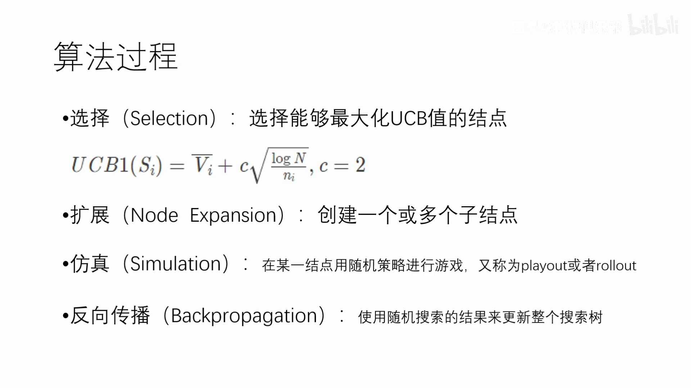
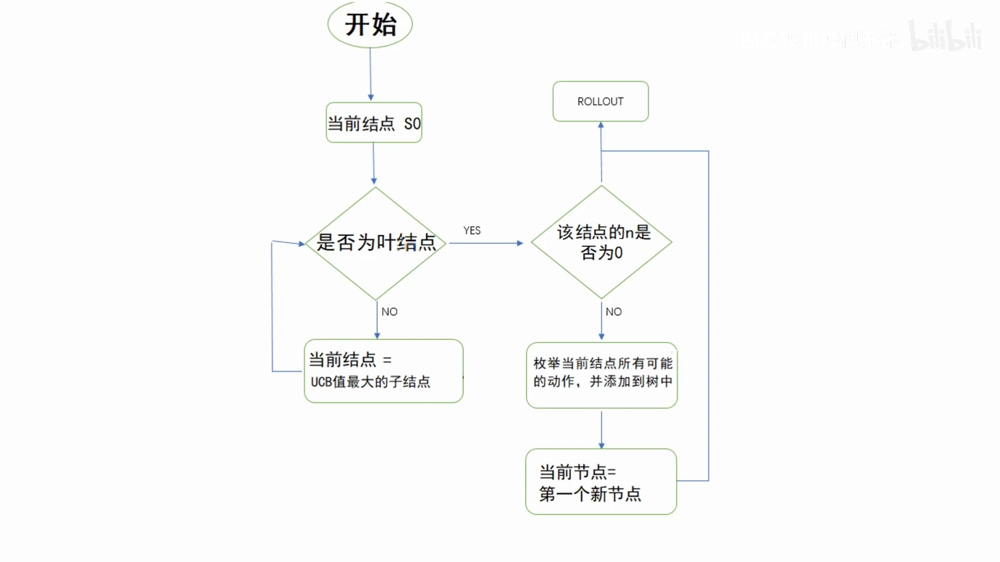
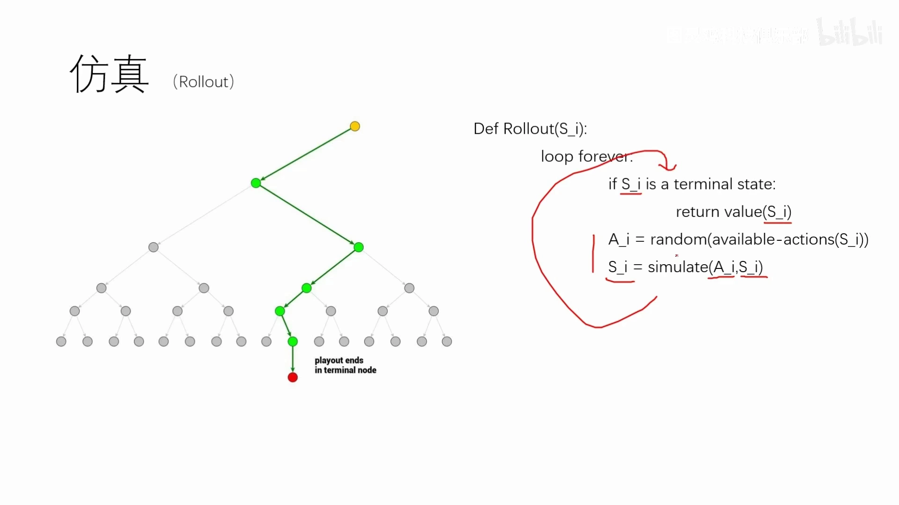
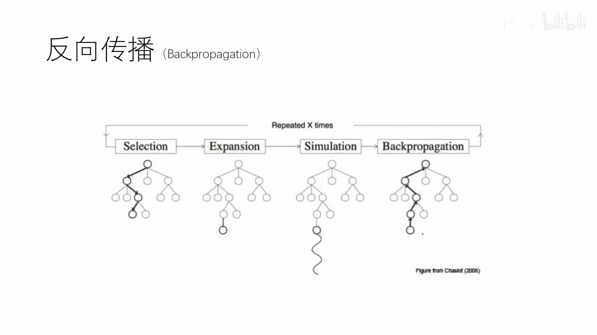
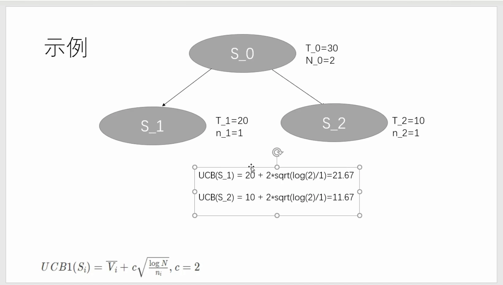
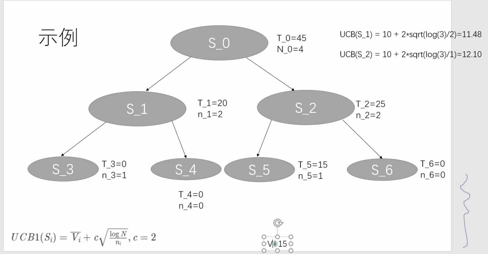

# AI如何下棋：直观了解蒙特卡洛树搜索MCTS

> 本篇整理自图灵鸡科技俱乐部的《AI如何下棋？直观了解蒙特卡洛树搜索MCTS》。视频地址：[BV1JD4y1Q7mV](https://www.bilibili.com/video/BV1JD4y1Q7mV/)。
> 上一篇（第 02 讲）用交互式演示走了一遍 MCTS 的完整流程；本篇补上它更「教科书」的一面：**一份可以直接照着写代码的流程图**、**UCB1 公式里每一项到底是什么**，以及**一个把数字代进去手算四轮的例子**。两篇对照着看，机制和公式就都对上了。

## 本讲要解决的核心问题（SCQA）

**背景**：棋类 AI 的经典路线是穷举式搜索。上世纪 90 年代 IBM 的深蓝把国际象棋的整个搜索空间全部列举出来，不管对手怎么下它都知道怎么应对，从而击败了当时的人类世界冠军。

**冲突**：这条路在围棋上彻底走不通。19×19 的棋盘有 361 个落子位置，把所有棋局可能性列出来是 361 的阶乘这个量级——比宇宙中原子的数量还多，再强的超算也处理不了。

**疑问**：既然不能穷举，那该怎么在有限时间里决定「下一步下哪」？

**回答（中心思想）**：用**蒙特卡洛树搜索（MCTS）**——一类启发式树搜索算法。它不试图算清整棵树，而是**反复执行「选择 → 扩展 → 仿真 → 反向传播」四步**，每一步都把一次随机对弈的结果记到树上，让树的统计量越来越准；时间或迭代次数一到就停下，按统计量给出当前最好的一步。四步里最关键的是「选择」：用 **UCB1 公式**在每一层挑孩子，公式是「平均价值 + 一个随访问次数衰减的探索奖励」。

---

## 一、MCTS 是什么：给定局面，选出最好的一步

MCTS 的定位可以一句话说清：**它是一类树搜索算法的统称，是一种用于决策过程的启发式搜索算法，在搜索空间巨大的游戏中比较有效** [【跳转到 01:30】](https://www.bilibili.com/video/BV1JD4y1Q7mV/?t=90)。


从全局看，它的目标非常具体：**给定一个游戏状态，选择最佳的下一步**。常见应用就是 AlphaGo、象棋与围棋 AI 程序。

这里的关键词是「启发式」：它不保证找到理论最优解，而是用一套经验性的规则把算力导向「看起来有希望」的地方。前面深蓝与围棋的对比说明了为什么必须这样做——**穷举的代价在围棋上是天文数字**，只能换成「有选择地看」。

---

## 二、四步循环与 UCB1 公式

MCTS 的算法过程固定为四步，每一步对应一个英文名字 [【跳转到 02:20】](https://www.bilibili.com/video/BV1JD4y1Q7mV/?t=140)：



- **选择（Selection）**：选择能够最大化 UCB 值的结点；
- **扩展（Node Expansion）**：创建一个或多个子结点；
- **仿真（Simulation）**：在某一结点用随机策略进行游戏，又称 playout 或 rollout；
- **反向传播（Backpropagation）**：使用随机搜索的结果来更新整个搜索树。

「选择」这一步用到的分数就是 **UCB1**：

$$
\text{UCB1}(S_i) \;=\; \overline{V}_i \;+\; c\sqrt{\frac{\log N}{n_i}},\qquad c = 2
$$

四项的含义分别是 [【跳转到 06:05】](https://www.bilibili.com/video/BV1JD4y1Q7mV/?t=365)：

- $\overline{V}_i$：该结点下面的**平均价值**。这一步如果是好棋，价值普遍更大；是坏棋，价值普遍更小。这是「利用」的部分——过去试出来的成绩。
- $c$：两项之间的**权重**，相当于「你想有多爱探索」。视频里说通常取 $2$ 或 $\sqrt{2}$，取 $3$ 也行，看哪个效果更好。
- $N$：**总探索次数**，即到目前为止所有结点一共被探索过多少次。
- $n_i$：**当前结点被探索的次数**。

因为 $n_i$ 在分母上、又在根号里，**一个结点被访问得越多，这一项就越小**；反过来，一个从没被访问过的结点 $n_i = 0$，这一项趋于无穷大，于是它一定被优先选中。这就是「探索」的部分。

而分子是 $\log N$：随着总次数 $N$ 增长，$\log N$ 缓慢增长，于是**所有结点的探索奖励都会一起被抬高**——即使某个结点之前表现很差，只要其他结点都被摸得足够清楚，它早晚会被重新翻出来看一眼。视频在这里补了一个细节：公式里的 $\log$ 在这些计算里都取**自然对数**，写成 $\ln$ 更准确。

> 为什么偏偏是 $\sqrt{\log N / n_i}$ 这个形状？它来自 UCB1 的置信区间推导：样本均值的不确定度按 $1/\sqrt{n_i}$ 收缩，而为了在 $N$ 次决策里保证「每个动作都被试到足够多次」，需要的置信宽度按 $\sqrt{\log N}$ 增长。完整的遗憾界推导见 1.5 篇《多臂赌博机的遗憾界：UCB 是怎么推导出来的》，本篇只用到结论。

---

## 三、流程图：把四步串成一个循环

四步不是顺序执行一次就结束，而是**不断迭代**：反向传播做完就回到选择，再扩展、再仿真、再反向传播，直到算法结束并给出最终决策 [【跳转到 03:10】](https://www.bilibili.com/video/BV1JD4y1Q7mV/?t=190)。



这张图把循环写成了判断分支，值得逐条读一遍 [【跳转到 04:00】](https://www.bilibili.com/video/BV1JD4y1Q7mV/?t=240)：

1. 从根结点 $S_0$ 开始（它代表当前的游戏状态）。
2. **判断当前结点是不是叶结点**。叶结点就是没有子结点的结点，已经到树的末端。
3. 如果**不是**叶结点：算出它所有子结点的 UCB 值，把 UCB 最大的那个子结点设为当前结点，回到第 2 步继续判断。这一步会一直重复，直到撞上一个叶结点。
4. 如果是叶结点：**判断这个结点的 $n$ 是否为 0**（$n$ 就是访问次数）。
5. 如果 $n = 0$：这个结点从没被探索过，直接进入 **ROLLOUT**（仿真）。
6. 如果 $n \neq 0$：枚举当前结点所有可能的动作并把它们加进树里——这就是**扩展**；然后把当前结点设为扩展出来的第一个新结点，再进入 **ROLLOUT**。
7. 仿真跑完，把结果反向传播回整棵树，循环继续。

注意第 5、6 条的分工：**「从没访问过」的结点不做扩展，直接仿真**；只有「已经访问过、但还没展开」的结点才需要扩展。这样每个结点在被反复利用之前，至少先拿到一次真实的采样结果。

---

## 四、仿真与反向传播：一次循环里发生了什么

### 4.1 仿真：随机走子到终局，用终局价值当评估

仿真的做法是**用随机策略把棋下完**，然后看结果。视频给了它的伪代码 [【跳转到 08:10】](https://www.bilibili.com/video/BV1JD4y1Q7mV/?t=490)：

```
Def Rollout(S_i):
    loop forever:
        if S_i is a terminal state:
            return value(S_i)
        A_i = random(available-actions(S_i))
        S_i = simulate(A_i, S_i)
```

逐行读：

- 如果当前状态 $S_i$ 已经是**终局**（有人赢了、或者和棋），就返回这个状态的价值 $\text{value}(S_i)$——赢了价值高，输了或和棋价值不会高。
- 否则，先取出当前状态下所有可行的动作 $\text{available-actions}(S_i)$，**随机挑一个**，再用 $\text{simulate}$ 算出走完这一步之后的新状态，把 $S_i$ 更新成它，继续循环。



这一步为什么重要？因为它是整套方法里**唯一提供「真实结果」的地方**。视频的解释是：如果一个结点代表的是好棋，那么随机走完赢的概率会更大，多次仿真后平均价值就偏高；如果是坏棋，怎么随机走都很难赢，平均价值自然偏低。**用大量随机结果去逼近整体分布，这正是「蒙特卡洛」这个名字的来源。**

### 4.2 反向传播：把这次的结果记到路径上每个结点

仿真是从某个叶结点出发的，得到价值之后要**沿路径回传**：路径上所有祖先结点的**访问次数 $N$ 全部加一**，价值也累加上去 [【跳转到 11:30】](https://www.bilibili.com/video/BV1JD4y1Q7mV/?t=690)。



图下半部分的四张小图是 MCTS 的经典示意（出自 Chaslot 2006）：**Selection** 沿已建立的路径往下走；**Expansion** 在叶结点长出一个新结点；**Simulation** 从新结点开始随机往下跑（那条波浪线就是随机走子）；**Backpropagation** 把结果沿原路径送回根。四张图连起来，就是一次完整的循环。

---

## 五、什么时候停，停下来选谁

### 5.1 两种终止方式

算法不能无限迭代下去，视频给了两种常见终止条件 [【跳转到 12:45】](https://www.bilibili.com/video/BV1JD4y1Q7mV/?t=765)：

- **时间限制**：给固定的思考时间（围棋、国际象棋比赛里每个棋手的用时本来就有限）。时间一到就停，给出当前最优解。
- **固定迭代次数**：比如规定跑 5000 次就停。视频还顺带提了一个有意思的视角——**如果两个 AI 都能给出同样好的结果，用的迭代次数少的那个更「聪明」**；反过来，如果给无限时间靠暴力穷举，那说明这个 AI 其实并不聪明。

### 5.2 停下来之后选谁：看价值

迭代结束后，**选择一个价值更大的结点**作为决策 [【跳转到 14:00】](https://www.bilibili.com/video/BV1JD4y1Q7mV/?t=840)。比如最后检测完发现某条路径的价值更大，就走这条路径对应的那个动作。

然后对手落子，局面变了，**再重新从新的根结点开始一轮搜索**——树不跨决策复用。

---

## 六、手算四轮：把数字代进 UCB1 里

最后是整支视频最有价值的部分：一个能跟着算的小例子。设 $c = 2$，$\log$ 取自然对数。

### 6.1 第一轮：两个候选都是无穷大，随便选一个

根结点 $S_0$ 没有子结点，是叶结点，所以要扩展：假设它有两种动作，分别到 $S_1$ 和 $S_2$。此时 $n_1 = n_2 = 0$，两者的 UCB1 都是无穷大——**选谁都一样**，按流程取第一个 $S_1$ [【跳转到 15:15】](https://www.bilibili.com/video/BV1JD4y1Q7mV/?t=915)。

$S_1$ 的 $n_1 = 0$，没被探索过，直接做 rollout，得到价值 $V = 20$。反向传播：$T_1 = 20$、$n_1 = 1$；回到根结点，$T_0 = 20$、$N_0 = 1$。

### 6.2 第二轮：轮到另一个没试过的孩子

第二轮从 $S_0$ 出发，$S_1$ 的 $n$ 已经是 1，而 $S_2$ 的 $n$ 还是 0——**$S_2$ 的 UCB 仍是无穷大**，所以这次一定选 $S_2$ [【跳转到 16:37】](https://www.bilibili.com/video/BV1JD4y1Q7mV/?t=997)。

对 $S_2$ 做 rollout，得到 $V = 10$。反向传播：$T_2 = 10$、$n_2 = 1$；根结点累加后 $T_0 = 30$、$N_0 = 2$。

### 6.3 第三轮：第一次真正比较两个 UCB 值

现在两个孩子的 $n$ 都是 1，终于要算分了 [【跳转到 18:17】](https://www.bilibili.com/video/BV1JD4y1Q7mV/?t=1097)：

$$
\text{UCB}(S_1) = 20 + 2\sqrt{\frac{\log 2}{1}} = 21.67,\qquad
\text{UCB}(S_2) = 10 + 2\sqrt{\frac{\log 2}{1}} = 11.67
$$



两个式子里**探索项一模一样**（$\log 2$ 与 $n_i=1$ 都相同），差别只在平均价值，所以 $S_1$ 以 $21.67$ 胜出。选 $S_1$ 往下走。

$S_1$ 是叶结点，但 $n_1 \neq 0$，所以这次要做**扩展**：把它接下来的两种可能动作 $S_3$、$S_4$ 加进树里，两者的 $T$ 与 $n$ 都初始化为 0。然后按流程取第一个新结点 $S_3$ 做 rollout，得到 $V = 0$。反向传播：$T_3 = 0$、$n_3 = 1$；$n_1$ 变成 2（$T_1$ 不变）；根结点 $N_0$ 变成 3。

### 6.4 第四轮：平均值被摊薄，探索项开始起作用

第四轮再比较 $S_1$ 与 $S_2$ 时，情况变了——**$S_1$ 的 $\overline{V}_1$ 是平均值而不是总和**：它被探索过两次（一次得 20、一次得 0），所以平均值是 10 [【跳转到 21:40】](https://www.bilibili.com/video/BV1JD4y1Q7mV/?t=1300)：

$$
\text{UCB}(S_1) = 10 + 2\sqrt{\frac{\log 3}{2}} = 11.48,\qquad
\text{UCB}(S_2) = 10 + 2\sqrt{\frac{\log 3}{1}} = 12.10
$$



这一轮非常值得注意：**两者平均值都是 10，但 $S_2$ 只被访问过 1 次，$n_2$ 更小，探索项更大，于是 $S_2$ 反超**。这就是「探索」在数值上的样子——不是抽象的口号，而是分母 $n_i$ 变小直接带来的加分。

选 $S_2$ 之后同样扩展出 $S_5$、$S_6$，对 $S_5$ 做 rollout 得 $V = 15$，反向传播：$T_5 = 15$、$n_5 = 1$；$T_2$ 变成 $10 + 15 = 25$；根结点 $T_0 = 45$、$N_0 = 4$。

### 6.5 停下来：看价值选动作

假设现在就停。比较两个孩子的**总价值**：$T_2 = 25$ 大于 $T_1 = 20$，所以选第二个动作（走到 $S_2$）[【跳转到 24:10】](https://www.bilibili.com/video/BV1JD4y1Q7mV/?t=1450)。

四轮走完，两个现象可以总结出来：

1. **第一项 $\overline{V}_i$ 越大，UCB 越大**，这条路径越容易被选中——它代表「过去试出来的成绩好」。
2. **第二项让「没试够」的结点也有机会**。第四轮里 $S_2$ 明明和 $S_1$ 一样好（平均值都是 10），却因为访问次数少而被优先选中——这正是算法主动补采样的机制。

---

## 小结

- **MCTS 是一类启发式树搜索算法**，目标是在给定局面下选出最佳下一步，在搜索空间巨大的游戏（围棋）里有效，因为穷举（深蓝路线）在那里不可行。
- **四步循环**：选择（按 UCB 挑孩子一路下探）→ 扩展（给叶结点添子结点）→ 仿真（随机走子到终局取价值）→ 反向传播（路径上 $N$ 加一、价值累加）。
- **UCB1 公式** $\text{UCB1}(S_i) = \overline{V}_i + c\sqrt{\log N / n_i}$，$c$ 通常取 2 或 $\sqrt{2}$；$\overline{V}_i$ 是利用项，$c\sqrt{\log N / n_i}$ 是探索项，$N$ 是总探索次数、$n_i$ 是本结点探索次数，$\log$ 取自然对数。
- **$n_i = 0$ 时探索项为无穷大**，未访问的结点优先；$n_i$ 变大时探索项衰减，$\log N$ 变大时所有结点的探索项一起被抬高。
- **流程图的两个判断**：是不是叶结点（不是就按 UCB 往下走）、$n$ 是否为 0（是 0 就直接仿真，不是 0 就先扩展再仿真）。
- **终止条件**：时间限制或固定迭代次数；停下后按价值（或访问统计）选出动作，然后从新的根结点重新开始。
- **手算例子的两个结论**：平均价值高的更容易被选；平均价值相同时，访问次数少的因为探索项更大而被优先补采样。