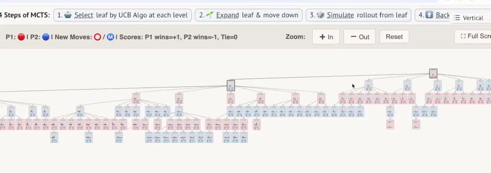
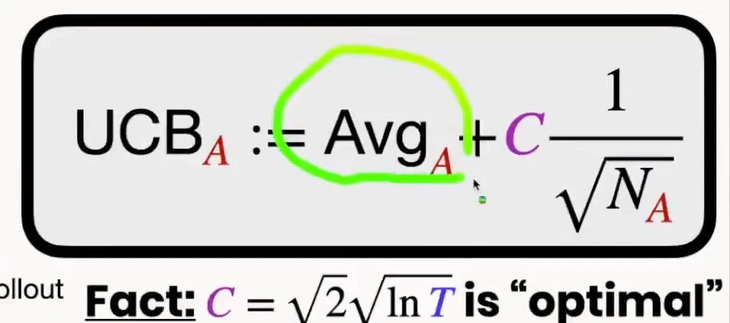
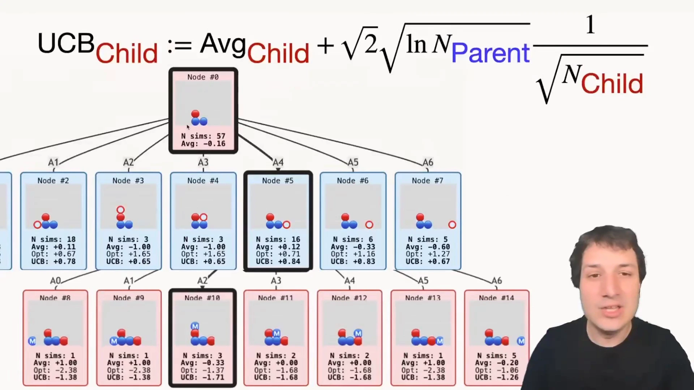
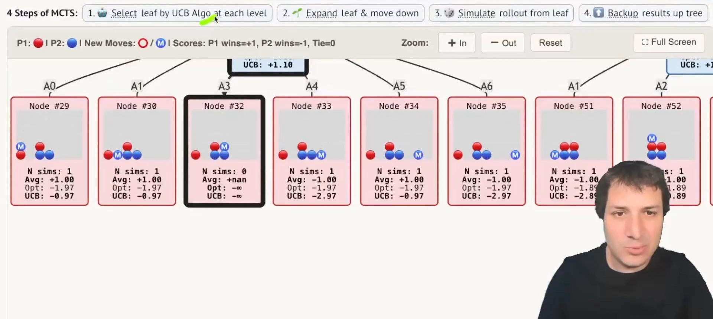
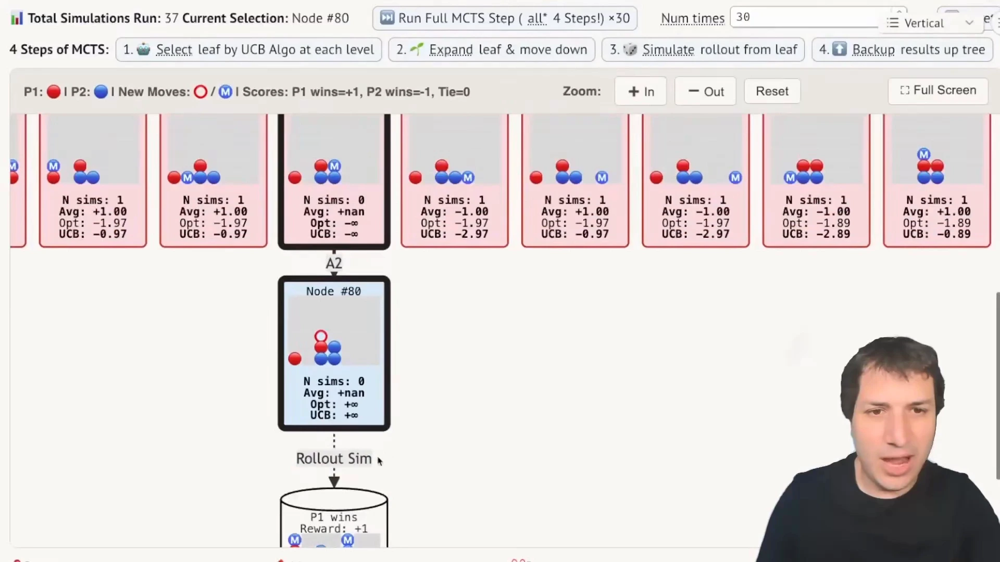
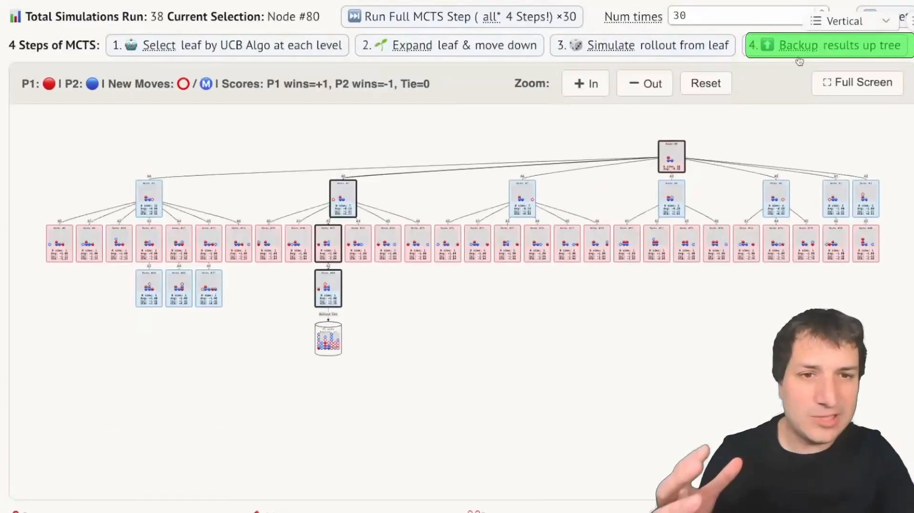
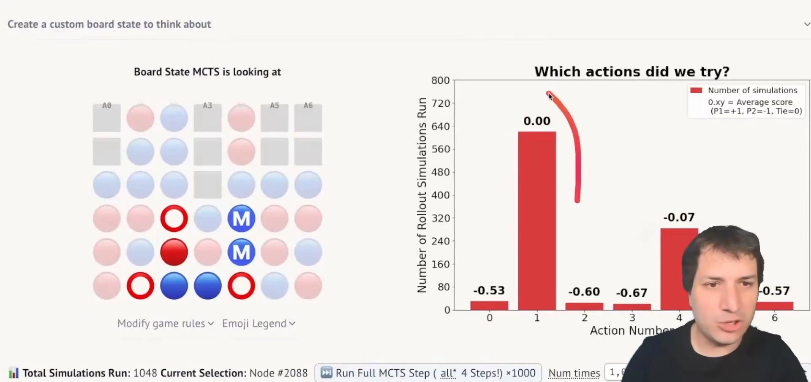

# 第02讲：蒙特卡洛树搜索——用 UCB 把博弈树长成不对称的形状

> 本篇整理自 Mihai Nica 的 AlphaZero 系列第二讲《蒙特卡洛树搜索》（B 站中配版 `BV1NZT96UEW9` 的 P2）。视频地址：[BV1NZT96UEW9/?p=2](https://www.bilibili.com/video/BV1NZT96UEW9/?p=2)。
> 第 10 章的前几篇已经讲清了「有模型 vs 免模型」的权衡（10.1）与模型误差的复合（10.2）：那两篇里的模型都是用来**生成单步样本**喂给值函数的。本篇换一条路——**同一个模型，不做单步采样，而是向前展开成一棵树，在树上搜索，直接选出当前这一步该走哪个动作**。这条路的终点就是 AlphaGo / AlphaZero 里的 MCTS。

## 本讲要解决的核心问题（SCQA）

**背景**：棋类 AI 的经典做法是搜索。深蓝（Deep Blue）用人工设计的特征做剪枝，把国际象棋的博弈树高效地搜完，从而击败卡斯帕罗夫。

**冲突**：这个办法在围棋上直接失效。19×19 的棋盘有 361 个落点，把所有棋局可能性列出来是 361 的阶乘这个量级——比宇宙中的原子数还多，再强的超算也穷举不完。更麻烦的是，即使能穷举，**绝大多数分支在实际对局中根本不会出现**，把算力平摊到它们身上是纯粹的浪费。

**疑问**：既然不能穷举、也不该平摊，那算力该怎么分配？怎么在「试过的走法里挑最好的」和「还没试过的走法里可能藏着更好的」之间做取舍？

**回答（中心思想）**：MCTS 的做法是**让树自己长成不对称的形状**——用一个叫 UCB 的分数在每一层挑「最值得继续看」的那个孩子，把绝大部分模拟预算压在少数几条有希望的分支上，其余分支只留一点点。UCB 的分数由两部分相加：**到目前为止的平均回报**（利用）与**一个随访问次数衰减的乐观奖励**（探索）。把 UCB 逐层用在树上，就是 UCT。整个算法是四步循环：**选择 → 扩展 → 模拟 → 回传**。

---

## 一、为什么需要树搜索：穷举行不通，均匀也不划算

先看量级。四子棋（Connect 4）只有 7 列，看起来很小，但博弈树是按「7 的步数次方」膨胀的：第一步 7 种落点，对手各有 7 种回应，再深一层又是 7 种……深度只加几层，节点数就已经到了无法渲染的地步 [【跳转到 02:45】](https://www.bilibili.com/video/BV1NZT96UEW9/?p=2&t=165)。

这里有两个独立的问题：

1. **树太大**：节点数随深度指数增长，而棋盘只是按边长的平方增长，两者的差距会越拉越大；
2. **大部分节点没用**：很多落子在实际对局中永远不会出现，把它们放进树里只是白白占内存和算力。

人类的做法恰好绕开了这两点：下棋时不会评估所有可能的开局，而是先想「眼下我能想到的几步候选」，再推敲对手的候选回应。MCTS 做的就是同一件事——**只把那些真正可能发生的局面放进树里**，于是「可能性」从指数级降到能处理的规模 [【跳转到 04:16】](https://www.bilibili.com/video/BV1NZT96UEW9/?p=2&t=256)。

效果就是树长得极不均匀：有的分支已经被推到 5~6 步深，有的分支只挂了一两个节点就停住了。



这也解释了为什么 AlphaZero 每步只需要数万次局面评估，而传统引擎要数千万次。卡斯帕罗夫的评价被视频引用来概括这件事：AlphaZero 是**更聪明地工作，而不是更努力地工作** [【跳转到 01:24】](https://www.bilibili.com/video/BV1NZT96UEW9/?p=2&t=84)。

---

## 二、UCB：把「不确定性」直接加进分数里

要在树上做取舍，先得解决一个更小的问题：**手上有若干个候选动作，每个都试过几次、各有胜率，下一次该试哪个？**

### 2.1 先用随机模拟给动作打分

MCTS 评估一个局面的办法非常朴素：从这个局面开始**随机走子直到终局**，赢了记 $+1$，输了记 $-1$，平局记 $0$。这个操作叫随机模拟，也叫 rollout 或 playout [【跳转到 07:54】](https://www.bilibili.com/video/BV1NZT96UEW9/?p=2&t=474)。



它的优点是**完全不需要值函数**——只要模型能模拟出「走这一步之后世界变成什么样」，就能得到一份带噪声的评估。缺点是噪声确实大，所以必须靠多次采样取平均。

### 2.2 只看平均值会陷入贪婪

有了平均值，最直接的做法是「永远选平均值最高的那个」。这不行。视频里的说法是：如果只依赖原始平均值，就会**过于贪婪，陷入只尝试那些偶然表现良好的走法而无法自拔** [【跳转到 09:14】](https://www.bilibili.com/video/BV1NZT96UEW9/?p=2&t=554)。

一个走法试了 1 次就赢，平均值是 $+1$；另一个试了 20 次赢了 14 次，平均值是 $+0.4$。只看平均值，前者永远赢——但它的 $+1$ 极可能只是运气。

### 2.3 UCB 分数 = 平均值 + 乐观奖励

UCB（Upper Confidence Bound，置信上界）的做法是给每个动作算一个分数，**把「我们有多不确定」直接加进去** [【跳转到 09:39】](https://www.bilibili.com/video/BV1NZT96UEW9/?p=2&t=579)：

$$
\text{UCB}_A \;=\; \overline{V}_A \;+\; c\cdot\frac{1}{\sqrt{N_A}}
$$

其中 $\overline{V}_A$ 是动作 $A$ 上所有模拟结果的平均值，$N_A$ 是动作 $A$ 被模拟过的次数，$c$ 是控制乐观程度的常数。

两项的含义正好相反：

- **第一项 $\overline{V}_A$ 是「利用」**：试得越多、赢得越多，这一项越大，算法越愿意再来一次；
- **第二项 $c/\sqrt{N_A}$ 是「探索」**：$N_A$ 越小（越没试过），这一项越大。一个从没试过的动作 $N_A=0$，这一项是无穷大，于是**它一定排在队首**。

$N_A$ 变大时探索项自然衰减：试得越多，我们对它的估计越有把握，就越不需要靠「乐观」去补贴它。这就是「一开始什么都想试，后来越来越集中在最好的那个」的数学来源。

视频还给出了 $c$ 的一个经典取法 [【跳转到 10:04】](https://www.bilibili.com/video/BV1NZT96UEW9/?p=2&t=604)：

$$
c = \sqrt{2}\sqrt{\ln T}
$$

$T$ 是到目前为止**所有动作**被尝试的总次数。$c$ 随 $T$ 缓慢增长（对数级），于是随着游戏进行，算法对表现差的动作会越来越「宽容」，最终每个动作都会被试到无穷多次——**任何动作都不会被永久放弃**。这也正是 UCB 在最坏情况遗憾上达到对数级、从而「在常数范围内最优」的原因。

$c$ 的物理意义很直白：**它是你想有多乐观的旋钮**。$c=0$ 就退化成纯贪婪；$c$ 越大越爱探索。

---

## 三、UCT：把 UCB 从老虎机搬到树的每一层

单层的 UCB 只解决「这一步选哪个动作」。树搜索要解决的是「沿着哪条路径往下走」。把 UCB 逐层套用，就是 **UCT**（UCB applied to Trees）。

做法是：从根节点开始，在每一层都对当前节点的所有孩子算一次 UCB 分数，选分数最高的那个当新的当前节点，再往下重复，直到碰到一个叶节点 [【跳转到 11:19】](https://www.bilibili.com/video/BV1NZT96UEW9/?p=2&t=679)。

公式和单层的几乎一样，但**探索项里的总次数换成了父节点的访问次数**：

$$
\text{UCB}_{\text{child}} \;:=\; \overline{V}_{\text{child}} \;+\; \sqrt{2}\,\sqrt{\ln N_{\text{parent}}}\cdot\frac{1}{\sqrt{N_{\text{child}}}}
$$



这个替换非常关键，它带来两个性质：

1. **乐观奖励是「父节点层面」发放的**。随着根节点被访问得越来越多，$N_{\text{parent}}$ 变大，$\ln N_{\text{parent}}$ 变大，于是**它的每一个孩子的乐观奖励都会一起变大**。这意味着即使某个孩子表现很差，只要其他孩子已经被摸得足够清楚，它的乐观奖励最终会高到让它重新被选中 [【跳转到 12:34】](https://www.bilibili.com/video/BV1NZT96UEW9/?p=2&t=754)。
2. **保证每个节点都会被探索到**：因为 $N_{\text{child}}$ 会不断变大而探索项衰减，而 $N_{\text{parent}}$ 的增长会持续给所有孩子加码，两者拉扯的结果是**没有哪个分支会被永久丢掉**。

用图里的具体数字感受一下。根节点 Node #0 已经被模拟 57 次，平均值 $-0.16$；它的孩子里 Node #5 平均值 $+0.12$、被模拟 16 次，UCB 是 $+0.84$，是这一层最高的；Node #7 平均值 $-0.60$（输得远多于赢），但只被模拟了 5 次，乐观奖励 $+1.27$ 把它撑到了 UCB $+0.67$——仍然比 Node #4（$-1.00$，3 次，UCB $+0.65$）略高，所以它**还没被彻底放弃**。

### 3.1 一次「选择」的现场：没试过的节点优先级是无穷大

看一次真实的选择过程。这一层里 Node #32 的 `N sims` 是 0，平均值显示为 `+nan`，乐观奖励 `Opt` 与总分 `UCB` 都显示为 $\infty$——于是它被粗黑框高亮选中 [【跳转到 17:01】](https://www.bilibili.com/video/BV1NZT96UEW9/?p=2&t=1021)。



注意它旁边的 Node #29、Node #30 的平均值都是 $+1.00$（试一次就赢），UCB 却是 $-0.97$。这一层的所有兄弟节点**乐观奖励完全相同**（都是 $-1.97$），UCB 的差别全部来自平均值——因为探索项只取决于**父节点的访问次数**与**各自的访问次数**，同一层共享同一个父节点，所以这一项对兄弟节点是同一个数。这正是 UCT 公式的结构：**同一层比的是平均值，跨层比的是访问次数**。而一个从没试过的节点（$N = 0$）更直接：它的探索项是 $\infty$，不看平均值就直接胜出——这是「探索优先于利用」最极端的情形。

> 演示程序按 negamax 记法记录价值——价值始终从「当前该走的一方」角度算，所以轮到对手走的层上乐观奖励取负号。它不影响比较，因为同一层内符号一致。

---

## 四、四步循环：选择、扩展、模拟、回传

上面只讲了「怎么往下走」。完整的 MCTS 是一次次重复的四步循环，每循环一次就往树里加一点信息 [【跳转到 14:01】](https://www.bilibili.com/video/BV1NZT96UEW9/?p=2&t=841)：

```
1. 选择（Selection）  ：从根出发，每层按 UCB 选孩子，直到叶节点
2. 扩展（Expansion）  ：把叶节点展开，加入它的孩子
3. 模拟（Simulation） ：从新叶节点随机对弈到终局，得到回报
4. 回传（Backup）     ：把回报沿路径回传，更新每个节点的 N 与平均值
```

### 4.1 选择：一路按 UCB 走到叶节点

从根节点开始，把「当前节点」当成父节点，算它所有孩子的 UCB，走向最高的那个；到了新节点再把身份换成父节点，继续算、继续走。一直走到一个**叶节点**为止（叶节点就是还没有孩子的节点）。

### 4.2 扩展：给叶节点添一个孩子

到了叶节点之后，如果它还有没试过的动作，就把它展开——把可能的后续局面作为新的子节点加进树里，然后往下走一层，站到新节点上 [【跳转到 17:45】](https://www.bilibili.com/video/BV1NZT96UEW9/?p=2&t=1065)。

### 4.3 模拟：从新节点随机对弈到终局

从刚加进来的这个节点开始随机走子，直到分出胜负，得到一个回报（赢了 $+1$、输了 $-1$）[【跳转到 18:26】](https://www.bilibili.com/video/BV1NZT96UEW9/?p=2&t=1106)。



**这一步只更新树内的节点，模拟过程中经过的树外状态一律不保存**。这是 MCTS 省内存的关键：rollout 可以走得很长，但它不占树的存储。

### 4.4 回传：把回报沿路径送回去

把这次模拟的回报沿着刚才走下来的路径逐级回传：路径上每个节点的 $N$ 加一，平均值按新样本更新 [【跳转到 19:10】](https://www.bilibili.com/video/BV1NZT96UEW9/?p=2&t=1150)。



用视频里的具体数字走一遍：新节点 Node #80 变成「1 次模拟、平均值 $+1$」；它的父节点 Node #32 从 0 次变成 7 次、平均值升到 $+0.14$；根节点从 37 次变成 38 次。有意思的是，Node #32 的平均值 $+0.14$ 一下就超过了原本最有希望的 Node #5（$+0.09$）——**一次幸运的 rollout 就足以改变这一层的排序**，而这也正是需要大量模拟、让平均值收敛的原因。

四步走完，回到第 1 步，继续循环，直到**计算预算耗尽**。

---

## 五、算完之后：用访问次数投票，而不是用平均值

预算耗尽后要给出动作。这里有个容易忽略的细节：**最终决策通常不用 UCB，而是看哪个孩子被访问得最多**（或者直接取平均值最高的）。

视频里的例子很直观：一共跑了 1048 次模拟，动作 1 被分配了 640 次，动作 4 分到约 290 次，其余动作只有个位数 [【跳转到 21:30】](https://www.bilibili.com/video/BV1NZT96UEW9/?p=2&t=1290)。



为什么要看次数而不是平均值？因为**访问次数本身就是算法「思考后的结论」**：UCB 会把预算持续投给真正有希望的分支，所以一个动作被访问得多，说明它在反复比较中一直没被比下去。而平均值只反映「试过的那些次」的运气。

顺带注意动作 4：它的平均得分是 $-0.07$，比动作 1 的 $0.00$ 差，但仍然被保留了约 290 次模拟。原因就是它的乐观奖励足以抵消「实际表现稍差」这件事——**算法没有把它一票否决**。

---

## 六、MCTS 的四个性质与它的边界

把这套机制的性质归一下类，可以看清它为什么适合下棋这类场景。

**（一）anytime：随时可以停**

MCTS 没有「必须跑完」的概念。跑 100 次和跑 10000 次都能给答案，只是质量不同；时间紧就少跑，时间宽裕就多跑。视频里 AI 的模拟预算是一个可以拖动的滑块，每步 1000 次模拟就已经不慢，拉到 1 万次会明显变慢但更强 [【跳转到 23:44】](https://www.bilibili.com/video/BV1NZT96UEW9/?p=2&t=1424)。这个性质在比赛读秒的场景里是刚需。

**（二）不对称：算力自动流向有希望的分支**

这是 UCB 的直接后果。树的形状不是预先设定的，而是被访问次数「雕刻」出来的：有希望的分支被反复加深，没希望的分支只留一两个节点。前面那张深度处处不同的树，就是这条性质的图像。

**（三）不需要值函数：rollout 就是评估器**

MCTS 从不训练价值网络，它用一个随机策略跑到底，用胜负当回报。所以它**只需要一个可以模拟的模型**（游戏规则已知、能往前推演），不需要预先知道状态值。

**（四）可增量：树可以复用**

每次循环只改动路径上的几个节点，不需要重算整棵树。不过要注意：**决策做完、动作执行之后，树通常只保留新根节点下面的子树，其余全部丢弃**——下一次决策要在新的根上重新长。

最后这条正好把它和 Dyna 区分开：

| | Dyna（10.1 / 10.3） | MCTS（本篇） |
| :--- | :--- | :--- |
| 模型用来做什么 | 生成**单步**样本 $(s,a,r,s')$ | 向前**展开成一棵树** |
| 学到的东西 | 更新**全局**值函数 $Q(s,a)$，跨状态复用 | 只在**当前决策**的局部树上算，算完就丢 |
| 是否需要值函数 | 需要，且是主角 | 不需要，rollout 代替 |
| 计算形态 | 均匀地反复更新 | 把预算集中到少数分支 |

**局限也要说清**：

- **必须有可模拟的模型**。游戏规则是已知的，所以能模拟；真实机器人、真实交通场景里没有现成的规则可推演。
- **rollout 的质量决定上限**。纯随机 rollout 在围棋这种「随机走子几乎必输」的游戏里信号极弱，需要大量采样才能压住噪声。
- **每次决策都要重算**。树算完就丢，下一步从头再来，这是纯粹的计算开销。

后两条正是 AlphaZero 要解决的问题：**用策略网络替代随机 rollout（给出该往哪几个分支看），用价值网络替代跑到终局的模拟（直接估一个局面值）**，于是同样的模拟次数能换来高得多的决策质量。这条线在 10.5 展开。

---

## 小结

- **树搜索的动机**：围棋这类游戏的博弈树是 361 的阶乘量级，穷举不可能；而绝大多数分支实际不会出现，平摊算力是浪费。所以要「只把可能发生的局面放进树里」。
- **UCB 的分数是两项之和**：平均值（利用）+ 随访问次数衰减的乐观奖励（探索）。$N_A=0$ 时探索项为无穷大，没试过的动作优先；$N_A$ 变大时探索项自然衰减。
- **$c$ 是乐观程度的旋钮**，$c=0$ 退化为贪婪；经典取法 $c=\sqrt{2}\sqrt{\ln T}$ 让每个动作都会被试到无穷多次，从而在遗憾上达到对数级最优。
- **UCT 就是把 UCB 逐层用**：探索项里的总次数换成**父节点**的访问次数，于是父节点被访问得越多，所有孩子的乐观奖励一起变大，保证没有分支被永久放弃。
- **四步循环**：选择（按 UCB 走到叶节点）→ 扩展（添孩子）→ 模拟（随机对弈到终局得回报）→ 回传（沿路径更新 $N$ 与平均值）。树外的状态不保存。
- **四个性质**：anytime（随时可停）、不对称（算力集中）、无需值函数（rollout 代替）、可增量（只改路径上的节点）。
- **与 Dyna 的分野**：Dyna 用模型生成单步样本去更新全局值函数；MCTS 用模型展开一棵局部树直接选动作，算完就丢。
- **边界**：需要可模拟的模型、rollout 质量影响大、每次决策都要重算——后两条由 AlphaZero 的策略网络与价值网络接手（见 10.5）。