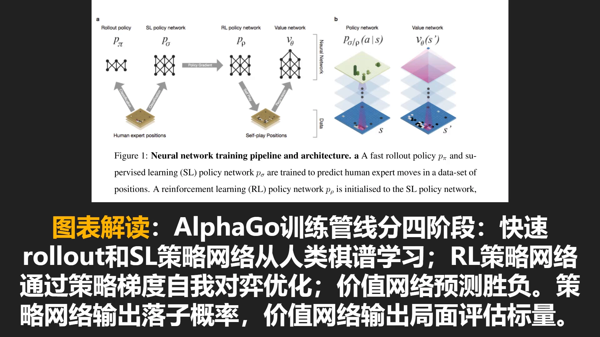
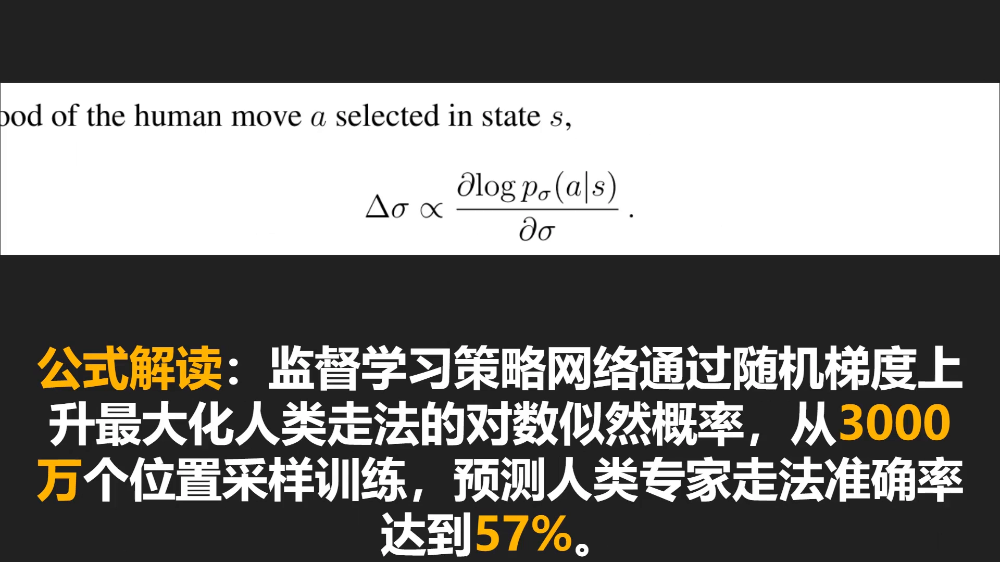
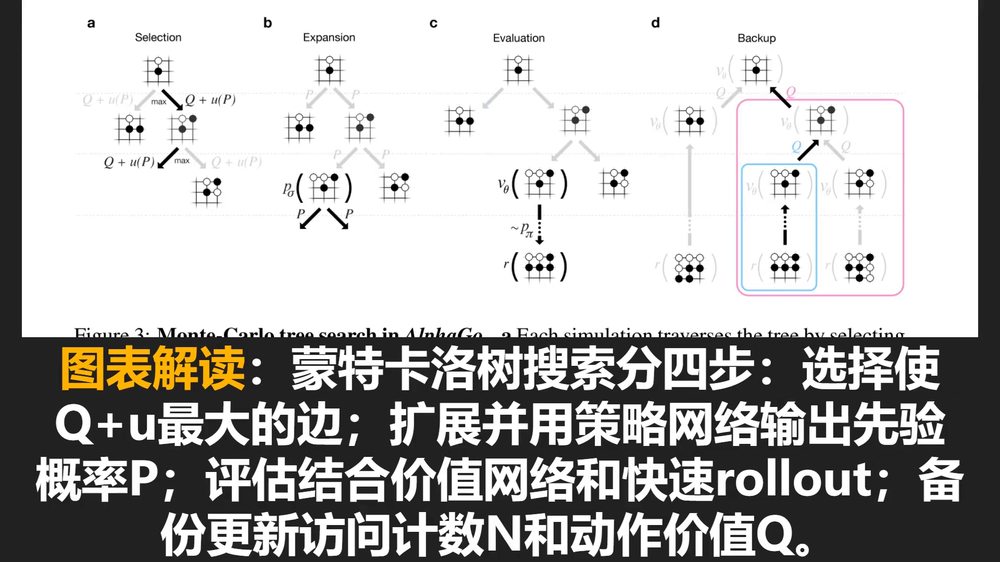
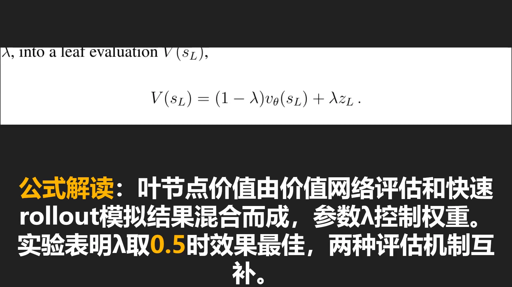
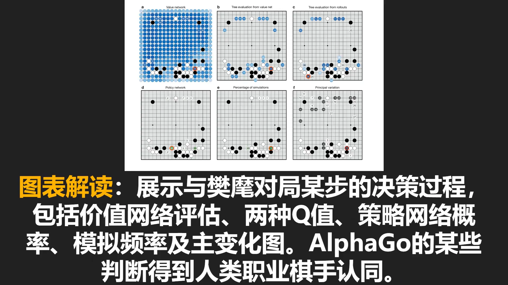
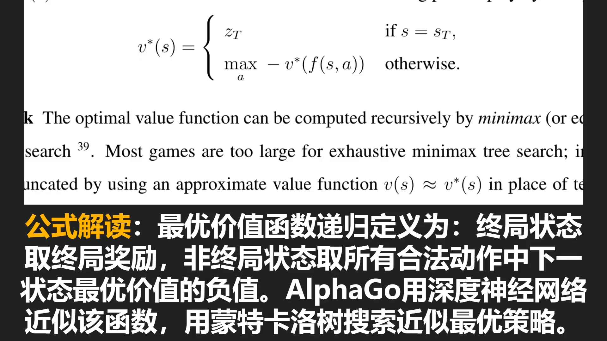
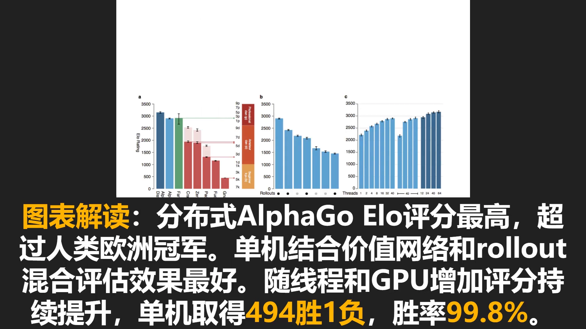

# AlphaGo：策略网络、价值网络与快速走子的三件套

> 本篇整理自 B 站视频《[38]. AlphaGo：论文解读【每天一个宝藏论文】》（`BV1t1RrBNELs`，11 分 16 秒）。视频地址：[BV1t1RrBNELs](https://www.bilibili.com/video/BV1t1RrBNELs/)。
> 第 10 章一路走到这里：10.1 讲了有模型与免模型的权衡，10.2 讲了模型误差如何复合，10.3 讲了 Dyna 把学习与规划揉在一起，10.4 讲了 MCTS 与 UCT 这套「在树上分配算力」的机制。本篇是这条线的第一个顶点——**2016 年的 AlphaGo 把深度网络塞进了 MCTS**，从此搜索不再是「随机 rollout 求平均」，而是「用学到的直觉决定往哪看、用学到的判断决定看到的东西值多少」。

## 本讲要解决的核心问题（SCQA）

**背景**：棋类 AI 的经典解法是搜索。给定规则，就能把「我走这步、对手走那步」展开成一棵博弈树，用极小极大（minimax）在树上算出最优着法。国际象棋上这条路走通过——深蓝就是这样击败卡斯帕罗夫的。

**冲突**：围棋把这条路堵死了两次。第一次是**树太大**：每步约 250 种合法走法，整局约 150 步，总状态数超过 $10^{170}$，远超宇宙原子总数，任何穷举都不可能。第二次是**局面太难评估**：国际象棋里子力价值可以人工标定，围棋里「这一手值多少」连职业棋手都说不清，没有便宜的评估函数，搜索就算展开也打不了分。

**疑问**：既然树展不开、叶子又打不了分，那还能不能搜索？如果能，靠什么来决定「往哪展开」和「展开到的局面值多少」？

**回答（中心思想）**：AlphaGo 的答案是**用两个深度卷积网络分别替代搜索中原本靠人工设计的两件事**——策略网络 $p(a\mid s)$ 替代「往哪展开」（缩小**宽度**），价值网络 $v(s)$ 替代「这个局面值多少」（缩短**深度**），再保留一个廉价的快速 rollout 作为补充评估。三者一起塞进 MCTS，就得到一个既能算得深、又不用穷举的棋手。这套组合在与其他围棋程序的对战中取得 99.8% 的胜率，并以 5:0 击败欧洲围棋冠军樊麾——这是计算机程序首次在完整尺寸的围棋上击败人类职业棋手 [【跳转到 00:50】](https://www.bilibili.com/video/BV1t1RrBNELs/?t=50)。

---

## 一、围棋的两个爆炸：宽度与深度

先把问题量化。围棋每步约 250 种合法走法，一局约 150 步。如果只按「宽度」算，一层就有 250 个分支；按「深度」算，150 层叠起来就是 $250^{150}$ 量级——即使剔掉绝大多数不合法局面，状态数仍在 $10^{100}$ 以上，比宇宙中的原子数还多 [【跳转到 00:00】](https://www.bilibili.com/video/BV1t1RrBNELs/?t=0)。

人类的做法绕开了这两个爆炸：棋手靠**棋感**（来自经验的对局面的判断）把候选点从 250 个压到几个，再靠**计算**在这几个点上往下推。棋感负责宽度，计算负责深度，两者缺一不可——只靠棋感行棋漏洞百出，只靠计算又算不完。

AlphaGo 的结构正好对应这两件事：**策略网络当棋感，MCTS 当计算，价值网络当「算到一半就下结论」的能力**。

---

## 二、四个组件：两套策略、一个价值网络、一个快速 rollout

AlphaGo 的核心思路可以概括成三步：用深度卷积网络构建价值网络与策略网络；这些网络先用监督学习从人类棋谱模仿，再用强化学习从自我对弈中提升；最后把训练好的网络与 MCTS 结合 [【跳转到 00:25】](https://www.bilibili.com/video/BV1t1RrBNELs/?t=25)。

上图左半部分就是完整的训练管线，四个阶段依次是：快速 rollout 策略 $p_\pi$ 与监督学习（SL）策略网络 $p_\sigma$ 从人类棋谱学习；强化学习（RL）策略网络 $p_\rho$ 在 SL 网络基础上用策略梯度自我对弈优化；价值网络 $v_\theta$ 用 RL 网络自我对弈产生的数据训练。右半部分则是两个网络的形状：输入都是棋盘，策略网络输出每个合法落子的概率分布，价值网络输出一个标量 [【跳转到 02:24】](https://www.bilibili.com/video/BV1t1RrBNELs/?t=144)。

### 2.1 SL 策略网络：先学会模仿人类

监督学习策略网络 $p_\sigma(a\mid s)$ 的训练目标非常直白：**最大化人类在状态 $s$ 下选择落子 $a$ 的对数似然**。用随机梯度上升，权重更新方向与对数概率的梯度成正比 [【跳转到 03:22】](https://www.bilibili.com/video/BV1t1RrBNELs/?t=202)：

$$
\Delta\sigma \;\propto\; \frac{\partial \log p_\sigma(a\mid s)}{\partial \sigma}
$$

训练数据是 3000 万个来自 KGS 围棋服务器的局面，最终预测人类专家走法的准确率达到 57%。这个数字看起来不高——但要知道围棋每步有 250 个候选，随机猜的准确率是 0.4%，57% 已经意味着网络学到了相当强的「棋感」。

### 2.2 RL 策略网络：从「像人」转向「求胜」

模仿人类有个天花板：人类走法不等于最优走法。于是 AlphaGo 以 SL 网络为起点，用策略梯度做自我对弈，目标从「像人类」换成「赢棋」[【跳转到 04:00】](https://www.bilibili.com/video/BV1t1RrBNELs/?t=240)：

$$
\Delta\rho \;\propto\; \frac{\partial \log p_\rho(a_t\mid s_t)}{\partial \rho}\, z_t
$$

其中 $z_t$ 是终局奖励：赢棋 $+1$，输棋 $-1$。这就是第 7 章讲过的 REINFORCE——用最终胜负给每一步的对数概率加权，赢了的走法提高概率，输了的走法降低概率。效果是 RL 策略网络在与先前版本的自己对弈时赢下超过 80% 的对局，甚至不使用任何搜索就以 85% 的胜率击败了当时最强的开源围棋程序 Pachi。

### 2.3 价值网络：直接预测胜负

价值网络要近似的是「在策略 $p$ 下从状态 $s$ 出发的期望结果」——一个条件期望：给定当前状态 $s$，此后双方都按策略 $p$ 走子，最终比赛结果的期望 [【跳转到 04:40】](https://www.bilibili.com/video/BV1t1RrBNELs/?t=280)。

这个量在理论上可以精确算，实际上算不出来，所以用网络 $v_\theta(s)$ 去近似。训练方式是回归：最小化预测值与真实结果之间的均方误差 [【跳转到 05:16】](https://www.bilibili.com/video/BV1t1RrBNELs/?t=316)：

$$
\Delta\theta \;\propto\; \frac{\partial v_\theta(s)}{\partial \theta}\big(z - v_\theta(s)\big)
$$

这里有一个容易被忽略的工程细节：**如果直接用完整对局的数据训练，同一局里相邻局面高度相关，网络容易过拟合**。所以 AlphaGo 从独立对局里采样了 3000 万个局面，最终训练集和测试集的均方误差分别是 0.226 和 0.234——两者接近，说明过拟合程度很低。

### 2.4 快速 rollout：最便宜也最粗糙的评估

第四个组件是快速 rollout 策略 $p_\pi$：一个极轻量的走子策略，用它从一个局面开始**随机走到终局**，赢了记 $+1$、输了记 $-1$。这就是 10.4 里讲过的随机模拟（rollout / playout）。

它的优点是**完全不需要值函数**，只要规则能模拟就能打分；缺点是噪声极大。AlphaGo 的做法不是二选一，而是把价值网络与 rollout **混合**起来用——下一节会看到怎么混。

---

## 三、把网络塞进 MCTS：四步循环与混合评估

有了四个组件，剩下的问题是「怎么用」。AlphaGo 的 MCTS 仍然是 10.4 讲过的四步循环——选择、扩展、评估、备份——但每一步都被网络改造过 [【跳转到 05:59】](https://www.bilibili.com/video/BV1t1RrBNELs/?t=359)。

### 3.1 选择：用「先验」改造 UCB

10.4 里的 UCT 用 $\overline{V} + c/\sqrt{N}$ 选孩子：平均值负责利用，$1/\sqrt{N}$ 负责探索。AlphaGo 把探索项换成了**带先验的版本** [【跳转到 06:49】](https://www.bilibili.com/video/BV1t1RrBNELs/?t=409)：

$$
a_t \;=\; \arg\max_a \Big( Q(s_t,a) + u(s_t,a) \Big),
\qquad
u(s,a) \;\propto\; \frac{P(s,a)}{1 + N(s,a)}
$$

区别只有一处，但很关键：探索奖励的分子从常数变成了**策略网络给出的先验概率 $P(s,a)$**。也就是说，「没试过的走法值得一试」这件事不再对所有走法一视同仁——**策略网络认为好的走法，值得优先去试**。分母 $1+N(s,a)$ 保证访问次数一多，先验的影响就衰减，让真实的搜索结果接管。

这个设计把两件事接上了：策略网络提供先验（往哪看），树搜索积累统计（看了之后值多少）。前者决定效率，后者决定准确性。

### 3.2 评估：为什么还需要 rollout

搜索走到叶节点，得给这个局面一个分数。AlphaGo 的评估是**两种机制的加权混合** [【跳转到 07:35】](https://www.bilibili.com/video/BV1t1RrBNELs/?t=455)：

$$
V(s_L) \;=\; (1-\lambda)\, v_\theta(s_L) \;+\; \lambda\, z_L
$$

其中 $v_\theta(s_L)$ 是价值网络的输出，$z_L$ 是用快速 rollout 策略模拟到终局得到的实际结果，$\lambda$ 控制两者权重。实验结论是：**单独用价值网络、或单独用 rollout，都不如混合**；$\lambda = 0.5$ 时表现最佳 [【跳转到 08:00】](https://www.bilibili.com/video/BV1t1RrBNELs/?t=480)。

为什么混合比任何一方都好？因为两者的错误方向不同：

- **价值网络**是在「强策略」的对局分布上训练的，判断接近高手直觉，但它是**函数近似**，会有系统性偏差，而且分布外的局面可能错得离谱；
- **快速 rollout** 用的是很弱的策略，走法质量差，但它是**真实的模拟**——只要走到终局，得到的胜负就是真的，噪声大但没有系统性偏差。

一个偏差小、方差大；一个偏差大、方差小。加权平均正好互补。这也回答了「为什么有了价值网络还要 rollout」：**价值网络单独不够准，rollout 单独不够稳**。

### 3.3 备份：把叶节点的分数摊回整条路径

评估完叶节点，要把结果沿路径回传。访问计数与动作价值的更新是标准的 MCTS 备份 [【跳转到 08:17】](https://www.bilibili.com/video/BV1t1RrBNELs/?t=497)：

$$
N(s,a) = \sum_{i=1}^{n} \mathbf{1}(s,a,i),
\qquad
Q(s,a) = \frac{1}{N(s,a)} \sum_{i=1}^{n} \mathbf{1}(s,a,i)\, V(s_L^i)
$$

其中 $\mathbf{1}(s,a,i)$ 是指示函数：第 $i$ 次模拟是否经过了边 $(s,a)$。$Q$ 就是「经过这条边的所有模拟所给出的叶节点评估的平均值」。所有模拟跑完后，从根节点选择**访问次数最多**的动作落子——注意不是选 $Q$ 最大的，而是选被搜得最多的，因为访问次数本身就是「搜索认为这里最值得看」的综合信号。

### 3.4 一张图看清六个视角

下面这张图是 AlphaGo 与樊麾对局中某一步的决策过程，六个面板分别展示了同一局面的六种「看法」[【跳转到 09:46】](https://www.bilibili.com/video/BV1t1RrBNELs/?t=586)。

- (a) 价值网络对棋盘上每个后续局面的胜率评估，颜色深浅表示胜率高低；
- (b)(c) 分别基于价值网络和基于 rollout 的树评估 $Q$ 值——两幅图的差异正是「两种评估互补」的直接证据；
- (d) 策略网络直接给出的落子概率；
- (e) 模拟过程中各动作被选中的频率百分比；
- (f) 主变化图（principal variation），即访问次数最多的那条搜索路径。

有意思的是，AlphaGo 最终落子的那一点，樊麾赛后说自己更倾向于 AlphaGo 预测的第一选点——说明 AlphaGo 的某些判断已经得到了人类职业棋手的认同 [【跳转到 10:11】](https://www.bilibili.com/video/BV1t1RrBNELs/?t=611)。

---

## 四、为什么非要搜索：极小极大与它的两个近似

回到理论。围棋是零和博弈，最优价值函数有一个递归定义 [【跳转到 10:35】](https://www.bilibili.com/video/BV1t1RrBNELs/?t=635)：

$$
v^*(s) =
\begin{cases}
z_T, & s = s_T \text{（终局）},\\[4pt]
\max_{a}\; -\,v^*\big(f(s,a)\big), & \text{其他}.
\end{cases}
$$

终局时最优价值就是终局奖励；非终局时，最优价值等于「在所有合法动作中取最大值，再取下一状态最优价值的负值」——负号是因为零和：一方的收益就是另一方的损失。

这个递归等价于极小极大搜索。但如前所述，围棋的树太大，穷尽不可能。AlphaGo 的两处近似正好对应两个爆炸 [【跳转到 11:00】](https://www.bilibili.com/video/BV1t1RrBNELs/?t=660)：

1. **用深度网络近似最优价值函数** $v_\theta(s) \approx v^*(s)$——把「算到底」换成「看一眼」，解决深度爆炸；
2. **用 MCTS 近似最优策略**——把「遍历所有分支」换成「只展开有希望的分支」，解决宽度爆炸。

一句话概括：**AlphaGo 不是把搜索做得更快，而是把搜索做得更省**——用学到的直觉决定往哪看，用学到的判断决定看到的东西值多少。

---

## 五、实验结果：每个组件到底贡献了多少

三张子图回答三个问题 [【跳转到 09:00】](https://www.bilibili.com/video/BV1t1RrBNELs/?t=540)：

- **左图（a）**：不同围棋程序的 Elo 对比。分布式 AlphaGo 评分最高，大幅领先当时的商业程序与开源程序，并且高于人类欧洲冠军。
- **中图（b）**：单机上不同组件组合的性能。仅使用策略网络、完全不搜索的版本已经很强；而把价值网络与 rollout 混合起来做评估的版本效果最好——这直接印证了 3.2 节的结论。
- **右图（c）**：可扩展性。随着搜索线程与 GPU 数量增加，Elo 持续提升。

最终成绩：单机 AlphaGo 在对阵其他程序时取得 494 胜 1 负，胜率 99.8% [【跳转到 09:25】](https://www.bilibili.com/video/BV1t1RrBNELs/?t=565)。

---

## 小结

- 围棋难在两个爆炸：**宽度**（每步约 250 种走法）与**深度**（总状态数超过 $10^{170}$），穷举与人工评估都行不通。
- AlphaGo 用两个网络分别接管这两件事：**策略网络 $p(a\mid s)$ 缩小宽度**（决定往哪展开），**价值网络 $v(s)$ 缩短深度**（决定展开到的局面值多少）。
- 四个组件各有分工：SL 策略网络从人类棋谱学棋感（准确率 57%），RL 策略网络用策略梯度把目标从「像人」换成「赢棋」，价值网络回归预测胜负，快速 rollout 提供廉价但真实的模拟。
- MCTS 的四步被网络改造：选择时把探索奖励换成 $P(s,a)/(1+N(s,a))$，扩展时用策略网络给先验，评估时用 $V = (1-\lambda)v_\theta + \lambda z$ 混合两种评估，备份时更新 $N$ 与 $Q$。
- **为什么还要 rollout**：价值网络偏差小但方差大、rollout 偏差大但方差小，混合评估（$\lambda=0.5$）比任何一方都好。
- 理论上 AlphaGo 做的是极小极大的两处近似：网络近似最优价值函数，MCTS 近似最优策略。
- 本篇留下的两个「不彻底」正是下一代要解决的问题：**它仍然依赖人类棋谱**（SL 网络），**rollout 仍然很贵**。AlphaGo Zero / AlphaZero 会把这两样都去掉。

## 关键术语速查

| 术语 | 一句话解释 |
| --- | --- |
| 策略网络 $p(a\mid s)$ | 输入棋盘，输出每个合法落子的概率；作用是缩小搜索宽度 |
| 价值网络 $v(s)$ | 输入棋盘，输出一个标量表示当前局面下当前方的期望结果；作用是替代深搜 |
| 快速 rollout | 用极轻量的策略从某局面随机走到终局，用真实胜负给局面打分 |
| 先验概率 $P(s,a)$ | 策略网络给出的、动作 $a$ 在状态 $s$ 下的初始推荐强度 |
| 混合评估参数 $\lambda$ | 叶节点评估中 rollout 结果所占的权重，实验最优值为 0.5 |
| 主变化图 | 搜索树中访问次数最多的那条路径，相当于 AI 认为最可能出现的后续走法 |
| 极小极大 | 零和博弈的最优价值递归：自己取最大，对手取最小（等价于取负后取最大） |