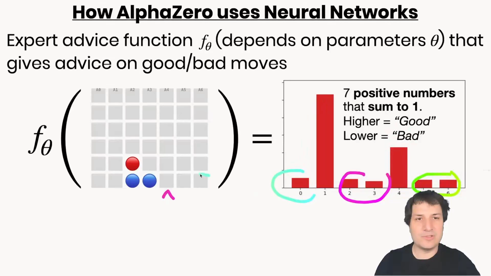
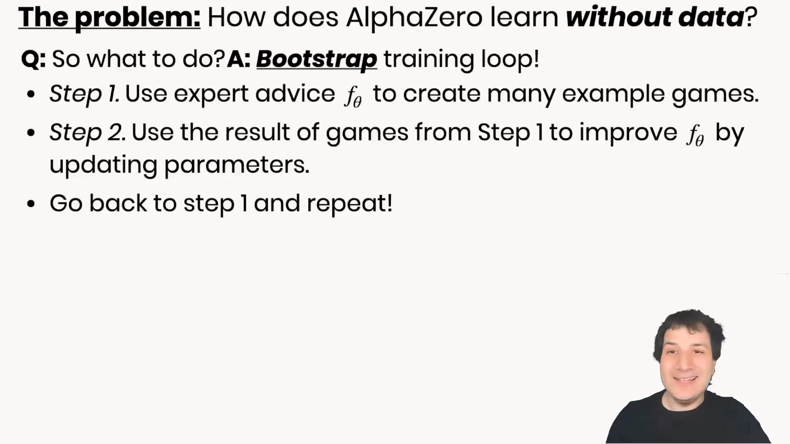
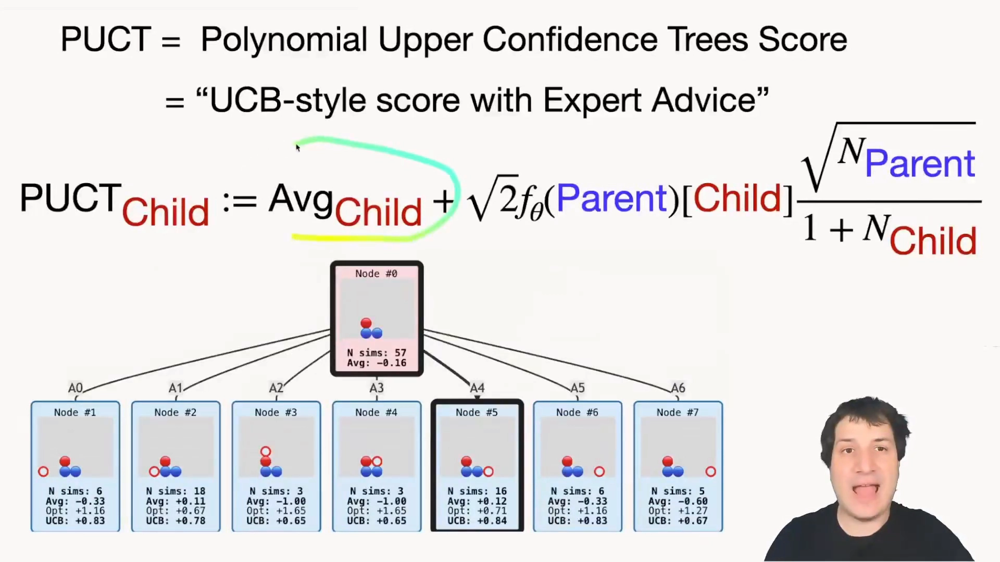
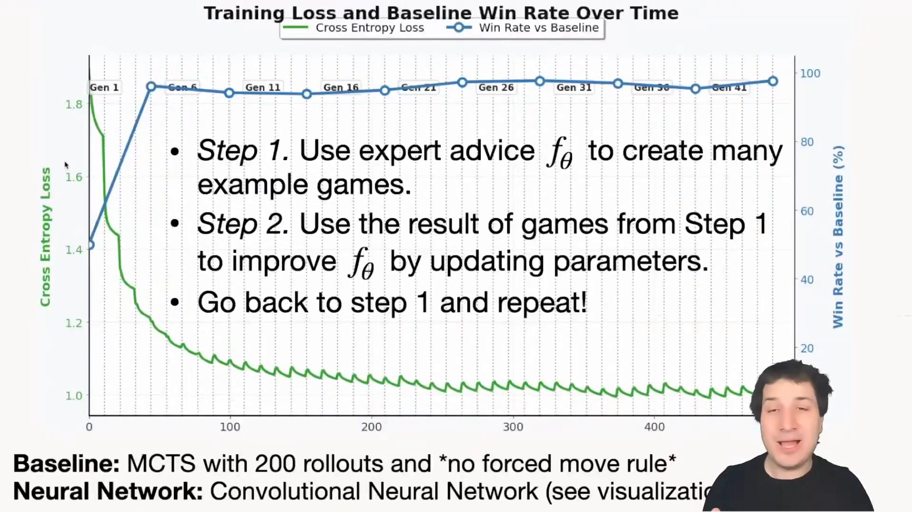
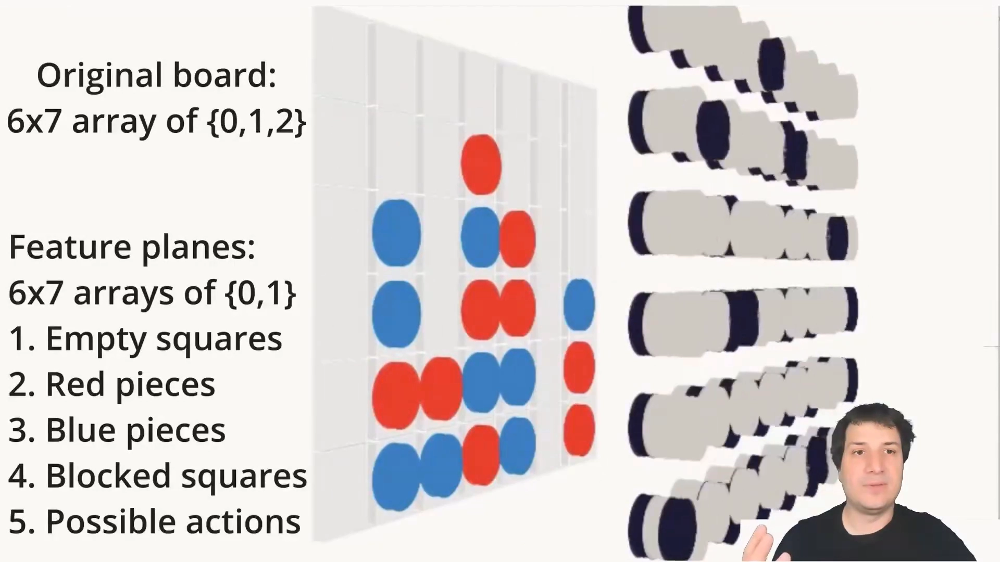
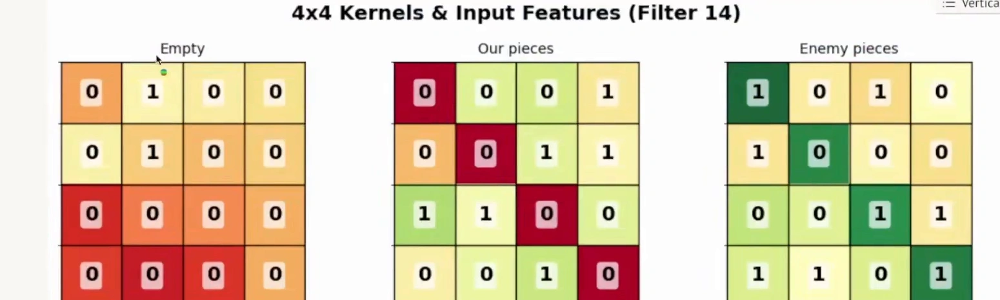
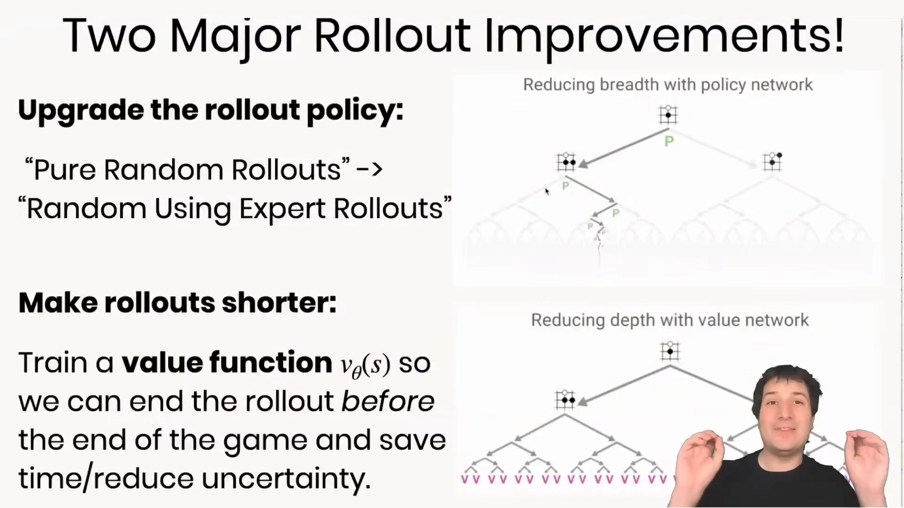

# AlphaZero：把MCTS变成策略改进算子

> 本篇整理自 Mihai Nica 的 AlphaZero 系列第三讲《AlphaZero 是如何学习的》（B 站中配版 `BV1NZT96UEW9` 的 P3，33 分 57 秒）。视频地址：[BV1NZT96UEW9/?p=3](https://www.bilibili.com/video/BV1NZT96UEW9/?p=3)。
> 上一篇（本篇同章的《AlphaGo：策略网络、价值网络与快速走子的三件套》）讲的是 2016 年的 AlphaGo：它靠人类棋谱训练策略网络，靠快速 rollout 给叶节点打分。本篇讲 2017 年的 AlphaZero 做了哪两刀——**把人类棋谱砍掉，把 rollout 砍掉**——以及砍完之后，为什么这个系统还能自己变强。

## 本讲要解决的核心问题（SCQA）

**背景**：AlphaGo 的策略网络是从 3000 万个人类棋谱局面里学出来的，价值网络也是用自我对弈数据回归出来的。这套办法能赢，但代价是**必须先有一批人类高手的数据**，而且天花板就是人类高手的水平。

**冲突**：如果没有人类棋谱呢？监督学习这条路直接断了——你手上没有任何「这个局面该走这里」的标注。更麻烦的是，就算想模仿一个比自己强的程序，也没意义：既然那个程序更强，为什么不直接用它？

**疑问**：在完全没有数据、网络初始化时纯随机的情况下，一个系统怎么判断「哪步棋好」？又怎么保证它每一轮都比上一轮更强，而不是原地打转？

**回答（中心思想）**：AlphaZero 用**自举训练循环**（bootstrapping）解决这个问题：第一步用当前的专家函数 $f_\theta$ 生成对局，第二步用这些对局去改进 $f_\theta$，然后重复。这个循环能转起来的关键在于——**第一步生成的棋局不是 $f_\theta$ 自己下出来的，而是「$f_\theta$ + MCTS」下出来的，因此质量高于 $f_\theta$ 本身**。MCTS 在这里不是「用网络来加速搜索」，而是反过来：**搜索成了策略改进算子**，它产出的走法分布就是网络要模仿的新目标。于是「搜索」和「学习」互为师生，一代一代往上爬。

---

## 一、专家建议函数：棋盘进，七个概率出

先把要学的东西定义清楚。AlphaZero 里只有一个网络，作者把它叫做**专家建议函数** $f_\theta$：输入当前棋局，输出「哪些走法好、哪些走法不好」[【跳转到 00:54】](https://www.bilibili.com/video/BV1NZT96UEW9/?p=3&t=54)。

视频用四子棋（Connect 4）做例子，因为它的棋盘只有 6×7，从数学上看就像一张 6×7 像素的小图片。函数输出 7 个数字，对应 7 种可能的落子（编号 0~6，因为 Python 从 0 开始）：

三个约束值得注意：

- **都是正数**：后面要拿它当「乐观奖励」，负数会让探索项失去意义；
- **总和为一**：网络不能耍赖说「每一步都好」，它必须把有限的注意力分配到它真正推荐的走法上；
- **数值大小有意义**：越大代表越推荐。

这个函数就是卷积神经网络在做的事。而「怎么找到这个函数」才是真正的难题。

### 1.1 为什么不能照抄监督学习

常规的神经网络训练靠监督学习：给一堆手写数字图片和人类标注的正确答案，网络猜错了就调参数，让正确答案的概率升高 [【跳转到 02:52】](https://www.bilibili.com/video/BV1NZT96UEW9/?p=3&t=172)。这套方法极其成功，但它要求**有人告诉你正确答案**。

四子棋的「正确答案」从哪来？复制人类棋谱不行——我们要的是超过人类，模仿人类最多追平人类。运行一个更强的算法来生成数据也不行——如果那个算法更强，直接用它就好了 [【跳转到 03:42】](https://www.bilibili.com/video/BV1NZT96UEW9/?p=3&t=222)。

所以 AlphaZero 走的是另一条路：**自己生成经验，再从经验里学习**。这就是强化学习。视频里引了一句很形象的话：人类数据就像是 AI 领域的化石燃料，抢占先机固然好，但最终得转向能靠经验自我学习的算法 [【跳转到 04:32】](https://www.bilibili.com/video/BV1NZT96UEW9/?p=3&t=272)。

---

## 二、自举循环：两步，反复

AlphaZero 的整个训练过程只有两步 [【跳转到 04:52】](https://www.bilibili.com/video/BV1NZT96UEW9/?p=3&t=292)：

1. **用当前的专家函数 $f_\theta$ 生成许多示例对局**；
2. **用第一步生成的对局来改进 $f_\theta$ 的参数**；
3. **回到第一步，重复**。

「自举」这个词来自「拽着自己的鞋带把自己提起来」——现实中不可能，但在机器学习里确实管用。可这里立刻冒出一个疑问：如果 $f_\theta$ 一开始什么都不知道，第一步生成的对局全是瞎下，第二步能学到什么？

答案是：**第一步生成的对局，质量比 $f_\theta$ 本身更高**。因为在 $f_\theta$ 之上还加了一层东西——蒙特卡洛树搜索。

### 2.1 MCTS 让棋局比专家更聪明

10.4 已经讲过 MCTS 的机制：用模拟给走法打分，既看历史平均成绩（利用），又给没试过的走法一个乐观奖励（探索）。它完全可以独立工作，不需要任何神经网络 [【跳转到 06:35】](https://www.bilibili.com/video/BV1NZT96UEW9/?p=3&t=395)。

AlphaZero 要做的是把 $f_\theta$ **嵌进** MCTS，而且是以一种非常特殊的方式嵌进去。特殊在哪？在于**专家只被允许影响「乐观奖励」这一项，不能影响「平均值」这一项** [【跳转到 08:01】](https://www.bilibili.com/video/BV1NZT96UEW9/?p=3&t=481)。

这个设计的好处是：**最终平均值会战胜专家**。因为平均值来自真实模拟的结果，专家只在「先去看哪一步」上说话。如果专家判断错了，模拟出来的平均值会推翻它；如果专家判断对了，模拟只会更快确认它 [【跳转到 08:26】](https://www.bilibili.com/video/BV1NZT96UEW9/?p=3&t=506)。

一个漂亮的极限情形：网络刚初始化时完全是随机的，它认为所有走法一样好——此时所有走法的乐观奖励相等，于是算法退化成**纯粹的 MCTS**。也就是说，AlphaZero 天然包含了「没有专家也能工作」的 MCTS 作为起点。

---

## 三、PUCT：把专家写进 UCB

把上面的想法写成公式，就是 PUCT（Polynomial Upper Confidence Trees）分数 [【跳转到 09:23】](https://www.bilibili.com/video/BV1NZT96UEW9/?p=3&t=563)：

$$
\text{PUCT}_{\text{child}} \;=\; \text{Avg}_{\text{child}} \;+\; \sqrt{2\, f_\theta(\text{parent})\lbrack \text{child} \rbrack}\;\cdot\;\frac{\sqrt{N_{\text{parent}}}}{1+N_{\text{child}}}
$$

对照 10.4 的 UCB 公式 $\overline{V} + c/\sqrt{N}$，逐项看这个式子：

- **$\text{Avg}_{\text{child}}$**：这个孩子节点在以往所有模拟中的平均得分——和 UCB 完全一样，是「利用」项，**专家碰不到它**。
- **$f_\theta(\text{parent})\lbrack\text{child}\rbrack$**：父节点上专家函数给出的、走向这个孩子的先验概率。专家推荐得越高，这一项的乐观加成越大。
- **$\sqrt{N_{\text{parent}}}/(1+N_{\text{child}})$**：探索衰减项。孩子被访问得越多，分母越大，乐观加成越小；父节点被访问得越多，分子越大，说明「该多分点预算给还没试过的孩子」。

三项合起来的效果是：**专家决定「先看哪里」，模拟决定「看了之后算数」**。这正是 10.4 里 UCT 的精神——把「不确定性」直接加进分数——只不过这里的不确定性被网络先验重新加权了。

### 3.1 一个真实例子：角落那手棋

视频里用交互式笔记本演示了这个机制怎么在实战中起作用 [【跳转到 11:08】](https://www.bilibili.com/video/BV1NZT96UEW9/?p=3&t=668)。界面上每个走法有两根条形：实心的是 MCTS 实际模拟的比例，阴影的是神经网络的输出。两者经常不一致——不一致的地方，就是搜索在纠正专家的地方。

最典型的一幕发生在棋盘角落 [【跳转到 12:23】](https://www.bilibili.com/video/BV1NZT96UEW9/?p=3&t=743)：AI 落在角落的那一手，**并不是神经网络推荐的高分走法**——网络原本推荐的是第五列。但 MCTS 跑了大量模拟后发现，在 0 列落子效果其实很好，于是最终选择了 0 列。

**搜索否决了专家。** 而这正是训练信号的来源。

### 3.2 训练信号：把搜索的结论压回网络

当 MCTS 找到的走法与专家推荐的不同时，算法就更新网络输出，让它更接近 MCTS 的结果 [【跳转到 12:48】](https://www.bilibili.com/video/BV1NZT96UEW9/?p=3&t=768)：遇到类似局面时，应该提高「角落落子」的概率，降低「第五列落子」的概率。

衡量两个分布差异用交叉熵损失，然后用梯度下降让它们靠近 [【跳转到 13:38】](https://www.bilibili.com/video/BV1NZT96UEW9/?p=3&t=818)。写成式子，策略网络的训练目标就是最小化

$$
\mathcal{L}_{\text{policy}}(\theta) \;=\; -\!\!\sum_{a} \pi_{\text{MCTS}}(a\mid s)\,\log f_\theta(a\mid s)
$$

其中 $\pi_{\text{MCTS}}$ 是搜索产出的目标分布。在 AlphaGo Zero / AlphaZero 的论文里，这个目标分布直接取根节点的**访问次数分布**：

$$
\pi_{\text{MCTS}}(a\mid s) \;\propto\; N(s,a)^{1/\tau}
$$

$\tau$ 是温度参数：$\tau = 1$ 时按访问次数比例采样（前期探索），$\tau \to 0$ 时退化为取访问次数最多的那一步（后期利用）。

这一步是整个方法的枢纽。它意味着：**网络学的不是「人类怎么下」，也不是「最终谁赢了」，而是「搜索之后认为该怎么下」**。搜索比网络强，所以网络在追赶一个比自己强的老师；而网络变强之后，下一轮搜索的起点更高，又能产出更强的目标。这就是自举循环能往上爬的机制。

---

## 四、训练曲线：44 代，从 50% 到 98%

视频跑了一个完整的训练实验。纵轴是交叉熵损失（绿线），横轴是训练步数，蓝线是相对基线的胜率 [【跳转到 14:11】](https://www.bilibili.com/video/BV1NZT96UEW9/?p=3&t=851)。

几个读数：

- **起点**：网络初始化时什么都不知道，交叉熵损失很高——搜索给出的走法对它完全是陌生的；
- **第一代到第二代急剧下降**：视频把「跑一批对局 + 用这批对局做一次梯度下降」称为**一代**，第二代相比第一代有巨大飞跃 [【跳转到 15:01】](https://www.bilibili.com/video/BV1NZT96UEW9/?p=3&t=901)；
- **基线**：蓝线的基线是第 0 代的表现——一个只做 200 次模拟的纯 MCTS。这个算法其实很差，200 次模拟不足以在人类水平上玩四子棋，所以新算法很快就超过了它。到第 5 代就赢下 95% 的对局 [【跳转到 15:26】](https://www.bilibili.com/video/BV1NZT96UEW9/?p=3&t=926)；
- **44 代之后**：交叉熵损失降到大约 1.0。这个数值已经接近该问题的最小可能值（因为问题本身有固有的熵），最终对基线达到约 98% 的胜率 [【跳转到 16:16】](https://www.bilibili.com/video/BV1NZT96UEW9/?p=3&t=976)。

曲线还有一个细节值得注意：损失不是单调平滑下降的，而是带一点锯齿——因为每一代都换了新的一批对局，模型会短暂地「过度记住」上一批，拿到新数据时损失又回升一点，但总体趋势向下。

---

## 五、策略网络内部：卷积在特征平面上找什么

训练完之后，网络到底学到了什么？视频用三维动画拆开了四子棋的卷积网络 [【跳转到 16:41】](https://www.bilibili.com/video/BV1NZT96UEW9/?p=3&t=1001)。

### 5.1 特征平面：把棋盘变成三维图像

计算机眼里的棋盘只是一个由 0/1/2 组成的整数数组。要喂给卷积网络，得先把它「摊开」成多个**特征平面**（feature plane）——每个平面是一个 6×7 的 0/1 数组，回答一个具体问题 [【跳转到 18:30】](https://www.bilibili.com/video/BV1NZT96UEW9/?p=3&t=1110)：

1. **空格子**在哪些位置；
2. **我方棋子**在哪些位置；
3. **敌方棋子**在哪些位置；
4. **被占据**的格子（其实可由第 1 项推出，但直接给出对学习有帮助）；
5. **可能动作**：如果我在某一列落子，棋子会落在哪个格子。

于是输入变成一个 $6\times 7\times 5$ 的三维数字块。作为对比，真正的 AlphaZero 在国际象棋上有**数百个**特征平面——每种棋子一个，还要把上一步、上上步的棋盘位置也加进来 [【跳转到 20:50】](https://www.bilibili.com/video/BV1NZT96UEW9/?p=3&t=1250)。

### 5.2 一个 4×4 的卷积核在做什么

接下来是卷积。取一个 $4\times 4$ 的窗口（滤波器），覆盖全部 5 个平面，就得到一个 $4\times 4\times 5 = 80$ 个数字的小立方体；每个数字配一个权重，一共 80 个参数 [【跳转到 21:45】](https://www.bilibili.com/video/BV1NZT96UEW9/?p=3&t=1305)。

计算过程极其朴素：**权重乘以特征，然后全部加起来**。因为特征只有 0 和 1，这一步实际上等价于「只把特征为 1 的位置上的权重挑出来求和」[【跳转到 22:40】](https://www.bilibili.com/video/BV1NZT96UEW9/?p=3&t=1360)。

把窗口在 6×7 的棋盘上滑遍所有能完整放下的位置，就得到一个 $4\times 3$ 的激活图——这就是 valid 卷积，维度变小了 [【跳转到 24:07】](https://www.bilibili.com/video/BV1NZT96UEW9/?p=3&t=1447)。实际网络里同时用 64 个这样的滤波器，于是得到 64 张 $4\times 3$ 的激活图。

### 5.3 学到的权重：一个「对角线威胁」探测器

真正有意思的是看**学到的权重长什么样**。视频展示了一个特定的滤波器（第 14 号），把 80 个权重按正负染成绿/红，铺在 5 个特征平面上 [【跳转到 25:43】](https://www.bilibili.com/video/BV1NZT96UEW9/?p=3&t=1543)。

读出来的结论非常清楚 [【跳转到 26:04】](https://www.bilibili.com/video/BV1NZT96UEW9/?p=3&t=1564)：

- 在**「我方棋子」平面**上，这条对角线上的权重全是很大的**负数**——意思是我方棋子落在这条线上，会强烈抑制这个神经元的激活；
- 在**「敌方棋子」平面**上，同样位置是很大的**正数**——敌方棋子在这条线上，会强烈激活它。

所以这个神经元在检测的事是：「**敌人沿着这条对角线连成了威胁**」。当前局面里我方在这条线上没有棋子、敌方有三个，于是三个大正数累加，神经元被激活，后续层据此判断「必须去堵」[【跳转到 27:19】](https://www.bilibili.com/video/BV1NZT96UEW9/?p=3&t=1639)。

这就是卷积网络「看懂棋」的机制：**不是靠规则，而是靠权重在特征平面上的空间模式**。

### 5.4 ReLU：让网络会做「如果……就……」

上面所有运算都是线性的——权重乘特征再求和。线性组合无论叠多少层，本质上还是一层。所以网络里必须有一个非线性操作 [【跳转到 30:19】](https://www.bilibili.com/video/BV1NZT96UEW9/?p=3&t=1819)：

$$
\text{ReLU}(x) = \max(0, x)
$$

它的作用是：负数一律变成 0（「这里没什么情况，关掉」），正数原样通过（「这里检测到了东西，放行」）。这就相当于给网络装上了 **if 判断**的能力——「如果这个位置有敌方棋子，就做这个」。

---

## 六、真正的 AlphaZero 还差两步

视频最后指出，前面演示的版本还只是「简化版 AlphaZero」：它在策略里用了专家数据来选择尝试哪些走法，并靠 MCTS 改进，但**模拟推演本身还是随机走到终局**。真正的 AlphaZero 在这上面加了两项改进 [【跳转到 32:11】](https://www.bilibili.com/video/BV1NZT96UEW9/?p=3&t=1931)：

1. **升级 rollout 策略**：不再随机走棋，而是按专家策略走——推演质量更高，模拟结果更准。这就是「用策略网络**减少宽度**」。
2. **缩短 rollout**：不必走到游戏结束，只跑固定步数（比如 10 步）就停下，剩下的用**价值网络** $v_\theta(s)$ 来估——这就是「用价值网络**减少深度**」。

这两项升级正好对应上一篇讲的 AlphaGo 的两个组件。区别在于：AlphaGo 里价值网络和 rollout 是**混合**使用的（$\lambda = 0.5$），而 AlphaZero 干脆**把随机 rollout 整个去掉**，只用价值网络；同时把人类棋谱整个去掉，只靠自我对弈。

把两篇放在一起看，AlphaZero 相对 AlphaGo 的改动其实是「减法」：

| 项目 | AlphaGo（2016） | AlphaZero（2017） |
| --- | --- | --- |
| 策略网络的数据来源 | 人类棋谱监督学习（3000 万局面） | 自我对弈 + MCTS 目标 |
| 叶节点评估 | 价值网络与快速 rollout 混合 | 只用价值网络 |
| MCTS 的角色 | 用网络加速搜索 | **策略改进算子**（产出训练目标） |
| 训练目标 | 人类走法 / 胜负 | MCTS 的访问次数分布 |

---

## 小结

- 没有数据时，唯一的路是**自举**：用当前策略生成对局，再用对局改进策略，循环往复。
- 循环能转起来的关键是：第一步的对局不是 $f_\theta$ 自己下的，而是「$f_\theta$ + MCTS」下的，**质量高于 $f_\theta$ 本身**。
- 专家只被允许影响**乐观奖励**，不能影响**平均值**——所以真实模拟的结果最终会战胜专家，专家错了会被纠正。
- PUCT 把这件事写成公式：$\text{Avg} + \sqrt{2 f_\theta(\cdot)}\cdot\sqrt{N_{\text{parent}}}/(1+N_{\text{child}})$。先验决定「先看哪」，模拟决定「算数的是多少」。
- 训练信号是**搜索的结论**：让网络输出逼近 MCTS 的访问次数分布 $\pi \propto N(s,a)^{1/\tau}$。搜索是老师，网络是学生；学生变强后老师也变强，于是能一代代往上爬。
- 实验上，44 代之后交叉熵损失降到接近理论下界，对「200 次模拟的纯 MCTS」基线胜率约 98%。
- 策略网络内部就是卷积：把棋盘摊成特征平面，用 $4\times4$ 的核在平面上滑动，学到的权重会自发形成「对角线威胁探测器」这类模式；ReLU 提供 if 判断能力。
- 真正的 AlphaZero 还砍掉了随机 rollout：用策略网络减少宽度、用价值网络减少深度——也就是上一篇 AlphaGo 的那两个组件，只是不再混合、不再依赖人类数据。

## 关键术语速查

| 术语 | 一句话解释 |
| --- | --- |
| 专家建议函数 $f_\theta$ | AlphaZero 里唯一的网络，输入棋盘输出各走法的概率（正数、和为 1） |
| 自举训练循环 | 用当前策略生成对局 → 用对局改进策略 → 重复 |
| PUCT | 带先验的 UCB 分数，专家只进入乐观奖励项 |
| 乐观奖励 | 给「还没充分尝试」的走法额外加分，鼓励探索；AlphaZero 里由网络先验缩放 |
| 访问次数分布 | MCTS 根节点上每个动作被模拟的次数，归一化后就是策略的训练目标 |
| 温度 $\tau$ | 控制从访问次数分布采样的锐度：$\tau=1$ 偏探索，$\tau\to0$ 取最大 |
| 特征平面 | 把棋盘按「空格/我子/敌子/占据/动作」拆成的多个 0/1 平面 |
| valid 卷积 | 只在滤波器能完整放下的位置做卷积，输出尺寸会变小 |
| ReLU | $\max(0,x)$，负数清零，给网络提供非线性与 if 判断能力 |