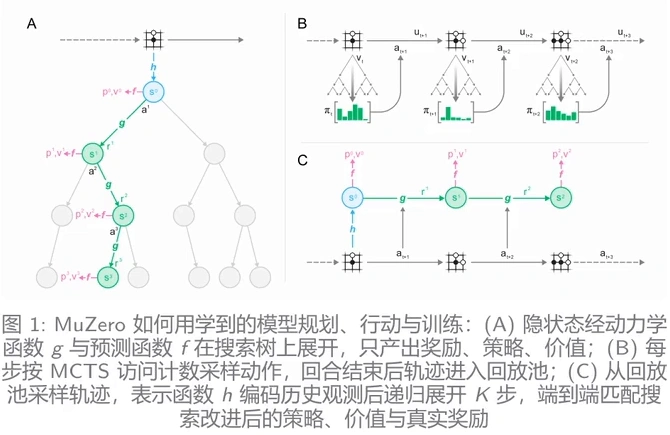
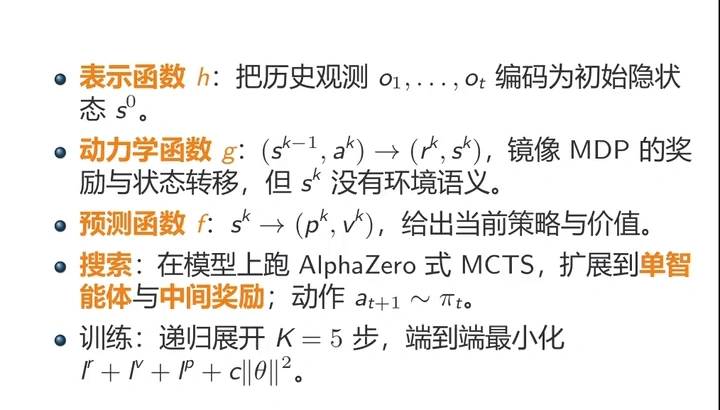
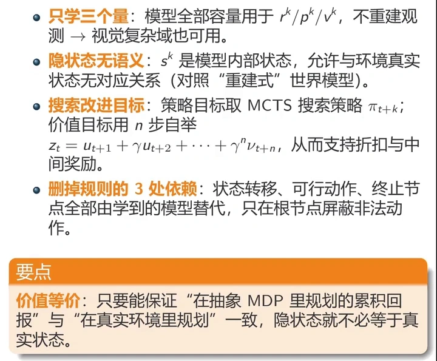
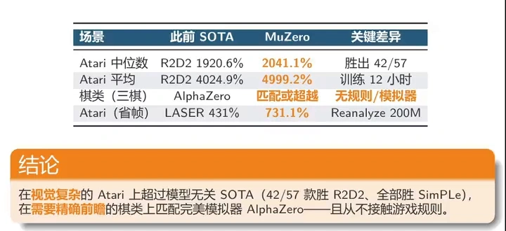
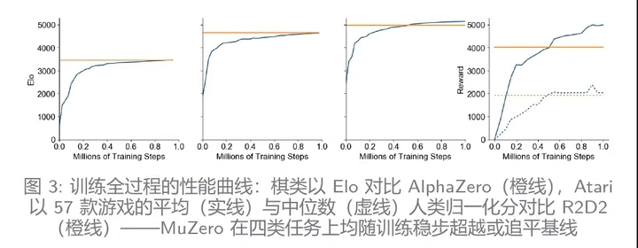
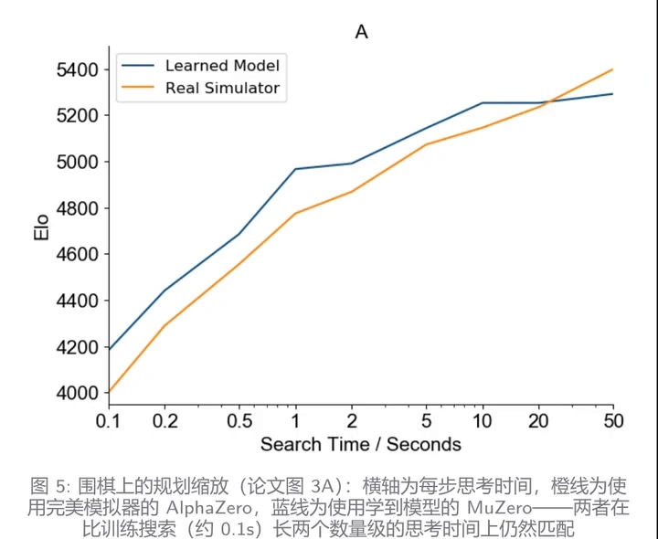
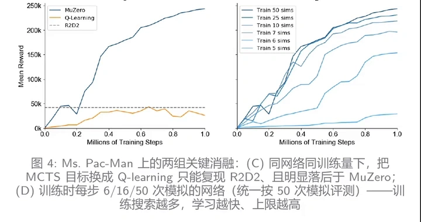

# MuZero：只学奖励策略与价值的隐空间规划

> 本篇整理自 B 站《【Nature 2020】MuZero：不依赖规则的学习型规划，用学到的模型下棋、打游戏》（`BV1Hjez6eEAC` 的 P2，16 分 34 秒，白拾的物理 AI 组会）。视频地址：[BV1Hjez6eEAC/?p=2](https://www.bilibili.com/video/BV1Hjez6eEAC/?p=2)。
> 这是第 10 章「规划」这条线的终点。前面几篇依次是：10.1 有模型 vs 免模型的权衡，10.2 模型误差如何复合，10.3 Dyna 把学习与规划揉在一起，10.4 MCTS 与 UCT，以及 10.5 的 AlphaGo 与 AlphaZero。那两代系统有一个共同的隐含前提——**环境规则是已知的**：AlphaZero 的搜索要问「从这个局面走这一步，下一个局面是什么」，而这个问题之所以能回答，是因为围棋的规则就写在程序里。MuZero 要拆掉的正是这个前提。

## 本讲要解决的核心问题（SCQA）

**背景**：树搜索在棋类上已经证明了自己。AlphaZero 用「搜索 + 自我对弈」统一了围棋、国际象棋与将棋，代价是它用到了三处**游戏规则**：状态转移、合法动作、终止节点。

**冲突**：真实世界里往往连环境动态都写不出来——机器人的动力学、工业控制的响应、推荐系统里用户的下一次点击，都没有一本规则手册。而另一条路（无模型强化学习）虽然不需要规则，却在视觉复杂的任务上难以做精确的前向规划。于是形成一个断裂：**会规划的模型不知道环境动态，知道环境动态的模型又常常把容量浪费在重建像素上**。

**疑问**：如果既没有规则、也不想重建像素，还能不能做树搜索？搜索所需的那点信息，能不能直接从经验里学出来？

**回答（中心思想）**：MuZero 的答案是——**只需要学三个与规划直接相关的量：奖励、策略、价值**。用一个只预测这三个量的隐模型替代真实模拟器，把 MCTS 搬进隐空间：搜索发生在模型自己造出来的抽象状态上，而不是真实观测上。只要「在抽象 MDP 里规划得到的累积回报」与「在真实环境里规划」一致（这就是**价值等价**），隐状态就不必等于真实状态，更不必重建像素。于是同一套算法、同一组超参数，既能在完全不知道规则的情况下匹配 AlphaZero 的棋力，又能在 57 款 Atari 游戏上超过当时最好的无模型方法 [【跳转到 01:20】](https://www.bilibili.com/video/BV1Hjez6eEAC/?p=2&t=120)。

---

## 一、问题的形状：一条断裂

把上面的冲突说得更具体一点 [【跳转到 03:15】](https://www.bilibili.com/video/BV1Hjez6eEAC/?p=2&t=195)：

- **基于模型的强化学习**试图先学环境再规划，但像素级重建在大规模问题上不可行——为了下一盘棋去重建 19×19 的棋盘图像，绝大部分计算都花在了与决策无关的细节上；
- **学隐状态空间**的工作虽然绕开了像素，但容量仍然主要花在与决策无关的信息上；
- **搜索一侧**，AlphaZero 是最强基线，但它依赖规则；
- **最接近本文的是价值预测网络（VPN）**：它已经提出「基于真实动作的抽象 MDP」，但只做浅层前瞻，也没有真正使用搜索。

MuZero 的关键差异因此落在一点上：**隐状态不需要携带任何环境语义，模型只被要求「预测得准」，而不被要求「重建得像」** [【跳转到 03:40】](https://www.bilibili.com/video/BV1Hjez6eEAC/?p=2&t=220)。

---

## 二、三个函数：表示、动力学、预测

MuZero 的结构可以用三个函数概括，而这三个函数合起来正好构成一个**可微的隐式 MDP** [【跳转到 03:56】](https://www.bilibili.com/video/BV1Hjez6eEAC/?p=2&t=236)。



三个函数的分工是 [【跳转到 04:06】](https://www.bilibili.com/video/BV1Hjez6eEAC/?p=2&t=246)：

$$
s^0 = h(o_1, o_2, \dots, o_t)
$$

**表示函数** $h$：把历史观测序列编码成初始隐状态 $s^0$。注意它吃的是**历史**，不是单帧——因为很多任务里单帧不足以确定状态（比如 Atari 里球的速度）。

$$
r^k,\, s^k = g(s^{k-1}, a^k)
$$

**动力学函数** $g$：接收上一步的隐状态与一个**假设动作**，输出即时奖励 $r^k$ 与新的隐状态 $s^k$。它是真实环境「状态转移 + 奖励函数」的替身，但它只在隐空间里工作。

$$
p^k,\, v^k = f(s^k)
$$

**预测函数** $f$：从隐状态直接给出策略 $p^k$ 与价值 $v^k$。它同时扮演 AlphaZero 里策略网络与价值网络两个角色。



有了这三件套，就可以在模型上运行 AlphaZero 风格的树搜索。但有两处必须扩展 [【跳转到 04:06】](https://www.bilibili.com/video/BV1Hjez6eEAC/?p=2&t=246)：

1. **单智能体场景**：AlphaZero 面对的是零和博弈，价值可以取负号表示对手视角；MuZero 要处理 Atari 这类单智能体任务，「对手」不存在，价值的符号约定要改。
2. **中间奖励**：Atari 每吃一分都有奖励，而不是只在终局给 $+1$。所以动力学函数必须预测每一步的即时奖励，价值目标也要支持折扣因子。

### 2.1 搜索发生在隐空间

这是本篇的技术核心，值得单独说清楚。

传统 MCTS 的每个节点对应一个**真实局面**：选择时问「走这一步会到哪个局面」，评估时问「这个局面值多少」。MuZero 的每个节点对应一个**隐状态** $s^k$，两个问题分别由 $g$ 和 $f$ 回答：

```text
真实观测 o_1..o_t
      │  h
      ▼
   s^0 ──g(s^0,a)──▶ (r^1, s^1) ──g(s^1,a')──▶ (r^2, s^2) ──▶ ...
    │                  │                          │
    f                  f                          f
    ▼                  ▼                          ▼
 (p^0, v^0)         (p^1, v^1)                 (p^2, v^2)
```

整棵树都长在隐空间里，**没有任何一步需要把隐状态解码回真实观测**。这也是为什么 MuZero 能处理 Atari：它不需要生成下一帧画面，只需要知道「下一帧对应的隐状态」和「这一步能拿多少分」。

搜索结束后，根节点上各动作的访问次数归一化就得到搜索策略 $\pi_t$，智能体按 $\pi_t$ 采样一个动作交给环境；回合结束后把整条轨迹写入回放池 [【跳转到 01:53】](https://www.bilibili.com/video/BV1Hjez6eEAC/?p=2&t=153)。

---

## 三、为什么不用重建观测也能学到有用的模型

这是最容易让人困惑的地方：一个模型连「世界长什么样」都不管，凭什么说它学到了世界？

答案是**价值等价**（value equivalence）这个概念 [【跳转到 05:06】](https://www.bilibili.com/video/BV1Hjez6eEAC/?p=2&t=306)：

> 只要能保证「在抽象 MDP 里规划的累积回报」与「在真实环境里规划」一致，隐状态就不必等于真实状态。

换句话说：**模型的任务不是复现世界，而是复现「决策所需的那部分世界」**。两个状态如果对所有动作都给出相同的奖励与相同的后续价值，那么它们在决策意义上就是等价的——哪怕一个隐状态看起来像一团噪声，另一个看起来像棋盘。



四个设计要素正好对应这个思路 [【跳转到 04:41】](https://www.bilibili.com/video/BV1Hjez6eEAC/?p=2&t=281)：

1. **只学三个量**：模型全部容量用于 $r^k / p^k / v^k$，不重建观测——所以视觉复杂度也能用；
2. **隐状态无环境语义**：$s^k$ 是模型内部状态，允许与真实状态毫无对应关系（与「重建式」世界模型有本质区别）；
3. **策略目标来自搜索本身**：策略目标是 MCTS 的搜索策略 $\pi_{t+k}$，价值目标用 $n$ 步自举；
4. **删掉规则的三处依赖**：状态转移、可行动作、终止节点全部由学到的模型替代，只在搜索树的根节点屏蔽非法动作。

第 4 点有个细节很能说明问题：**MuZero 只在根节点屏蔽非法动作**。也就是说，在树的深处它并不检查「这一步合不合法」——它相信学到的模型会把不合法的走法自动给出很低的奖励与价值。这是一个很大胆的赌注，而实验证明它赌赢了。

---

## 四、训练：沿真实动作展开五步，匹配三个目标

训练时的做法是：从回放池采样一条真实轨迹，用表示函数编码出 $s^0$，然后**沿着真实动作序列**递归展开 $K$ 步，每一步都用动力学函数和预测函数算出预测值，再与三个目标比对 [【跳转到 04:31】](https://www.bilibili.com/video/BV1Hjez6eEAC/?p=2&t=271)。

$$
\mathcal{L}(\theta) \;=\; \sum_{k=0}^{K} \Big( \ell^{r}\big(u_{t+k},\, r^k\big) + \ell^{v}\big(z_{t+k},\, v^k\big) + \ell^{p}\big(\pi_{t+k},\, p^k\big) \Big) \;+\; c\,\lVert \theta \rVert^{2}
$$

三项损失分别是：

- **奖励损失** $\ell^r$：模型预测的即时奖励 $r^k$ 与环境中真实观测到的奖励 $u_{t+k}$ 之差；
- **价值损失** $\ell^v$：模型预测的价值 $v^k$ 与价值目标 $z_{t+k}$ 之差。价值目标用 $n$ 步自举，从而支持折扣因子与中间奖励 [【跳转到 04:41】](https://www.bilibili.com/video/BV1Hjez6eEAC/?p=2&t=281)：

$$
z_t \;=\; u_{t+1} + \gamma\, u_{t+2} + \cdots + \gamma^{\,n-1}\, u_{t+n} \;+\; \gamma^{\,n}\, v_{t+n}
$$

- **策略损失** $\ell^p$：模型预测的策略 $p^k$ 与搜索产出的策略 $\pi_{t+k}$ 之差——这一项和 AlphaZero 完全一样，**搜索是老师**。

最后加一个 $L^2$ 正则项防止过拟合。论文里 $K$ 取 **5**，也就是模型每次向前推演五步。

这里必须回指 10.2：**在学到的模型上展开多步，误差会复合**。MuZero 的应对方式是**把展开深度压在 5 步**——不追求长程想象的准确性，只要求这五步内的预测够用；真正的长程前瞻交给搜索树（搜索树在每个节点都重新用模型展开一步，而不是把一条想象的轨迹走到底）。同时，训练时展开五步、评测时搜索 800 次模拟，这个「训练短、推理长」的不对称也是它敢用不精确模型的原因之一。

---

## 五、实验：两类主场同时赢

### 5.1 主表

作者选了两类互补的基准：一类考**精确前瞻**（棋类，以 AlphaZero 为对手，看 Elo），一类考**视觉复杂度**（Atari，57 款游戏的人类归一化分数）——正好对应之前两类方法各自的主场 [【跳转到 05:26】](https://www.bilibili.com/video/BV1Hjez6eEAC/?p=2&t=326)。两类任务都不给规则、不给模拟器，模型只能从观测与奖励中学。



结果 [【跳转到 06:46】](https://www.bilibili.com/video/BV1Hjez6eEAC/?p=2&t=406)：

| 场景 | 此前 SOTA | MuZero | 关键差异 |
| --- | --- | --- | --- |
| Atari 中位数 | R2D2 1920.6% | 2041.1% | 57 款中胜出 42 款 |
| Atari 平均 | R2D2 4024.9% | 4999.2% | 训练 12 小时 |
| 棋类（围棋/国象/将棋） | AlphaZero | 匹配或超越 | 无规则、无模拟器 |
| Atari（省帧设置） | LASER 431% | 731.1% | Reanalyze 200M 帧 |

一句话总结：**在视觉复杂的 Atari 上超过模型无关的 SOTA，在需要精确前瞻的棋类上匹配完美模拟器，而全程不接触游戏规则** [【跳转到 07:11】](https://www.bilibili.com/video/BV1Hjez6eEAC/?p=2&t=431)。

还有一个容易被忽略的细节：即使在棋类上，MuZero 每个节点的计算量比 AlphaZero **更少**（16 个残差块对 20 个），却依然能追平。作者推测，模型在搜索树里「缓存」了计算——每一次动力学展开都换来了对局面的更深理解 [【跳转到 07:59】](https://www.bilibili.com/video/BV1Hjez6eEAC/?p=2&t=479)。



### 5.2 学到的模型能撑多久

这是全文最关键的一张证据图 [【跳转到 12:40】](https://www.bilibili.com/video/BV1Hjez6eEAC/?p=2&t=760)：在围棋上把每步思考时间从训练时的大约 0.1 秒一路推到 10 秒，让使用**学到模型**的 MuZero 与使用**完美模拟器**的 AlphaZero 正面对比。



两条强度曲线在整整两个数量级上基本重合。这说明**模型没有过拟合到训练时的搜索规模，而是学到了可外推的规划结构**——给它更多算力，它就能继续变强，和用真规则搜索的效果一样。

Atari 上就没有这么漂亮了：把每步模拟次数从 1 次逐步提高，57 款游戏的平均人类归一化分数只轻微上升，大约 100 次模拟之后不再改善，而且不同游戏之间的波动相当大 [【跳转到 13:05】](https://www.bilibili.com/video/BV1Hjez6eEAC/?p=2&t=785)。作者的解释是 **Atari 上的模型误差更大，规划收益被模型的不精确吃掉了**——这正是 10.2 讲的复合误差在起作用。

### 5.3 两组消融：搜索是教师

最有说服力的证据来自 Ms. Pac-Man 上的两组消融 [【跳转到 09:03】](https://www.bilibili.com/video/BV1Hjez6eEAC/?p=2&t=543)。



- **左图（C）**：把训练目标从「匹配 MCTS 策略」换成 R2D2 式的 Q-learning，网络大小与训练量保持不变——结果只能复现 R2D2 的水平，明显落后于 MuZero。这就把性能增益**归因到了搜索本身**，而不是网络容量或训练量。
- **右图（D）**：让不同网络在训练时分别使用 5/6/7/10/25/50 次模拟，统一按 50 次模拟评测——训练时搜索越多，学得越快、上限越高；而且即便只有 5~6 次模拟（比动作数量还少），也稳定优于随机。

两图合起来说明：**搜索既是「学得好」的原因，也是推理期的性能旋钮** [【跳转到 09:28】](https://www.bilibili.com/video/BV1Hjez6eEAC/?p=2&t=568)。这与过去「MCTS 需要足够模拟才有效」的经验相反。

---

## 六、局限：MuZero 不是万能的

论文自己给出的边界相当清楚 [【跳转到 09:44】](https://www.bilibili.com/video/BV1Hjez6eEAC/?p=2&t=584)：

1. **学到的模型不够精确**：Atari 上规划的边际收益远小于棋类，100 次模拟后饱和，限制来自模型误差；
2. **不直接处理不完全信息博弈**：比如德州扑克——这条重要限制被作者放在脚注而不是正文里；
3. **计算与工程门槛不低**：棋类需要每步 800 次模拟与百万次 mini-batch 训练，论文没有讨论真实系统里的在线成本；
4. **隐状态不可解释**：模型不重建状态与观测，学到的隐空间很难直接迁移成可检查的表征或安全接口。

不依赖规则的规划可能通向机器人、工业控制与智能助手，但本文只验证了游戏域 [【跳转到 10:09】](https://www.bilibili.com/video/BV1Hjez6eEAC/?p=2&t=609)。

---

## 七、三代系统放在一起看

把 AlphaGo、AlphaZero、MuZero 排成一条线，改动其实是一路做减法：先减掉 rollout，再减掉规则。

| 维度 | AlphaGo（2016） | AlphaZero（2017） | MuZero（2019/2020） |
| --- | --- | --- | --- |
| 是否需要人类数据 | 需要（3000 万人类棋谱局面） | 不需要，纯自我对弈 | 不需要，纯自我对弈 |
| 是否需要环境模型/规则 | 需要（围棋规则） | 需要（围棋/国象/将棋规则） | **不需要**，模型从经验中学 |
| rollout 策略 | 快速 rollout + 价值网络混合（$\lambda=0.5$） | 无 rollout，只用价值网络 | 无 rollout，隐空间展开 + 预测函数 |
| 搜索发生在哪 | 真实棋盘状态 | 真实棋盘状态 | **隐状态（抽象 MDP）** |
| 训练目标 | 人类走法 + 胜负 | MCTS 访问次数分布 + 胜负 | MCTS 策略 + 回报 + 真实奖励 |
| 模型要重建观测吗 | — | — | 不重建，只预测奖励/策略/价值 |
| 规划强度可调吗 | 是（搜索次数） | 是（搜索次数） | 是，且可外推两个数量级 |

一句话串起来：**AlphaGo 用网络把搜索变省，AlphaZero 用搜索当老师把网络变强，MuZero 把「老师提问所需的世界」也一起学了出来**。

而这条线的遗产有两个 [【跳转到 14:46】](https://www.bilibili.com/video/BV1Hjez6eEAC/?p=2&t=886)：一是**价值等价模型**把树搜索从有规则的游戏解放到只有观测的真实系统；二是**规划强度变成推理期可调的算力旋钮**——这也是今天 test-time compute 讨论最早的实证之一。后续工作沿着三个方向扩展同一框架：EfficientZero 攻样本效率、Sample MuZero 攻连续动作、LightZero 提供统一基准；而 Dreamer 系列、DayDreamer 与 TD-MPC2 则把隐空间想象规划推成了机器人连续控制的主流。

---

## 小结

- MuZero 要回答的是：**规划能力究竟来自已知的环境动态，还是可以从经验中学出来**？答案是后者。
- 三个函数构成一个可微的隐式 MDP：表示函数 $h$ 把历史观测编码为隐状态，动力学函数 $g$ 在隐空间里做状态转移并预测奖励，预测函数 $f$ 给出策略与价值。
- **搜索只发生在隐空间**：每一步只需要「下一个隐状态」和「这一步的奖励」，不需要把隐状态解码回观测，因此不需要重建像素、也不需要知道规则。
- 之所以「不重建也能学到有用的模型」，靠的是**价值等价**：只要在抽象 MDP 里规划的累积回报与真实环境一致，隐状态就不必等于真实状态。
- 训练只匹配三个目标：真实奖励、$n$ 步自举的价值、搜索产出的策略；沿真实动作展开 5 步，端到端优化。
- 隐空间的多步展开同样面临 10.2 的复合误差，MuZero 用**短展开（5 步）+ 长搜索**规避：训练时展开很短，推理时搜索很长。
- 实验上，Atari 中位数 2041.1% 超过 R2D2，棋类无规则匹配 AlphaZero；围棋上把思考时间拉长两个数量级，学到模型与完美模拟器的强度曲线基本重合。
- 两组消融证明**搜索是教师**：把目标换成 Q-learning 就退回到 R2D2 水平；训练时搜索次数越多，学得越快、上限越高。
- 局限同样明确：模型误差限制了 Atari 上的规划收益、不处理不完全信息博弈、算力门槛高、隐状态不可解释。

## 关键术语速查

| 术语 | 一句话解释 |
| --- | --- |
| 表示函数 $h$ | 把历史观测序列编码成初始隐状态 $s^0$ |
| 动力学函数 $g$ | 输入隐状态与假设动作，输出即时奖励与下一隐状态 |
| 预测函数 $f$ | 从隐状态直接给出策略 $p$ 与价值 $v$ |
| 隐状态 | 模型内部状态，允许与真实环境状态毫无对应关系 |
| 价值等价 | 只要规划所需的累积回报一致，隐状态不必等于真实状态 |
| 隐空间搜索 | 在模型造出的抽象状态上跑 MCTS，不需要重建观测 |
| 目标重分析 | 用最新参数重跑历史轨迹的搜索，用更优的策略作为训练目标 |
| 展开步数 $K$ | 训练时沿真实动作递归展开的步数，论文取 5 |
| 省帧设置 | 用远少于常规的环境交互帧数训练，考察样本效率 |