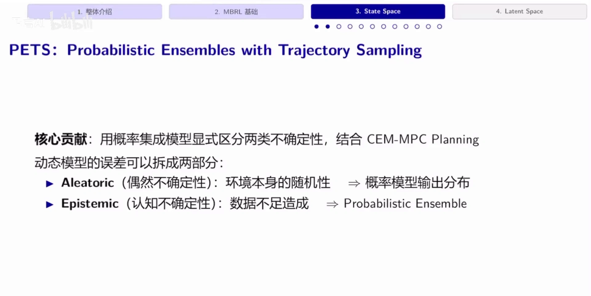
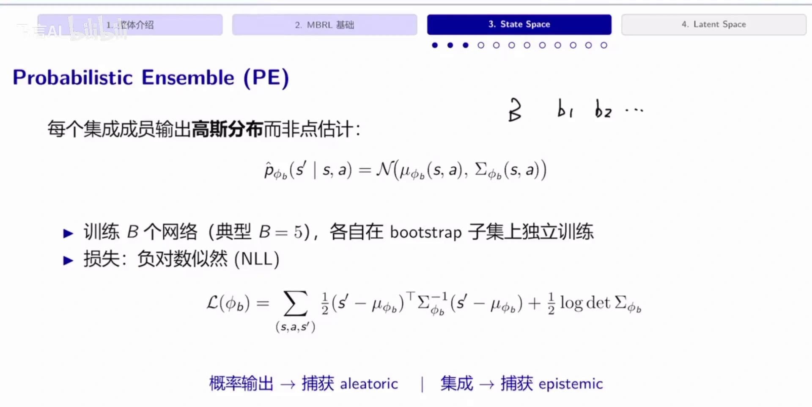
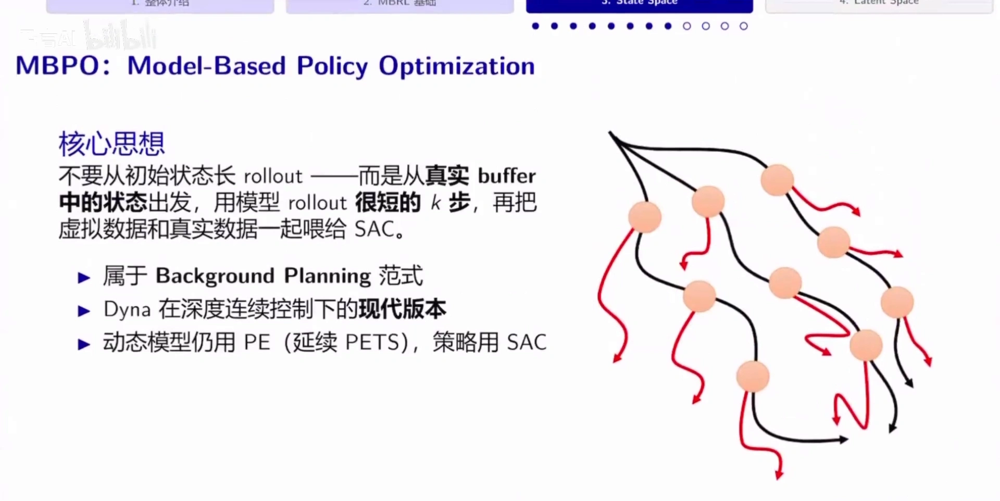
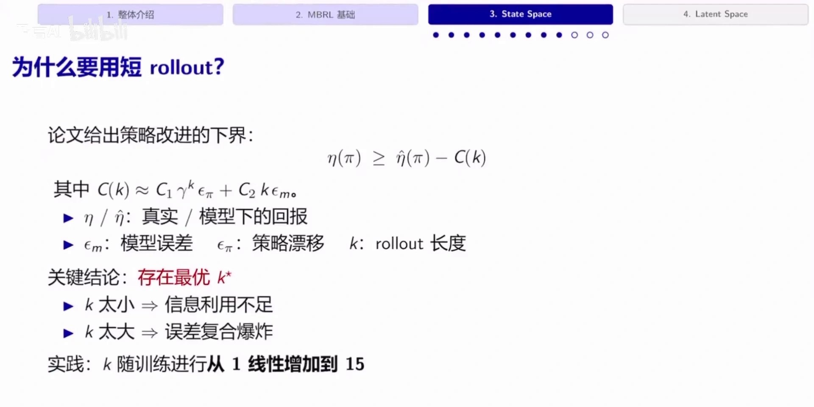
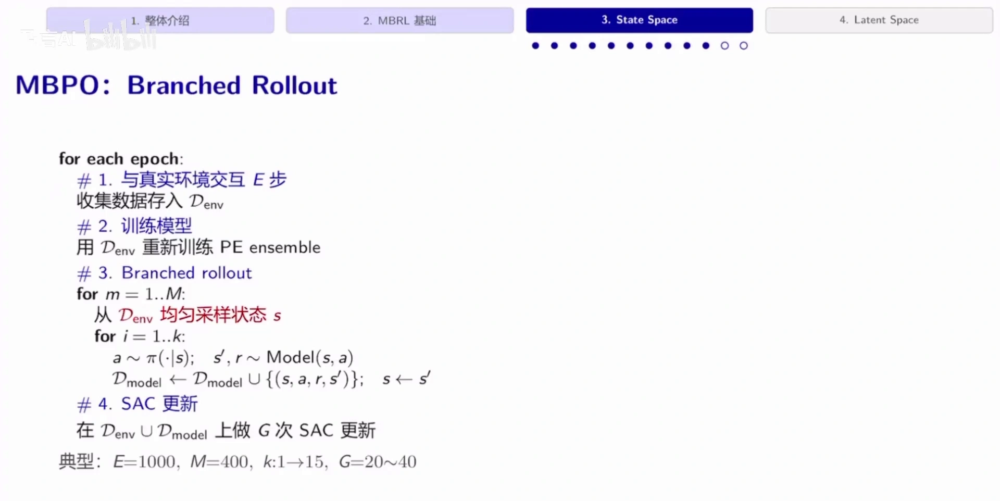
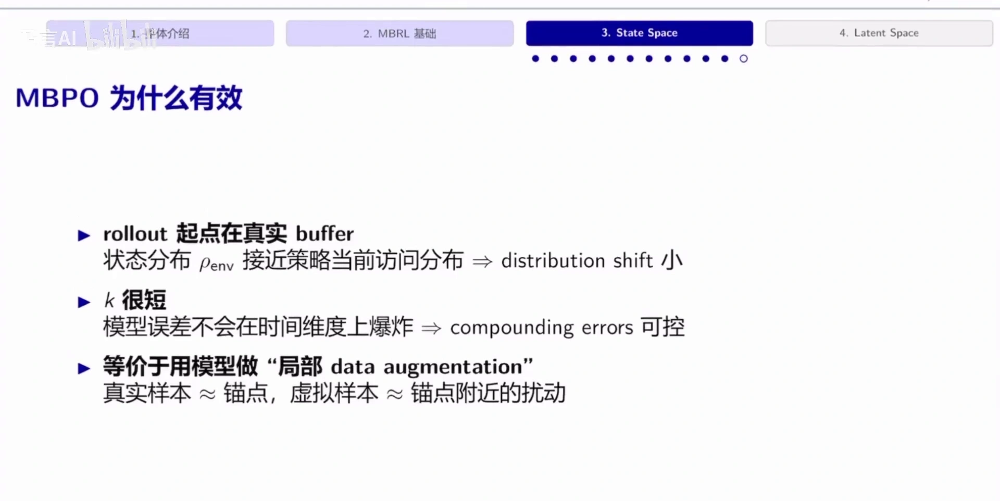
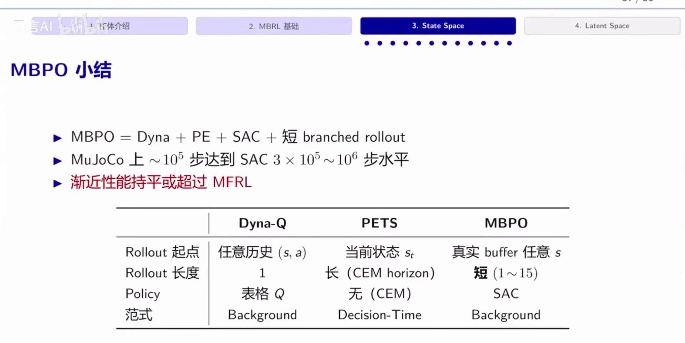

# MBPO 算法全解：概率集成、短分支 rollout 与 SAC

> 前提：10.2 已经把 MBPO 的**复合误差理论**讲透了——单步误差 $\epsilon$ 经 $H$ 步 rollout 放大到 $O(\epsilon H^2)$、分支 rollout 的三项界、标准界算出来 $k=0$ 的悖论、以及用实测泛化斜率把结论翻正的实验。**本篇不重推理论**，只做算法层面的完整交代：模型用什么形式学、rollout 从哪里起、跑多长、和 SAC 怎么接、训练循环长什么样。
>
> 世界模型那条线（World Models 的三件套、Dreamer 的 RSSM 与想象训练）见同目录下的[世界模型：从 WorldModels 到 Dreamer](世界模型：从WorldModels到Dreamer.md)。

## 本讲要解决的核心问题（SCQA）

**背景**：基于模型的强化学习有两条路——用模型做**在线规划**（PETS 这类，决策时用 CEM 搜动作序列），或者用模型**扩充训练数据**（Dyna 这类，模型只在训练时用）。MBPO 属于后者。

**冲突**：用模型扩充数据，绕不开两个坑。第一，模型不知道自己哪里不知道——在训练数据稀疏的地方它会**非常自信地给出错误预测**，而策略会专门去找这些地方。第二，rollout 越长误差越大，长链模型数据基本不可用。

**疑问**：模型该用什么形式学，才能既表达环境本身的随机性、又表达「我没见过这里」的不确定性？rollout 到底该跑多长，才能既充分榨取样本、又不被复合误差毁掉？

**回答（中心思想）**：MBPO 的配方可以写成一行加法——**MBPO = Dyna + PE + SAC + 短 branched rollout**。PE（概率集成）负责让模型知道自己不知道，SAC 负责在连续动作空间里稳定地做策略提升，短分支 rollout 负责把误差锁在可控范围内。三者缺一不可，而**短 rollout 是那个真正解决问题的设计**。

---

## 一、先解决「模型不知道自己不知道」：概率集成 PE

### 1.1 模型误差可以拆成两类

动态模型的误差不是一种，而是两种，必须用不同手段处理 [【跳转到 01:12】](https://www.bilibili.com/video/BV1KJGn6PEE1/?t=72)：



| 类型 | 来源 | 应对手段 |
| :--- | :--- | :--- |
| **偶然不确定性**（aleatoric） | 环境本身的随机性，比如空气阻力、摩擦、掷骰子 | 让模型输出**分布**而不是点估计 |
| **认知不确定性**（epistemic） | 数据不足，模型没见过这类状态 | 训练**多个模型**，用它们的分歧度量「我没见过」 |

第一类是环境固有的，再多数据也消不掉；第二类是数据不够造成的，加数据就能消。**真正危险的是第二类**：模型在训练集没覆盖的地方只能外插，而外插时它并不知道自己不靠谱，会非常确信地输出一个错误结果。

### 1.2 PE 的做法：每个成员输出高斯，各自在 bootstrap 子集上训

概率集成（Probabilistic Ensemble, PE）的做法很直接 [【跳转到 03:03】](https://www.bilibili.com/video/BV1KJGn6PEE1/?t=183)：

1. 从数据集里做**有放回的随机采样**，采出 $B$ 个子集；
2. 在每个子集上独立训练一个网络；
3. 每个网络的输出是**高斯分布**而不是一个点。

$$
\hat p_{\phi_b}(s' \mid s, a) = \mathcal{N}\!\left(\mu_{\phi_b}(s,a),\ \Sigma_{\phi_b}(s,a)\right)
$$

损失用负对数似然（NLL）：

$$
\mathcal{L}(\phi_b) = \sum_{(s,a,s')} \frac{1}{2}\,(s' - \mu_{\phi_b})^{\top}\,\Sigma_{\phi_b}^{-1}\,(s' - \mu_{\phi_b}) \;+\; \frac{1}{2}\log \det \Sigma_{\phi_b}
$$



一句话记住这个分工：**概率输出 → 捕获 aleatoric；集成 → 捕获 epistemic**。课堂讲义按 PETS 的典型设置取 $B=5$，MBPO 论文里用的是 7 个。

### 1.3 为什么「多个模型的分歧」能表示「我不知道」

直观理解 [【跳转到 03:58】](https://www.bilibili.com/video/BV1KJGn6PEE1/?t=238)：训练数据只覆盖了某个区间，要预测区间外的一个点。如果每个模型都是**在不同子集上独立训出来的**，那它们在数据稠密区会给出几乎一样的答案，而在数据稀疏区会**各说各话、方差极大**。

于是「成员之间的分歧」就成了一个免费的、随数据量自动收缩的不确定性估计：**数据越多，分歧越小**。策略只要避开分歧大的区域，就避开了模型最不可信的地方。

从概率角度看，这件事也有个干净的解释：我们真正想要的是对参数后验做积分的预测分布

$$
p(s' \mid s, a, \mathcal{D}) = \int p(s' \mid s, a, \theta)\, p(\theta \mid \mathcal{D})\, \mathrm{d}\theta
$$

但平常只做了点估计（一组固定参数）。集成相当于用「多个参数样本的平均」去近似这个积分——**把参数从一个点扩成一堆点**。

---

## 二、MBPO 的定位：Dyna 的现代版本

MBPO 属于 **background planning** 范式：模型只在训练时用，决策时直接用训好的策略，不做在线搜索 [【跳转到 13:57】](https://www.bilibili.com/video/BV1KJGn6PEE1/?t=837)。



三个定位要点：

- **Dyna 在深度连续控制下的现代版本**：Dyna-Q 用表格模型 + 一格 rollout + Q-learning；MBPO 换成神经网络模型 + $k$ 步 rollout + SAC。
- **动态模型沿用 PE**（延续 PETS 的做法），**策略用 SAC**（连续动作、最大熵、样本效率高）。
- **虚拟数据和真实数据一起喂给策略**，相当于做了一次数据集扩充。

---

## 三、短分支 rollout：$k$ 为什么必须短

### 3.1 两难

rollout 长度 $k$ 是个两难 [【跳转到 14:36】](https://www.bilibili.com/video/BV1KJGn6PEE1/?t=876)：

- **太长**：学到的模型和真实模型之间有固有误差，这个误差会随时间步累积（10.2 讲过，量级是平方级的），长链数据基本不可用；
- **太短**：模型数据太少，样本利用不充分，样本效率上不去。

### 3.2 课堂给出的两项界

讲义把论文的界重写成一个更好读的形式 [【跳转到 16:16】](https://www.bilibili.com/video/BV1KJGn6PEE1/?t=976)：

$$
\eta(\pi) \;\ge\; \hat\eta(\pi) - C(k), \qquad C(k) \approx C_1 \gamma^{k}\,\epsilon_\pi + C_2\, k\, \epsilon_m
$$

其中 $\eta$ 是真实回报、$\hat\eta$ 是模型下的回报、$\epsilon_m$ 是模型误差、$\epsilon_\pi$ 是策略漂移、$k$ 是 rollout 长度。



两项的走向正好相反：

| 项 | 随 $k$ 的变化 | 含义 |
| :--- | :--- | :--- |
| $C_1 \gamma^{k}\epsilon_\pi$ | 指数衰减 | 分支之前的策略漂移，$k$ 越大越不重要 |
| $C_2\, k\, \epsilon_m$ | 线性增长 | 分支之后的模型误差，$k$ 越大越致命 |

一个减、一个增，所以**存在最优的 $k^{*}$**：$k$ 太小信息利用不足，$k$ 太大误差复合爆炸。

需要说明：这是讲义为了讲清直觉做的**两项简化**。论文原始的分支 rollout 界有三项（前两项都随 $k$ 指数衰减、第三项线性增长），完整形式与推导见 10.2；这里的两项版把前两项合并成了一个 $\gamma^k$ 项，结论方向一致。

### 3.3 实践中的调度：从 1 线性加到 15

既然最优 $k$ 依赖模型误差，而模型误差会随训练数据增加而下降，那 $k$ 就不该是个常数 [【跳转到 19:11】](https://www.bilibili.com/video/BV1KJGn6PEE1/?t=1151)：

**训练前期模型不准，线性增长项占主导，$k$ 设小一点（一步两步）；随着模型变准，再逐步放大，最终到 15。**

这也解释了 MBPO 论文里那个看起来很奇怪的现象：$k=1$ 就已经很强，但最优 $k$ 在不同任务上从 1 到 25 不等——**它不是超参，而是「模型当前有多准」的度量**。

---

## 四、训练循环

把上面几块拼起来，算法本体其实很短 [【跳转到 19:45】](https://www.bilibili.com/video/BV1KJGn6PEE1/?t=1185)：



```text
for each epoch:
    # 1. 与真实环境交互 E 步，收集数据存入 D_env
    # 2. 训练模型：用 D_env 重新训练 PE ensemble
    # 3. Branched rollout
    for m = 1..M:
        从 D_env 均匀采样状态 s
        for i = 1..k:
            a ~ π(·|s);  s', r ~ Model(s, a)
            D_model ← D_model ∪ {(s, a, r, s')};  s ← s'
    # 4. SAC 更新：在 D_env ∪ D_model 上做 G 次 SAC 更新
```

典型超参：$E=1000$、$M=400$、$k: 1 \to 15$、$G=20\sim40$。

几个容易忽略的细节：

- **模型只用真实数据训**（$D_{\text{env}}$），策略更新则同时从真实和虚拟两套数据里采样（伪代码里的 $D_{\text{env}} \cup D_{\text{model}}$）。这样模型不会被自己的预测污染。10.2 为了强调这一点，把后半句简化成了「策略只在模型数据上更新」；严格说策略是从两套数据的并集里采样的。
- **rollout 的起点是均匀采样的真实状态**，不是 episode 初始状态。这一点是「分支」二字的全部含义，也是下一节「为什么有效」的第一条。
- 每个 epoch 采 400 条分支、每条 $k$ 步，再配 20~40 次梯度更新——**算力开销不小**。MBPO 的隐含假设是：在真实系统上，样本比算力更贵。

---

## 五、为什么有效：三条，一条比一条直观



1. **起点在真实 buffer**。分支的初始状态来自真实数据，所以状态分布 $\rho_{\text{env}}$ 接近策略当前的访问分布，distribution shift 小。长链从初始状态一路推，中间状态很快就跑到模型没见过的区域去了。
2. **$k$ 很短**。模型误差来不及在时间维度上爆炸，复合误差被锁在可控范围内。
3. **等价于「局部 data augmentation」**。这是最漂亮的一条：真实样本是**锚点**，虚拟样本是锚点附近的**小扰动**。模型在这里扮演的角色不是「另一个环境」，而是「一个在真实数据附近做插值的增广器」。

第三条把 MBPO 和「用模型替代环境」的直觉彻底区分开了：**它不指望模型在远处正确，只要求模型在真实数据附近的邻域里正确**。这个要求低得多，也现实得多。

---

## 六、MBPO 的位置：和 Dyna-Q、PETS 摆在一起看



| 维度 | Dyna-Q | PETS | MBPO |
| :--- | :--- | :--- | :--- |
| rollout 起点 | 任意历史 $(s,a)$ | 当前状态 $s_t$ | 真实 buffer 中任意 $s$ |
| rollout 长度 | 1 | 长（CEM horizon） | 短（$1\sim15$） |
| 策略 | 表格 $Q$ | 无（CEM 在线搜） | SAC |
| 范式 | Background planning | Decision-time planning | Background planning |

这张表其实是「模型怎么用」这张谱系图上的三个点：**Dyna 只往前看一步，PETS 每步都重新搜一遍，MBPO 往前看几步但只在训练时看**。

效果上，MuJoCo 上大约 $10^5$ 步就能达到 SAC 需要 $3\times10^5 \sim 10^6$ 步的水平，而**渐近性能持平甚至超过免模型方法**。此前的方法通常只能在「样本效率」和「渐近性能」里二选一，MBPO 是少数两个都要的。

---

## 七、三条世界模型路线对比

把本篇和世界模型那篇放在一起，三条路线的差别可以压成一张表：

| 维度 | World Models（2018） | MBPO（2019） | Dreamer（2019–2023） |
| :--- | :--- | :--- | :--- |
| 模型形式 | VAE + MDN-RNN，在 32 维隐空间预测 | 概率集成（PE），在状态空间预测 | RSSM：确定性 $h$ + 随机 $z$ |
| 模型输出 | 下一个 $z$ 的混合高斯 | 下一个 $s'$ 的高斯分布 | 下一个 $z$ 的分布 + reward |
| 策略 | 线性层 C，CMA-ES 进化搜索 | SAC | actor-critic，在想象轨迹上训 |
| 模型怎么用 | 只在模型内训练，采一次数据不回头 | 训练时做短分支 rollout 扩充数据 | 训练时想象 15 步，真实数据持续回流 |
| 观测输入 | 像素（64×64） | 低维状态 | 像素或低维状态 |
| 主要贡献 | 提出 V/M/C 解耦与「在梦中训练」 | 把短 rollout 变成可解释的设计 | 用循环回流修掉模型利用，跨域通用 |

一句话概括三者的分工：**World Models 提出「在想象中训练」这个想法，MBPO 给出「只信模型几步」的定量纪律，Dreamer 补上「模型错了怎么修」的闭环。**

---

## 八、局限

- **理论上**：$C(k)$ 是借用 TV 距离下的最坏情况界加局部线性近似得到的，**没有有限样本保证 $k^{*}>0$**，只在模型误差足够小时成立。
- **实验上**：MBPO 的实验全部是 MuJoCo 状态可观测的连续控制，没有像素输入，也没有真机验证。
- **成本上**：$B$ 个模型、每步数百条 rollout、几十次梯度更新，算力开销显著。
- **调参上**：$k$ 的调度和 $G$ 仍是逐任务设定。$k=1$ 已经很强，但最优 $k$ 仍要靠调。
- **没回答的问题**：**误差如何在线估计**。MBPO 用集成分歧做代理，但没有给出「这个状态上的模型误差是多少」的可靠估计。

---

## 小结

- **两类不确定性要分开处理**：偶然不确定性靠概率输出（高斯），认知不确定性靠集成（多个 bootstrap 成员的**分歧**）。后者才是「模型不知道自己不知道」的解药。
- **PE 的损失是负对数似然**，每个成员输出 $\mathcal{N}(\mu_{\phi_b}, \Sigma_{\phi_b})$；集成相当于用多个参数样本近似对参数后验的积分。
- **MBPO 是 background planning**：模型只在训练时用，决策时直接用策略，不做在线搜索。
- **短 rollout 是核心设计**：策略漂移项随 $k$ 指数衰减、模型误差项随 $k$ 线性增长，两者拉出一个最优 $k^{*}$；实践中 $k$ 从 1 线性加到 15。
- **训练循环四步**：真实交互 → 重训 PE → 从真实状态分支做 $k$ 步 rollout → 在真实加虚拟数据上做 SAC 更新。
- **为什么有效**：起点在真实 buffer（分布偏移小）、$k$ 短（误差可控）、整体等价于**局部数据增强**——真实样本是锚点，虚拟样本是锚点附近的扰动。
- **配方就是一行加法**：MBPO = Dyna + PE + SAC + 短 branched rollout。

如果只记一句话：**MBPO 不指望模型在远处正确，只要求它在真实数据附近的邻域里正确——所以它只在还准的那几步用模型。**

---

## 关键术语速查

| 术语 | 一句话解释 |
| :--- | :--- |
| 偶然不确定性（aleatoric） | 环境本身的随机性，加数据也消不掉，靠概率输出建模 |
| 认知不确定性（epistemic） | 数据不足造成的不确定性，靠多个模型的分歧度量 |
| 概率集成（PE） | 在 bootstrap 子集上独立训练多个概率网络，成员分歧即认知不确定性 |
| bootstrap 子集 | 从原数据集有放回随机采样得到的子集，成员之间因此产生差异 |
| NLL 损失 | 负对数似然，同时优化均值与协方差的高斯拟合损失 |
| background planning | 模型只在训练时用、决策时直接执行策略的范式 |
| 分支 rollout | 从真实 buffer 的状态分叉、只在模型里推 $k$ 步的短轨迹 |
| 策略漂移 $\epsilon_\pi$ | 数据采集策略与当前策略之间的分布距离 |
| 局部数据增强 | 把模型数据理解为真实样本锚点附近的扰动，而非独立的虚拟经验 |
| 模型利用 | 策略主动寻找并放大模型误差以刷高模型回报的现象 |