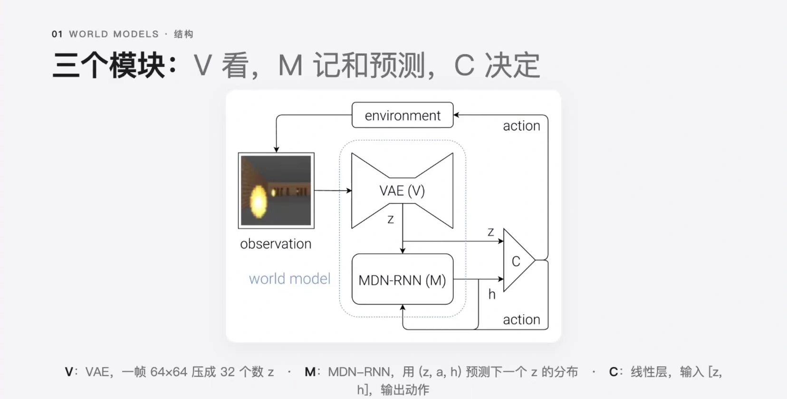
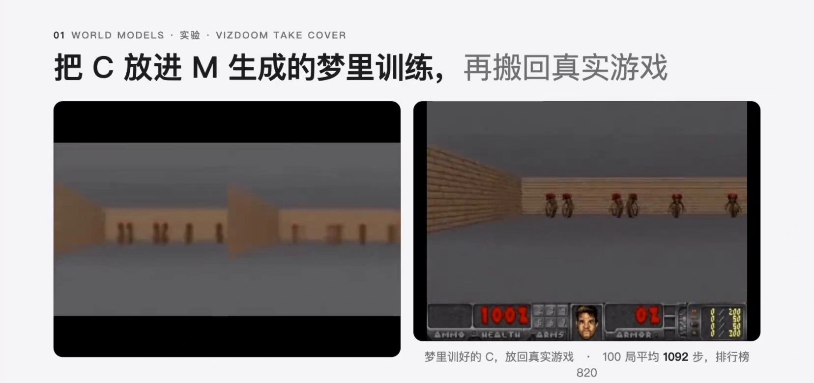
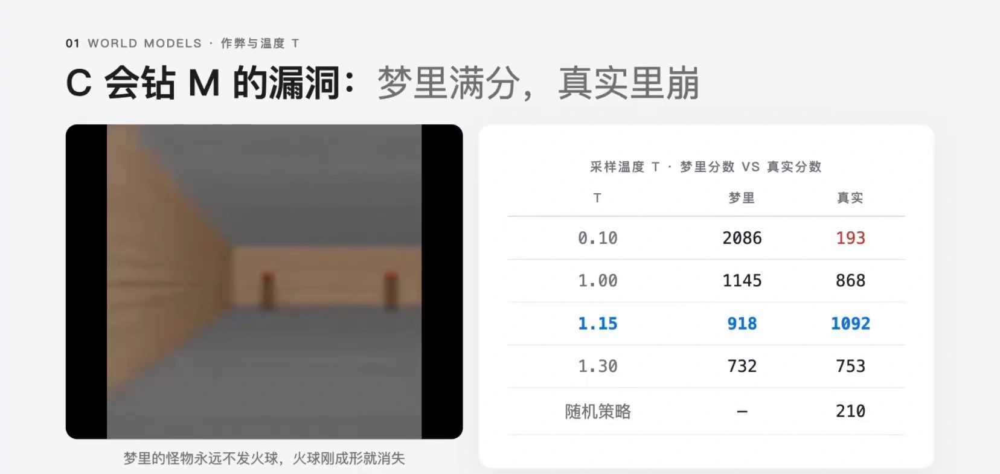
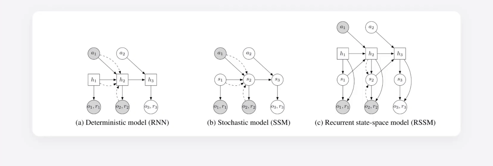
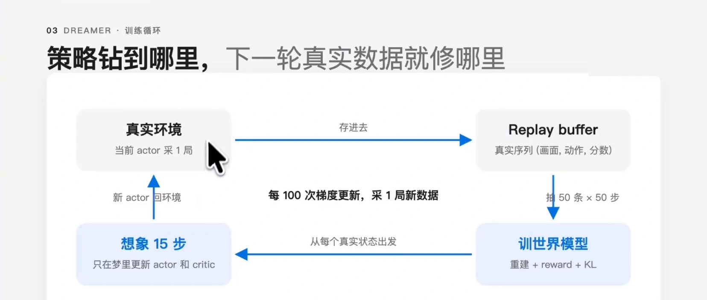
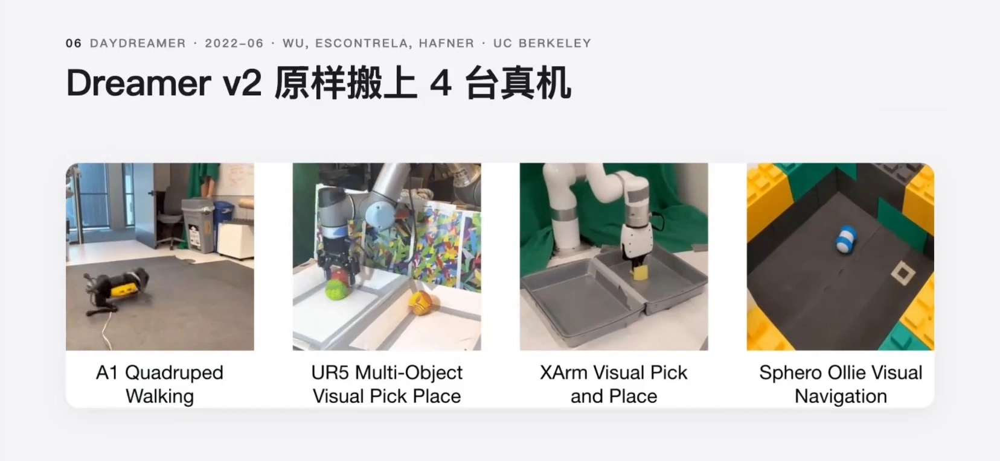

# 世界模型：V 看、M 记、C 决定，与在梦里练出来的策略

> 前提：10.1 讲清了有模型与免模型的宏观权衡，10.2 讲清了模型误差如何随 rollout 平方级复合，10.3~10.5 讲了 Dyna、MCTS 与隐空间规划。本篇换一个角度：**如果智能体先把「世界怎么运转」学成一个可以自己往前推的模型，然后干脆钻进这个模型里去练策略，会怎样？** 这就是「世界模型」（world model）这条线，从 Ha & Schmidhuber 2018 的 World Models 一路走到 Dreamer 系列。
>
> 同一条目下另有一篇讲 MBPO 的算法全解（[MBPO 算法全解](MBPO算法全解：概率集成与短分支rollout.md)），两篇分工不重叠。

## 本讲要解决的核心问题（SCQA）

**背景**：免模型强化学习把「预测未来」这件事整个丢给了价值函数——它不显式建模环境，只学「在这个状态做这个动作值多少分」。样本效率因此很低：每一个梯度都要用真实交互换。

**冲突**：人不是这样学的。棒球飞过来只有几毫秒反应时间，击球手能打中，不是因为他算得快，而是因为**脑子里有一个关于世界如何运转的内部模型**，已经下意识预测出球会在什么时候飞到哪里，肌肉跟着挥棒就行。可要把这件事装进神经网络，立刻撞上两个难题：原始观测（比如一帧 64×64 的像素）维度太高，直接在上面预测下一帧既贵又没意义；而模型一旦不准，策略就会去钻空子。

**疑问**：能不能把「感知」和「决策」拆开——先学一个压缩过的、能自己往前推的世界模型，再让一个极小的策略**只在这个模型的隐空间里**训练？这样练出来的策略，搬到真实世界还管用吗？

**回答（中心思想）**：World Models 的答案是**三件套解耦**：V 负责看（把画面压成隐向量 $z$），M 负责记和预测（在隐空间里预测下一个 $z$ 和奖励），C 负责决定（一个线性层，只看 $z$ 和一个记忆向量 $h$）。C 完全不碰像素，所以它可以极小、可以在 M 生成的「梦」里训练、并且能迁移回真实环境。代价是梦会骗人——C 会主动去找 M 的漏洞，这就是后来 Dreamer 系列用「三块一起循环训练」要修的东西。

---

## 一、「世界模型」这个词是怎么来的

论文引言给的定义很短：**你的大脑里有一个关于世界内部的模型，它在给定当前动作的条件下，预测接下来的感官输入会是什么** [【跳转到 00:23】](https://www.bilibili.com/video/BV1ZseE6qEum/?t=23)。

棒球击球手是论文自己举的例子：球飞过来只有几毫秒，来不及做任何「计算」，但内部模型已经预测出球的落点，身体直接执行。骑车的人也一样——他脑子里想的是骑车的画面，那个画面就是世界模型。

这个想法并不新。1990 年 Schmidhuber 自己画过一张图：**一个 RNN 当控制器，另一个 RNN 当世界模型去预测下一步的输入和奖励** [【跳转到 00:48】](https://www.bilibili.com/video/BV1ZseE6qEum/?t=48)。2018 年的 World Models 很大程度上是把这张 28 年前的草图做成了能跑的东西。

---

## 二、World Models 的三件套：V 看、M 记、C 决定

论文把智能体拆成三块，其中 V 和 M 合起来叫「世界模型」，C 只是它的一个策略 [【跳转到 01:57】](https://www.bilibili.com/video/BV1ZseE6qEum/?t=117)。



### 2.1 V（Vision）：把一帧压成 32 个数

V 就是一个标准的 VAE：把一帧 64×64 的画面压成隐空间里的一个向量 $z$，训练目标是把这一帧重建回来。World Models 里这个 $z$ 只有 **32 个数**——从 64×64×3 = 12288 维压到 32 维，压缩比接近 400 倍。

$$
z \sim q_\phi(z \mid o), \qquad \mathcal{L}_V = \mathbb{E}\big[\lVert o - \mathrm{dec}_\phi(z) \rVert^2\big]
$$

这一步是**纯无监督**的：不需要奖励，不需要动作，只要「重建得像不像」。

### 2.2 M（Memory）：在隐空间里预测下一帧

M 是整篇论文的重点，做法是 **LSTM + 混合密度网络（MDN）输出层**，合称 MDN-RNN。

它每一步吃三样东西：当前的 $z$、当前的动作 $a$、以及自己上一步的隐状态 $h$；输出是**下一个 $z$ 的概率分布** [【跳转到 02:22】](https://www.bilibili.com/video/BV1ZseE6qEum/?t=142)。

这里有个关键设计：输出**不是一个点，而是一个混合高斯**。因为环境本身有随机性，同一个状态做同一个动作，下一帧可能不一样；用单一值去拟合，模型只能学到「平均」，而平均出来的画面往往是糊的。混合高斯的写法是

$$
p(z_{t+1} \mid z_t, a_t, h_t) = \sum_{i=1}^{K} \pi_i(z_t,a_t,h_t)\; \mathcal{N}\!\left(z_{t+1};\ \mu_i(z_t,a_t,h_t),\ \sigma_i^2(z_t,a_t,h_t)\right)
$$

$h$ 本身是 LSTM 的隐状态，World Models 里是 **256 个数**。它不是训练出来的参数，而是每走一步算出来的向量：

$$
h_t = \mathrm{LSTM}(z_t,\ a_t,\ h_{t-1})
$$

$h$ 为什么重要？因为**一张静止的画面说不出车速和航向**。$z$ 只是单帧的压缩，而 $h$ 是一路读着 $z$ 和动作序列积攒下来的摘要。为了完成「预测下一帧」这个任务，模型被逼着把速度、航向、这个弯还要拐多久这些**单帧看不出来的量**全部塞进 $h$ 里 [【跳转到 05:22】](https://www.bilibili.com/video/BV1ZseE6qEum/?t=322)。所以 $h$ 天生带时间维度，是记忆。

讲者在这里给了一个很到位的类比：**这本质上就是图像领域的 next token prediction**。语言模型靠预测下一个 token 学表征，World Models 靠预测下一帧的隐向量学表征——这个思路在 2018 年就试过，只是当时受限于算力和数据没成气候。

### 2.3 C（Controller）：一个线性层

C 简单到有点反直觉：**一个线性层**，输入是 $z$ 和 $h$ 拼起来的向量，输出动作 [【跳转到 03:12】](https://www.bilibili.com/video/BV1ZseE6qEum/?t=192)。

$$
a_t = W\,[z_t;\ h_t] + b
$$

这就是「感知与决策解耦」的全部含义：**决策部分不需要看到像素**。它看到的是已经被 V 和 M 消化过的、32 + 256 维的低维状态。参数少到可以用进化算法（CMA-ES）在几百个候选里搜出来，根本不用梯度。

### 2.4 五步训练流程

整套流程是串行的，一步接一步 [【跳转到 03:37】](https://www.bilibili.com/video/BV1ZseE6qEum/?t=217)：

```text
1. 用随机策略在环境里跑 1 万局，记录每一帧画面和当时的动作
2. 用这些画面训 V（VAE），损失是纯重建误差，无监督
3. 用训好的 V 把所有画面编码成 z，配上录下来的动作，训 M（预测下一个 z）
4. 定义 C（一个线性层）
5. 用 CMA-ES 等进化算法搜 C 的参数——维护一群候选，各自去跑几局看总分，
   分高的留下、在它附近再采一批，一代代往前推（不用梯度）
```

注意第 1 步和第 5 步的区别：**数据只采一次**。V 和 M 训完之后就冻结，C 的搜索可以反复在 M 里进行，不需要再碰真实环境。

---

## 三、在梦里训练：C 只在 M 内部滚动

### 3.1 做法

World Models 的第二个实验做得更激进：**C 完全不碰真实游戏，全部训练都在梦里完成** [【跳转到 06:29】](https://www.bilibili.com/video/BV1ZseE6qEum/?t=389)。

机制很直接：因为 M 输出的是下一个 $z$ 的**分布**，所以可以从这个分布里采样出一个 $z$，把它当作下一帧喂回去。于是 M 和 C 就在模型内部一直滚下去，生成出一段**从来没有真实发生过的游戏过程**。



### 3.2 为什么必须在隐空间，而不是像素空间

这是本篇最容易被跳过、但最该讲清的一点。在像素空间里做「预测下一帧再训练」有三个死结：

1. **维度太高**。64×64×3 的下一帧有 12288 个自由度，而真正决定未来的信息（速度、航向、怪物位置）可能只有几十维。让模型在像素上做预测，绝大部分算力花在重建墙纸纹理上。
2. **随机性无法表达**。像素级的精确预测在随机环境里没有唯一答案，M 必须输出分布；而在 32 维隐空间里输出混合高斯是可行的，在 12288 维像素空间里几乎不可行。
3. **策略不需要像素**。C 要的是「我现在该往哪走」，不是「这一帧长什么样」。把决策放在隐空间，C 可以小到只有几百个参数，用进化算法就能搜。

换句话说：**隐空间不是省算力的权宜之计，而是让「预测」和「决策」都变成可学习问题的那一步**。

### 3.3 结果与代价

CarRacing 上，一局平均 900 分以上算解决；VizDoom 的「Take Cover」任务里，只在梦里训练的 C 拿回了 **1092 分**，而随机策略只有 210 分 [【跳转到 07:19】](https://www.bilibili.com/video/BV1ZseE6qEum/?t=439)。这在 2018 年是相当惊人的结果：**策略一次真实交互都没做过，就学会了玩游戏**。

---

## 四、梦的漏洞：C 会钻 M 的空子

但梦里训练有个坑。M 只是一个近似模型：**训练数据稠密的地方很准，稀疏的地方会犯错**。而 C 的优化只在梦里进行，它分不清「真的高分」和「模型算错了的高分」——这就是 sim-to-real gap [【跳转到 07:33】](https://www.bilibili.com/video/BV1ZseE6qEum/?t=453)。

作者在早期实验里找到了一个对抗策略：**站到某个位置，梦里的怪物就永远不发火球**，火球刚成形就消失。这个策略在梦里是满分，放到真实游戏里一塌糊涂。



论文用采样温度 $T$ 做了对照，规律很清楚：

| 采样温度 $T$ | 梦里分数 | 真实分数 |
| :--- | ---: | ---: |
| 0.10 | 2086 | 193 |
| 1.00 | 1145 | 868 |
| 1.15 | 918 | 1092 |
| 1.30 | 732 | 753 |
| 随机策略 | — | 210 |

温度越低，梦越「确定」，越容易被钻；温度太高，梦太随机，策略学不到东西。中间那个 $T=1.15$ 才让真实分数超过梦里分数。

原因讲得很透：**C 拿到了 M 的全部隐藏状态，等于拿到了游戏引擎的内部**。它可以把 M 推到训练数据从来没有覆盖过的地方去，而那个地方 M 是错的——**这个错误对策略有利，所以策略会主动去找它**。这个现象在 10.2 里叫「模型利用」（model exploitation），在 MBPO 里靠「短 rollout」压住，在 Dreamer 里靠「循环回流真实数据」修掉。

---

## 五、从 PlaNet 到 Dreamer：RSSM 与想象训练

### 5.1 PlaNet 与 RSSM：把确定性记忆和随机性拆开

PlaNet（2018-11, Hafner 等）做了两处改动 [【跳转到 08:40】](https://www.bilibili.com/video/BV1ZseE6qEum/?t=520)：

1. **把 V 和 M 合成一个模型一起训**，不再分头训；
2. **加一个 reward 头**，从状态直接预测这一步得几分。

第二点有代价：加了 reward 头之后，latent 就必须保留「对预测分数有用」的信息，**世界模型从此绑定了任务**。这也是后来很多人批评的地方——你学到的不是纯粹的世界，而是「针对这个任务优化过的世界」。

更重要的遗产是 **RSSM（Recurrent State Space Model，循环状态空间模型）**，Dreamer 系列一路沿用的骨架。



RSSM 的核心是**把状态解耦成两部分**：

- **确定性部分 $h_t$**：用 GRU 递推，负责长期记忆。比如画面里有个球，只看这一帧你不知道它在上升还是下落，必须知道上一帧它在哪。
- **随机部分 $z_t$**：负责表达「同一个 $h$ 下可能的多种未来」。

$$
h_t = \mathrm{GRU}(h_{t-1},\ z_{t-1},\ a_{t-1})
$$

$z_t$ 有两个分布，区别在于**看不看当前观测**：

- **后验** $q(z_t \mid h_t, o_t)$：训练时用，有真实观测；
- **先验** $p(z_t \mid h_t)$：想象时用，没有观测，只能靠模型自己猜。

训练损失由三块组成：重建误差、奖励误差、以及后验与先验之间的 KL 约束。第三块是关键——**它逼着先验去逼近后验，这样在想象中没有观测时，先验也能给出靠谱的状态**。

### 5.2 Dreamer V1：把在线规划换成想象训练

Dreamer V1 做的事，是把 PlaNet 的「每步在线规划」换成了「在想象里训 actor-critic」 [【跳转到 09:30】](https://www.bilibili.com/video/BV1ZseE6qEum/?t=570)。循环是这样的：

```text
1. 从 replay buffer 抽 50 条真实序列
2. 用它们更新世界模型（重建下一帧 + reward + KL）
3. 从这些真实状态出发，在模型里想象 15 步
4. 在这 15 步想象轨迹上更新 actor 和 critic
5. 每做 100 次梯度更新，拿当前 actor 回真实环境跑 1 局，存进 replay buffer
6. 回到 1
```

对比 World Models 的「采一次数据、串行走完、再也不回头」，Dreamer 是**三块一起循环着训**。



### 5.3 为什么这个循环能修掉「钻漏洞」

这是 Dreamer 系列最大的更新，值得完整讲一遍 [【跳转到 10:20】](https://www.bilibili.com/video/BV1ZseE6qEum/?t=620)。

假设 actor 在梦里发现「站到某个角落，火球会消失」，于是学会往那边跑，永远砸不到。下一轮它真的跑到那个角落——但真实环境里火球没有消失，它被打死了。这段真实经历（角落的状态、真实的下一帧、分数归零的 reward）被存进 replay buffer。再下一轮，世界模型在这批数据上更新，**那个角落的预测被纠正**；critic 给那个状态的估值掉下来，actor 就学会「这个策略是错的」。

讲者点出了最漂亮的一层：**actor 去钻漏洞的那个动作，本身就是在替模型采集它最缺的那块数据**。探索和补模型变成了同一件事。

### 5.4 V2 与 V3：两个方向的推进

- **Dreamer V2**：把 latent 从连续高斯改成**离散类别分布**。高斯是单峰的，建模不了多峰的复杂状态；离散分布可以。同时把动作空间从连续扩展到离散（离散动作不可导，改用 REINFORCE 更新策略）[【跳转到 11:35】](https://www.bilibili.com/video/BV1ZseE6qEum/?t=695)。
- **Dreamer V3**：没有加新范式，主要贡献是**一套超参数跨任务通用**，加上一堆提升训练稳定性的技巧（比如 symlog 压缩大尺度的 reward 和 value，防止梯度爆炸）。结果是从零开始在 Minecraft 里挖到钻石，登上 Nature；模型规模从 12M 放大到 400M [【跳转到 11:48】](https://www.bilibili.com/video/BV1ZseE6qEum/?t=708)。

V3 的消融里有一个结论特别值得记住：**性能主要来自无监督的重建损失**，把 reward 和 value 的梯度去掉几乎不掉分。也就是说，**世界模型的表征不是靠某个具体任务学出来的**——「重要的是世界，而不是任务」。这条结论正是后来「先用无标注数据预训练一个世界模型」这条路线的重要依据。

---

## 六、DayDreamer：把梦搬到真机器狗上

DayDreamer 把上面这一整套真正放到了四台真机器人上，设定非常硬：**真机在线强化学习，不用任何仿真，不用任何人类示范** [【跳转到 12:53】](https://www.bilibili.com/video/BV1ZseE6qEum/?t=773)。



以机器狗为例，整个系统分成两侧：

- **狗这一侧**：每秒 20 次读传感器（IMU、关节编码器），喂给当前的大脑（一个小神经网络），输出 12 个关节的目标角度发给电机；同时把「感觉到了什么、做了什么、得了几分」记进日记本（replay buffer）。狗自己完全不学习，只负责动和记日记。
- **电脑这一侧**：从日记本抽几十段记录，训一个网络回答「如果我现在腿是这个姿势、发了这个指令，下一瞬间我会感觉到什么、会得几分」——这个网络就是世界模型。注意这里的「世界」不是一幅画面，而是**身体对指令的反应**：重心怎么移动、哪条腿会打滑、会不会翻过来。
- 有了身体模型之后，电脑就可以不动真狗地做实验：从每一个真实瞬间出发，问「接下来 15 步如果我这样蹬」，让模型往后推演 15 步，看哪种蹬法分数最高，把大脑往那个方向改一点。
- 改完存一个 checkpoint 到磁盘，狗那边定期来取，换上继续跑，产生新的日记。

为什么一小时就能学会从翻倒状态起身？算一下就明白：狗一小时最多走 7.2 万步，还得摔倒、翻身；而显卡在这一小时里可以在世界模型里预演**几千万步**。**真实经历只用来校准身体模型，练技术的过程全在大脑里完成**——就像跳水运动员每跳一次，会在脑子里回放几千遍再跳下一次 [【跳转到 16:43】](https://www.bilibili.com/video/BV1ZseE6qEum/?t=1003)。

它和 MuJoCo 这类仿真器的区别也讲得很清楚：**MuJoCo 是手写的世界模型**，它不知道这台电机的力矩曲线、这块地板的摩擦系数、这盏灯的光照，所以和真机对不上；而学出来的世界模型是**用真机数据拟合的**，这些细节作为隐式知识都包含在数据里，不需要任何人显式写出来。代价是必须真机采数据，几个小时起步，而且狗会摔很多次。

两个很有说服力的观察：

- 训练好之后拿杆子反复把它推倒，在线再学 10 分钟就能适应：轻推会顶住，重推能翻身再站起来。
- 机械臂实验在夜里训练，天亮后日出强光打进来，图像分布变了，性能直接跌到零；作者什么都没改，让它继续学，**五个小时后自己恢复了，并且超过原来的水平**。世界模型通过自我循环的训练，能重新学到对世界的真实感知。

---

## 七、世界模型的三个用途

把上面这些串起来，世界模型的价值可以归成三条：

| 用途 | 机制 | 本讲中的例子 |
| :--- | :--- | :--- |
| **样本效率** | 一份真实数据可以反复在模型里推演出大量虚拟经验 | DayDreamer 一小时真机数据换几千万步脑内预演 |
| **在想象中安全试错** | 危险动作先在模型里试，失败了不付出真实代价 | 机器狗摔倒、机械臂撞坏都在梦里发生 |
| **表征学习（预训练）** | 无监督重建就能学到有用的隐空间，不依赖具体任务 | Dreamer V3 消融：去掉 reward 与 value 梯度几乎不掉分 |

第三条最容易被低估。它意味着世界模型可以**先在海量无标注数据上预训练，再针对具体任务微调**——这正是后来一大批工作的基本范式。

---

## 八、局限

- **模型偏差（model bias）**：M 只在数据稠密处准，稀疏处会错，而策略会主动去找那些错的地方。World Models 用温度 $T$ 缓解，Dreamer 用真实数据回流修补，但都没有从根上消除。
- **长程预测退化**：想象 15 步还行，想象 200 步就开始糊。这和第 10.2 讲的复合误差是同一件事——单步误差经过 $H$ 步会被放大到 $O(\epsilon H^2)$ 量级。
- **训练不稳定**：世界模型、reward 头、actor、critic 四个部分互相依赖，任何一个跑偏都会拖垮整体。Dreamer V3 花了大量篇幅在 symlog、归一化这类稳定性技巧上，正说明这一点。
- **绑定任务的风险**：一旦加了 reward 头（PlaNet 起），latent 就会被任务塑形，「世界」不再是纯粹的世界。
- **算力换样本**：梦里的每一步也是要算的。世界模型把「样本贵」换成了「算力贵」，在仿真便宜的场合未必划算。

---

## 小结

- **世界模型的定义**：给定当前动作，预测接下来的感官输入是什么。这个想法 1990 年就有了，2018 年的 World Models 第一次把它做成能跑的系统。
- **三件套解耦是核心**：V（VAE）把一帧压成 32 维 $z$，M（MDN-RNN）在隐空间预测下一个 $z$ 的混合高斯，C 只是看 $[z; h]$ 的一个线性层。**决策不需要看到像素**。
- **$h$ 是记忆**：单帧看不出速度和航向，为了预测下一帧，模型被逼着把这些量塞进 $h$。这本质上是图像领域的 next token prediction。
- **在梦里训练可行，但梦会骗人**：只在梦里训练的 C 在 VizDoom 拿到 1092 分，却也能找到「站角落火球就消失」的漏洞——因为 C 拿到了模型全部隐藏状态，等于拿到了游戏引擎内部。
- **Dreamer 的修法是循环回流**：三块一起循环训，策略钻到哪里，下一轮真实数据就修哪里；钻漏洞的动作本身就是在给模型采集它最缺的数据。
- **RSSM 把确定性记忆与随机性拆开**：$h$ 用 GRU 记长期历史，$z$ 表达同一历史下的多种未来；训练时用后验（看观测），想象时用先验（不看观测），KL 约束把两者拉近。
- **Dreamer V3 的结论最值得记**：性能主要来自无监督重建损失——**重要的是世界，而不是任务**。

如果只记一句话：**世界模型把「感知」和「决策」拆开，让策略可以极小、可以在想象中训练；而想象训练能成立的前提，是真实数据必须持续回流去校准那个梦。**

---

## 关键术语速查

| 术语 | 一句话解释 |
| :--- | :--- |
| 世界模型（world model） | 给定当前状态和动作，预测下一个观测与奖励的内部模型 |
| V / M / C | World Models 的三件套：VAE 编码器、MDN-RNN 预测器、线性控制器 |
| 隐向量 $z$ | 一帧观测经 VAE 压缩后的低维表示，World Models 中为 32 维 |
| 记忆向量 $h$ | LSTM/GRU 的隐状态，携带单帧看不出的速度、航向等历史信息 |
| MDN-RNN | 带混合密度输出层的 RNN，输出下一个 $z$ 的混合高斯分布而非单点 |
| 在梦中训练（training in dreams） | 用 M 采样生成虚拟轨迹来训练 C，完全不碰真实环境 |
| sim-to-real gap | 模型内表现与真实环境表现的差距，根源是模型在数据稀疏处会犯错 |
| RSSM | 循环状态空间模型，把确定性状态 $h$ 与随机状态 $z$ 解耦的动力学模型 |
| 后验 / 先验 | $q(z_t \mid h_t, o_t)$ 用观测，$p(z_t \mid h_t)$ 不用观测；KL 约束把两者拉近 |
| 想象轨迹（imagination rollout） | 从真实状态出发、只在世界模型内部推演出的虚拟轨迹 |
| DayDreamer | 把 Dreamer 搬到真机器人上做在线学习的系统 |