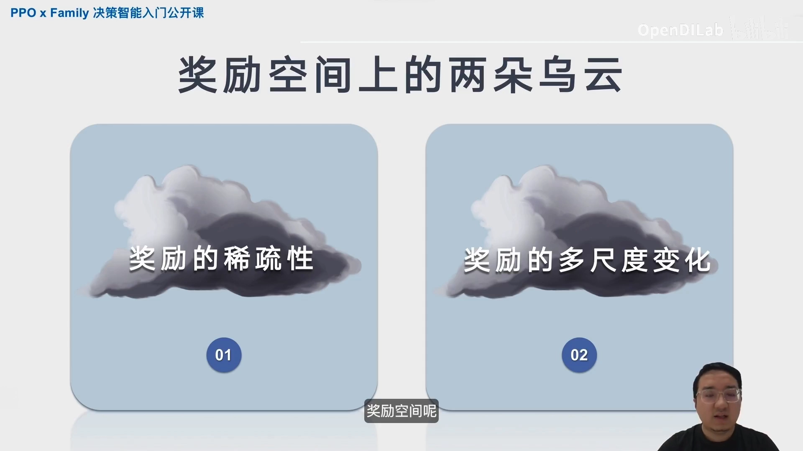
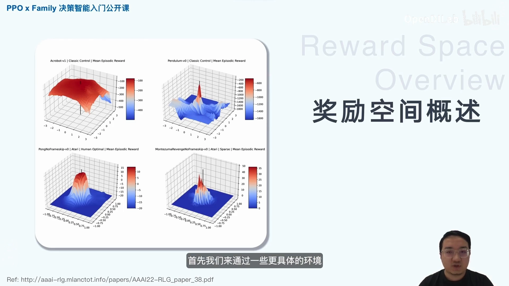
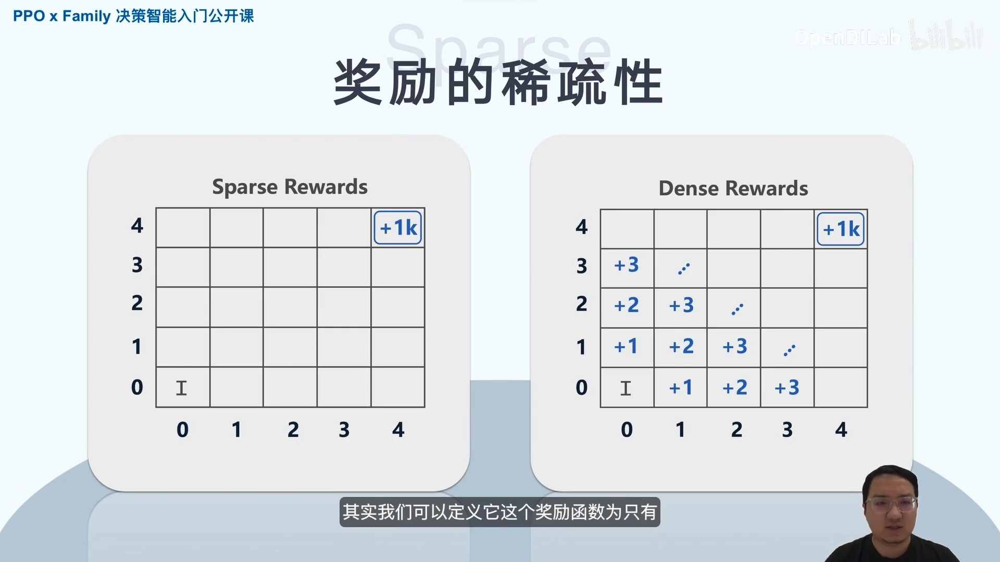
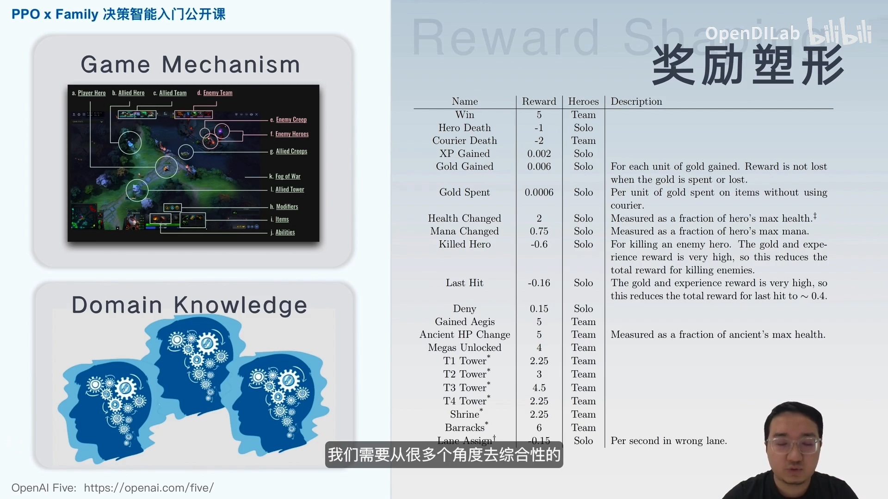
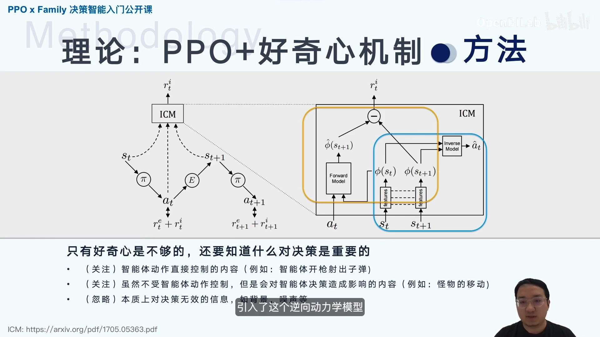
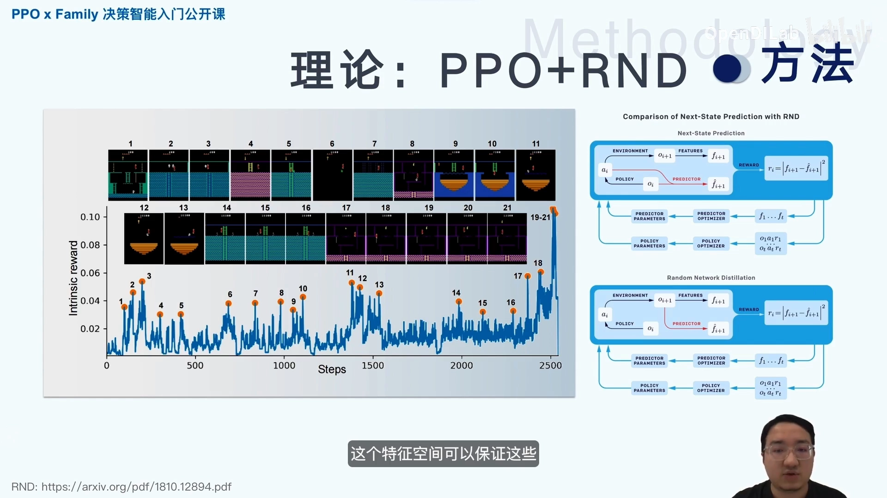
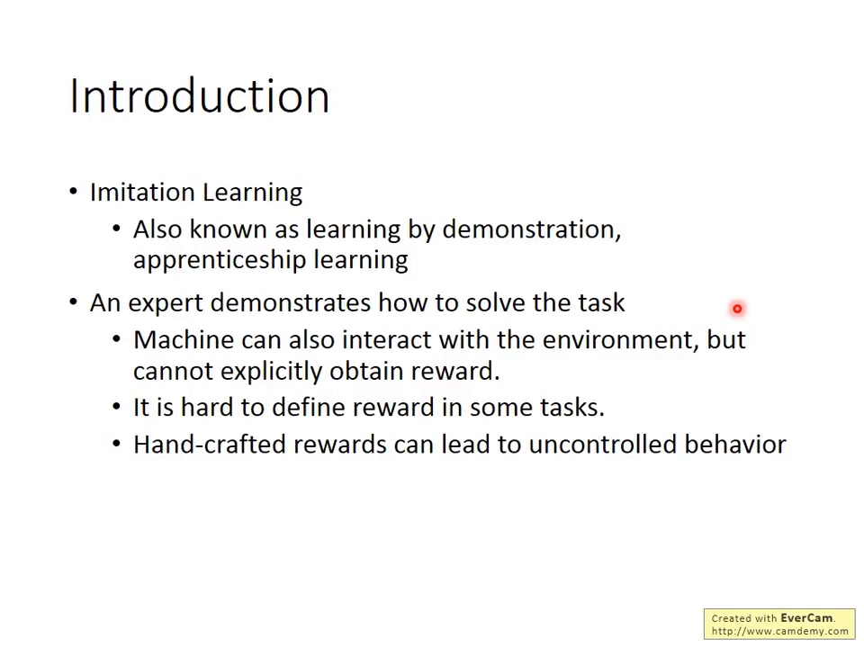
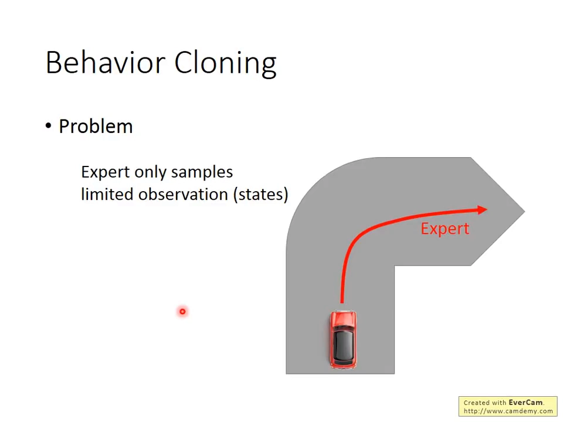
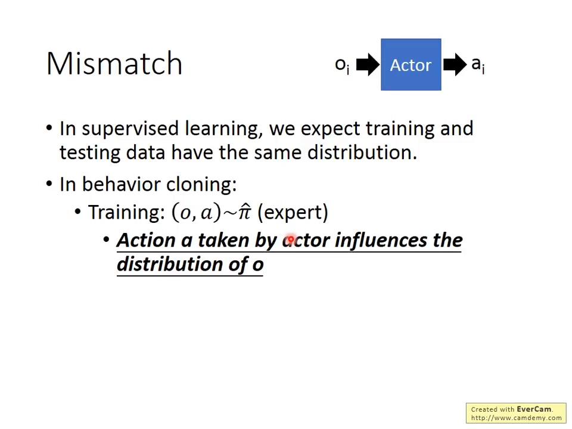
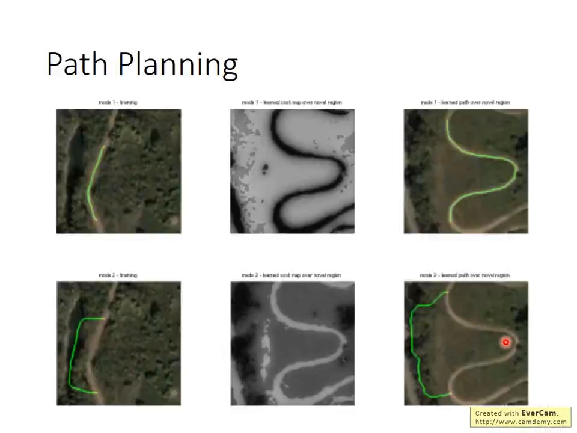

# 稀疏奖励困境与专家演示数据：奖励信号几乎不存在时，还能学什么

> 本篇整理自两支视频：OpenDILab《PPO × Family 决策智能入门公开课》第四课「解密稀疏奖励空间」（[BV15j411F7ni](https://www.bilibili.com/video/BV15j411F7ni/)，37 分钟）与李宏毅的《Imitation Learning》讲座（[BV1Hu4y1v7Gv](https://www.bilibili.com/video/BV1Hu4y1v7Gv/)，82 分钟）。
>
> 这是第 11 章的开篇，只做一件事：**把「为什么要从奖励学习转向从演示学习」这条逻辑铺清楚，并给出一张路线地图**。行为克隆与分布偏移的细节见 11.2，逆强化学习见 11.3，GAIL 见 11.4，本篇不重复推导。文中「命中概率的数量级估算」与「稀疏奖励下梯度为何消失」两处推导是依据 Sutton & Barto《Reinforcement Learning: An Introduction》第 1、3、13 章的标准结论补足的，已在对应位置注明；其余内容均来自上述两支视频。

## 本讲要解决的核心问题（SCQA）

**背景**：前面十章讲的都是同一件事——智能体自己跟环境打交道，从奖励信号里学出策略。第 1 章的探索与利用、第 2 章的遗憾、第 4 章的探索性起点、第 7 章的策略梯度，全都默认了一件事：**奖励会及时地、以足够密的方式出现**。

**冲突**：真实任务里这个前提经常不成立。下棋只有终局胜负，机器人只有「任务完成」和「任务没完成」，自动驾驶甚至根本没有一个能写成公式的奖励——李宏毅举的例子很直白：撞墙扣多少分、撞人扣多少分、撞狗扣多少分？你根本不知道该怎么定；而一旦定错，智能体会找到你没想到的作弊路径（考 100 分就给奖励，它就作弊）。OpenDILab 的讲者把这称为「奖励空间上的两朵乌云」：**奖励的稀疏性**与**奖励的多尺度变化**。

**疑问**：稀疏奖励到底为什么会让强化学习失效——是「运气不好还没撞上」，还是有更硬的结构性原因？如果奖励这条路走不通，人类自己的做法（示范一遍）能不能变成算法？

**回答（中心思想）**：稀疏奖励的困难不是「样本少」，而是**成功事件的命中概率随任务长度指数下降**，于是值函数在所有状态上都是 0、TD 误差恒为 0、策略梯度的权重恒为 0——**梯度信号在成功发生之前根本不存在**，探索与信用分配同时失效。绕开它的办法有两大类：一是自己造奖励（奖励塑形、内在奖励），代价是把领域知识或额外的建模误差搬进训练；二是**换一种监督信号**——专家演示轨迹 $(s_0,a_0,s_1,a_1,\dots)$ 本身就是「该怎么做」的答案，不需要奖励就能学。这就是模仿学习的出发点。演示数据的价值有三条（跳过探索、给出好的初始策略、提供状态分布先验），局限也有三条（覆盖不全、分布偏移、质量依赖专家），而后续的四条技术路线正是围着这三条局限长出来的。

[【跳转到 00:32】](https://www.bilibili.com/video/BV15j411F7ni/?t=32)

---

## 一、稀疏奖励：奖励在状态空间里只占「一根针」

### 1.1 四种奖励地形：从平滑曲面到一根针

OpenDILab 的讲者用四张三维曲面把「奖励空间」画了出来：横纵两轴是状态动作空间，颜色和高度是奖励取值。

[【跳转到 01:38】](https://www.bilibili.com/video/BV15j411F7ni/?t=98)

四张图代表四种完全不同的难度：

- **Acrobot（左上）**：奖励随状态平滑变化，算法可以「循序渐进」地爬坡，每一步都能得到一点方向信息。
- **Pendulum（右上）**：大部分区域是平坦的低奖励，只有一个很窄的尖峰。讲者的说法是「奖励函数逐渐变得稀疏」——空间里有很大一部分是全蓝的，也就是全零。
- **Pong（左下）**：奖励集中在一个小山包上，但周围仍是可分辨的梯度。
- **Montezuma's Revenge（右下）**：奖励是**一根针**。除了极少数几个位置，整片空间都是零。

这张图给了一个很关键的直觉：**稀疏不是「奖励小」，而是「奖励在空间里的支撑集小」**。奖励小可以靠缩放解决，支撑集小没法靠缩放解决——因为智能体在绝大多数状态下拿到的信息是完全相同的 $0$，它无法从 $0$ 里读出「我离成功更近了还是更远了」。

### 1.2 稀疏的两种典型形态：吸收性奖励与阶跃式奖励

讲者进一步把稀疏奖励分成两类，它们的难点不一样：

**第一类是吸收性奖励（absorbing reward）**，典型代表是棋类。整局棋的优化目标是胜负，而胜负只在最后一步给出。在棋局的前中期，智能体拿不到任何奖励信号，讲者的原话是「这样的吸收性奖励必然导致强化学习在前中期的优化找不到方向、找不到目标，探索变得非常困难」。

**第二类是阶跃式奖励**，典型代表是「拿钥匙 → 开宝箱 → 开门」这类游戏机制。它比第一类好一点：中间有若干个正反馈点。但讲者指出，阶跃之间「存在很多空白的段」，整体上奖励依然是稀疏的——中间某一段很难被探索到，也就很难利用到里面具体的游戏情节。

### 1.3 为什么随机探索会失效：命中概率随长度指数下降

这是本篇最需要算清楚的一件事。用讲者给的那个格子世界做例子最直观。

[【跳转到 07:17】](https://www.bilibili.com/video/BV15j411F7ni/?t=437)

左图的设定是：只有智能体到达右上角的目标点才获得正奖励，其余全是 0。讲者的描述是「智能体在决策前中期只能漫无目的地随机探索、去尝试，类似瞎猫碰死耗子」。右图则把「当前位置与目标点的距离」当作奖励，距离越近奖励越大，于是每一步都有梯度。

**数量级估算（依据标准结论补足，非视频内容）**。假设动作空间有 $k$ 个选项、任务需要 $n$ 步才能完成，随机策略每一步踩中「正确动作」的概率约为 $1/k$，那么一条随机轨迹恰好走通整个任务的概率是

$$
p_{\text{success}} \approx \left(\frac{1}{k}\right)^{n} = k^{-n}
$$

代入具体数字（$k=4$，即上下左右）：

| 任务长度 $n$ | 随机走通的概率 $4^{-n}$ | 大致含义 |
| --- | --- | --- |
| 8 步 | $1.5\times 10^{-5}$ | 抽 10 万条轨迹大约撞上 1~2 次 |
| 20 步 | $9.1\times 10^{-13}$ | 抽一万亿条轨迹才撞上一次 |
| 100 步 | $6.2\times 10^{-61}$ | 需要 $10^{61}$ 量级的尝试次数 |

这就是稀疏奖励的**结构性困难**：它不是「运气差一点」，而是**命中概率随任务长度指数衰减**。而 Montezuma's Revenge 这类 Atari 游戏的一条通关轨迹动辄上千帧、动作空间十几个——按上表外推，随机探索在物理上不可能成功。

需要说明的是，这个估算把「每步踩中正确动作」当作独立事件，忽略了多条可行路径带来的加成；但对长任务来说，可行路径的数量是多项式级的，而 $k^{-n}$ 是指数级的——量级结论不受影响。

### 1.4 成功发生之前，梯度恒等于 0

指数级命中率只是第一层。第二层是：**在成功事件发生之前，所有基于奖励的学习信号都是 0**。

设奖励只在终止状态非零，其余 $r=0$。那么对任意策略 $\pi$：

- **TD 学习**：TD 误差 $\delta_t = r_{t+1} + \gamma V(s_{t+1}) - V(s_t)$。若 $V$ 初始化为 0、且所有中间奖励为 0，则 $\delta_t = 0$ 恒成立，更新量 $Q \leftarrow Q + \alpha\delta$ 永远是 $0$——**值函数停在 0 不动，连「哪里离成功近」都学不出来**。
- **蒙特卡洛 / 策略梯度**：REINFORCE 的更新权重是回报 $G_t$。在没成功过的情节里 $G_t = 0$，于是 $\nabla_\theta J \propto \sum_t G_t \nabla_\theta \log \pi_\theta(a_t\mid s_t) = 0$——**梯度整条为零**，策略参数一步都不会动。
- **信用分配**：即使偶尔成功一次，$G_t$ 是一条长度 $n$ 的轨迹上的同一个数，要把这份功劳分摊到 $n$ 个动作上，正是第 7 章讲的高方差问题；而这里样本量还退化成了 1。

所以稀疏奖励的困难可以一句话概括：**它不是「学习信号弱」，而是「学习信号在成功之前根本不存在」**。这也解释了为什么讲者说奖励稀疏会让「前中期的优化找不到方向」——不是方向不准，是没有方向。

### 1.5 与第 1、2 章的呼应：这是探索问题被放大到极端

第 1 章讲探索与利用时，$\epsilon$-贪婪、乐观初始化、UCB 之所以有效，前提是**每条臂被拉动后都能观测到一个有区分度的奖励**。第 2 章的遗憾界（如 UCB 的 $\tilde{O}(\sqrt{KT})$）也是在这个前提下推出来的：置信区间的宽度按 $1/\sqrt{N(a)}$ 收缩，靠的是「有效样本数」随拉动次数增长。

稀疏奖励把这两条前提同时打掉：

- 拉动一条臂，观测到的几乎永远是 0，**不同臂之间的观测无法区分**，置信区间收不缩；
- 于是「有效样本数」不随交互次数增长，遗憾界退化回线性——**你花了 $T$ 步，却只得到常数级别的信息**。

换句话说，稀疏奖励不是一个新的技术问题，而是**第 1 章的探索问题被推到极端后的样子**。理解了这一点，后面两条解法（造奖励 / 换监督信号）就有了统一的解释：它们都在做同一件事——**在成功发生之前，人为地制造出可用的区分信号**。

---

## 二、解法一：自己造奖励，以及它的代价

### 2.1 奖励塑形（reward shaping）：有效，但需要领域知识

最直接的想法是改造奖励函数，把「稀疏」变「稠密」。OpenDILab 的讲者用 OpenAI Five 的 Dota 智能体做例子：要设计这样一张奖励表，首先得了解 Dota 的游戏机制，还要跟职业选手交流、积累领域知识，然后从「给敌人造成的伤害」「是否推掉对方的防御塔」「是否赢下这一局」等很多角度综合设计，最后还要细致调节每一类奖励的数值。

[【跳转到 05:27】](https://www.bilibili.com/video/BV15j411F7ni/?t=327)

讲者的评价很直接：「这样的工作可想而知需要非常深厚的、与决策环境相关的领域知识。所以实践中这种方法虽然一定程度上能解决问题，但用起来十分困难。」

这句话点出了奖励塑形的本质代价：**它把「设计奖励」的难题从算法转移给了人**。而且塑形本身有风险——李宏毅的「考试作弊」例子说的就是同一件事：手写奖励一旦写偏，智能体会精确地优化你写下的东西，而不是你想要的东西。

### 2.2 内在奖励与好奇心：ICM 与 RND

第二条造奖励的路是**自动生成**一个「内在奖励」（intrinsic reward），与外在奖励线性组合后一起训练：

$$
r_t = r_t^{e} + \beta\, r_t^{i}
$$

其中 $r_t^{e}$ 是环境给的外在奖励，$r_t^{i}$ 是模型自己算出来的内在奖励。动机是：智能体没见过的状态、没做过的决策，可能蕴含更高价值，所以「越新颖奖励越大」。

[【跳转到 13:43】](https://www.bilibili.com/video/BV15j411F7ni/?t=823)

**ICM（Intrinsic Curiosity Module）** 的做法分两步：

1. 用前向模型预测 $\hat\phi(s_{t+1})$，与真实的 $\phi(s_{t+1})$ 比较得到预测误差，作为内在奖励；
2. 关键在 $\phi$ 怎么来——ICM 引入**逆向动力学模型**，用 $(s_t, s_{t+1})$ 去预测 $a_t$。这个辅助任务迫使表征只保留「与动作相关」的信息，从而把背景噪声、与决策无关的变化抑制掉。

讲者把 ICM 的设计动机总结成一句话：**「只有好奇心是不够的，我们还需要知道什么对于决策是重要的。」** 他把信息分成三类：智能体动作能直接控制的内容（开枪后子弹飞行）、不受控制但会影响决策的内容（怪物移动）——这两类要放大；本质上对决策无效甚至有干扰的信息（噪声、无关的对比信息）——要滤掉。

**RND（Random Network Distillation）** 换了一个更便宜的思路：不学前向/逆向动力学模型，而是拿一个**随机初始化且固定**的目标网络，让预测器网络去拟合它的输出，用两者特征的预测误差作为新颖性度量。

[【跳转到 17:29】](https://www.bilibili.com/video/BV15j411F7ni/?t=1049)

讲者特别解释了为什么用随机初始化的网络：一个好的随机网络能把 observation 比较均匀地映射到特征空间，而且**目标是固定的、不需要额外训练代价**。相比之下，用 autoencoder 式的自监督重建任务做内在奖励会遇到一个核心问题——强化学习的数据分布本身在动态变化，重建目标跟着变，学习难度和稳定性一定更差。

### 2.3 造奖励的三条共同代价

讲者对这条路线的批评相当克制但很关键，可以归成三条：

1. **超参敏感**。好奇心模型本身是**在线训练**的，非平稳过程会让内在奖励的量级不断变化，讲者说「好奇心机制在实际使用时对超参比较敏感，需要积累一定的使用经验」。
2. **noisy TV 问题**。如果状态转移是随机的而不是确定性的映射，ICM 这类「预测误差 = 新颖性」的方法会把随机噪声当成新颖性。最经典的例子是 noisy TV：迷宫某些区域有随机生成的图片或视频，ICM 会给这些位置很高的内在奖励，智能体就「在这些错误的位置流连忘返」。
3. **表征设计仍然要靠人**。讲者从 Atari 实验里提炼出三条表征要求：足够紧凑（滤掉无关信息、低维）、足够充分（不滤掉决策必需信息）、并且要在非平稳的在线训练下仍然稳定。这三条本身就是设计难题。

所以「自己造奖励」这条路是**用建模误差换探索信号**：它确实能在稀疏奖励环境里跑起来（讲者最后用 PPO + 内在奖励 + ICM 在 MiniGrid 上做了验证——那个环境里智能体是红色箭头，到达绿色目标点才有大于零的奖励，其余情况奖励都是 0），但代价是把一个新的、更难调的学习问题塞进了训练循环。

[【跳转到 23:36】](https://www.bilibili.com/video/BV15j411F7ni/?t=1416)

> **顺带一提：多尺度变化是第二朵乌云。** 讲者用 Atari 57 个环境的定量分析说明，不同子环境的得分、奖励稠密度、回合长度相差 4~5 个数量级，同一环境在训练前后期也会剧烈变化。对应的工程手段是奖励裁剪、POP（用 EMA 动态统计均值方差，再用等价的参数变换保住输出精度）、value rescale（用对数级别的压缩函数保持压缩映射性质）。这些属于「奖励工程」而非「稀疏奖励」，本篇不展开，只需记住：**奖励空间的麻烦不止稀疏一种**。

---

## 三、解法二：换一种监督信号——专家演示数据

### 3.1 演示数据长什么样

李宏毅的讲法从定义切入：模仿学习（imitation learning）又叫 learning from demonstration，要做的事情就是「有一个 expert，比如人类，对 machine 做一些示范，然后 machine 根据这些示范进行学习」。

它跟强化学习的关键差别有两处：

- machine **也可以和环境互动**，但它**没有办法从环境中得到奖励**；
- 它不是被奖励驱动去做事，而是**被 expert 的示范启发**才知道要做什么。

[【跳转到 03:54】](https://www.bilibili.com/video/BV1Hu4y1v7Gv/?t=234)

幻灯片上列的三条动机，正好对应第一节讲的三种困境：**奖励拿不到**（对应稀疏）、**奖励难定义**（对应无法写成公式）、**手写奖励导致失控行为**（对应塑形风险）。

那么演示数据具体是什么？以自驾车为例，行车记录仪拍到画面 $o_i$，专家（人类驾驶员）在这个画面下踩油门向前——于是得到一条条 $(o_i, \hat{a}_i)$ 对，把整段驾驶记录下来就是一条轨迹：

$$
\tau = (s_0, a_0, s_1, a_1, \dots, s_T, a_T)
$$

**这里有一个容易被忽略但很重要的点**：演示数据里**没有奖励**。轨迹只告诉你「专家在这个状态下做了这个动作」，不告诉你「这个动作值多少分」。这正是它能绕开稀疏奖励的原因，也是它信息量少于完整奖励函数的原因——后面第四节的局限全部源于这一点。

### 3.2 演示数据的三种来源与代价

把两支视频里的例子归拢起来，演示数据大致有三个来源：

| 来源 | 具体形式 | 代价 | 视频里的例子 |
| --- | --- | --- | --- |
| 人类遥操作 / 人类示范 | 人直接操作设备、或抓着机器人的手做一遍 | 最贵：要人、要时间，且每条轨迹都要重新采 | 李宏毅：拉着机器人的手折衣服、收盘子、倒茶，「总共 demo 20 次」 |
| 其他控制器 | 规划器、MPC、PD 控制、更强的启发式策略 | 便宜且可批量生成，但上限受控制器本身限制 | 李宏毅的「用穷举得到最优落子」当作 expert 的下棋例子 |
| 已有日志 | 行车记录仪、推荐系统点击日志、历史交互记录 | 几乎免费，但**没有反事实**：日志里只有「当时做了什么」，没有「换个动作会怎样」 | 李宏毅：自驾车用行车记录仪收集人类驾驶行为 |

这三种来源的成本结构差异很大，但有一个共同点值得注意：**它们都只提供「专家走过的状态上的动作」，不提供「专家没走过的状态上的动作」**。这条性质直接决定了第三节的第一个局限。

### 3.3 演示数据解决的三个问题

演示数据能做的事，可以精确地对应到第一节列出的三个失效点：

**第一，跳过探索。** 稀疏奖励最贵的一步是「找到第一条成功轨迹」，成本按 $k^{-n}$ 指数增长。演示数据直接把这条轨迹送到手上——**这一步的成本从指数级降到零**。李宏毅讲的机器人例子就是这个逻辑：与其让机器人自己随机试出折衣服的动作，不如人拉着它的手折一遍。

**第二，给出好的初始策略。** 即使后面还要用强化学习继续优化，从一个「已经大致会做」的策略出发，也比从随机策略出发省掉绝大部分探索。李宏毅的停车场导航例子给了这个说法一个量化的注脚：那篇论文的 training data 只有四条轨迹，machine 就已经能学会「循规蹈矩地绕一圈开进停车格」——**少量演示就能换来一个可用的起点**。

**第三，提供状态分布的先验。** 演示轨迹告诉你**哪些状态是重要的**——专家会去的地方才是任务真正经过的地方。这条信息可以用来：把探索限制在合理区域、给奖励塑形提供势函数、或者直接把演示样本塞进经验回放缓冲区做预训练。OpenDILab 的讲者在讲奖励塑形时提到的「需要跟职业选手交流、积累领域知识」，本质上也是在手工构造这种状态分布先验；演示数据把它自动化了。

---

## 四、演示数据的三个局限

演示数据不是免费的午餐。三条局限，恰好对应后面三节的主题。

### 4.1 覆盖不全：专家没去过的状态怎么办

李宏毅用一张图把这个问题讲得很清楚：专家走的路线是红色的，对 machine 来说，它的 observation 就只有在这条红色路线上可以看到的景象。如果初始位置换到别的地方，「它就会崩溃，就不知道做什么」。

[【跳转到 08:22】](https://www.bilibili.com/video/BV1Hu4y1v7Gv/?t=502)

他给的第二个例子更生动：用行为克隆玩马里奥，让 machine 复制人类玩 100 场的操作。正常走的时候很顺，但一旦卡在两个方块中间，它就跳不出来——因为「人不会犯这个错误，人从来没有犯过这个错误」，这个 observation 从来没有在训练数据里出现过。

这个局限的根源在 3.1 节已经点出：**演示数据只覆盖专家访问过的状态分布**。而智能体一旦自己行动，就会走到专家没去过的地方——于是引出第二个、也是更本质的局限。

### 4.2 分布偏移：动作会改变你看到的东西

李宏毅把行为克隆的问题归结为「Mismatch」，并在幻灯片上把最关键的一句加了下划线：

[【跳转到 16:26】](https://www.bilibili.com/video/BV1Hu4y1v7Gv/?t=986)

> **Action $a$ taken by actor influences the distribution of $o$.**

这句话的意思是：监督学习默认「训练和测试数据同分布」，但在行为克隆里，**你会看到什么观测，取决于你自己的策略参数**。专家的策略永远不会把车开到撞墙前，所以训练数据里没有「马上要撞墙」的画面；而一个学得不够好的 actor 会开到那里，此时它面对的是一个训练时从未见过的输入，输出自然不可靠，于是偏得更远——正反馈。

李宏毅给的两个补充观察值得记住：

- 两个 actor 可能「很不一样但动作差不多」，也可能「只差一点点但观测天差地别」——**误差会被放大**；
- 所以「把同样的数据加多」并不对症：问题的来源是分布本身在变，得换数据来源（在策略自己走到的状态上请专家标注），这正是 DAgger 的思路。

这一条是 11.2 的主题（行为克隆的 $T^2\epsilon$ 界与 DAgger 的纠偏数据），本篇只点到为止。

### 4.3 质量依赖专家：演示决定你学到什么

第三个局限最容易被忽视：**你学到的是专家的偏好，不是任务的真相**。李宏毅用停车场导航的例子演示了这一点。同一个任务、同样的起终点，只换演示数据的风格，学出来的行为就完全不同：

- 演示来自「循规蹈矩的 driver」，学到的车会规规矩矩沿着道路绕一圈，即使有更近的路也不走；
- 演示来自「懒惰的 driver」（会切过不该走的地方），学到的车就会抄近路；
- 演示来自「会倒车的 driver」，学到的车就认为倒车没关系。

更直观的是路径规划的例子：同样的地形、同样的起终点，只换演示路线，学到的代价地图就完全不同，规划出的路径也随之不同。

[【跳转到 72:40】](https://www.bilibili.com/video/BV1Hu4y1v7Gv/?t=4360)

这张图值得多看两眼：左列是演示路线，中间一列是学到的代价地图（深色 = 低代价），右列是按该代价地图规划出的路径。**同一个环境，因为模仿的对象不同，学到的「什么算好」就不同**。所以演示数据的质量上限就是学到的策略的上限——专家次优，学到的就次优；专家有偏好，学到的就继承偏好。

---

## 五、路线地图：从演示到策略的四条路

演示数据给了「该怎么做」的答案，但怎么把它变成一个能自己跑的策略，有四条不同的路。这一节只做地图，每条一句话，细节分别落在 11.2、11.3、11.4 与第 12 章。

| 路线 | 一句话 | 核心代价 | 详见 |
| --- | --- | --- | --- |
| 行为克隆（BC） | 把演示当成监督学习：输入观测、输出专家动作，最小化动作误差 | 分布偏移：小误差改变状态分布，闭环越走越偏 | 11.2 |
| 逆强化学习（IRL） | 先从演示反推奖励函数，再用强化学习在该奖励下求最优策略 | 双层优化、奖励不唯一；每个 iteration 都要解一次 RL | 11.3 |
| 生成对抗模仿学习（GAIL） | 不显式反推奖励，直接让判别器区分「像专家」与「不像专家」，用判别器输出当奖励 | 对抗训练不稳定；判别器饱和 | 11.4 |
| RL + 演示混合 | 演示只用来「热启动」：预填充回放池、加监督辅助损失，之后继续在线 RL 微调 | 需要在线环境；离线阶段仍有分布外问题 | 第 12 章 |

几条值得记住的对比：

**BC vs IRL：为什么绕一圈去反推奖励？** 李宏毅引了 Ng 论文里一个有趣的解释：**简单的奖励可以导致非常复杂的行为**。人的行为极其复杂，但人的奖励函数可能简单到「每多活一秒加一分」。所以也许 model 奖励函数比直接 model 行为更容易——参数空间更小、更容易泛化。代价是 IRL 变成了双层循环：外循环找能区分专家与当前策略的奖励，内循环在该奖励下求最优策略。

**IRL vs GAIL：其实是同一件事。** 李宏毅专门用一节讲这个等价性：把 GAIL 里判别器的输出 $D(s_t,a_t)$ 直接看作奖励，那么「更新判别器让专家得分高、当前策略得分低」就等于「更新奖励函数」，而「更新策略让判别器得分高」就等于「在该奖励下做一步强化学习」。所以两者的差别只在实现：GAIL 用判别器隐式表示奖励，省掉了 IRL 的显式双层优化。他还提到一个有意思的对照——GAIL 的判别器对输入求梯度再链式回策略参数，形式上就是确定性策略梯度那一套；对离散数据则对应经典的策略梯度。

**什么时候用哪条？** 李宏毅给了一个很实用的经验判断：**专家数据少的时候 GAIL 往往更有效**。因为 BC 完全依赖专家数据覆盖，专家数据稀疏时「有些 state 没被照顾到，策略在那些 state 上根本没有被训练过」；而 GAIL 是在**整体数据分布**上拉近两个 occupancy measure 的距离，专家 guidance 少一些影响没那么大。反过来，专家轨迹非常丰富时，BC 往往已经够用。

**混合路线为什么值得单独列。** 因为它承认了一个事实：演示数据覆盖不全、有分布偏移，但它给的**起点**极好。所以工程上常见的做法是「演示预填充 + 在线 RL 微调」：先把演示样本放进回放池、加一个监督项让策略别偏离专家太远，再让智能体自己在环境里继续探索、用真实奖励修正。这条路线在离线强化学习的语境下会更完整，属于第 12 章。

---

## 六、把这一篇放回全书的位置

最后用三句话把本篇与前文接上：

1. **稀疏奖励是第 1 章探索问题的极端形态。** 第 1 章的 UCB、乐观初始化都依赖「拉一次就有可区分观测」；稀疏奖励让这个前提失效，于是遗憾从次线性退化回线性。理解这一点，就能理解为什么「造奖励」和「换监督信号」本质上是同一件事——都是**在成功发生之前人为制造区分信号**。
2. **演示数据换掉的是监督信号的来源，不是学习的框架。** IRL 和 GAIL 最终仍然要做强化学习，只是奖励从「环境给」变成「从演示里推」。所以第 3~10 章的算法（动态规划、蒙特卡洛、TD、策略梯度、Actor-Critic、PPO、基于模型的方法）在这里一个都没浪费。
3. **本章四条路线是围着三个局限长的。** 覆盖不全 → DAgger 补数据（11.2）；分布偏移 → 从「模仿动作」转向「匹配分布」（11.3/11.4）；质量依赖专家 → 混合路线用真实奖励纠偏（第 12 章）。

---

## 小结

- **稀疏奖励的困难是结构性的，不是运气问题**：随机命中概率按 $k^{-n}$ 指数衰减（8 步约 $10^{-5}$，20 步约 $10^{-12}$，100 步约 $10^{-61}$），探索在物理上不可能成功。
- **更硬的一层是梯度恒为 0**：成功发生之前，TD 误差 $\delta = 0$、回报 $G_t = 0$，值函数停在 0、策略梯度整条为零——学习信号不是弱，是**不存在**。
- **造奖励这条路有效但昂贵**：奖励塑形需要深厚领域知识（OpenAI Five 的 Dota 奖励表）；内在奖励（ICM/RND）把难题换成「表征怎么设计 + 超参怎么调」，还要防 noisy TV。
- **演示数据换了一个监督信号**：轨迹 $(s_0,a_0,s_1,a_1,\dots)$ 本身就编码了「该怎么做」，不需要奖励；来源有人类遥操作、其他控制器、已有日志，成本依次降低、信息也依次变少（日志没有反事实）。
- **演示数据解决三件事**：跳过指数级探索、给出好的初始策略、提供状态分布先验。
- **演示数据有三个局限**：覆盖不全（专家没去过的状态没标签）、分布偏移（动作改变观测分布）、质量依赖专家（学到的是偏好，不是真相）。
- **四条路线围着三个局限长**：BC（11.2）、IRL（11.3）、GAIL（11.4）、RL + 演示混合（第 12 章）。专家数据少时 GAIL 更稳，专家数据多时 BC 往往够用。

## 关键术语速查

| 术语 | 一句话解释 |
| --- | --- |
| 稀疏奖励 (sparse reward) | 奖励在状态动作空间里的支撑集极小，绝大多数状态奖励为 0，只有极少数状态（或终止状态）非零 |
| 吸收性奖励 (absorbing reward) | 只在情节终止时给出一次的奖励，典型如棋类胜负 |
| 奖励塑形 (reward shaping) | 手工改造奖励函数，把稀疏奖励变稠密；需要领域知识，且写偏会诱导作弊行为 |
| 内在奖励 (intrinsic reward) | 由模型自己算出的、与任务奖励无关的新颖性信号，与外在奖励加权组合后用于训练 |
| ICM | Intrinsic Curiosity Module：用前向模型的预测误差做内在奖励，并用逆向动力学模型滤掉与动作无关的噪声 |
| RND | Random Network Distillation：用「预测器网络拟合固定随机网络」的误差做内在奖励，比 ICM 更便宜、更抗噪声 |
| noisy TV 问题 | 状态转移本身随机时，基于「预测误差 = 新颖性」的方法会把随机噪声误判为新颖，智能体被噪声吸引而不去完成任务 |
| 模仿学习 (imitation learning) | 又称 learning from demonstration：从专家示范轨迹中学习策略，不需要环境奖励 |
| 演示数据 (demonstration) | 专家产生的轨迹 $(s_0,a_0,s_1,a_1,\dots)$，只含状态与动作，不含奖励 |
| 行为克隆 (behavior cloning) | 把演示当监督学习：输入观测、输出专家动作，最小化动作误差 |
| 分布偏移 (distribution shift) | 策略的动作会改变后续观测分布，导致测试时遇到训练时未见过的状态 |
| 逆强化学习 (IRL) | 从演示反推奖励函数，再在该奖励下用强化学习求最优策略 |
| GAIL | 生成对抗模仿学习：用判别器区分「像专家/不像专家」，把判别器输出当奖励训练策略 |
| occupancy measure | 策略在状态动作空间上的访问分布；模仿学习可看作让策略的 occupancy measure 逼近专家的 |