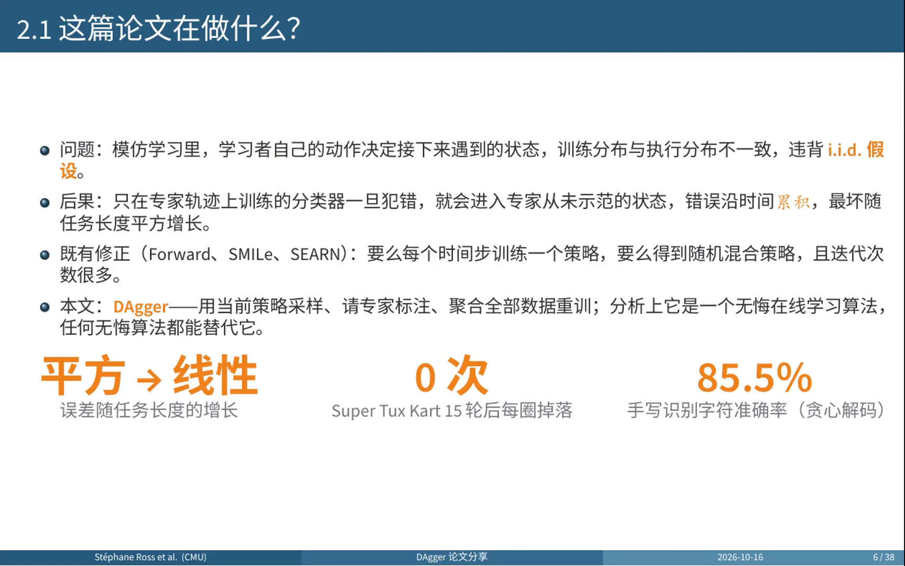
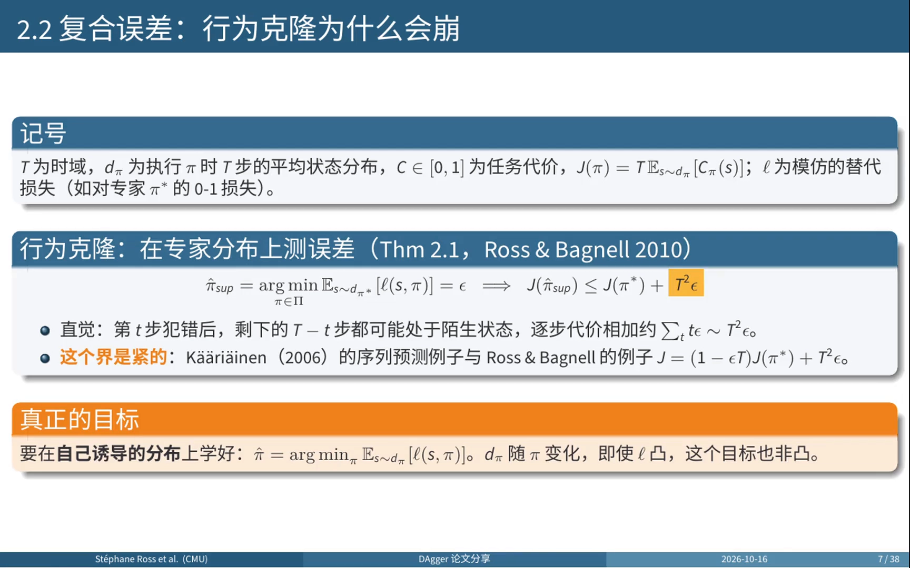
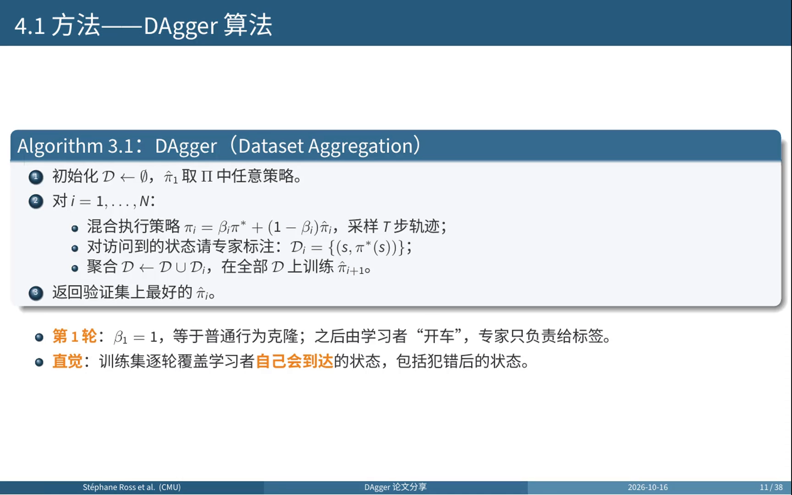
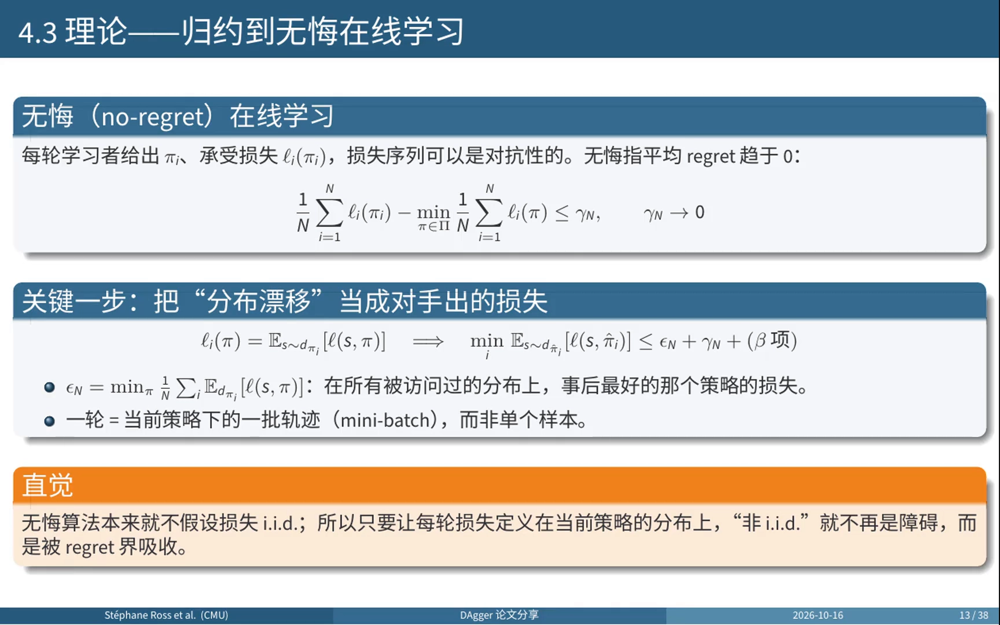
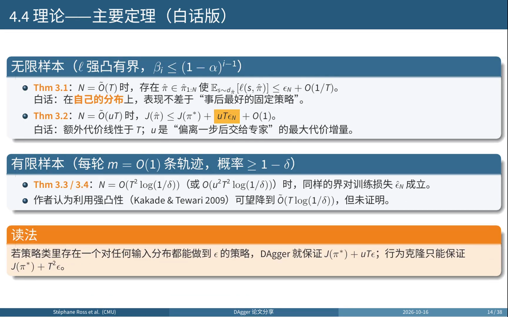
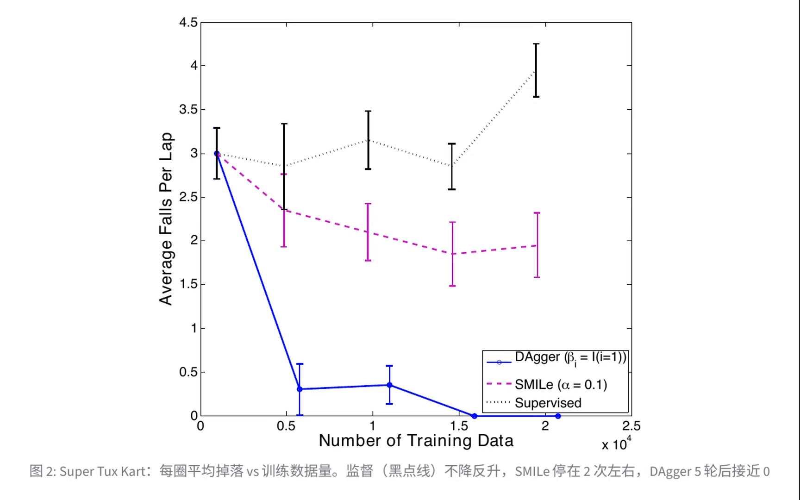
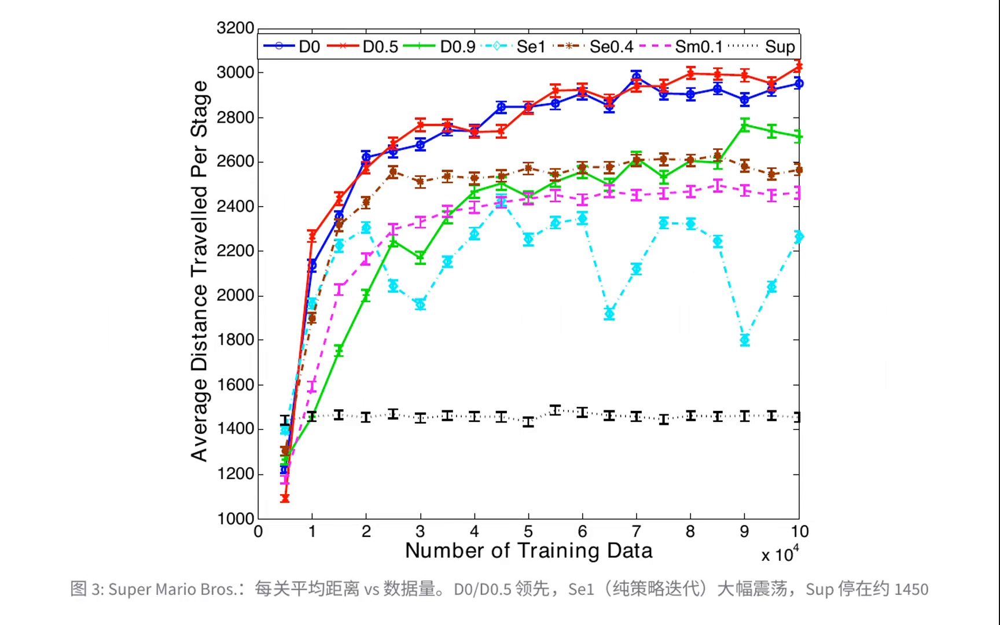
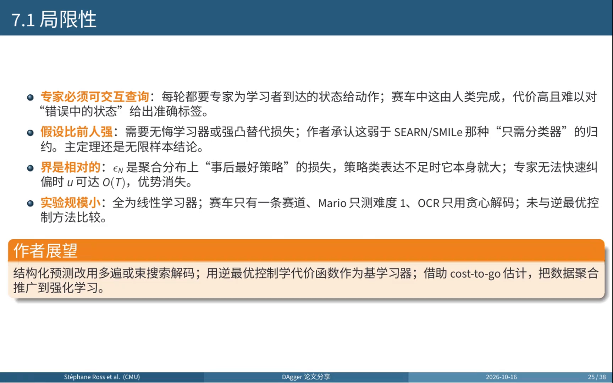
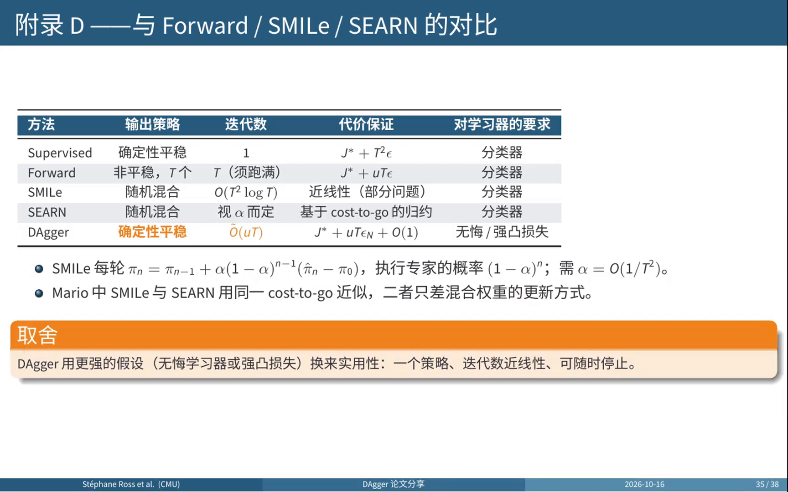
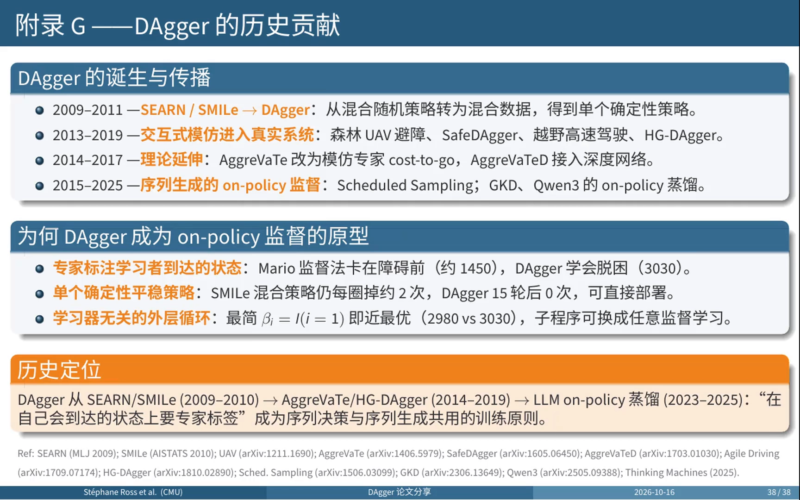

# DAgger：把模仿学习归约为无悔在线学习

> 前提：11.1 已经交代了宏观动机——奖励稀疏时，专家演示是唯一能拿到的监督信号。现在假设我们手上有一批专家轨迹 $\{(s_i, a_i)\}$，最直接的做法就是把它当成监督学习数据集来学一个策略，这叫**行为克隆**。本篇讲这条路线的技术细节：它为什么一上路就越开越偏，以及 DAgger（Ross, Gordon & Bagnell, AISTATS 2011）如何用最小的改动把误差从平方级压回线性级。

## 本讲要解决的核心问题（SCQA）

**背景**：模仿学习不要求设计奖励函数，也不一定需要与环境交互，只要专家轨迹就能学策略。行为克隆（Behavioral Cloning, BC）是这条路线里最简单的一种：输入专家看到的状态，输出专家采取的动作，像普通监督学习那样最小化预测误差。

**冲突**：验证集上单步动作的准确率很高，但把策略放进环境里连续跑一整段，它就会越走越偏、最终撞车。原因不是模型不够大，而是**训练分布和执行分布根本不是一个分布**——学习者的动作决定了它下一步会看到什么，统计学习最基本的 i.i.d. 假设在这里不成立。

**疑问**：单步误差 $\epsilon$ 到底是怎么被放大成平方级的？能不能不改学习器、只改数据来源，就把它压回线性级？

**回答（中心思想）**：BC 的缺陷不在于分类器不够强，而在于**误差测在了错误的分布上**。在专家分布上做到 $\epsilon$，只能保证总代价不超过 $J(\pi^{\ast}) + T^2\epsilon$；如果能在**策略自己诱导的分布**上做到 $\epsilon$，代价就只增加 $uT\epsilon$。DAgger 的做法是把后者变成可执行的算法：让当前策略自己跑、请专家标注它访问到的状态、把新数据并入数据集重训，并把整个过程证明为一个**无悔在线学习（no-regret online learning）**问题。

[【跳转到 02:12】](https://www.bilibili.com/video/BV14PJU6YEx7/?t=132)

---

## 一、行为克隆：把策略学习变成监督学习

行为克隆的设定可以一行写完：给定专家轨迹数据集 $D = \{(s_i, a_i)\}$，学一个参数化策略 $\pi_\theta(a \mid s)$，最小化负对数似然

$$
\theta^{\ast} = \arg\min_\theta \; -\sum_{(s_i,a_i)\in D} \log \pi_\theta(a_i \mid s_i)
$$

- **离散动作**：这就是分类问题，损失是交叉熵，模型输出每个动作的概率后经 softmax 归一化；
- **连续动作**：这就是回归问题，损失是均方误差，模型直接输出转向角、油门深度这类实数值。

它的优点是显而易见的：简单、稳定、收敛快，**完全不需要与环境交互**，也不需要设计奖励函数。正因为如此，它常被当作强化学习的初始化手段——先把策略抬到一个不差的水平，再交给 RL 去打磨。

但它默认了一件事：**训练记录里的局面，足以教会部署时需要的动作**。这个默认在闭环控制里通常不成立。

---

## 二、复合误差：单步 $\epsilon$ 为什么变成 $T^2\epsilon$

### 2.1 先把记号定下来

记 $T$ 为时域，$d_\pi$ 为执行策略 $\pi$ 时 $T$ 步的**平均状态分布**，$C(s) \in [0,1]$ 为任务代价（例如偏离车道、掉落赛道），$\ell$ 为模仿用的替代损失（例如与专家动作不一致的 0-1 损失）。总代价是

$$
J(\pi) = T \cdot \mathbb{E}_{s \sim d_\pi}\big[\,C(s) \,\big]
$$

关键在 $d_\pi$ 这个下标：**状态分布本身依赖策略**。换一个策略，走出来的状态分布就换了一套。

### 2.2 定理 2.1：在专家分布上学，只能保证平方级

行为克隆优化的目标是 $\mathbb{E}_{s\sim d_{\pi^{\ast}}}[\ell(s,\pi)]$，也就是在**专家分布**上测误差。假设它做到了 $\epsilon$：

$$
\hat\pi_{\text{sup}} = \arg\min_{\pi\in\Pi} \mathbb{E}_{s\sim d_{\pi^{\ast}}}\big[\ell(s,\pi)\big] = \epsilon
\;\;\Longrightarrow\;\;
J(\hat\pi_{\text{sup}}) \le J(\pi^{\ast}) + T^2\epsilon
$$

[【跳转到 03:07】](https://www.bilibili.com/video/BV14PJU6YEx7/?t=187)

**直觉推导**：假设在第 $t$ 步犯了一次错，此后剩下的 $T-t$ 步都可能处在专家从未示范过的陌生状态里，每一步都继续付出代价。把每一步的期望错误加起来：

$$
\sum_{t=1}^{T} (T-t)\,\epsilon \;\sim\; T^2\epsilon
$$

这个界不是保守估计，而是**紧的**：Kääriäinen（2006）在序列预测里、Ross 与 Bagnell 在模仿学习里，都构造出了真的达到平方增长的例子。也就是说，$T^2\epsilon$ 描述的是这类方法的真实病态，而不是证明技巧不够好。

### 2.3 与 10.2 的呼应：同一个结构，不同的成因

第 10 章讲基于模型的 RL 时见过一模一样的结构：单步模型误差 $\epsilon_m$ 经 $H$ 步 rollout 放大成 $O(\epsilon_m H^2)$，多出来的那个 $H$ 来自「策略在被污染的状态上继续决策」。

两处的数学形状相同，成因不同：

| 对比维度 | 10.2 模型误差 | 11.2 行为克隆 |
| :--- | :--- | :--- |
| 单步误差来自 | 学到的转移模型 $\hat P(s'\mid s,a)$ 不准 | 学到的策略 $\pi_\theta(a\mid s)$ 不准 |
| 放大机制 | 误差污染状态，后续预测建立在错状态上 | 策略偏离专家，后续决策落在没见过的状态上 |
| 谁在放大 | 环境模型的偏差 | 策略自己引起的**状态分布偏移** |
| 典型解法 | 缩短 rollout（分支短链） | 换数据来源（DAgger 聚合） |

一句话对照：**10.2 是「模型把状态带偏了」，11.2 是「策略把自己带偏了」**，两者都会让单步误差享受平方级的复利。

### 2.4 分布偏移的三种典型表现

「分布偏移」是个笼统的说法，落到具体任务上通常表现为下面三类问题：

1. **协变量偏移（covariate shift）**：输入分布变了。训练时见到的都是「车在路中间」的画面，部署时出现的是「车已经压到路肩」的画面，后者在训练集里几乎没出现过。视频里的说法是：学习者一旦犯错，就进入了专家从未示范的状态。
2. **恢复行为缺失**：专家从来没有示范过「已经偏了该怎么救回来」。赛车任务里这一点被实验直接证实——监督学习的掉落次数不随数据增加而下降，Mario 里的监督控制器则常常贴着障碍卡住，因为专家总是在很远处就起跳，数据里根本没有「贴墙」这种状态。
3. **因果混淆（causal confusion）**：策略学到的是虚假相关而不是真正的因果线索。这一条不是本文的论述，而是后来文献（de Haan et al., 2019）对 BC 失败模式的补充归纳——例如把「方向盘角度大」当成转弯的原因，而真正决定该不该转的是路况。

前两条都能被 DAgger 的「在策略自己访问到的状态上要标签」直接缓解；第三条要靠改输入表征（用历史帧而非单帧）之类的办法，属于工程层面的补丁。

---

## 三、DAgger：把分布漂移变成可逐轮修补的数据覆盖问题

### 3.1 算法：一个聚合循环加一个规约

DAgger 全称 Dataset Aggregation（数据集聚合）。算法短到可以整段背下来：

1. 初始化数据集 $D \leftarrow \varnothing$，初始策略 $\hat\pi_1$ 取策略类 $\Pi$ 中任意一个；
2. 对第 $i = 1,\dots,N$ 轮：
   - 构造混合执行策略 $\pi_i = \beta_i \pi^{\ast} + (1-\beta_i)\hat\pi_i$，用它采样 $T$ 步轨迹；
   - 对访问到的每个状态请专家标注动作，得到本轮数据 $D_i = \{(s, \pi^{\ast}(s))\}$；
   - 聚合 $D \leftarrow D \cup D_i$，在**全部** $D$ 上训练 $\hat\pi_{i+1}$；
3. 返回验证集上表现最好的 $\hat\pi_i$。

[【跳转到 04:55】](https://www.bilibili.com/video/BV14PJU6YEx7/?t=295)

第一轮 $\beta_1 = 1$，这时它退化成普通的行为克隆；从第二轮起方向盘交给学习者，**专家只负责在旁边说「这里应该怎么开」**。于是训练集会一轮一轮地覆盖学习者自己会到达的状态，包括它犯错之后才会进入的那些状态。

### 3.2 四个值得记住的设计

1. **数据聚合等价于 follow-the-leader**：每一轮选的都是在迄今所有轮损失之和上最好的策略，也就是「事后最优」（FPL）。所以聚合的不只是数据，还是一个在线学习算法的历史。
2. **专家混合参数 $\beta_i$ 是可选的理论要求**：唯一的要求是它的平均值趋于零。可以取指数衰减 $\beta_i = (1-\alpha)^{i-1}$，也可以用最简单的指示函数 $\beta_i = \mathbb{I}(i=1)$（只在第一轮用专家）。实验里后者常常就是最好的。
3. **学习器只是一个子程序**：论文里赛车用岭回归、Mario 用四个线性 SVM、OCR 用多类 SVM，连续和离散输出都能处理。DAgger 不改学习器，只改训练数据从哪来。
4. **输出单个确定性平稳策略**：既不需要 Forward Training 那样的 $T$ 个时变策略，也不需要 SMILe 那样的随机混合策略，训完可以直接部署。

### 3.3 为什么能 work：把分布漂移当成对手出的题

这是全文最漂亮的一步。在线学习里，每一轮学习者给出一个策略 $\pi_i$、承受一个损失 $\ell_i(\pi_i)$，损失序列可以是对抗性的。**无悔**指平均 regret 趋于零：

$$
\frac{1}{N}\sum_{i=1}^{N}\ell_i(\pi_i) \;-\; \min_{\pi\in\Pi}\frac{1}{N}\sum_{i=1}^{N}\ell_i(\pi) \;\le\; \gamma_N, \qquad \gamma_N \to 0
$$

作者的关键一步是把第 $i$ 轮的损失**定义为在当前执行策略诱导的分布上的模仿损失**：

$$
\ell_i(\pi) = \mathbb{E}_{s\sim d_{\pi_i}}\big[\ell(s,\pi)\big]
\;\;\Longrightarrow\;\;
\min_i \mathbb{E}_{s\sim d_{\hat\pi_i}}\big[\ell(s,\hat\pi_i)\big] \le \epsilon_N + \gamma_N + (\beta\ \text{项})
$$

[【跳转到 06:36】](https://www.bilibili.com/video/BV14PJU6YEx7/?t=396)

这里 $\epsilon_N = \min_\pi \frac{1}{N}\sum_i \mathbb{E}_{d_{\pi_i}}[\ell(s,\pi)]$，意思是「在所有被访问过的分布上，事后最好的那个策略的损失」。直觉是：**无悔算法本来就不假设损失是 i.i.d. 的**，所以只要把每轮损失定义在当前策略的分布上，「非 i.i.d.」就不再是障碍，而是被 regret 界吸收掉了。

### 3.4 主要定理：从 $T^2\epsilon$ 到 $uT\epsilon$

在无限样本、损失强凸有界、$\beta_i$ 按几何速率衰减的条件下：

- **定理 3.1**：$N = \tilde{O}(T)$ 时，存在某个 $\hat\pi$ 使 $\mathbb{E}_{s\sim d_{\hat\pi}}[\ell(s,\hat\pi)] \le \epsilon_N + O(1/T)$——在**自己的分布**上，表现不差于「事后最好的固定策略」；
- **定理 3.2**：$N = \tilde{O}(uT)$ 时，$J(\hat\pi) \le J(\pi^{\ast}) + uT\epsilon_N + O(1)$——额外代价**线性于 $T$**。

[【跳转到 07:06】](https://www.bilibili.com/video/BV14PJU6YEx7/?t=426)

$u$ 是什么？它是「**偏离一步之后交给专家，代价最多会增加多少**」。附录 A 用伸缩求和给出了证明梗概：定义一族混合策略，前 $t$ 步执行学到的策略、之后交给专家；相邻两个之间的代价差恰好是「第 $t$ 步不选学习者动作、改选专家动作」的 $Q$ 值之差；把这些差加起来，总代价等于专家代价加上这些项之和，而每一项只在两者动作不同时才非零，这个概率被 0-1 损失上界，增量又不超过 $u$，于是得到 $uT\epsilon$。

$u$ 的大小取决于任务：

- 如果代价就是对专家的 0-1 损失，$u \le 1$；
- 如果专家能在几步内把系统拉回原来的分布（例如马尔可夫链快速混合），$u$ 是常数；
- **最坏情况下 $u$ 可以是 $T$ 的量级**，此时界退化成 $T^2\epsilon$，与行为克隆无异。

换句话说，DAgger 的线性保证是**有条件的**：它依赖「专家能快速纠偏」这个前提。

有限样本时（每轮只采 $m = O(1)$ 条轨迹），定理 3.3/3.4 说轮数达到 $N = O(T^2\log(1/\delta))$ 时同样的界以 $1-\delta$ 的概率对训练损失成立。作者认为利用强凸性可以降到 $\tilde{O}(T\log(1/\delta))$，但没有证明。附录 C 的证明要点是：定义每条样本轨迹上平均损失与期望损失之差，按轮次和样本顺序排列，它们构成有界的**鞅差序列**，于是可以用 Azuma-Hoeffding 不等式——这里必须用鞅版本，因为每一轮的数据都依赖前面训练出来的策略，样本之间并不独立。

---

## 四、实验：同样的学习器，只改数据从哪里来

三个任务都刻意使用线性学习器，目的是让差距来自数据而不是模型容量：

| 任务 | 输入与学习器 | 指标 |
| :--- | :--- | :--- |
| Super Tux Kart（Star Track 赛道） | 800×600 画面缩到 25×19 灰度像素，岭回归，5 Hz 输出转向 | 每圈平均掉落次数 |
| Super Mario Bros. | 27152 维稀疏二值特征，四个线性 SVM | 每关前进距离（满程约 4200~4300） |
| 手写识别（OCR） | 8×16 像素 + 前一字母 26 位编码，多类 SVM，贪心解码 | 字符准确率 |

Star Track 悬在太空中，两侧就是虚空，任何一次偏离都可能直接掉落，所以这个任务对复合误差特别敏感；Mario 则要求躲避敌人、跳过沟壑，而且必须在时限内前进。两者的共同点是：**策略的每一个动作都会直接决定下一帧画面**。

[【跳转到 10:30】](https://www.bilibili.com/video/BV14PJU6YEx7/?t=630)

[【跳转到 11:50】](https://www.bilibili.com/video/BV14PJU6YEx7/?t=710)

主表的关键数字：

- **赛车**：监督学习每圈掉 3~4 次且不随数据增加而下降，SMILe 20 轮后约每圈 2 次，**DAgger 15 轮后为 0**；
- **Mario**：监督学习约 1450，SMILe 约 2460，最好的 SEARN（$\alpha = 0.4$）约 2560，DAgger 用 $\beta$ 按 0.5 衰减达到 **3030**，用最简单的指示函数也有 2980；
- **手写识别**：不用结构的 SVM 82%，监督学习 83.6%，SMILe 约 84.7%，DAgger **85.5%**。

三条曲线在最左侧的起点完全相同，因为第一轮大家都只是在专家数据上训练，**差别完全来自之后数据从哪里来**。

四个观察值得单独记住：

1. **监督学习越学越不动**：赛车的训练圈彼此很相似，学不到如何从错误中恢复；Mario 中监督控制器常常贴着障碍卡住，因为数据里根本没有贴墙的状态。
2. **随机混合有代价**：SMILe 20 轮后仍约每圈掉两次，部分原因是混合策略偶尔会抽到差的成员；DAgger 5 轮后就几乎不掉，而且转向更平滑。
3. **专家扶持参数 $\beta$ 有实际作用**：Mario 中按 0.5 衰减得到 3030，略好于指示函数的 2980（纯学习者在早期会大量踩到卡在原地的重复数据）；按 0.9 衰减则收敛明显变慢。
4. **纯策略迭代是否稳定取决于任务**：SEARN 取 $\alpha = 1$ 时在 Mario 中剧烈震荡，在 OCR 中却和 DAgger 相当。规律是：**策略对自身输入的影响越大，保留历史数据就越重要**。

---

## 五、代价与边界：专家必须在线

DAgger 的局限主要有四点：

- **专家必须可交互查询**：每一轮都要专家为学习者到达的状态给出动作。赛车任务里这由人类完成，代价高，而且人很难在没有亲自操控的情况下给出准确标签。
- **假设比前人更强**：需要无悔学习器或强凸的替代损失。作者自己承认这弱于 SEARN/SMILe 那种「只需分类器」的规约，而且主定理是无限样本结论。
- **界是相对的**：$\epsilon_N$ 是聚合分布上「事后最好策略」的损失，策略类表达力不足时它本身就大；专家无法快速纠偏时 $u$ 可达 $O(T)$，优势消失。
- **实验规模小**：全是线性学习器，赛车只有一条赛道、Mario 只测难度 1、OCR 只用贪心解码，也没有和逆最优控制方法比较。

[【跳转到 12:45】](https://www.bilibili.com/video/BV14PJU6YEx7/?t=765)

「专家必须在线」这一条直接催生了工程变体，它们都在回答同一个问题：**怎么少问专家**。

- **HG-DAgger（Human-Gated DAgger）**：人类安全员决定何时接管，只在接管时提供纠正动作，把「全程标注」变成「按需标注」；
- **SafeDAgger**：先用一个安全策略判断当前状态是否已经偏离，只在偏离时才查询专家，减少驾驶中对专家的查询次数；
- **ThriftyDAgger**：用集成模型的分歧估计不确定性，只在「不确定且接近失败」时才问专家；
- **SIRIUS**：让多个专家各自负责擅长的状态区域，学生按当前情况向对应的专家请教。

这些变体的共同点是保留 DAgger 的核心结构（**学生跑、专家标、数据聚合**），只把「何时问专家」做成一个可调的策略。

[【跳转到 17:28】](https://www.bilibili.com/video/BV14PJU6YEx7/?t=1048)

这张表把取舍讲清楚了：**前几种方法只要求分类器，而 DAgger 需要无悔学习器或强凸损失——它用更强的假设换来了实用性**：一个策略、近线性的迭代数、可以随时停止。

---

## 六、与后面两条路线的分岔

模仿学习有三条主要技术路线，本篇只走了第一条：

- **行为克隆 / DAgger（本篇）**：直接学策略 $\pi(a\mid s)$，把模仿做成监督学习。缺的是「在自己出错的地方的标签」。
- **逆强化学习（11.3）**：先从专家行为反推一个奖励函数 $R(s,a)$，再用这个奖励跑正向 RL。好处是奖励可以迁移到新任务，代价是双层优化、计算昂贵。
- **生成对抗模仿学习（11.4）**：不显式学奖励，而是用判别器对抗地匹配专家与学习者的**占用度量（occupancy measure）** $\rho_\pi(s,a)$——任何策略对应一个状态-动作分布，只要这个分布对上了，策略也就学到了。

三者的关系可以用一句话概括：**BC 匹配动作，IRL 匹配奖励，GAIL 匹配分布**。DAgger 的位置很特殊：它仍然是 BC 家族（学的是动作标签），但它把「分布」这件事通过数据聚合补上了。

[【跳转到 20:38】](https://www.bilibili.com/video/BV14PJU6YEx7/?t=1238)

这条思想后来跑得很远：AggreVaTe 把「模仿专家动作」改成「模仿专家的 cost-to-go」，AggreVaTeD 接入深度网络；Scheduled Sampling 用它处理序列生成的暴露偏差；GKD 把语言模型蒸馏视为「带交互专家的模仿学习」，Qwen3 技术报告与 Thinking Machines 的 on-policy 蒸馏博客也沿用了同一做法。

---

## 小结

- **行为克隆的缺陷不在分类器，而在误差测在哪里**：在专家分布上做到 $\epsilon$，只能保证 $J(\pi^{\ast}) + T^2\epsilon$。
- **平方级来自状态分布的自反馈**：第 $t$ 步犯错后，剩余 $T-t$ 步都在陌生状态里，求和得到 $T^2\epsilon$；这个界是紧的，有构造性反例。
- **DAgger 只改数据来源**：学生自己跑 → 专家标注它访问到的状态 → 聚合全部数据重训，$\beta_i$ 从 1 衰减到 0。
- **理论保证来自归约**：把第 $i$ 轮损失定义在当前策略诱导的分布上，分布漂移就变成对抗性损失，被 regret 界吸收，于是 $T^2\epsilon$ 变成 $uT\epsilon$。
- **线性保证是有条件的**：$u$ 衡量「偏离一步后交给专家，代价最多增加多少」，最坏情况下 $u$ 可达 $O(T)$，优势消失。
- **代价是专家必须在线**：HG-DAgger、SafeDAgger、ThriftyDAgger、SIRIUS 都在把「何时问专家」做成可调策略。
- **同预算下的一致胜出**：赛车零掉落对 SMILe 的约两次，Mario 3030 对监督的约 1450，OCR 85.5% 对 83.6%。

如果只记一句话：**模仿学习缺的不是更强的分类器，而是学习者自己会到达的状态上的专家标签；DAgger 用一个「跑—标注—再训」的循环拿到它们，并证明这正是无悔在线学习。**

## 关键术语速查

| 术语 | 一句话解释 |
| :--- | :--- |
| 行为克隆（Behavioral Cloning, BC） | 把专家轨迹当监督数据集，直接学 $\pi_\theta(a\mid s)$，不需要环境交互与奖励设计 |
| 复合误差（compounding error） | 单步误差 $\epsilon$ 经 $T$ 步放大成 $O(T^2\epsilon)$：犯错后进入没见过的状态，错误继续累积 |
| 状态分布 $d_\pi$ | 执行策略 $\pi$ 时 $T$ 步的平均状态分布；换策略就换分布，这是 BC 病根 |
| 协变量偏移（covariate shift） | 训练与部署的输入分布不一致，例如训练只有「车在路中间」的画面 |
| 恢复行为缺失 | 专家从未示范「已经偏了怎么救回来」，策略在偏离状态上没有正确标签 |
| 因果混淆（causal confusion） | 策略学到虚假相关而非因果线索（de Haan et al., 2019 的归纳） |
| DAgger（Dataset Aggregation） | 用当前策略采样、请专家标注访问到的状态、聚合全部数据重训的迭代式模仿学习 |
| 混合执行策略 $\pi_i = \beta_i\pi^{\ast} + (1-\beta_i)\hat\pi_i$ | 以 $\beta_i$ 的概率听专家的，其余时候用学到的策略；$\beta_i$ 平均值趋于零即可 |
| 无悔在线学习（no-regret） | 平均损失与事后最好固定策略之差（regret）随轮数趋于零，不假设损失 i.i.d. |
| follow-the-leader（FPL） | 每轮选「迄今所有轮损失之和最小」的策略，DAgger 的数据聚合等价于此 |
| $u$（纠偏代价系数） | 偏离一步后改由专家接管，代价最多增加多少；最坏情况 $u = O(T)$ |
| $\epsilon_N$ | 在所有被访问过的分布上、事后最好的策略的损失，是 DAgger 界的「相对基准」 |
| HG-DAgger / SafeDAgger | 只在人类安全员接管或判定不安全时才查询专家的 DAgger 变体 |
| AggreVaTe | 把「模仿专家动作」改成「模仿专家的 cost-to-go」的后续工作 |