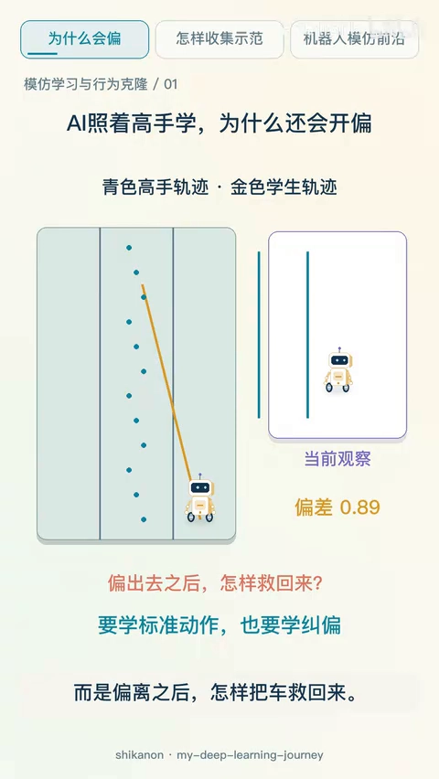
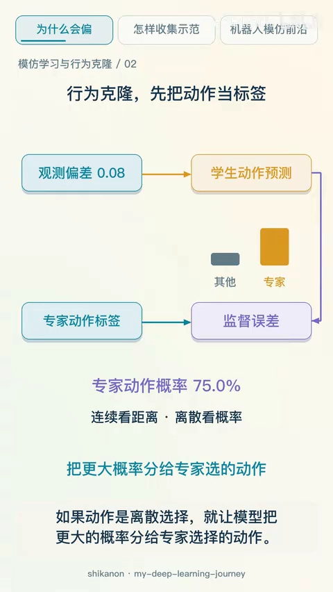
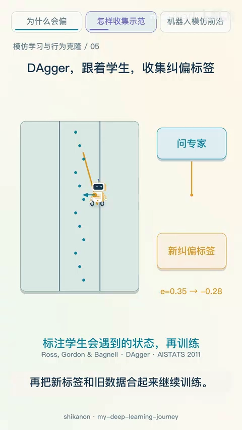
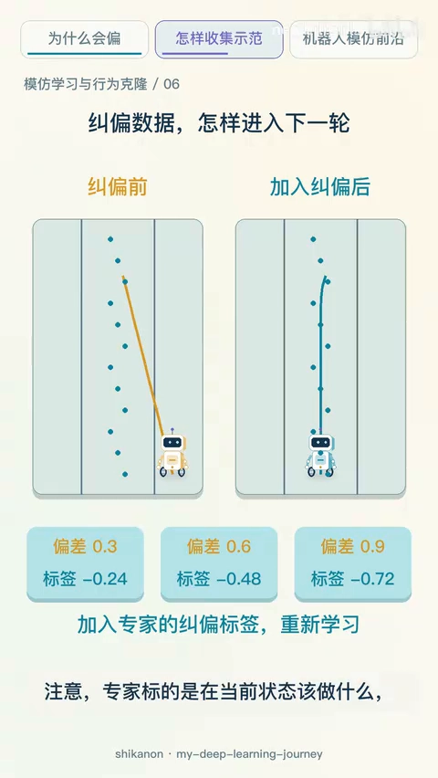
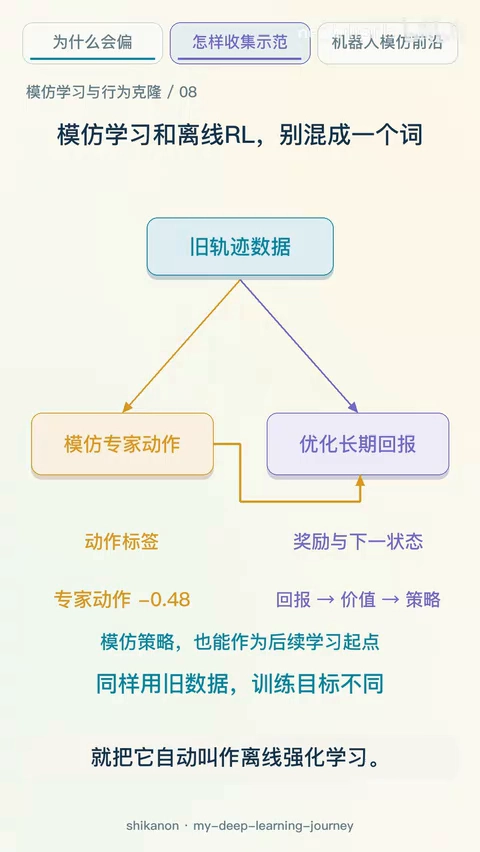
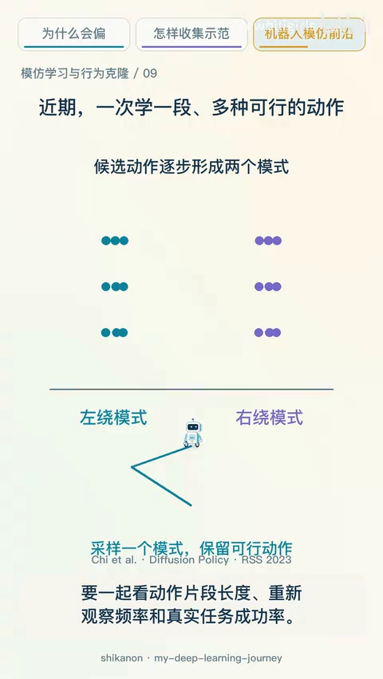

# 行为克隆为何越开越偏：多峰动作与纠偏数据

> 承接 11.2 的主线：上一篇从论文的角度给出了 $T^2\epsilon$ 的定理与 DAgger 的线性界，这一篇用五分钟的动画把同一件事讲成直觉——为什么闭环会越走越偏、为什么「平均两个好动作」会得到坏动作、以及 DAgger 到底在收集什么数据。

## 本讲要解决的核心问题（SCQA）

**背景**：模仿学习里最直接的做法是行为克隆——输入专家当时看到的东西，输出专家当时采取的动作，像普通监督学习那样减小预测误差。它不需要设计奖励函数，也不一定需要强化学习。

**冲突**：专家的车一直开在路中间，训练数据也大多来自中间。新司机稍微偏了一点，眼前就出现专家很少遇到的局面；他再做一个不合适的动作，就会更偏。这时缺的可能不是更多同样的标准路线，而是**偏离之后怎样把车救回来**。

**疑问**：一个在验证集上单步动作很准的策略，为什么连续开一整段就崩？问题出在数据、模型，还是评估方式？

**回答（中心思想）**：问题出在**数据覆盖**。开车时一个转向动作会改变之后的位置和视角，于是小错误改变了状态分布，新状态又更容易犯错——这是一个正反馈。DAgger 的贡献不是换模型，而是换**收集数据的方式**：让学生自己跑，在它真正会走到的状态上请专家标注，再把纠偏样本并进数据集重训。

[【跳转到 00:00】](https://www.bilibili.com/video/BV1q8JD6WE4z/?t=0)

---

## 一、行为克隆：把动作当标签

行为克隆的输入是专家当时看到的东西，输出是专家当时采取的动作，训练目标就是普通的监督学习目标：

- 动作是**连续数值**（方向盘转角、油门深度）时，比较预测动作与专家动作的距离，用均方误差；
- 动作是**离散选择**（上下左右）时，让模型把更大的概率分给专家选择的动作，用交叉熵。

[【跳转到 00:25】](https://www.bilibili.com/video/BV1q8JD6WE4z/?t=25)

这条路线不要求先设计一套完整的奖励，也不一定需要强化学习，但它默认了一件事：**训练记录里的局面，足以教会部署时需要的动作**。这个默认在闭环控制里通常不成立。

---

## 二、闭环为什么越走越偏

普通图片分类时，一张图判断错了，通常不会把下一张图推到更难的位置；开车不同——**一个转向动作会改变之后的位置和视角**。于是小错误改变了状态分布，新状态又更容易犯错，形成反馈。

这带来两个直接后果。

**第一，验证集上的单步准确率不能推出闭环可靠性。** 评估必须把策略放进闭环，让它自己行动，再看它真实到过哪些状态、是否成功、以及怎样失败。

**第二，数据里缺的往往正是「救回来」的样本。** 专家开得很稳，训练数据集中在路中间；一旦学生偏出去，金色轨迹上的那些状态在数据集里几乎没有对应标签。

这就是上一篇里 $T^2\epsilon$ 的直觉版本：第 $t$ 步犯错之后，剩下的每一步都在陌生状态里，错误不是线性叠加而是滚雪球。

---

## 三、多峰动作：平均两个好动作，可能得到坏动作

还有一个容易忽略的问题：**同一个障碍，向左绕和向右绕都可以**。

如果训练记录把这两种动作混在一起，而模型只用均方误差输出一个平均值，结果可能是直走——左转和右转方向相反，把这两种动作取平均，左右相互抵消得到 0，而 0 意味着直行，机器人反而撞上障碍。

[【跳转到 01:40】](https://www.bilibili.com/video/BV1q8JD6WE4z/?t=100)

所以这里需要的是**表达多个可行动作的分布**，而不是把它们强行压成一个答案。这是行为克隆的第二类失败：第一类是「没见过这个状态」，第二类是「见过，但把多个合理答案平均成了一个坏答案」。

---

## 四、DAgger：跟着学生收集纠偏标签

2011 年的 DAgger 把收集数据的方式改了：

1. 先用示范训练一个策略（也就是行为克隆）；
2. 让这个策略在环境里行动，跑到**学生自己会遇到的局面**；
3. 请专家标注这些状态下此时该做什么；
4. 把新标签和旧数据合起来，继续训练，进入下一轮。

[【跳转到 02:30】](https://www.bilibili.com/video/BV1q8JD6WE4z/?t=150)

重点不是「只让专家多开几圈」，而是**问学生真正容易走到的状态**。只拿青色区域训练，偏出去之后的正确转向很少出现；沿金色轨迹挑几个状态请专家给出回到路线的动作，把这些状态和动作加入数据集，下一轮训练看到了纠偏样本，新的学生轨迹才有机会靠近路线。

[【跳转到 03:20】](https://www.bilibili.com/video/BV1q8JD6WE4z/?t=200)

两个容易搞混的细节：

- 专家标的是**在当前状态该做什么**，不是把学生过去做错的动作也标成正确；
- 专家需要**持续**提供标签，这是 DAgger 最主要的成本；而且真实机器人的危险动作，不能靠算法名字保证安全。

---

## 五、边界：模仿学习不是离线强化学习

示范数据同时能喂给两类方法，但目标不同：

- **行为克隆**直接问专家「在这个局面选什么」，学的是动作标签；
- **离线强化学习**通常利用奖励，估计什么动作能让**长期回报**更高。

模仿得到的策略也可以成为后续强化学习的起点。但要注意两点：没有奖励标签不等于一概不能用离线算法，具体取决于目标和补充信息；也不能因为模型是从旧轨迹训练的，就把它自动叫做离线强化学习。

[【跳转到 04:35】](https://www.bilibili.com/video/BV1q8JD6WE4z/?t=275)

---

## 六、前沿与三条待解问题

机器人操作的示范往往有多个合理做法。**扩散策略**把动作生成看成一个逐步去噪的问题，可以表示复杂的动作分布，并一次预测一段动作，它有助于处理前面「左右都可行」的多峰情况。

[【跳转到 05:00】](https://www.bilibili.com/video/BV1q8JD6WE4z/?t=300)

但不能仅凭输出更丰富，就认为消除了闭环分布偏移。另一个问题是执行频率：预测一段动作可以更平滑，却可能对突然变化反应更慢，要一起看**动作片段长度、重新观察频率和真实任务成功率**。

2025 年的 π0.5 用机器人数据、语言和其他多种数据联合训练，研究视觉-语言-动作模型在新环境中的泛化。它说明示范学习正在走向更广的数据和任务；不过作者展示的新环境结果，不代表所有陌生物体和场景都已解决。

三条值得继续关注的问题：**纠偏样本怎么收集、动作分布怎样表达、进入新环境后如何发现失败。**

---

## 小结

- **行为克隆就是监督学习**：连续动作比距离、离散动作比概率，不需要奖励函数，但默认训练记录足以覆盖部署时的局面。
- **闭环会放大错误**：动作改变下一次输入，小错误改变状态分布，新状态更容易犯错，形成正反馈。
- **评估必须闭环**：验证集单步准确率高，推不出连续开一整段可靠。
- **多峰动作不能取平均**：左绕 −1 与右绕 +1 平均为 0，也就是直行撞上去；要表达分布而不是压成一个答案。
- **DAgger 改的是数据来源**：学生自己跑 → 在它访问到的状态上请专家标注 → 并入数据集重训，重点是拿到纠偏样本。
- **代价是专家必须持续标注**，且真实机器人的安全性不能靠算法名字保证。
- **模仿学习不等于离线强化学习**：前者学动作标签，后者用奖励优化长期回报，二者可以接力。

如果只记一句话：**学高手不仅要学标准动作，更要学自己偏出去时该怎样回来。**

## 关键术语速查

| 术语 | 一句话解释 |
| :--- | :--- |
| 行为克隆（Behavioral Cloning） | 把专家轨迹当监督数据集直接学 $\pi_\theta(a\mid s)$，不需要奖励与环境交互 |
| 闭环评估（closed-loop evaluation） | 让策略自己在环境里连续行动，看它真实到过哪些状态，而不是只看单步预测准确率 |
| 状态分布偏移 | 策略的动作改变后续输入分布，训练时见过的状态与部署时遇到的状态不一致 |
| 多峰动作（multimodal action） | 同一状态下有多个都合理的动作，用均方误差回归会把它们平均成一个不可行的动作 |
| 扩散策略（Diffusion Policy） | 把动作生成看作逐步去噪，能表示复杂的多峰动作分布，并一次预测一段动作 |
| DAgger | 让学生自己跑、请专家标注它访问到的状态、把新数据并入数据集重训的迭代式模仿学习 |
| 纠偏样本（corrective data） | 在「已经偏出去」的状态上由专家给出的「该怎样回到路线」的动作标签 |
| 离线强化学习（Offline RL） | 只用固定数据集、借助奖励估计长期回报来优化策略，与模仿动作标签的目标不同 |