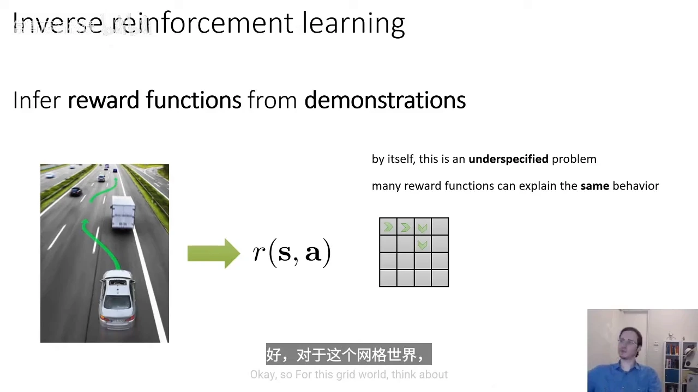
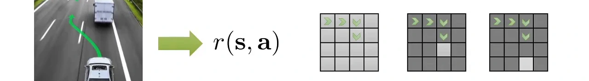
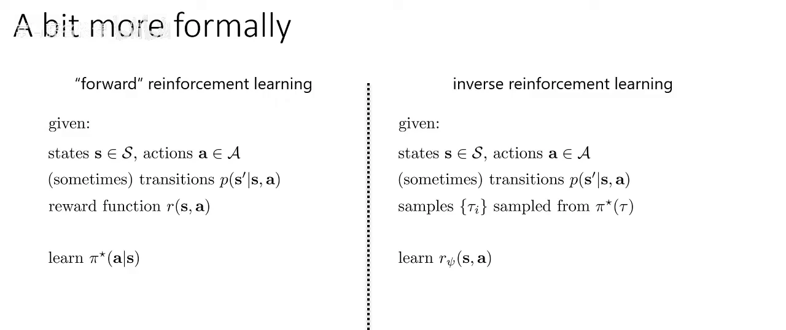
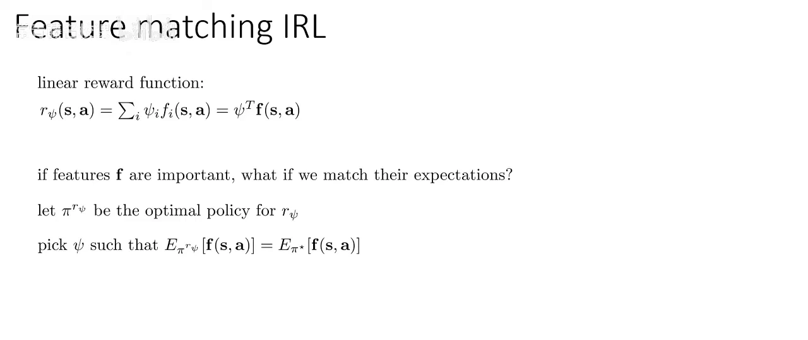
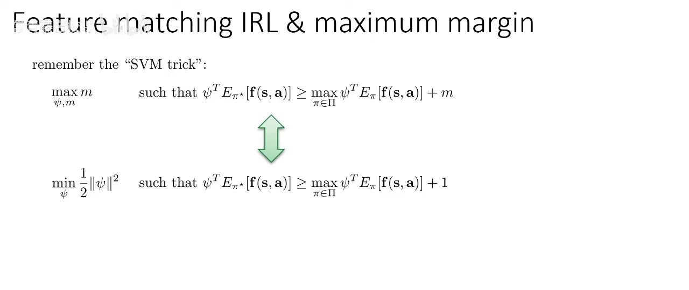
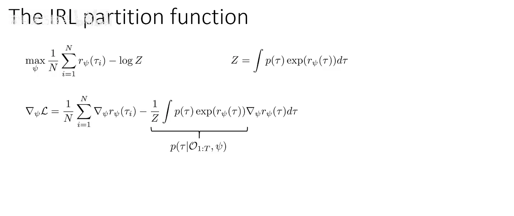
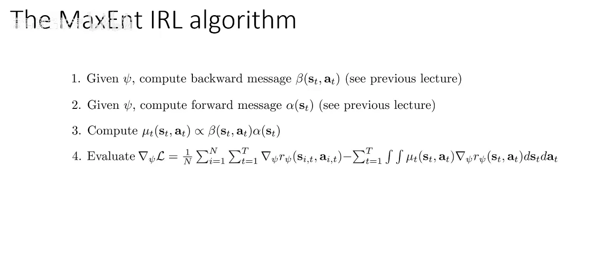
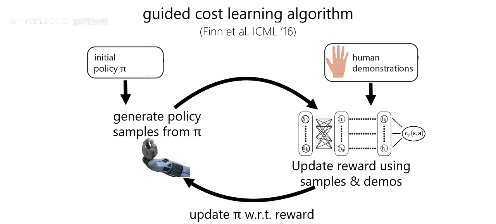
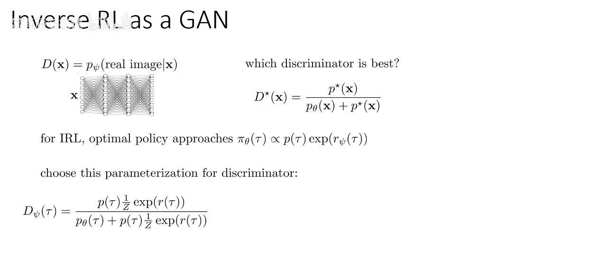
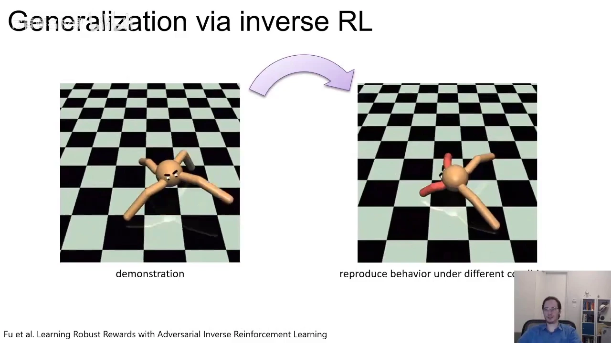

# 逆强化学习 IRL：从行为反推奖励函数

> 本篇整理自 Berkeley CS285《深度强化学习》2023 年第 20 讲「逆强化学习」（[BV16t7h6KEUW](https://www.bilibili.com/video/BV16t7h6KEUW/) 第 20 讲第 1~4 部分，约 40 分钟，Sergey Levine 主讲）。
>
> 11.1 交代了「奖励稀疏 → 换监督信号」的动机与 BC / IRL / GAIL 的路线地图，11.2 讲清了行为克隆的 $T^2\epsilon$ 复合误差与 DAgger 的纠偏。本篇接着往下一层走：**既然行为克隆直接学策略会漂移，能不能反过来先把奖励学出来，再用强化学习重新优化？** 这就是逆强化学习（Inverse Reinforcement Learning, IRL）。本篇讲透三件事——IRL 为什么是「不适定」问题、特征匹配与学徒学习怎么试图消除歧义、最大熵 IRL 怎么把它变成良定义的概率模型并给出可计算的梯度。GAIL 只在本篇末尾指出它与 IRL 的等价关系，推导留给 11.4。
>
> 文中「势函数等价类」（第 2.3 节）与「学徒学习的投影算法」（第 3.4 节）两处依据 Ng & Russell (2000)、Ng, Harada & Russell (1999)、Abbeel & Ng (2004) 的标准结论补足，讲座未展开，已在对应位置注明出处；其余内容均来自上述讲座。

## 本讲要解决的核心问题（SCQA）

**背景**：前面十章都在做同一件事——给定奖励函数，求最优策略。11.1 说明真实任务里奖励常常写不出来（撞墙扣几分？撞人扣几分？），于是改用专家演示作为监督信号；11.2 说明最直接的做法行为克隆把演示当监督学习，单步误差 $\epsilon$ 在闭环里会被放大成 $T^2\epsilon$。

**冲突**：行为克隆学的是「专家在这个状态下做了什么」，它把因果搞反了——专家之所以那样做，是因为背后有一个奖励函数。照搬动作有两个后果：一是环境一变（机器人坏了一条腿、道路改了）就失效，因为动作是绑在旧动力学上的；二是它无法解释「专家为什么这么做」，所以遇到专家没演示过的状态就无计可施。而人类模仿别人时并不是这样：我们看懂对方想要什么，然后用**自己的**方式去达成同一个目标。

**疑问**：能不能从演示里把奖励函数反推出来？为什么这件事在数学上是个「不适定」问题？怎么把它变成一个能算的优化问题，代价又是什么？

**回答（中心思想）**：IRL 把奖励函数当作未知参数、把演示轨迹当作观测，用**极大似然**去反推奖励——于是「学奖励」变成了标准的统计学习问题。难点有两层：**第一层是不适定性**，能解释同一段演示的奖励函数有无穷多个（最极端的是「专家做什么就给高分」的指示函数），所以必须加先验或正则；**第二层是配分函数**，极大似然的目标里含一个要对所有轨迹求和的归一化项，直接算不出来。最大熵 IRL 用「软最优」概率模型同时解决这两件事：它把轨迹概率定义成 $\propto \exp(r_\psi(\tau))$，用最大熵原理在「能解释专家的所有奖励」里挑熵最大的那个，并把梯度化简成一句极漂亮的话——**专家策略下的特征期望，减去当前策略下的特征期望**。代价是双层优化：外层更新奖励，内层每次都要在该奖励下解一次 RL。引导代价学习（Guided Cost Learning）用「惰性策略优化 + 重要性采样」把这个内层开销压下来，而 GAIL 干脆用判别器绕过显式奖励，直接匹配占用度量（11.4）。

[【跳转到 05:24】](https://www.bilibili.com/video/BV16t7h6KEUW/?p=82&t=324)

---

## 一、为什么要把「学策略」换成「学奖励」

### 1.1 奖励比策略更本质

讲座给的第一个理由是**抽象层级**：策略是「在这个状态下做这个动作」，奖励是「什么值得追求」。两者的映射关系是严重不对称的：

- **一个奖励可以导出多个策略**。同一个奖励函数下，不同的算法、不同的随机种子、甚至同一个最优策略的不同等价实现，都能拿到同样高的回报。所以奖励是「多对一」地决定策略。
- **一个策略可能对应无数个奖励**。这正是后面第二节要讲的不适定性。反过来看，这句话也说明：策略携带的关于「目标」的信息，远比奖励少。

所以学会奖励之后，你拿到的是一个**与动力学解耦的目标**：环境变了、机器人坏了，只要目标没变，就可以在新环境里用 RL 重新优化这个奖励，得到「用另一种方式达成同一件事」的行为。而行为克隆给出的动作是绑死在旧动力学上的，环境一变就作废。

讲座用一段心理学实验的录像说明人类是怎么做的：实验者当着一个孩子的面，用一种笨拙的方式（手被占住，只能用头或脚）去够一个玩具；然后让孩子自己来。孩子不会照搬「用头去顶」这个动作，而是直接用手把玩具拿起来——**孩子复制的是意图，不是动作**。讲座的原话是：你会观察对方、搞懂他想干嘛，然后模仿他的意图；这可能让智能体采取和专家完全不同的动作，结果却一样。

### 1.2 什么时候奖励写不出来

讲座把「为什么要学奖励」落到两个具体场景：

- **游戏类任务**：奖励是天然的——分数就显示在画面上，把游戏分数当奖励很合理。这类任务不需要 IRL。
- **现实任务**：奖励写不出来。自动驾驶要在「到达目的地」「保持车速」「不违章」「不惹恼其他司机」之间做权衡，想写一个公式把这些因素调到「既安全又舒服」，非常难；但让专业司机演示一遍，非常容易。

这就是 IRL 的适用面：**奖励难写、但能示范**。机器人操作、自动驾驶、步态模仿都属于这一类。

### 1.3 与 11.2 的分工：一条慢而稳的路

把三条路线放在一起看，IRL 的位置很清楚：

| 路线 | 学什么 | 误差/代价 | 环境变化后 |
| :--- | :--- | :--- | :--- |
| 行为克隆（11.2） | 策略 $\pi(a \mid s)$ | 复合误差 $O(T^2\epsilon)$，闭环会漂移 | 动作绑在旧动力学上，通常失效 |
| 逆强化学习（本篇） | 奖励 $r_\psi(s,a)$ | 双层优化，每次更新奖励都要解一次 RL | 奖励与动力学解耦，可重新优化 |
| GAIL（11.4） | 策略（隐式匹配占用度量） | 对抗训练不稳定，但省掉内层 RL | 不恢复奖励，泛化性弱于 IRL |

一句话概括：**BC 快但会漂移，IRL 慢但泛化好，GAIL 用对抗训练把 IRL 的内层 RL 省掉**。本篇讲中间那条。

---

## 二、不适定性：同一段演示对应无数个奖励函数

这是 IRL 最核心的难点，也是讲座花最多时间铺垫的地方。

### 2.1 一个 16 格的网格世界

讲座刻意用一个**没有任何语义**的例子：一个 4×4 的网格世界，智能体走了一段四步的轨迹（画面上用箭头标出）。问题很简单：**执行这段轨迹的智能体，它的奖励函数是什么？**

为什么不用自动驾驶的例子？因为人一眼就能从「车在高速上」读出大量语义——交通规则、别的车、GPS 坐标。而算法读不到这些语义。讲座的类比很到位：这就像 11.1 提到的蒙特祖玛的复仇，人类知道「拿到钥匙能开门」，算法只看到一堆像素。所以要看清楚「反推奖励」这件事本身的数学困难，必须先把语义剥掉。

答案是什么？讲座给了至少三种都能解释这段演示的奖励函数：

[【跳转到 06:39】](https://www.bilibili.com/video/BV16t7h6KEUW/?p=82&t=399)

1. **终点大奖**：走到这个特定方格给大奖，其他位置奖励极差；
2. **下半区高奖励**：把网格下半部分的奖励整体抬高，也能让智能体走这条路；
3. **深色格惩罚**：只对穿越深色格给惩罚，同样能解释。

还可以更极端：**一个退化的指示函数**——对演示之外的任何动作给负无穷奖励。这个奖励「完美解释了数据」，却毫无泛化能力：它没有学到任何关于任务的规律，只是把演示背了下来。这正是 11.2 里行为克隆的奖励版对应物——**记忆而不是理解**。

讲座的结论是一句很重的话：**一般来说，有无数种奖励函数能让观察到的行为在传统意义上最优**。这就是不适定性（ill-posedness）。

### 2.2 把问题形式化：正向 vs 逆向

要谈怎么消除歧义，先得把问题写清楚。讲座把正向 RL 和逆向 RL 并排放在一张幻灯片上：

[【跳转到 07:41】](https://www.bilibili.com/video/BV16t7h6KEUW/?p=82&t=461)

两边共享的前提是状态空间 $\mathcal{S}$、动作空间 $\mathcal{A}$，以及（有时）转移概率 $p(s' \mid s,a)$。差别只在「给什么、求什么」：

- **正向 RL**：给定奖励函数 $r(s,a)$，求最优策略 $\pi^\star(a \mid s)$；
- **逆向 RL**：给定由最优策略采样出的轨迹样本 $\{\tau_i\}$，求奖励函数 $r_\psi(s,a)$。

注意这里有一个隐含假设：**演示来自最优策略（或它的近似）**。这个假设是后面所有方法的出发点，也是「质量依赖专家」（11.1 第三节）在数学上的体现。

奖励函数怎么参数化？讲座给了两代答案：

$$
r_\psi(s,a) = \psi^{\mathsf{T}} \mathbf{f}(s,a)
$$

这是传统 IRL 文献里的**线性奖励**：$\mathbf{f}(s,a)$ 是人工设计的特征向量，$\psi$ 是待学的权重。直观上，特征就是「智能体可能想要或不想要的各种东西」，而 $\psi$ 要回答的是「它对每件事到底有多想要」。到了深度强化学习时代，$\psi$ 直接变成神经网络的参数，$r_\psi(s,a)$ 变成非线性标量输出。

恢复出奖励之后，通常还要用它再跑一遍 RL 拿到策略 $\pi$——这就是「双层」的由来。

### 2.3 可辨识性的硬限制：奖励只能被辨识到「差一个势函数」

即使不谈「无穷多个」，还有一个更硬的结论：**有些差别在原理上就辨识不出来**。

设 $\Phi: \mathcal{S} \to \mathbb{R}$ 是任意一个状态上的标量函数（称为**势函数**），构造新奖励

$$
R'(s,a,s') = R(s,a,s') + \gamma\,\Phi(s') - \Phi(s)
$$

（这里把奖励写成依赖后继状态 $s'$ 的形式，因为势函数差需要 $s'$；第二节里 $r(s,a)$ 的写法是同一件事的简化。）

则**最优策略完全不变**。（依据标准结论补足：Ng, Harada & Russell 1999 的「奖励变换下的策略不变性」定理；讲座未展开，但 Ng & Russell 2000 的 IRL 论文正是以它为可辨识性讨论的出发点。）

证明只有两行：把新奖励代进贝尔曼方程，可以验证新动作价值函数恰好等于

$$
Q'(s,a) = Q(s,a) - \Phi(s)
$$

减掉的 $\Phi(s)$ 与动作 $a$ **无关**，所以在同一个状态内比较不同动作时，它被完全抵消，$\arg\max_a Q'(s,a) = \arg\max_a Q(s,a)$。

这条结论的意义是双面的：

- **好消息**：奖励塑形（11.1 第 2.1 节）只要写成势函数差的形式，就既能加速学习又不会改变最优解——这是工程上可以放心用塑形的理论依据。
- **坏消息**：IRL 从演示里恢复奖励时，**只能恢复到「差一个势函数」的等价类**。你和真实奖励之间的差别，只要是一个势函数差，就永远无法从行为里区分出来。这不是算法不够好，而是信息本身不够。

所以 IRL 的目标从一开始就不该定成「还原真实奖励」，而应该是「找到一个能解释专家行为、并且在新环境下仍然好用的奖励」。后面所有方法都是在这个更弱的目标上做文章。

---

## 三、特征匹配与学徒学习：在特征期望空间里消除歧义

在最大熵方法之前，文献里主流的思路是**特征匹配**（feature matching）：不去比奖励函数本身，而是比「在特征上的期望表现」。

### 3.1 特征期望

对策略 $\pi$，定义它的**特征期望**（feature expectation）为折扣累积特征

$$
\mu(\pi) = \mathbb{E}_{\pi}\left[\sum_{t=0}^{\infty} \gamma^{t}\, \phi(s_t, a_t)\right]
$$

它是一个和 $\psi$ 同维的向量，可以理解为「这个策略在各类特征上平均能拿到多少」。讲座里对应的写法是状态动作边缘分布下的期望 $\mathbb{E}_{\pi}[\mathbf{f}(s,a)]$——两者是同一件事的两种记账方式（一个是折扣求和，一个是归一化的访问分布）。

在这个记号下，线性奖励下的期望回报可以写成内积：

$$
J(\pi) = \psi^{\mathsf{T}} \mu(\pi)
$$

**IRL 的本质于是变成一句话：找到 $\psi$，使得 $\mu(\pi_\psi) = \mu(\pi_E)$**——让「在该奖励下最优的策略」的特征期望，等于专家的特征期望。

[【跳转到 09:46】](https://www.bilibili.com/video/BV16t7h6KEUW/?p=82&t=586)

右边那一项（专家的特征期望）可以直接用演示样本平均近似——你不需要知道 $\pi_E$ 本身，只要把演示轨迹上的特征平均一下就行。这一步很关键：**它把「不知道专家策略」这个麻烦绕开了**。

### 3.2 但特征匹配仍然有歧义

讲座紧接着指出：这个表述**仍然不唯一**。原因和第二节的网格世界是同一个——不同的 $\psi$ 可以导出相同的策略，而相同策略的特征期望当然完全一样。特征匹配只是把「奖励空间里的歧义」搬到了「特征期望空间里」，并没有消掉它。

### 3.3 最大间隔原则：把「打平」改成「赢得漂亮」

为消除歧义，文献引入**最大间隔原则**（maximum margin principle），思路和支持向量机（SVM）几乎一模一样：不要只要求专家策略「不输给」其他策略，而是要求它**以最大的间隔赢**：

$$
\max_{\psi,\,m} \; m \quad \text{s.t.} \quad \psi^{\mathsf{T}} \mu(\pi_E) \ge \max_{\pi \in \Pi} \psi^{\mathsf{T}} \mu(\pi) + m
$$

直观解释：如果有两个奖励函数的特征期望都和专家一致，就选那个让专家「明显更好」的，而不是选那个让专家「勉强打平」的。

讲座还指出，这个约束有个问题：如果策略空间巨大且连续，里面很可能存在和专家**几乎一样**的策略，对它也要求同样的间隔就不合理了。合理的做法是**按策略相似度加权**——对差异大的策略要求大间隔，对相似的策略要求小间隔。这正好对应 SVM 里把常数 $1$ 换成某种距离度量的技巧：

[【跳转到 12:16】](https://www.bilibili.com/video/BV16t7h6KEUW/?p=82&t=736)

$$
\max_{\psi,\,m} m \;\;\Longleftrightarrow\;\; \min_{\psi} \tfrac{1}{2}\lVert \psi \rVert^{2} \quad \text{s.t.} \quad \psi^{\mathsf{T}} \mu(\pi_E) \ge \max_{\pi \in \Pi} \psi^{\mathsf{T}} \mu(\pi) + 1
$$

讲座对这一步的评价很坦诚：为什么能这么换「有点微妙，需要一点拉格朗日对偶性，不过你可以信我，这两个问题是等价的」。

### 3.4 学徒学习：不显式恢复奖励，直接做投影

把上面的思路做成算法，就是 Abbeel & Ng (2004) 的**学徒学习**（Apprenticeship Learning）。它的关键设计是：**不显式恢复奖励函数**，而是在特征期望空间里做迭代投影。（以下算法流程依据原文补足，讲座只提到论文名。）

1. 用演示样本估计专家的特征期望 $\hat\mu_E$；
2. 维护一个「已用过的奖励」集合，用**最大间隔**方向找当前最能区分专家与已有策略的奖励权重 $\psi$：让 $\psi$ 在 $\hat\mu_E$ 与已有策略的特征期望之间张出最大间隔；
3. 在该奖励下解 RL，得到新策略 $\pi^{(i)}$，计算它的特征期望 $\mu^{(i)}$；
4. 把 $\pi^{(i)}$ 加入集合，重复 2~3，直到新策略的特征期望与专家的距离 $\lVert \hat\mu_E - \mu^{(i)} \rVert$ 小于阈值；
5. 输出这些策略的混合（或以最后一步的策略为解）。

它的收敛性保证很漂亮：每一轮间隔单调缩小，最终特征期望距离可以做到 $O(1/\sqrt{i})$ 量级——也就是说，**即使从不显式写出奖励，也能保证特征期望逼近专家**。这正是「学徒学习」这个名字的由来：学徒不是复制师傅的动作，而是把自己的表现拉到师傅的水平线上。

### 3.5 这类方法的三个弱点

讲座对特征匹配/最大间隔这一类方法给了三条批评，都很关键：

1. **最大化间隔是个启发式**。它没有解释「为什么要这么做」，背后隐含了一个没写出来的假设：专家是故意展示了便于推导其奖励函数的行为。
2. **没有建模专家的次优行为**。真实专家会犯错、会犹豫、会有随机性，而约束式写法要求专家严格最优。加松弛变量是个补丁，但那是启发式调整，不是对专家行为的清晰模型。
3. **约束优化很难扩展**。线性参数化时还能解，换成神经网络表示奖励，问题就变得非常难处理。

正是这三条，把讲座引向下一节的主题：**与其用约束把歧义「堵住」，不如用一个概率模型把次优性「建模进去」**。

---

## 四、最大熵 IRL：把不适定问题变成良定义的概率模型

### 4.1 从「最优」到「软最优」

概率化的起点是 11.1/CS285 上一讲介绍的**软最优**（soft optimal）图模型：给每个时间步加一个二值「最优性」变量 $\mathcal{O}_t$，并令

$$
p(\mathcal{O}_t = 1 \mid s_t, a_t) = \exp\big(r_\psi(s_t, a_t)\big)
$$

这个设定的含义是：**奖励越高的动作，「是最优的」这件事越可能发生**；奖励为 0 时概率为 1（中性），奖励为负时概率小于 1（不太可能）。于是「专家行为」不再是「严格最优」，而是「以指数级偏向高奖励动作」——次优行为、随机性、犯错，全都被这个模型自然地容纳了。

在这个模型下，轨迹的概率是

$$
p(\tau \mid \mathcal{O}_{1:T}, \psi) \propto p(\tau)\exp\big(r_\psi(\tau)\big), \qquad r_\psi(\tau) = \sum_{t} r_\psi(s_t, a_t)
$$

其中 $p(\tau) = p(s_1)\prod_t p(s_{t+1} \mid s_t, a_t)$ 是环境本身的轨迹概率（与 $\psi$ 无关）。**奖励高的轨迹，概率呈指数级更高**。

### 4.2 极大似然：目标里冒出一个配分函数

有了概率模型，学奖励就变成了标准的**极大似然**：选 $\psi$，让观测到的专家轨迹在该模型下最可能出现。

$$
\max_{\psi} \; \frac{1}{N}\sum_{i=1}^{N} \log p(\tau_i \mid \mathcal{O}_{1:T}, \psi)
$$

把轨迹概率代进去，注意 $p(\tau)$ 与 $\psi$ 无关可以丢掉，得到

$$
\max_{\psi} \; \frac{1}{N}\sum_{i=1}^{N} r_\psi(\tau_i) - \log Z, \qquad Z = \int p(\tau)\exp\big(r_\psi(\tau)\big)\, d\tau
$$

这个式子的前半部分是「让专家轨迹的奖励尽量高」，后半部分 $\log Z$ 是归一化项（$Z$ 称为**配分函数**，partition function）。

讲座专门解释了为什么**不能把 $\log Z$ 扔掉**：只最大化前半部分，就等于「给一切打高分」——那些专家根本不会走的轨迹，只要奖励给得更高，似然反而更大。$\log Z$ 的作用是：**你不能随便抬高奖励，你必须让「看到的轨迹」比「没看到的轨迹」更可能**。讲座的原话是：**正是这个对数归一化项让 IRL 变得困难**。

难在哪？$Z$ 要对**所有可能的轨迹**求和（积分）。状态动作空间一大，这个积分就不可解。

### 4.3 梯度：专家特征期望减去当前策略特征期望

对 $\psi$ 求导，用 $\nabla_\psi \log Z = \mathbb{E}_{p(\tau \mid \mathcal{O},\psi)}[\nabla_\psi r_\psi(\tau)]$，得到

[【跳转到 01:40】](https://www.bilibili.com/video/BV16t7h6KEUW/?p=83&t=100)

$$
\nabla_\psi \mathcal{L} = \underbrace{\frac{1}{N}\sum_{i=1}^{N} \nabla_\psi r_\psi(\tau_i)}_{\text{专家轨迹}} \;-\; \underbrace{\mathbb{E}_{\tau \sim p(\tau \mid \mathcal{O}_{1:T},\psi)}\big[\nabla_\psi r_\psi(\tau)\big]}_{\text{当前奖励下的软最优策略}}
$$

这个结果值得停一下：**第一项是「专家做了什么」，第二项是「当前奖励认为专家应该做什么」**。梯度就是这两者的差。在线性奖励 $r_\psi = \psi^{\mathsf{T}}\phi$ 下，用特征期望的语言说，这就是

$$
\nabla_\psi \mathcal{L} = \mu(\pi_E) - \mu(\pi_\psi)
$$

也就是**匹配特征期望**——绕了一大圈，最大熵 IRL 的梯度恰好回到了第三节那个目标，只不过这次它是从一个良定义的概率模型里推出来的，而且**自动带上了对次优性的建模**。

### 4.4 前向-后向消息：怎么算第二项

第二项要对「当前奖励下的软最优策略」求期望，这可以用上一讲的图模型推断来算。把求和移到期望外面，逐时间步处理：

$$
\nabla_\psi \mathcal{L} = \frac{1}{N}\sum_{i=1}^{N}\sum_{t} \nabla_\psi r_\psi(s_{i,t},a_{i,t}) - \sum_{t}\int \mu_t(s_t,a_t)\,\nabla_\psi r_\psi(s_t,a_t)\, ds_t\, da_t
$$

其中 $\mu_t(s_t,a_t) \propto \beta(s_t,a_t)\,\alpha(s_t)$ 是**状态动作边缘分布**：$\beta$ 是后向消息（从「未来能拿多少奖励」往回传），$\alpha$ 是前向消息（从初始分布往前传）。两者相乘再在状态动作上归一化，就得到「软最优策略在每个 $(s,a)$ 上花多少时间」。

于是整个算法就是四步：

[【跳转到 06:15】](https://www.bilibili.com/video/BV16t7h6KEUW/?p=83&t=375)

1. 给定当前 $\psi$，算后向消息 $\beta(s_t,a_t)$；
2. 给定当前 $\psi$，算前向消息 $\alpha(s_t)$；
3. 算 $\mu_t(s_t,a_t) \propto \beta(s_t,a_t)\alpha(s_t)$；
4. 用上面的公式算梯度，做一步梯度上升，回到 1。

注意第 4 步里的关键细节：**归一化只在状态动作上做，不在轨迹上做**。以及这套方法的前提：状态空间要小且可枚举、转移概率要已知。讲座说得很直白：**这套方法对未知动力学、或大规模连续状态动作空间都不行**。

### 4.5 为什么叫「最大熵」，以及它怎么消掉歧义

讲座给了两个层面的解释。

**直观层面**：最大熵 IRL 是**用专家的随机性来消除歧义**的。

- 如果专家在某个情形下表现得很随机，说明这些结果对它来说差不多好——奖励差异小；
- 如果专家反复做某件特定的事，说明这件事对它很重要——奖励大。

这正好补上了特征匹配的短板：特征匹配只看「期望值相等」，而最大熵模型还看「分布的随机程度」，于是「奖励大不相同、策略却很像」这种歧义被压掉了。讲座的总结是：**奖励越高，专家的行为就越确定**。

**数学层面**：当奖励是 $\psi$ 的线性函数时，可以证明这个算法等价于求解一个约束优化问题

$$
\max_{\pi} \; \mathcal{H}(\pi) \quad \text{s.t.} \quad \mu(\pi) = \mu(\pi_E)
$$

也就是「**在匹配专家特征期望的前提下，让策略的熵最大**」。这就是「最大熵」三个字的来历。讲座把它称为**奥卡姆剃刀的统计版**：除了数据支持的推断，不做任何额外的推断。这也解释了为什么它比最大间隔那一类方法更「讲道理」——后者是启发式地要求「赢得漂亮」，前者是有明确统计原则的。

原始论文（Ziebart 等，2008）用匹兹堡出租车司机的轨迹做过验证：从 GPS 数据反推出司机「爱走市区还是高速」的奖励偏好，再让规划软件按这个奖励导航，行为就像出租车司机。

---

## 五、代价与扩展：内层 RL 太贵怎么办

### 5.1 三个不可行的前提

讲座把 MaxEnt IRL 的工程障碍列成三条：

1. **内层要解出软最优策略**，才能算前向/后向消息；
2. **要枚举所有状态动作对**，才能归一化访问频率、算梯度；
3. **要已知转移概率**，才能做前向/后向传递。

真实问题里这三条全不成立：状态只能采样、动态未知、空间连续。所以必须做近似。

### 5.2 惰性策略优化 + 重要性采样

近似的思路很自然：既然第二项需要「当前奖励下的软最优策略」，那就用任意最大熵 RL 算法（soft Q-learning、SAC 之类）学一个策略，采它的轨迹来估计第二项。

但这样太贵——**每做一次奖励的梯度更新，都要把内层 RL 跑到收敛**。讲座提出的省法叫**惰性策略优化**（lazy policy optimization）：每次只把策略优化一点点，从上一次 $\psi$ 得到的策略接着往下训。

代价是**估计量有偏**：你采样用的分布不是最优策略的分布。修正办法是**重要性采样**，给每个策略样本加权：

$$
w_j = \frac{\exp\big(\sum_t r_\psi(s_{j,t}, a_{j,t})\big)}{\prod_t \pi(a_{j,t} \mid s_{j,t})}
$$

推导的漂亮之处在于**未知项全部抵消**：分子里最优策略的轨迹概率包含初始状态分布和转移概率，分母里当前策略的轨迹概率也包含同样的项，一约就没了，只剩「奖励的指数」除以「策略概率之积」。这个形式和 11.2/策略梯度里的重要性采样是同一套东西。

而且它有个自我修正的性质：**策略优化得越接近收敛，权重就越接近 1**。所以「偷懒」是可以的，只是偷懒越多、权重越重要。

### 5.3 引导代价学习：一个交替的循环

把上面两步拼起来，就是 Finn 等人 (ICML 2016) 的**引导代价学习**（Guided Cost Learning, GCL）——讲座称它是**第一个能处理高维状态动作空间的深度 IRL 算法**。它的结构是一个交替循环：

[【跳转到 04:19】](https://www.bilibili.com/video/BV16t7h6KEUW/?p=84&t=259)

1. 从当前策略 $\pi$ 采样策略样本；
2. 用「策略样本 + 人类演示」按重要性加权公式更新奖励 $r_\psi$；
3. 用更新后的奖励，按最大熵 RL 更新策略（策略梯度 = 常规策略梯度 + 熵项）；
4. 回到 1。

循环收敛时，你同时得到一个奖励函数和一个策略：策略是该奖励下的好策略，奖励是能解释专家行为的奖励。

### 5.4 与 GAIL 的关系：IRL 就是一种特殊的 GAN

讲座最后把 IRL 和 GAN 摆在一起看，结论是：**这个交替过程就是一场博弈**——奖励函数想让「演示」和「策略样本」看起来差别很大，策略想让自己的样本在奖励函数眼里看起来像演示。这和 GAN 里判别器与生成器的关系完全同构。

把 GAN 的最优判别器 $D^\star(\mathbf{x}) = \frac{p^\star(\mathbf{x})}{p_\theta(\mathbf{x}) + p^\star(\mathbf{x})}$ 里的 $p^\star$ 换成「软最优策略的轨迹分布」$\propto p(\tau)\exp(r_\psi(\tau))$，就得到 IRL 专用的判别器：

[【跳转到 04:15】](https://www.bilibili.com/video/BV16t7h6KEUW/?p=85&t=255)

$$
D_\psi(\tau) = \frac{p(\tau)\exp(r_\psi(\tau))}{p_\theta(\tau) + p(\tau)\exp(r_\psi(\tau))}
$$

展开后 $p(\tau)$ 里的初始分布和动态项同样相互抵消，只剩 $\dfrac{\exp(r_\psi(\tau))}{\pi_\theta(\tau) + \exp(r_\psi(\tau))}$。于是：

- **用 IRL 的判别器**：训练目标里隐含了配分函数 $Z$，$Z$ 随 $\psi$ 一起被优化，**不需要再算重要性权重**，而且能恢复出奖励函数（Fu 等 2018 的 AIRL 就是这条路）；
- **用普通二分类器**：判别器收敛时对一切输入输出 0.5，什么都不剩，但策略被拉到了专家分布上——这就是 **GAIL**（Ho & Ermon 2016）。它不恢复奖励，所以不属于 IRL，但它是定义明确的模仿学习方法。

讲座给了一句很凝练的对比：**两者的本质相同，区别在于前者能恢复奖励函数、后者恢复不了奖励但能恢复策略**。GAIL 的细节（占用度量、对抗训练稳定性、与策略梯度的联系）留给 11.4。

### 5.5 为什么值得绕这一圈：迁移的证据

讲座用一个实验说明 IRL 相对行为克隆的真正优势：用 AIRL 从一个「正常四足蚂蚁」的演示里恢复奖励，然后把学到的奖励用到**两条腿坏掉**的蚂蚁身上，重新优化。

[【跳转到 07:01】](https://www.bilibili.com/video/BV16t7h6KEUW/?p=85&t=421)

结果是：新蚂蚁用**完全不同的步态**，把同一个奖励最大化了。讲座的总结是：**只要真的恢复出专家的奖励函数，就能在新条件下重新优化它、得到有意义的行为，而单纯模仿动作做不到这一点**。这也是 IRL 全部价值的落点——它把「目标」和「动力学」解耦了。

---

## 六、把 IRL 放回第 11 章的位置

### 6.1 一句话总结 IRL 的三个层次

1. **目标层**：奖励比策略更本质。一个奖励导出多个策略，一个策略对应无数奖励；学会奖励就拿到了与动力学解耦的目标。
2. **困难层**：不适定性。能解释同一段演示的奖励有无穷多个（极端例子是「专家做什么就给高分」的指示函数），而且即使排除这些，奖励也只能被辨识到「差一个势函数」的等价类。
3. **方法层**：最大熵 IRL 用软最优概率模型 + 极大似然把问题变成良定义的概率模型，梯度化简为「专家特征期望 − 当前策略特征期望」；代价是配分函数难算、内层要解 RL，工程上用前向-后向消息（小离散空间）或重要性采样 + 惰性策略优化（高维连续空间）来近似。

### 6.2 三条路线的最终对比

| 对比维度 | 行为克隆（11.2） | 逆强化学习（本篇） | GAIL（11.4） |
| :--- | :--- | :--- | :--- |
| 学到的对象 | 策略 $\pi(a \mid s)$ | 奖励 $r_\psi(s,a)$（再解 RL） | 策略（判别器隐式定义奖励） |
| 监督信号 | 单步动作标签 | 整条轨迹的似然 | 判别器对「像不像专家」的打分 |
| 主要误差来源 | 分布偏移，$O(T^2\epsilon)$ | 奖励不可辨识 + 内层 RL 的近似误差 | 对抗训练不稳定、判别器饱和 |
| 计算成本 | 最低（一次监督学习） | 最高（双层优化） | 中等（一次对抗训练） |
| 环境变化后 | 通常失效 | 可重新优化，泛化最好 | 不恢复奖励，泛化弱于 IRL |
| 专家数据很少时 | 容易欠覆盖 | 仍可工作但更不稳 | 往往最稳（在整体分布上拉近） |

最后一行是 11.1 已经引过的经验判断，这里可以给出它的数学解释：**BC 只在专家访问过的状态上有监督信号，专家数据一稀疏，那些状态就直接「没有标签」；而 IRL/GAIL 比较的是整条轨迹（或占用度量）的分布，缺几个点不会让目标失效**。

### 6.3 与前后章节的接口

- **往前接 11.2**：BC 的 $T^2\epsilon$ 说的是「在错误的分布上测误差」；IRL 换掉了误差的定义——它不再比较动作，而是比较**整条轨迹在奖励下的似然**，所以分布偏移的问题被换成了「奖励不可辨识」的问题。
- **往前接第 9 章**：最大熵 IRL 的内层就是一个最大熵 RL 问题（Soft Q-Learning / SAC 那一套），第 9 章的算法在这里被当成子程序反复调用，这也是它贵的原因。
- **往后接 11.4**：把 IRL 的判别器换成普通二分类器，就得到 GAIL；两者的训练目标同构，差别只在判别器的参数化形式。
- **往后接第 12 章**：IRL 的「奖励可迁移」这个卖点，在离线 RL 里会以另一副面孔出现——用学到的奖励（或奖励模型）给离线数据重新打标签，从而绕开奖励设计。

---

## 小结

- **IRL 的动机**：奖励比策略更本质、更可迁移。一个奖励可以导出多个策略，一个策略却可能对应无数奖励；学会奖励后可以用 RL 重新优化，泛化到新环境（坏腿蚂蚁的例子）。人类模仿的也是意图而非动作。
- **不适定性是核心难点**：同一段演示有无穷多个解释——终点大奖、区域高奖励、深色格惩罚，甚至「专家做什么就给高分」的指示函数。后者完美拟合数据、零泛化能力，是行为克隆「背答案」的奖励版。
- **可辨识性有硬限制**：$R' = R + \gamma\Phi(s') - \Phi(s)$ 不改变最优策略（等价地 $Q' = Q - \Phi(s)$，减掉的项与动作无关），所以奖励只能被辨识到「差一个势函数」的等价类。IRL 的目标只能是「找到能解释行为且在新环境下好用的奖励」，不是「还原真实奖励」。
- **特征匹配把问题搬到特征期望空间**：$\mu(\pi) = \mathbb{E}_\pi[\sum_t \gamma^t \phi(s_t,a_t)]$，目标是 $\mu(\pi_\psi) = \mu(\pi_E)$；但仍有歧义，于是加最大间隔原则（SVM 技巧：最大化间隔 $\Leftrightarrow$ 最小化 $\lVert\psi\rVert$）。
- **学徒学习不显式恢复奖励**：在特征期望空间里做迭代投影，每轮找「最能区分专家与已有策略」的奖励、解一次 RL，特征期望距离按 $O(1/\sqrt{i})$ 收敛。缺点是最大间隔只是启发式、不建模次优行为、难以扩展到神经网络。
- **最大熵 IRL 把不适定变成良定义**：软最优模型 $p(\mathcal{O}_t=1 \mid s_t,a_t) = \exp(r_\psi)$ 给出 $p(\tau \mid \mathcal{O},\psi) \propto p(\tau)\exp(r_\psi(\tau))$；极大似然目标含配分函数 $Z$（对所有轨迹求和，算不出来），梯度化简为「专家特征期望 − 当前策略特征期望」。
- **算法与代价**：小离散空间用前向-后向消息算状态动作边缘 $\mu_t \propto \beta\alpha$，四步迭代（Ziebart 2008）；高维连续空间用惰性策略优化 + 重要性采样 $w_j = \exp(\sum_t r_\psi)/\prod_t \pi(a_t\mid s_t)$，即引导代价学习（Finn 2016）。代价始终是双层优化：每次更新奖励都要解一次 RL。
- **与 GAIL 同构**：判别器取 $D_\psi(\tau) = \frac{p(\tau)\exp(r_\psi(\tau))}{p_\theta(\tau) + p(\tau)\exp(r_\psi(\tau))}$ 就是 IRL（能恢复奖励），取普通二分类器就是 GAIL（只恢复策略）。

## 关键术语速查

| 术语 | 一句话解释 |
| :--- | :--- |
| 逆强化学习 (IRL) | 从专家演示轨迹反推奖励函数，再用该奖励做正向强化学习求策略 |
| 不适定性 (ill-posedness) | 能解释同一段演示的奖励函数有无穷多个，问题没有唯一解 |
| 指示奖励 / 退化奖励 | 只对「等于专家动作」给奖励的奖励函数：完美拟合演示，零泛化能力 |
| 势函数 (potential function) | 状态上的标量函数 $\Phi(s)$；奖励加上 $\gamma\Phi(s') - \Phi(s)$ 不改变最优策略 |
| 奖励等价类 | IRL 只能恢复到「差一个势函数」的程度，这类差别原理上不可辨识 |
| 线性奖励 | $r_\psi(s,a) = \psi^{\mathsf{T}}\mathbf{f}(s,a)$，特征是人工设计的，$\psi$ 是待学权重 |
| 特征期望 (feature expectation) | $\mu(\pi) = \mathbb{E}_\pi[\sum_t \gamma^t \phi(s_t,a_t)]$，策略在各类特征上的平均表现 |
| 特征匹配 | 让「当前奖励下的最优策略」的特征期望等于专家的特征期望，即 $\mu(\pi_\psi) = \mu(\pi_E)$ |
| 最大间隔原则 | 要求专家策略以最大间隔胜过其他策略，以避免特征期望相等带来的歧义 |
| 学徒学习 (Apprenticeship Learning) | Abbeel & Ng 2004：不显式恢复奖励，在特征期望空间迭代投影，距离按 $O(1/\sqrt{i})$ 收敛 |
| 软最优 (soft optimal) | $p(\mathcal{O}_t=1 \mid s_t,a_t) = \exp(r_\psi(s_t,a_t))$，奖励越高越可能被判为最优，从而容纳次优行为 |
| 配分函数 (partition function) | $Z = \int p(\tau)\exp(r_\psi(\tau))d\tau$，对所有轨迹求和；极大似然里必须有它，但通常算不出来 |
| 最大熵 IRL | Ziebart 2008：在「匹配专家特征期望」的约束下最大化策略熵，等价于用软最优模型做极大似然 |
| 前向/后向消息 | 图模型推断里从初始分布往前传（$\alpha$）、从未来奖励往回传（$\beta$）的量，相乘即状态动作边缘 $\mu_t$ |
| 引导代价学习 (GCL) | Finn 2016：惰性策略优化 + 重要性采样，把最大熵 IRL 扩展到高维连续空间 |
| 重要性权重 | $w_j = \exp(\sum_t r_\psi(\tau_j))/\prod_t \pi(a_t\mid s_t)$，修正「策略未训到收敛」带来的分布偏差 |
| AIRL | Fu 2018：把 IRL 写成 GAN（判别器含配分函数），恢复出的奖励可迁移到新动力学 |
| GAIL | Ho & Ermon 2016：用普通二分类器当判别器，不恢复奖励，只恢复策略；与 IRL 训练目标同构（详见 11.4） |