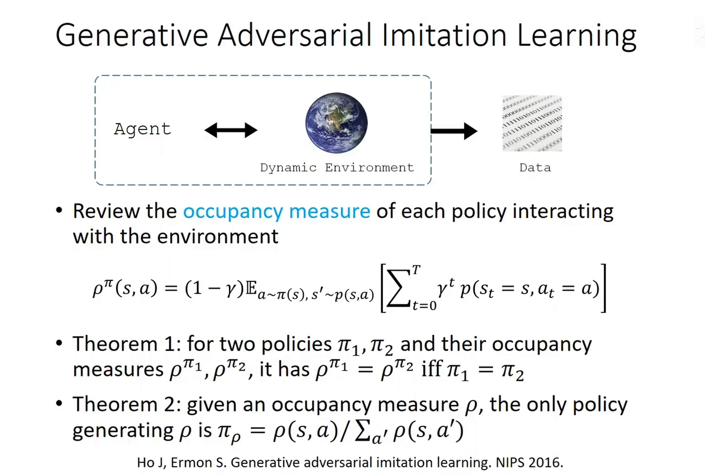
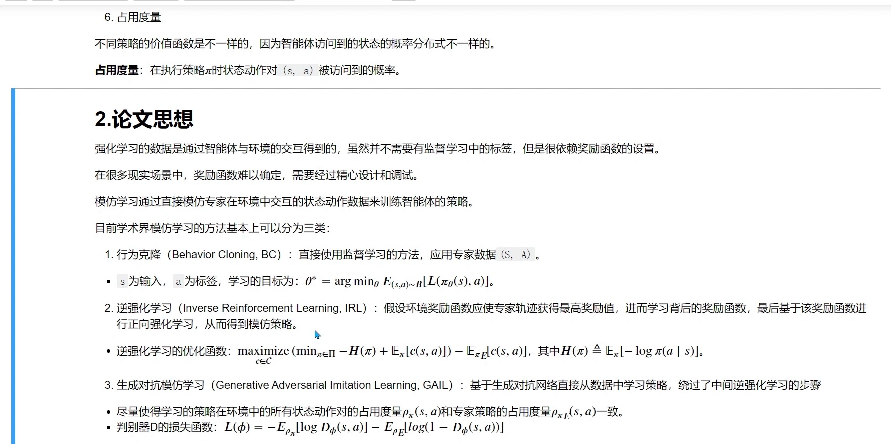
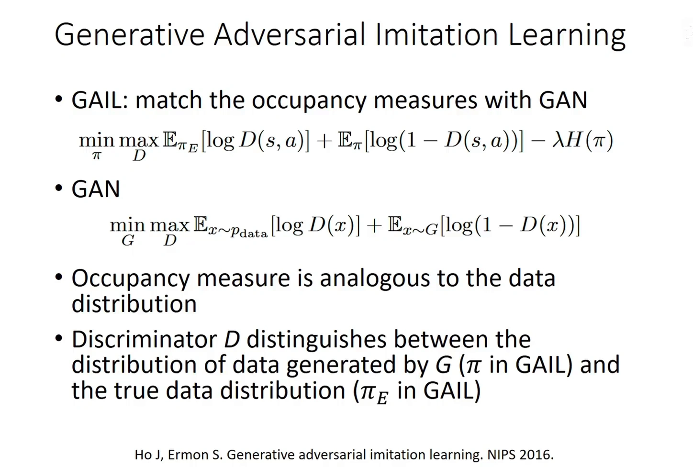
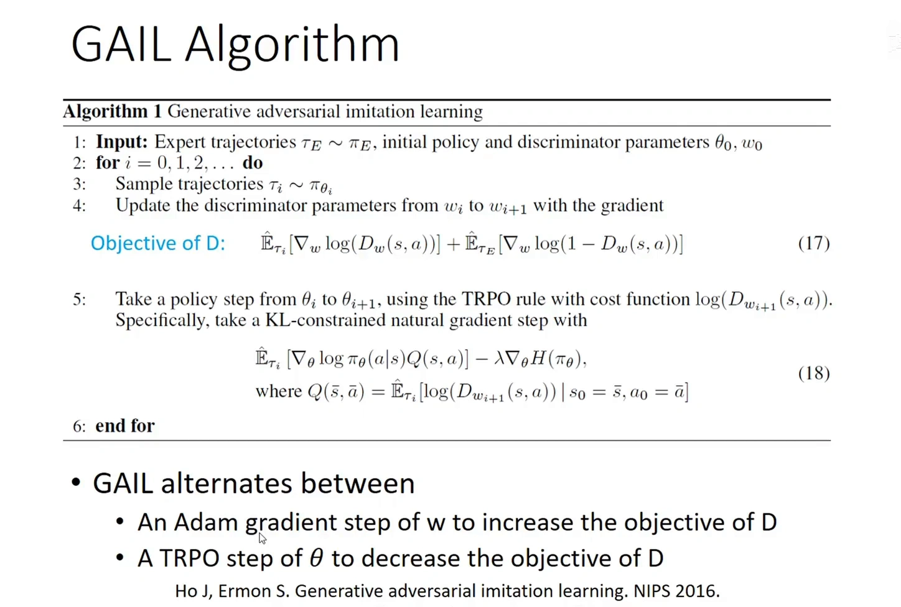
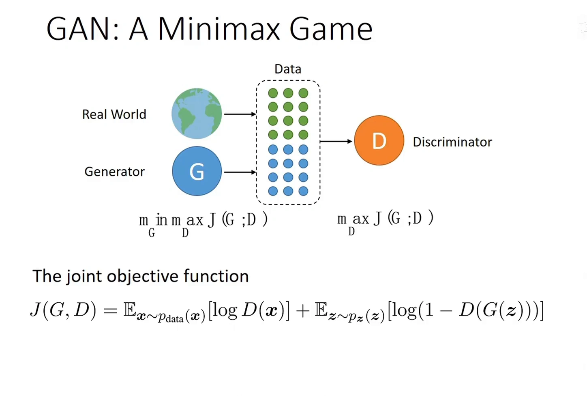
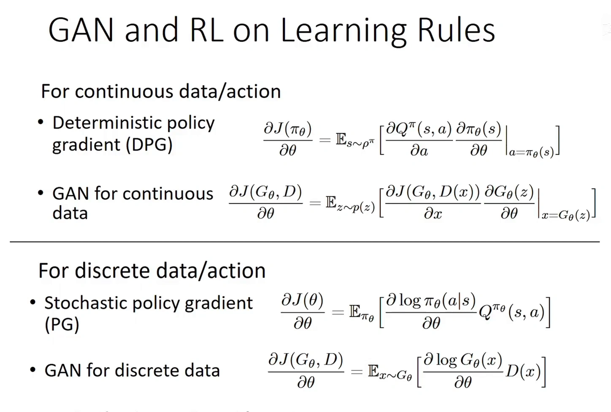
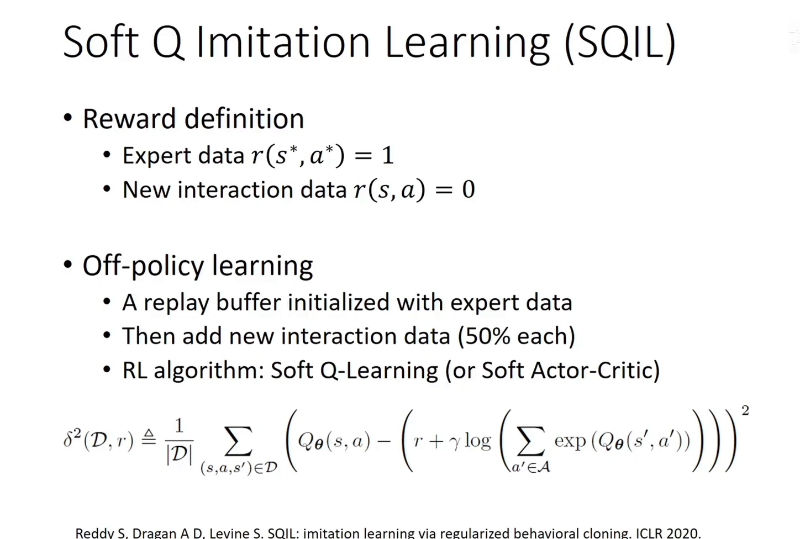
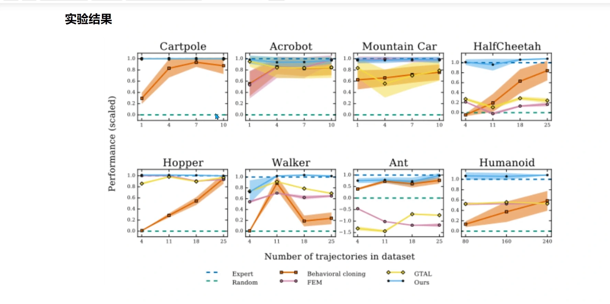
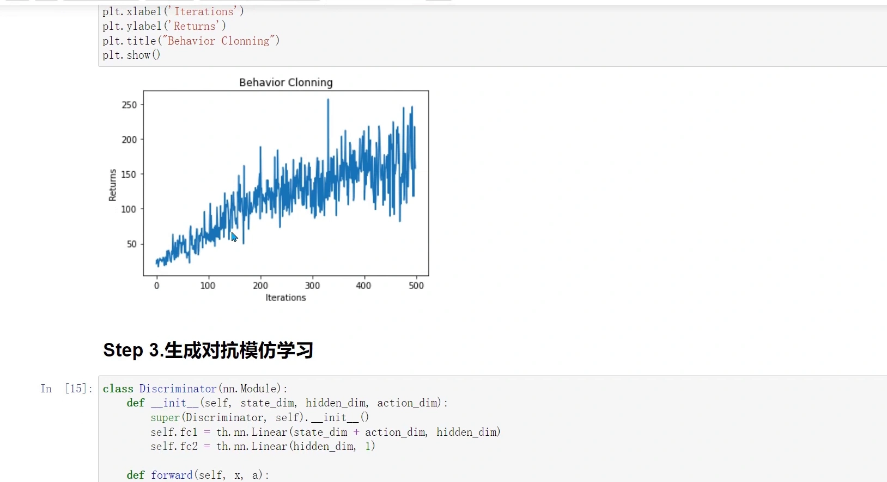

# GAIL：用判别器匹配专家的占用度量

> 承接 11.3：逆强化学习（inverse reinforcement learning, IRL）能学出可迁移的奖励，代价是「外循环找奖励、内循环解 RL」的两层迭代；11.2 的行为克隆（behavioral cloning, BC）便宜，却会因为分布偏移越走越偏。GAIL（Ho & Ermon, NIPS 2016）正是为绕开 IRL 的代价而生：它不恢复奖励，而是直接让策略的**占用度量（occupancy measure）**去匹配专家的占用度量，用判别器充当奖励函数。

## 本讲要解决的核心问题（SCQA）

**背景**：模仿学习手上有一批专家轨迹，希望学出一个能完成任务的策略。到目前我们已经见过两条路线——行为克隆把它当成监督学习（11.2），逆强化学习先反推奖励、再解一次正向 RL（11.3）。

**冲突**：BC 的误差是测在**专家分布**上的，策略自己一走动就漂出去，代价是 $T^2\epsilon$ 级的复合误差；IRL 泛化好，但每一轮都要在「找一个让专家最优的奖励」和「用这个奖励解一次 RL」之间来回，不是端到端，计算成本极高，而且逆出来的奖励往往过于复杂、过于不稳定。

**疑问**：能不能既保留 IRL 的泛化性——学到的是「怎么完成这个任务」，而不是「记住专家在某个状态下的动作」——又拿到 BC 的便宜：不必反复解内层 RL？

**回答（中心思想）**：可以。**「学会专家」其实等价于「匹配专家的占用度量」**，而匹配两个分布正是生成对抗网络（generative adversarial network, GAN）擅长的事。GAIL 用一个判别器区分「这个 $(s,a)$ 对来自专家还是来自策略」，再把判别器的输出直接当奖励：策略越像专家，判别器越分不出，奖励信号越小，最终收敛到 $\rho_\pi = \rho_{\pi_E}$。整个过程不需要环境提供任何奖励，也不需要显式恢复 $R$。



[【跳转到 11:24】](https://www.bilibili.com/video/BV1aDdVYrEQb/?p=24&t=684)

---

## 一、先把「占用度量」讲清楚

### 1.1 定义：策略决定了它会走到哪里

同一个环境里换一个策略，价值函数会变，**智能体访问到的状态的概率分布也会变**。把「执行策略 $\pi$ 时，状态动作对 $(s,a)$ 被访问到的概率」记下来，就是占用度量：

$$
\rho_\pi(s,a) = (1-\gamma)\sum_{t=0}^{\infty}\gamma^{t}\,P\big(s_t = s,\; a_t = a \mid \pi\big)
$$

- $(1-\gamma)$ 是归一化因子，保证 $\sum_{s,a}\rho_\pi(s,a) = 1$，让它成为一个合法的概率分布；
- $\gamma^t$ 是折扣权重：第 $t$ 步访问到的 $(s,a)$ 打折后计入。视频里的写法把求和上限写成 $T$，本质相同——只是有限时域与无限时域的差别。

这个量为什么重要？因为**策略不是只决定「在某个状态下做什么」，它决定「会走到哪些状态」**。11.2 讲的复合误差，根源就在这里：BC 的训练数据来自专家的 $\rho_{\pi_E}$，部署时策略走的是自己的 $\rho_\pi$，两个分布一旦错开，后面每一步都在陌生状态上做决策。

### 1.2 两条定理：占用度量是策略的「指纹」

- **定理 1**：对两个策略 $\pi_1,\pi_2$ 及其占用度量 $\rho_{\pi_1},\rho_{\pi_2}$，有 $\rho_{\pi_1} = \rho_{\pi_2}$ 当且仅当 $\pi_1 = \pi_2$。
- **定理 2**：给定一个占用度量 $\rho$，唯一能产生它的策略是

$$
\pi_\rho(a \mid s) = \frac{\rho(s,a)}{\sum_{a'}\rho(s,a')}
$$

定理 2 的分母是「访问到状态 $s$ 的总概率」，分子是「访问到 $(s,a)$ 的概率」，两者相除就还原出「到了 $s$ 之后选 $a$ 的条件概率」。也就是说，**占用度量里已经完整编码了策略**，不多不少。

两条定理合起来给出一个关键推论：**「学会专家策略」和「匹配专家的占用度量」是同一件事**。这就把「模仿」从「在状态空间里逐点对齐动作」换成了「对齐两个分布」——后者正是 GAN 的主场。

---

## 二、为什么匹配占用度量能绕开奖励恢复

### 2.1 回报只依赖占用度量

任何奖励函数 $R(s,a)$ 下的期望折扣回报都可以写成占用度量的内积：

$$
J(\pi) = \mathbb{E}_{\pi}\Big[\sum_{t}\gamma^{t}R(s_t,a_t)\Big] = \frac{1}{1-\gamma}\sum_{s,a}\rho_\pi(s,a)\,R(s,a)
$$

所以只要 $\rho_\pi = \rho_{\pi_E}$，**在任何奖励下两个策略的回报都相同**。反过来说，我们根本不需要知道那个奖励是什么——只要把占用度量对齐，专家在所有可能任务上的表现就都被复制过来了。这正是 IRL 想要的「泛化」，但省掉了「把奖励显式写出来」这一步。

### 2.2 三条路线其实是三种「对齐什么」



[【跳转到 28:30】](https://www.bilibili.com/video/BV1VB4y1D7Bq/?t=1710)

把三条路线放在一起看，区别只在「对齐的对象」：

- **行为克隆**对齐的是**动作标签**：$\theta^\ast = \arg\min_\theta \mathbb{E}_{(s,a)\sim\mathcal{B}}\big[L(\pi_\theta(s),a)\big]$。数据全部来自专家，所以一上来就有；但它只在专家的状态分布上成立。
- **逆强化学习**对齐的是**「专家最优」这一约束**：先在函数集合里找一个代价 $c$，使得专家在该代价下最优，再用这个 $c$ 解一次正向 RL。视频里把 IRL 的优化目标写成

$$
\max_{c\in\mathcal{C}}\Big(\min_{\pi\in\Pi} -H(\pi) + \mathbb{E}_{\pi}\big[c(s,a)\big]\Big) - \mathbb{E}_{\pi_E}\big[c(s,a)\big]
$$

  内层是「在给定代价下求最大熵最优策略」，外层是「让专家的代价低于该策略的代价」。它要走 $X \to Z \to Y$：先反推代价 $Z$，再解出策略 $Y$。
- **GAIL** 直接走 $X \to Y$：不去碰 $Z$，而是让 $\rho_\pi$ 逼近 $\rho_{\pi_E}$。

视频里对 IRL 的评价很直接：**它不得不逆一个奖励，代价是外循环找函数、内循环解 RL，计算成本非常高，而且逆出来的奖励函数往往过于复杂或不稳定**。GAIL 的价值就在于把这个中间层整个拆掉。

---

## 三、对抗训练：判别器就是奖励函数

### 3.1 目标函数

GAIL 的目标函数和 GAN 几乎逐字对应，只多了最后一项熵正则：

$$
\min_{\pi}\max_{D}\;\; \mathbb{E}_{\pi_E}\big[\log D(s,a)\big] + \mathbb{E}_{\pi}\big[\log\big(1 - D(s,a)\big)\big] - \lambda H(\pi)
$$



[【跳转到 13:00】](https://www.bilibili.com/video/BV1aDdVYrEQb/?p=24&t=780)

逐项拆开看：

- $D(s,a)\in[0,1]$ 是判别器输出的概率，表示「这个状态动作对有多大概率来自专家」。实现上就是一个以 $(s,a)$ 拼接向量为输入、过若干全连接层再过一个 sigmoid 的网络。
- $\mathbb{E}_{\pi_E}[\log D(s,a)]$：希望判别器把专家样本判成 1。这一项**由判别器最大化**。
- $\mathbb{E}_{\pi}[\log(1 - D(s,a))]$：希望判别器把策略样本判成 0。这一项也**由判别器最大化**。
- 前面的 $\min_\pi$：策略要反过来让这两项变小，也就是让判别器分不清。
- $-\lambda H(\pi)$：熵正则，见 3.3。

这是一个**最小最大（minimax）博弈**：判别器想把两类样本分开，策略想骗过它。策略越像专家，判别器越分不出，两个期望都趋近 $\log\frac{1}{2}$，博弈达到均衡，此时 $\rho_\pi = \rho_{\pi_E}$。

### 3.2 奖励信号从哪来

判别器的输出可以直接当奖励用。GAIL 原文的做法是**把 $\log D(s,a)$ 当代价（cost）**，交给策略梯度去最小化，等价地就是取

$$
r(s,a) = -\log D(s,a)
$$

理解这个符号：样本越像专家，$D(s,a)$ 越接近 1，$\log D$ 越接近 0，代价越小、奖励越大；样本越不像专家，$D$ 越接近 0，$-\log D$ 越大，奖励越小。所以**判别器给出的不是一个「任务奖励」，而是一个「像不像专家」的稠密信号**。

这就是「GAIL 不需要环境奖励」的确切含义：环境只提供状态转移 $P(s'\mid s,a)$，奖励完全由判别器现场生成。也正因为奖励是稠密的、每一步都有，它比稀疏的任务奖励好学得多。

### 3.3 熵正则项在防什么

$-\lambda H(\pi)$ 里 $H(\pi)$ 是策略熵。它出现在 $\min_\pi$ 里，所以策略在最小化判别器目标的同时，还要**最大化自己的熵**。

作用有两个：

1. **防止过早坍缩到确定性策略**。如果策略很早就锁定成「某个状态只做一个动作」，它就失去了探索能力，一旦判别器指出这条路线不像专家，它没有别的路可退。
2. **让策略更从容地应对环境里的小变化**。动作分布摊开一点，面对轻微扰动的状态时性能更稳。视频里把它类比成正则化：线性回归里 $X^{\mathsf T}X$ 不可逆时解不唯一，加一个凸的正则项就能得到唯一解；IRL 里逆出来的奖励同样可能多解，加策略熵能让交替迭代的过程更稳定。

---

## 四、算法：一步判别器，一步策略

GAIL 的训练就是一个交替循环，没有内外两层 RL：



[【跳转到 14:20】](https://www.bilibili.com/video/BV1aDdVYrEQb/?p=24&t=860)

写成流程就是：

```text
输入：专家轨迹 τ_E ~ π_E，初始策略参数 θ_0，初始判别器参数 w_0
for i = 0, 1, 2, ... do
    用当前策略 π_{θ_i} 采样轨迹 τ_i
    # 第一步：判别器，梯度上升
    w_{i+1} ← w_i + α ∇_w [ Ê_{τ_i} log D_w(s,a) + Ê_{τ_E} log(1 − D_w(s,a)) ]
    # 第二步：策略，梯度下降（把 log D 当代价）
    θ_{i+1} ← θ_i − β ∇_θ [ Ê_{τ_i} log π_θ(a|s) · Q(s,a) − λ H(π_θ) ]
end for
```

其中第二步的 $Q$ 就是用判别器当奖励算出来的：

$$
Q(\bar s,\bar a) = \hat{\mathbb{E}}_{\tau_i}\big[\log D_{w_{i+1}}(s,a) \;\big|\; s_0 = \bar s,\; a_0 = \bar a\big]
$$

也就是「从 $(\bar s,\bar a)$ 出发，后面按当前策略走，累计的 $\log D$ 期望」。

两个实现细节值得记住：

- **判别器那一步是有监督学习**，用 Adam 做梯度上升即可，和训练一个二分类器没有区别。
- **策略那一步是 on-policy 的 RL**。原文用的是 TRPO（带 KL 约束的自然梯度步），因为它 2016 年发表时 PPO 还没问世；后续很自然地把 TRPO 换成 PPO，GAIL 一样能工作。这一点和 GAN 有本质区别，下一节展开。

---

## 五、和 GAN 的关系：像，但不一样

### 5.1 结构上的对应



[【跳转到 24:12】](https://www.bilibili.com/video/BV1aDdVYrEQb/?p=24&t=1452)

把两个目标函数并排放：

$$
\min_{G}\max_{D}\;\; \mathbb{E}_{x\sim p_{\text{data}}}\big[\log D(x)\big] + \mathbb{E}_{x\sim G}\big[\log\big(1 - D(x)\big)\big]
$$

$$
\min_{\pi}\max_{D}\;\; \mathbb{E}_{\pi_E}\big[\log D(s,a)\big] + \mathbb{E}_{\pi}\big[\log\big(1 - D(s,a)\big)\big] - \lambda H(\pi)
$$

对应关系一目了然：

| GAN | GAIL |
| --- | --- |
| 生成器 $G$ | 策略 $\pi$ |
| 生成样本 $x = G(z)$ | 生成的轨迹 $(s_0,a_0,s_1,a_1,\dots)$ |
| 真实数据分布 $p_{\text{data}}$ | 专家的占用度量 $\rho_{\pi_E}$ |
| 判别器输入单张样本 $x$ | 判别器输入状态动作对 $(s,a)$ |
| 生成器的分布 $p_G$ | 占用度量 $\rho_\pi$ |

所以视频里的说法是：**占用度量之于 GAIL，就相当于数据分布之于 GAN**。GAN 让生成分布逼近真实分布，GAIL 让策略的占用度量逼近专家的占用度量。

### 5.2 三处关键差异

**第一，生成的对象不同。** GAN 生成一张图或一段音频；GAIL 生成一条**轨迹**——它必须真的和环境交互，一步步拿到 $s_{t+1}$。所以 GAIL 的策略更新天然是 on-policy 的，采样成本比 GAN 高。

**第二，判别器看的东西不同。** GAN 的判别器看单张图 $x$；GAIL 的判别器看 $(s,a)$ 对。而且要注意：$(s,a)$ 在期望里其实带着占用度量的折扣权重，所以出现在第 $t$ 步的样本要乘上 $\gamma^{t}$。

**第三，梯度怎么传回去，这是最本质的区别。**



[【跳转到 27:00】](https://www.bilibili.com/video/BV1aDdVYrEQb/?p=24&t=1620)

- **GAN 可以直接反传**：$x = G_\theta(z)$ 对 $\theta$ 可微，判别器 $D$ 也可微，于是

$$
\frac{\partial J(G_\theta, D)}{\partial \theta} = \mathbb{E}_{z\sim p(z)}\left[\frac{\partial J(G_\theta, D(x))}{\partial x}\cdot\frac{\partial G_\theta(z)}{\partial \theta}\Big|_{x = G_\theta(z)}\right]
$$

  注意这里求导的对象不是模型参数，而是**模型的输入数据**——只要数据本身（图片、语音这类连续量）可微，就可以用链式法则一路传回去。视频指出，这个式子和确定性策略梯度（DPG）长得一模一样：

$$
\frac{\partial J(\pi_\theta)}{\partial \theta} = \mathbb{E}_{s\sim\rho^{\pi}}\left[\frac{\partial Q^{\pi}(s,a)}{\partial a}\cdot\frac{\partial \pi_\theta(s)}{\partial \theta}\Big|_{a = \pi_\theta(s)}\right]
$$

- **GAIL 不能直接反传**：动作是从策略里**采样**出来的，采样不可微；而且奖励（判别器输出）还依赖环境的状态转移，梯度穿不过去。所以策略只能用策略梯度更新：

$$
\frac{\partial J(\theta)}{\partial \theta} = \mathbb{E}_{\pi_\theta}\left[\frac{\partial \log \pi_\theta(a\mid s)}{\partial \theta}\,Q^{\pi_\theta}(s,a)\right]
$$

  而离散数据下的 GAN 恰好也是这个形式：

$$
\frac{\partial J(G_\theta, D)}{\partial \theta} = \mathbb{E}_{x\sim G_\theta}\left[\frac{\partial \log G_\theta(x)}{\partial \theta}\,D(x)\right]
$$

一句话总结这张对照表：**连续、可微、能一路反传时，GAN 的更新等价于 DPG；离散、要采样时，GAN 的更新等价于策略梯度 PG。GAIL 属于后者**——判别器只提供「打分」，真正的策略改进由 RL 完成。

---

## 六、优缺点

### 6.1 优点

1. **不需要手工设计奖励**。奖励由判别器现场给出，环境只负责状态转移。对「奖励难以形式化」的任务（自动驾驶要遵守的交通规则、机器人要模仿的灵巧动作）尤其合适。
2. **不需要内层反复解 RL**。IRL 是两层循环，GAIL 只有一层交替：一步判别器、一步策略。这是它相对 IRL 最大的工程优势。
3. **样本效率高于 IRL**。同样的专家轨迹数量下，GAIL 通常比 IRL 方法更快逼近专家水平（第八节的实验会看到）。
4. **匹配的是行为分布，不只是动作**。BC 只对齐「在专家的状态上该做什么」，GAIL 对齐整个占用度量，因此不会在专家没走过的状态上手足无措。

### 6.2 缺点

1. **训练不稳定**。这是 GAN 的通病：判别器和策略是一对博弈，一方太强另一方就学不动。视频里自己复现时就遇到「效果提升很快但波动很大」的问题。
2. **对超参敏感**。判别器结构、学习率、熵系数 $\lambda$、每轮判别器更新几步，都会明显影响结果。
3. **判别器可能饱和**。sigmoid 输出的判别器在两类样本很容易分开时会进入梯度饱和区，梯度消失、学不动。改用 Wasserstein 距离（earth mover's distance）衡量两个占用度量之间的距离可以缓解这个问题，训练也更有效。
4. **on-policy 采样昂贵**。每一步策略更新都要重新采样轨迹，样本利用率不如 off-policy 方法。
5. **依赖专家质量**。模仿学习整体建立在「专家经验是正确的」这个假设上；专家本身次优时，学出来的策略会在专家的基础上继续偏移——上梁不正下梁歪。
6. **判别器也判断不出「知识的重要性」**。BC 会学到「小习惯」的问题（比如专家恰好是一位腿短的司机，于是「调座椅」这个动作在数据里出现频率极高），GAIL 也没有真正解决——它只是把「判断哪些知识重要」的难题从监督学习转移给了判别器。

---

## 七、后续与变体：对抗之外还有别的路

GAIL 和 IRL 的共同代价是**要迭代**：判别器和策略、或者奖励和策略，都得来回更新，训练进程偏慢。于是一批工作尝试把它变成 one-pass——奖励一次定好，然后只解一次 RL。

先补一句与 11.3 的衔接：那里已经指出，把判别器参数化成 IRL 的形式（AIRL）时，判别器收敛后能恢复出奖励函数，因而可以迁移到新条件；GAIL 用的是普通二分类器，判别器收敛时对一切输入输出 0.5、什么都不剩，但策略被拉到了专家分布上。**前者能恢复奖励，后者只能恢复策略**。下面这些变体，大体都在这条光谱上找位置。

### 7.1 Wasserstein GAIL

把判别器的 sigmoid 换成 Wasserstein 距离的 critic，直接度量两个占用度量之间的 earth mover's distance。好处是避开 sigmoid 饱和导致的梯度消失，训练更稳。

### 7.2 SQIL：奖励直接设成 0 和 1



[【跳转到 19:00】](https://www.bilibili.com/video/BV1aDdVYrEQb/?p=24&t=1140)

Soft Q Imitation Learning（SQIL）把奖励定义简化到极致：

$$
r(s,a) = \begin{cases} 1, & (s,a) \in \mathcal{D}_{\text{expert}} \\ 0, & \text{新交互数据} \end{cases}
$$

然后用一个经验回放池，一半装专家数据、一半装新交互数据，用最大熵的 off-policy 算法（Soft Q-Learning 或 Soft Actor-Critic）去训练。损失函数是 soft Q-learning 的时序差分误差：

$$
\delta^{2}(\mathcal{D}, r) \triangleq \frac{1}{\lvert \mathcal{D}\rvert}\sum_{(s,a,s')\in\mathcal{D}}\left(Q_\theta(s,a) - \left(r + \gamma\log\Big(\sum_{a'\in\mathcal{A}}\exp\big(Q_\theta(s',a')\big)\Big)\right)\right)^{2}
$$

它等于说：**不做判别器，也不做逆奖励，直接把「是不是专家数据」当奖励**。要想拿更多奖励，策略就往专家的 $(s,a)$ 上靠、往它的前继状态上靠。因为是 one-pass，训练快，效果也不差。

### 7.3 RED：用随机网络的拟合误差当奖励

思路是「一个 $(s,a)$ 对有多像专家，看它有多容易被拟合」。先用专家数据训练一个随机网络（random network）产生输出，再用另一个网络用 MSE 去拟合它的预测：见过的、离专家数据近的 $(s,a)$，拟合误差小；没见过的、分布外的，误差大。于是把误差取负、乘一个超参数，就得到一个软性的奖励：

$$
r(s,a) = -\alpha \cdot \mathrm{MSE}\big(f_\theta(s,a),\, g(s,a)\big)
$$

和 SQIL 的 0/1 硬信号相比，它给出的是连续的、间接的鼓励。RED 在 Atari 的一些难探索游戏（如蒙特祖玛的复仇）上效果不错。

### 7.4 集成方差与能量模型

- **集成方差（DRIL 一类）**：对专家数据做行为克隆，用不同子集训练多个策略组成 ensemble。数据稀疏的地方，各策略分歧大、方差大，说明这里离专家数据远；方差小的地方奖励高。这和 model-based RL 里的认知不确定性（epistemic uncertainty）是同一个思路。
- **能量模型**：把占用度量乘上 $(1-\gamma)$ 归一化成分布，再用玻尔兹曼分布 $p \propto e^{-E}$ 去建模，就能把「专家的占用度量」和「一个能量函数」直接对应起来。反推出专家的能量函数后，把它作为负奖励加到 RL 里，同时会自然推出一项最大熵项。这也是 one-pass 的。

---

## 八、实验证据：GAIL 到底好不好用

### 8.1 论文的实验设置

论文在 Gym 的九个连续控制任务上评估 GAIL。做法是：先用 TRPO 训练一个专家策略，再从专家策略里抽取不同数量的轨迹作为数据集；然后比较行为克隆、两种逆强化学习方法（FEM 特征期望匹配、GTAL）和 GAIL，四者采用相同的网络架构、相同的随机初始化，保证实验环境完全一致。



[【跳转到 31:00】](https://www.bilibili.com/video/BV1VB4y1D7Bq/?t=1860)

### 8.2 三条曲线说明的三件事

**第一，行为克隆对数据量极度敏感。** 橙色曲线随专家轨迹条数增加而明显上升，说明 BC 对专家数据的利用效率很低——它只能被动地「记住」数据里出现过的状态，数据没覆盖到的地方就无能为力。

**第二，逆强化学习比 BC 好，但仍不如 GAIL。** 粉色（FEM）和黄色（GTAL）介于两者之间。

**第三，GAIL 在很少的数据下就能贴近专家。** 蓝色（Ours）在横轴最左端就已经接近 1，个别任务上甚至略高于专家。视频对此的解释是：BC 只能在专家给定的数据集上做拟合，上限就是专家；而 GAIL 会自己生成新数据、在生成数据上对齐分布，所以上限有可能超过专家。

### 8.3 一个反例：Reacher

九个任务里有一个例外：在 Reacher（两自由度机械臂够到目标点）上，行为克隆反而比 GAIL 好，GAIL 甚至没达到专家水平。论文没有解释原因。视频作者的猜想是「这个环境不太适合做生成对抗」，但没有展开原因。

这个反例值得记住：**GAIL 不是无条件优于 BC**。专家轨迹足够丰富、任务又简单时，行为克隆已经够用，而且更稳。

### 8.4 一次代码复现

视频作者还做了一次完整复现，用 PPO 先训一个专家（return 约四五百），再分别跑 BC 和 GAIL：



[【跳转到 37:00】](https://www.bilibili.com/video/BV1VB4y1D7Bq/?t=2220)

- **行为克隆**：500 轮后 return 才到 171，明显低于专家，但曲线整体还在上升——数据不够时 BC 就是这样慢慢爬。
- **GAIL**：500 轮后 return 达到 434，接近专家水平，而且用很少的数据就能快速拉升。
- 代价是**不稳定**：曲线波动很大。作者归因于自己只用了一个 BCE loss + Adam 的朴素实现，论文里做了更多稳定化处理。

判别器的实现非常简单：把状态 $s$ 和动作 $a$ 拼成一个向量，过一层全连接、再过 sigmoid 得到 $[0,1]$ 的概率；训练时把策略样本的标签设为 1、专家样本的标签设为 0，就是一个普通的二分类问题。

---

## 九、三条路线对比

把全篇收束成一张表。五个维度，正好对应「为什么要有 GAIL」这个问题：

| 维度 | 行为克隆 BC | 逆强化学习 IRL | 生成对抗模仿学习 GAIL |
| --- | --- | --- | --- |
| 需要环境奖励 | 不需要 | 不需要（奖励是学出来的） | 不需要（奖励由判别器给出） |
| 需要内层 RL | 不需要，纯监督学习 | 需要：外循环找奖励 + 内循环解 RL | 需要，但只有一层交替（一步判别器、一步策略） |
| 泛化能力 | 弱：误差测在专家分布上，复合误差可达 $T^{2}\epsilon$ | 强：学出可迁移的奖励 | 强：对齐的是整个占用度量 |
| 训练稳定性 | 高：就是一个监督学习问题 | 中：奖励多解、交替迭代易震荡 | 低：GAN 式博弈，对超参敏感 |
| 样本效率 | 低：需要大量专家数据 | 中 | 高：少量专家轨迹即可接近专家 |

一句话概括这张表：**BC 便宜但会漂，IRL 泛化好但太贵，GAIL 用「匹配占用度量」把两者的优点拼在一起，代价是训练变得不稳定。**

---

## 小结

- **占用度量 $\rho_\pi(s,a)$ 是策略的指纹**：它完整编码了策略，两条定理保证「占用度量相同」与「策略相同」互为充要，且能唯一反解。
- **匹配占用度量等价于学会专家**：任何奖励下的回报都只依赖占用度量，所以对齐了 $\rho$ 就对齐了所有任务上的表现，不需要显式恢复 $R$。
- **GAIL 的目标是一个最小最大博弈**：$\min_\pi\max_D \mathbb{E}_{\pi_E}[\log D] + \mathbb{E}_{\pi}[\log(1-D)] - \lambda H(\pi)$。判别器想分清专家与策略，策略想骗过它。
- **判别器就是奖励函数**：$r(s,a) = -\log D(s,a)$，越像专家奖励越高。环境只提供状态转移，奖励完全由判别器现场生成。
- **训练是交替的一层循环**：一步 Adam 更新判别器，一步 TRPO/PPO 更新策略，没有 IRL 那样的内外两层。
- **和 GAN 的差别在梯度怎么回去**：GAN 对连续数据可以直接反传（等价于 DPG），GAIL 的动作是采样出来的，只能用策略梯度——判别器只提供打分。
- **熵正则 $-\lambda H(\pi)$ 防止策略过早坍缩**，同时让交替迭代更稳定。
- **实验上 GAIL 在少数据时优势最明显**，但 Reacher 这类简单任务上 BC 反而更好；GAIL 不是无条件优于 BC。
- **后续工作主要在去掉对抗**：Wasserstein GAIL 换距离度量，SQIL 用 0/1 奖励、RED 用拟合误差、DRIL 用集成方差、能量模型用玻尔兹曼分布，都在追求 one-pass。

## 关键术语速查

| 术语 | 一句话解释 |
| --- | --- |
| 占用度量（occupancy measure） | 执行策略 $\pi$ 时状态动作对 $(s,a)$ 被访问到的折扣概率分布，完整编码了策略 |
| 判别器（discriminator） | 输入 $(s,a)$ 输出 $[0,1]$ 的网络，判断样本来自专家还是来自策略 |
| 生成器（generator） | 在 GAIL 里就是策略 $\pi$：输入状态、输出动作，负责「生成」轨迹 |
| 最小最大博弈（minimax） | 判别器最大化、策略最小化同一个目标，双方对抗到均衡 |
| 熵正则（entropy regularization） | $-\lambda H(\pi)$，鼓励策略保持随机性，防止过早坍缩到确定性 |
| 复合误差（compounding error） | 单步的小误差改变状态分布，后续每步都在陌生状态上，误差累积放大 |
| 最大熵逆强化学习 | 在 IRL 里加策略熵做正则，缓解奖励多解、让交替迭代更稳定 |
| Wasserstein 距离 | 衡量两个分布之间的 earth mover's distance，可替代 sigmoid 判别器避免梯度饱和 |
| one-pass 模仿学习 | 奖励一次定好、只解一次 RL 的模仿学习，避免判别器与策略的反复迭代 |
| SQIL | 把专家数据奖励设为 1、新数据设为 0，配合最大熵 off-policy RL 的极简做法 |
| RED | 用随机网络的拟合误差当奖励：越像专家数据，误差越小、奖励越高 |