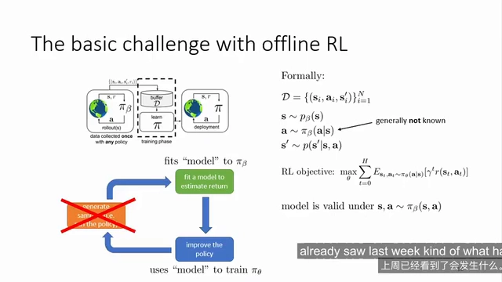
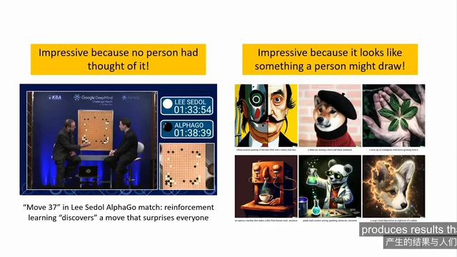
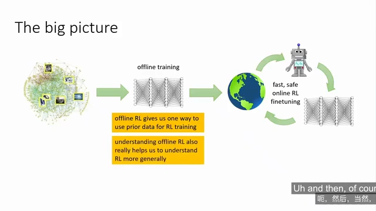
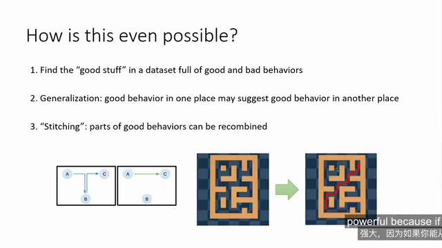
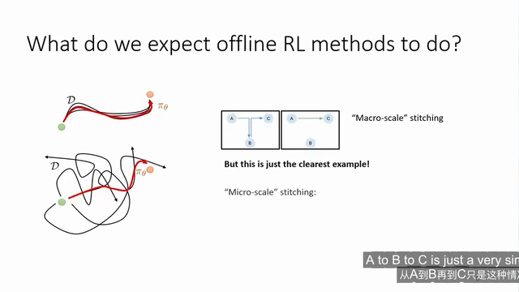
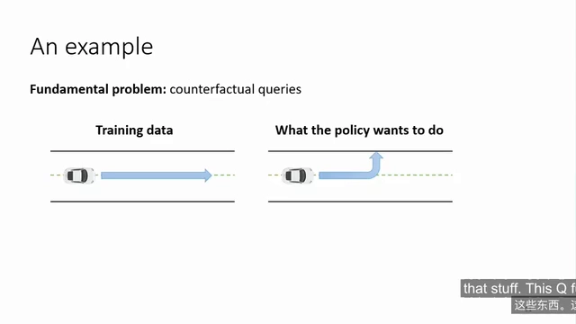

# 离线强化学习的设定与它为何能超越数据集

> 这是 Berkeley CS 185/285 第 17 讲（Sergey Levine）的前半部分。本篇走「原理侧」：只回答三件事——把「与环境交互」这一步彻底剪掉之后，RL 还剩下什么；剩下来的部分凭什么能学出比数据集更好的策略；以及为此要付什么代价。**真实场景清单、方法路线图与数据集分档，见同目录的[离线强化学习：冻结数据集上的范式转移](离线强化学习：冻结数据集上的范式转移.md)。**

## 本讲要解决的核心问题（SCQA）

**背景**：到目前为止我们学过的所有强化学习方法都有一个迭代结构——收集样本、拟合价值函数或模型、用它改进策略、再收集样本。经典 RL 始终在这个循环里转。

**冲突**：这个循环有个隐藏前提：**能采新数据**。一旦不能采，循环就断了。而「不能采」在真实世界里是常态而非例外——具体是哪些场景、各自的约束是什么，另一篇已经列过，这里不重复。

**疑问**：循环断了，RL 还剩下什么？更尖锐地问：**只拿一批静态数据，凭什么指望学出比这批数据里「典型行为」更好的策略？** 这不是否定了 RL 相对监督学习的主要优势吗？

**回答（中心思想）**：剩下的部分完全够用，只是要换一套推理方式。离线 RL 就是「把回放缓冲区冻结」的 RL：数据分布由某个行为策略 $\pi_\beta$ 决定，你甚至不知道它是什么，但**只要数据里散落着「好的片段」，就能通过泛化与拼接（stitching）把它们重新组合成一条数据里从未出现过的更优轨迹**。代价是：你失去了「试一试就知道」的能力，所有关于没见过的动作的判断都变成了反事实猜测——这正是 12.2 要处理的难题。

---

## 一、把循环剪断：离线 RL 的定义

### 1.1 经典 RL 是一个迭代循环

课程开篇的架构图值得记住：**数据收集 → 拟合价值函数或模型 → 改进策略 → 回到数据收集**。策略梯度、Actor-Critic、基于模型的方法，全都只是这个循环的不同填法。图中那个橙色方块（收集数据）是循环的动力源。

### 1.2 离线设定：拿到一个你不知来历的 buffer

离线 RL 做的事就是**把橙色方块删掉**。你拿到的是一个回放缓冲区，里面是**别人以某种方式收集的数据**——通常你并不知道具体是怎么收集的，只能使用这个数据集，并从中提取最优策略。

这里有个容易忽略的细节：**离线 RL 一般不假设已知行为策略**。数据可能来自任何来源（人类操作、旧版本系统、多个策略的混合），你只需要相信数据存在，不需要知道 $\pi_\beta$ 长什么样。

### 1.3 形式化：目标没变，约束变了

[【跳转到 16:48】](https://www.bilibili.com/video/BV1RX8B6LEX4/?t=1008)

课程给的写法是：

$$
\mathcal{D} = \{(s_i, a_i, s'_i)\}_{i=1}^{N}, \qquad
s \sim p_\beta(s), \quad a \sim \pi_\beta(a \mid s), \quad s' \sim p(s' \mid s, a)
$$

优化目标与普通 RL 完全一致：

$$
\max_{\theta} \; \sum_{t=0}^{H} \mathbb{E}_{(s_t, a_t) \sim \pi_\theta}\big[\gamma^{t} r(s_t, a_t)\big]
$$

区别全在最后那句附注上：**模型（或 Q 函数）只在 $s, a \sim \pi_\beta(s,a)$ 时有效**。也就是说，我们训练出来的东西是一个**只在数据分布上成立的估计器**，却要拿它去评价一个会跑到数据分布之外的策略。这句话就是整个离线 RL 领域的存在理由。

> 注：幻灯片用的是三元组 $(s, a, s')$，奖励由 $r(s,a)$ 给出；本系列其它篇章按四元组 $(s,a,r,s')$ 书写，两者等价。

---

## 二、和已有范式的关系：一张表看清三者差别

三个概念的差别可以压成一张表。**离线 RL 与离轨策略只差一条：训练时还能不能采新数据；与模仿学习差在有没有奖励信号。** 离轨策略 vs 离线 RL 的完整辨析（含「水龙头 / 脸盆 / 水桶」比喻与结构图）在[另一篇](离线强化学习：冻结数据集上的范式转移.md)里，这里只留对照。

| 范式 | 数据里有什么 | 训练时能否采新数据 | 优化目标 |
| :--- | :--- | :--- | :--- |
| 模仿学习（行为克隆） | 只要 $(s, a)$ 对 | 不能 | 复制行为策略 |
| 离轨策略（Q-learning、SAC） | 完整 $(s, a, r, s')$ | **能**，buffer 持续写入 | 最大化回报 |
| 离线强化学习 | 完整 $(s, a, r, s')$ | **不能**，buffer 冻结 | 最大化回报 |

一句话记住：**在线方法更简单，离线方法通常更高效；离线 RL 是把「高效」推到极限的那个版本。**

---

## 三、为什么值得做：优化与数据是两种不同的惊艳

> 现实场景层面的动机（医疗、自动驾驶、推荐系统、工厂数据……）在[另一篇](离线强化学习：冻结数据集上的范式转移.md)里按约束类型逐条列过，这里只讲课程里那个更「务虚」、但更能解释「为什么要做这件事」的动机。

### 3.1 两种「惊艳」：像人，还是不像人

[【跳转到 09:20】](https://www.bilibili.com/video/BV1RX8B6LEX4/?t=560)

Levine 把机器学习的两种成功放在一起对比：

- **强化学习的成就**（AlphaGo 对李世石的第 37 手）：令人兴奋之处在于它发现了**与人类设想完全不同的招法**——不是像人，而是不像人。RL 的强大在于**优化最大奖励并产生涌现行为**，它不试图模仿数据。
- **数据驱动方法**（图像生成模型）：令人惊艳之处在于它产出的东西**像人做的**。数据驱动方法从数据中学习世界，但**通常不试图超越数据**。

于是自然的问题是：能不能兼得两者？**用海量离线数据达到人类水平的能力，再超越数据的限制、发掘涌现能力？** 课程承认这是个「小小的梦想」，但它正是离线 RL 的动机所在——也正好对应本篇第四节要讲的「拼接」。

### 3.2 大图景：离线预训练 + 在线微调

[【跳转到 11:20】](https://www.bilibili.com/video/BV1RX8B6LEX4/?t=680)

课程明确说：**离线 RL 不仅仅为离线问题服务，它同时也为常规在线 RL 提供一个离线预训练阶段。** 理想的流程是：拿一个大型离线数据集，用离线 RL 得到一个非常优秀的初始策略，部署后再做少量在线交互继续优化。这也解释了为什么工业界对它的兴趣远大于「纯离线」场景本身。

---

## 四、静态数据怎么可能超过数据集本身

这是全篇最精彩的部分，也是离线 RL 区别于「在历史数据上做监督学习」的根本所在。课程先替听众把反对意见说出来：**如果你不能与世界互动、不能试错，这不是否定了 RL 的主要优势吗？** 然后给了三个由浅入深的解释。

### 4.1 三个直观解释

[【跳转到 14:40】](https://www.bilibili.com/video/BV1RX8B6LEX4/?t=880)

1. **筛选**：如果数据集中既有优秀行为也有不良行为，离线 RL 可以被视为一种**自动筛选工具**——识别什么是好行为、什么是不好行为，并有效模仿优质部分而非全部内容。这在现实中很有价值，因为**获得完全优质的数据很困难，获得好坏混杂的数据要容易得多**。
2. **泛化**：学到的模型具备泛化能力，一个地方的良好行为可能透露出另一个地方良好行为的信息。课程甚至指出，**不良行为也可能有帮助**——因为你可以类比「此处的好到坏」，映射到「彼处的好到坏」。
3. **拼接（stitching）**：这是课程认为最精确的表述，也是离线 RL 真正期待实现的能力。

### 4.2 拼接：马尔可夫性送的礼物

拼接的本质是**传递性**：如果数据集中观察到从 A 到 B 的路径，在其他场景中又看到从 B 到 C 的路径，那么**由于马尔可夫性质成立，无需收集新数据就能推断从 A 到 C 是可行的**。

课程用一个标准基准测试场景说明：一个小迷宫，数据里只有绿色圆点在迷宫中的各种局部移动，你从未见过完整轨迹，但看过的子轨迹足够多，就能掌握迷宫的通用导航方法，从而拼出从迷宫左下角到右上角的最优策略。

这个理念的强大之处在于处理**异构数据**：想象一个包含驾驶行为的数据集，不同人擅长不同部分——某人擅长并入高速公路，另一人擅长安全通过无信号交叉口。若能识别每个人行为中的最佳部分并重新组合，得到的策略在每种情境下都达到最佳水平，**整体优于任何单个人**（前提是无人在所有场景中都最优）。

### 4.3 期望离线 RL 学到什么

[【跳转到 16:20】](https://www.bilibili.com/video/BV1RX8B6LEX4/?t=980)

课程用一句话概括了「正确的思维模型」：**数据并不一定特别擅长任务，你希望从中提取能有效解决问题的部分，然后执行这些步骤。** 并且提醒：A→B→C 这种传递性只是概念的**简化特例**，真实的拼接既发生在「宏观尺度」（把不同轨迹的片段接起来），也发生在「微观尺度」（在相邻状态之间做局部改进）。

---

## 五、和模仿学习的分界：复制 vs 提取

上面这句话其实已经把模仿学习与离线 RL 的分界说完了，这里只做一句收束：

- **模仿学习**：数据被当作「接近最优的执行方式」，你要做的是**复制**它。所以它要求数据来自专家，学出来的策略上界就是数据里的行为策略。
- **离线 RL**：数据被当作「一堆可能含有好片段的经验」，你要做的是**提取**。所以它不要求数据是专家数据，好坏混杂反而更好用。

**分界的根源只有一条：数据里有没有奖励。** 有了 $r$，你才有一个独立于「数据里怎么做」的评价标准，才敢说「这一步比那一步好」，也才谈得上拼接与超越。行为克隆为什么做不到超越、它的两条缺陷（策略上界就是行为策略、分布偏移）具体怎么来的，见[另一篇](离线强化学习：冻结数据集上的范式转移.md)里以行为克隆为例的那一节。

---

## 六、代价：所有问题都变成反事实问题

天下没有免费的午餐。课程在讲完拼接的好处后，立刻转向代价：**为什么不能直接拿 Q-learning 跑这批数据？** 事实上二十年前人们就是这么做的，但它存在一个严重问题。

问题的根源在于：**RL 本质上在回答反事实问题**——「如果我在这个状态采取另一个动作，会不会比数据里实际采取的动作更好？」在线 RL 回答这个问题的方式很简单：试一试，看结果。这就是试错的本质。离线 RL 不能试。

[【跳转到 21:20】](https://www.bilibili.com/video/BV1RX8B6LEX4/?t=1280)

课程给的例子是驾驶数据：数据里所有驾驶员都保持在路面上，没有人糟糕到会随机驶出道路。现在你的策略想知道「驶出道路」是好是坏——你当然知道这是坏主意，但那是基于生活常识；**Q 函数完全不知道，因为这个动作与训练数据完全不同**，它甚至不知道「驶出道路」是这个宇宙里可能发生的事。

于是离线 RL 的核心张力出现了：**既要避免执行与数据集完全不同的动作（因为无法预测后果），又要保留泛化空间（否则就被死死限制在数据里见过的内容上）**。这两者的平衡点怎么找，就是 12.2 要展开的分布偏移与价值高估问题，以及 12.3～12.4 各类约束方法的用武之地。

---

## 小结

- **定义**：离线 RL 是「把回放缓冲区冻结」的 RL——数据由未知的行为策略 $\pi_\beta$ 收集，训练期间不采新数据，目标函数与普通 RL 相同。
- **三者差别一张表**：与离轨策略只差「还能不能采新数据」，与模仿学习只差「数据里有没有奖励」。
- **动机**：优化与数据是两种不同的惊艳——RL 的价值在于产出「不像人」的新行为，数据驱动的价值在于「像人」；离线 RL 想兼得。
- **为什么能超越数据集**：筛选（从好坏混杂的数据里挑好的）、泛化（好行为可迁移）、拼接（A→B、B→C 推出 A→C，靠的是马尔可夫性）。
- **与模仿学习的分界**：模仿学习复制接近最优的数据；离线 RL 从不一定优秀的数据里提取可用的部分。根源是奖励信号。
- **代价**：所有「这个动作好不好」的判断都变成反事实查询，而数据里没有答案——这是 12.2 的起点。

## 关键术语速查

| 术语 | 一句话解释 |
| :--- | :--- |
| 离线强化学习（offline RL） | 只用一个固定数据集训练策略，训练期间不与环境交互 |
| 行为策略 $\pi_\beta$ | 收集数据时实际执行的策略，离线 RL 通常不知道它 |
| 状态分布 $p_\beta(s)$ | 行为策略在环境中访问到的状态分布 |
| 拼接（stitching） | 把数据里分散的好片段重新组合成一条数据中从未出现过的更优轨迹 |
| 反事实查询（counterfactual query） | 询问「数据里没出现过的那个动作会怎样」，离线 RL 无法靠试错回答 |
| 分布偏移（distribution shift） | 训练数据的分布与策略实际访问的分布不一致，是离线 RL 一切困难的根源 |

## 参考视频

- Berkeley CS 185/285 Lecture 17：Offline Reinforcement Learning（Sergey Levine），[BV1RX8B6LEX4](https://www.bilibili.com/video/BV1RX8B6LEX4/)