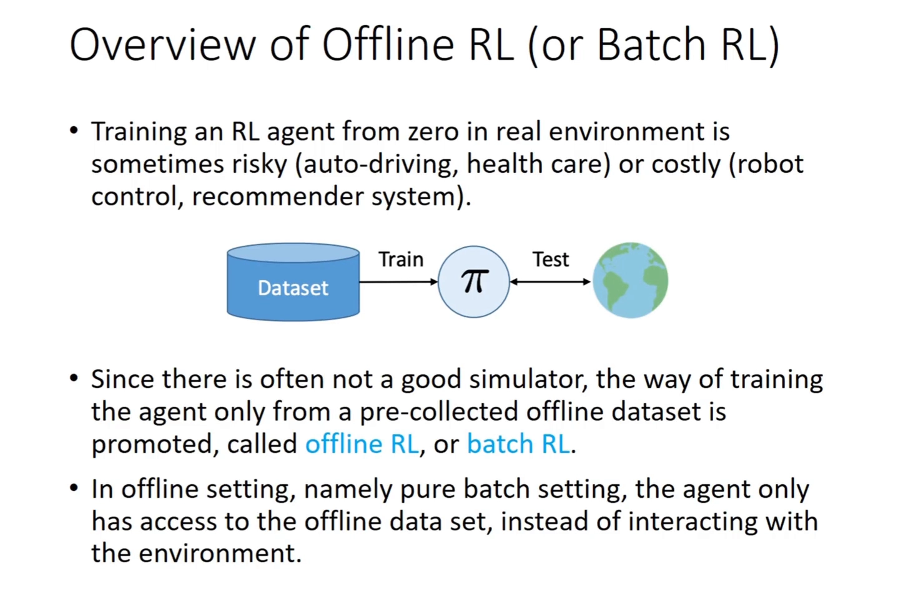
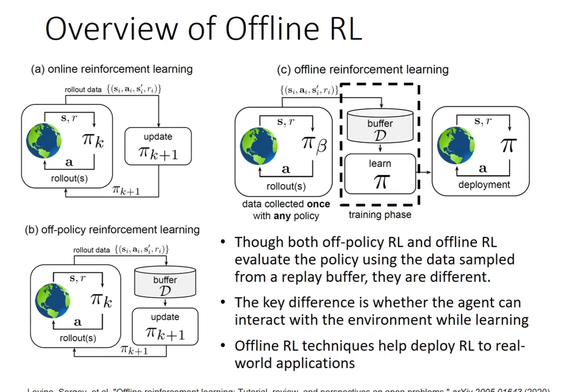
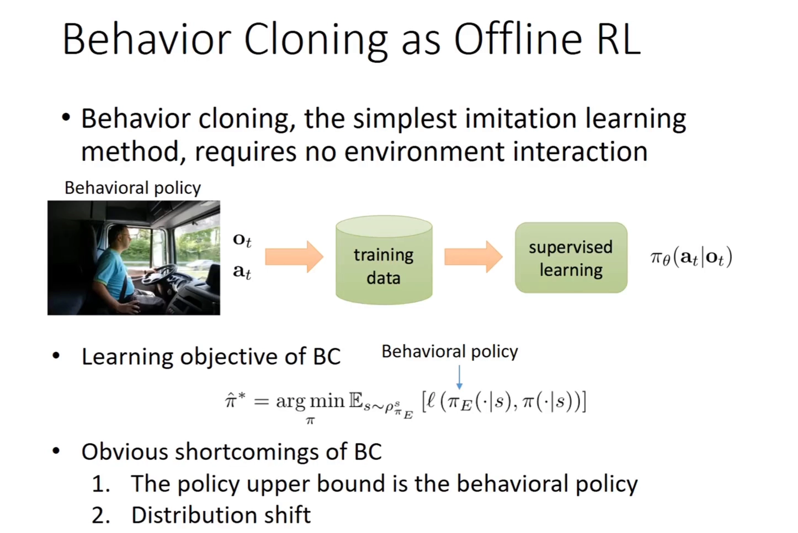
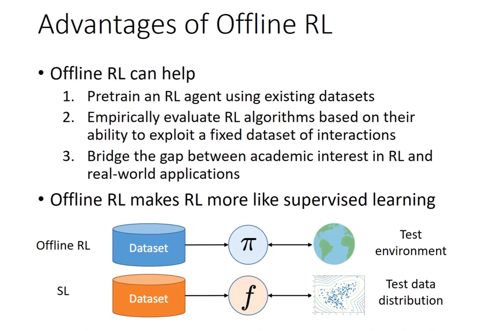
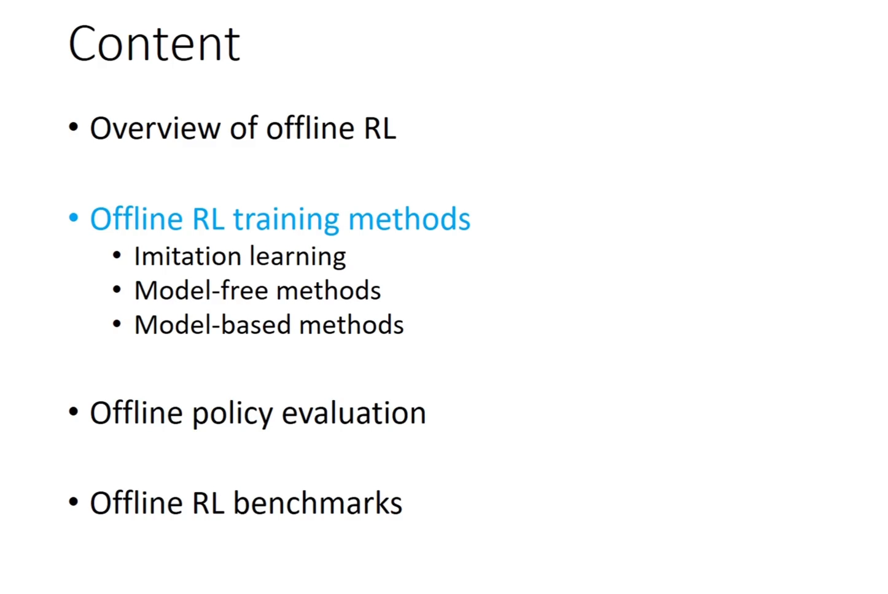
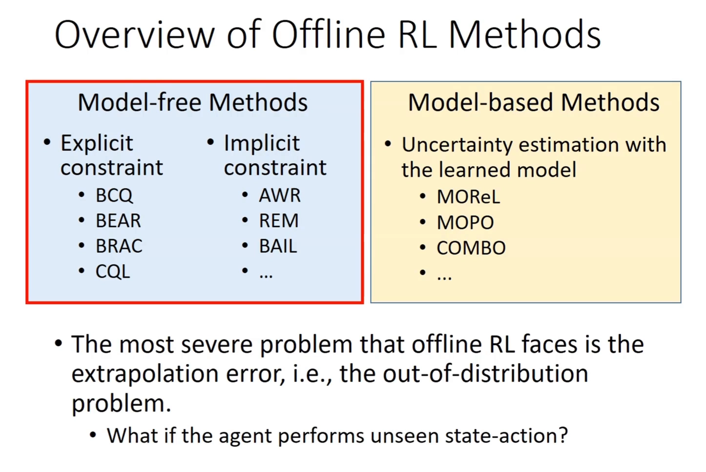

# 离线强化学习：冻结数据集上的范式转移

> 前 11 章的方法——动态规划、蒙特卡洛、TD、DQN、策略梯度、PPO、SAC，以及刚讲完的模仿学习——有一个共同前提：**策略在训练过程中能碰到环境**。哪怕是最省数据的离轨策略（off-policy）方法，也要不停地往回放缓冲区（replay buffer）里灌新数据。这一章换掉这个前提：**只给一个固定数据集，训练期间一次都不许和环境交互**。
>
> 本篇走「工程 / 地图侧」：哪些真实场景真的需要离线 RL、每个场景的约束是什么、方法分成哪几路、数据集怎么分档。**设定为什么成立、静态数据凭什么能超过数据集、代价在哪里，见同目录的[离线强化学习的设定与它为何能超越数据集](离线强化学习的设定与它为何能超越数据集.md)。**

## 本讲要解决的核心问题（SCQA）

**背景**：强化学习（reinforcement learning, RL）的标准范式是「与环境交互 → 收集数据 → 更新策略 → 再交互」。这套循环在游戏、仿真器里跑得很好，因为试错的代价只是一点算力。

**冲突**：真实世界不提供这种循环。自动驾驶不能让未训练好的策略上路，医疗不能让未验证的方案上病人，推荐系统不能把随机推荐推给用户去「探索」——一次错误的代价可能是事故、是病人的生命、是几十亿的营收。而工业界手里真正有的，往往只是一批**别人留下的、改不了采集过程的日志**。

**疑问**：那么，到底哪些场景非离线不可、各自的约束差在哪？既然数据不能选，方法上分几路来对付它？拿到一批数据，怎么判断它算好数据还是坏数据？

**回答（中心思想）**：离线 RL 把「与环境交互」这一步从训练流程里剪掉，只保留「数据集 → 策略」这条通路，因此它天然贴近监督学习的工程形态（给定数据集、训练、离线评估）。围绕这条通路，工程上有三件事要回答：**哪些场景必须这么做**（第三节）、**算法分几路去防止策略跑出数据范围**（第四节）、**数据本身怎么分档**（第五节）。

[【跳转到 01:08】](https://www.bilibili.com/video/BV1Qopze2EYU/?t=68)

---

## 一、设定：训练期只碰数据，不碰环境

一句话：**离线收集到一批数据，让策略和这批数据进行交互、进行训练；但在训练过程中，这个策略不和真实环境发生任何交互。** 只有在测试阶段，智能体才回到真实环境里跑一遍，测出它的性能。

写成式子就是：给定一个由行为策略（behavior policy）$\pi_\beta$ 收集的静态数据集 $\mathcal{D} = \{(s_i, a_i, r_i, s'_i)\}_{i=1}^{N}$，只依赖 $\mathcal{D}$ 求一个最大化折扣回报的策略，**且训练期间不与环境交互**。目标和普通 RL 一模一样，被改掉的只有「数据从哪来」这一条约束；形式化的完整写法与「模型只在 $s,a \sim \pi_\beta$ 时有效」这句附注，见[另一篇](离线强化学习的设定与它为何能超越数据集.md)的第一节。

这个设定读起来**很像一个监督学习的 setting**：给定一个数据集训练模型，再在测试分布上评估性能——只不过这里的「模型」是策略，「测试分布」是测试环境。这个类比不是修辞，它直接决定了离线 RL 的工程价值：数据可以攒、可以买、可以从日志里挖，训练可以反复重跑、可以离线做大规模超参搜索，**而这一切都不需要线上环境陪着**。

**为什么它以前叫 batch RL**：机器学习里讲 batch learning，是因为拿着一批固定的数据可以分析模型的泛化误差；而在 RL 里，只要你能交互出几乎无限的数据，数据本身就会覆盖掉整个分布，这种「可分析性」就消失了。所以早期研究为了让机器学习里那套误差理论能搬进 RL，**不得不把交互出的数据变成 fixed 并且 limited**——这就是 batch 这个词的由来。它说明离线 RL 从一开始就带着「用统计学习理论解释 RL」的野心，而不只是「没环境时的一个将就方案」。

---

## 二、和已有范式的关系：只差「数据从哪来」

### 2.1 自来水的三个比喻

视频用三个生活化的比喻把 on-policy、off-policy、offline 串在一条线上，非常值得记住：

| 范式 | 比喻 | 数据的使用方式 | 代价 |
| :--- | :--- | :--- | :--- |
| 同轨策略 on-policy | 在**水龙头**下洗手，水直接流走 | 数据只学一遍就扔掉，更新完立刻重新采样 | 数据最贵 |
| 离轨策略 off-policy | 水龙头下放个**脸盆**接水，满了就流走 | 数据进回放缓冲区，可重复采样，但只保留最近一段 | 数据有折损，效果不如 on-policy |
| 离线 offline RL | 只有**一桶死水** | 数据完全冻结，洗完还是这些水 | 最省数据，但性能无从保证 |

「数据有折损」不是比喻里的修辞。on-policy 的数据永远来自当前策略，梯度是无偏的；off-policy 一旦从旧策略的数据里采样，就要靠重要性采样或自举来补偿分布差，训练效果通常不如 on-policy 那样「干净」。而离线 RL 把这种折损推到极端：**桶里的水不但不会更新，连「桶是谁灌的」你都未必知道。**

### 2.2 关键判据：训练时还能不能采新数据

[【跳转到 03:34】](https://www.bilibili.com/video/BV1Qopze2EYU/?t=214)

这张图是本节的核心。幻灯片上的原话是：**off-policy RL 和 offline RL 都用回放缓冲区里采样出来的数据来评估策略，但两者不同；关键区别在于「学习过程中智能体还能不能与环境交互」。**

这句话值得反复咀嚼，因为它澄清了一个极常见的混淆：

- **off-policy ≠ offline**。DQN、SAC 都是 off-policy，但它们的 buffer 是**活的**：策略一边学，一边还在往 buffer 里写新数据。旧数据只是被重复利用，不是被冻结。
- **offline 的 buffer 是死的**。数据集在训练开始前就固定，训练期间一条新样本也不会产生。所以离线 RL 面对的数据分布**与目标策略无关**——它由某个你未必知道的行为策略 $\pi_\beta$ 决定。

换句话说：off-policy 解决的是「旧数据能不能多用几次」，offline 解决的是「只有旧数据，一次新的都没有」。前者是效率问题，后者是可行性问题。

---

## 三、为什么真实世界需要它：场景与各自的约束

视频给的场景不是泛泛而谈，每个都带着具体约束。按「约束来自哪里」可以归成三类。

### 3.1 约束来自「在线试错会直接造成损失」

- **推荐系统 / 广告系统 / 用户行为定向（behavior targeting）**：这是视频里讲得最细的一个。工业界的做法是收集一段时间的日志，每三天或每一周把新数据和历史数据合在一起，重新训练一个点击率（click-through rate, CTR）预估模型。视频特别强调：**大家不太会拿在线的数据直接去微调模型——那非常危险，微调没调好，整个系统就崩了，损失几十亿是很有可能会发生的事。** 现在常见的折中是：模型参数不动，只让序列模型对历史数据做一次快速 update——但整个训练过程**仍然是一个离线 RL 的过程**。
- **医疗 / health care**：不可能让没有训练好的 agent 直接和病人交互，「这会产生非常恐怖的后果」。视频把它与自动驾驶并列为「训练期不能交互」的两个典型。
- **自动驾驶**：在仿真器里可以 on-policy 地练，但它对真实环境没有任何影响；一旦要上真车，就必须先离线把策略练到足够好。

### 3.2 约束来自「数据是别人留下的，你改不了采集过程」

[【跳转到 07:21】](https://www.bilibili.com/video/BV1Qopze2EYU/?t=441)

- **工厂 / 工业控制的操作数据**：这类数据是操作员干出来的，性能是人调的。视频的判断很直接：想靠这批数据去**优化**原来的操作，你会发现「没有优化的可能性」——因为数据里的行为本身就是那个水平，你依样画葫芦学出来，最好也就和它一样，还可能因为复合误差更差。这正是上图那张幻灯片要说明的事：行为克隆（behavior cloning, BC）的上界就是行为策略本身。

### 3.3 约束来自「数据本来就有，只是没被当成 RL 数据用」

- **游戏与棋类**：王者荣耀团队训练出人类水平的 AI，用的是玩家对局数据加行为克隆；AlphaGo 起步时也是在 30 万盘棋谱上做监督学习。视频的定性是：**这些完全就是离线 RL**——训练过程中 agent 和环境没有任何交互。它们的价值在于「预训练（pretrain）一个 agent」，先让它达到一个水平，再谈后续。

### 3.4 三点好处

[【跳转到 05:49】](https://www.bilibili.com/video/BV1Qopze2EYU/?t=349)

幻灯片把好处归成三条，第三条尤其值得注意：

1. **用现成数据集预训练一个 RL agent**——不打扰任何环境，先让 agent 达到一个可用水平。
2. **用一个固定数据集来实证评估算法**——一个算法「有多大概率能依靠一份离线给定的数据集」，本身就是算法能力的一部分。这一条把离线 RL 从「应用技巧」提升成了「基准测试平台」：有了固定数据集，不同算法才第一次能在完全相同的条件下比较。
3. **连接学术界对 RL 的兴趣与真实世界的应用**——学术研究里常见的是 on-policy 或 off-policy，而真实应用「总是你得离线训练」。

---

## 四、三条技术路线：先给一张地图

离线 RL 的方法很多，但按「怎么防止策略跑到数据支撑集之外」这个共同关切，可以归成三类。视频先给了一张内容表，再给了一张方法总览。

[【跳转到 07:14】](https://www.bilibili.com/video/BV1Qopze2EYU/?t=434)

[【跳转到 09:31】](https://www.bilibili.com/video/BV1Qopze2EYU/?t=571)

三类方法的共同逻辑，视频讲得很清楚：

- **显式约束（explicit constraint）**：在损失函数里**显式**写一项，不让策略走到离数据支撑集太远的地方。理由是：在支撑集之外，你拿不到环境的反馈，只能靠模型的归纳偏置（inductive bias）在分布外的位置做「自然泛化」，这很危险。代表方法：BCQ、BEAR、BRAC、CQL（幻灯片把 CQL 归在这一栏）。
- **隐式约束（implicit constraint）**：公式里不写约束项，但**做法本身**就把策略限制在数据支撑集上。代表方法：AWR、REM、BAIL。
- **基于模型（model-based）**：既然不能和环境交互，那就先学一个环境模型，训练时和这个模型交互，再套用现成的 on-policy / off-policy 算法。代表方法：MOReL、MOPO、COMBO。

对照本系列的后续安排，这张地图可以这样读：

| 路线 | 一句话 | 本系列对应 |
| :--- | :--- | :--- |
| 策略约束 | 让学到的策略别离行为策略太远 | 12.3（BCQ、BEAR） |
| 保守价值估计 | 让价值函数对没见过的动作给出偏低的估计 | 12.4（CQL、IQL） |
| 序列建模 | 把轨迹当成序列，用 Transformer 直接建模 | 12.5（Decision Transformer） |

需要说明的是，**第三类「序列建模」不在这支视频的讨论范围内**——视频讲的是 2020 年前后的主流方法，Decision Transformer 那条线放在 12.5 单独讲。

---

## 五、数据集质量谱系：D4RL 的五档分类

> 本节两支视频都没有展开，属于离线 RL 基准 D4RL 的公开分类与观察，列在这里作为「怎么给数据分级」的对照表，方便后续章节对照实验设置。

离线 RL 的算法表现高度依赖数据集本身，所以社区需要一个统一的「数据分级」标准。D4RL 基准按**行为策略的水平**把同一环境的数据集分成五档：

| 数据档位 | 收集方式 | 特点 |
| :--- | :--- | :--- |
| random | 随机策略 | 覆盖广，但奖励极低，几乎没有「好片段」 |
| medium | 训练到中等水平的策略（如中等水平的 SAC） | 行为尚可但远非最优，数据同质 |
| medium-replay | 上述中等策略**训练过程中**回放缓冲区里的全部内容 | 混合了早期很差与后期较好的行为，质量跨度大 |
| medium-expert | 中等策略与专家策略的数据混合 | 质量双峰分布，考验「挑好的」能力 |
| expert | 专家策略 | 质量最高，但**覆盖最窄** |

这里有一个常被提到的反直觉现象：**数据质量并不是越高越好**。expert 数据虽然每一步都接近最优，但它只覆盖了专家走过的那条窄路，策略没有机会看到「另一种走法」，也就没有拼接空间；而 random 或 medium-replay 这类覆盖更广、质量更杂的数据，反而给「筛选 + 拼接」留出了余地。因此在 D4RL 上，**某些算法在 random 数据上的表现会好于 expert 数据**，而行为克隆这类只会「复制」的方法则正好相反——它在 expert 上很强，在 random 上直接崩掉。这也解释了为什么离线 RL 的基准必须同时报告多档数据，而不是只报一个平均数。

---

## 六、核心挑战预告：外推误差

上面那张方法总览的底部写着一句话：**离线 RL 面临的最严重问题是外推误差（extrapolation error），也就是分布外（out-of-distribution, OOD）问题**——如果 agent 执行了没见过的状态-动作对，会发生什么？

视频用机器学习里的两个概念做了对照：内插（interpolation）是在已有数据点之间做泛化，外推（extrapolation）是往数据范围之外推。前者有数据兜底，后者没有；而参数化模型在数据外延处的行为**没有任何保证**。

至于这个误差怎么产生、为什么价值会被系统性高估、$\frac{1}{1-\gamma}$ 如何把误差放大、以及支持集与保守性怎么设计——这些是 **12.2 的核心内容**，本篇只点到为止。想先看「为什么静态数据能超过数据集」这一侧的原理，可以回到[另一篇](离线强化学习的设定与它为何能超越数据集.md)的第四节。

---

## 小结

- **设定**：只给一个静态数据集 $\mathcal{D} = \{(s_i,a_i,r_i,s'_i)\}$，训练期间不与环境交互，训完才部署评估。旧名叫 batch RL，动机是让机器学习的误差理论可以搬进 RL。
- **与 off-policy 的分界只有一条**：训练时还能不能采新数据。DQN/SAC 的 buffer 是活的，离线 RL 的 buffer 是冻结的，而且数据分布与目标策略无关。
- **真实世界的三类约束**：在线试错直接造成损失（推荐、医疗、自动驾驶）、数据是别人留下的改不了采集过程（工厂操作数据）、数据本来就有只是没被当 RL 数据用（玩家对局、棋谱）。
- **三条路线**：显式/隐式约束（12.3）、保守价值估计（12.4）、序列建模（12.5）。它们都在回答同一个问题：怎么防止策略跑到数据支撑集之外。
- **数据分级**：D4RL 按行为策略水平分 random / medium / medium-replay / medium-expert / expert 五档；数据质量并非越高越好，覆盖窄的 expert 数据反而可能让某些算法表现更差。
- **核心挑战**：外推误差 / OOD 动作，12.2 展开。

## 关键术语速查

| 术语 | 一句话解释 |
| :--- | :--- |
| 离线强化学习（offline RL） | 只用一个固定数据集训练策略，训练期间不与环境交互 |
| batch RL | 离线 RL 的旧称，强调数据是 fixed 且 limited 的一批 |
| 行为策略 $\pi_\beta$ | 当初收集数据时在环境里执行的那个策略，离线 RL 通常不知道它是什么 |
| 回放缓冲区（replay buffer） | 存放历史转移的容器；off-policy 的 buffer 持续写入，offline 的 buffer 冻结 |
| 复合误差（compounding error） | 模仿学习中策略一旦偏离专家分布，误差会沿轨迹累积放大 |
| 外推误差（extrapolation error） | 在数据支撑集之外估计价值所产生的误差，离线 RL 最严重的问题 |
| 数据支撑集（data support） | 数据集中真实出现过的状态-动作对构成的集合 |

## 参考视频

- 张伟楠《强化学习课程》第 13 讲：离线强化学习（上海交通大学），[BV1Qopze2EYU](https://www.bilibili.com/video/BV1Qopze2EYU/)