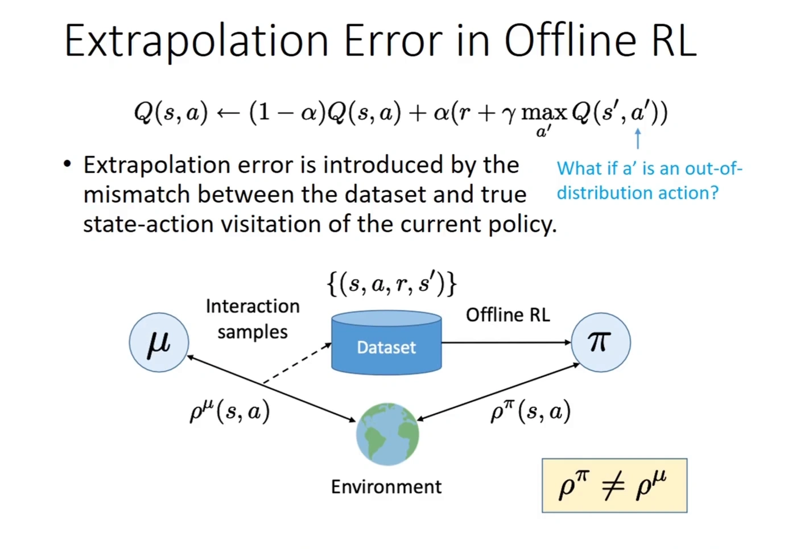
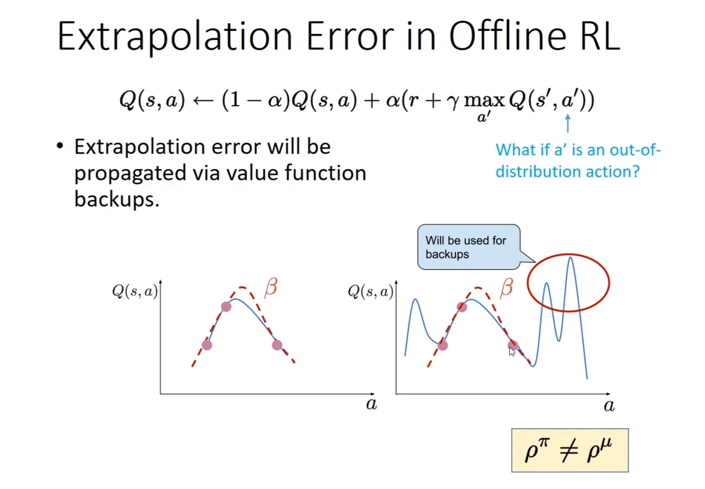
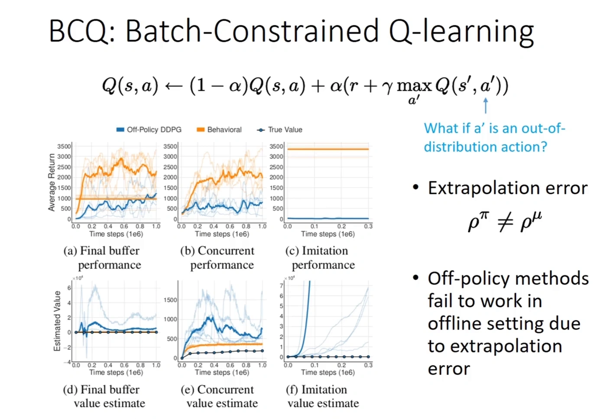
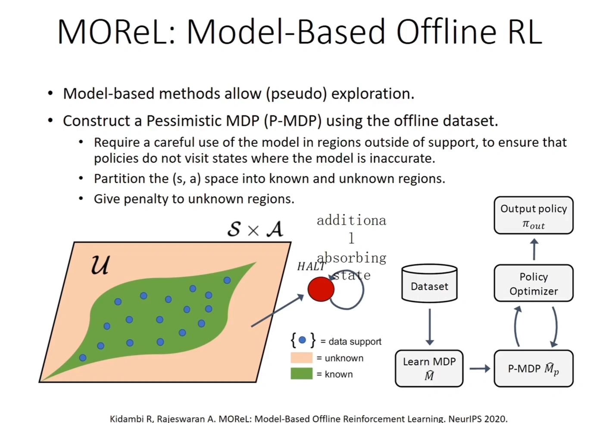
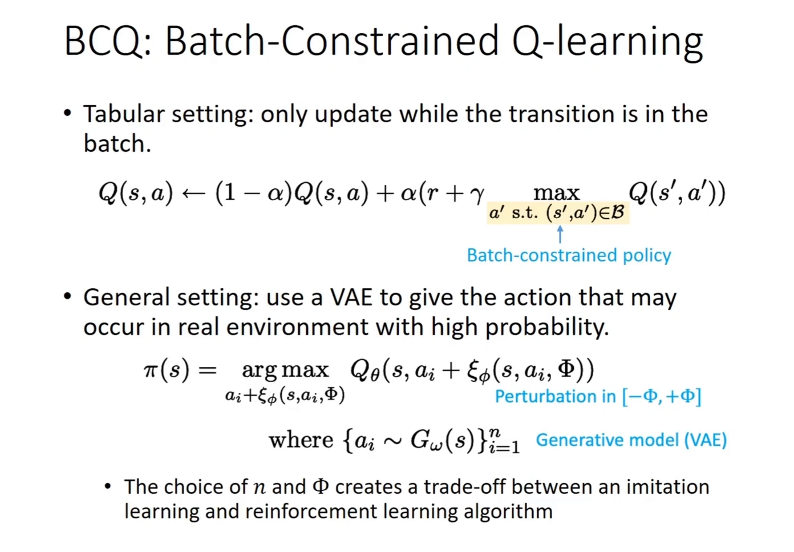
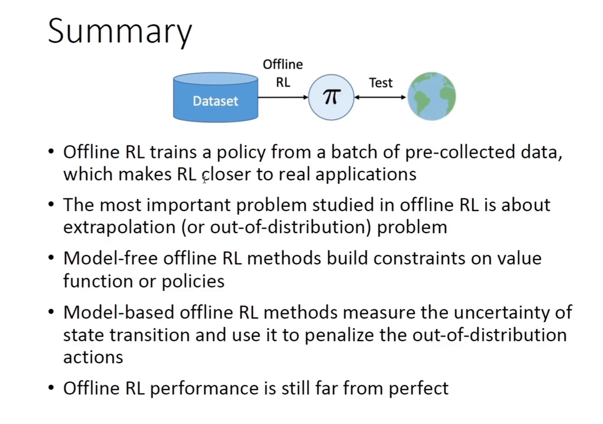

# 外推误差：离线强化学习为何会高估没见过的动作

> 承接 12.1：离线强化学习的设定是「只有一份固定的数据集，训练中不再与环境交互」。这一篇不重复它是什么、用在哪里，只回答一个技术问题——**把在线算法原样搬到这份静态数据上，为什么会失败**。本文依据上海交通大学张伟楠《强化学习》课程第 13 讲中讲外推误差（extrapolation error）的部分整理。

## 本讲要解决的核心问题（SCQA）

**背景**：离线强化学习看起来只是把「在线采样」换成「读一份数据集」，其余照旧：还是 Q-learning，还是贝尔曼 backup，还是同一个网络结构。既然数据里有状态、动作、奖励、下一状态，似乎直接跑起来就行。

**冲突**：直接跑的结果不是「效果差一点」，而是**训练曲线先升后崩、Q 值一路发散**。数据本身没有错，错的是算法在被问到一些**数据集里根本没有的动作**时，仍然给出了一个自信的数值。

**疑问**：训练明明只在数据点上做，误差是从哪里冒出来的？为什么在线 RL 里同样的算法就没这个问题？

**回答（中心思想）**：问题出在**外推误差**（extrapolation error）。Q-learning 的目标里有一个 $\max_{a'}$，它会把「网络在无数据区域随手画出来的高值」当成真值写进目标，再沿 backup 传回整个状态空间。在线 RL 里这个错误会被真实交互纠正，离线 RL 里没有纠正机会，错误被固化并被策略主动追逐。

[【跳转到 11:20】](https://www.bilibili.com/video/BV1Qopze2EYU/?t=680)

上图是这一讲的核心一页。上面是 Q-learning 的更新式，箭头指向其中的 $\max_{a'} Q(s',a')$，旁边一行小字问：**如果 $a'$ 是一个分布外的动作呢？** 下面的示意图把分布偏移画清楚了：行为策略 $\mu$ 与环境交互，产生数据集 $\{(s,a,r,s')\}$，离线算法从数据集里学出策略 $\pi$；但 $\mu$ 访问过的状态动作分布 $\rho^{\mu}(s,a)$ 和 $\pi$ 真正会访问的 $\rho^{\pi}(s,a)$ 并不是同一个分布——右下角那行黄底公式就是全篇的根源：

$$
\rho^{\pi}(s,a) \neq \rho^{\mu}(s,a)
$$

---

## 一、问题出在 $\max$ 那一步

把 Q-learning 的更新写全：

$$
Q(s,a) \leftarrow (1-\alpha)\,Q(s,a) + \alpha\Big(r + \gamma \max_{a'} Q(s',a')\Big)
$$

左边要更新的 $Q(s,a)$，其 $(s,a)$ 是从数据集里采的，这一步没有问题——它落在有数据的地方。问题在右边：目标值 $r + \gamma \max_{a'} Q(s',a')$ 里的 $a'$ 是**对 $Q$ 求最大挑出来的**，没有任何机制保证这个 $a'$ 在数据集里出现过。

于是出现一个很别扭的结构：**我们在有数据的地方做学习，却用无数据地方的预测当标签。**

讲者把这一点讲得很直白：如果是在线 Q-learning，你在 $s'$ 上挑出最大的那个 $a'$，接下来就会真的执行它、拿到真实回报，错误当场被纠正；但在离线设定下「咱就碰不到它」——你永远拿不到那个 $(s',a')$ 的真实回报，模型在数据外延上做出的泛化「就一直会在那个地方」。误差由此从数据支撑集之外，**传递到数据支撑集之内的估计上**。

这也解释了为什么这不是「数据不够多」的问题：哪怕你在数据集覆盖的每个点上都拟合得很准，只要 $\max$ 把你带到覆盖之外，那个点的值就是无约束的。

## 二、误差会沿 backup 一路传回来

单点的高估还不是最糟的。真正让它致命的是**它会被写进目标、再传回更早的状态**。

[【跳转到 13:00】](https://www.bilibili.com/video/BV1Qopze2EYU/?t=780)

左图是理想情况：红色虚线是真实的 $Q$ 曲线，蓝色实线是网络拟合的结果，两者在数据点（圆点）附近基本重合，用哪个动作做 backup 都差不多。

右图是离线设定下的真实情况：数据只覆盖中间一段，网络在两侧**没有任何约束**，于是画出了几个高高的尖峰。而 $\max_{a'}$ 恰恰会挑中最高那根——图上被红圈圈出的位置，标注写着「Will be used for backups」（将被用作 backup 的目标）。

这里有一个容易被忽略的因果链：

1. 网络在无数据区域给了一个偏高的值；
2. $\max_{a'}$ 系统性地挑中它（因为它是最大的）；
3. 这个高值被写进目标 $r + \gamma \max_{a'} Q(s',a')$；
4. 通过一次 backup，它变成前一个状态的价值估计；
5. 前一个状态的高估又成为更早状态的目标……

讲者用一句话概括这个循环：**误差不只是最后选动作时才出现，它会沿着训练链传播。** 这就是离线 RL 里 Q 值会整体抬升、而不是只在某个角落出错的机制。

## 三、实验证据：off-policy 方法在离线设定下估值爆掉

上面是机制推演，下面这张图是它的实验版本——来自 BCQ 论文（Fujimoto 等，2019）的对比实验。

[【跳转到 13:40】](https://www.bilibili.com/video/BV1Qopze2EYU/?t=820)

上排 (a)(b)(c) 是**平均回报**：蓝线是 off-policy 的 DDPG，橙线是行为策略（behavioral），黑线是真实值。下排 (d)(e)(f) 是**估计价值**（estimated value），注意纵轴已经换成了 $10^{4}$ 量级。

看下排：黑线（真实价值）几乎贴着 0，而蓝线（DDPG 自己认为的价值）一路往上冲，在 (f) 这个「只用模仿数据」的设定里甚至涨到了 $10^{7}$ 量级。也就是说，**算法坚信自己做得极好，实际回报却很差**——这正是第二节那条因果链在真实任务上的样子。

幻灯片右侧的两行结论把话说得很直接：

- Extrapolation error $\rho^{\pi} \neq \rho^{\mu}$；
- **Off-policy methods fail to work in offline setting due to extrapolation error**（off-policy 方法因为外推误差，在离线设定下根本不工作）。

这也是「离线 RL 不是把 SAC 的数据换成静态的就完事」最直接的证据：算法本身没坏，坏的是它在无数据区域被问价时给不出有意义的答案。

## 四、为什么 Double Q 解决不了

熟悉第 6 章的话，这里会有一个自然的疑问：$\max$ 带来的高估不是已经用 Double Q-learning 处理过了吗？

两者的性质不同，不能互相替代。

| | 6.4 讲的高估 | 12.2 讲的高估 |
| :--- | :--- | :--- |
| 来源 | $\max$ 算子的统计偏差：对带噪声的估计取最大，期望上偏高 | 数据覆盖不足：网络在无数据区域给出无约束的预测 |
| 是否可缓解 | 可以，Double Q 用两个估计解耦「选动作」与「评估动作」 | 不能，换多少个估计器，无数据区域仍然无数据 |
| 是否有纠错机会 | 有，在线交互会立刻暴露错误 | 没有，离线设定下永远拿不到那个 $(s',a')$ 的真实回报 |

讲者在讲 BCQ 时也点到了这层关系：Double Q 缓解的是「过高估计」这件事本身，但**如果过高估计又发生在数据支撑集之外，问题会更严重**——因为此时连「这个值大概偏高多少」的量级都无从判断。

一句话：Double Q 治的是**噪声**，离线 RL 面对的是**空白**。

## 五、误差累积：$\gamma$ 折扣下的放大

把上面的直觉写成一个量级关系。设某个状态上的价值估计误差为 $\epsilon$，它会以 $\gamma$ 的比例被写进前一个状态的目标；再往前传一层，又乘一次 $\gamma$。于是沿一条长链回溯，累计误差量级是

$$
\epsilon + \gamma \epsilon + \gamma^{2}\epsilon + \cdots \;\approx\; \frac{\epsilon}{1-\gamma}
$$

$\gamma$ 越接近 1，这个放大因子越可怕：$\gamma = 0.99$ 时是 100 倍，$\gamma = 0.999$ 时是 1000 倍。也就是说，**单个状态上一个看起来不大的外推误差，会被长程折扣累加成一个不可忽略的量**。这解释了为什么长程任务上的离线 RL 格外难训。

这个结构和 10.2 讲的**复合误差**（compounding error）是同构的：都是「单步误差被长程放大，放大因子是 $\frac{1}{1-\gamma}$」。但成因不同，值得对照着记：

- 10.2 的复合误差来自**模型误差**——学到的动力学模型在每一步都有一点偏差，规划时被反复代入；
- 12.2 的外推误差来自**分布偏移**——策略访问的分布与数据分布不同，误差从无数据区域被 $\max$ 拉进目标。

同一把放大尺子，量的是两种不同的错误来源。

## 六、支持集与保守性

讲到这里，可以把两个后面反复出现的概念先定下来。

**支持集（support）**：数据集里真实出现过的 $(s,a)$ 集合。理想情况下，学出来的策略应当把自己的动作支撑在数据集的支持集之内——不是「动作要一模一样」，而是「不要跑到数据从没覆盖过的地方去」。

**保守性（conservatism）**：对没有数据支持的区域给**悲观**估计，而不是让网络自由外推。既然无数据区域的真实值无从得知，与其乐观地猜一个高值，不如压低它。

[【跳转到 26:40】](https://www.bilibili.com/video/BV1Qopze2EYU/?t=1600)

这张图来自 model-based 分支的 MOReL，但它把「支持集 + 保守」这个想法画得最清楚：左边是整个 $\mathcal{S} \times \mathcal{A}$ 空间，绿色是数据支撑集（known），橙色是未知区域（unknown）；右边是做法——把 $(s,a)$ 空间划分成已知与未知，**对未知区域给惩罚**，走出已知区域就进入一个吸收态（absorbing state）并给负奖励，让策略学会不要走出去。

这个例子属于 model-based 路线（学一个环境模型，对模型的不确定区域做惩罚），具体算法不在本篇展开。但它说明的是一条通用原则：**保守不是保守在策略上，而是保守在对未知区域的估值上。**

## 七、三种应对思路，动机从哪里来

有了上面的机制，后面三节的算法就不再是「一堆技巧」，而是对同一条因果链的三个不同切法。

[【跳转到 14:00】](https://www.bilibili.com/video/BV1Qopze2EYU/?t=840)

**思路一：约束策略，不要选 OOD 动作。** 既然错误来自「$\max$ 挑中了数据外的动作」，最直接的办法就是把 $\max$ 的候选集合限制住。tabular 设定下就是图上第一行——只在 batch 里出现过的 $(s',a')$ 上取最大：

$$
Q(s,a) \leftarrow (1-\alpha)Q(s,a) + \alpha\Big(r + \gamma \max_{a'\ \text{s.t.}\ (s',a') \in \mathcal{B}} Q(s',a')\Big)
$$

连续动作下没法「划等号」，BCQ 的做法是用一个 VAE 作为生成模型 $G_\omega(s)$ 产生 $n$ 个「可能出现在真实环境里」的候选动作 $a_i$，再在候选上加一个小扰动 $\xi_\phi$，最后在这 $n$ 个候选里选 Q 值最大的：

$$
\pi(s) = \arg\max_{a_i + \xi_\phi(s,a_i,\Phi)} Q_\theta\big(s,\, a_i + \xi_\phi(s,a_i,\Phi)\big), \qquad \{a_i \sim G_\omega(s)\}_{i=1}^{n}
$$

候选数 $n$ 与扰动幅度 $\Phi$ 就是「模仿」与「强化」之间的旋钮——$n$ 越小、$\Phi$ 越窄，越接近行为克隆；反过来才有改进空间。具体算法见 12.3。

**思路二：不约束策略，改压低 OOD 动作的 Q 值。** 与其限制策略能去哪，不如让「去了没数据的地方」这件事本身在数值上不划算。这就是 CQL 的保守正则项，见 12.4。

**思路三：干脆不做价值估计。** 上面所有麻烦都来自 $\max_{a'} Q(s',a')$ 这个查询；如果改用序列建模，把「回报」当作条件而不是当作要被最大化的目标，就绕开了这个查询。这是 Decision Transformer 的出发点，见 12.5。

## 八、小结

[【跳转到 35:00】](https://www.bilibili.com/video/BV1Qopze2EYU/?t=2100)

把这一篇的因果链压缩成四步：

1. 数据集只覆盖行为策略访问过的 $(s,a)$；
2. Q-learning 的目标里有 $\max_{a'}$，它会挑中网络在无数据区域随手画出的高值；
3. 这个高值被写进目标，沿 backup 传回整个状态空间，量级被 $\frac{1}{1-\gamma}$ 放大；
4. 离线设定下没有真实交互来纠正它，策略还会主动去找这些被高估的动作，越训越偏。

幻灯片最后一行也留了一句实话：**Offline RL performance is still far from perfect**。这不是一门已经解决的技术的总结，而是一个仍在推进的方向。

---

## 附：本讲要点速查

| 概念 | 一句话 |
| :--- | :--- |
| 外推误差 | 网络在数据支撑集之外的预测没有约束，而 $\max$ 会把这些无约束的预测拉进目标 |
| 分布偏移 | $\rho^{\pi}(s,a) \neq \rho^{\mu}(s,a)$：策略会访问的状态动作分布与数据集不同 |
| 误差传播 | 单点高估经 backup 传回更早状态，量级被 $\frac{1}{1-\gamma}$ 放大 |
| 支持集 | 数据集真实覆盖过的 $(s,a)$ 集合；策略理想上应落在其中 |
| 保守性 | 对无数据区域给悲观估计，而不是让网络自由外推 |
| 与 Double Q 的区别 | Double Q 治 $\max$ 算子的统计偏差（噪声），这里面对的是数据空白 |