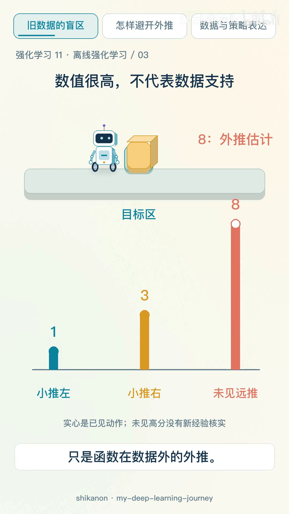
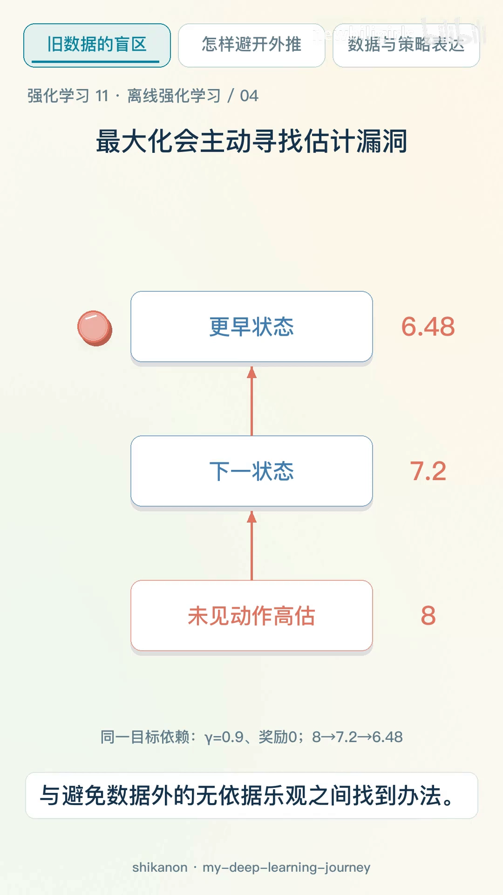
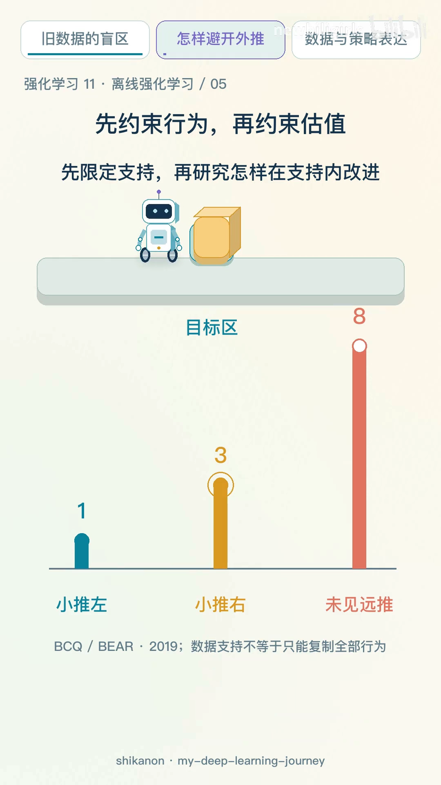

# 没见过的动作凭什么得高分

> 承接 12.2 的主线：上一篇从课程的角度把外推误差的因果链推了一遍——$\max$ 挑中数据外的高值、误差沿 backup 传播、$\frac{1}{1-\gamma}$ 放大。这一篇用七分钟的动画把同一件事讲成直觉：为什么一个从没试过的动作会被打上最高分，以及为什么「高分」和「有证据」是两个判断。

## 本讲要解决的核心问题（SCQA）

**背景**：离线强化学习给我们的是一份旧记录——某个机器人推箱子的日志。每条记录里有当时的状态、推的动作、得到的奖励和下一状态。训练期间不再让它去试新动作。

**冲突**：日志里只出现过「小推左」和「小推右」，回报分别是一分和三分。可是训出来的 Q 网络却会给一个**从没出现过的远推**打八分。八分比三分高，于是策略会去选它。

**疑问**：这个八分是从哪来的？网络凭什么对一个它没有任何信息的动作这么有把握？

**回答（中心思想）**：八分不是「算出来的」，是**函数在数据外的外推**。神经网络在无数据区域必须给出某个值，而这个值没有任何新经验来核实。更麻烦的是，价值学习的目标里带 $\max$，它会**主动去搜索**这类漏洞，把八分写进目标再传回更早的状态。

[【跳转到 00:00】](https://www.bilibili.com/video/BV1j8JD6WEho/?t=0)

---

## 一、旧数据就是边界

先看清楚离线设定到底冻结了什么。

[【跳转到 00:32】](https://www.bilibili.com/video/BV1j8JD6WEho/?t=32)

动画把一条转移拆成四个字段：旧状态、动作、奖励、新状态。这条记录是真的发生过的——机器人右推，箱子进了目标区，拿到 3 分。

关键在于下面那行红字：**记录冻结，训练不再查询新行动后果。** 在线学习里，策略执行一个新动作、观察到后果、再纠错，这个循环一直在转；离线学习把这个循环掐断了。于是「可用数据来自谁、动作覆盖多广、是否包含失败」这三件事，直接决定了它能学到什么。

## 二、数值很高，不代表数据支持

现在把同一个状态下的三个动作摆在一起。

[【跳转到 00:48】](https://www.bilibili.com/video/BV1j8JD6WEho/?t=48)

前两根柱子是实心的，对应数据里真实出现过的动作，它们的分数有据可查。第三根「未见远推」是空心的——**它没有数据，只有网络给出的一个数字**。

动画在这里给了一句很关键的判断：**高分和有证据是两个判断。** 我们在已见数据上预测得再准，也不能据此证明未见动作同样准。这不是「模型不够好」，而是任何一种参数化模型都做不到的事：你在数据点之间做内插，误差可控；你在数据之外做外推，没有任何保证。

讲者把这一点总结成一句话：**数值很高，不代表数据支持。**

## 三、最大化会主动去找漏洞

如果只是「有个别动作被高估」，还不至于毁掉训练。真正的问题是**算法会主动去找这些被高估的动作**。

[【跳转到 01:04】](https://www.bilibili.com/video/BV1j8JD6WEho/?t=64)

动画把 Q-learning 的目标拆成三层：**未见动作高估 = 8**，这个 8 进入**下一状态**的价值，再乘上折扣进入**更早状态**的目标。图上标注的设定是 $\gamma = 0.9$、奖励为 0：

$$
8 \;\rightarrow\; 7.2 \;\rightarrow\; 6.48
$$

也就是 $8 \times 0.9 = 7.2$，$7.2 \times 0.9 = 6.48$。一个凭空出现的 8 分，经过两次 backup 就变成了更早状态的 6.48 分——**而这个 6.48 落在有数据的地方**。

这一步是整条因果链的枢纽：误差不是在「最后选动作」的那一刻才出现的，它在训练过程中就已经被写进了目标。用动画里的话说，**误差不只是最后选动作时才出现，它会沿着训练链传播。**

## 四、误差沿训练链传播

[【跳转到 01:36】](https://www.bilibili.com/video/BV1j8JD6WEho/?t=96)

把这条链和在线 RL 对照，差别就出来了：

- **在线**：策略真的去执行那个动作，观察到真实回报，发现「原来没有 8 分」，错误当场被修正；
- **离线**：这个动作永远不会被执行，8 分永远不会被证伪，它只会一遍遍被写进目标、被传回更早的状态。

于是训练呈现出一种很典型的现象：**前期靠数据里的好动作提升，后期被外推出来的高估带崩。** 这不是调参能解决的问题——学习信号本身被污染了。

## 五、另一个极端：只模仿数据也不行

看到这里，一个自然的反应是：那干脆别做价值估计了，直接模仿数据里的动作，不就绕开外推了吗？

动画承认这条路可行，但指出它的代价：**完全不做改进、只模仿数据，又可能把好坏动作都照单全收。**

这是两端之间的一个夹缝：

- 往前一步做 $\max$，会被外推误差带偏；
- 退后一步只模仿，就丢掉了「从数据里挑出更好的行为」的能力，策略的上界被行为策略锁死。

离线 RL 要解的，正是这个夹缝里的问题。动画把目标说得很清楚：**在「利用数据中较好的行为」与「避免数据外的无依据乐观」之间找到办法。**

## 六、先限定支持，再在支持内改进

早期代表路线选择了前者——先把动作限制在数据支持得到的范围内，再在这个范围里做改进。

[【跳转到 01:44】](https://www.bilibili.com/video/BV1j8JD6WEho/?t=104)

图上的标记很直观：三根柱子里，被圈住的是**小推右（3 分）**——数据支持范围内的最好动作；那根 8 分被留在圈外。动画给出的路线标注是 **BCQ / BEAR（2019）**，并附了一句限定：**数据支持不等于只能复制全部行为。**

这句话是这一节的重点。约束不是「照抄数据」，而是「只在数据支持得到的地方做选择」——在支持集内部，仍然可以挑出比行为策略更好的动作（比如选 3 分的小推右，而不是 1 分的小推左）。具体算法（BCQ 的生成模型 + 扰动、BEAR 的支持集约束）留给 12.3。

另外两条思路各有各的切法：**CQL / IQL** 不动策略，改从价值估计入手，让没有证据的高分不那么诱人（12.4）；**Decision Transformer** 干脆绕开价值估计，把回报当作条件做序列建模（12.5）。动画在后面的段落里把这两条也各讲了一遍，本篇不展开。

## 七、小结

把这一篇的直觉版本压成四句话：

1. 数据集冻结，训练期间拿不到任何新动作的后果；
2. 网络在无数据区域必须给出一个数，这个数是外推，不是知识；
3. 目标里的 $\max$ 会主动挑中外推出来的高值，再沿 backup 传回更早的状态；
4. 于是「高分」和「有证据」被混为一谈——这正是离线 RL 要修的东西。

动画最后回到开头那个八分，给了一个很准确的定位：**问题不是数字大，而是它落在数据没有支持的动作上，还被最大化主动追逐。**

---

## 附：本讲要点速查

| 说法 | 含义 |
| :--- | :--- |
| 旧数据就是边界 | 训练期间不再查询新动作的后果，可用数据决定了能学到什么 |
| 数值很高不代表数据支持 | 未见动作上的高分是函数外推，没有新经验核实 |
| 高分与有证据是两个判断 | 在已见数据上预测得准，不能推出未见动作也准 |
| 最大化会主动找漏洞 | 目标里的 $\max$ 会挑中外推出来的高值，写进目标再传回更早状态 |
| 误差沿训练链传播 | $8 \rightarrow 7.2 \rightarrow 6.48$（$\gamma=0.9$）：误差从无数据处渗进有数据处 |
| 先限定支持再改进 | 约束策略落在数据支持内，但支持内仍可挑出更好的动作 |