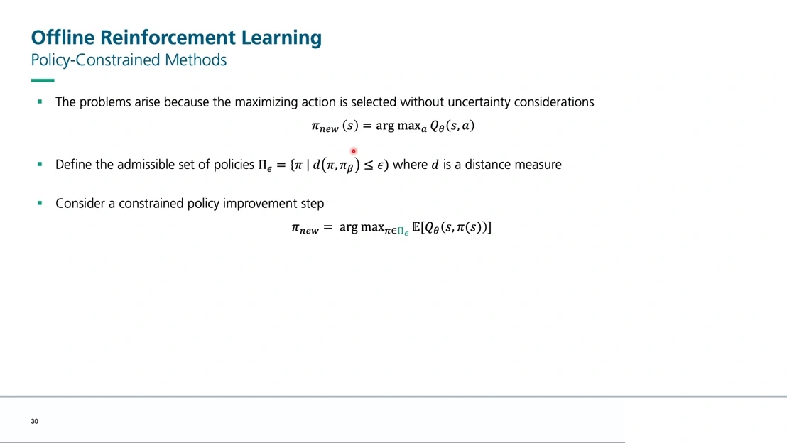
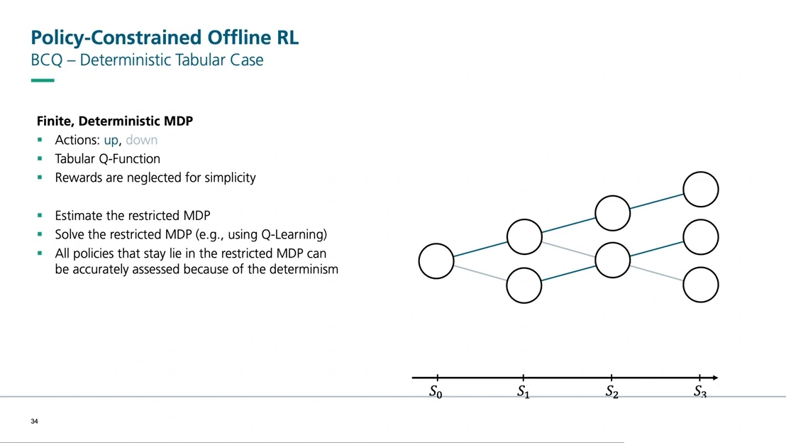
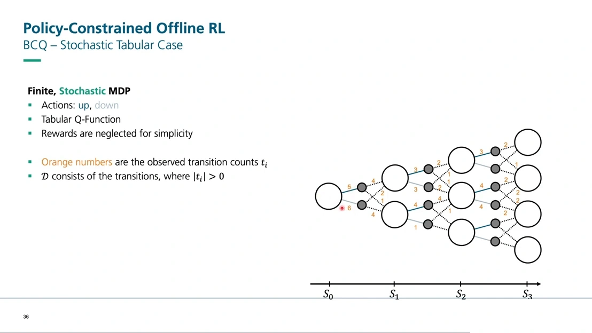
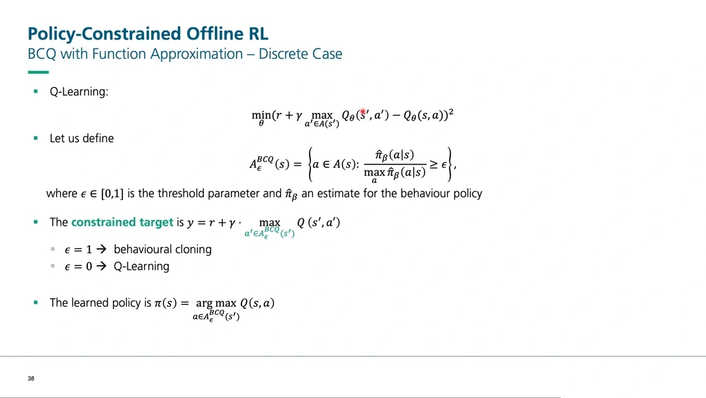
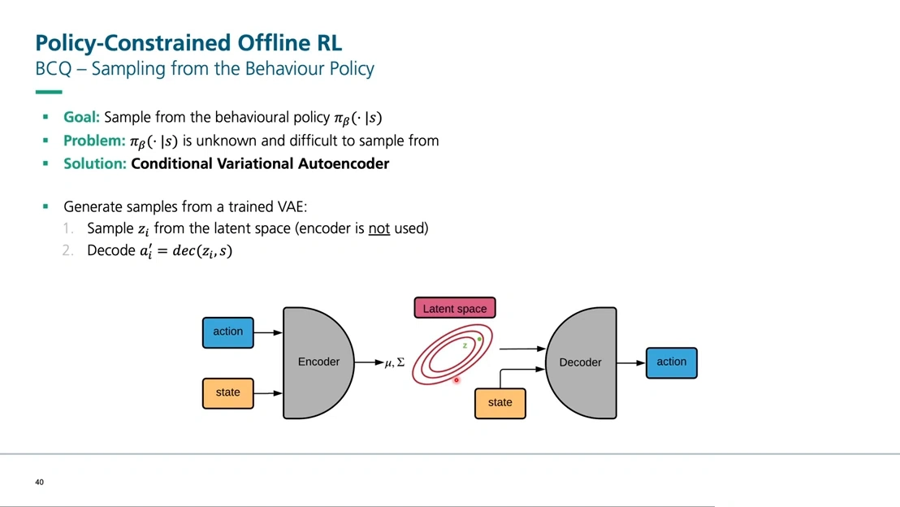
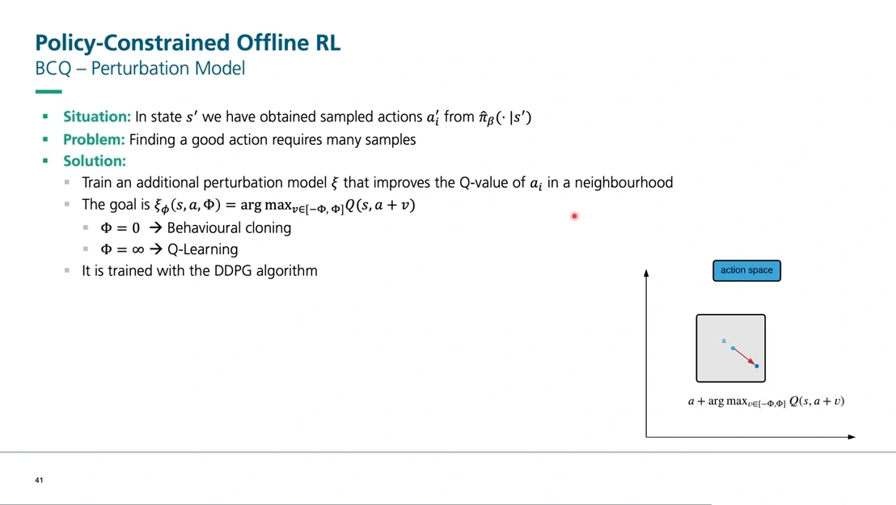
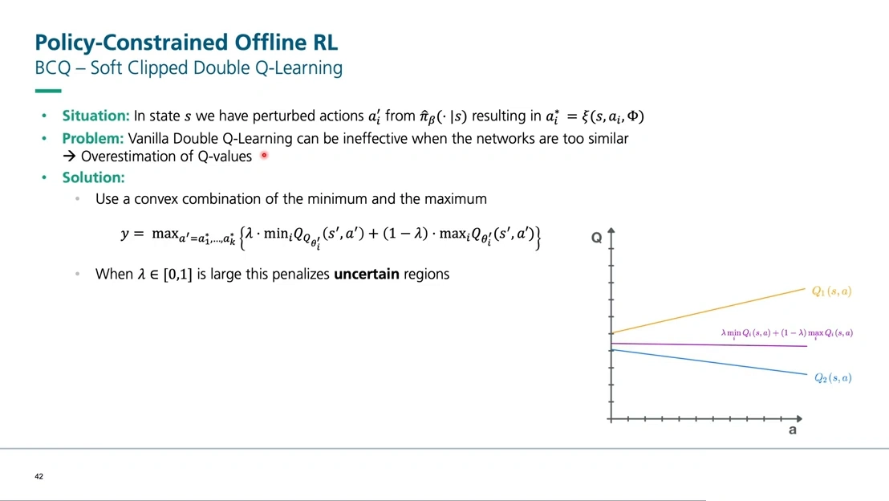
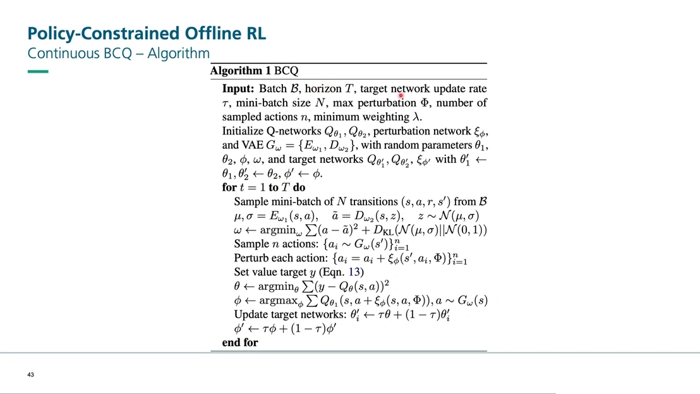
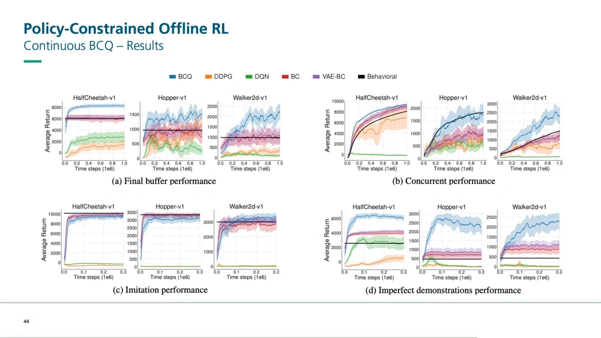

# BCQ：把动作限制在数据支持集内

> 12.2 已经把病因讲透了：$\max$ 会挑中网络在无数据区域随手画出的高值，离线设定下又没有真实交互来纠正它。本篇是「三种应对思路」里的第一条——**不换 Q 值，也不换学习目标，只改策略能选的候选动作**。本文依据一门离线强化学习课程中「Policy-constrained Offline RL」与「BEAR」两讲的 BCQ 部分整理，BCQ 由 Fujimoto 等人在 2019 年提出。

## 本讲要解决的核心问题（SCQA）

**背景**：离线强化学习的目标函数和在线版本一模一样，唯一的区别是数据来自一份固定数据集，训练中不再与环境交互。Q-learning 的更新式里依然有 $\max_{a'}$。

**冲突**：这个 $\max$ 是在**整个动作空间**上取的，而数据只覆盖了其中一小块。于是策略会主动去选那些「网络觉得好、但数据里从没出现过」的动作——12.2 讲过，这不是数据不够多的问题，是查询本身越界了。

**疑问**：既然错误来自「$\max$ 挑中了数据外的动作」，那能不能干脆**不让策略选那些动作**？如果能，候选集合该怎么划？连续动作空间里又怎么划？

**回答（中心思想）**：BCQ（batch-constrained Q-learning）的做法是**把策略的动作限制在「数据集里出现过的动作附近」**：用一个生成模型（条件变分自编码器）学出行为策略的动作分布，只从这个分布里采样候选动作，再用一个扰动网络在候选附近做小范围搜索，最后在候选里挑 Q 值最大的。动作不越界，Q 就不需要在无数据区域外推，高估自然被压住。

[【跳转到 05:00】](https://www.youtube.com/watch?v=d3-42o1MWsE&t=300)

---

## 一、先把「约束」写成一个优化问题

讲者把离线 RL 的解法分成两大类，分界线是**在哪一步动手**：

| 类别 | 动手的位置 | 代表算法 | 思路 |
| :--- | :--- | :--- | :--- |
| 策略约束 | 策略改进（policy improvement） | BCQ、BEAR | 让新策略不要离行为策略太远 |
| 保守估计 | 策略评估（policy evaluation） | CQL、MOPO、COMBO | 让 Q 在不确定的地方偏低 |

本篇讲第一类。它的出发点是一句很朴素的话：**问题出在「选最大化动作时不考虑不确定性」**。

$$
\pi_{\text{new}}(s) = \arg\max_{a} Q_\theta(s,a)
$$

这个式子对动作空间里的每个 $a$ 都要问一次 Q 值，包括那些数据从没覆盖过的 $a$。约束的做法是先划一个**可采纳集**（admissible set）：

$$
\Pi_\epsilon = \left\{\pi \;\middle|\; d(\pi, \pi_\beta) \le \epsilon\right\}
$$

其中 $\pi_\beta$ 是采集数据的行为策略，$d$ 是某种衡量两个策略差异的距离，$\epsilon$ 是允许偏离的幅度。然后策略改进不再对整个策略空间取最大，而是只在这个集合里取：

$$
\pi_{\text{new}} = \arg\max_{\pi \in \Pi_\epsilon} \mathbb{E}\left[Q_\theta(s, \pi(s))\right]
$$

框架到这里就结束了，**剩下的全部问题都变成一个**：$d$ 到底取什么？这个选择直接分出了 BCQ 和 BEAR 两条路——BCQ 要求「分布匹配」，BEAR 认为这太严、应该改成「支持集约束」（见本篇的姊妹篇）。

## 二、表格情形：把数据里没出现过的动作直接删掉

先看最简单的情形，理解约束到底在做什么。

[【跳转到 08:20】](https://www.youtube.com/watch?v=d3-42o1MWsE&t=500)

设定是一个小型网格世界：状态 $s_0, s_1, s_2, s_3$ 逐层展开，每个状态有 up / down 两个动作，暂时不考虑奖励，只看访问序列。确定性转移意味着「选了 up 就一定往上走」。

现在拿一份数据集，数一数每条转移出现了多少次。**凡是计数为零的转移，直接从图里删掉**——这样就得到一个「受限 MDP」（restricted MDP）。在受限 MDP 上跑 Q-learning，$\max_{a'}$ 只会在保留下来的动作里挑，因此**永远不会 bootstrap 一个分布外的动作**。讲者的原话是：所有停留在这个受限 MDP 里的策略都能被准确评估，因为一切都是确定性的。

这就是 BCQ 的核心直觉的表格版本：**不是让 Q 学会在空白处别乱猜，而是根本不让它被问到空白处。**

### 2.1 换成随机环境，这套做法就漏了

[【跳转到 10:50】](https://www.youtube.com/watch?v=d3-42o1MWsE&t=650)

把环境改成随机的：选 down 有 75% 真的往下、25% 反而往上；选 up 同理。此时再数转移，会出现一种尴尬情况——某个状态你**从来没访问过**，但它的邻居被访问过很多次，于是受限 MDP 里缺了一块。

后果是：在受限 MDP 上优化出来的策略，部署到真实环境时可能被随机性「扫」到那块没数据的地方去。讲者的说法是，这时会出现**分布偏移**：你以为自己一直待在 $s_1$，实际却落到了训练时压根没见过的状态，而那个状态上的动作是好是坏，没有任何依据。

这一步值得记住，因为它说明了为什么后面必须走「学一个生成模型」的路线：**表格情形可以靠计数精确地删边，连续动作空间里没有「边」可删。**

## 三、连续动作：用阈值 $\epsilon$ 划出受限动作集

连续动作空间里没法枚举，BCQ 换了个等价的说法：**不是删动作，而是给动作定一个概率门槛。**

[【跳转到 13:20】](https://www.youtube.com/watch?v=d3-42o1MWsE&t=800)

对状态 $s$，受限动作集定义为

$$
A_\epsilon^{BCQ}(s) = \left\{ a \in \mathcal{A}(s) \;:\; \frac{\hat\pi_\beta(a \mid s)}{\max_{\hat a} \hat\pi_\beta(\hat a \mid s)} \ge \epsilon \right\}
$$

拆开看：分子是这个动作被行为策略选中的概率，分母是**同一状态下最可能的那个动作**的概率。比值衡量的是「这个动作相对于最好的动作，有多不被待见」。比值低于 $\epsilon$ 的动作，说明它在数据里几乎没出现过，直接踢出候选。

于是 Q-learning 的目标值也相应改成只在这个集合上取最大：

$$
y = r + \gamma \max_{a' \in A_\epsilon^{BCQ}(s')} Q(s', a'), \qquad \pi(s) = \arg\max_{a \in A_\epsilon^{BCQ}(s)} Q(s,a)
$$

$\epsilon \in [0,1]$ 是约束里唯一的新超参，它的两个端点把整条谱系串了起来：

- $\epsilon = 1$：只有「最可能的那个动作」能进候选集，等价于**行为克隆**——完全照抄数据；
- $\epsilon = 0$：所有动作都能进，退化成**标准 Q-learning**。

中间的值就是「模仿」与「改进」之间的旋钮。讲者强调，这也正是 BCQ 的动机：**只要被 bootstrap 的动作离数据足够近，外推误差就会小**；不需要彻底禁止外推，只需要让外推的距离可控。

### 3.1 卡在哪：这个比值算不出来

公式写起来干净，但落到连续动作上就崩了。原因很直接：$\hat\pi_\beta(a\mid s)$ 是**行为策略的密度**，而行为策略本身是未知的——你只有它采样出来的 $(s,a)$，没有它的概率函数。离散情形可以靠计数估出频率，连续空间里既不能枚举也不能计数。

BCQ 的解法是用三个组件把这个密度「学」出来，再在学出来的分布上做局部搜索。

## 四、BCQ 的三个组件

### 4.1 条件变分自编码器：把行为策略学成一个能采样的生成模型

[【跳转到 20:25】](https://www.youtube.com/watch?v=d3-42o1MWsE&t=1225)

第一个组件是**条件变分自编码器**（conditional variational autoencoder, CVAE）。普通自编码器把输入压进一个瓶颈再还原，VAE 的改动是**把瓶颈表示成一个标准正态分布**，从而可以在潜空间里随机采样、解码出新的样本；「条件」的意思是编码器和解码器都额外接收状态 $s$ 作为条件。

训练数据就是数据集里的 $(s,a)$ 对，目标是两件事同时做：

$$
\omega \leftarrow \arg\min_{\omega} \; \sum \left(a - \tilde a\right)^2 + D_{\mathrm{KL}}\Big(\mathcal{N}(\mu,\sigma) \,\Big\|\, \mathcal{N}(0,1)\Big)
$$

- 第一项是**重构误差**：解码出来的动作 $\tilde a$ 要尽量接近数据里的真实动作 $a$；
- 第二项是 **KL 散度**：把瓶颈处的分布拉向标准正态，保证潜空间规整、可以随便采样。

训练好之后，采样动作只要两步：先从潜空间采一个 $z_i$，再解码 $a_i' = \mathrm{dec}(z_i, s)$。讲者特别指出，**采样时编码器是不用的**——编码器只在训练时负责把真实动作映射到潜空间。

这就是 BCQ 里最关键的替代：$\pi_\beta(a\mid s)$ 算不出来，但「从 $\pi_\beta$ 里采样」可以做到。**能不能采样，比能不能算密度更重要。**

### 4.2 扰动网络：在候选动作附近做局部搜索

[【跳转到 22:55】](https://www.youtube.com/watch?v=d3-42o1MWsE&t=1375)

只有生成模型还不够。要在 $n$ 个候选里挑出真正好的动作，$n$ 必须足够大——讲者的说法是，想靠纯采样估准 Q 在 $s'$ 上的分布，得采非常多的动作。扰动网络的作用就是**减少对采样数量的依赖**：在候选附近做局部搜索，而不是靠撒更多点。

第二个组件是**扰动网络** $\xi_\phi$，它给每个候选动作加一个小偏移，把候选「推」向 Q 值更高的方向：

$$
\xi_\phi(s, a, \Phi) = \arg\max_{v \in [-\Phi, \Phi]} Q\big(s, a + v\big)
$$

$\Phi$ 是**允许的最大扰动幅度**，也就是搜索半径。这一项的作用是把「改进」限制在一个局部邻域里——在这个邻域内，动作离数据还不算远，外推误差可控。讲者用 DDPG 来训练它（DDPG 本身就是「对 Q 求导、沿梯度改动作」的算法，见 8.4）。

$\Phi$ 的两个端点同样很有信息量：

- $\Phi = 0$：不许扰动，只能在 CVAE 的候选里挑，**退化为行为克隆**；
- $\Phi \to \infty$：扰动不受限制，**退化为普通 Q-learning**，又回到 12.2 的外推误差。

所以 BCQ 的两个旋钮是配套的：**$n$ 决定候选有多密，$\Phi$ 决定每个候选能走多远**。$n$ 越大越可能撞见好动作，但每次更新要跑 $n$ 次前向，代价也越大；$\Phi$ 越大改进空间越大，但越容易走出支持集。

### 4.3 soft-clip double Q：给不确定的区域加一层惩罚

[【跳转到 24:10】](https://www.youtube.com/watch?v=d3-42o1MWsE&t=1450)

第三个组件是**软截断双 Q**（soft-clipped double Q-learning）。它解决的问题是：双 Q 网络在离线训练里容易**变得太像**，一旦两个网络几乎一样，「取最小值」就不再能抑制高估了。

BCQ 的补丁是在最小值与最大值之间做凸组合：

$$
y = \max_{a' = a_1, \dots, a_k}\left\{\lambda \cdot \min_i Q_{\theta_i'}(s', a') + (1-\lambda)\cdot \max_j Q_{\theta_j'}(s', a')\right\}
$$

$\lambda \in [0,1]$ 越大，目标越偏向最小值。讲者把它解释成一种**对不确定区域的惩罚**：两个（或多个）Q 网络在某个动作上分歧越大，说明那里越不确定，取最小值和最大值的差就越大，这个差被 $\lambda$ 加权后就把目标压低。这本质上是一个小型集成（ensemble）的用法。

讲者也明确说了，这是三个组件里**最次要的一个**——真正关键的是 CVAE。

## 五、把三个组件拼起来

[【跳转到 25:25】](https://www.youtube.com/watch?v=d3-42o1MWsE&t=1525)

伪代码把整条流水线写得很清楚，一轮迭代是四步：

1. 从数据集 $\mathcal{B}$ 采一个 mini-batch，用重构误差 + KL 训练 CVAE；
2. 从 CVAE 采 $n$ 个候选动作 $\{a_i \sim G_\omega(s')\}_{i=1}^n$；
3. 对每个候选做扰动 $\{a_i = a_i + \xi_\phi(s', a_i, \Phi)\}_{i=1}^n$，在这 $n$ 个扰动后的动作里取 Q 的最大值，作为目标值 $y$；
4. 用均方误差更新 Q 网络，用 DDPG 更新扰动网络，最后软更新目标网络。

输入里列出的超参正好对应前面讲的三个旋钮：最大扰动幅度 $\Phi$、采样动作数 $n$、soft-clip 权重 $\lambda$，再加上 Q-learning 本来就有的目标网络更新率 $\tau$ 和 mini-batch 大小 $N$。

**为什么这样能 work，一句话版本**：目标值里的 $\max$ 只在「CVAE 认为可能出现、且扰动没走远」的动作上取，Q 网络不需要在无数据区域外推，12.2 那条「高估 → 写进目标 → 沿 backup 传播」的链条从源头被掐断了。

## 六、实验：四种数据设定下的表现

[【跳转到 27:30】](https://www.youtube.com/watch?v=d3-42o1MWsE&t=1650)

实验在 HalfCheetah、Hopper、Walker2d 三个连续控制任务上做，横轴是训练步数，纵轴是平均回报。四组数据设定分别是：

| 设定 | 数据怎么来 | 说明 |
| :--- | :--- | :--- |
| (a) final buffer | 训练一个 DDPG 智能体 100 万步，把回放缓冲区里的转移全部留下 | 数据覆盖充分，但行为策略本身并不强 |
| (b) concurrent | 边训 DDPG 边把数据放进缓冲区，离线算法只能用缓冲区里的数据 | 行为策略仍在改进，数据质量较好 |
| (c) imitation | 先训出专家，再用专家跑出数据 | 数据质量最高 |
| (d) imperfect demonstrations | 专家策略 + 30% 随机动作 + 较大的探索噪声 | 数据里没有完美的动作选择 |

讲者逐组解释：

- **(a) final buffer**：为了拿到多样化的数据，行为策略被加了很大的噪声，所以它自己表现一般。所有对比方法（DDPG、DQN、BC、VAE-BC）都拿不到好回报，**只有 BCQ 能把 HalfCheetah 解出来**，Hopper 和 Walker 也一样。
- **(b) concurrent**：这次噪声小一些，行为策略本身能涨到 8000～10000 的回报。BCQ 已经能超过行为策略，但在 Hopper 上两者很接近——讲者把这称为「性能的局限」。
- **(c) imitation**：只用专家数据时，BCQ 非常接近专家水平。此时行为克隆（BC）本身也表现得很好，BCQ 与 BC 差不多——这很合理，数据里全是好动作时，模仿就是最优策略。
- **(d) imperfect demonstrations**：这是最能说明问题的一组。数据来自专家，但动作选择被 30% 的随机动作污染，也就是说**数据里几乎找不到完美动作**。即便如此，BCQ 仍能学出一个接近最优的策略，虽然达不到 8000～10000 的水平。

最后一组的含义值得单独说一句：**BCQ 不是「复制数据里最好的那条轨迹」，而是「在数据覆盖的动作里重新组合出更好的选择」**——这正是 12.1 讲的「拼接」（stitching）能力在算法层面的体现。

## 七、BCQ 的位置与局限

把 BCQ 放回 12.2 那张「三种应对思路」的地图上，它的定位很清楚：**不动 Q 值、不动学习目标，只在策略改进这一步限制候选动作**。

代价也随之而来，讲者在两讲里点到的有这几条：

1. **要多训三个网络**。CVAE、扰动网络、双 Q 网络都要各自训练，其中 CVAE 还要单独一轮前向 + 反向，训练成本明显高于普通 Q-learning。
2. **超参变多了**。$\epsilon$、$n$、$\Phi$、$\lambda$ 四个旋钮互相耦合：$\epsilon$ 和 $\Phi$ 都往「保守」方向调，策略就退化成行为克隆；都往「激进」方向调，又会走回外推误差。讲者用「$\epsilon=1$ 是 BC、$\epsilon=0$ 是 Q-learning」「$\Phi=0$ 是 BC、$\Phi=\infty$ 是 Q-learning」这两组端点反复强调这一点。
3. **约束太紧就学不到超过数据的东西**。这是 BCQ 最本质的局限，也是 BEAR 那篇论文的出发点：**分布匹配**要求新策略的分布贴近行为策略的分布，但「贴近分布」比「落在数据支持集内」严格得多。BEAR 的实验里有一张对比图直接说明了后果——在随机数据上，BCQ 的表现接近行为克隆，学不出东西来（见姊妹篇）。

还有一点需要说明：本篇两个视频的实验都是 MuJoCo 连续控制任务上的四组数据设定，**没有涉及 D4RL 基准**，因此这里不对「BCQ 与 BEAR 在 D4RL 上的排名」下结论。

至于下一节要讲的 CQL/IQL，走的是完全不同的路子：**不约束策略，直接在 Q 值上加正则项，把分布外动作的价值压低**。这条路子不需要生成模型、不需要核函数，实现更简单，也是后来更流行的原因（12.4 展开）。

## 小结

1. 策略约束方法在**策略改进**这一步动手：先定义可采纳集 $\Pi_\epsilon = \{\pi : d(\pi,\pi_\beta) \le \epsilon\}$，再在集合内取最大。
2. 表格情形下，约束等价于「删掉计数为零的转移」，在受限 MDP 上跑 Q-learning 就不会 bootstrap 到分布外动作；但随机环境下会漏，部署时可能被扫进未知区域。
3. 连续情形下，BCQ 用相对概率阈值定义受限动作集 $A_\epsilon^{BCQ}(s)$：$\epsilon=1$ 退化为行为克隆，$\epsilon=0$ 退化为 Q-learning。
4. 因为 $\pi_\beta$ 的密度算不出来，BCQ 用 **CVAE** 学一个可采样的行为策略，用**扰动网络**在候选附近做局部搜索（幅度由 $\Phi$ 限制），用 **soft-clip double Q** 惩罚不确定区域。
5. 两个关键旋钮是 $n$（候选数）与 $\Phi$（扰动幅度）：前者决定候选多密，后者决定每个候选能走多远，两者都往保守调就退化成行为克隆。
6. BCQ 的局限在于**分布匹配本身太严**——这正是 BEAR 要改的地方。

---

## 附：本讲要点速查

| 概念 | 一句话 |
| :--- | :--- |
| 可采纳集 $\Pi_\epsilon$ | 与行为策略距离不超过 $\epsilon$ 的策略集合，策略改进只在其中进行 |
| 受限 MDP | 只保留数据中出现过的转移得到的子图，在它上面跑 Q-learning 不会越界 |
| $A_\epsilon^{BCQ}(s)$ | 行为策略概率相对最大概率的比值不低于 $\epsilon$ 的动作集合 |
| $\epsilon$ 的两端 | $\epsilon=1$ 等价于行为克隆，$\epsilon=0$ 等价于标准 Q-learning |
| CVAE | 条件变分自编码器，把行为策略学成「给定状态可采样动作」的生成模型 |
| 扰动网络 $\xi_\phi$ | 在候选动作的 $[-\Phi,\Phi]$ 邻域内搜索让 Q 更大的偏移，用 DDPG 训练 |
| soft-clip double Q | 用最小与最大 Q 的凸组合做目标，$\lambda$ 越大越惩罚网络分歧大的区域 |
| 与 12.2 的关系 | 12.2 讲 $\max$ 为什么会被外推误差带偏，本篇讲怎么把 $\max$ 的候选集关小 |