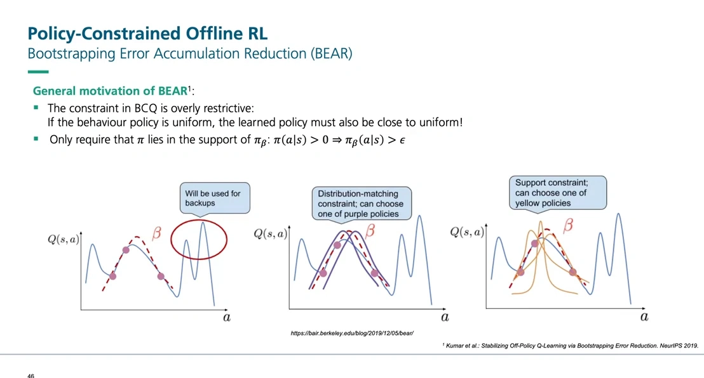
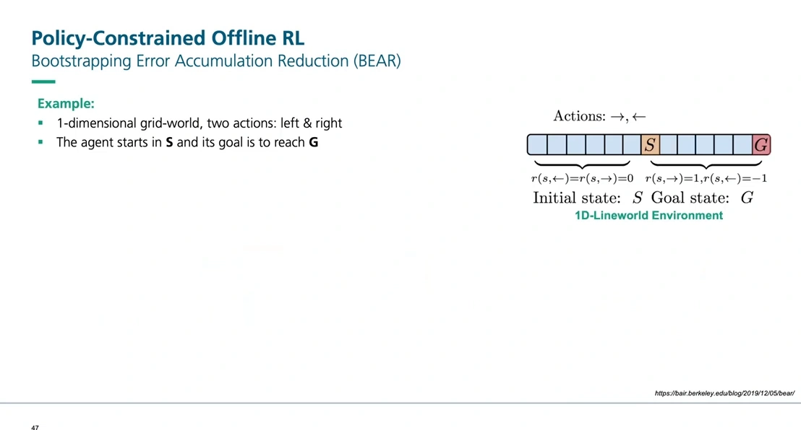
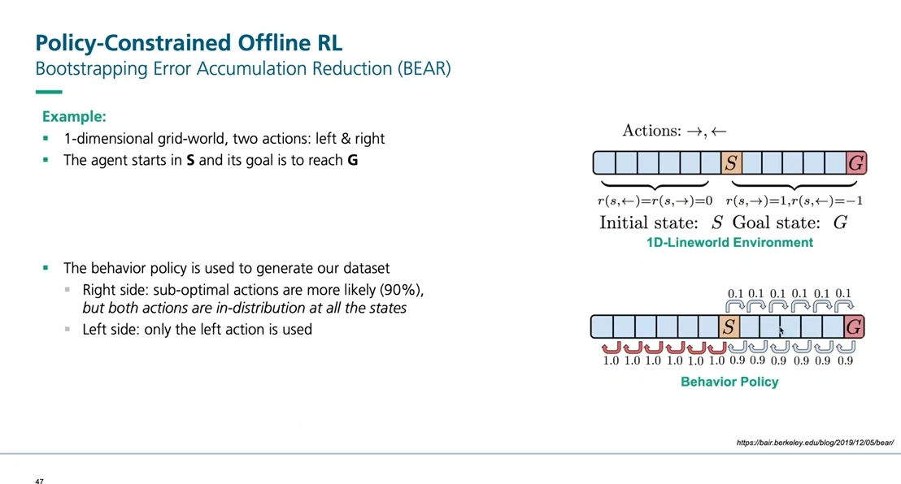
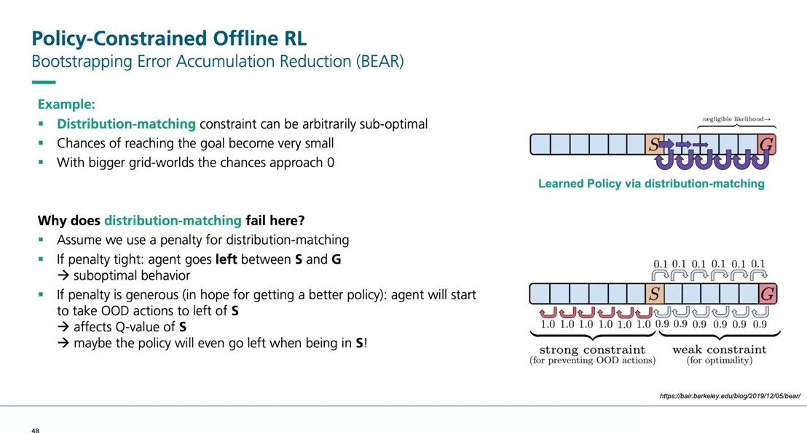
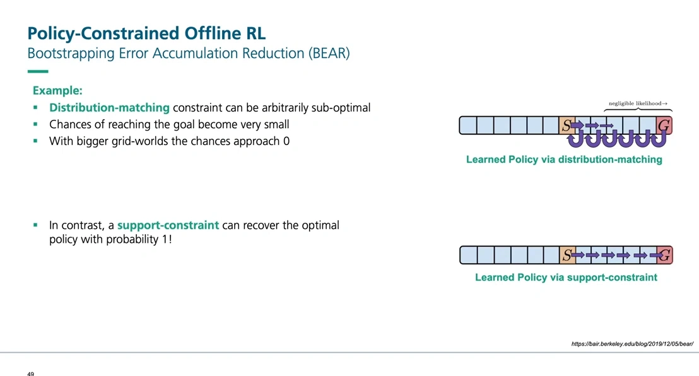
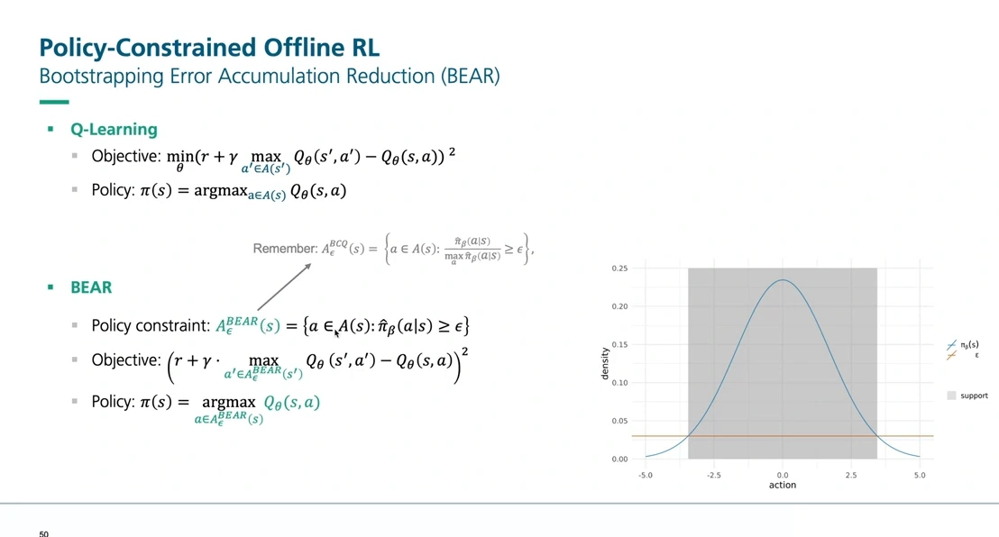
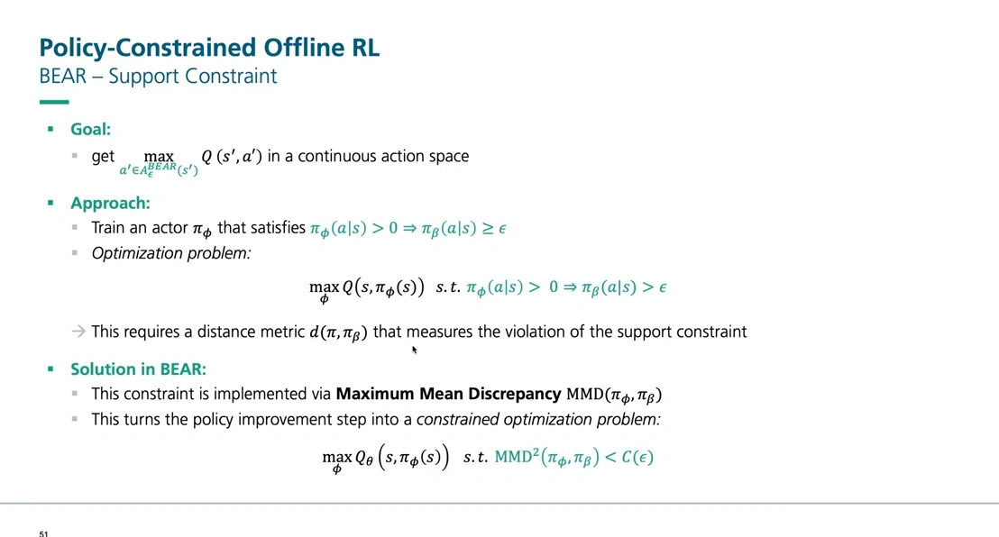
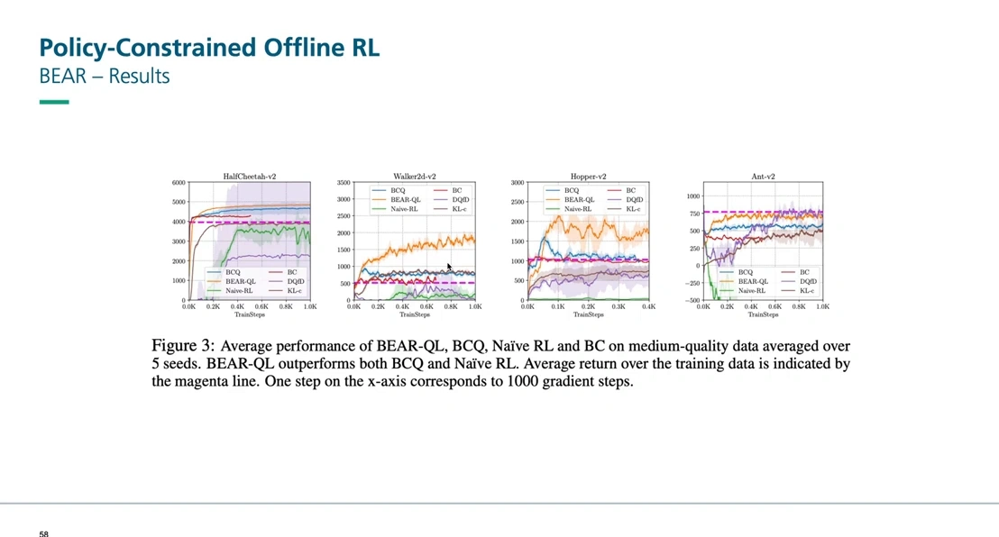
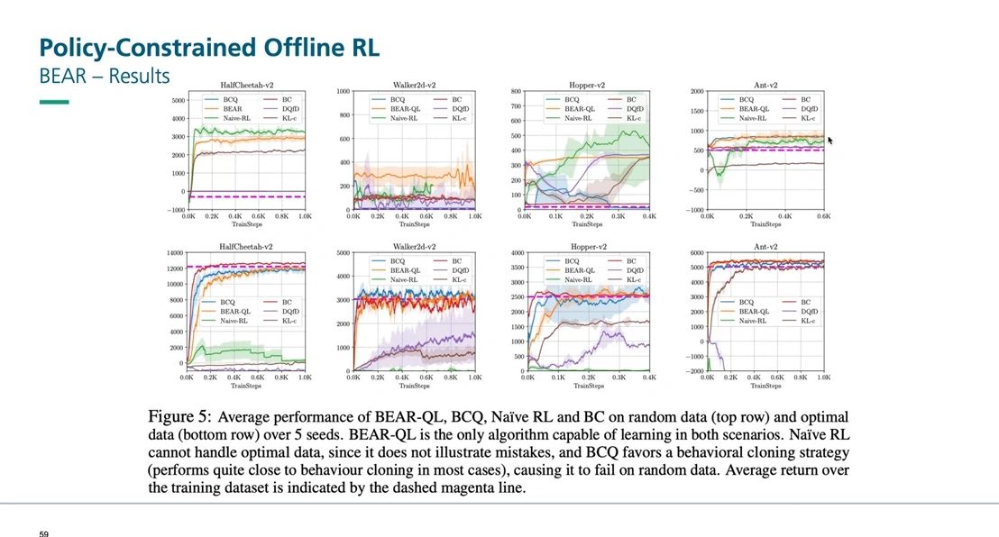

# BEAR：分布匹配太严，支持集约束才对

> 上一篇讲了 BCQ：把策略的动作限制在「数据集里出现过的动作附近」，用条件变分自编码器采样候选、用扰动网络做局部搜索。这一篇讲同一条路线上的第二个算法 BEAR（Bootstrapping Error Accumulation Reduction，Kumar 等，NeurIPS 2019）。它的出发点不是「BCQ 不够保守」，恰恰相反——**BCQ 的约束太严了**。本文依据同一门离线强化学习课程中「BEAR」一讲整理。

## 本讲要解决的核心问题（SCQA）

**背景**：BCQ 用「分布匹配」的方式约束策略：新策略的动作分布要贴近行为策略的动作分布，用相对概率阈值 $\epsilon$ 划出一个可采纳集。

**冲突**：这个约束比需要的更严。我们真正想要的只是「不要选数据里从没出现过的动作」，但「分布贴近」要求的是整条分布的形状都相似——这两件事并不等价。差别的代价在一维走廊环境里看得很清楚：分布匹配会把唯一能到终点的策略排除在外。

**疑问**：为什么分布匹配会失败？「支持集约束」和它差在哪里？连续动作空间里，支持集约束又怎么实现？

**回答（中心思想）**：BEAR 把约束从「分布匹配」换成「支持集约束」——**只要动作在行为策略下概率大于零（落在数据支持集里），就允许被选择**，不要求分布形状相似。实现上，它用一个可微的距离（最大均值差异，MMD）来度量「策略违反支持约束的程度」，把策略改进写成带约束的优化问题，用对偶梯度下降求解。

[【跳转到 02:55】](https://www.youtube.com/watch?v=2r9GT8KrQh8&t=175)

上图就是全篇的路线图。三张子图都是「横轴动作、纵轴 Q 值」的剖面，红色虚线是行为策略的分布：

- **左图（无约束）**：Q 在数据外画出一根尖峰，被红圈标为「将被用于 backup」——这就是 12.2 的外推误差；
- **中图（分布匹配）**：只能选那些形状贴近行为分布的「紫色」策略，选择余地很小；
- **右图（支持集约束）**：只要落在行为分布的支持范围内，「黄色」那一族策略都可以选，于是可以挑到 Q 值更高的那个。

幻灯片上把 BEAR 的动机写成了两行：BCQ 的约束过于严格——如果行为策略是均匀分布，学出来的策略也必须接近均匀；而真正需要的只是 $\pi(a\mid s) > 0 \Rightarrow \pi_\beta(a\mid s) > \epsilon$。

---

## 一、先把 BCQ 的约束摊开看

BCQ 的受限动作集是这样一个集合：

$$
A_\epsilon^{BCQ}(s) = \left\{ a \in \mathcal{A}(s) \;:\; \frac{\hat\pi_\beta(a \mid s)}{\max_{\hat a}\hat\pi_\beta(\hat a \mid s)} \ge \epsilon \right\}
$$

注意分母：它是**同一状态下概率最大的那个动作**。所以这个判据衡量的是**相对比例**——「这个动作比最好的动作差多少倍」。讲者的说法是，这实际上是在要求两个分布**彼此靠近**：只有当新策略的分布形状与行为策略相似时，各动作的相对概率才不会被压到阈值以下。

这个要求强在哪里？强在它管的是**整条分布**，而我们真正在意的只是「这个动作有没有数据支持」。两者之间的缝隙，就是 BEAR 的切入点。

## 二、一维走廊：分布匹配为什么把最优解排除在外

### 2.1 环境设定

[【跳转到 03:20】](https://www.youtube.com/watch?v=2r9GT8KrQh8&t=200)

环境是一条一维走廊，两个动作：向右、向左。智能体从中间的 $S$ 出发，目标是走到右端的 $G$。奖励设计是：在 $S$ 右侧，向右 +1、向左 −1；在 $S$ 左侧，向左和向右都是 0。换句话说，**只有往右走才有正回报**。

这个环境小到可以手算，但正好能把「分布匹配」的毛病暴露出来。

### 2.2 数据是怎么来的

[【跳转到 04:35】](https://www.youtube.com/watch?v=2r9GT8KrQh8&t=275)

采集数据的行为策略很「懒」：$S$ 左侧的状态里，向左的概率是 1.0，向右是 0；$S$ 右侧的状态里，向左 0.9、向右 0.1。

关键在于：**向右的动作虽然概率低，但它确实在数据里出现过**——它落在行为策略的支持集内。这一点是后面所有论证的前提。

### 2.3 两种惩罚力度，两种失败方式

[【跳转到 05:25】](https://www.youtube.com/watch?v=2r9GT8KrQh8&t=325)

讲者把 $\epsilon$ 的两种取值都推了一遍，结果两头都不对：

**惩罚紧（$\epsilon$ 大，强约束）**：策略被要求紧贴行为策略的分布，于是 $S$ 右侧那个只有 10% 概率的「向右」动作，相对比例低于阈值，被踢出了可采纳集。剩下的动作只有「向左」——智能体在 $S$ 和 $G$ 之间来回走，**永远到不了终点**。

**惩罚松（$\epsilon$ 小，弱约束）**：为了让「向右」重新进入候选集，必须把阈值调低。但阈值一低，$S$ 左侧那些**从未出现过的向左动作**（在 $S$ 左边继续往左走）也一起被放进来了。这些动作没有数据、Q 值纯属外推，而 12.2 讲过外推出来的值往往偏高。于是 $Q(s)$ 被这些虚高的邻居值抬高，**连站在 $S$ 的时候策略都开始往左走**。

讲者在这里停了一下，说这个例子他当初也花了不少时间才想明白，建议去看 BEAR 论文作者写的那篇博客。但结论很干脆：**问题不在阈值调得好不好，而在「匹配分布」这个要求本身**。

### 2.4 病根：一个 $\epsilon$ 管整条状态空间

讲者的总结是：分布匹配要求「处处都像」，但不同状态下的数据密度完全不同。$S$ 左侧数据很密（向左概率 1.0），$S$ 右侧数据很稀（向右只有 0.1）。用一个统一的 $\epsilon$ 去卡所有状态，必然出现「左边卡得住、右边卡太死」或者反过来。

**真正需要的是一种「按状态自适应」的约束**：只要这个动作在该状态下有数据支持，就允许它；没有支持，就不允许。这就是支持集约束。

## 三、支持集约束：只要动作在数据里出现过

[【跳转到 09:35】](https://www.youtube.com/watch?v=2r9GT8KrQh8&t=575)

把判据从「相对比例」换成「绝对概率」，一切就顺了。BEAR 的受限动作集是：

$$
A_\epsilon^{BEAR}(s) = \left\{ a \in \mathcal{A}(s) \;:\; \hat\pi_\beta(a \mid s) \ge \epsilon \right\}
$$

和 BCQ 的区别只有一处：**分母没了**。BCQ 比的是「相对于最好的动作」，BEAR 比的是「相对于一个绝对门槛 $\epsilon$」。只要行为策略给这个动作的概率不低于 $\epsilon$，它就落在支持集里，就允许被选择。

回到走廊：向右的动作概率是 0.1，只要 $\epsilon < 0.1$，它就在集合里。于是智能体可以一路向右走到终点——讲者的说法是，支持集约束**能以概率 1 恢复最优策略**，因为每个状态上「向右」都有数据支持，最优动作可以被 bootstrap 出来。

[【跳转到 10:50】](https://www.youtube.com/watch?v=2r9GT8KrQh8&t=650)

这张幻灯片把两者的公式并排放了：上面是 BCQ 的相对比值判据，下面是 BEAR 的绝对概率判据，中间用箭头标出「记住 BCQ 是怎么定义的」。

右边的密度图是理解支持集的最好方式：横轴是动作，纵轴是行为策略的密度，**灰色区间是密度不低于 $\epsilon$ 的部分**——这就是支持集。BEAR 允许策略在这个区间里任意选动作，包括那些概率不高但确实存在的动作；BCQ 则要求策略的分布形状也贴近这条曲线。

一句话概括差别：**BCQ 要求「长得像」，BEAR 只要求「在范围内」。**

## 四、BEAR 怎么在连续动作上实现支持集约束

公式换成绝对概率后，新问题来了：连续动作空间里没法枚举动作、逐个检查概率。BCQ 用 CVAE 解决了「怎么采样」，BEAR 换了另一条路——**训练一个 actor，让它的输出自动满足约束**。

[【跳转到 13:45】](https://www.youtube.com/watch?v=2r9GT8KrQh8&t=825)

目标是让 actor 满足

$$
\pi_\phi(a \mid s) > 0 \;\Longrightarrow\; \pi_\beta(a \mid s) \ge \epsilon
$$

也就是「actor 认为可能的动作，必须在数据支持集里」。这是一个逐点成立的蕴含关系，没法直接当损失函数优化，于是改写成带约束的优化问题：

$$
\max_{\phi} \; Q_\theta\big(s, \pi_\phi(s)\big) \quad \text{s.t.} \quad \mathrm{MMD}^2\big(\pi_\phi, \pi_\beta\big) < C(\epsilon)
$$

读法是：**在「策略分布与行为分布的最大均值差异不超过阈值」的前提下，最大化 Q 值**。$C(\epsilon)$ 是由 $\epsilon$ 决定的容差。讲者举了个具体数字：如果约束取 0.05，那就是要求动作都落在这个容差对应的集合里。

### 4.1 为什么是 MMD

$\mathrm{MMD}$ 是**最大均值差异**（maximum mean discrepancy）。它的基本做法是：用一个核函数把两个分布映射到一个函数空间里，比较它们的「均值嵌入」差多远；两个分布越接近，这个差越小。实际计算时用**高斯核**，只需要从两个分布里各采一批样本，就能估出这个量。

讲者在这里的处理很坦诚：MMD 的推导涉及不少数学，幻灯片里只放了一个简短的引子，**「这部分不考」**，想深入就去读论文或者那篇 Medium 文章。所以他只讲了结论——**用一个可微的、能由样本估计的距离，把支持约束写成优化问题的约束项**。

从数学性质上说，MMD 有一个正好对上本篇处境的好处：**它只需要样本、不需要密度**。而 BCQ 当初之所以要绕道 CVAE，正是因为 $\pi_\beta$ 的密度算不出来。用 MMD 就绕开了这个障碍——两个分布都可以只以「采样」的形式出现。

### 4.2 求解：对偶梯度下降

带约束的优化问题不能直接对 $\phi$ 求梯度，标准做法是拉格朗日对偶：给约束项配一个乘子，把「约束下的最大化」变成「无约束的极小极大问题」，然后交替更新策略参数和乘子。讲者把这一步称为「dual gradient descent 之类的魔法」，同样没有展开，只说明它是 BEAR 实现里绕不过去的一环。

顺便说清楚 BEAR 与 BCQ 在工程上的分工差异：

| | BCQ | BEAR |
| :--- | :--- | :--- |
| 约束对象 | 动作的**生成方式**（只在 CVAE 候选里选） | 策略与行为策略的**分布距离** |
| 是否需要行为策略的密度 | 不需要，只要能从 CVAE 采样 | 不需要，MMD 只需样本 |
| 连续动作上怎么取最大 | 采样 $n$ 个候选 + 扰动网络局部搜索 | 训练一个 actor 直接输出动作 |
| 距离/阈值形式 | 相对概率比值 $\ge \epsilon$ | 绝对概率 $\ge \epsilon$，用 MMD 度量违反程度 |
| 主要超参 | $\epsilon$、$n$、$\Phi$、$\lambda$ | $\epsilon$（经 $C(\epsilon)$ 进入约束）、MMD 的核带宽 |

## 五、结果：放松约束换来了什么

[【跳转到 15:44】](https://www.youtube.com/watch?v=2r9GT8KrQh8&t=944)

第一组对比用的是**中等质量数据**（medium-quality），横轴是训练步数，纵轴是平均回报，虚线是数据本身的平均水平。讲者的结论是：BEAR 在所有这些环境里都能超过 BCQ，原因是**它在策略改进这一步没有过度收紧**。

更值得看的是第二组：随机数据和最优数据。

[【跳转到 16:34】](https://www.youtube.com/watch?v=2r9GT8KrQh8&t=994)

上排是**随机数据**（random），下排是**最优数据**（optimal）。讲者指着图说：BEAR 在随机数据上也能恢复出不错的策略——「如果探索本身不是大问题，你甚至可以用 BEAR 从随机数据里学出策略」。

这张图的图注把 BCQ 的短板说得更直接：**BCQ 偏向行为克隆式的策略，在随机数据上会失败**；而朴素 RL 在最优数据上失败，因为最优数据里没有任何「错误示范」，Q 网络学不到「哪些动作不好」。

这正好呼应第一节的公式对比：BCQ 的判据是相对比值，随机数据下各动作概率都很低、彼此接近，相对比值反而容易通过；但一旦某个动作概率明显更高，其余动作就被压出候选集，策略就退化成模仿。BEAR 的绝对阈值没有这个问题——它只问「有没有支持」，不问「比最好的差多少」。

## 六、两条路线的共同局限

把 BCQ 和 BEAR 放在一起看，它们共享同一套代价：

1. **都要额外的网络或额外的计算**。BCQ 要 CVAE + 扰动网络 + 双 Q；BEAR 要 actor + 行为策略的采样 + MMD 的核矩阵计算（每批样本两两算核，开销随批大小平方增长）。
2. **超参都难调**。约束松紧是这类方法的命门：太紧，策略退化成行为克隆，学不出超过数据的东西；太松，分布外动作又回来了，12.2 的外推误差重新出现。BCQ 的 $\epsilon$ 与 $\Phi$、BEAR 的 $\epsilon$ 与核带宽，都是在调这个平衡。
3. **上界受数据限制**。约束类方法的天花板是「数据支持集内最好的策略」——它们能把数据里零散的好动作拼起来（12.1 讲的 stitching），但没法凭空创造数据里完全没有的行为。

也正因为这三条，后来的工作换了个方向：**不约束策略，直接在 Q 值上加正则项**，把分布外动作的价值压低。这条路子不需要生成模型、不需要核函数，实现简单得多，效果还更好——这就是 CQL 和 IQL，下一篇（12.4）展开。

## 小结

1. BCQ 的约束是**分布匹配**：用相对概率比值 $\hat\pi_\beta(a|s) / \max_{\hat a}\hat\pi_\beta(\hat a|s) \ge \epsilon$ 定义候选集，要求新策略的分布贴近行为策略。
2. 分布匹配太严：一维走廊里，惩罚紧则到不了终点，惩罚松则被外推的 Q 值带回错误方向——**病根是用一个 $\epsilon$ 管整条状态空间**。
3. BEAR 换成**支持集约束**：判据改成绝对概率 $\hat\pi_\beta(a|s) \ge \epsilon$，只要动作在数据里出现过就允许选，不要求分布形状相似。
4. 连续动作上，BEAR 训练一个 actor，把「$\pi_\phi(a|s)>0 \Rightarrow \pi_\beta(a|s)\ge\epsilon$」写成约束优化：$\max_\phi Q(s,\pi_\phi(s))$，约束是 $\mathrm{MMD}^2(\pi_\phi,\pi_\beta) < C(\epsilon)$。
5. MMD 用高斯核从样本估计，不需要密度——这正好绕开了 BCQ 当初必须用 CVAE 的那个障碍。
6. 实验上 BEAR 在中等质量数据上超过 BCQ；在随机数据上，BCQ 会退化成接近行为克隆，而 BEAR 仍能学出策略。

---

## 附：本讲要点速查

| 概念 | 一句话 |
| :--- | :--- |
| 分布匹配约束 | 要求新策略的动作分布贴近行为策略分布（BCQ 的做法） |
| 支持集约束 | 只要求动作落在行为策略概率大于 $\epsilon$ 的区间内（BEAR 的做法） |
| 相对 vs 绝对 | BCQ 比「相对于最优动作的比例」，BEAR 比「绝对概率门槛」 |
| 一维走廊反例 | 惩罚紧到不了终点，惩罚松被外推的 Q 值带偏——分布匹配的两难 |
| MMD | 最大均值差异，用核函数比较两个分布的均值嵌入，可只由样本估计 |
| 约束优化形式 | $\max_\phi Q(s,\pi_\phi(s))$，约束 $\mathrm{MMD}^2(\pi_\phi,\pi_\beta) < C(\epsilon)$ |
| 对偶梯度下降 | 给约束配拉格朗日乘子，交替更新策略参数与乘子 |
| 与 12.4 的关系 | 约束策略这条路超参多、开销大，CQL/IQL 改为直接在 Q 值上加正则 |