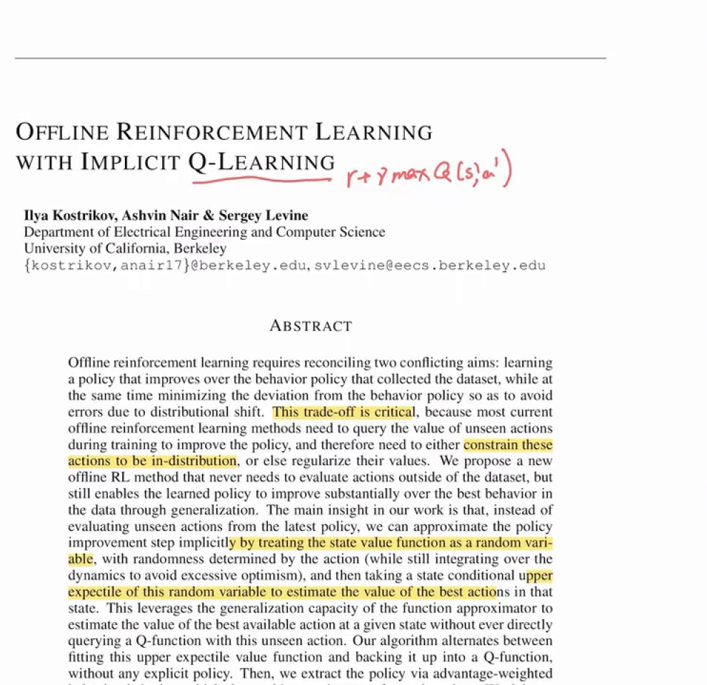
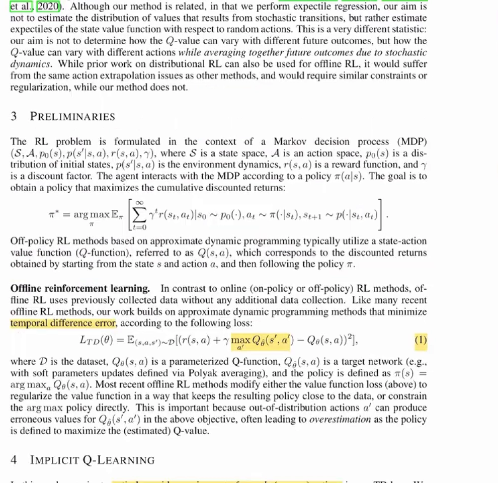
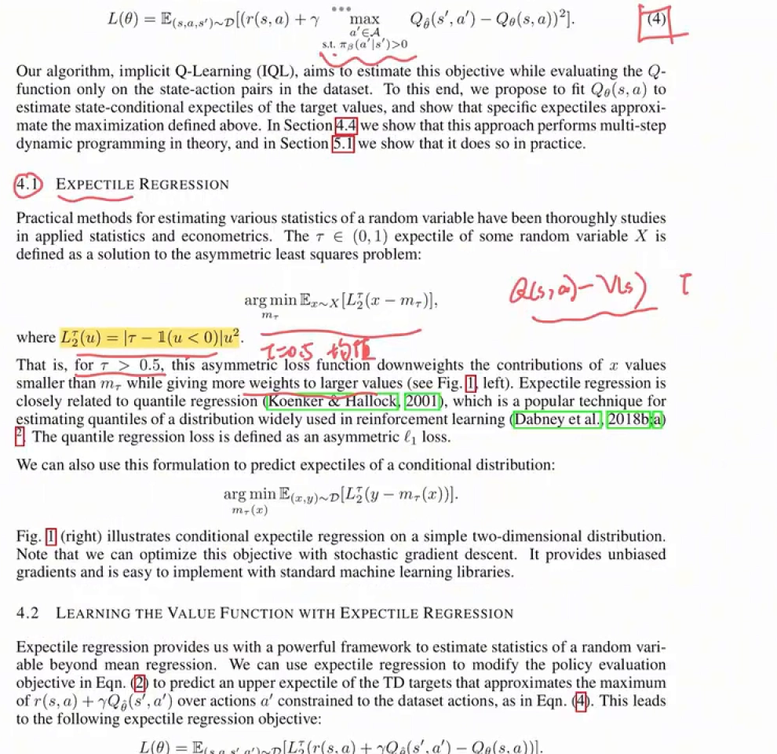
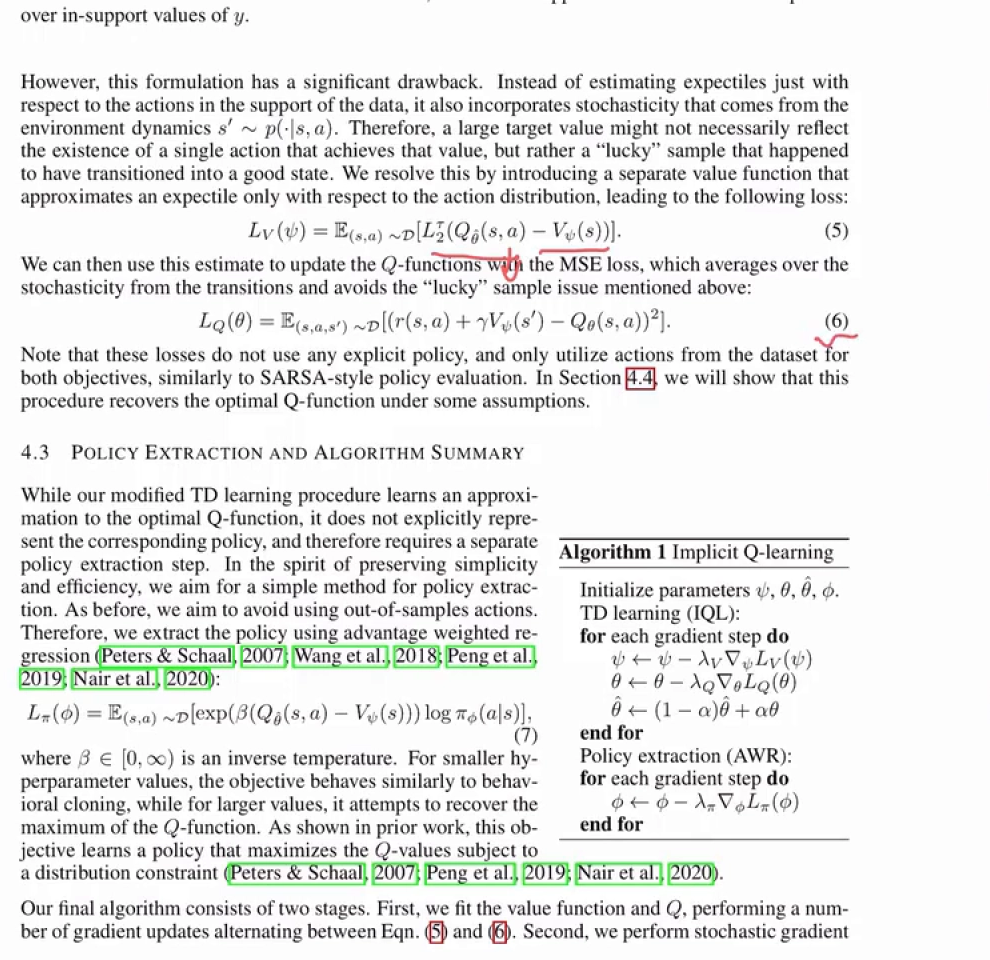
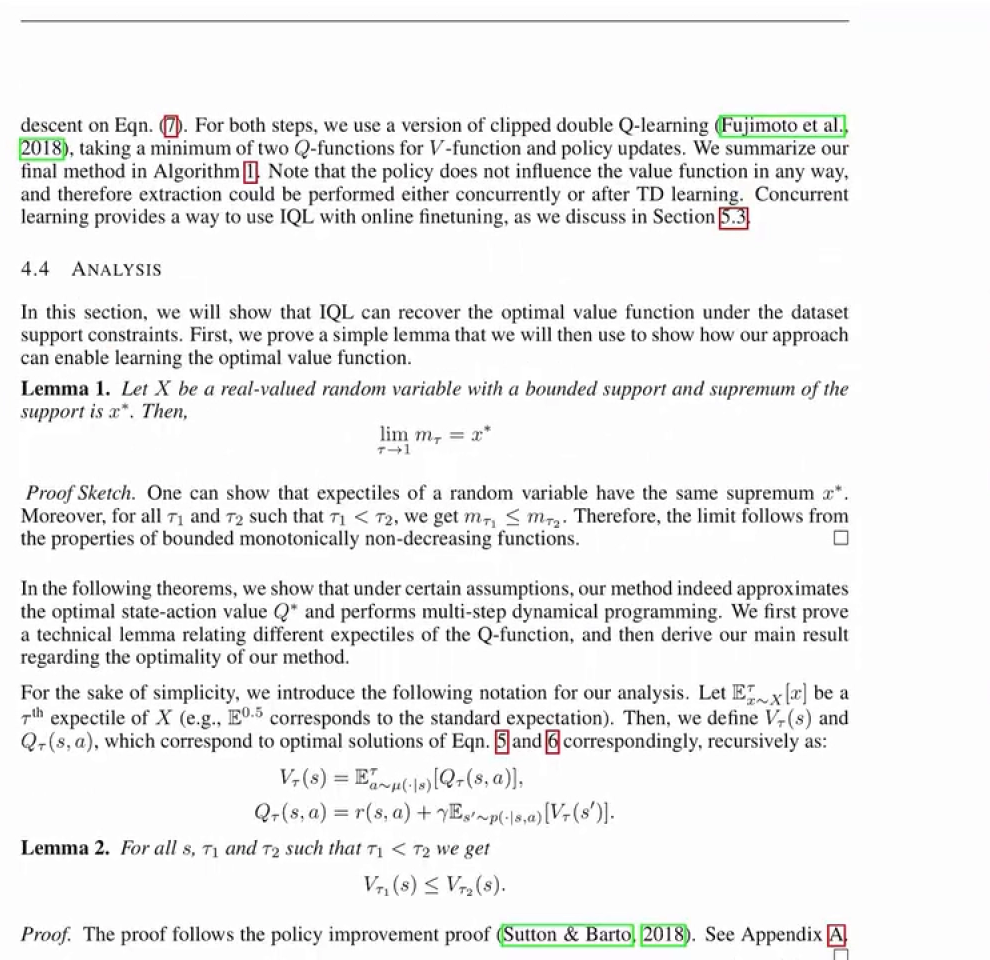
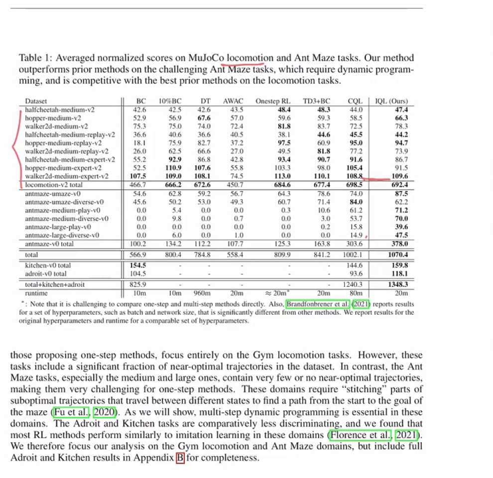

# IQL论文精读：用期望分位数回归在数据集内做最大化

> 承接上一篇《从IQL到CQL：把保守性搬到价值函数上》：那一篇从课程角度讲了 IQL 的两个零件——SARSA 式回归与期望分位数回归，以及它为什么不会重新变乐观。这一篇跟着论文原文（Kostrikov、Nair、Levine，*Offline Reinforcement Learning with Implicit Q-Learning*，2021）走一遍：公式 (1)(4)(5)(6)(7) 各自在解决什么、三个网络怎么分工、实验说了什么。直觉部分不再重复，只补公式与结果。

## 本讲要解决的核心问题（SCQA）

**背景**：离线 RL 只有一个固定数据集，训练中不能再和环境交互。它有一对互相冲突的目标：既要学出比数据采集策略更好的策略（否则就退化成行为克隆），又不希望策略偏离数据太远（数据之外的动作没有真实反馈，Q 值容易估不准）。

**冲突**：标准 Q-learning 的贝尔曼 backup 里有一个 $\max_{a'}$。连续动作空间下，这个 $\max$ 会去搜索大量数据集中**从未出现过**的动作；而这些动作的值可能是完全错误的。更糟的是，选择条件就是取 $\max$——**只要某一个分布外动作被错误高估，它就会被 $\max$ 选中**，训练时直接拿这个错误的 Q 值当目标，形成恶性循环。

**疑问**：「只在数据支撑集内取最大」听起来像是在自我设限——强化学习的核心目标恰恰是采取比数据中更好的行动，把动作限制在数据里，凭什么还能改进？

**回答（中心思想）**：靠**函数逼近器的泛化能力**。神经网络在数据上学到的「什么是好动作、什么是坏动作」的特征会迁移，所以在数据动作上做**上分位数回归**，就能推断出「这个状态下最好的动作值多少」，而**全程不需要把数据外的动作送进 Q 网络**。这就是 IQL（Implicit Q-Learning）的核心。

---

## 一、论文要同时满足的两个目标



[【跳转到 00:50】](https://www.bilibili.com/video/BV1beEB6uEjn/?t=50)

摘要里有一句话把整个领域的处境讲透了，也是这张图上被高亮的部分：

> most current offline reinforcement learning methods need to query the value of unseen actions during training to improve the policy, and therefore need to either **constrain these actions to be in-distribution, or else regularize their values**.

翻译过来就是：现有方法都绕不开「查询没见过的动作」，所以只能二选一——**要么把这些动作约束回分布内**（这就是 12.3 的 BCQ/BEAR），**要么给它们的值加正则**（这就是上一篇讲的 CQL）。IQL 主张的是第三条路：**一个从不需要评估数据集之外动作的方法**，同时仍能通过泛化显著超越数据里最好的行为。

论文还特别澄清了它与**分布式 RL**（distributional RL）的区别，这一点容易被名字误导：IQL 做期望分位数回归，但**目的不是估计「随机状态转移造成的回报分布」**，而是估计「**状态价值函数对随机动作的期望分位数**」。换句话说，它关心的不是「同一个动作因为环境随机性可能得到多少回报」，而是「同一个状态下不同动作的价值能差多少，而未来的随机性已经被平均掉了」。这个区别决定了后面 $V$ 与 $Q$ 的分工。

## 二、问题：$\max$ 里的 $a'$ 会给出错误的值



[【跳转到 02:38】](https://www.bilibili.com/video/BV1beEB6uEjn/?t=158)

论文先把标准的离线 TD 损失摆出来：

$$
L_{TD}(\theta) = \mathbb{E}_{(s,a,s')\sim\mathcal{D}}\Big[\big(r(s,a) + \gamma \max_{a'} Q_{\hat\theta}(s',a') - Q_\theta(s,a)\big)^{2}\Big]
$$

其中 $Q_{\hat\theta}$ 是目标网络（用 Polyak 平均更新），策略定义为 $\pi(s) = \arg\max_a Q_\theta(s,a)$。然后论文用一句几乎就是 12.2 结论的话点出问题：

> out-of-distribution actions $a'$ can produce erroneous values for $Q_{\hat\theta}(s',a')$ in the above objective, often leading to **overestimation** as the policy is defined to maximize the estimated Q-value.

也就是说：**策略的定义本身就带着 $\arg\max$，它天生会去找那些被高估的动作。** 这句话解释了为什么几乎所有离线方法都要在「值函数损失」或「$\arg\max$ 策略」这两处之一动手脚——IQL 选择的是前者。

## 三、先看一个「安全但保守」的解

在给出自己的方法之前，论文先讨论了一条更简单的路：**直接学行为策略的 Q 函数 $Q^{\pi_\beta}$，再让策略去最大化它**（Brandfonbrener 等 2021、Peng 等 2019 的做法）。

这条路的安全性是无懈可击的：TD 损失里只用到数据集里的动作，**完全不存在分布外动作的问题**。但论文指出它的局限：这种做法「在简单的 MuJoCo locomotion 任务上效果不错，但在更需要**多步动态规划**的复杂任务上表现很差」。

原因不难想：$Q^{\pi_\beta}$ 描述的是行为策略的价值，它只反映「行为策略平均而言能拿到多少」，并不包含「如果换成更好的动作会怎样」的信息。想让策略超越数据，就必须在某个地方引入「取最大」——问题只是怎么取才安全。

## 四、公式 (4)：把 $\max$ 限制在数据支撑集内

IQL 的起点是一个理想目标：保留 SARSA 式目标的安全性，但把其中的「平均」换成「数据支撑集内的最大」。



[【跳转到 04:42】](https://www.bilibili.com/video/BV1beEB6uEjn/?t=282)

$$
L(\theta) = \mathbb{E}_{(s,a,s')\sim\mathcal{D}}\Big[\Big(r(s,a) + \gamma \max_{\substack{a'\in\mathcal{A}\\ \text{s.t. } \pi_\beta(a'\mid s')>0}} Q_{\hat\theta}(s',a') - Q_\theta(s,a)\Big)^{2}\Big]
$$

注意 $\max$ 下面那行约束：$a'$ 必须满足 $\pi_\beta(a'\mid s')>0$，也就是**行为策略在那个状态下真有可能选出这个动作**。论文的措辞是：我们要估计的是「**在数据分布支撑集内的动作上的最大 Q 值**」，并且关键的一点是——

> it is possible to do this **without ever querying the learned Q-function on out-of-sample actions** by utilizing expectile regression.

麻烦在于：连续动作空间里，$\{a' : \pi_\beta(a'\mid s')>0\}$ 是无穷多个点，没法枚举、更没法取最大。所以真正的技术问题变成：**怎么在不枚举的前提下，估计出这个「支撑集内的最大值」？**

## 五、期望分位数回归：把「取上端」变成可微的损失

论文的答案是**期望分位数回归**（expectile regression）。它来自统计学里一个成熟的概念：随机变量 $X$ 的 $\tau$-expectile 定义为下面这个非对称最小二乘问题的解：

$$
\arg\min_{m_\tau}\ \mathbb{E}_{x\sim X}\big[L_2^{\tau}(x - m_\tau)\big], \qquad \text{其中}\quad L_2^{\tau}(u) = \big\lvert \tau - \mathbb{1}(u<0)\big\rvert\, u^{2}
$$

论文对它的解释是：**当 $\tau > 0.5$ 时，这个不对称的损失函数会降低小于 $m_\tau$ 的那些 $x$ 的权重，同时给更大的值更高的权重**——于是解会往分布的上端偏。

它和**分位数回归**（quantile regression）的关系值得单独记一笔，因为两者经常被混为一谈：

| | 分位数回归（quantile） | 期望分位数回归（expectile） |
| :--- | :--- | :--- |
| 损失形式 | 非对称 $\ell_1$（绝对偏差） | 非对称 $\ell_2$（平方偏差） |
| 优化性质 | 非对称 $\ell_1$，在 0 点不可微 | 非对称 $\ell_2$，处处可微 |
| 论文的评价 | RL 里估计分布分位数的常用手段 | 「提供无偏梯度，且用标准机器学习库就能轻松实现」 |

两者都是「对中位数/均值的推广」，只是一个推广的是中位数（$\ell_1$ 的最优解），一个推广的是均值（$\ell_2$ 的最优解）。IQL 选 expectile 的理由很工程化：**平方版本好优化**。

## 六、公式 (5)(6)(7) 与算法 1：三个网络、两阶段

有了 expectile，接下来要把它安放到正确的位置。这里有一个容易被忽略的设计：**为什么需要一个单独的 $V$ 网络，而不是直接用 expectile 去回归 TD 目标？**

论文的回答是：如果直接用 expectile 回归 $r(s,a) + \gamma Q_{\hat\theta}(s',a')$，那么除了「动作带来的价值差异」，你还会把「**环境的随机性**」也算进上分位数里。于是一个很大的目标值可能并不代表「存在某个动作能拿到它」，而只是「恰好碰到了一个幸运的转移」。论文的原话是要避免这种 **lucky sample** 的问题。

解决办法是把两个期望拆开：**$V$ 只对动作分布取 expectile，$Q$ 再用 MSE 对状态转移取期望。**



[【跳转到 05:32】](https://www.bilibili.com/video/BV1beEB6uEjn/?t=332)

**公式 (5)，$V$ 的损失**（只在动作维度取上分位数）：

$$
L_V(\psi) = \mathbb{E}_{(s,a)\sim\mathcal{D}}\Big[L_2^{\tau}\big(Q_{\hat\theta}(s,a) - V_\psi(s)\big)\Big]
$$

**公式 (6)，$Q$ 的损失**（标准 MSE，对转移取期望）：

$$
L_Q(\theta) = \mathbb{E}_{(s,a,s')\sim\mathcal{D}}\Big[\big(r(s,a) + \gamma V_\psi(s') - Q_\theta(s,a)\big)^{2}\Big]
$$

论文特意指出：这两个损失**都不包含任何显式策略**，并且**只用到数据集里的动作**——和 SARSA 式的策略评估是一样的结构。

**公式 (7)，策略提取**（优势加权回归，AWR）：

$$
L_\pi(\phi) = \mathbb{E}_{(s,a)\sim\mathcal{D}}\Big[\exp\big(\beta\,(Q_{\hat\theta}(s,a) - V_\psi(s))\big)\log \pi_\phi(a\mid s)\Big]
$$

$Q - V$ 就是**优势**（advantage）：动作比 $V$ 好，权重 $\exp(\beta\cdot\text{优势})$ 就大，这个动作被更多地模仿；动作不好，权重就小。$\beta\in[0,\infty)$ 是**逆温度**：$\beta$ 小的时候目标接近行为克隆，$\beta$ 大的时候试图逼近 Q 函数的最大值。

把这三条拼起来，就是论文的**算法 1**：

```text
Algorithm 1  Implicit Q-learning
  初始化参数 ψ（V）、θ（Q）、θ̂（目标 Q）、φ（策略）

  TD 学习（IQL）：
    每个梯度步：
      ψ ← ψ − λ_V ∇_ψ L_V(ψ)          # V 用 expectile 损失回归 Q
      θ ← θ − λ_Q ∇_θ L_Q(θ)          # Q 用 MSE 回归 r + γV(s')
      θ̂ ← (1 − α)θ̂ + αθ              # 目标网络 Polyak 平均

  策略提取（AWR）：
    每个梯度步：
      φ ← φ − λ_π ∇_φ L_π(φ)          # 用 exp(β(Q−V)) 加权模仿数据动作
```

讲者把算法分成两个阶段来解释：**第一阶段是 TD learning**，反复更新 $V$ 的参数 $\psi$ 和 $Q$ 的参数 $\theta$，并同步更新目标网络；**第二阶段才是策略提取**，更新策略网络的参数 $\phi$。

这里有一个结构上的好处：**评论家和演员完全独立**。$V$ 和 $Q$ 的更新里没有任何 $\pi_\theta$ 下的期望，$\pi_\theta$ 只出现在最后那一步加权最大似然里。所以完全可以先只训 Q 函数、再单独训演员——这也是它被称为「隐式 Q 学习」而不是「隐式演员-评论家」的原因。讲者的评价是：**隐式 Q 函数的更新非常稳定**，因为不需要在学习过程中考虑某个行为者的期望。

顺带一提实现细节：论文在两个阶段都用了 **clipped double Q-learning**（取两个 Q 函数的最小值）来抑制过估计——就是 6.4 讲过的那个技巧。

## 七、理论：$\tau\to1$ 时收敛到支撑集上的最大值

「用 expectile 代替 max」这件事，论文给了正式的分析。



[【跳转到 06:33】](https://www.bilibili.com/video/BV1beEB6uEjn/?t=393)

**Lemma 1**：设 $X$ 是取值有界的实随机变量，支撑集的上确界为 $x^{*}$，则

$$
\lim_{\tau\to 1} m_\tau = x^{*}
$$

证明思路很短：expectile 与原随机变量有相同的上确界；而且对任意 $\tau_1 < \tau_2$ 都有 $m_{\tau_1} \le m_{\tau_2}$，即 $m_\tau$ 关于 $\tau$ 单调不减。由有界单调不减函数的性质，极限存在且等于上确界。

**Lemma 2**：对任意 $s$ 与 $\tau_1 < \tau_2$，有 $V_{\tau_1}(s) \le V_{\tau_2}(s)$。

在这两条引理之上，论文进一步证明了：在某些假设下，IQL 逼近最优动作价值 $Q^{*}$，并且**实现了多步动态规划**。这正是它比「只学 $Q^{\pi_\beta}$」强的地方——它虽然从不查询数据外的动作，却仍然在做真正的动态规划。

## 八、实验：locomotion 持平、AntMaze 大幅领先、速度快四倍



[【跳转到 06:58】](https://www.bilibili.com/video/BV1beEB6uEjn/?t=418)

这张表是论文最核心的实验结果，讲者挑了三处讲。

**第一，locomotion 上与最强的 baseline 基本持平。** 表格最后两列是 CQL 与 IQL，locomotion-v2 的合计得分分别是 $698.5$ 与 $692.4$——几乎一样。也就是说，在「数据里本来就有大量接近最优轨迹」的任务上，IQL 的隐式做法并不吃亏。

**第二，AntMaze 上大幅领先。** AntMaze 的难点在于**数据集中没有完整的最优轨迹**，算法必须把不同子轨迹的片段**拼接**起来才能找到路。这时差距就出来了：antmaze-v0 合计得分 CQL 是 $163.8$，IQL 是 $378.0$，**超过一倍**。讲者的原话是「IQL 远超 CQL」。表格里 `antmaze-large` 那两行的对比尤其明显：CQL 是 $15.8$ 与 $14.9$，IQL 是 $39.6$ 与 $47.5$。

**第三，计算效率。** 看表格最后一行 `runtime`：CQL 是 $80$m，IQL 是 $20$m——讲者说**IQL 比 CQL 快了大概四倍**，速度也接近最快的 one-step 方法。原因很直接：IQL 本身不需要正则项，也不需要对 OOD 动作做大量采样。

论文还报告了 $\tau$ 的影响（Fig. 3）：在 AntMaze 这个任务上，**更大的 $\tau$ 对应更好的结果**，也就是更接近 Q-learning 的行为。这与第七节的理论是对得上的——$\tau\to1$ 才逼近支撑集上的最大值。

**最后是离线预训练 + 在线微调。** 论文先在离线数据上训练，再进行 **100 万步**的在线交互，并和 AWAC、CQL 比较，结果发现 **IQL 更适合做 online fine-tuning**。讲者给了两个原因：一是 IQL 本身有比较强的离线性能，为微调提供了好的初始化；二是它用「加权的 BC」来提取策略，这个约束比其它离线约束**更适合在后面做在线改进**。

## 九、小结

- **IQL 要解决的问题**：在完全不查询数据外动作的前提下，仍然学到接近最优的 Q 函数，而不是退化成行为策略的平均。
- **公式 (4)**：理想目标是把 $\max$ 限制在 $\pi_\beta(a'\mid s')>0$ 的动作上；难点是连续空间无法枚举。
- **expectile 损失**：$L_2^{\tau}(u) = \lvert\tau - \mathbb{1}(u<0)\rvert u^{2}$，$\tau>0.5$ 时把 $V$ 推向分布上端；与分位数回归的区别是「平方偏差 vs 绝对偏差」，好处是可微、好优化。
- **三个网络的分工**：$V$ 只对**动作**取 expectile（避免把环境的随机性当成好动作），$Q$ 对**转移**取 MSE，策略用 AWR 提取。
- **理论**：$\tau\to1$ 时 expectile 收敛到支撑集的上确界，因此在数据支撑集内它确实是「最大值」的替代品。
- **实验**：locomotion 与 CQL 持平，AntMaze 上远超 CQL，运行时间约为 CQL 的四分之一，且更适合离线预训练后的在线微调。

---

## 附：本篇要点速查

| 概念 | 一句话 |
| :--- | :--- |
| 公式 (4) 的约束 | $\max$ 只在 $\pi_\beta(a'\mid s')>0$ 的动作上取，即数据支撑集内 |
| expectile | 非对称平方损失下的最优解，$\tau=0.5$ 是均值，$\tau\to1$ 是上确界 |
| 与分位数回归的区别 | 分位数用非对称 $\ell_1$，expectile 用非对称 $\ell_2$，后者可微 |
| 为什么单独设 $V$ | 避免把「幸运的转移」误当成「存在好动作」，把动作期望与转移期望拆开 |
| AWR 提取 | 用 $\exp(\beta(Q-V))$ 加权模仿数据动作，$\beta$ 是逆温度 |
| 两阶段训练 | 先 TD 学习把 $Q$、$V$ 训好，再单独训策略；评论家与演员完全解耦 |
| Lemma 1 | $\lim_{\tau\to1} m_\tau = x^{*}$，expectile 在 $\tau\to1$ 时收敛到支撑集上确界 |
| 关键数字 | locomotion 合计 CQL $698.5$ vs IQL $692.4$；antmaze 合计 $163.8$ vs $378.0$；运行时间 $80$m vs $20$m |