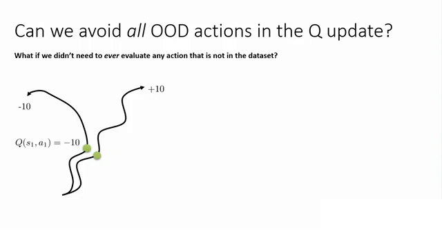
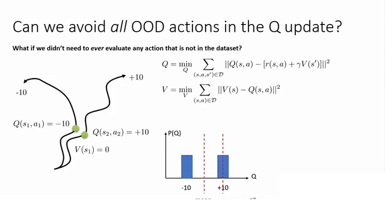
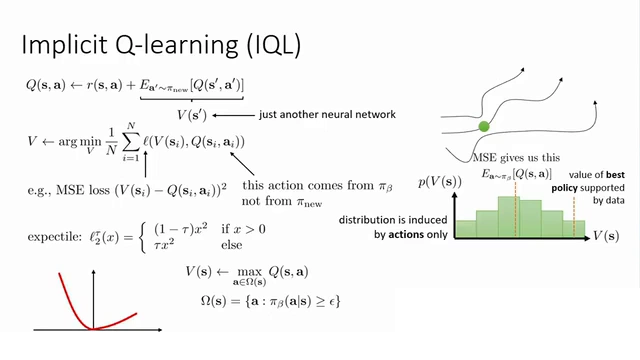
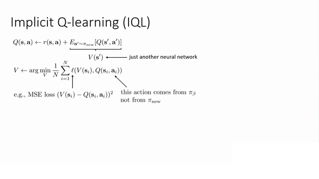
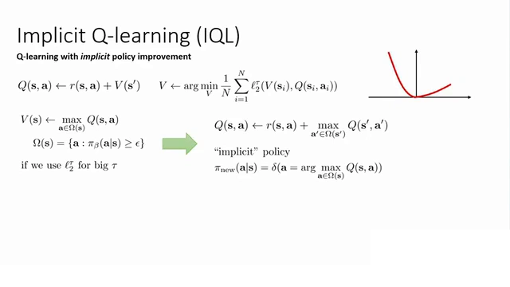
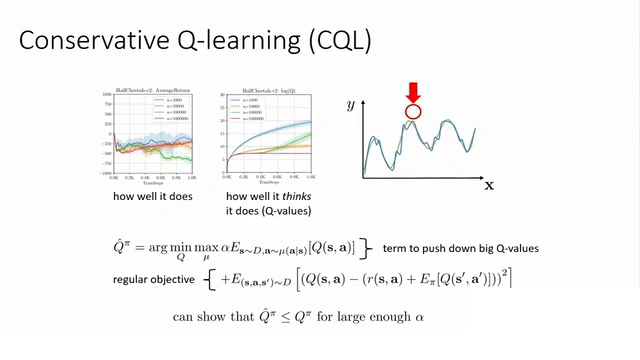
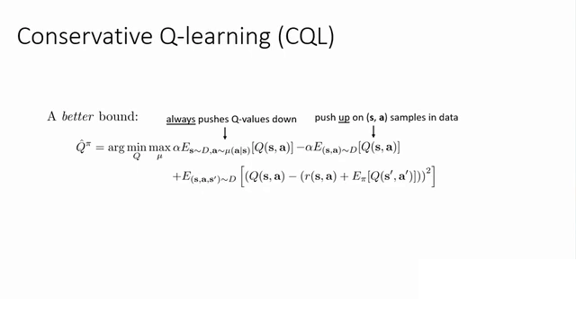
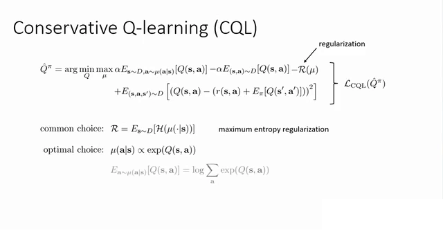

# 从IQL到CQL：把保守性搬到价值函数上

> 承接 12.2 与 12.3。12.2 已经把外推误差的因果链推完了（$\max$ 挑中数据外的高值、误差沿 backup 传播、离线没有纠错机会、量级被 $\frac{1}{1-\gamma}$ 放大），12.3 讲的是第一条应对路线——**约束策略**，让 $\max$ 的候选动作留在数据附近。这一篇讲另外两条路线：**IQL 干脆不查询数据外的动作**，**CQL 让数据外动作的估值被系统性地压低**。内容依据 Berkeley CS285 第 18 讲「离线强化学习算法」整理。

## 本讲要解决的核心问题（SCQA）

**背景**：离线 RL 的麻烦都出在一个查询上——$Q(s',a')$ 里的 $a'$ 是 $\max$ 挑出来的，没人保证它在数据集里出现过。12.3 的 BCQ/BEAR 选择给策略套上缰绳，让 $\max$ 只挑数据附近的动作。

**冲突**：策略约束要付代价。你得选一种散度来度量「策略离行为策略多远」，而两种 KL 的方向各有各的毛病：**前向 KL**（$\pi_\theta$ 在第二个位置）会把概率质量摊到行为策略的所有模式上，这叫**模式覆盖**（mode-covering）——行为策略里那些糟糕的动作也得给它们留概率，所以不良行为的权重压不到零；**逆向 KL** 反过来只抓住最大的那个模式，叫**模式搜索**（mode-seeking），代价是丢掉其它模式。此外约束强度本身是个难调的旋钮：太紧学不到比数据更好的行为，太松又回到 OOD 的老问题。讲者的原话是，这类方法「容易实现、非常稳定、容易让它正常工作，但可能学习速度较慢、也难以提升到行为策略之上」。

**疑问**：能不能不碰策略，直接在**价值函数**上动手？要么让「去了没数据的地方」在数值上不划算，要么干脆一次都不去查询数据外的动作。

**回答（中心思想）**：能，而且有两条路。**IQL**（Implicit Q-Learning）把 $\max$ 限制在数据支撑集内的动作上，用**期望分位数回归**（expectile regression）实现一个「软最大值」——它从来不需要把数据外的动作送进 Q 网络。**CQL**（Conservative Q-Learning）反过来给 Q 值加正则项：一边压低所有动作的估值、一边抬回数据集内动作的估值，让学到的 Q 值成为策略价值的一个**下界**。两条路的共同点是：**保守性从策略层搬到了价值层**。

---

## 一、IQL：干脆不查询数据外的动作

### 1.1 出发点：一个只在数据支撑集内取最大的目标

IQL 的出发点是一个「如果算得出来就好了」的目标：把 Q-learning 目标里的 $\max_{a'}$ 换成**只在数据支撑的动作上取最大**。

[【跳转到 44:10】](https://www.bilibili.com/video/BV1Vd8B65Eh8/?t=2650)

讲者用这张图说明为什么「数据内的最大化」是有意义的。两条轨迹访问了两个**非常相似**的状态（图中两个绿色圆圈），之后却走向完全不同的结果：一个是 $-10$，一个是 $+10$。如果这确实是一个马尔可夫状态，那么从绿色圆圈出发，最优策略的价值应接近 $+10$、差策略接近 $-10$——也就是说，**同一状态下不同动作的 Q 值应该差别很大**，图上标的就是 $Q(s_1,a_1)=-10$ 与 $Q(s_2,a_2)=+10$。

这正是离线 RL 想要的东西：不是照抄数据里的动作，而是从数据里**挑出更好的那个**。问题只在于，连续动作空间里没法枚举「数据支撑集内的所有动作」再取最大。

### 1.2 SARSA 是安全的，但它只学到平均

最省事的做法是干脆不要 $\max$：把目标里的动作直接取数据集里的 $a'$。这就是 SARSA 形式的 backup，讲者称它为 Actor-Critic 的「退化解法」。

[【跳转到 46:40】](https://www.bilibili.com/video/BV1Vd8B65Eh8/?t=2800)

$$
Q = \min_{Q}\ \sum_{(s,a,s')\in\mathcal{D}} \big\lVert Q(s,a) - \big[r(s,a) + \gamma V(s')\big]\big\rVert^2
$$

$$
V = \min_{V}\ \sum_{(s,a)\in\mathcal{D}} \big\lVert V(s) - Q(s,a)\big\rVert^2
$$

这两个损失里**没有任何动作是被查询出来的**：$a$ 来自数据集，$a'$ 也来自数据集。安全性是拿到了，但代价藏在第二个式子里：$V(s)$ 是 $Q(s,a)$ 在数据动作上的**均方误差**拟合，也就是**均值**。

回到 1.1 的例子：一半时间走向 $-10$、一半时间走向 $+10$，均方误差给出的 $V(s_1)=0$。可**没有任何一个动作真的能得到 0**——0 只是两个结果的平均。图上右侧的直方图把这层意思画了出来：分布有两个峰（$-10$ 和 $+10$），而 MSE 找到的是中间那条虚线（mean），我们真正想要的是右边那条虚线（upper quantile）。

一句话：**SARSA 安全，但它只学到行为策略的平均价值，学不会挑更好的动作。**

### 1.3 把「取上端」写成一个可优化的损失

于是问题变成：能不能把损失函数从「找均值」改成「找分布的上端」？答案是可以，而且改动极小。

均方误差的损失是一条抛物线 $u^2$；把它**不对称化**，就得到期望分位数回归的损失：

$$
L_2^{\tau}(u) = \big\lvert \tau - \mathbb{1}(u<0)\big\rvert\, u^{2}
$$

其中 $\mathbb{1}(\cdot)$ 是指示函数，$\tau\in(0,1)$ 是唯一的一个超参数。它的行为很好记：

- $u = V(s) - Q(s,a) < 0$，也就是 $V$ **低估**了 $Q$：权重是 $\lvert\tau - 1\rvert = 1-\tau$；
- $u > 0$，也就是 $V$ **高估**了 $Q$：权重是 $\tau$。

只要取 $\tau > 0.5$，低估的样本就比高估的样本罚得更重，于是 $V$ 会被推向分布的上端。$\tau = 0.5$ 时退化成普通 MSE（学均值），$\tau \to 1$ 时逼近**最大值**。

[【跳转到 54:10】](https://www.bilibili.com/video/BV1Vd8B65Eh8/?t=3250)

这张幻灯片把 IQL 的全部零件放在了一起。左下角是不对称损失 $L_2^{\tau}$ 的曲线（左陡右缓，所以低估被罚得更狠）；中间是

$$
V(s) \leftarrow \max_{a\in\Omega(s)} Q(s,a), \qquad \Omega(s) = \{a : \pi_\beta(a\mid s) \ge \epsilon\}
$$

也就是「在行为策略有不可忽略概率的动作集合 $\Omega(s)$ 上取最大」——这正是 1.1 里那个理想目标的可实现版本。右侧的直方图标注着 **value of best policy supported by data**（数据所支持的最好策略的价值）：横轴是 $V(s)$，虚线落在分布的右端而不是均值处。

讲者在这里补了一句很容易被忽略的细节：这个损失在数学上叫 **expectile（期望分位数）**，不叫 quantile（分位数）。两者的区别是：**分位数回归最小化的是非对称的绝对偏差（$\ell_1$）**，**expectile 回归最小化的是非对称的平方偏差（$\ell_2$）**。平方版本处处可微、梯度性质好，用标准机器学习库就能优化，这是它在 IQL 里被选中的原因。

### 1.4 $V$ 是「另一个神经网络」：为什么不会重新变乐观

看到 $V(s) \leftarrow \max_{a\in\Omega(s)} Q(s,a)$，一个自然的担心是：这不又在取最大吗？会不会把高估重新引进来？

[【跳转到 50:50】](https://www.bilibili.com/video/BV1Vd8B65Eh8/?t=3050)

讲者的回答分两层。

**第一层：$V$ 只是「另一个神经网络」。** 在 Q 的更新里，$Q(s,a) \leftarrow r(s,a) + V(s')$，那个原本要做 $\max$ 的位置被一个独立训练的网络 $V$ 顶替了；而 $V$ 的回归目标全部来自数据集里的 $(s,a)$ 对——图上的标注写得很清楚：**this action comes from $\pi_\beta$ not from $\pi_{\text{new}}$**。所以整条更新链里，从来没有出现过数据外的动作。

**第二层：为什么这不会过度乐观。** 关键在于两个期望被分别处理了：

- $Q$ 仍然用**标准均方误差**回归 $r + \gamma V(s')$，也就是对**状态转移**取期望——保持风险中性；
- $V$ 用**非对称损失**在数据动作上回归 $Q$，也就是对**动作**取上端——保持乐观。

**对动作乐观、对状态转移风险中性**，这恰好就是强化学习想要的效果。讲者还提醒：由于差动作仍然参与回归（只是权重更低），$V$ 实际上会**略微低估**那个最大值——比如两个峰是 $-10$ 和 $+10$，$V$ 可能给出 $9.7$ 而不是 $10$。所以这里不存在「错误的乐观倾向」。

### 1.5 完整算法与策略提取

把上面几步拼起来，就得到 IQL 的完整更新。幻灯片给这一页的标题是「**带隐式策略改进的 Q-learning**」。

[【跳转到 55:00】](https://www.bilibili.com/video/BV1Vd8B65Eh8/?t=3300)

$$
Q(s,a) \leftarrow r(s,a) + V(s')
$$

$$
V \leftarrow \arg\min_{V}\ \frac{1}{N}\sum_{i=1}^{N} L_2^{\tau}\big(V(s_i),\, Q(s_i,a_i)\big)
$$

当 $\tau$ 足够大时，上面这组更新等价于

$$
Q(s,a) \leftarrow r(s,a) + \max_{a'\in\Omega(s')} Q(s',a')
$$

对应的「隐式策略」就是 $\pi_{\text{new}}(a\mid s) = \delta\big(a - \arg\max_{a\in\Omega(s)} Q(s,a)\big)$——一个确定性的、只在数据支撑集内挑动作的策略。

实际实现时通常分**两个阶段**：先只做 TD 学习，把 $Q$ 和 $V$ 训到收敛；再用**优势加权回归**（AWR，advantage-weighted regression）把策略提取出来。这一步不能省，因为「训练时没查过 OOD 动作」不代表「提取策略时也不会查」——如果提取时直接对 $Q$ 做无约束最大化，同样的外推问题会立刻回来。

讲者对 IQL 的评价很实在：**它的 Q 函数更新非常稳定**（因为不需要在更新里考虑某个具体策略的期望），**大部分麻烦都集中在第四步的策略提取上**；而 AWR 虽然是少数「不需要查询分布外动作」的提取方法，却有它自己的缺陷——如果一个动作非常糟糕，AWR 不会给它任何负梯度，所以改进空间仍然有限。他还提到一个实用变体：把第四步换成「演员-评论家 + BC 目标」，也就是在提取阶段加一个策略约束，这样既保留了隐式 Q 学习的稳定性，又能约束提取出来的策略。

---

## 二、CQL：让数据外动作的估值被系统性压低

### 2.1 从对抗样本到 min-max

CQL 的出发点是一个类比：**策略优化动作去骗 Q 函数，这和对抗样本是同一件事**。

对抗样本是指优化神经网络的**输入**，让网络输出一个特定的（错误的）高值。在离线 RL 里，策略正是那个「优化输入」的角色：它挑动作，目的就是让 $Q$ 值大。如果把这件事写成一个优化问题，就得到**最小最大**（min-max）形式：让一个动作分布 $\mu$ 去**最大化** $Q$，同时让 $Q$ 去**最小化**这些被挑出来的高值。

[【跳转到 69:35】](https://www.bilibili.com/video/BV1Vd8B65Eh8/?t=4175)

$$
\hat{Q}^{\pi} = \arg\min_{Q}\ \max_{\mu}\ \alpha\,\mathbb{E}_{s\sim\mathcal{D},\,a\sim\mu(a\mid s)}\big[Q(s,a)\big] + \mathbb{E}_{(s,a,s')\sim\mathcal{D}}\Big[\big(Q(s,a) - \big(r(s,a) + \mathbb{E}_{\pi}[Q(s',a')]\big)\big)^{2}\Big]
$$

读这个式子要注意两点。第一，$\mu$ **只是扮演对手**：它长得像策略，但这里并不关心它是不是一个好策略，它的唯一职责是把 $Q$ 的错误峰值找出来、逼 $Q$ 去修。第二，第二行的目标函数**仍是标准的离策略演员-评论家目标**（Q 值减目标值的平方），和之前所有算法完全一致；唯一的改动是第一行那个「往下压」的项。

幻灯片左侧那两张图，是这个问题的实验版本：**左边是「实际表现」，右边是「它自己以为的表现」**。横轴是训练步数，右图的纵轴是 Q 值——随着训练推进，Q 值一路往上抬，而真实回报基本没动。

然后是这一页最关键的结论：**只要 $\alpha$ 足够大，可以证明学到的 $\hat{Q}^{\pi}$ 是真实 $Q^{\pi}$ 的下界**，即 $\hat{Q}^{\pi}(s,a) \le Q^{\pi}(s,a)$ 对所有 $(s,a)$ 成立。讲者特意说了句公道话：这「并不像看起来那么深刻」——如果你让 $\alpha$ 趋近于无穷大，$Q$ 会在所有地方都变得很小，这样拿到下界并不难。但它至少是一个**令人安心的事实**：你不再可能高估。

### 2.2 第一版的问题：药效可能比病症更糟

下界是拿到了，可它带来一个新毛病：**系统性低估**。

推理链条是这样的：$\mu$ 一开始确实会去找那些**远离数据**的虚假峰值，正则项把它们压低——这正是我们想要的。可一旦远离数据的高值都被压平，$\mu$ 不会就此罢手，它会继续在**靠近数据**的动作里找高值，继续要求 $Q$ 压低它们，直到第一项和第二项（TD 误差）达成某种平衡。由于第二项是平方的、第一项不是，这个平衡点会**系统性地低于真实值**。

讲者的评价很直白：这比「Q 值涨到 $10^{20}$」那张疯狂的图好多了，你能在一定程度上解决问题，**但可能药效比病症更糟**。

### 2.3 第二版：压低 OOD + 抬回数据内

修法只有一句话：**在压低所有动作的同时，把数据集内动作的 Q 值抬回去。**

[【跳转到 70:50】](https://www.bilibili.com/video/BV1Vd8B65Eh8/?t=4250)

$$
\hat{Q}^{\pi} = \arg\min_{Q}\ \max_{\mu}\ \alpha\,\mathbb{E}_{s\sim\mathcal{D},\,a\sim\mu(a\mid s)}[Q(s,a)] \;-\; \alpha\,\mathbb{E}_{(s,a)\sim\mathcal{D}}[Q(s,a)] \;+\; \mathbb{E}_{(s,a,s')\sim\mathcal{D}}\Big[\big(Q(s,a) - (r(s,a) + \mathbb{E}_{\pi}[Q(s',a')])\big)^{2}\Big]
$$

图上两个箭头把两个 $\alpha$ 项的作用标了出来：第一个是 **always pushes Q-values down**（总是往下压），第二个是 **push up on (s,a) samples in data**（把数据里的样本抬起来）。

效果可以这样推：如果 $\mu$ 挑出来的动作和数据集里的动作**很相似**，这两个项会互相抵消——你同时在往下压和往上抬，权重都是 $\alpha$，净效果约等于零；只有当 $\mu$ 挑到**远离数据**的异常动作时，才会出现「压低异常动作、抬高数据附近动作」的净效果。于是所有优质值都被**推向数据集**，而数据附近的动作基本不受影响。

这就是真正的 **CQL 目标**。它的保证也相应变弱了一点，但变得更有用：**不再保证 $\hat{Q}^{\pi}$ 对所有 $(s,a)$ 都是下界**，但**策略下的 Q 期望值仍然是下界**——也就是说，只要 $\alpha$ 选得合适，你不会高估策略的价值，而这正是我们最终需要的。

### 2.4 为什么是 $\log\sum\exp$ 而不是 $\max$

上面两个式子里还留着一个 $\max_\mu$，直接优化它并不方便。CQL 的处理办法是给 $\mu$ 加一个**正则项**，然后解析地求出最优的 $\mu$。

[【跳转到 75:25】](https://www.bilibili.com/video/BV1Vd8B65Eh8/?t=4525)

$$
\mathcal{L}_{\text{CQL}}(\hat{Q}^{\pi}) = \alpha\,\mathbb{E}_{s\sim\mathcal{D},\,a\sim\mu(a\mid s)}[Q(s,a)] - \alpha\,\mathbb{E}_{(s,a)\sim\mathcal{D}}[Q(s,a)] - \mathcal{R}(\mu) + \mathbb{E}_{(s,a,s')\sim\mathcal{D}}\Big[\big(Q(s,a) - (r(s,a) + \mathbb{E}_{\pi}[Q(s',a')])\big)^{2}\Big]
$$

正则项 $\mathcal{R}(\mu)$ 的常用选择是**最大熵正则**：$\mathcal{R} = \mathbb{E}_{s\sim\mathcal{D}}\big[\mathcal{H}(\mu(\cdot\mid s))\big]$。加上它之后，最优的 $\mu$ 有闭式解：

$$
\mu(a\mid s) \propto \exp Q(s,a)
$$

把它代回期望项，就得到那个著名的化简：

$$
\mathbb{E}_{a\sim\mu(a\mid s)}\big[Q(s,a)\big] = \log\sum_{a}\exp Q(s,a)
$$

于是整个 CQL 目标可以写成三项相加的形式：

$$
\min_{Q}\ \alpha\,\mathbb{E}_{s\sim\mathcal{D}}\Big[\log\sum_{a}\exp Q(s,a) - \mathbb{E}_{a\sim\hat{\pi}_\beta(a\mid s)}Q(s,a)\Big] + \frac{1}{2}\,\mathbb{E}_{(s,a,s')\sim\mathcal{D}}\Big[\big(Q(s,a) - \mathcal{B}\hat{Q}(s,a)\big)^{2}\Big]
$$

三项各管一件事，值得逐个点名：

| 项 | 形式 | 作用 |
| :--- | :--- | :--- |
| 第一项 | $\alpha\,\mathbb{E}_{s}\big[\log\sum_{a}\exp Q(s,a)\big]$ | 对**所有**动作的 Q 值做软最大化后往下压，重点是压住那些偏高的动作 |
| 第二项 | $-\alpha\,\mathbb{E}_{s}\big[\mathbb{E}_{a\sim\hat{\pi}_\beta}Q(s,a)\big]$ | 把**数据集内**动作的 Q 值抬回来，抵消第一项对数据内动作的误伤 |
| 第三项 | $\frac{1}{2}\mathbb{E}_{\mathcal{D}}\big[(Q - \mathcal{B}\hat{Q})^{2}\big]$ | 标准 TD 误差，保证 Q 仍然满足贝尔曼方程 |

**为什么用 $\log\sum\exp$ 而不是直接 $\max$？** 因为 $\log\sum_a \exp Q(s,a)$ 是 $\max_a Q(s,a)$ 的**光滑上界**：它比最大值略大一点（动作越多、差距越小，越接近最大值），但处处可微、可以直接用梯度下降优化。讲者的说法是「对数求和指数类似于软最大值，它试图最小化 Q 值的软最大值」。$\alpha$ 则是保守程度的旋钮：讲者提到，让 $\alpha$ 趋近于无穷大时 $Q$ 会在所有地方都变得很小；反过来从公式看，$\alpha = 0$ 时整个正则项消失，目标就退化成普通的 TD 目标。

### 2.5 连续动作下怎么算

$\log\sum_a \exp Q(s,a)$ 里的求和只在**离散动作**下能真的算。连续动作空间里没法枚举，实现上退化为**采样估计**：从当前策略（或演员网络）采样动作，用重要性权重 $\exp Q$ 加权，再取对数求和。论文里这一版本称为 **CQL(H)**，$H$ 就是采样动作的个数。

还有一个实现细节值得记下来：**$\mu$ 必须加正则，否则训练不稳**。如果没有熵正则，$\mu$ 会把全部概率压到当前 Q 值最高的那个动作上——而 Q 函数在训练中一直在变，两个峰值稍微一换高低，$\mu$ 就会在两者之间来回跳，梯度方向跟着剧烈震荡。加上熵正则后，$\mu$ 会把概率分摊到一批「不同但都高值」的动作上，稳定得多。讲者顺带指出：这个带熵正则的 min-max 目标和 **GAN** 的形式非常相似，所以「良好的正则化对稳定性至关重要」这句话在这里同样成立。

至于拿到 $\hat{Q}^{\pi}$ 之后怎么取策略：离散动作可以直接 $\arg\max$（因为数据外动作的值已经被压低了，$\arg\max$ 不会挑到它们）；连续动作则用标准的演员-评论家演员目标去最大化 $\mathbb{E}[Q]$。

---

## 三、三条路线对比

到这里，离线 RL 的三条主要路线都见过了。它们的差别可以压缩成一句话：**BCQ/BEAR 管住策略能去哪，CQL 管住 Q 值怎么给价，IQL 管住谁可以被查询。**

| 维度 | BCQ / BEAR（约束策略，见 12.3） | CQL（压低 Q 值） | IQL（避免查询 OOD） |
| :--- | :--- | :--- | :--- |
| 保守性加在哪 | 策略（动作分布） | 价值函数（Q 值） | 价值函数的**查询范围** |
| 是否需要生成/采样数据外的动作 | 需要，BCQ 用 VAE 生成候选、BEAR 用 MMD 约束分布 | 需要，靠 $\mu$ 或采样动作去估计 $\log\sum\exp$ | **不需要**，动作全部来自数据集 |
| 理论保证 | 约束的是策略与数据的距离，本身不给 Q 值下界（见 12.3） | **有**：策略价值的下界（$\alpha$ 合适时） | 有：$\tau\to1$ 时收敛到支撑集上的最大值（需要较强假设） |
| 关键超参 | 候选数 $n$、扰动幅度 $\Phi$、MMD 阈值 | 保守系数 $\alpha$、采样动作数 $H$ | 只有 $\tau$（外加 AWR 的温度 $\beta$） |
| 实现复杂度 | 高（要额外训练生成模型或算核矩阵） | 中（要采样动作、调 $\alpha$） | **低**（两个 MLP 加一个不对称损失） |
| 主要风险 | 约束太紧退化成行为克隆 | $\alpha$ 太大会系统性低估 | 策略提取那一步仍可能引入 OOD 查询 |

讲者对这类方法的定位有一句很实用的话：**如果你想要一个容易实现的方法，他会推荐 IQL**（很容易编码）；**如果你想证明样本复杂度界限，悲观主义（CQL 这一路）才是理论上最方便的分析对象**——它有着「非常优雅的理论性质」，但「并不总是最方便实现的方法」。

## 四、为什么后来 CQL 与 IQL 更流行

把三条路线放在工程现实里看，结论相当朴素：**离线 RL 的瓶颈往往不是「界够不够紧」，而是「跑不跑得起来、调不调得动」。**

- **IQL 的超参只有一个 $\tau$**，不需要显式建模行为策略、不需要采样 OOD 动作、不需要算分布距离，两个 MLP 加一个不对称平方损失就能跑。讲者说它「很难让事情变得非常糟糕」，因为隐式 Q 函数更新本身非常稳定。
- **CQL 的代价是要调 $\alpha$ 并采样动作**，但它换来了一个可证明的下界，而且这个下界是针对**策略价值**的——这正是离线 RL 真正关心的量。
- **BCQ/BEAR 的代价最高**：要额外训练生成模型（BCQ 的 VAE）或计算分布距离（BEAR 的 MMD），超参也更多。

实验上的对比可以看另一篇（IQL 论文精读）：在 D4RL 的 locomotion 任务上两者基本持平，在需要「拼接」子轨迹的 AntMaze 任务上 IQL 大幅领先，而运行时间只有 CQL 的四分之一左右。

## 小结

- **IQL 的核心**：把 $\max_{a'}$ 换成「数据支撑集内的 $\max$」，用**期望分位数回归**（非对称平方损失，$\tau>0.5$）在数据动作上做软最大化；$V$ 是另一个网络，对动作乐观、对状态转移风险中性，所以不会重新变乐观。
- **IQL 的代价**：策略提取那一步仍要小心，AWR 对糟糕动作不给负梯度，改进空间有限。
- **CQL 的核心**：给 Q 值加正则——用 $\log\sum\exp Q$ 压低所有动作、用 $-\mathbb{E}_{\mathcal{D}}[Q]$ 抬回数据内动作，剩下的交给 TD 误差。
- **CQL 的保证**：第一版（只压低）能给出对**所有** $(s,a)$ 的下界，但会系统性低估；加上抬回项之后，界变弱为「**策略价值的期望**是下界」，但实用得多。
- **$\log\sum\exp$ 的意义**：它是 $\max$ 的光滑上界，可微、可梯度优化；$\alpha$ 控制保守程度。
- **共同点**：三条路线都在回答同一个问题——「数据外的动作该怎么办」，只是把保守性放在了策略、Q 值、或查询范围这三个不同的位置。

---

## 附：本篇要点速查

| 概念 | 一句话 |
| :--- | :--- |
| 期望分位数回归 | 用不对称平方损失 $L_2^{\tau}(u) = \lvert\tau - \mathbb{1}(u<0)\rvert u^{2}$ 估计分布的上端，$\tau\to1$ 逼近最大值 |
| expectile 与 quantile | 分位数回归最小化非对称**绝对**偏差，expectile 回归最小化非对称**平方**偏差，后者可微好优化 |
| 支持集内的 $\max$ | $\max_{a\in\Omega(s)}Q(s,a)$，其中 $\Omega(s)=\{a:\pi_\beta(a\mid s)\ge\epsilon\}$ |
| 隐式策略改进 | 不对策略做显式优化，而是让 $V$ 在数据动作上取上端，从而间接完成策略改进 |
| AWR | 优势加权回归：用 $\exp(\beta(Q-V))$ 加权模仿数据动作，好的动作权重更大 |
| 悲观主义 | 对没见过的动作宁可低估也不高估；CQL 是它在离线 RL 里的代表实例 |
| $\log\sum\exp$ | $\max$ 的光滑上界，也叫 soft max；CQL 用它把「压低所有动作」变成可优化的损失 |
| 保守系数 $\alpha$ | 控制 CQL 正则强度的旋钮：越大越保守、越容易低估 |