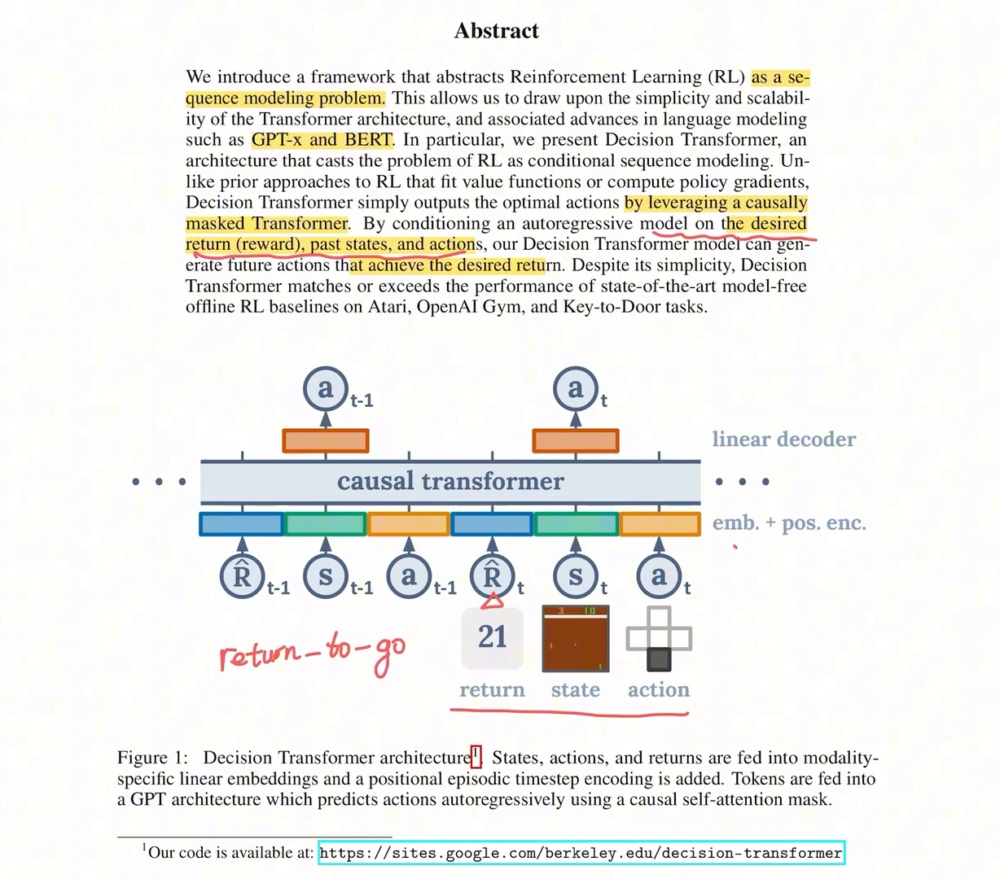
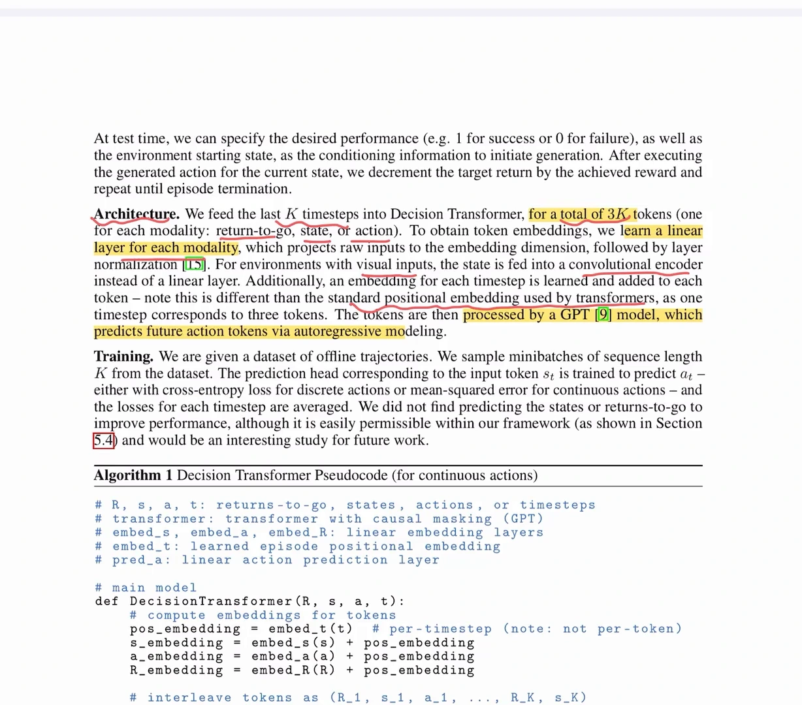
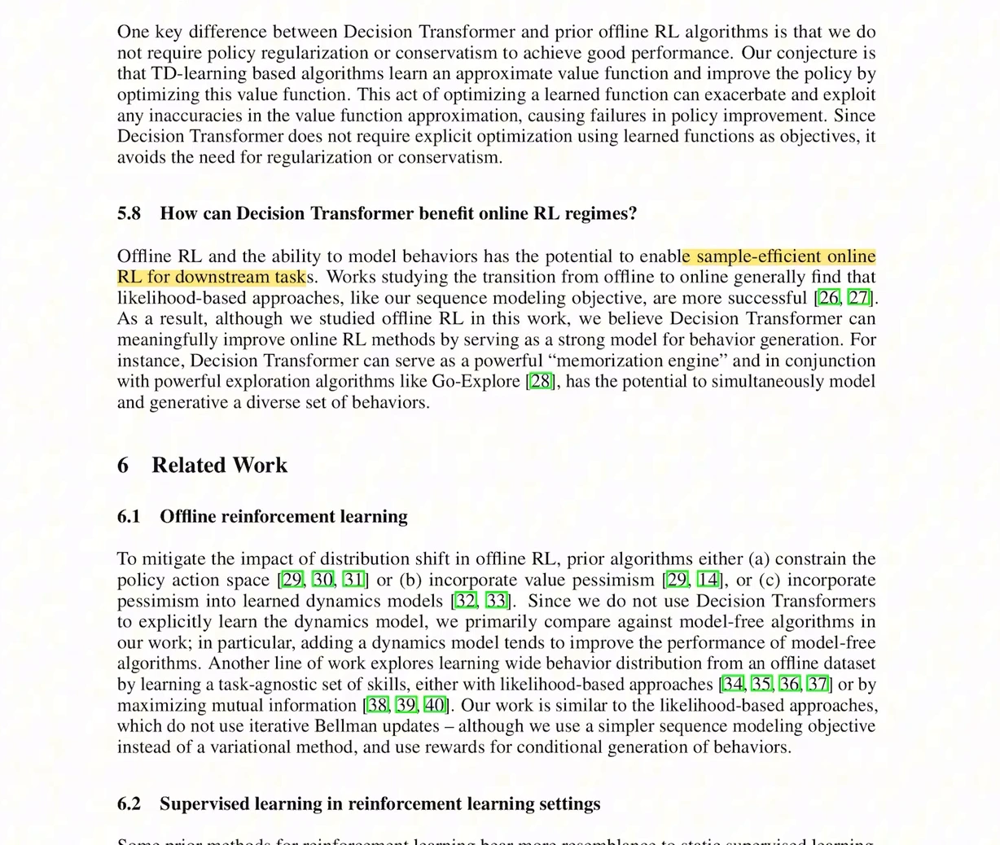
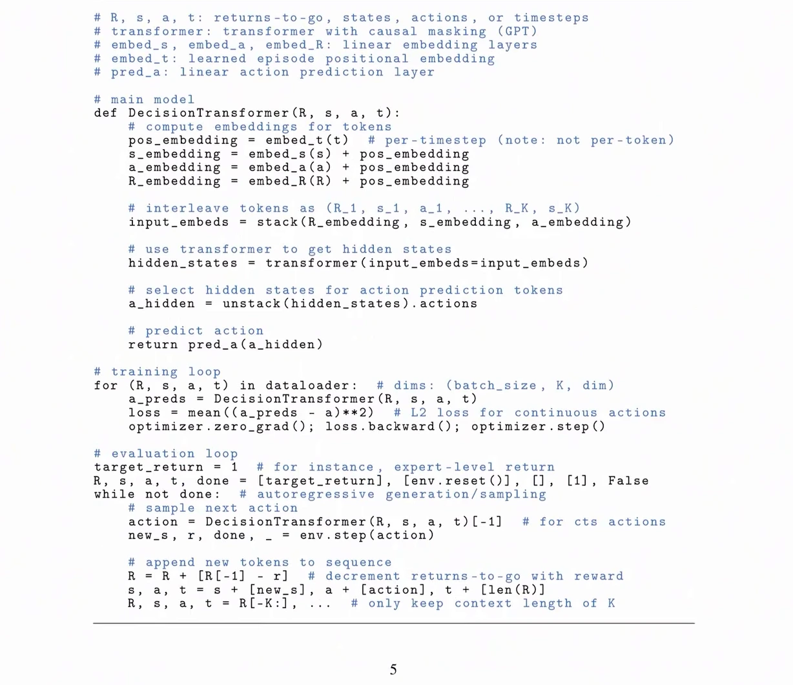
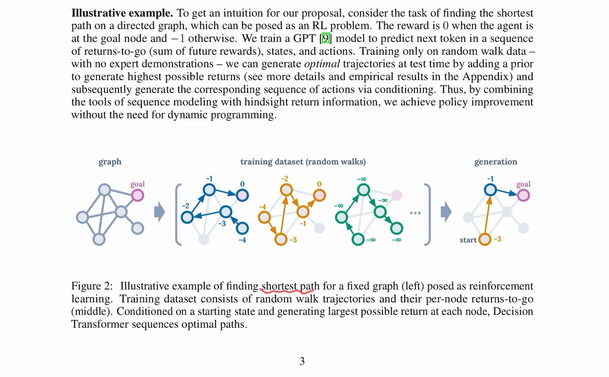
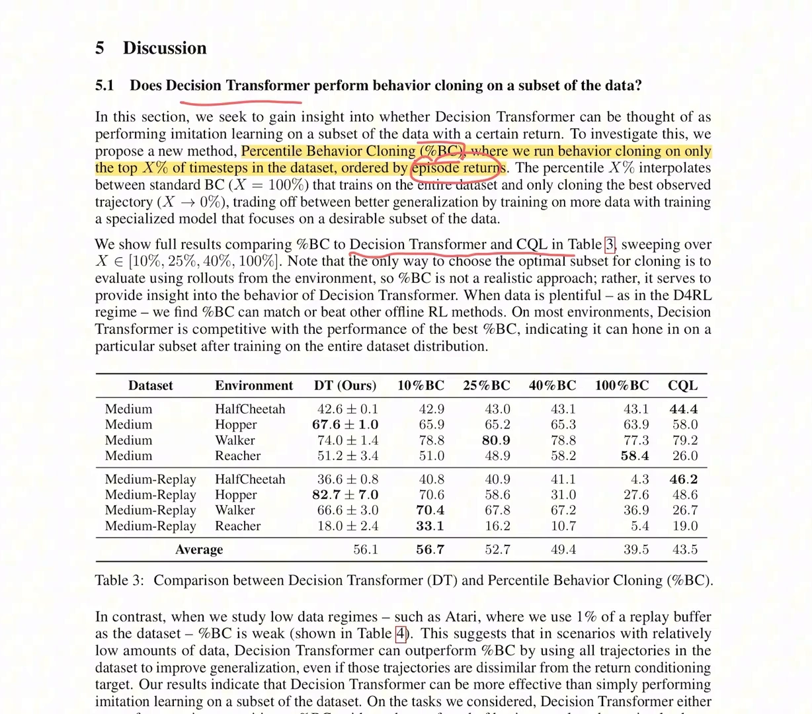
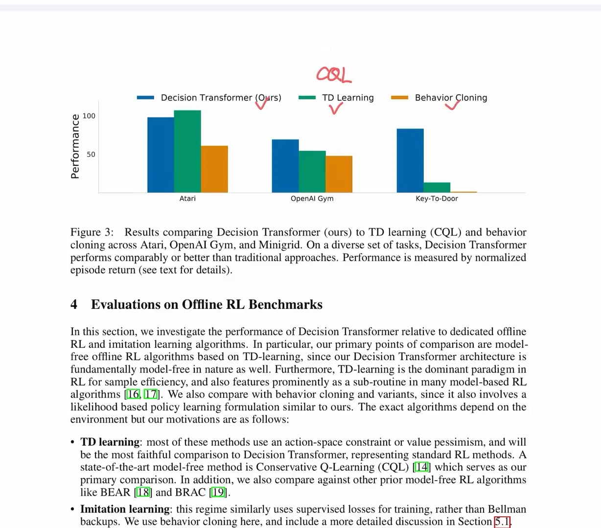
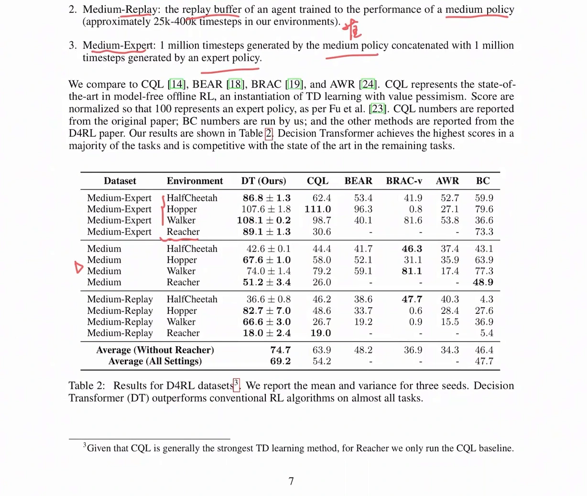
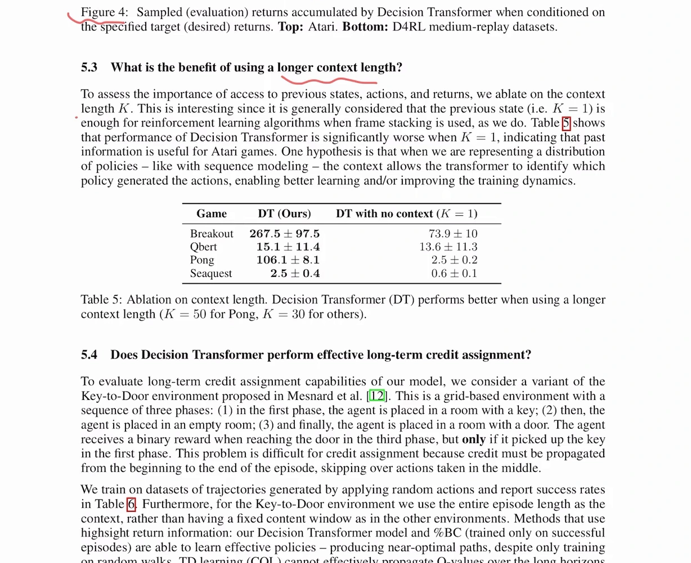
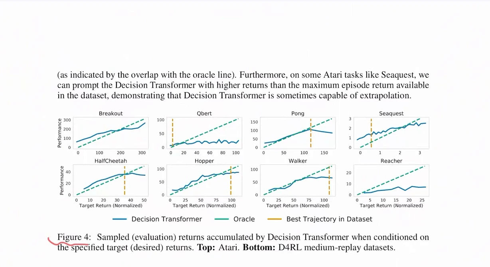

# Decision Transformer：把离线强化学习变成条件序列建模

> 承接 12.2 与 12.4。12.2 已经把外推误差的因果链推完了（$\max_{a'}$ 挑中数据外的高值、误差沿 backup 传播、离线没有纠错机会），12.3 与 12.4 是两条应对路线——**约束策略**、**保守估值**。这一篇讲第三条，也是最激进的一条：**干脆不做价值估计**。内容依据 B 站「萝卜汁MeMo」的 Decision Transformer 论文精读整理，讲者逐页过的是论文原文（Chen et al., 2021），所以画面里的原文段落也一并作为依据。

## 本讲要解决的核心问题（SCQA）

**背景**：前两条路线都在给「数据外的动作」打补丁。BCQ/BEAR 给策略套缰绳，CQL 压低 OOD 动作的估值，IQL 干脆不去查询它们。但它们共享同一个部件：一个价值函数 $Q(s,a)$，以及它上面的那个 $\max$。

**冲突**：只要还有 $\max_a Q(s,a)$，就有「给一个没见过的动作打分」这一步，也就永远要额外加一项东西去防它乱来。而这些补丁本身都有代价——约束太紧退化成行为克隆，太松又回到 OOD；保守系数调不好就系统性低估（12.3、12.4 都讨论过）。

**疑问**：能不能把「给动作打分再取最大」这一步整个删掉？

**回答（中心思想）**：能。**Decision Transformer**（DT）把轨迹当成一条序列，用 GPT 式的因果 Transformer 自回归地预测下一个动作，条件是「这段轨迹到目前为止还想要多少回报」。它不学 $Q$、不算策略梯度、也不做贝尔曼 backup：**训练是一个纯监督学习问题，推理是一次条件生成**。

---

## 一、核心洞察：一条轨迹本来就是一条序列

离线数据集里的一条轨迹，天然就是按时间排好的一串东西。DT 把它写成这样：

$$
\tau = \big(\hat R_1, s_1, a_1,\ \hat R_2, s_2, a_2,\ \ldots,\ \hat R_T, s_T, a_T\big)
$$

其中 $\hat R_t$ 是**回报-to-go**（return-to-go）：

$$
\hat R_t = \sum_{t'=t}^{T} r_{t'}
$$

这个量有三点要注意：

- **它是未来的，不是过去的。** 讲者特意强调过这一点：$s_t, a_t$ 指的是过去到现在的状态和动作，而 $\hat R_t$ 指的是**从 $t$ 时刻起到回合结束**还能拿到的累计回报。两者方向相反，别混。
- **它是「后见之明」的信息。** 在训练数据里，$\hat R_t$ 是事后算出来的：这条轨迹实际拿了多少，从第 $t$ 步起就还剩多少。它不需要模型去估计，直接由数据给。
- **条件变量取整段剩余回报，而不是单步奖励。** 单步的 $r_t$ 只说明「这一步拿了多少」，而 $\hat R_t$ 说明「从这里开始整段还有多好」——后者才是能表达「这条轨迹值不值得走」的量。



[【跳转到 02:00】](https://www.bilibili.com/video/BV1aEG76TEpd/?t=120)

图上红色手写标注的 `return-to-go` 就写在 $\hat R_t$ 那个 token 下面，这是整篇论文最关键的一个输入。摘要里那句 "casts the problem of RL as conditional sequence modeling" 是全篇的定位：**不是「学一个策略」，而是「学一个以回报为条件的序列模型」**。

---

## 二、模型结构：3K 个 token，只对动作算损失

结构上没有什么新东西，就是把 GPT 拿过来：

- **输入**：最近 $K$ 个时间步，每个时间步三个 token（$\hat R_t$、$s_t$、$a_t$），一共 $3K$ 个 token。
- **嵌入**：每个模态一个**独立的线性层**（状态是图像时换成卷积 encoder），把原始输入投影到嵌入维度，再做 layer norm。
- **位置编码**：按**时间步**学一个嵌入，同一个时间步的三个 token 共享它。论文特意点出这和标准 Transformer 的 per-token 位置编码不同——因为这里「一个时间步对应三个 token」。
- **主干**：带因果掩码的 GPT，所以 $a_t$ 只能看到它之前的 token，看不到未来。
- **输出**：线性解码器，只从**动作位置**的隐状态预测动作。

损失只在动作 token 上算：离散动作用交叉熵，连续动作用均方误差，各时间步取平均。论文还提到一句很实用的结论——他们试过让模型同时预测 state 和 return-to-go，**没有带来提升**。



[【跳转到 04:35】](https://www.bilibili.com/video/BV1aEG76TEpd/?t=275)

伪代码里的前向过程也就这么几行（对应论文 Algorithm 1）：

```python
pos_embedding = embed_t(t)              # 每个时间步一个，不是每个 token 一个
s_embedding = embed_s(s) + pos_embedding
a_embedding = embed_a(a) + pos_embedding
R_embedding = embed_R(R) + pos_embedding

input_embeds = stack(R_embedding, s_embedding, a_embedding)   # 按 (R_1, s_1, a_1, ..., R_K, s_K) 交错
hidden_states = transformer(input_embeds=input_embeds)
a_hidden = unstack(hidden_states).actions   # 只取动作位置
return pred_a(a_hidden)
```

注意 `unstack(...).actions` 这一步：**只有动作位置的隐状态被送去算损失**，回报与状态 token 只作为上下文参与注意力。这一点决定了这个模型的训练目标里完全没有「预测回报」这一项。

---

## 三、为什么这样就绕开了 OOD 问题

这是本篇最需要讲清楚的一段，也是 DT 与 12.2/12.3/12.4 的根本分界。

12.2 的因果链是这样的：目标里出现 $\max_{a'} Q(s',a')$ → 网络在无数据区域随手画出的高值被挑中 → 这个高值被写进标签 → 沿 backup 传回更早的状态 → 策略主动去追这个错误的高值。

DT 里这条链的**每一环都不存在**：

- **没有 $\max$。** 训练目标是对数据里**真实出现过**的 $a_t$ 做最大似然（或 MSE），标签来自数据，不是模型自己的输出。
- **没有自举。** 不用 $r + \gamma \max_{a'} Q(s',a')$ 造标签，也就没有「拿自己的预测当标签」这一步。
- **没有「评估动作」这个操作。** 模型不是在给动作打分，而是在给定上下文的情况下**生成**动作。生成不会主动去找「哪个动作值最高」，所以不会系统性地扑向数据空白处。

论文 5.7 节把这一点写成了一句很干脆的话：DT 不需要 policy regularization（策略正则）或 conservatism（保守性），因为它不需要「用一个学到的函数当目标去做显式优化」；而 TD 类方法恰恰是靠优化学到的价值函数来改进策略的，这个动作会把价值函数近似的误差**放大并加以利用**。



[【跳转到 13:00】](https://www.bilibili.com/video/BV1aEG76TEpd/?t=780)

不过这里要诚实：**DT 并没有消灭分布偏移，只是把它换了个位置。** 12.2 的分布偏移是「策略访问的状态动作分布 $\rho^{\pi}(s,a)$ 不等于数据分布 $\rho^{\mu}(s,a)$」；DT 里它变成了**条件上的偏移**——你给的目标回报如果落在数据集回报分布之外，模型仍然要在没有数据的地方外推。视频里 Figure 4 的实验量的就是这件事（见第七节）。

所以准确的说法是：DT 把**价值外推**换成了**条件外推**。后者更温和（一个标量条件比整个动作空间好控制），但并没有消失。

---

## 四、推理：指定一个目标回报，然后自回归生成

这是全篇最反直觉的部分。训练时 $\hat R_t$ 来自数据（事后算出来的真实回报-to-go）；推理时没有数据，$\hat R_1$ 是**人为指定**的。

流程对应 Algorithm 1 的 evaluation loop：

1. 给定起始状态 $s_1$ 和**目标回报** $\hat R_1$（比如「这一局我想要 5000 分」）；
2. 把 $(\hat R_1, s_1)$ 送进模型，取最后一个动作位置的输出作为 $a_1$；
3. 环境执行 $a_1$，返回真实奖励 $r_1$ 和下一个状态 $s_2$；
4. **更新目标回报**：$\hat R_2 = \hat R_1 - r_1$，把 $(\hat R_2, s_2)$ 接到序列尾部；
5. 只保留最近 $K$ 步，重复直到回合结束。

关键在第 4 步：**目标回报是递减的**。$\hat R_1 = 5000$ 的意思是「这一整局我想要 5000 分」；已经拿到 100 分之后，剩下还想要的就只有 4900。伪代码里就是一行：

```python
target_return = 1                        # 例如专家级回报
R, s, a, t, done = [target_return], [env.reset()], [], [1], False
while not done:                          # 自回归生成
    action = DecisionTransformer(R, s, a, t)[-1]
    new_s, r, done, _ = env.step(action)
    # 把新 token 接到序列尾部
    R = R + [R[-1] - r]                  # 用实际奖励递减回报-to-go
    s, a, t = s + [new_s], a + [action], t + [len(R)]
    R, s, a, t = R[-K:], ...             # 只保留最近 K 步
```



[【跳转到 04:43】](https://www.bilibili.com/video/BV1aEG76TEpd/?t=283)

这也解释了这个方法的名字：它不是「算出最优动作」，而是**条件生成**——给定想要的回报，生成能达成它的动作序列。讲者的说法是：在推理的时候直接给模型一个比较高的目标 return，它就能生成一个接近最短路径的轨迹序列。所谓「策略改进」，在这里被替换成了「**条件化**」。

论文给的最短路径例子把这件事画得很清楚：有向图上每走一步 reward 是 $-1$，走到目标点 reward 是 $0$，训练数据只是**随机游走**（没有任何专家示范）。每个节点标上它这一步的 return-to-go，训练完之后，只要在推理时要求「尽可能高的回报」，生成出来的就是最优路径。



[【跳转到 03:30】](https://www.bilibili.com/video/BV1aEG76TEpd/?t=170)

**限制也在这里**：目标回报不能随便给。给得比数据集里的最大值还高，就是要求模型在没有数据的地方外推。论文在 5.2 节说得很克制——在 Seaquest 等 Atari 任务上，DT 偶尔能超过数据集里的最大回报，是 "sometimes capable of extrapolation"，不是保证。

---

## 五、它和行为克隆是什么关系：%BC 实验

DT 的损失只对动作算，形式上和行为克隆一模一样；差别只在于多了一个条件 $\hat R_t$。所以一个自然的问题是：**DT 是不是就是「自动挑出高回报的那部分数据做 BC」？**

论文的回答方式很直接：造一个对手叫 **%BC**（percentile behavior cloning）——按 episode return 从高到低排序，只拿前 $X\%$ 的时间步做 BC。$X = 100\%$ 就是普通 BC，$X \to 0$ 就是只克隆最好的一条轨迹。这个对手需要知道每条轨迹的回报，而且「挑哪个子集最好」只能靠环境 rollout 试出来，所以它**不是一个现实可用的方法**，但可以当诊断工具。



[【跳转到 08:40】](https://www.bilibili.com/video/BV1aEG76TEpd/?t=520)

结果：DT 平均 56.1，10% BC 56.7，25% BC 52.7，40% BC 49.4，100% BC 39.5，CQL 43.5。**DT 与 10% BC 最接近**。讲者的解读是：DT 能从完整数据里学到高回报的行为模式，不需要事先挑数据；而普通 BC 的问题是它会平均模仿所有数据，包括低质量轨迹。

低数据场景反过来对 DT 更有利：Atari 上只用 1% 的 replay buffer 时，%BC 再砍掉 90% 的数据会更惨，而 DT 仍然用全部轨迹训练，即使这些轨迹和目标 return 差异比较大，也能改善泛化。

**关于「轨迹拼接」（trajectory stitching）**：这里要区分两件事。12.1 讲过，离线 RL 相对 BC 的核心优势是**拼接**——把不同轨迹里的好片段拼成一条更优的轨迹。DT 的条件化确实提供了做这件事的机制（生成时不必复制某一条轨迹，而是从条件出发逐 token 生成），但**论文没有把 stitching 作为卖点来验证**，%BC 实验比较的是「挑子集」而不是「拼片段」。后续工作普遍认为 DT 的 stitching 能力弱于基于价值的方法——这一句是补充的背景，不是视频里的内容。

---

## 六、实验：三套 benchmark 与 D4RL

主结果图比较三类方法：Decision Transformer、TD learning（以 CQL 为代表）、Behavior Cloning，覆盖三套任务。



[【跳转到 05:49】](https://www.bilibili.com/video/BV1aEG76TEpd/?t=349)

讲者逐套读了这张图：

- **Atari**：高维图像输入、奖励经常存在延迟。DT 基本接近 TD learning 这一类方法（略低一点）。
- **OpenAI Gym**：连续控制任务。DT 优于另外两种方法，说明它可以用在连续控制上。
- **Key-to-Door**：稀疏奖励 + 长程任务。DT 比另外两个 baseline 好很多，讲者的判断是它很适合这类任务。

D4RL 上的表 2 更细：数据集分 medium、medium-replay、medium-expert 三档，对比 CQL、BEAR、BRAC-v、AWR、BC。DT 的平均分（不含 Reacher）是 74.7，CQL 63.9，BEAR 48.2，BRAC-v 36.9，AWR 34.3，BC 46.4。



[【跳转到 07:43】](https://www.bilibili.com/video/BV1aEG76TEpd/?t=463)

**上下文长度到底有没有用？** 这是 DT 特有的一个超参。论文做了消融：$K = 1$ 时模型只能看到当前这一步。



[【跳转到 10:45】](https://www.bilibili.com/video/BV1aEG76TEpd/?t=645)

差距很大：Breakout 从 267.5 掉到 73.9，Pong 从 106.1 掉到 2.5（$K = 50$ 用于 Pong，其余 $K = 30$）。论文给的假设是：序列建模是在表示一个**策略分布**，上下文能让 Transformer 判断「这些动作是哪个策略产生的」，从而学得更好。

**长程信用分配**（5.4 节）：Key-to-Door 分三个阶段——先在放钥匙的房间拿钥匙，再穿过空房间，最后进有门的房间；只有在第三阶段到达门、并且第一阶段拿过钥匙，才给奖励。奖励只发生在最后，信用必须从回合末尾一路传回开头。讲者的总结是：CQL 在这类任务上表现很差，DT 和 %BC 效果比较好；数据量提升对 DT 和 %BC 有明显帮助，对 BC 和 random 基本没有效果。

---

## 七、局限与它没有回答的问题

**1. 对目标回报敏感，而且只在数据范围内可靠。** 论文 Figure 4 直接把「指定的目标回报」和「实际拿到的回报」画在一起，绿色虚线是 oracle（两者完全一致）。DT 的曲线在部分任务上贴着 oracle，但在 Qbert、Reacher 上明显偏离，Pong 过了某个目标值之后实际回报反而下降。



[【跳转到 10:03】](https://www.bilibili.com/video/BV1aEG76TEpd/?t=603)

所以「给个高目标就能拿高分」只在数据支撑范围内成立，目标回报本身是一个要按任务调的超参。

**2. 上下文窗口 $K$ 是硬约束。** 模型只看最近 $K$ 步（Key-to-Door 用整条轨迹是特例）。Table 5 说明 $K$ 小会显著掉点，而 $K$ 大意味着推理时序列更长、更慢。

**3. 它不是在线算法，也没有真正的「策略改进」算子。** DT 不会自己变得比数据更好，它只是把数据里**已经存在**的好行为按条件提取出来。论文 5.8 节讨论的是反过来用它——把 DT 当作强大的行为生成模型或「记忆引擎」，去初始化或辅助 online RL，而不是让 DT 自己在线上改进。

**4. 与 CQL 的比较不是全面胜出。** Atari 上 CQL 略高，说明在「高维观测 + 奖励延迟」这类任务上，价值方法仍然有优势。

**5. 一个更根本的依赖（补充说明，非讲者原话）**：DT 把「能不能变好」押在了「数据集里有没有好片段」上。条件回报只能引导模型去取数据里已经存在的行为；数据里完全不存在的好行为，它生成不出来。

---

## 八、三条路线对比

12.4 已经从「保守性加在哪」的角度比过一次。换成序列建模关心的五个维度再看一遍：

| 维度 | 策略约束（BCQ/BEAR，见 12.3） | 保守价值（CQL/IQL，见 12.4） | 序列建模（DT） |
| :--- | :--- | :--- | :--- |
| 是否估计价值 | 是，要 Q 网络 | 是，CQL 学保守 Q，IQL 学 $V$ 与 $Q$ | **否**，只有动作预测头 |
| 是否约束策略 | 是，显式写散度或支持集约束 | 否（CQL 约束的是 Q 值，IQL 约束的是查询范围） | 否 |
| 是否需采样或生成 OOD 动作 | 需要（VAE 生成候选、MMD 比较分布） | CQL 需要采样动作估 $\log\sum\exp$；IQL 不需要 | **不需要** |
| 能否 stitching | 能，但受约束强度限制 | 能（IQL 在 AntMaze 上的优势就是证据） | 有条件：机制上可以，实测弱于价值方法（补充） |
| 实现复杂度 | 高 | 中（CQL）/ 低（IQL） | 低：一个 Transformer 加一个监督损失 |

一句话总结这张表：**前两条路线都在回答「数据外的动作该怎么办」，DT 的答案是「不问这个问题」。**

---

## 九、和第 14 章的关系

DT 的意义不只是一条离线 RL 路线。它第一次把「策略」写成了**以回报为条件的序列生成模型**——这和第 14 章 RLHF/DPO 里「把策略当成语言模型、用条件或偏好去引导生成」是同一套语言。第 14 章会再见到这个视角。

---

## 小结

- **核心洞察**：把轨迹写成 $(\hat R_t, s_t, a_t)$ 的序列，用因果 Transformer 自回归预测动作。训练是监督学习，推理是条件生成。
- **为什么能绕开 OOD**：没有 $\max_a Q(s,a)$，就没有「给没见过的动作打分」这一步，也就不需要策略约束或保守性——论文 5.7 节的原话是它不对学到的函数做显式优化。
- **推理的关键**：目标回报 $\hat R_1$ 人为指定；每步用真实奖励递减 $\hat R_{t+1} = \hat R_t - r_t$；只保留最近 $K$ 步。
- **与 BC 的关系**：DT 本质是「带回报条件的 BC」。%BC 实验说明它的效果接近「只学最好的 10% 数据」，但不需要事先挑数据。
- **代价**：目标回报与 $K$ 都要调；不做在线改进；Atari 上仍略逊于 CQL。
- **它没有消灭分布偏移**，只是把「价值外推」换成了「条件外推」。

---

## 附：本篇要点速查

| 概念 | 一句话 |
| :--- | :--- |
| 回报-to-go（return-to-go） | $\hat R_t = \sum_{t'=t}^{T} r_{t'}$，从当前时刻到回合结束还能拿到的累计回报，是未来的量 |
| 轨迹的序列表示 | $\tau = (\hat R_1, s_1, a_1, \ldots, \hat R_T, s_T, a_T)$，每个时间步三个 token |
| 3K 个 token | 最近 $K$ 个时间步、三个模态，共 $3K$ 个 token 送入因果 Transformer |
| 位置编码 | 按时间步学，一个时间步的三个 token 共享同一个位置嵌入 |
| 损失 | 只对动作 token 算：离散动作用交叉熵，连续动作用均方误差 |
| 条件生成 | 推理时人为指定 $\hat R_1$，模型生成能达成该回报的动作序列 |
| 回报递减 | 每步更新 $\hat R_{t+1} = \hat R_t - r_t$，伪代码里是 `R = R + [R[-1] - r]` |
| %BC | 按 episode return 排序只克隆前 $X\%$ 时间步的对照方法，用来诊断 DT 是否等价于「挑子集做 BC」 |
| 上下文长度 $K$ | DT 特有的关键超参；$K = 1$ 时性能显著变差 |

## 参考视频

- 萝卜汁MeMo《Decision Transformer》论文精读，[BV1aEG76TEpd](https://www.bilibili.com/video/BV1aEG76TEpd/)