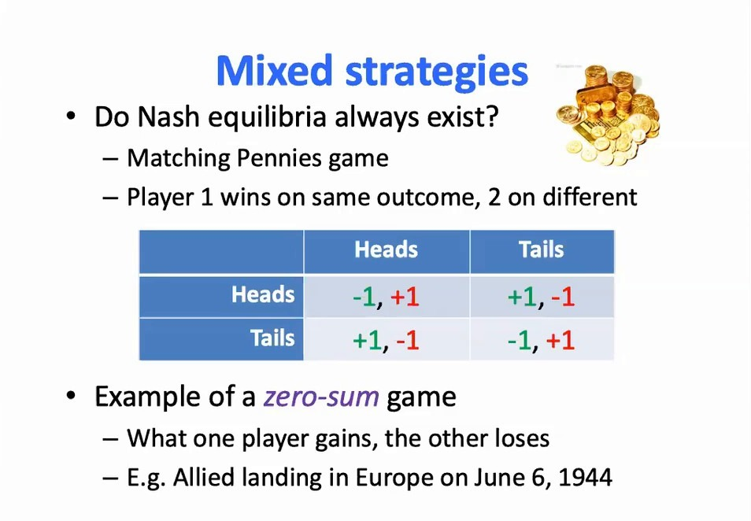
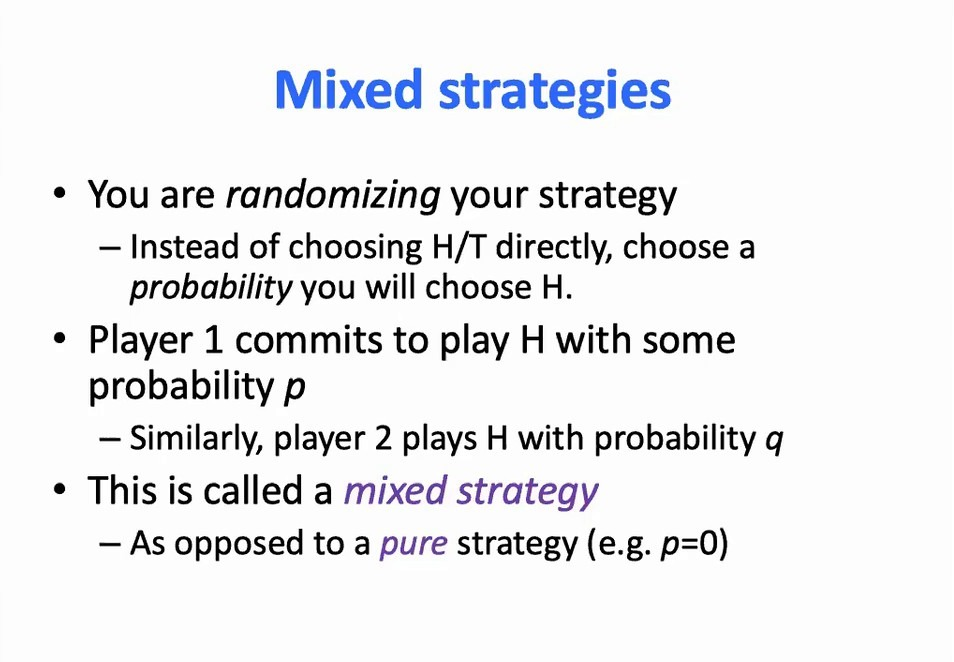
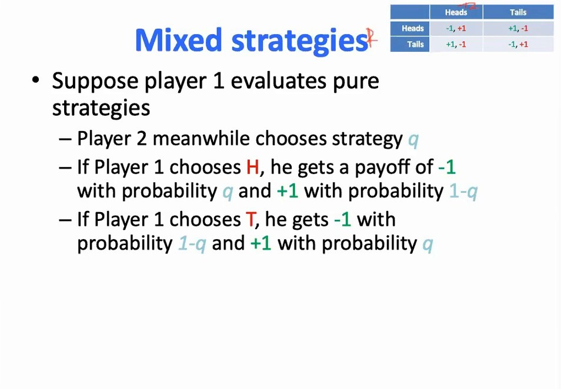
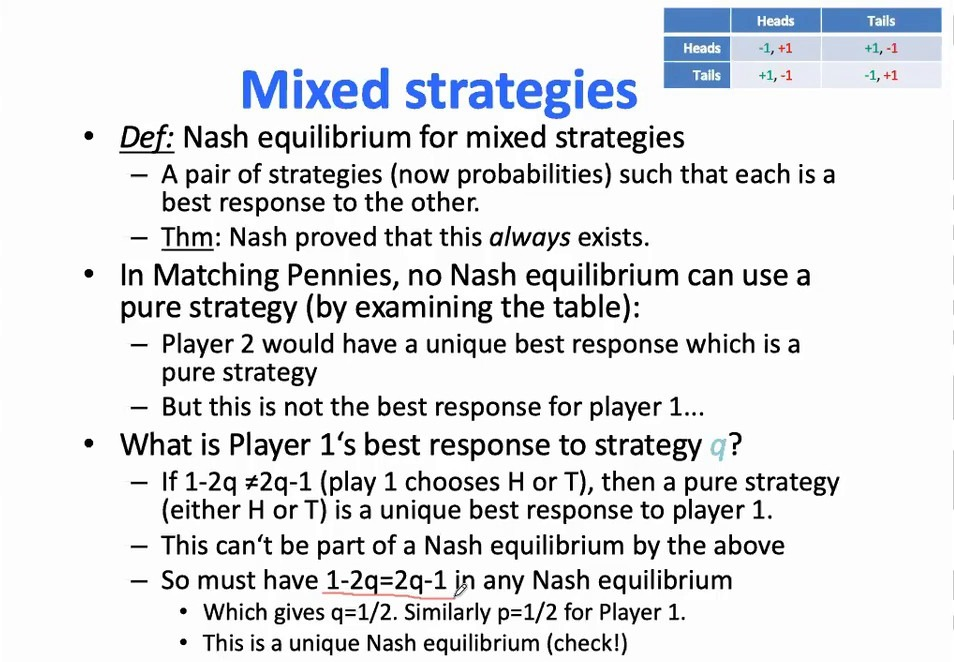
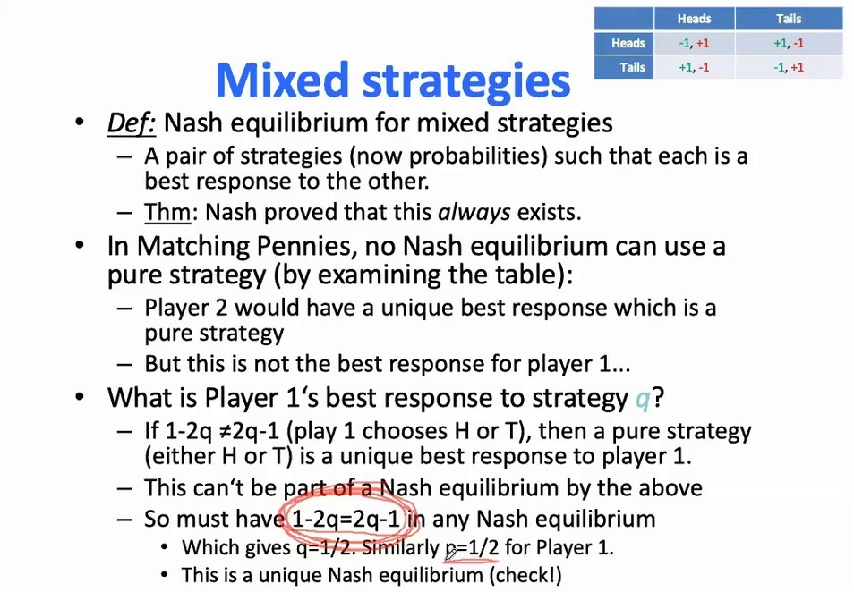
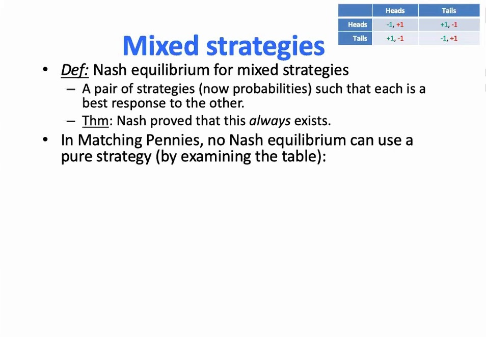
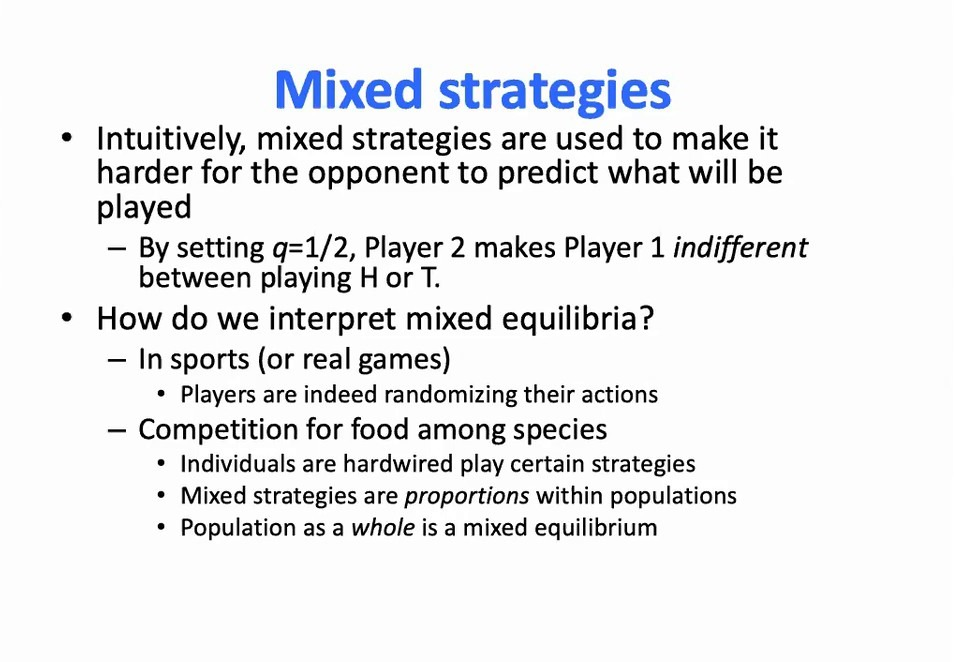

# 混合策略纳什均衡：猜硬币与零和博弈

> 承接同目录的[纯策略纳什均衡：囚徒困境与最佳对策](纯策略纳什均衡：囚徒困境与最佳对策.md)。那一篇里每个例子都能找到纯策略均衡；这一篇要处理反例——**有些博弈在纯策略里根本没有均衡**。课程用猜硬币引出混合策略，用"令对手无差异"的技巧解出唯一的均衡，并顺带给出了两人零和博弈的通解与"博弈的值"。这套东西是后面 13.5 里 MADDPG 那一类方法的理论底色。

## 本讲要解决的核心问题（SCQA）

**背景**：上一篇我们把纳什均衡定义成"互为最佳对策的联合策略"，并在囚徒困境、协调博弈里都找到了它。看起来这个解概念挺好用。

**冲突**：猜硬币这个博弈里，无论双方停在哪个纯策略组合上，总有一方想改。你出正面我就出反面，你出反面我就出正面——追下去是个死循环。**纯策略空间里一个均衡都没有。**

**疑问**：那这个博弈该怎么玩？如果连"解"都不存在，前面那套理论是不是就废了？

**回答（中心思想）**：把"策略"从"选一个动作"放宽成"选一个动作上的**概率分布**"，均衡就回来了。猜硬币的混合均衡是双方各以 $1/2$ 出正面，而这个均衡的求法只有一条原则：**让对手在他的两个纯动作之间无差异**。更进一步，Nash 证明了混合策略均衡**总是存在**——这才让"纳什均衡"成为一个站得住的解概念。

---

## 一、猜硬币：纯策略里没有均衡

[【跳转到 00:25】](https://www.bilibili.com/video/BV1fz4y1S72S/?p=4&t=25)

规则：两人同时出硬币，正面或反面。参与人 1 押"两人相同"（同正或同反）赢，参与人 2 押"两人不同"赢。收益矩阵：

| 参与人 1 ＼ 参与人 2 | 正面 | 反面 |
| :--- | :--- | :--- |
| **正面** | -1, +1 | +1, -1 |
| **反面** | +1, -1 | -1, +1 |

课程顺带点出：**这也是一个零和博弈**——每一格的两个数加起来恒为 0，一个人赢多少，另一个人就输多少。

然后是逐格"追"的过程：

- 假设参与人 2 一直出**正面**，参与人 1 显然会改出**反面**（得 +1 而不是 -1）；
- 假设参与人 1 固定出**反面**，参与人 2 又会改出**反面**；
- 参与人 1 再改回**正面**……

课程的原话是：这样一圈一圈转下去，说明**纯策略空间里没有均衡**。那这个游戏该怎么玩？你预测结果会是什么？

> **补充（非讲者原话）**：石头剪刀布是同一个结构的三动作版本——任何纯策略组合都会被一方单方面改进，所以它同样只有混合均衡（各以 $1/3$ 出三种手势）。猜硬币可以看成它的两动作简化版。

---

## 二、混合策略：把策略随机化

[【跳转到 02:47】](https://www.bilibili.com/video/BV1fz4y1S72S/?p=4&t=167)

课程给的出路是：**把策略随机化**——不是直接选正面或反面，而是选一个概率。

- 参与人 1 以概率 $p$ 出正面（以 $1-p$ 出反面）；
- 参与人 2 以概率 $q$ 出正面（以 $1-q$ 出反面）。

这就叫**混合策略**。它总是包含纯策略：把某个概率设成 1，就退化成确定地选那个动作。

课程在这里强调了一个容易混的点：**策略空间变了**。以前我们不分"动作"和"策略"，因为纯策略就等于动作；现在策略是动作上的一个概率分布，也就是一个**概率单纯形**。后面所有关于均衡的讨论，都要在这个更大的空间里做。

---

## 三、期望收益：把收益换成期望值

混合之后，收益不再是确定的数，而是**期望值**。

[【跳转到 05:06】](https://www.bilibili.com/video/BV1fz4y1S72S/?p=4&t=306)

课程先固定参与人 1 用**纯策略**、参与人 2 用**混合策略** $q$，算参与人 1 的期望收益：

- 参与人 1 出**正面**：以概率 $q$ 得 $-1$，以概率 $1-q$ 得 $+1$，所以

$$
\mathbb{E}[\,\text{出正面}\,] = (-1)\cdot q + (+1)\cdot (1-q) = 1 - 2q
$$

- 参与人 1 出**反面**：以概率 $1-q$ 得 $-1$，以概率 $q$ 得 $+1$，所以

$$
\mathbb{E}[\,\text{出反面}\,] = (-1)\cdot (1-q) + (+1)\cdot q = 2q - 1
$$

（课件的写法是 $(-1)\cdot q + (+1)\cdot (1-q) = 1-2q$ 与 $(+1)\cdot q + (-1)\cdot (1-q) = 2q-1$，与上面一致。）

于是问题变成：**对参与人 1 来说，正面和反面哪个更有吸引力？** 这取决于 $q$。

---

## 四、令对手无差异：解出唯一的混合均衡

这是全篇最关键的一步，也是所有两人零和博弈求解的通用技巧。

[【跳转到 10:21】](https://www.bilibili.com/video/BV1fz4y1S72S/?p=4&t=621)

课程先说明为什么猜硬币里**纯策略不可能是均衡**：如果参与人 1 用纯策略，那么参与人 2 会有一个唯一的纯策略最佳对策；但那不是参与人 1 的最佳对策，于是有人想偏离。

接着是核心推理：

- 如果 $1-2q \ne 2q-1$，那么参与人 1 在两个纯动作中有一个严格更好，他会**只选那一个**——混合策略不可能是他的最佳对策，也就不可能出现在均衡里。
- 所以，均衡处**必须**让两者相等：

$$
1 - 2q = 2q - 1 \quad\Longrightarrow\quad q = \tfrac{1}{2}
$$

- 对参与人 2 用同样的技巧，得到 $p = \tfrac{1}{2}$。

这就是猜硬币**唯一的纳什均衡**：双方各以 $1/2$ 的概率出正面。

[【跳转到 12:01】](https://www.bilibili.com/video/BV1fz4y1S72S/?p=4&t=721)

课程把这段逻辑总结成一个可复用的套路：**两个方程、两个未知数**。要让参与人 2 在正面和反面之间无差异，就解出 $p$；要让参与人 1 无差异，就解出 $q$。课程说，这是两人两动作标准式博弈里求纳什均衡**最简单的办法之一**。

> **注意这个推理的"反直觉"之处**：均衡不是"我选一个让我收益最大的混合比例"，而是"我选一个让**对手**无所谓的混合比例"。你随机化的目的不是让自己更赚，而是让对手没法针对你。这一点在第六节还会回到。

---

## 五、Nash 的存在性定理：为什么这个解概念站得住

[【跳转到 08:00】](https://www.bilibili.com/video/BV1fz4y1S72S/?p=4&t=480)

混合策略下纳什均衡的定义和纯策略完全一样，只是策略空间换成了概率分布：**一对策略（现在是概率）互为最佳对策**。

课程接着讲了它的分量：**Nash 在 1950 年代的论文里证明了这个均衡总是存在**——这也是他拿诺贝尔奖的工作。课程的原话大意是：如果没有存在性定理，"均衡"这个词就没有意义；有了它，纳什均衡才成为一个有意义的解概念。

这句话值得停一下。前面我们看到猜硬币的纯策略均衡不存在——如果故事到此为止，纳什均衡就是个时灵时不灵的工具。存在性定理说的是：**只要允许混合，均衡一定存在**。于是"求纳什均衡"变成了一个总有答案的问题，多智能体 RL 才有了一个可以追求的目标。

---

## 六、零和博弈与"博弈的值"

猜硬币是零和博弈的一个特例。零和博弈有一个额外的好性质：均衡下双方的期望收益是确定的，而且互为相反数。

课程在讲两人零和博弈的通解时给出了这个量（推导在同目录的[马尔可夫博弈：多智能体如何打破MDP的假设](马尔可夫博弈：多智能体如何打破MDP的假设.md)第五节，那里把它用在了随机博弈的每个状态上）：对收益矩阵

$$
A = \begin{pmatrix} a & b \\ d & c \end{pmatrix}
$$

参与人 1 的混合策略与博弈的值分别是

$$
p = \frac{c-d}{(a-b)+(c-d)}, \qquad v = \frac{ac-bd}{a-b+c-d}
$$

把猜硬币的 $a=-1,\ b=+1,\ d=+1,\ c=-1$ 代进去，$p = 1/2$，$v = 0$——双方各占一半，期望收益为 0，与前面的结论一致。

> **补充（非讲者原话，但与本篇直接相关）**：这个"$v$ 一定存在"的结论就是 von Neumann 的**极小极大定理**：在两人零和博弈里
>
> $$
> \max_{\pi_1} \min_{\pi_2} J_1(\pi_1, \pi_2) \;=\; \min_{\pi_2} \max_{\pi_1} J_1(\pi_1, \pi_2) \;=\; v
> $$
>
> 也就是说，"先手方按最坏情况最大化"和"后手方按最好情况最小化"得到同一个值，双方都有最优的混合策略，且这个值就是博弈的值。课程在讲零和博弈时用"鞍点"和"博弈的值"表达了同一件事（见 P31），但没有单独把这条定理拎出来命名。它是 13.5 里 MADDPG 一类方法处理竞争场景的理论基础之一。

---

## 七、怎么理解混合均衡

[【跳转到 13:49】](https://www.bilibili.com/video/BV1fz4y1S72S/?p=4&t=829)

课程给了三层解释：

1. **直觉**：混合策略是为了**让对手猜不到你要出什么**。你把 $q$ 设成 $1/2$，参与人 1 就在正面和反面之间完全无差异——他没法针对你，你也就不会吃亏。
2. **体育与真实博弈**：球员确实在随机化自己的动作（发球方向、点球方向）。这是字面意义上的随机。
3. **物种竞争**：个体可能只采取某个固定的纯策略，但整个种群中采取 A 的比例和采取 B 的比例，就构成了**种群层面的混合策略**；整个种群可能处在一个均衡上。

课程还提了第四层：混合均衡也可以理解为**信念上的均衡**——你相信对方以某个概率出招，对方也相信你以某个概率出招，于是形成自我强化的均衡。这条线索会在后面讲贝叶斯博弈（处理不确定性）时接上。

课程最后留了一个美式橄榄球的练习：进攻方可以传球或跑阵，防守方可以防传或防跑；双方都猜对时收益为 0，猜错时进攻方大赚（或防守方大亏）。用同样的"令对手无差异"技巧解出 $p$ 和 $q$，就得到混合均衡与该博弈的值。

---

## 小结

- **纯策略可能没有均衡**：猜硬币里任何纯策略组合都会被一方单方面改进，追下去是死循环。
- **混合策略**：策略 = 动作上的概率分布。纯策略是它的退化情形（某个概率为 1）。
- **收益变成期望值**：$1-2q$ 与 $2q-1$ 分别是出正面、出反面的期望收益。
- **求解原则**：让对手在他的纯动作之间**无差异**。对猜硬币就是 $1-2q = 2q-1 \Rightarrow q = 1/2$，同理 $p = 1/2$。
- **存在性**：Nash 证明混合策略均衡总是存在，这才让纳什均衡成为可靠的解概念。
- **零和博弈**：均衡下双方期望收益互为相反数，这个值叫"博弈的值"；两人零和博弈有闭式通解，是后面随机博弈在每个状态上要用的工具。
- **怎么理解**：随机化是为了让对手无法针对你；在种群层面，它表现为不同策略的比例。

## 关键术语速查

| 术语 | 一句话解释 |
| :--- | :--- |
| 混合策略（mixed strategy） | 在动作集合上的一个概率分布；纯策略是它的特例 |
| 期望收益 | 混合策略下收益的期望值，取决于双方的概率 |
| 无差异（indifference） | 对手的两个纯动作给你相同的期望收益；均衡处必然如此 |
| 零和博弈（zero-sum game） | 所有结果下双方收益之和为 0，一人所得即另一人所失 |
| 博弈的值（value of the game） | 零和博弈在均衡下先手方能拿到的期望收益 |
| 极小极大定理（minimax theorem） | 两人零和博弈中 $\max\min = \min\max = v$，双方都有最优混合策略 |
| 单纯形（simplex） | 动作上所有概率分布的集合，混合策略所在的空间 |

## 参考视频

- UCL 汪军《Multi-agent Artificial Intelligence》第 1.3 讲 混合策略纳什均衡、第 7.1 讲 多智能体强化学习介绍及基本概念（其中的两人零和博弈通解练习），[BV1fz4y1S72S](https://www.bilibili.com/video/BV1fz4y1S72S/)（P4、P31）
