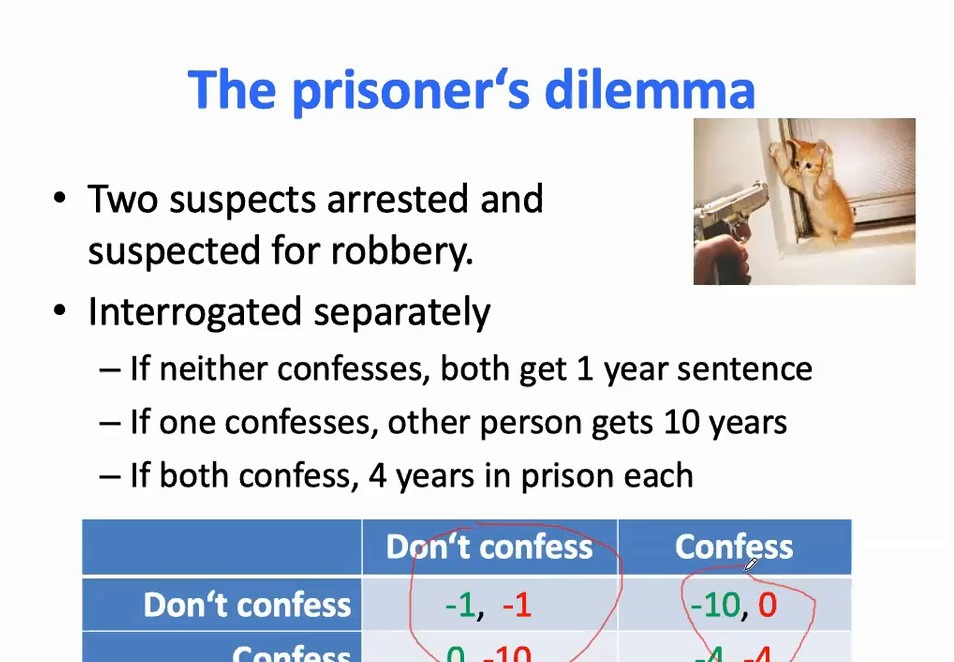
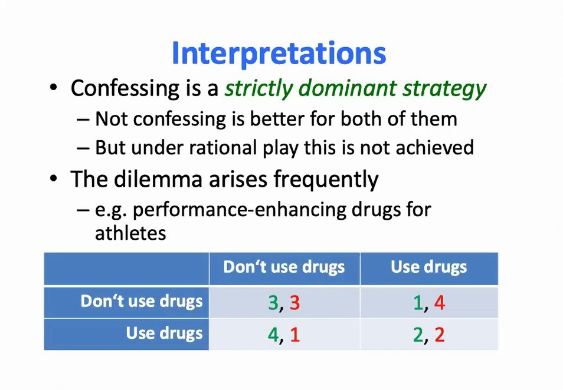
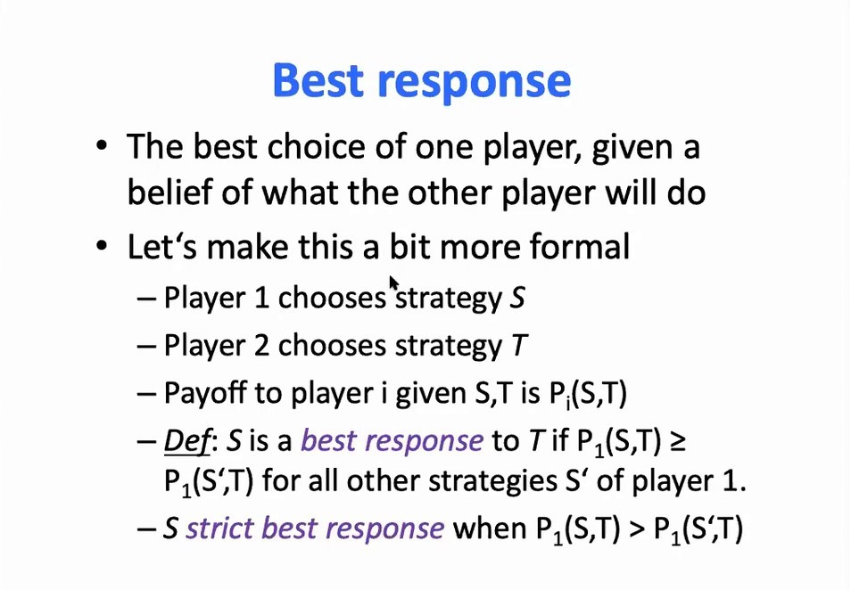
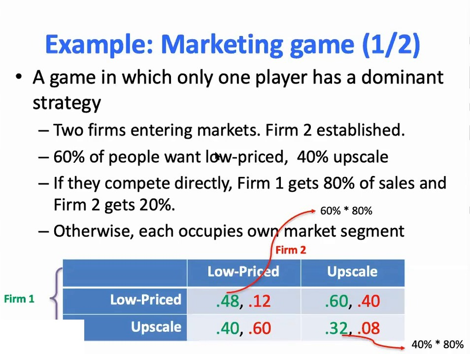
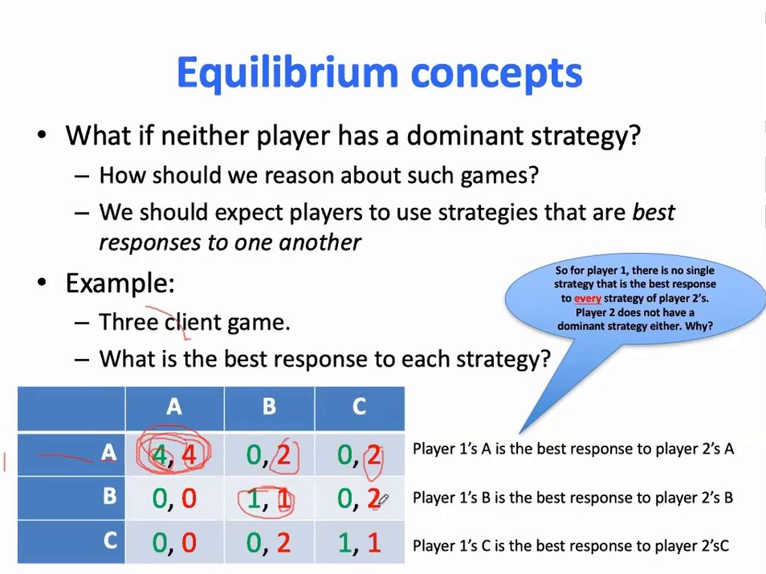
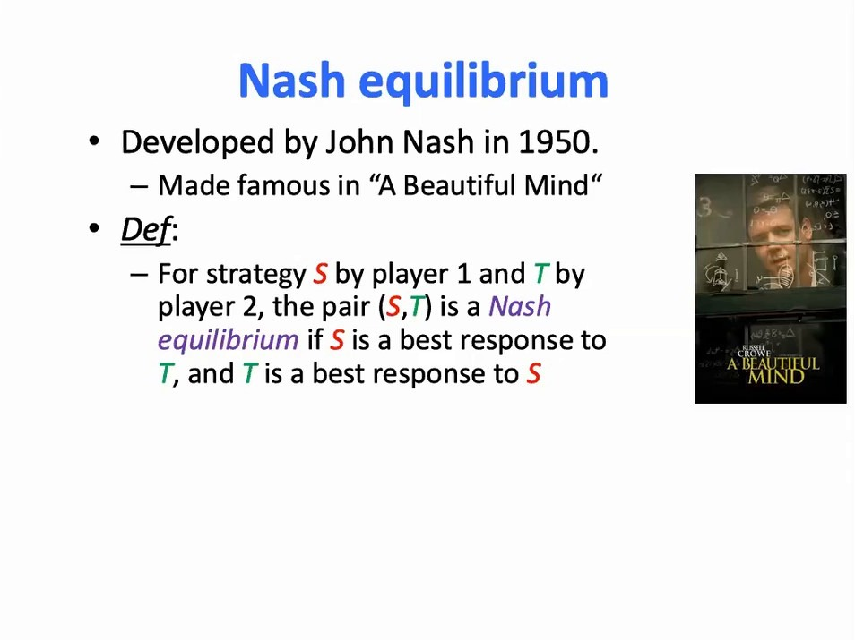
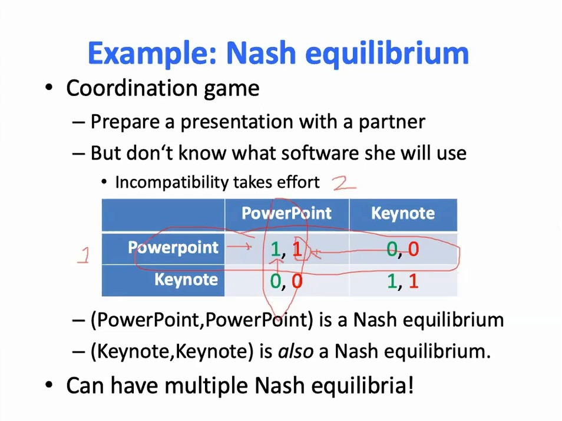
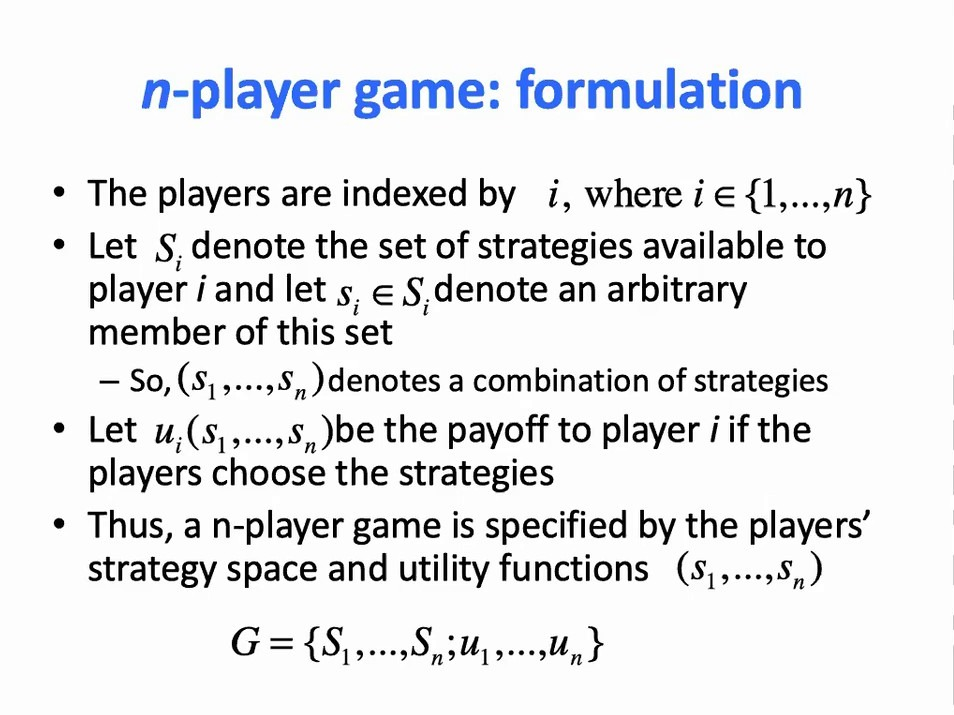
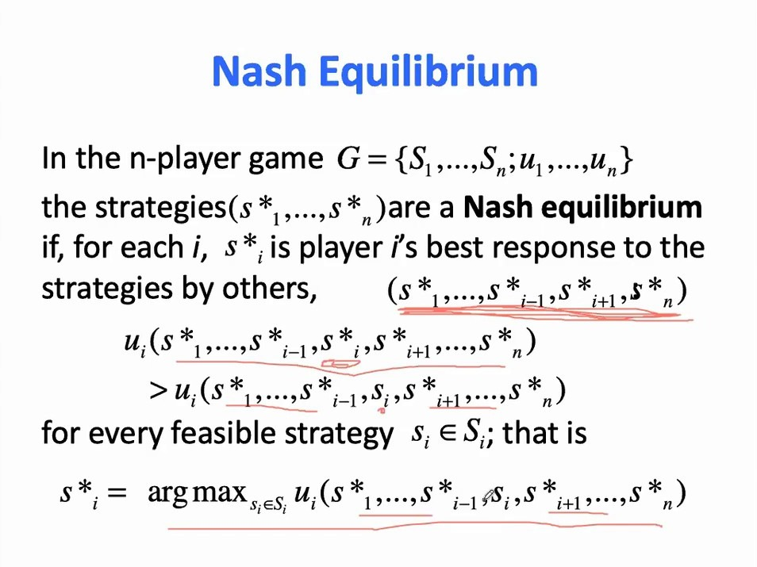

# 纯策略纳什均衡：囚徒困境与最佳对策

> 这是 UCL 汪军《Multi-agent Artificial Intelligence》第 1.2 讲（纯策略纳什均衡）的内容。前 12 章我们处理的都是**单智能体**问题：一个策略、一个环境、一个 MDP。从这一篇开始，环境里出现了第二个、第三个会自己改策略的决策者，"最优"这个词就再也回不到原来的意思了。本篇只做一件事：把博弈的语言搭起来——参与人、策略、收益、最佳对策、占优策略、纳什均衡，并用囚徒困境和协调博弈说明两件反直觉的事：**均衡不等于最优**，**均衡也不一定唯一**。

## 本讲要解决的核心问题（SCQA）

**背景**：在单智能体 MDP 里，"最优策略"是有明确定义的：存在一个策略 $\pi^*$，使得对任意状态 $s$ 都有 $V_{\pi^*}(s) \ge V_{\pi}(s)$。也就是说，最优策略至少不比任何其它策略差——这个定义之所以成立，是因为环境是固定的。

**冲突**：多智能体时，环境里多了一个也在学习、也在改变策略的决策者。你的收益不只取决于你自己做什么，还取决于对方做什么。此时"我选一个对所有人都最优的策略"这句话根本没有意义——因为**对方也在选**。

**疑问**：那多智能体下的"最优"该怎么定义？如果定义不出来，我们凭什么说某个联合行为是"解"？

**回答（中心思想）**：单智能体有最优策略，多智能体只有**均衡**。纳什均衡的定义绕开了"最优"，只要求一件事：**给定别人都不动，没有任何一方能靠单方面改变策略让自己更好**。这个定义弱得多，也因此更普适——代价是它可能不唯一，也可能不是对所有人最好的结果。

---

## 一、囚徒困境：均衡不等于最优

课程用囚徒困境开场，因为它把"均衡 ≠ 最优"这件事讲得最干净。

[【跳转到 02:20】](https://www.bilibili.com/video/BV1fz4y1S72S/?p=3&t=140)

规则是：两个嫌疑人因抢劫被捕，被**分开**审问。

- 两人都不认罪：各判 1 年；
- 一人认罪：认罪者获释，另一人判 10 年；
- 两人都认罪：各判 4 年。

写成收益矩阵（数字是"刑期"的相反数，越大越好）：

| 参与人 1 ＼ 参与人 2 | 不认罪 | 认罪 |
| :--- | :--- | :--- |
| **不认罪** | -1, -1 | -10, 0 |
| **认罪** | 0, -10 | -4, -4 |

课程带着听众做了一遍逐列分析：

- 假设对方**不认罪**：我认罪得 0，不认罪得 -1，所以认罪更好；
- 假设对方**认罪**：我认罪得 -4，不认罪得 -10，所以还是认罪更好。

**不管对方怎么做，认罪都更好。** 对另一个嫌疑人完全对称，于是（认罪，认罪）是这个博弈唯一稳定的结果——两人各判 4 年。

但这里有个刺眼的地方：如果两人能串通，都**不认罪**，各判 1 年，对两个人都更好。课程的原话是：这里不能这么想，因为每个人都是作为**单个自利主体**做决定，而不是把两个人当成一个整体；除非有个"上帝"把他们叫到一起商量，才会得出不同的结论。

[【跳转到 04:51】](https://www.bilibili.com/video/BV1fz4y1S72S/?p=3&t=291)

课程把这张幻灯片的两行字念得很重：

- **认罪是严格占优策略**；
- **不认罪对双方都更好，但在理性博弈下达不到**。

这就是"均衡 ≠ 最优"：纳什均衡描述的是**在给定别人行为时没人愿意单方面偏离的状态**，它完全不保证这个状态对集体是好的。课程顺手给了同构的例子——运动员要不要用兴奋剂：别人不用，你用了更好；别人用了，你还是用了更好。所以"用"也是占优策略，结果所有人都在用，而所有人都不用对所有人更好。

---

## 二、最佳对策：给定对手，我该怎么做

囚徒困境之所以能分析得这么干脆，是因为每个参与人都有占优策略。但大多数博弈没有。要往下走，得先有一个更弱的概念。

[【跳转到 06:28】](https://www.bilibili.com/video/BV1fz4y1S72S/?p=3&t=388)

课程的定义是：**最佳对策（best response）是在你对别人行为的信念给定的情况下，你的最优选择**。形式化一点：设参与人 1 选策略 $S$、参与人 2 选策略 $T$，参与人 $i$ 的收益记为 $P_i(S,T)$，则

$$
S \text{ 是 } T \text{ 的最佳对策} \iff P_1(S,T) \ge P_1(S',T) \quad \text{对所有其它策略 } S' \text{ 成立}
$$

把 $\ge$ 换成 $>$，就叫**严格最佳对策**。这个定义里已经埋下了后面所有内容的种子：最佳对策是**相对于对手的某个策略**说的，脱离对手谈"最优"是没有意义的。

---

## 三、占优策略：不管对手怎么做都最好的策略

在最佳对策之上再强一层，就是占优策略。

课程的说法是：**占优策略是对手的每一个策略都构成最佳对策的策略**——换句话说，不管别人怎么做，你都该选它。囚徒困境里的"认罪"就是。

但课程马上提醒：**并不是所有博弈都有占优策略**。下面这个经济学里的例子就只有一个参与人有占优策略。

[【跳转到 07:32】](https://www.bilibili.com/video/BV1fz4y1S72S/?p=3&t=452)

设定是：两家公司进入市场，公司 2 是已有根基的老牌企业；人群中 60% 想要低价产品，40% 想要高端产品。

- 如果两家**正面竞争**：公司 1 拿到 80% 的销量，公司 2 只拿 20%；
- 如果**各自占住一个细分市场**：各自拿下自己那块。

把比例乘起来就得到收益矩阵（每格是"公司 1 的收益, 公司 2 的收益"）：

| 公司 1 ＼ 公司 2 | 低价 | 高端 |
| :--- | :--- | :--- |
| **低价** | .48, .12 | .60, .40 |
| **高端** | .40, .60 | .32, .08 |

课程的分析：

- **公司 1**：对方做低价时，我做低价得 .48 > .40；对方做高端时，我做低价得 .60 > .32。所以公司 1 有占优策略——**做低价**。
- **公司 2**：对方做低价时，我做高端得 .40 > .12；对方做高端时，我该做低价（.60 > .08）。**它没有占优策略**，最优选择取决于公司 1 怎么做。

有意思的是，即使只有一方有占优策略，我们**仍然能做出很好的预测**：公司 1 一定会选低价；公司 2 是理性的，也知道公司 1 的收益结构，能推出公司 1 会选低价，于是自己该选高端。所以预测结果是（低价，高端）。

这个例子说明：**一个博弈里不必人人都有占优策略，解仍然可能存在。**

---

## 四、纳什均衡：互为最佳对策

没有占优策略时怎么办？课程给出的思路是：

> 如果双方都在对彼此做最佳对策呢？

[【跳转到 13:26】](https://www.bilibili.com/video/BV1fz4y1S72S/?p=3&t=806)

课程用这个 3×3 的博弈演示了"互为最佳对策"是怎么找的：

| 参与人 1 ＼ 参与人 2 | A | B | C |
| :--- | :--- | :--- | :--- |
| **A** | 4, 4 | 0, 2 | 0, 2 |
| **B** | 0, 0 | 1, 1 | 0, 2 |
| **C** | 0, 0 | 0, 2 | 1, 1 |

- 给定对方选 A：参与人 1 选 A 得 4，选 B、C 都只得 0 → **A 是最佳对策**；
- 给定对方选 B：参与人 1 选 B 得 1，选 A、C 得 0 → **B 是最佳对策**；
- 给定对方选 C：参与人 1 选 C 得 1，选 A、B 得 0 → **C 是最佳对策**。

对参与人 2 完全对称。于是 (A,A)、(B,B)、(C,C) 三对都是"各自对对方的最佳对策"吗？**不是**。课程逐个检验：只有 (A,A) 同时满足双方互为最佳对策——比如在 (B,B) 上，参与人 2 改选 A 能得 2，比留在 B 得 1 更好，所以他愿意偏离。

**互为最佳对策的联合策略，就叫纳什均衡。**

[【跳转到 14:42】](https://www.bilibili.com/video/BV1fz4y1S72S/?p=3&t=882)

课程给的定义很短：**如果 $S$ 是 $T$ 的最佳对策，且 $T$ 是 $S$ 的最佳对策，那么策略对 $(S,T)$ 就是纳什均衡**。幻灯片上还标了它的来历：John Nash 1950 年提出，因电影《美丽心灵》而广为人知。

纳什均衡为什么值得单独命名？课程的解释是：**没有任何一方愿意"单方面"偏离**——只有他一个人改策略、不跟对方商量——因为一旦偏离，收益会更低。所以它有一种"自我维持"的稳定性。

---

## 五、协调博弈：均衡可能不唯一

纳什均衡的稳定性是好事，但它带来一个新麻烦：**稳定点可能不止一个**。

[【跳转到 19:16】](https://www.bilibili.com/video/BV1fz4y1S72S/?p=3&t=1156)

课程用的例子是：你和同伴要一起做个演示，但不知道对方用什么软件。两人都用 PowerPoint 或两人都用 Keynote 就很顺；一个用一个、另一个用另一个，就要额外花力气转换。收益矩阵：

| 参与人 1 ＼ 参与人 2 | PowerPoint | Keynote |
| :--- | :--- | :--- |
| **PowerPoint** | 1, 1 | 0, 0 |
| **Keynote** | 0, 0 | 1, 1 |

课程先验证 (PowerPoint, PowerPoint)：固定对方选 PowerPoint，我改选 Keynote 只能得 0，不如留在 PowerPoint 得 1，所以没人想偏离。再验证 (Keynote, Keynote)：完全对称，也是纳什均衡。

于是这个博弈有**两个**纳什均衡。课程的结论很直接：这会让预测变难——他们可能都用 PowerPoint，也可能都用 Keynote，你并不知道是哪一个；两个看起来同样可能。人们往往会遵循某种约定俗成的默契（课程用了"社会习俗"的说法），因为只要对方不变，谁也不想先改。

> **均衡选择（equilibrium selection）**：当存在多个纳什均衡时，需要一个额外的准则才能断定行为会落在哪一个。这个准则可以来自社会惯例，也可能来自别的机制。课程在这里点了一句：这是博弈论文献里至今仍然活跃的研究方向。它会在 13.3 之后反复出现——CTDE、价值分解这些方法，本质上都在替智能体解决"我们该协调到哪个均衡"的问题。

---

## 六、n 人博弈与纳什均衡的正式定义

前面都是两人博弈。多智能体 RL 里智能体数可以任意，所以课程给了 $n$ 人版本。

[【跳转到 21:45】](https://www.bilibili.com/video/BV1fz4y1S72S/?p=3&t=1305)

一个博弈由三样东西构成：参与人集合、每个参与人的策略集、以及每种策略组合下每个参与人的收益。写成：

$$
G = \{S_1, \dots, S_n;\ u_1, \dots, u_n\}
$$

其中 $S_i$ 是参与人 $i$ 的策略集，$s_i \in S_i$ 是其中一个具体策略，$(s_1,\dots,s_n)$ 是一个策略组合，$u_i(s_1,\dots,s_n)$ 是参与人 $i$ 在这个组合下的收益。课程还补了一句术语：动作个数有限且离散时，这叫**有限标准式博弈**；两个参与人、两个动作的情形可以把收益写成一张矩阵，所以又叫**矩阵博弈**。

[【跳转到 23:25】](https://www.bilibili.com/video/BV1fz4y1S72S/?p=3&t=1405)

在这个记号下，纳什均衡的定义是：策略组合 $(s_1^*, \dots, s_n^*)$ 是纳什均衡，当且仅当对每个参与人 $i$，$s_i^*$ 都是对其他人策略 $(s_{-i}^*)$ 的最佳对策，即

$$
u_i(s_i^*, s_{-i}^*) \ge u_i(s_i, s_{-i}^*) \quad \text{对每个可行策略 } s_i \in S_i \text{ 成立}
$$

等价地写成最大化形式：

$$
s_i^* = \arg\max_{s_i \in S_i} u_i(s_i, s_{-i}^*)
$$

> **关于幻灯片上的不等号**：课程幻灯片这一行写的是严格不等号 $>$，但纳什均衡的标准定义是弱不等号 $\ge$（严格版本叫"严格纳什均衡"）。两者在囚徒困境、协调博弈这类例子里给出同样的结论，但 $\ge$ 才能保证"允许平局"的情形也被算作均衡。本篇统一按 $\ge$ 书写。
>
> **与强化学习记号的对接**：$u_i$ 就是后面 MARL 里的回报 $J_i$；策略从"一次性的动作"换成"策略 $\pi_i$"之后，上面这个式子就变成
>
> $$
> J_i(\pi_i^*, \pi_{-i}^*) \ge J_i(\pi_i, \pi_{-i}^*) \quad \text{对所有 } \pi_i
> $$
>
> 这正是 13.3 之后所有 MARL 算法想要逼近的目标。注意它和单智能体最优性的关键差别：**它是对每个 $i$ 分别成立的，而且都以其他人的策略 $\pi_{-i}^*$ 为条件**。

---

## 七、还有哪些经典博弈

课程最后快速过了三个经典博弈，它们各自对应一种"麻烦"。

- **性别战**：你和伴侣要租一部电影，你想看爱情片、对方想看惊悚片。两个对角格（都看爱情片、都看惊悚片）都是纳什均衡，但到底演哪一个？课程说，这往往得靠社会习俗而不是"理性"来决定——**又是均衡选择问题**。
- **猎鹿**：两人一起去猎鹿（各得 4），或者各自去猎兔（各得 3）；一人猎鹿、一人猎兔则猎鹿者一无所获。课程指出这里有**两个均衡**，但（猎鹿，猎鹿）比（猎兔，猎兔）**风险更大**——如果对方去猎兔，你就什么都得不到。所以虽然都是均衡，从解概念的角度看它们的"质量"并不相同。
- **鹰鸽博弈（胆小鬼博弈）**：双方争夺同一份资源，各自可以强硬（鹰）或退让（鸽）；都退让则平分，都强硬则两败俱伤，一方强硬一方退让则强硬者通吃。课程特别点出：**它的纳什均衡不在对角线上，而在"一强一弱"的那两格里**。

这三个例子合起来说明：纳什均衡是一个**很弱**的解概念——它只排除"有人想单方面跑掉"的情形，对"哪个均衡更好""怎么协调到同一个均衡"一概不管。这正是多智能体 RL 后面要面对的麻烦。

---

## 小结

- **博弈的基本语言**：参与人、策略集、收益函数。$n$ 人博弈写成 $G = \{S_1,\dots,S_n; u_1,\dots,u_n\}$。
- **最佳对策**：给定对手的策略，我的最优选择。它是"相对于对手"的概念。
- **占优策略**：对对手每一个策略都是最佳对策的策略。有占优策略时预测是确定的；但大多数博弈没有。
- **纳什均衡**：互为最佳对策的联合策略。等价说法是"没有任何一方能靠单方面偏离获益"。
- **均衡 ≠ 最优**：囚徒困境里（认罪，认罪）是唯一均衡，但（不认罪，不认罪）对双方都更好。
- **均衡可能不唯一**：协调博弈有两个均衡，性别战有两个，猎鹿有两个——这时需要额外的准则来做均衡选择。
- **纯策略可能不存在均衡**：猜硬币就是这样的博弈，它逼出了"混合策略"，见同目录的[混合策略纳什均衡：猜硬币与零和博弈](混合策略纳什均衡：猜硬币与零和博弈.md)。

## 关键术语速查

| 术语 | 一句话解释 |
| :--- | :--- |
| 参与人（player） | 博弈中做决策的主体；多智能体 RL 里就是智能体 |
| 策略（strategy） | 参与人可选的行动方案；在标准式博弈里就是一次性的动作 |
| 收益 / 支付（payoff） | 参与人在某个策略组合下得到的数值，记作 $u_i$ |
| 最佳对策（best response） | 给定对手策略时，使自己的收益最大的策略 |
| 占优策略（dominant strategy） | 对对手每一个策略都是最佳对策的策略 |
| 纳什均衡（Nash equilibrium） | 互为最佳对策的策略组合；没人愿意单方面偏离 |
| 均衡选择（equilibrium selection） | 存在多个均衡时，决定行为落在哪一个的额外准则 |
| 矩阵博弈（matrix game） | 两人、有限动作、收益可写成矩阵的标准式博弈 |

## 参考视频

- UCL 汪军《Multi-agent Artificial Intelligence》第 1.2 讲 纯策略纳什均衡，[BV1fz4y1S72S](https://www.bilibili.com/video/BV1fz4y1S72S/)（P3）
