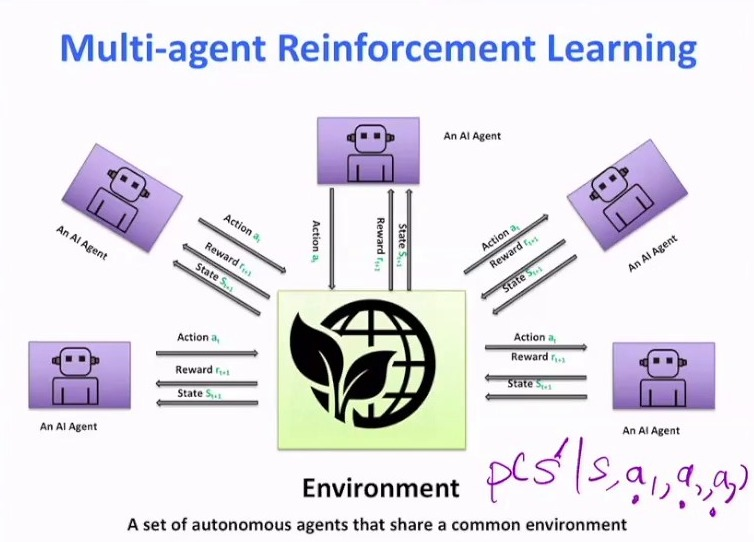
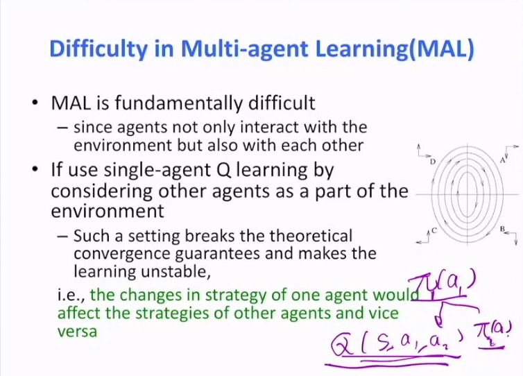
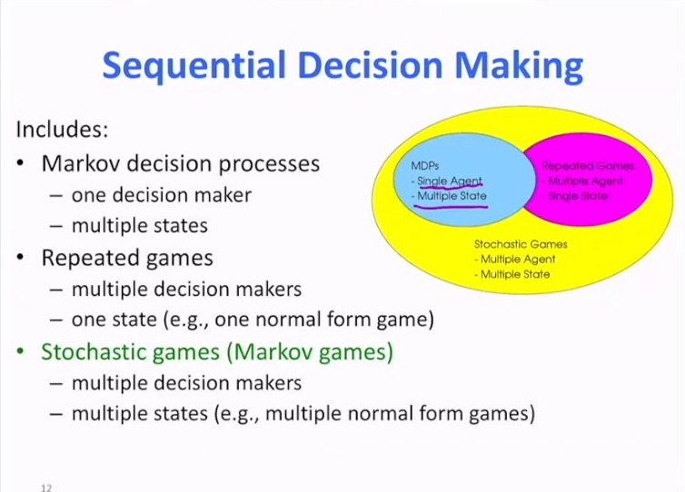
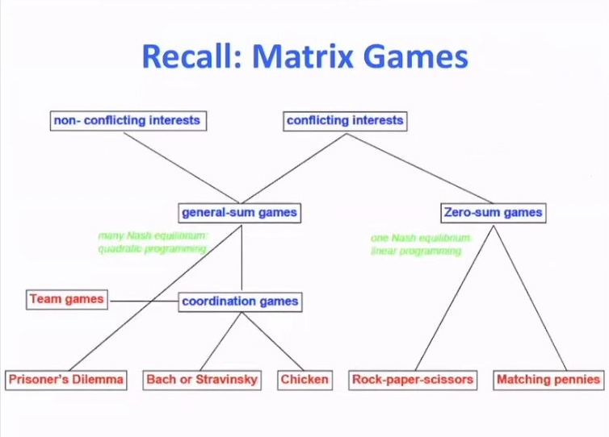
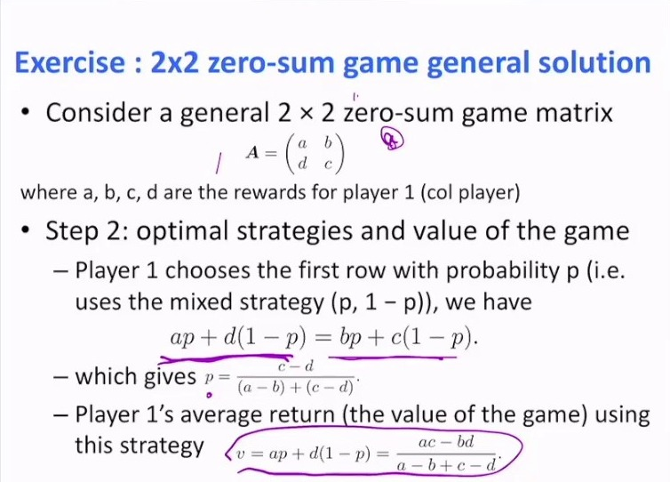
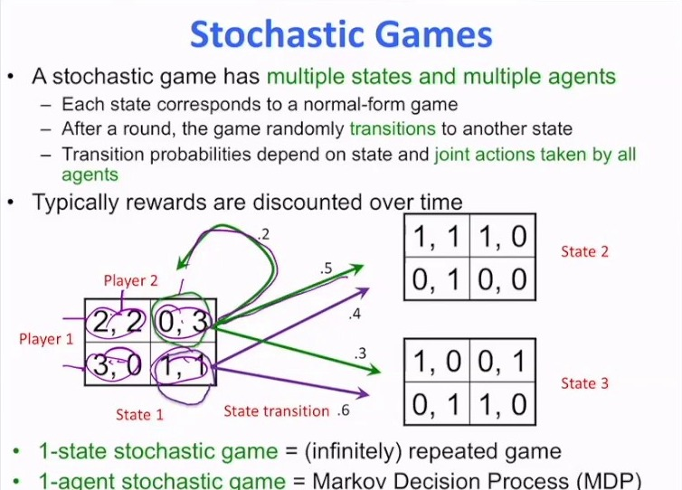
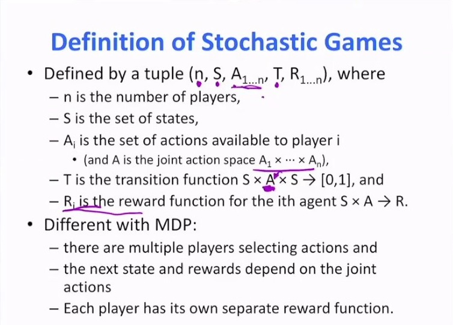
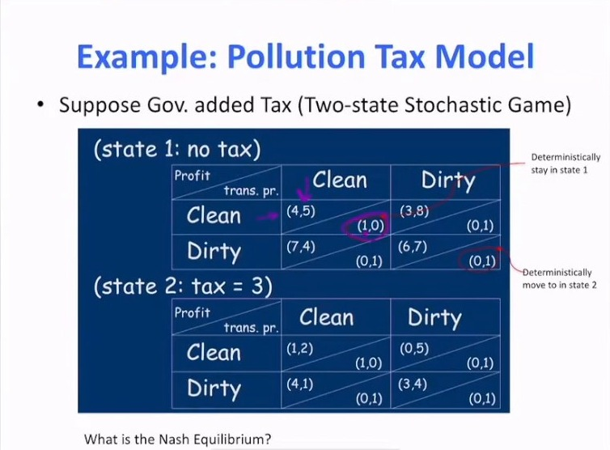
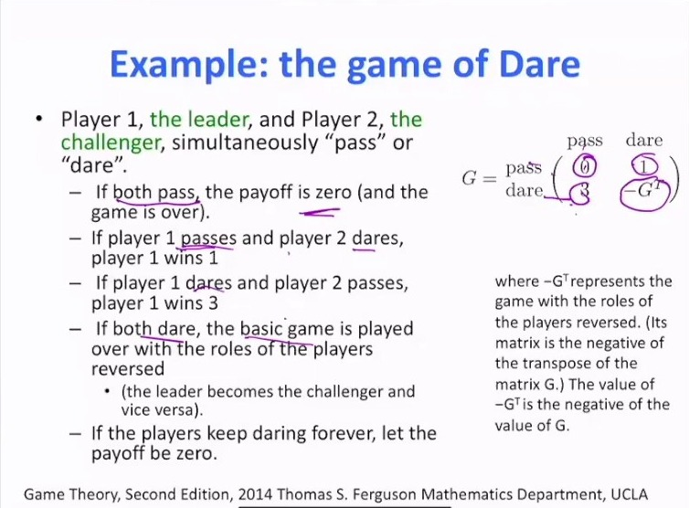

# 马尔可夫博弈：多智能体如何打破 MDP 的假设

> 这是第 13 章的开篇。前 12 章的所有方法——动态规划、蒙特卡洛、时序差分、DQN、策略梯度、Actor-Critic、PPO、离线 RL——都建立在一个共同前提上：**环境是固定的**。一个策略、一个环境、一个 MDP $(S, A, P, R, \gamma)$。多智能体一来，这个前提就碎了：环境里多了几个也在学习、也在改变策略的决策者。本篇的任务是把这件事讲清楚：MDP 该怎么推广成**马尔可夫博弈**，博弈有哪些类型，以及为什么多智能体 RL 会比单智能体难那么多。具体的算法（CTDE、VDN/QMIX、MADDPG/MAPPO）留给 13.3～13.5。

## 本讲要解决的核心问题（SCQA）

**背景**：单智能体 RL 的理论保证几乎都依赖 MDP 的**平稳性**——转移概率 $P(s' \mid s,a)$ 和奖励 $R(s,a)$ 不随时间变化。正因为环境不动，值迭代才收敛，Q-learning 才收敛，策略梯度才有明确的梯度方向。

**冲突**：多智能体时，从任何一个智能体的视角看，环境里包含**其他智能体**，而其他智能体**也在学习、也在改策略**。于是"环境"每一步都在变——它是一个移动靶。MDP 的平稳性假设被打破，前面所有的收敛性保证都不再成立。

**疑问**：那该怎么重新建模？"最优策略"这个词还有意义吗？

**回答（中心思想）**：把 MDP 推广成**马尔可夫博弈**（也叫随机博弈）：元组从 $(S,A,P,R,\gamma)$ 变成 $(S, A_1,\dots,A_n, P, R_1,\dots,R_n, \gamma)$。三处关键改动——**联合动作空间** $A = A_1 \times \cdots \times A_n$、**每个智能体各自的奖励** $R_i$、**转移依赖联合动作**——每一处都带来一个新的困难。而"最优"则被**纳什均衡**取代：不再要求某一方最优，只要求没有任何一方能靠单方面改策略获益。

---

## 一、从 MDP 到多智能体：到底变了什么

[【跳转到 03:55】](https://www.bilibili.com/video/BV1fz4y1S72S/?p=31&t=235)

课程的说法很朴素：多智能体无非是往环境里加入更多智能体，每个智能体各自观察环境状态、采取动作、获得奖励。**唯一的区别**是：

- 环境里多了几个智能体，动作不再是一个 $a$，而是 $(a_1, \dots, a_n)$；
- 转移不再只依赖一个动作，而是依赖**联合动作**；
- 奖励也不再是一个标量，而是每个智能体各有一份。

课程顺手举了三个应用场景，说明这不是玩具问题：

- **星际争霸**：控制多个单位互相作战，是多智能体学习的经典测试平台（课程提到这是他们几年前做过的工作）。
- **广告竞价**：一个广告位发给交易平台和多个广告主，大家为同一个位置竞价。出价高了不划算，出价低了拿不到——**你的机会取决于别人怎么做**。
- **生成模型**：生成器可以看成智能体 1，判别器看成智能体 2。生成器要骗过判别器，判别器要识别真假，两者构成一个**极小极大博弈**。课程用这个例子说明：多智能体思想在很典型的机器学习方法里也扮演着重要角色。

---

## 二、非平稳性：为什么单智能体方法会失效

这是本章所有困难的**根源**，课程专门用一页幻灯片讲它。

[【跳转到 07:45】](https://www.bilibili.com/video/BV1fz4y1S72S/?p=31&t=465)

课程的原话分两层：

1. **多智能体学习本质上是困难的**，因为智能体不只与环境交互，**还彼此交互**。
2. 如果你把其他智能体当成"环境的一部分"，直接套用单智能体 Q-learning，那么——**这种设定破坏了理论上的收敛性保证，使学习变得不稳定**。原因是：一个智能体的策略变化会改变其他智能体的策略所面对的环境，反之亦然。

课程用一张图说明了后果：两个智能体的策略在参数空间里**绕着圈跑**（circling），谁也停不下来。具体机制是：

- 智能体 1 和智能体 2 都在学 Q，而 Q 同时依赖双方的动作；
- 智能体 1 更新自己的策略 → 智能体 2 面对的"环境"变了 → 智能体 2 的 Q 函数要重估 → 智能体 2 更新策略 → 智能体 1 面对的"环境"又变了……

只要双方**同时**在学，这个循环就不会停。这就是**非平稳性（non-stationarity）**：从单个智能体的角度看，环境不是一个固定的 MDP，而是一个随着对手策略漂移的移动靶。

> 这一条也是为什么"多智能体 = 把单智能体算法复制 n 份"这种朴素做法（independent learners）在实践中经常不收敛。13.3 的 CTDE 范式、13.4 的价值分解、13.5 的 MADDPG/MAPPO，本质上都是在用不同办法**把这个移动靶固定住或至少减缓它的漂移**。

---

## 三、序贯决策的三类问题：MDP、重复博弈、随机博弈

课程用一张维恩图把三个概念摆在一起，这张图值得记住——它把"多智能体"和"多状态"当成两个独立的维度。

[【跳转到 08:20】](https://www.bilibili.com/video/BV1fz4y1S72S/?p=31&t=500)

| 问题类型 | 决策者 | 状态 | 一句话 |
| :--- | :--- | :--- | :--- |
| 马尔可夫决策过程（MDP） | 1 个 | 多个 | 前 12 章的全部内容 |
| 重复博弈（repeated game） | 多个 | 1 个 | 反复玩同一个标准式博弈（阶段博弈） |
| 随机博弈 / 马尔可夫博弈 | 多个 | 多个 | 每个状态上是一个标准式博弈，状态之间按联合动作转移 |

课程特别强调两个**退化关系**，它们是理解随机博弈的最好抓手：

- **只有一个智能体** → 随机博弈退化成 **MDP**（转移只依赖这一个智能体的动作）；
- **只有一个状态** → 随机博弈退化成**无限重复博弈**（无论做什么都回到同一个状态，反复地玩同一个阶段博弈）。

所以随机博弈不是凭空造出来的新东西，它就是"把 MDP 和矩阵博弈各取一半"的自然结果。

---

## 四、博弈类型谱系：从零和到团队

在进入随机博弈之前，课程先把**单个状态上的博弈**（矩阵博弈）分了类。这个分类是 13.2 的基础。

[【跳转到 10:31】](https://www.bilibili.com/video/BV1fz4y1S72S/?p=31&t=631)

课程给出的分类树是：

- **利益冲突（conflicting interests）→ 零和博弈（zero-sum games）**
  - 所有结果下双方收益之和为 0，一人所得即另一人所失；
  - 课程标注：**有唯一的纳什均衡**，可用**线性规划**求解；
  - 例子：石头剪刀布、猜硬币。
- **利益不冲突（non-conflicting interests）→ 一般和博弈（general-sum games）**
  - 课程标注：**可能有多个纳什均衡**，可用**二次规划**求解；
  - 其中一个特例是**协调博弈（coordination games）**：参与人需要选到"配套"的动作才都有好处。幻灯片在协调博弈下列了三个经典例子：囚徒困境、性别战（幻灯片上写的是"Bach or Stravinsky"，即性别战的另一个名字）、胆小鬼博弈；
  - 更特殊的一个是**团队博弈（team games）**：所有参与人共享**同一个**奖励。

课程对团队博弈补了一句：团队博弈是一种**势博弈（potential game）**——因为大家的目标完全一致，整个系统可以写成一个共同的势函数。这一句是 13.4 价值分解能成立的前提（VDN/QMIX 就是在团队奖励下做信用分配）。

> **三种关系设定，对应 13.2 的三个场景**：
>
> - **完全合作**：所有 $R_i$ 相同（团队博弈），目标是最大化共同回报；
> - **完全竞争**：零和，$R_1 = -R_2$，一方的收益就是另一方的损失；
> - **混合（一般和）**：既不完全是队友也不完全是敌人，general-sum。
>
> 这三种设定下"什么叫好策略"完全不同，13.2 会逐个展开。本篇只需要记住一件事：**同一个算法不可能同时适配这三种设定**——这正是 MARL 没有"统一算法"的原因。

---

## 五、两人零和博弈的解法与"博弈的值"

随机博弈的每个状态上都要解一个矩阵博弈，所以课程花了不少时间把两人零和博弈的解法讲透。这部分内容在同目录的[混合策略纳什均衡：猜硬币与零和博弈](混合策略纳什均衡：猜硬币与零和博弈.md)第四节已经从猜硬币的角度讲过一遍，这里只补上**通用公式**和它在随机博弈里的用法。

[【跳转到 16:40】](https://www.bilibili.com/video/BV1fz4y1S72S/?p=31&t=1000)

对一般的 $2\times 2$ 零和博弈，收益矩阵写成

$$
A = \begin{pmatrix} a & b \\ d & c \end{pmatrix}
$$

（$a,b,c,d$ 都是参与人 1 的收益；参与人 2 的收益是它们的相反数。）求解分两步：

**第一步：检验有没有纯策略（鞍点）。** 如果某个元素同时是它所在行的最小值、所在列的最大值，它就是鞍点，鞍点就是纳什均衡，博弈有纯策略解。

**第二步：没有鞍点，就解混合策略。** 设参与人 1 以概率 $p$ 选第一行（即混合策略 $(p, 1-p)$），令两行的期望收益相等：

$$
ap + d(1-p) = bp + c(1-p)
$$

解出

$$
p = \frac{c-d}{(a-b)+(c-d)}
$$

而参与人 1 用这个策略时的平均收益，就是**博弈的值**：

$$
v = ap + d(1-p) = \frac{ac-bd}{a-b+c-d}
$$

课程强调这套办法的用途：**随机博弈有多个状态，每个状态上都是一个阶段博弈（矩阵博弈），需要在每个状态上分别求解**。所以两人零和博弈的这个闭式解，是后面解随机博弈的"零件"。

> 课程在这里还提到了 Shapley 1953 年的经典论文——随机博弈这个概念就是从那里来的。课程提醒读者：那篇论文的术语和今天不一样（论文里的 "position" 就是今天的 "state"），但洞见和那个简洁的价值方程至今仍然好用。

---

## 六、随机博弈的定义：与 MDP 的三处差别

先把随机博弈的性质摆出来，再给形式定义。

[【跳转到 19:48】](https://www.bilibili.com/video/BV1fz4y1S72S/?p=31&t=1188)

课程把随机博弈的性质列成三条，另外补了一句关于奖励的说明：

- 它有**多个状态和多个智能体**；
- **每个状态对应一个标准式博弈**（阶段博弈）；
- 一轮结束后，博弈按概率**转移到下一个状态**，而转移概率依赖状态与所有智能体采取的**联合动作**；
- 此外，奖励通常按时间折扣。

幻灯片下方还标了两条退化关系，与第三节的维恩图一致：**单状态**的随机博弈就是（无限）重复博弈；**单智能体**的随机博弈就是马尔可夫决策过程。

[【跳转到 22:33】](https://www.bilibili.com/video/BV1fz4y1S72S/?p=31&t=1353)

课程给的定义是：随机博弈由元组

$$
(n,\ S,\ A_{1..n},\ T,\ R_{1..n})
$$

确定，其中

- $n$ 是参与人（智能体）的个数；
- $S$ 是状态集合；
- $A_i$ 是参与人 $i$ 可用的动作集合，而 $A = A_1 \times \cdots \times A_n$ 是**联合动作空间**；
- $T: S \times A \times S \to [0,1]$ 是转移函数；
- $R_i: S \times A \to \mathbb{R}$ 是第 $i$ 个智能体的奖励函数。

课程把与 MDP 的差别明确列成三条：

1. **有多个参与人在选择动作**（而不是一个）；
2. **下一状态和奖励依赖联合动作**（而不是单个动作）；
3. **每个参与人有各自独立的奖励函数**（而不是共享一个标量奖励）。

> **讲者提示的笔误**：课程在这里说幻灯片上的记号有个笔误（联合动作空间应写成 $A = A_1 \times \cdots \times A_n$），并再次强调差别就在"每个智能体各一份奖励"和"转移依赖联合动作"。

把这三条差别展开，就是本章后面所有困难的来源：

| 差别 | 直接后果 |
| :--- | :--- |
| 联合动作空间 $A = A_1 \times \cdots \times A_n$ | 动作空间大小是各智能体动作数的**乘积**，随智能体数**指数增长**。$n$ 个各有 $k$ 个动作的智能体，联合动作有 $k^n$ 个。这就是"探索的维度爆炸" |
| 每个智能体有自己的 $R_i$ | 如果奖励是团队共享的，就要回答"这一份团队奖励里，谁的贡献大"——这就是**信用分配**问题 |
| 转移依赖联合动作 | 从单个智能体看，$P(s' \mid s, a_i)$ 不再是良定义的——它还取决于别人做什么，而且别人在变。这就是**非平稳性** |

课程接着把"问题"正式化：给定一个随机博弈，要求什么？答案是——**为每个智能体学一个策略，使得各自的折扣累积奖励最大**：

$$
\max_{\pi_i} \; J_i(\pi_i, \pi_{-i}) = \mathbb{E}_{\pi}\left[\sum_{t=0}^{\infty} \gamma^t R_i(s_t, a_{1,t}, \dots, a_{n,t})\right]
$$

注意这个目标和单智能体的差别：**它带着一个 $\pi_{-i}$**。你的回报取决于别人的策略，而别人的策略也在变——所以这个最大化问题不能孤立地解。

---

## 七、两个例子：随机博弈长什么样

### 7.1 污染税模型：两状态随机博弈

[【跳转到 30:55】](https://www.bilibili.com/video/BV1fz4y1S72S/?p=31&t=1855)

设定：两家公司向环境排污。政府不直接监控每家公司，只**检测河水**；一旦检测到污染，就对两家都加税。

- **状态 1（无税）**：收益矩阵是囚徒困境式的——不管对方怎么做，排污都更划算（因为治理污染要花钱买设备）。所以（排污，排污）是状态 1 的**占优策略**，也是纳什均衡。课程说它"比一般均衡更强"：不管对方怎么做，我都会排污，所以结果非常可预测。
- **状态 2（加税 3）**：一旦检测到污染，就进入这个状态，所有收益都减 3。

转移规则写在每个格子的下半部分：

- 双方都**清洁** → 以概率 1 留在状态 1；
- 只要有**任何一方排污** → 立刻转移到状态 2（政府检测到污染，两家一起被加税）；
- 在状态 2 里，只要还有人排污就留在状态 2；只有当**没人再排污**时才回到状态 1。

课程把问题抛给听众：**这个博弈的纳什均衡是什么？如果你是其中一家公司，你会怎么做？**

课程还提醒了一个容易犯的错：这里不能只说"清洁"或"排污"了，因为策略必须说明**在每个状态下双方各做什么**——状态 1 下的动作和状态 2 下的动作要分别指定。这就是随机博弈的策略比矩阵博弈的策略复杂的地方：它是**状态相关的**。

求解思路课程也给了：先解出每个状态上的矩阵博弈，再把它写成一个动态规划问题，用值迭代去解；验证的办法仍然是纳什均衡的定义——**看有没有一方能通过单方面偏离而获益**。

### 7.2 胆量博弈：可能永远玩不完的随机博弈

[【跳转到 35:03】](https://www.bilibili.com/video/BV1fz4y1S72S/?p=31&t=2103)

第二个例子更极端：**领导者**（参与人 1）和**挑战者**（参与人 2）同时选择"退让"或"硬碰"。

- 双方都退让：收益为 0，博弈结束；
- 领导者退让、挑战者硬碰：领导者得 1；
- 领导者硬碰、挑战者退让：领导者得 3；
- **双方都硬碰**：进入"基础博弈"，并且**双方角色互换**——原来的挑战者变成领导者，领导者变成挑战者，继续玩。

课程指出：只要双方一直硬碰，这个博弈就**可能永远玩下去**；但只要在某个时刻不再同时硬碰，博弈就结束。所以这里的状态转移是不确定的，取决于双方到底采取了什么动作。

角色互换在数学上怎么表示？课程给了答案：设原博弈的收益矩阵为 $G$，那么互换角色后的博弈是 $-G^{\mathsf{T}}$——**转置**表示角色对调，**取负**表示原来领导者的收益变成了现在挑战者的损失。于是"博弈的值"也取相反数。

求解时用到的技巧很漂亮：设博弈的值为 $V$（还不知道具体数值），把上面那个零和博弈的通解写成 $V$ 的函数，再令它等于 $V$，就得到一个关于 $V$ 的**二次方程**；解出 $V$，就能得到每个状态下的策略。

> 这两个例子合起来说明了随机博弈的两件事：**状态之间的转移由联合动作决定**（污染税模型），以及**博弈结构本身可以在状态之间变化**（胆量博弈里的角色互换）。这已经远远超出 MDP 的表达能力了。

---

## 八、多智能体 RL 的四个核心困难

课程里明确讲了第一个（非平稳性，见第二节）。下面把四个困难摆在一起，作为本章的地图——**本篇只做地图，不深入**，每个困难对应的解法在 13.3～13.5。

| 困难 | 一句话 | 根源 | 主要对策（章节） |
| :--- | :--- | :--- | :--- |
| **非平稳性** | 其他智能体在学，环境对单个智能体是移动靶 | 转移依赖联合动作，而联合动作里的别人在变 | CTDE、集中式 critic（13.3）、MADDPG（13.5） |
| **信用分配** | 团队奖励下，谁的贡献大？ | 只有一个共享的 $R$，但动作是多个智能体出的 | 价值分解 VDN/QMIX（13.4） |
| **探索的维度爆炸** | 联合动作空间随智能体数指数增长 | $A = A_1 \times \cdots \times A_n$，大小是 $k^n$ | 参数共享、分解式策略（13.4、13.5） |
| **均衡选择** | 多个均衡时选哪个？协调失败怎么办 | 纳什均衡一般不唯一（见协调博弈） | 通信/约定、集中式训练（13.3） |

> 说明：课程在 P31 里明确展开的是**非平稳性**（含"绕圈"行为与收敛性保证被破坏）。其余三条是本节依据课程给出的随机博弈定义与博弈分类做的归纳，属于**本系列的整理**，不是讲者在 P31 里的原话。

其中"均衡选择"这一条，其实在上一篇的协调博弈里已经见过它的雏形：两个对角格都是纳什均衡，但双方可能选到不同的那个，结果双双得 0。多智能体 RL 里这个问题更严重——智能体是**同时**在学的，选到同一个均衡并不是自动的。

---

## 九、MDP 与马尔可夫博弈对照表

把前面所有内容压成一张表。这张表是本章的总纲：

| 维度 | MDP（单智能体） | 马尔可夫博弈（多智能体） |
| :--- | :--- | :--- |
| 元组 | $(S, A, P, R, \gamma)$ | $(S, A_1,\dots,A_n, P, R_1,\dots,R_n, \gamma)$ |
| 状态 | $s \in S$ | $s \in S$（对所有智能体共享） |
| 动作 | 一个动作 $a \in A$ | 联合动作 $(a_1,\dots,a_n) \in A_1 \times \cdots \times A_n$ |
| 转移 | $P(s' \mid s, a)$ | $P(s' \mid s, a_1, \dots, a_n)$ |
| 奖励 | 标量 $R(s,a)$ | 向量 $(R_1, \dots, R_n)$，每个智能体一份 |
| 策略 | $\pi(a \mid s)$ | $(\pi_1, \dots, \pi_n)$，每个智能体一个 |
| "最优"的定义 | 存在 $\pi^*$ 使 $V_{\pi^*}(s) \ge V_\pi(s)$ 对所有 $\pi$ 成立 | 只有**纳什均衡**：$J_i(\pi_i^*, \pi_{-i}^*) \ge J_i(\pi_i, \pi_{-i}^*)$ 对所有 $\pi_i$ 成立 |
| 收敛保证 | 值迭代、策略迭代、Q-learning 等有收敛性定理 | **一般没有**。非平稳性破坏收敛性保证；只有零和、团队、势博弈等特殊结构下才有结论 |
| 均衡唯一性 | 最优策略至少值函数意义下唯一 | 一般不唯一，需要均衡选择 |

最后一行值得再说一句：**单智能体有唯一的最优策略（至少值函数意义下），多智能体只有均衡**。这不是理论上的吹毛求疵——它直接决定了算法设计：单智能体算法在追一个固定的目标，多智能体算法在追一个**由所有智能体共同定义、并且随他们一起移动**的目标。

---

## 十、本章路线图

本篇只搭了舞台，后面四篇按"从设定到算法"的顺序展开：

- **13.2 关系设定：完全合作、完全竞争与混合场景**——把第四节那张分类树搬到序贯决策里。三种设定下"什么叫好策略"完全不同：合作要解决信用分配，竞争要处理极小极大，混合要面对均衡不唯一。
- **13.3 集中式训练与分布式执行（CTDE）范式**——对付非平稳性的主流思路：训练时允许 critic 看到所有人的观测与动作（把移动靶"拍下来"），执行时每个 actor 只用自己的局部观测（保证可部署）。
- **13.4 价值分解方法：VDN 与 QMIX**——在团队博弈（共享奖励）下做信用分配：把联合 Q 函数分解成各智能体 Q 的组合，让"个体最优"与"集体最优"一致（IGM 条件）。
- **13.5 多智能体策略梯度：MADDPG 与 MAPPO**——把 CTDE 接到策略梯度上。MADDPG 用集中式 critic 处理连续动作与混合场景（它的理论底色就是本篇第五节的零和博弈与极小极大），MAPPO 把 PPO 搬到多智能体并靠参数共享与集中式价值函数稳住训练。

一句话串起来：**13.1 讲清"问题为什么难"，13.2 讲清"难在哪一种关系里"，13.3～13.5 讲清"用什么结构去对付它"。**

---

## 小结

- **多智能体的三处改动**：联合动作空间 $A = A_1\times\cdots\times A_n$、每个智能体各自的 $R_i$、转移依赖联合动作。三处改动分别带来维度爆炸、信用分配、非平稳性。
- **非平稳性是根源**：其他智能体也在学，环境对单个智能体是移动靶。把别人当环境的一部分做单智能体 Q-learning，会破坏收敛性保证，表现为策略"绕圈"。
- **三类序贯决策**：MDP（单决策者 + 多状态）、重复博弈（多决策者 + 单状态）、随机博弈（多决策者 + 多状态）。前两者都是随机博弈的退化情形。
- **博弈类型谱系**：零和（唯一均衡、线性规划）↔ 一般和（可能多个均衡、二次规划），一般和里包含协调博弈与团队博弈。
- **随机博弈的定义**：$(n, S, A_{1..n}, T, R_{1..n})$；目标是每个智能体最大化自己的折扣累积奖励，而这个目标带着别人的策略。
- **"最优"被"均衡"取代**：没有哪一方能靠单方面改策略获益，就是纳什均衡。它一般不唯一，也不保证对集体最好。
- **四个核心困难**：非平稳性、信用分配、探索的维度爆炸、均衡选择。

## 关键术语速查

| 术语 | 一句话解释 |
| :--- | :--- |
| 马尔可夫博弈 / 随机博弈 | MDP 的多智能体推广：多状态 + 多智能体 + 联合动作转移 |
| 联合动作空间 | $A = A_1 \times \cdots \times A_n$，大小是各智能体动作数的乘积 |
| 非平稳性（non-stationarity） | 其他智能体在学习，导致单个智能体面对的环境随时间变化 |
| 信用分配（credit assignment） | 团队共享奖励下，判断每个智能体的贡献大小 |
| 零和博弈 | 所有结果下双方收益之和为 0，一人所得即另一人所失 |
| 一般和博弈（general-sum） | 既不合作也不完全对立的博弈，可能有多个纳什均衡 |
| 团队博弈（team game） | 所有智能体共享同一个奖励，是一种势博弈 |
| 均衡选择（equilibrium selection） | 存在多个均衡时决定行为落在哪一个的额外准则 |
| 阶段博弈（stage game） | 随机博弈中每个状态上对应的那个标准式（矩阵）博弈 |

## 参考视频

- UCL 汪军《Multi-agent Artificial Intelligence》第 7.1 讲 多智能体强化学习介绍及基本概念，[BV1fz4y1S72S](https://www.bilibili.com/video/BV1fz4y1S72S/)（P31）
