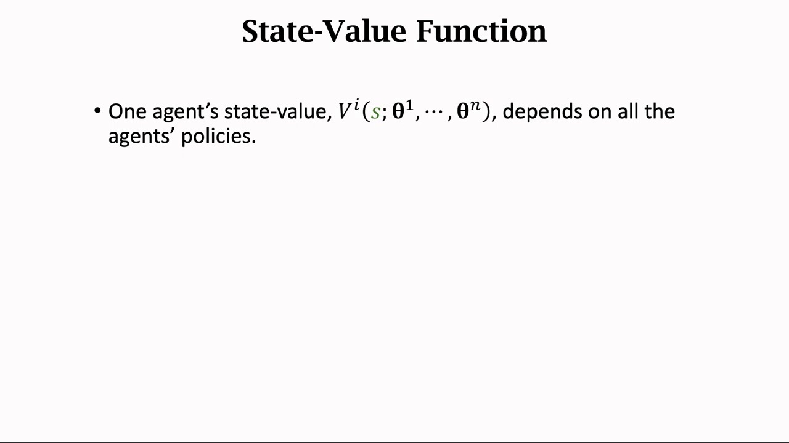
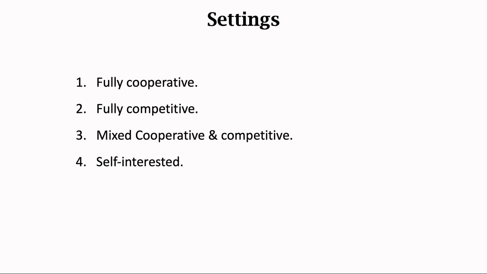
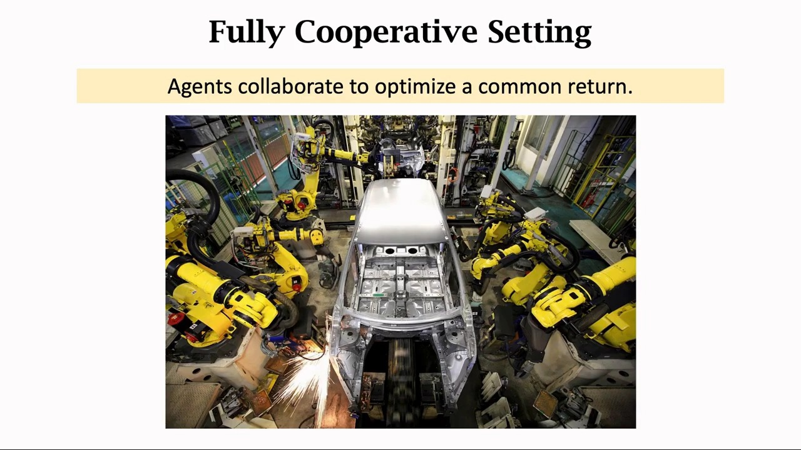
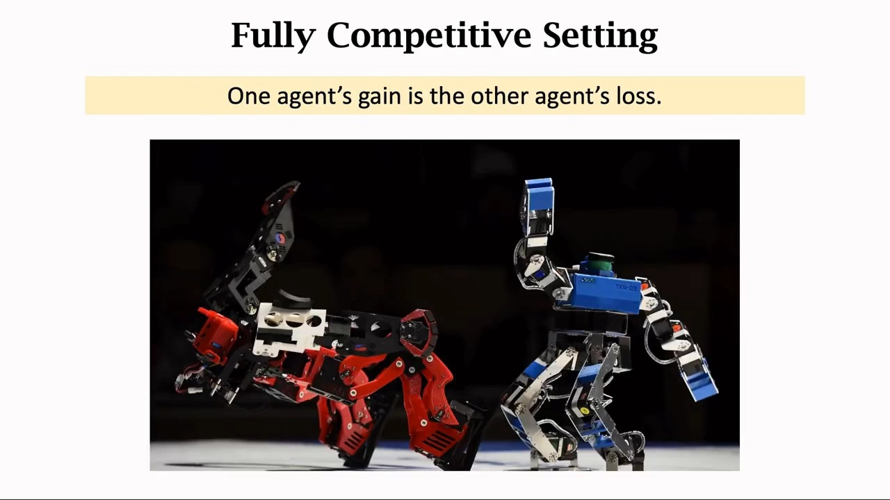
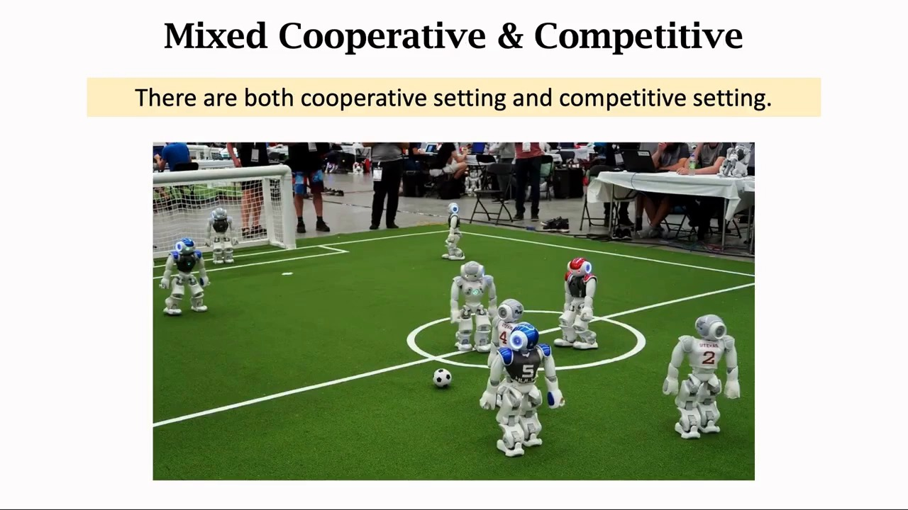
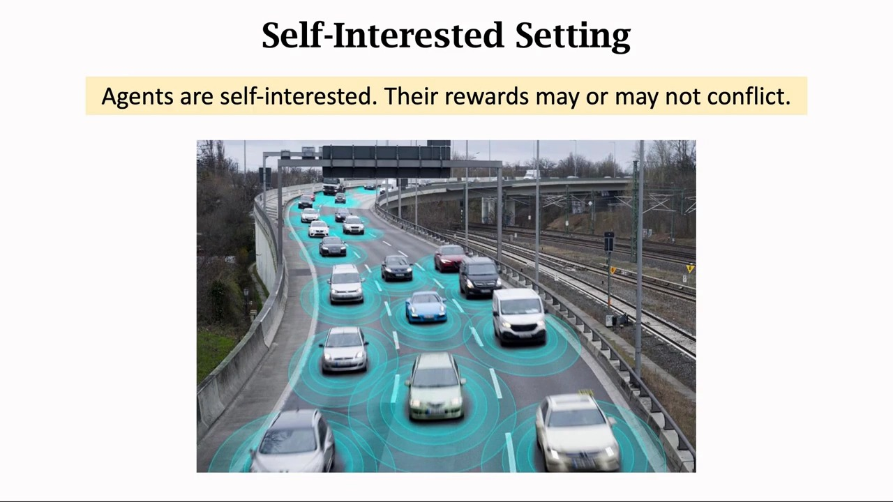
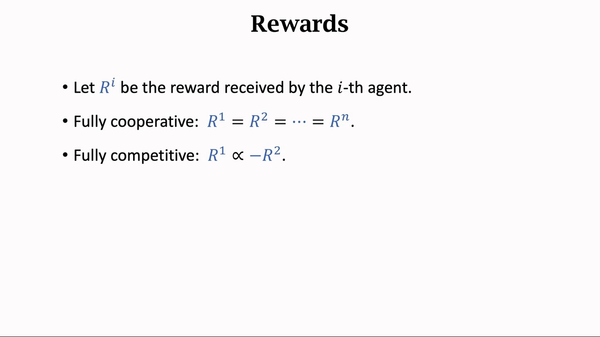
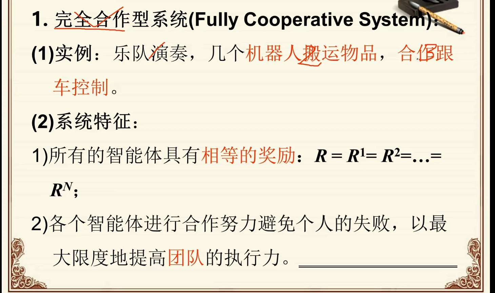
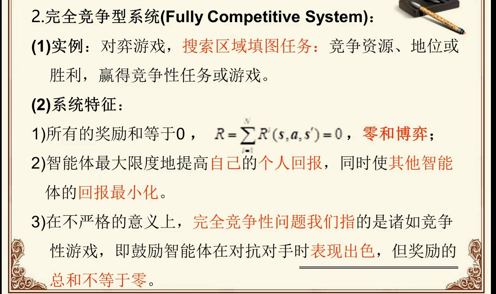
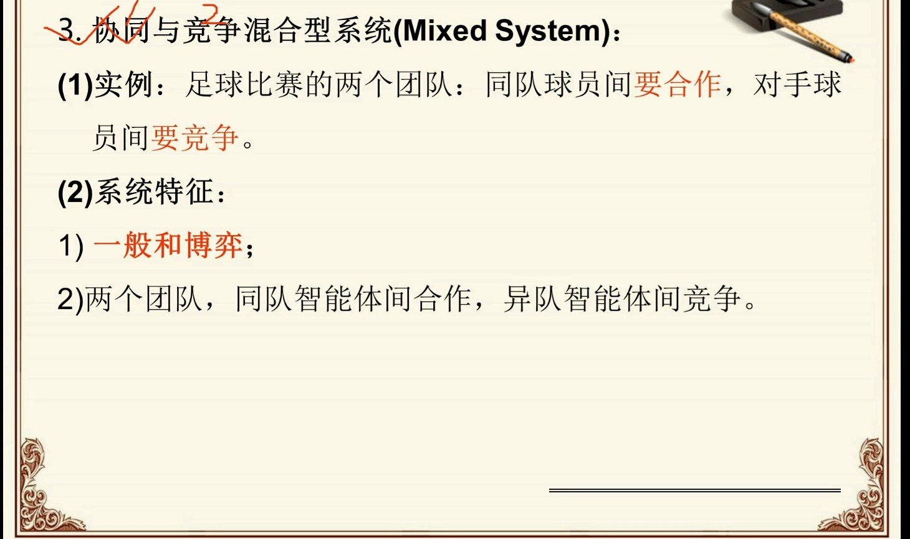

# 关系设定：完全合作、完全竞争与混合如何决定算法设计

> 承接上一篇[马尔可夫博弈：多智能体如何打破MDP的假设](../13.1_博弈论基础纳什均衡与马尔可夫博弈/马尔可夫博弈：多智能体如何打破MDP的假设.md)。13.1 已经讲清了马尔可夫博弈的定义 $(n, S, A_{1..n}, T, R_{1..n})$、纳什均衡、博弈类型谱系和四个核心困难，本篇不再重复。这里只问一个问题：**奖励向量 $(R_1, \dots, R_n)$ 内部的相对关系，如何决定你该用哪一族算法**。答案比想象中更硬——合作、竞争、混合三种设定下，"什么叫好策略"不同，能用的算法不同，收敛保证也不同。

## 本讲要解决的核心问题（SCQA）

**背景**：13.1 把 MDP 推广成马尔可夫博弈，最关键的一处改动是奖励从标量 $R(s,a)$ 变成向量 $(R_1(s,a), \dots, R_n(s,a))$——每个智能体各领一份。

**冲突**：这 $n$ 份奖励之间的关系可以完全不同。它们可以一模一样（队友），可以互为相反数（对手），也可以既不相同也不互补（互不相干的路人）。关系不同，目标函数的结构就不同：合作时全场只有一个目标，竞争时是一个鞍点问题，混合时是一堆互不兼容的目标。

**疑问**：这三种关系能不能用同一套算法处理？如果不能，每种关系分别适合什么算法，为什么？

**回答（中心思想）**：不能，而且**关系设定是算法设计的第一性约束**。合作把问题压成单目标，于是可以做价值分解；竞争把问题压成鞍点，于是可以自我对弈；混合什么也压不成，于是没有通用收敛保证。本篇按这条线索走一遍三种设定，给出"设定 × 算法"对照表，并说明 13.3～13.5 各自负责哪一块。

---

## 一、先看一个事实：一个智能体的价值函数依赖所有人的策略

王树森在讲多智能体强化学习时，第一件事不是给算法，而是把记号改掉——因为不改记号，后面所有算法都没法写。

[【跳转到 09:45】](https://www.bilibili.com/video/BV1Uf4y1D7mx/?t=585)

多智能体设定下的记号与单智能体几乎一样，只有一处关键差别：

- 状态仍是 $s$；第 $i$ 个智能体的动作记作 $a^i$（上标是编号）；转移函数是 $p(s' \mid s, a^1, \dots, a^n)$，**依赖所有智能体的动作**；
- 奖励有 $n$ 个：第 $i$ 个智能体拿到的是 $R^i$，回报是 $U_t^i = \sum_{k=0}^{\infty} \gamma^k R_{t+k}^i$；
- 每个智能体有自己的策略网络 $\pi^i(\cdot \mid s; \theta^i)$。

于是状态价值函数变成

$$
V^i\!\left(s; \theta^1, \dots, \theta^n\right) = \mathbb{E}\left[\, U_t^i \;\middle|\; S_t = s \,\right]
$$

注意它的自变量：**不只是 $\theta^i$，而是全部 $n$ 个策略参数**。讲者给了一个非常直白的解释——如果你有个猪队友，你未来拿不到多少奖励，你的 $V^i$ 就比较小；把猪队友换成靠谱的队友，$V^i$ 立刻变大。

课程接着用足球机器人举例：假设别人都不动，只有一个前锋把自己的策略改好了，那么**他的队友的状态价值会变大，而对手的状态价值会变小**。一个智能体改策略，所有人的价值函数都跟着变。

> 这一步就是 13.1 讲的非平稳性的"价值函数版本"：13.1 说的是转移 $p(s' \mid s, a^i)$ 从单智能体视角看不再良定义，这里说的是 $V^i$ 的自变量里塞进了别人的参数。两句话是同一件事的两种写法。**而 $R^i$ 之间的相对关系，决定了这个耦合是"大家一起往上走"还是"你上我下"**——这正是下面要分类的东西。

---

## 二、四种关系设定：讲者的清单

[【跳转到 00:34】](https://www.bilibili.com/video/BV1Uf4y1D7mx/?t=34)

王树森把多智能体系统按"智能体之间是什么关系"分成四类。前三类就是本篇的主线，第四类是一个必要的补充：

| 设定 | 讲者给的例子 | 奖励之间的关系 |
| :--- | :--- | :--- |
| 完全合作（fully cooperative） | 多个工业机器人协同装配汽车；一个机械臂取箱子、另一个机器人运箱子 | 利益一致，奖励相同，有共同目标 |
| 完全竞争（fully competitive） | 机器人格斗；捕食者与猎物 | 一方的收益是另一方的损失，典型情形是零和 |
| 混合（mixed cooperative & competitive） | 足球机器人；星际争霸 | 队内合作、队间竞争，两者同时存在 |
| 利己主义（self-interested） | 股票与期货的自动交易系统；无人车 | 各自最大化自身利益，不在乎别人受益还是受损 |

前三张幻灯片分别对应前三行，第四张在讲利己主义时给出：

[【跳转到 00:46】](https://www.bilibili.com/video/BV1Uf4y1D7mx/?t=46)

[【跳转到 01:13】](https://www.bilibili.com/video/BV1Uf4y1D7mx/?t=73)

[【跳转到 01:45】](https://www.bilibili.com/video/BV1Uf4y1D7mx/?t=105)

讲者在"完全竞争"这一页里埋了一个容易被略过的细节：**捕猎不算零和博弈**。猎豹赢了得到的是一顿饭，小鹿输掉的是命——小鹿的损失大于猎豹的收益，两者相加不为零。也就是说，"完全竞争"描述的是**利益方向相反**，而"零和"是一个更强的、要求数值上刚好抵消的条件。这个区分在第三节会被形式化。

第四类"利己主义"值得单独说一句，因为它和前三类不是同一个维度的划分。讲者的定义是：每个智能体只想最大化自身利益，**至于让别人受益还是受损，它不在乎**。合作是"有钱大家一起赚"，竞争是"让对手受损失"，利己主义两者都不是——它的行为在客观上会影响别人，但主观上没有针对谁。

[【跳转到 04:13】](https://www.bilibili.com/video/BV1Uf4y1D7mx/?t=253)

讲者用两个例子说明这种"互相影响但互不针对"：一是股票与期货的自动交易系统，交易量很大，每一笔都会影响股价，2010 年就有一家自动交易公司的程序出错，引发股市剧烈波动甚至触发熔断（字幕把公司名识别成 "nine capital"，应为 Knight Capital）；二是无人车——车少的时候彼此几乎不影响，可以当单智能体处理；等到路上有一半是无人车，一辆车刹车或变道就会影响其他车，这时必须当多智能体系统看。

---

## 三、把三种关系写成奖励约束

上面是文字描述。要让它能指导算法设计，必须写成数学条件。两位讲者各给了一半：王树森给出的是最简的等式，另一位讲者（正一大模型算法程序的 MARL 系列）给出的是带状态与联合动作的完整写法。

> **记号说明**：王树森与正一都用上标 $R^i$ 表示第 $i$ 个智能体的奖励（与动作 $a^i$、策略参数 $\theta^i$ 的上标一致），13.1 用的是下标 $R_i$。两者是同一个东西，下面正文统一用 13.1 的下标写法，引幻灯片原文时保留上标。

[【跳转到 06:20】](https://www.bilibili.com/video/BV1Uf4y1D7mx/?t=380)

### 3.1 完全合作：所有奖励相等

$$
R_1(s, a) = R_2(s, a) = \cdots = R_n(s, a) = R(s, a)
$$

[【跳转到 01:40】](https://www.bilibili.com/video/BV1nGZwYdER8/?t=100)

讲者在这一页给的第二条特征值得抄下来：**各个智能体进行合作、努力避免个人的失败，以最大限度地提高团队的执行力**。注意它说的是"避免个人的失败"而不是"最大化个人的收益"——在共享奖励下，这两件事已经不是一回事了，这正是第五节要讲的懒惰智能体的伏笔。

这就是 13.1 里的**团队博弈（team game）**，也是**势博弈**——因为大家目标完全一致，整个系统可以写成一个共同的势函数。

这里有一个必须讲清楚的"能退化但不能真退化"：

- **理论上可以退化**：既然只有一个目标，问题就等于"在联合动作空间 $A_1 \times \cdots \times A_n$ 上做单智能体 RL"。13.1 已经指出，单智能体随机博弈就是 MDP。
- **实际上不能退化**：联合动作空间的大小是各智能体动作数的乘积，$n$ 个各有 $k$ 个动作的智能体就有 $k^n$ 个联合动作。把它当成单智能体的动作空间，维度直接爆炸，探索和学习都无法进行。

所以合作设定的算法设计目标不是"退化"，而是**保留多智能体的分解结构，只在价值或策略层面做文章**——这就是 13.4 价值分解的出发点。

### 3.2 完全竞争：奖励之和为零

$$
\sum_{i=1}^{n} R_i(s, a) = 0 \qquad \text{两人时即} \quad R_1(s,a) = -R_2(s,a)
$$

[【跳转到 02:30】](https://www.bilibili.com/video/BV1nGZwYdER8/?t=150)

这张幻灯片把"完全竞争"写成三条特征：

1. 所有智能体的奖励和等于 0，即 $\sum_{i=1}^{N} R^i(s, a, s') = 0$，这就是零和博弈；
2. 每个智能体最大限度地提高自己的个人回报，同时使其他智能体的回报最小化；
3. **在不严格的意义上**，"完全竞争"也可以指那些奖励总和不为零、但鼓励智能体在对抗中表现突出的任务。

第三条是讲者自己加的补充，它正好接上了王树森"捕猎不是零和"的例子——两个讲者在同一件事上互相印证。

零和这个条件为什么重要？因为 13.1 已经推过的**极小极大定理**在这里生效：

$$
\max_{\pi_1} \min_{\pi_2} J_1(\pi_1, \pi_2) \;=\; \min_{\pi_2} \max_{\pi_1} J_1(\pi_1, \pi_2) \;=\; v
$$

博弈的值 $v$ 唯一存在，双方都有最优策略。**这给了竞争设定一个别的设定没有的东西：一个确定的、不随对手漂移而漂移的学习目标。**

### 3.3 混合：一般和

$$
\text{既不满足 } R_1 = \cdots = R_n, \quad \text{也不满足 } \sum_i R_i = 0
$$

[【跳转到 05:30】](https://www.bilibili.com/video/BV1nGZwYdER8/?t=330)

讲者给混合型系统列了两条特征：一是**一般和博弈（general-sum）**，二是**分成若干团队**——同队合作、异队竞争，足球比赛的两支球队就是标准例子。

这里要小心一个区分：**"混合"不等于"一般和"**。一般和是"既不相等也不互补"这个大筐，混合（多团队对抗）只是其中结构最规整的一类。真正的一般和可以没有任何团队结构——比如利己主义的自动交易系统，谁跟谁都不是队友。

一般和的麻烦在于它把前两种设定的好性质全丢了：均衡可能不唯一（13.1 的协调博弈），可能不是帕累托最优（13.1 的囚徒困境），也没有极小极大定理那样的鞍点结构。**所以它没有通用的收敛保证**——这句话是后面所有算法讨论的前提。

---

## 四、每种设定对应哪一族算法

这一节是全篇的骨架。下面这张映射表是本系列依据 13.3～13.5 的算法结构整理的，**不是两位讲者的原话**；但每一条"为什么"都可以从第三节的奖励约束直接推出来。

### 4.1 合作 → 价值分解、参数共享、集中式 critic

为什么合作设定适合这一族：

1. **目标唯一**。$R_1 = \cdots = R_n$，全场只有一个要优化的量，所以"多目标"这个麻烦根本不存在。
2. **但动作空间不能合并**。如 3.1 所述，$k^n$ 的联合动作空间逼着你保留分解结构。于是自然的想法是：**在价值上做分解**——把联合动作价值 $Q_{tot}(s, a^1, \dots, a^n)$ 写成各智能体 $Q_i(s, a^i)$ 的组合（VDN 用求和，QMIX 用单调混合网络），让"每个智能体各自贪心"与"团队整体最优"一致。这就是 13.4。
3. **参数共享**。讲者提到，同一款无人车的策略网络是可以互换的，此时所有 $\theta^i$ 相等；共享参数等于把样本量放大 $n$ 倍，同质智能体场景下几乎是免费的收益。
4. **集中式 critic**。训练时让 critic 看到全局状态与联合动作，把 13.1 的"移动靶"在训练阶段先固定住。这是 13.3 的 CTDE。

### 4.2 竞争 → 自我对弈、极小极大 Q-learning、搜索

为什么竞争设定适合这一族：

1. **极小极大定理保证值存在**。零和下 $v$ 唯一，于是"对手"可以被一个确定的策略代表，学习目标不再随对手漂移——这是合作与混合都不具备的奢侈品。
2. **自我对弈（self-play）**。让对手就是自己的历史版本，对手分布由自己控制。非平稳性没有消失，但它从"外部随机漂移"变成了"自己推动的课程"：你变强，对手也变强，训练信号始终处在能力边界上。
3. **极小极大 Q-learning**。把单智能体的 $\max_{a'}$ 换成 $\max_{a^i} \min_{a^{-i}}$，直接照着极小极大定理写更新式。
4. **AlphaZero 式搜索**。自我对弈 + 蒙特卡洛树搜索 + 策略价值网络，是这条路线最成功的实例（10.5 已展开）。

### 4.3 混合 → 没有通用保证，靠 CTDE 与经验技巧

为什么混合设定没有专属算法家族：

1. **目标不唯一**。一般和的纳什均衡一般不唯一，而且可能不是帕累托最优。既然"要收敛到哪个点"本身都没有共识，就不存在一个可以证明收敛的目标。
2. **没有鞍点结构**。极小极大定理只对零和成立；一般和里每个智能体的最优策略都依赖别人，且这个依赖不构成鞍点，追下去可能永远在绕圈（13.1 的"circling"）。
3. **实践中的做法**：CTDE + 集中式 critic 缓解非平稳性，再叠一堆经验技巧（奖励塑形、对手建模、种群训练、参数共享）。**MADDPG 是这条路线最常被引用的代表**（13.5），它的做法就是给每个智能体配一个能看见所有人动作的 critic——注意这不是"解决了"一般和，而是"用工程手段把不收敛的概率压低"。

---

## 五、合作设定的两个特有难题（为 13.4 铺垫）

这两条是本系列依据团队博弈的结构整理的，两位讲者都没有在本篇引用的视频里展开。

**难题一：信用分配（credit assignment）。** 团队拿到 $+10$ 的奖励，这 $+10$ 里谁贡献了多少？在共享奖励下，每个智能体看到的梯度信号是同一个数，它无法区分"是我这一脚传得好"还是"是队友射得准"。而算法要更新的是**每个智能体各自的** $\theta^i$，所以必须先把团队回报拆到个体头上。价值分解（VDN/QMIX）本质上就是在学这个拆分函数。

**难题二：懒惰智能体（lazy agent）。** 如果团队里一个智能体干了大部分活，其他智能体搭便车也能拿到同样的奖励，那么搭便车者的策略梯度里几乎没有"我该改进"的信号——它的动作对团队回报的影响被别人的贡献淹没了。结果是强者越强、懒者越懒，团队规模一大就退化成一两个智能体在干活。这是共享奖励结构的直接副作用，也是 13.4 里各种分解形式要处理的稳定性问题。

---

## 六、竞争设定的三个特有难题

**难题一：策略循环。** 13.1 已经用猜硬币演示过：你出正面我就出反面，你改反面我就改正面，追下去是个死循环。在连续版本里，这表现为两个智能体的策略在参数空间里绕着圈跑。两人零和的情况稍好——极小极大值给了学习一个固定靶，循环通常能被吸收；但**一旦离开两人零和**（多人对抗、一般和），绕圈就没有终点。

**难题二：对手建模。** 竞争设定下，你的最优策略取决于对手是谁。想赢就得先猜对手会怎么打——这就是对手建模（opponent modeling）。它把问题从"学习一个策略"变成"学习一个关于对手的模型，再对这个模型做最佳对策"，难度和样本需求都上去了。

**难题三：非传递性（non-transitivity）。** 这一条是补充的背景知识，讲者未展开。石头剪刀布是最纯粹的非传递博弈：A 胜 B、B 胜 C、C 胜 A，**没有"最强策略"这种东西**。真实对抗任务（星际、围棋、德扑、MOBA）里非传递性普遍存在，后果很实际：

- 不存在一个标量指标能给人排"强度"，Elo 分数会在循环克制中来回震荡；
- 单一 checkpoint 不能代表能力，评价必须对着**一群**对手（population）做；
- 训练目标不能是"打败当前对手"，否则会陷入"专杀某一套路、被另一套路专杀"的循环。

---

## 七、混合设定的三个特有难题

**难题一：均衡选择。** 13.1 的协调博弈已经演示过：两个对角格都是纳什均衡，但双方可能选到不同的那个，结果双双得 0。混合设定里这个问题更严重——一般和的均衡更多，而且智能体是**同时**在学的，选到同一个均衡不是自动的。

**难题二：社会困境。** 囚徒困境的多智能体版本：每个智能体单独看，"背叛"都是占优策略；所有人一起背叛，结果对所有人都不如一起合作。13.1 的污染税模型就是随机博弈版的社会困境——两家公司在状态 1 里都有排污的占优策略，于是必然滑向加税的状态 2。这类问题的难点不在"怎么优化"，而在"优化出来的均衡不是我们想要的"。

**难题三：协调失败。** 即使存在一个对所有人都好的联合策略，智能体也可能因为各自独立探索而永远碰不到它。合作设定下这靠共享参数、集中式训练来缓解；混合设定下队友和对手混在一起，协调的对象和竞争的对象还得分开处理。

---

## 八、一个现实观察：真实任务几乎都是混合的

讲者在讲利己主义时顺口说了一段很关键的话，值得单独拎出来：无人车的目标是"在保障安全驾驶的前提下尽快到达目的地"，它不在乎别人的利益；但**它的利己主义通常对其他车辆有好处**——为了自己的安全，它要尽量避免事故，这也有利于别人。同时，**它也可能有竞争关系**：为了尽快到达，它可能变道抢别人的路，让别人变慢。

也就是说，同一批自动驾驶车辆之间，**既合作（互相让行、避免碰撞）又竞争（抢道、抢时间）**，而且合作与竞争的成分随场景变化。这正是"混合"设定在真实世界里的样子。

这解释了一个现象：MARL 算法在 benchmark 上表现不错，在真实场景里却难落地。原因是 benchmark 大多是纯合作（星际微操、粒子环境）或纯零和（围棋、德扑），而这两类恰好是**有理论保证**的两类；真实任务落在中间那片没有保证的区域里。

---

## 九、三种设定 × 算法选择对照表

| 关系设定 | 奖励结构 | 均衡性质 | 典型算法 | 收敛保证 |
| :--- | :--- | :--- | :--- | :--- |
| 完全合作 | $R_1 = \cdots = R_n$ | 团队最优即纳什均衡（势博弈），均衡与集体最优一致 | 价值分解 VDN/QMIX（13.4）、参数共享、集中式 critic（13.3） | 目标良定义；算法收敛依赖价值分解的可表示性与单调性假设 |
| 完全竞争 | $\sum_i R_i = 0$ | 极小极大定理：博弈的值唯一，混合均衡存在 | 自我对弈、极小极大 Q-learning、AlphaZero 式搜索（10.5） | 两人零和有收敛性结果；多人对抗弱得多 |
| 混合 | 一般和，既不相等也不互补 | 均衡可能不唯一，可能非帕累托最优 | 无专属家族；CTDE + 经验技巧，代表是 MADDPG（13.5） | 一般没有 |
| 利己主义 | 各自最大化，不针对他人 | 同一般和 | 独立学习 + 稳定化技巧 | 一般没有 |

表格最后一行是讲者清单里的第四类，它和"混合"在数学上同属一般和，区别只在**意图**：混合场景里存在明确的队伍划分，利己主义里没有。

---

## 十、通往 13.3～13.5 的路线图

三种设定对应三条技术路线，后面三篇正好一网打尽：

- **13.3 集中式训练与分布式执行（CTDE）**——**跨越三种设定的通用范式**。它的做法与关系设定无关：训练时让 critic 看见所有人的观测与动作，执行时每个 actor 只用自己的局部观测。合作、竞争、混合都能套，区别只在 critic 怎么设计。
- **13.4 价值分解方法：VDN 与 QMIX**——**专攻合作**。它要解决的就是第五节那两个难题：把联合 $Q$ 拆成个体 $Q$ 的组合，让信用分配有据可依，同时用单调性约束避免懒惰智能体。
- **13.5 多智能体策略梯度：MADDPG 与 MAPPO**——**覆盖竞争与混合**。MADDPG 的集中式 critic 就是为一般和设计的（它的理论底色是 13.1 的极小极大），MAPPO 则把 PPO 搬到多智能体，靠参数共享与集中式价值函数稳住训练。

一句话串起来：**13.1 讲问题为什么难，13.2 讲难在哪一种关系里，13.3 给通用骨架，13.4 和 13.5 分别填合作与对抗两块**。

---

## 小结

- **关系设定是算法设计的第一性约束**。奖励向量 $(R_1, \dots, R_n)$ 的内部关系，决定了目标函数是单目标、鞍点还是一片混乱。
- **一个智能体的价值函数依赖所有人的策略**：$V^i(s; \theta^1, \dots, \theta^n)$。这是非平稳性的价值函数版本，也是"关系"必须先分类的原因。
- **四种设定**：完全合作（奖励相同）、完全竞争（奖励和为零）、混合（一般和 + 团队结构）、利己主义（各自最大化，不针对他人）。
- **完全竞争不必然是零和**：捕猎里小鹿的损失大于猎豹的收益。零和是更强的数值条件。
- **合作 → 价值分解**：目标唯一但联合动作空间 $k^n$ 不能合并，所以在价值上做分解；难题是信用分配与懒惰智能体。
- **竞争 → 自我对弈**：极小极大定理给出唯一的博弈值，对手可以用自己的历史版本扮演；难题是策略循环、对手建模、非传递性。
- **混合 → 没有通用保证**：均衡不唯一、可能非帕累托最优、没有鞍点；实践靠 CTDE 加经验技巧。
- **真实任务几乎都是混合的**：自动驾驶既让行又抢道。这解释了 MARL 在真实场景里难落地。

## 关键术语速查

| 术语 | 一句话解释 |
| :--- | :--- |
| 关系设定（setting） | 按奖励向量内部关系对多智能体系统做的分类：合作、竞争、混合、利己主义 |
| 完全合作 | $R_1 = \cdots = R_n$，所有智能体共享同一奖励，即团队博弈 |
| 完全竞争 | $\sum_i R_i = 0$（两人时 $R_1 = -R_2$），即零和博弈；宽松意义上也指奖励和不等于零的对抗任务 |
| 混合设定 | 一般和博弈，同时存在合作与竞争，典型结构是分成若干团队 |
| 利己主义（self-interested） | 每个智能体只最大化自身利益，不刻意帮助或损害他人 |
| 自我对弈（self-play） | 让对手是自己的历史版本，把非平稳性变成自己推动的课程 |
| 信用分配（credit assignment） | 团队共享奖励下，判断每个智能体贡献大小的问题 |
| 懒惰智能体（lazy agent） | 共享奖励下搭便车、梯度信号被稀释的智能体 |
| 非传递性（non-transitivity） | A 胜 B、B 胜 C、C 胜 A，不存在标量强度排序 |
| 社会困境（social dilemma） | 个体理性导致集体次优，囚徒困境的多智能体版本 |

## 参考视频

- 王树森《多智能体强化学习(1-2)：基本概念》，[BV1Uf4y1D7mx](https://www.bilibili.com/video/BV1Uf4y1D7mx/)（四种关系设定、奖励结构、价值函数耦合、独立学习不收敛）
- 正一大模型算法程序《多智能体强化学习MARL的学习系统分类——完全合作系统，完全竞争系统，协同与竞争混合系统》，[BV1nGZwYdER8](https://www.bilibili.com/video/BV1nGZwYdER8/)（四类系统的形式化特征、一般和与两团队结构）