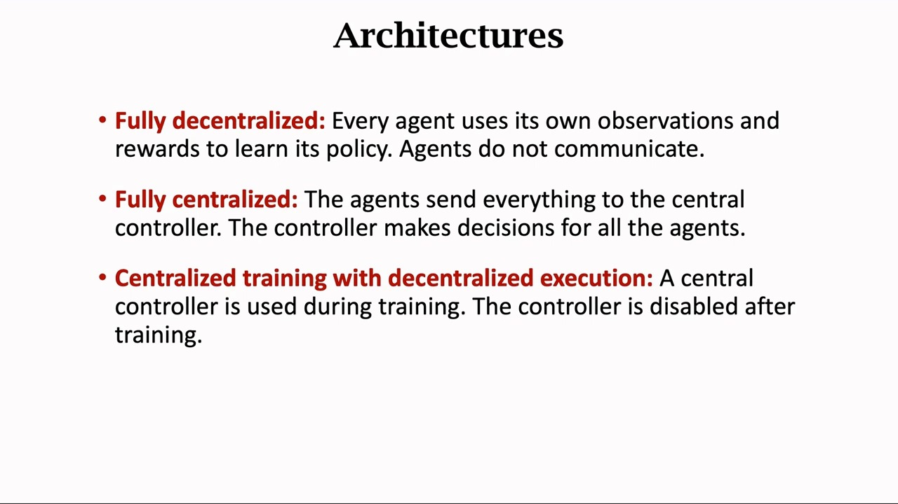
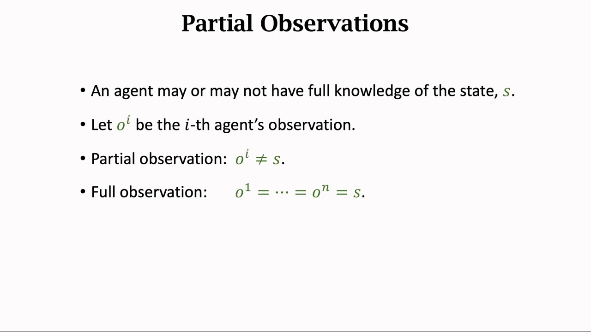
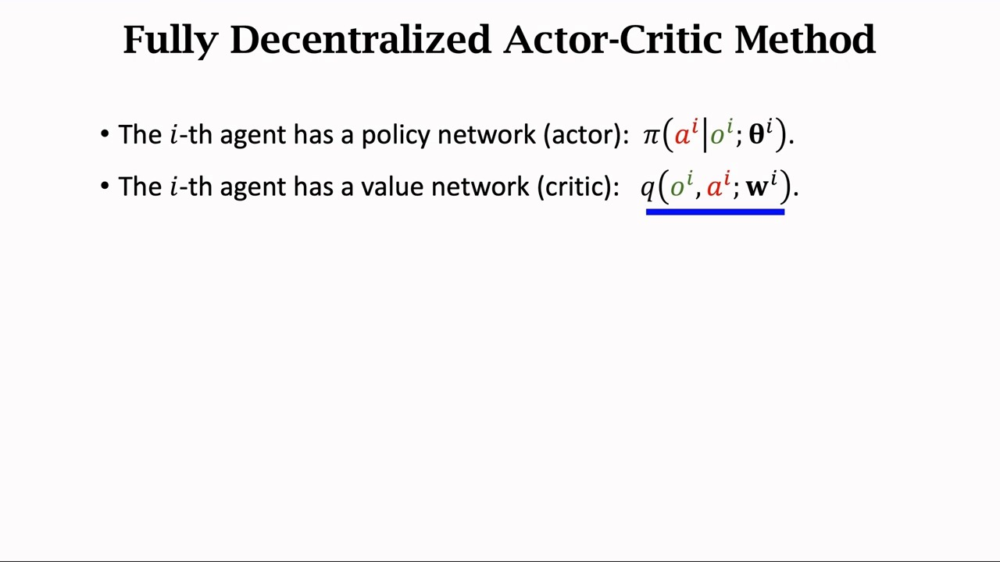
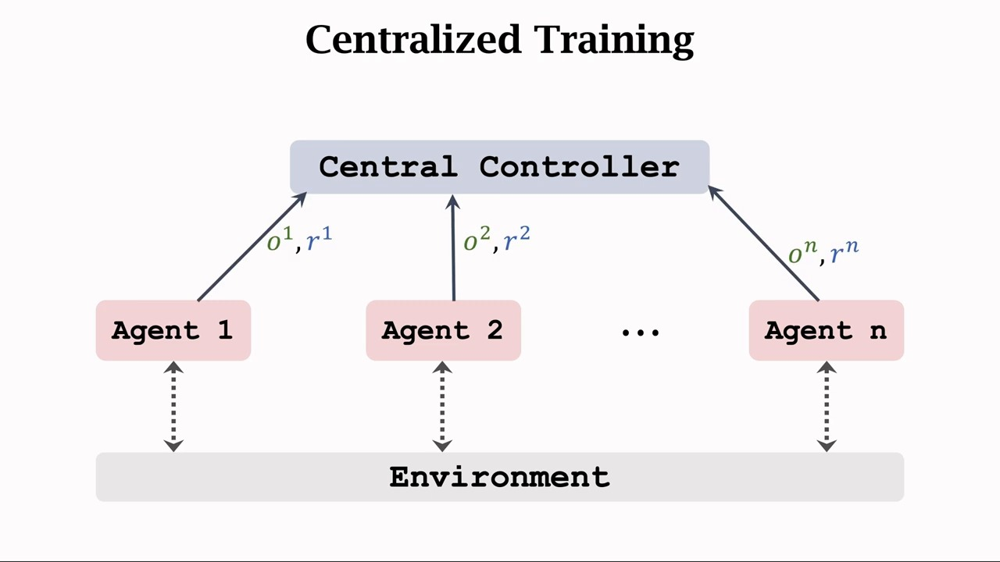
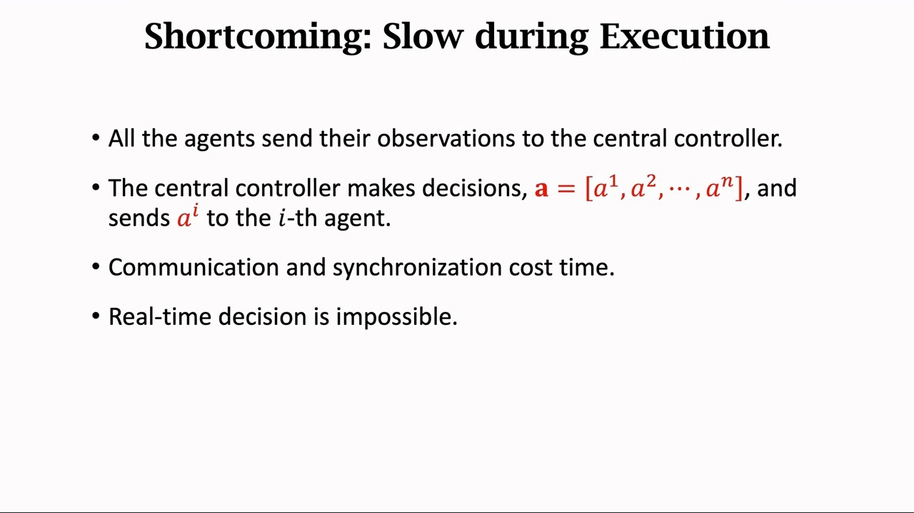
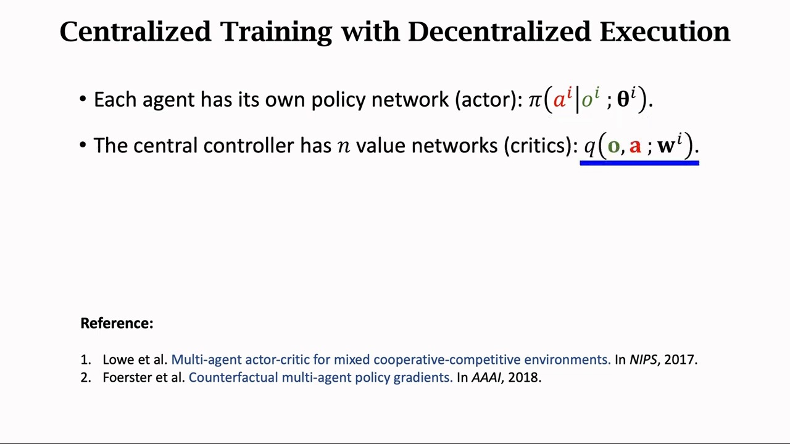
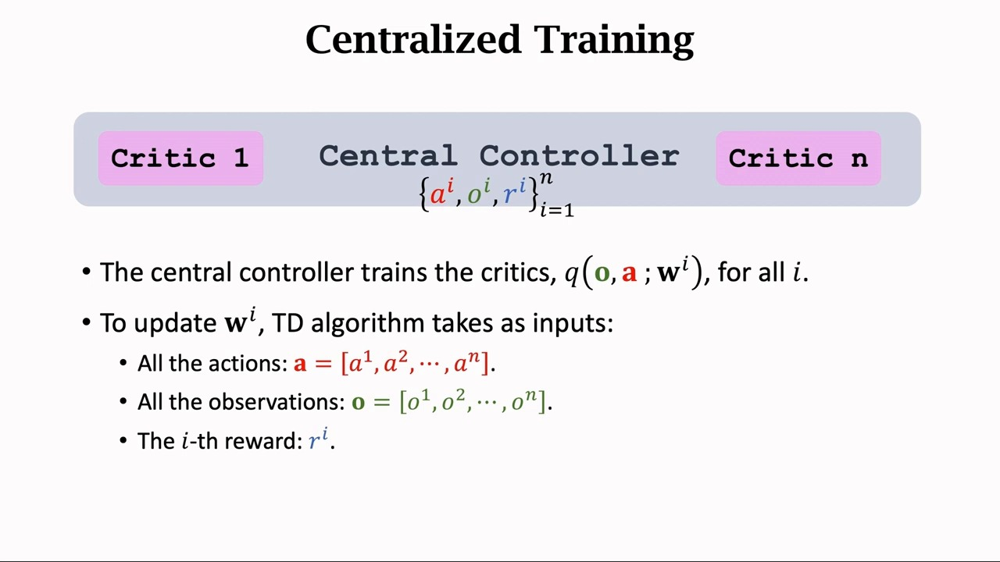
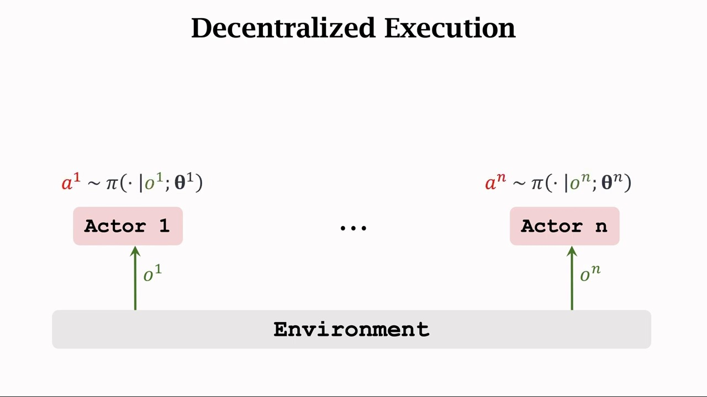
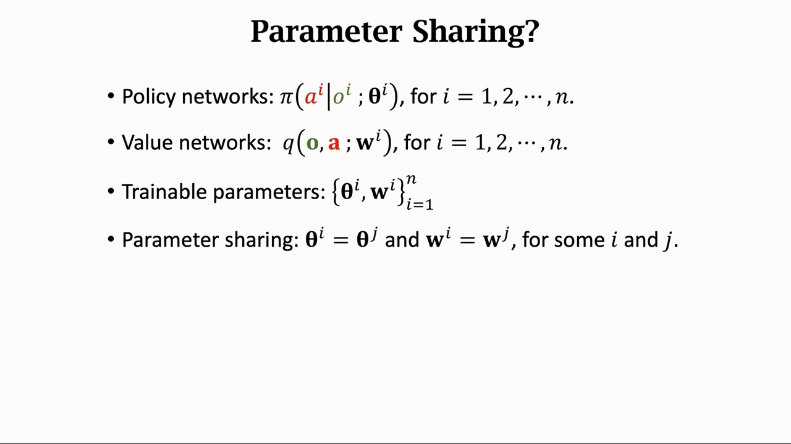
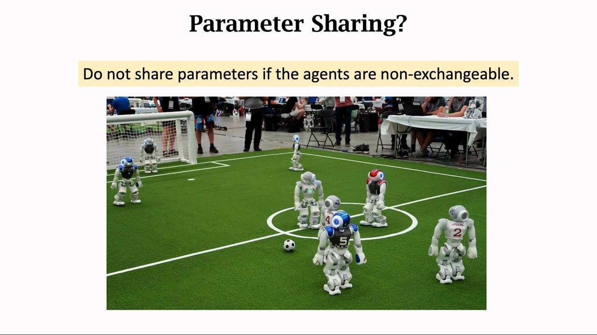

# 集中式训练与分布式执行：CTDE 范式

> 13.1 把多智能体 RL 的困难摊成了四条，其中两条是根：**非平稳性**——别人也在学，环境对你是移动靶；**信用分配**——团队奖励下分不清谁的功劳。本篇讲对付这两条的**主流范式**：CTDE（centralized training with decentralized execution，集中式训练与分布式执行）。它不解决某一个具体算法问题，而是给出一套**信息流的安排**：训练时允许一个"中央"看到全局，执行时把它拆掉，每个智能体只看自己的局部观测。

## 本讲要解决的核心问题（SCQA）

**背景**：单智能体 RL 里，智能体看什么、学什么、执行什么，三者是同一件事——策略的输入就是执行时的输入。多智能体一来，这三件事可以**分开**：训练是一个可以慢慢做、可以收集大量信息的离线过程；执行是一个必须实时、必须分布式的在线过程。

**冲突**：这两个过程对信息的需求正好相反。**训练需要全局信息**：如果 critic 能看到所有人的观测和动作，它评估"我这个动作好不好"时就不会把别人的变化误当成环境变化，非平稳性被大幅缓解，信用分配也有了抓手。**执行只能看局部**：真实部署时每个智能体只拿到自己的观测 $o^i$，拿不到全局状态 $s$，更不能在执行时停下来等其他智能体的动作。

**疑问**：能不能既要训练的全局视野，又要执行的局部独立？训练时用的那些执行时拿不到的信息，会不会让学出来的策略"依赖"它们而无法部署？

**回答（中心思想）**：能。**训练时集中（centralized），执行时分散（decentralized）**——把"用全局信息"这件事只放在**训练期**、只放在**critic** 上；actor 的输入从头到尾只有 $o^i$。这套安排就是 CTDE。本篇按讲者的三条架构讲清它相对两个极端的位置，再补上它自己的三种形态、核心矛盾与局限。

---

## 一、两个互相矛盾的需求

讲者开篇给这节课定的题目是**智能体之间的通信方式**：多智能体问题里一个 agent 的策略和动作会影响其他所有 agents，所以 agents 之间最好要通信、共享信息；而"怎么共享"分为中心化和去中心化两条路。

[【跳转到 00:41】](https://www.bilibili.com/video/BV12o4y197US/?p=23&t=41)

把这两个需求摆在一起，矛盾就很清楚了：

| 需求 | 来源 | 代价 |
| :--- | :--- | :--- |
| 训练要**全局** | 非平稳性、信用分配都要求"看到别人在干什么" | 需要通信、需要同步、需要集中算力 |
| 执行要**局部** | 部署时只有 $o^i$，且必须实时 | 看不到别人，无法协调 |

CTDE 的回答是把这两条**按时间切开**：矛盾不是被消除，而是被**挪到了不同的阶段**。训练期允许不实时、允许通信、允许一个中央节点存在；执行期把这些全部删掉。

### 1.1 局部观测是这个矛盾的物理来源

讲者专门用一页幻灯片交代观测的记号，因为整个矛盾就建立在"看不到全局"这件事上。

[【跳转到 02:35】](https://www.bilibili.com/video/BV12o4y197US/?p=23&t=155)

- 多智能体强化学习通常假设 **partial observation**（不完全观测）：agent 往往只能观测到它局部的状态，看不到全局状态 $s$，于是 $o^i \ne s$，而且不同 agent 通常有不同的局部观测；
- **完全观测**的意思是每个 agent 都能看到全局状态，于是 $o^1 = \cdots = o^n = s$。

这个记号后面会反复用到：CTDE 的整个设计就是**让 critic 吃 $\mathbf{o}$、让 actor 只吃 $o^i$**。

---

## 二、三种架构：从两个极端到折中

讲者把架构按"谁掌握信息、谁做决策"分成三种，并且是从两个极端讲起的——先看极端，折中的位置才清楚。

### 2.1 完全去中心化：把单智能体算法复制 n 份

**完全去中心化**（fully decentralized）：agents 全都是独立的个体，每个 agent 独立跟环境交互，并且**用自己的观测和奖励**来更新自己的策略；agents 彼此不交流，不知道别人的观测和动作。

[【跳转到 04:08】](https://www.bilibili.com/video/BV12o4y197US/?p=23&t=248)

讲者给出的实现是：假设每个 agent 都有计算能力（比如机器人上装了 CPU 或 GPU），就在每个 agent 上各部署一个策略网络和一个价值网络。第 $i$ 个智能体的 actor 与 critic 分别是

$$
\pi\big(a^i \mid o^i; \theta^i\big), \qquad q\big(o^i, a^i; w^i\big)
$$

注意 critic 的输入是 $o^i$ 和 $a^i$——**只有自己的**。幻灯片上特意在 $o^i, a^i$ 下面画了一道蓝线，强调这两个位置放的都不是全局量。

讲者对它的评价很直接：**去中心化的本质跟单智能体强化学习完全一样，根本不考虑 agents 之间的影响；去中心化通常效果不好**，因为 agents 不是独立存在的个体，他们对彼此有影响。这正是 13.1 第二节讲的非平稳性：从每个 agent 的角度看，别人的策略都在动，那个 $q(o^i,a^i;w^i)$ 学的是一个**会漂移的目标**。

### 2.2 完全中心化：一个"定于一尊"的中央

另一个极端是**完全中心化**（fully centralized）：所有 agents 都把信息传送给中央控制器，中央控制器知道所有 agents 的观测、动作以及奖励；agents 上没有策略网络，agents 自己不做决策，决策都是由中央做的，agents 只是执行指令。讲者把这套安排概括成"**定于一尊**"。

[【跳转到 05:16】](https://www.bilibili.com/video/BV12o4y197US/?p=23&t=316)

写法上就是把每个智能体的输入从局部换成全局。设

$$
\mathbf{a} = \big[a^1, a^2, \cdots, a^n\big], \qquad \mathbf{o} = \big[o^1, o^2, \cdots, o^n\big]
$$

分别包含所有 agents 的动作与观测，那么中央控制器上的第 $i$ 个 agent 的 actor 与 critic 是

$$
\pi\big(a^i \mid \mathbf{o}; \theta^i\big), \qquad q\big(\mathbf{o}, \mathbf{a}; w^i\big)
$$

与 2.1 对比，唯一的改动是 $o^i \to \mathbf{o}$、$a^i \to \mathbf{a}$：**critic 和 actor 都变成了全局输入**。

中心化的好处是知道全局信息，可以帮助所有 agents 做出好的决策。但讲者紧接着讲了它的**主要缺点：执行的速度慢**。

[【跳转到 09:20】](https://www.bilibili.com/video/BV12o4y197US/?p=23&t=560)

课程把代价拆成两条：

- 决策过程需要 **communication（通信）** 和 **synchronization（同步）**：发送信息要花时间，而且**所有人要等待最慢的人**，这是同步的代价；
- 于是中心化的系统导致 agents 反应很慢，**无法做到实时的决策**，到了关键时刻总是会慢半拍。

> 讲者在这里补了一句大白话："想必大家在实际生活中都有亲身体会。"这句话不是玩笑——中心化的瓶颈不是算力，而是**通信延迟与同步等待**，这两样在真实系统里恰恰最难压缩。

### 2.3 中心化训练、去中心化执行：把两段切开

第三种架构就是本篇的主题：**centralized training with decentralized execution**。

- 每个 agent 都有自己的策略网络，训练的时候需要一个中央控制器，它帮助 agents 训练策略网络；
- **结束训练之后就不需要中央控制器了**，每个 agent 独立跟环境交互，用自己的策略网络、基于自己局部的观测来做决策。

一句话：**训练期用中心化的信息，执行期用去中心化的策略**。讲者说，现在 CTDE 比较流行，有很多种不同的模型，他在这节课里只介绍其中一种——**actor-critic 方法**；这种方法是 2017 和 2018 年两篇论文独立提出的（幻灯片列出的参考文献是 Lowe 等人的 MADDPG，NIPS 2017，与 Foerster 等人的 COMA，AAAI 2018），并且他强调自己做了些简化，所以课上的版本跟两篇论文不完全一样。

---

## 三、把 CTDE 落到 Actor-Critic 上

### 3.1 结构：actor 在本地，critic 在中央

[【跳转到 10:34】](https://www.bilibili.com/video/BV12o4y197US/?p=23&t=634)

讲者给出的具体安排是：

- 每个 agent 上面都**单独部署一个策略网络** $\pi(a^i \mid o^i; \theta^i)$，输入是 agent 自己的局部观测 $o^i$；
- **中央控制器上有 $n$ 个价值网络**，全都记做 $q$，每个价值网络对应一个 agent；这些价值网络的结构都相同，但参数 $w^i$ 通常不同；
- 中央知道所有 agents 的观测 $\mathbf{o}$ 和动作 $\mathbf{a}$，所以价值网络的输入是**所有的 $\mathbf{o}$ 和所有的 $\mathbf{a}$**：

$$
q\big(\mathbf{o}, \mathbf{a}; w^i\big)
$$

把 2.1 的 $q(o^i,a^i;w^i)$、2.2 的 $q(\mathbf{o},\mathbf{a};w^i)$ 和这里的写法并排看，CTDE 的位置就一目了然：**critic 的输入跟完全中心化一样是全局的，actor 的输入跟完全去中心化一样是局部的**。它把两个极端各取了一半，而且取的是各自**好处**的那一半。

### 3.2 训练阶段：中央控制器训练 critic

[【跳转到 12:20】](https://www.bilibili.com/video/BV12o4y197US/?p=23&t=740)

训练时，中央控制器可以看到所有 agents 的观测、动作以及奖励——**所以叫做 centralized training**。具体地，要更新第 $i$ 个 critic 的参数 $w^i$，TD 算法需要把三样东西作为输入：

- 所有的动作 $\mathbf{a} = [a^1, \cdots, a^n]$；
- 所有的观测 $\mathbf{o} = [o^1, \cdots, o^n]$；
- 第 $i$ 个 agent 的奖励 $r^i$。

写成更新式就是（这一步是**补充**，讲者只说了"用 TD 算法"，没有写公式）：

$$
w^i \leftarrow w^i - \alpha \, \nabla_{w^i} \Big( q(\mathbf{o}, \mathbf{a}; w^i) - \big[\, r^i + \gamma\, q(\mathbf{o}', \mathbf{a}'; w^i) \,\big] \Big)^2
$$

而 actor 的更新用的是策略梯度，梯度信号来自这个**全局 critic**：

$$
\nabla_{\theta^i} J \approx \mathbb{E}\Big[\, \nabla_{\theta^i} \log \pi(a^i \mid o^i; \theta^i)\; q(\mathbf{o}, \mathbf{a}; w^i) \,\Big]
$$

（同样是**补充**的写法；连续动作的确定性版本见 13.5 的 MADDPG。）

这两条式子把 CTDE 的关键说尽了：**梯度里出现了 $\mathbf{o}, \mathbf{a}$，但 actor 的输入里只有 $o^i$**。全局信息只走"评价"这条路进来，从不走"决策"这条路。

### 3.3 执行阶段：把中央控制器删掉

[【跳转到 13:24】](https://www.bilibili.com/video/BV12o4y197US/?p=23&t=804)

训练结束后，中央控制器和它上面的价值网络**全都没用了**。执行时每个 agent 只做一件事：

$$
a^i \sim \pi\big(\cdot \mid o^i; \theta^i\big)
$$

不需要通信，不需要同步，也没有"等最慢的人"的问题——2.2 里中心化的那个致命缺点在这一步被彻底删掉了。

> **这是 CTDE 最容易被误解的一点**：CTDE 不是"训练时集中、执行时也偷偷用全局信息"。执行期真的只剩 $n$ 个本地网络，它们之间没有任何通道。所谓"集中"是一个**只在训练期存在的临时脚手架**。

---

## 四、CTDE 的三种典型形态

讲者这一讲只展开了 actor-critic 这一种实现。但 CTDE 是一个**范式**，不是某一个算法；按"全局信息被放在哪个部件上"，主流做法可以归成三类（这一分类是**本系列的整理**，不是讲者原话；具体算法分别在 13.4、13.5 展开）：

| 形态 | 全局信息放在哪 | actor 的输入 | 代表 |
| :--- | :--- | :--- | :--- |
| 集中式 critic + 分布式 actor | critic $q(\mathbf{o},\mathbf{a})$ | $o^i$ | MADDPG、COMA（13.5） |
| 集中式价值分解 | 一个全局 $Q_{tot}$，再分解成各 $Q_i$ | $o^i$（每个 $Q_i$ 只用 $o^i, a^i$） | VDN、QMIX（13.4） |
| 集中式训练 + 参数共享 | 共享参数 + 全局 critic | $o^i$ | MAPPO、共享参数的 PPO（13.5） |

三者的区别值得说清，因为它们经常被混为一谈：

- **集中式 critic**：$n$ 个 critic，每个都吃全局 $(\mathbf{o},\mathbf{a})$，各自给自己那个 agent 打分。讲者课上讲的就是这一种（$n$ 个 $q(\mathbf{o},\mathbf{a};w^i)$）。
- **集中式价值分解**：只学**一个**全局 $Q_{tot}(\mathbf{o},\mathbf{a})$，但要求它能拆成 $\sum_i Q_i(o^i,a^i)$ 这样的结构，使得"每个人各自取最大"与"整体取最大"一致。它把"全局"压进了**一个标量**，而不是 $n$ 个网络。
- **参数共享**：所有 agent 共用一套 $\theta, w$，靠输入里带 $o^i$ 来区分身份。它不改变信息流，改变的是**参数量的增长方式**——从 $O(n)$ 变成 $O(1)$。

### 4.1 参数共享：一个独立的旋钮

讲者把参数共享单独拿出来讲，因为它和"三种架构"是**正交**的：不论你选哪种架构，都要回答"要不要共享参数"。

[【跳转到 14:20】](https://www.bilibili.com/video/BV12o4y197US/?p=23&t=860)

形式化地，共享参数就是让

$$
\theta^i = \theta^j, \qquad w^i = w^j \quad \text{对某些 } i, j
$$

讲者给了一条很实用的判据：**看智能体是否可互换（exchangeable）**。

[【跳转到 14:33】](https://www.bilibili.com/video/BV12o4y197US/?p=23&t=873)

- **足球机器人**：有的负责进攻，有的负责防守，还有一个守门，每个机器人的功能不同，所以**不应该**用同样的参数；
- **无人车**：相同型号的无人车功能都一样，可以用相同的神经网络参数，所以**可以**共享。

判据落在"功能是否同构"上：**功能不同 → 不共享；功能相同 → 共享**。（补充一句讲者没展开的取舍：共享的好处是样本效率与参数量，代价是表达能力——一个网络要同时扮演守门员和前锋，就只能学到一个折中的策略。）

---

## 五、CTDE 的核心矛盾

到这里 CTDE 的"结构"已经清楚了。真正值得停下来想的是：**它凭什么成立？** 这一节是本篇最需要动脑的地方，内容属于**本系列的整理与推导**，讲者课上没有展开。

### 5.1 信息不对称：策略会不会依赖执行时拿不到的信息？

第一反应通常是担心：critic 用了 $\mathbf{o}, \mathbf{a}$，这些执行时拿不到；那学出来的 actor 会不会**隐式地依赖**这些信息，导致部署时失效？

答案是不会，理由在梯度的结构里：

$$
\nabla_{\theta^i} J \approx \mathbb{E}\Big[\, \nabla_{\theta^i} \log \pi(a^i \mid o^i; \theta^i)\; q(\mathbf{o}, \mathbf{a}; w^i) \,\Big]
$$

拆开看，这个梯度是两项的乘积：

- $\nabla_{\theta^i} \log \pi(a^i \mid o^i; \theta^i)$：**只依赖 $o^i$**，它决定"往哪个方向调参数"；
- $q(\mathbf{o}, \mathbf{a}; w^i)$：**依赖全局信息**，但它只作为一个**标量权重**出现，决定"这一步调多少、往哪边加权"。

也就是说，全局信息只影响**梯度的幅度与方向偏好**，不进入策略的**函数形式**。参数更新完之后，$\pi(a^i \mid o^i;\theta^i)$ 仍然是一个只吃 $o^i$ 的函数——它的输入域从头到尾没变过。这就是 CTDE 在理论上站得住的根本原因：**全局信息只用来"打分"，不用来"决策"**。

> 换个说法：critic 是一个**只在训练期存在的老师**。老师看过标准答案（全局信息），学生只看课本（局部观测）。老师的作用是让学生的每一次修改更准，而不是让学生考试时带小抄——考试卷面上只有课本内容。

### 5.2 但会引入"一致性"问题

上面那段推导有个隐含前提：**critic 打的分，必须是对"执行时真正会发生的联合行为"的评价**。这个前提在 CTDE 里并不自动成立，于是产生了 CTDE 的固有 gap。它有两个具体的表现：

**（1）训练时的联合动作分布 ≠ 执行时的联合动作分布。**

训练时 critic 评估的 $\mathbf{a}$ 是从**联合策略** $\prod_j \pi_j(a^j \mid o^j)$ 里采出来的；执行时各 agent 也是各自独立采样，看起来一致。但如果 critic 在做 bootstrap 时用的是**联合最大化** $\max_{\mathbf{a}} q(\mathbf{o}, \mathbf{a})$，而执行时每个 agent 各自取 $\arg\max_{a^i}$，两者就可能指向**不同的联合动作**——critic 以为会发生的行为，执行时并不会发生。这个不一致就是 13.4 里 IGM 条件要解决的问题：让"个体各自取最大"与"整体取最大"重合。

**（2）训练分布 ≠ 部署分布。**

训练时 critic 见到的 $(\mathbf{o},\mathbf{a})$ 来自训练期的策略；策略在更新，分布就在漂移。这一点跟单智能体的 off-policy 学习同源，但在多智能体里被放大：**$n$ 个策略同时漂移**，critic 要追的是一个 $n$ 维联合分布，而不是一个一维分布。

> 这两条合起来说明：CTDE 缓解了非平稳性，但没有**消除**它。它把"环境在变"换成了"critic 的目标在变"，问题的形态变了，难度降低了，但没有归零。

---

## 六、两条实现路径

同一个范式，落地时有两条技术路线，区别在"全局信息最终被塞进什么函数里"（**本系列的整理**）：

| 路径 | 全局信息的载体 | 怎么用 | 代表 |
| :--- | :--- | :--- | :--- |
| 策略梯度路线 | 集中式 critic $q(\mathbf{o},\mathbf{a};w^i)$ | 用 $q$ 给 actor 提供梯度信号 | MADDPG、COMA、MAPPO（13.5） |
| 值函数路线 | 全局 $Q_{tot}(\mathbf{o},\mathbf{a})$ | 学 $Q_{tot}$，再分解成各 $Q_i$，执行时各取 $\arg\max$ | VDN、QMIX（13.4） |

两条路的差别不只是"用 $q$ 还是用 $Q$"，而是**执行时到底靠什么选动作**：

- 策略梯度路线：执行时 actor 直接输出动作，**不需要** critic，所以中央控制器可以整个删掉；
- 值函数路线：执行时每个 agent 用自己那个 $Q_i$ 取 $\arg\max$。这条路要求分解结构满足一致性条件，否则"各自最优"不等于"整体最优"——这就是 5.2 里那个 gap 的直接后果。

---

## 七、CTDE 的局限

CTDE 不是免费的午餐，它的代价集中在三处（**本系列的整理**，其中第一条与讲者讲的"中心化执行慢"同源）：

1. **critic 的输入随智能体数增长。** 集中式 critic 吃的是 $\mathbf{o} = [o^1,\dots,o^n]$ 和 $\mathbf{a} = [a^1,\dots,a^n]$，输入维度是 $n \cdot \dim(o) + n \cdot \dim(a)$，线性增长；如果 critic 要对联合动作做最大化，还要面对大小为 $\prod_i \vert A_i \vert$ 的联合动作空间——**指数增长**。智能体一多，critic 既难训练也难扩展。
2. **训练与执行的分布不一致。** 就是 5.2 的两条 gap。它不会让方法失效，但会让"训练时表现好"与"部署时表现好"之间出现落差。
3. **集中式 critic 在智能体数量多时难以训练。** 这一点是第一条的直接后果：输入维度上去了，样本复杂度也上去了；而且训练期的通信与同步开销虽然不像执行期那样致命，仍然是实打实的工程成本。

> 这也解释了为什么后来的工作会往两个方向跑：一是**把全局信息压缩**（价值分解把 $n$ 个 critic 压成一个可分解的 $Q_{tot}$，13.4），二是**把参数压掉**（参数共享把 $O(n)$ 个网络压成 $O(1)$ 套参数，MAPPO，13.5）。

---

## 八、与 13.1 四个困难的对应

13.1 列了四个困难，CTDE 对它们的作用并不均等：

| 困难 | CTDE 的作用 | 机制 |
| :--- | :--- | :--- |
| **非平稳性** | **缓解** | critic 看到 $\mathbf{o},\mathbf{a}$，别人的策略变化被显式建模进 $q$，而不是被误当成环境噪声 |
| **信用分配** | **部分缓解** | 每个 agent 有自己的 $q(\mathbf{o},\mathbf{a};w^i)$，评价是**按个体**给的；但团队共享奖励时，"这份奖励里谁的功劳"仍需价值分解（13.4） |
| **探索的维度爆炸** | **不直接解决** | 联合动作空间仍是 $\prod_i \vert A_i \vert$；CTDE 只改了信息流，没改动作空间的规模，探索要靠额外机制 |
| **均衡选择** | **不直接解决** | 集中式训练提供了协调的**机会**（critic 能看到联合行为），但"选哪个均衡"仍需额外约定 |

这张表值得记住：**CTDE 是一把针对非平稳性的专用工具**，它顺手改善了信用分配（因为评价按个体给），但对探索和均衡选择基本无能为力。把 CTDE 当成"多智能体问题的通用解"是常见的误读。

---

## 九、三条路线的对比

把两个极端和折中放在一张表里（**本系列的整理**；其中"讲者的评价"一行是视频原话）：

| 维度 | 完全去中心化 | 完全中心化 | CTDE |
| :--- | :--- | :--- | :--- |
| 训练时用什么信息 | 各自的 $o^i, r^i$ | 全局 $\mathbf{o}, \mathbf{a}, \mathbf{r}$ | 全局 $\mathbf{o}, \mathbf{a}, \mathbf{r}$ |
| 执行时用什么信息 | 各自的 $o^i$ | 全局 $\mathbf{o}$（要实时上报） | 各自的 $o^i$ |
| 执行期通信 | 无 | 必需，且要同步 | 无 |
| 扩展性 | 最好（$n$ 个独立小网络） | 最差（中央是瓶颈） | 中等（critic 随 $n$ 变宽） |
| 非平稳性 | 严重，本质是单智能体学习 | 不存在（一个决策者） | 大幅缓解 |
| 实时性 | 好 | 差，无法实时决策 | 好 |
| 实现复杂度 | 最低（等于单智能体算法复制 $n$ 份） | 中等（要一个中央） | 最高（训练与执行两套结构） |
| 讲者的评价 | "通常效果不好" | "执行的速度慢" | "现在比较流行" |

表中"讲者的评价"那一行的三句话，恰好概括了这张表的取舍：**去中心化简单但学不好，中心化学得好但跑不快，CTDE 想在两者之间同时拿到"学得好"和"跑得快"**。

---

## 十、本章路线图

- **13.4 价值分解方法：VDN 与 QMIX**——CTDE 的**值函数实现**。它把 5.2 那个一致性 gap 正面解决：要求全局 $Q_{tot}$ 的 $\arg\max$ 与各 $Q_i$ 的 $\arg\max$ 一致（IGM 条件），从而在执行期真正做到"各自取最大 = 整体取最大"。
- **13.5 多智能体策略梯度：MADDPG 与 MAPPO**——CTDE 的**策略梯度实现**。MADDPG 就是本篇 3.1 那个结构在确定性策略上的版本（参考文献里 Lowe 等人 2017 那篇），MAPPO 则把 PPO 搬过来并靠参数共享（本篇 4.1）压住参数量。

一句话串起来：**13.1 讲问题为什么难，13.3 讲信息该怎么摆，13.4 与 13.5 讲两条路各自怎么把这件事做成算法。**

---

## 小结

- **两个矛盾的需求**：训练要全局信息（缓解非平稳性、支撑信用分配），执行只能看局部（只有 $o^i$、必须实时）。CTDE 把矛盾按**阶段**切开，而不是消除。
- **三种架构**：完全去中心化（各自学，通常效果不好）、完全中心化（学得好，但通信与同步导致执行慢、无法实时）、CTDE（训练期集中、执行期分散）。
- **CTDE 的 actor-critic 形态**：actor 是 $\pi(a^i \mid o^i;\theta^i)$，critic 是 $q(\mathbf{o},\mathbf{a};w^i)$；训练时中央控制器用全局信息训练 critic，执行时把中央控制器整个删掉。
- **三种典型形态**：集中式 critic、集中式价值分解、集中式训练加参数共享。参数共享是**正交**的旋钮，判据是智能体是否可互换。
- **核心矛盾**：全局信息只作为**梯度权重**出现，不进入策略的函数形式，所以策略不会依赖执行时拿不到的信息；但会留下**一致性 gap**——训练时评估的联合行为与执行时的实际联合行为可能不一致。
- **局限**：critic 输入随 $n$ 线性增长、联合动作空间指数增长、训练与执行分布不一致。
- **对应关系**：CTDE 缓解非平稳性、部分缓解信用分配，但**不解决**探索与均衡选择。

## 关键术语速查

| 术语 | 一句话解释 |
| :--- | :--- |
| CTDE | 集中式训练与分布式执行：训练期用全局信息，执行期只用局部观测 |
| 完全去中心化（fully decentralized） | 每个智能体用自己的观测和奖励独立学习，彼此不通信 |
| 完全中心化（fully centralized） | 所有信息上报中央控制器，由控制器替所有智能体决策 |
| 局部观测（partial observation） | $o^i \ne s$，智能体只看到状态的一部分 |
| 集中式 critic | 输入为全局 $\mathbf{o}, \mathbf{a}$ 的价值网络，只在训练期使用 |
| 参数共享（parameter sharing） | 多个智能体共用同一套参数，$\theta^i = \theta^j$、$w^i = w^j$ |
| 可互换（exchangeable） | 智能体功能同构、可以互换角色；可互换才适合共享参数 |
| 一致性 gap | 训练时 critic 评估的联合行为与执行时实际发生的联合行为之间的偏差 |
| 联合观测 / 联合动作 | $\mathbf{o} = [o^1,\dots,o^n]$、$\mathbf{a} = [a^1,\dots,a^n]$ |

## 参考视频

- 王树森《深度强化学习》多智能体强化学习(2/2)：三种架构，[BV12o4y197US](https://www.bilibili.com/video/BV12o4y197US/)（第 23 P）。讲者用 Actor-Critic 串起三种架构，重点在"信息放在哪、决策由谁做"，并单独讨论了参数共享的适用条件。