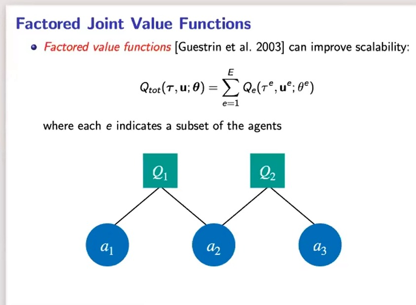
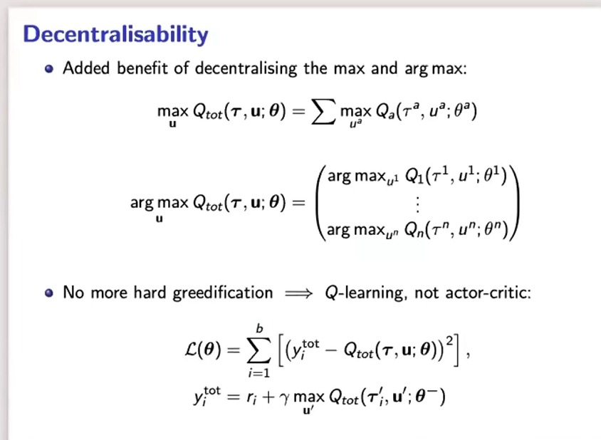
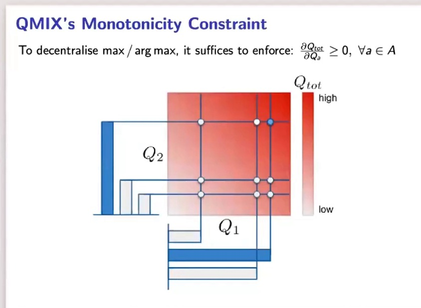
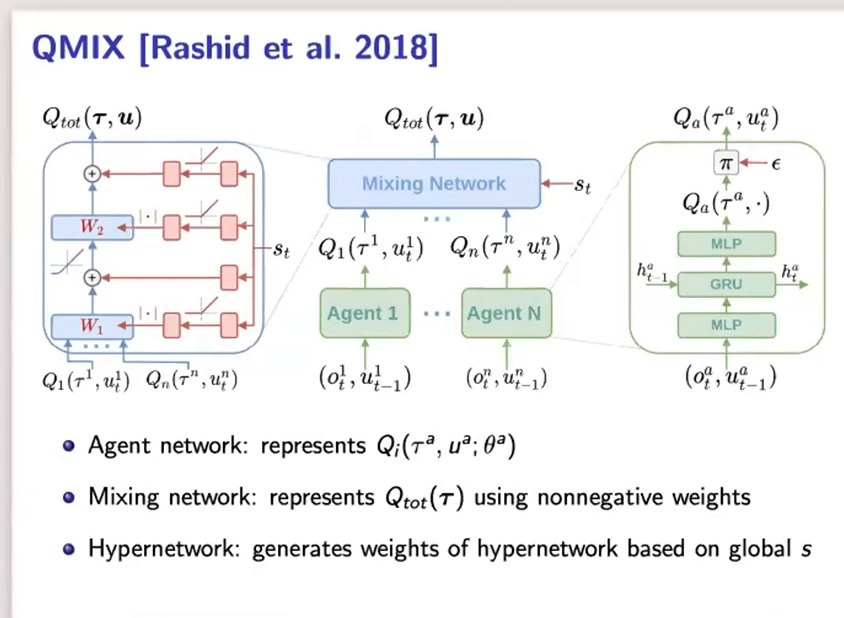
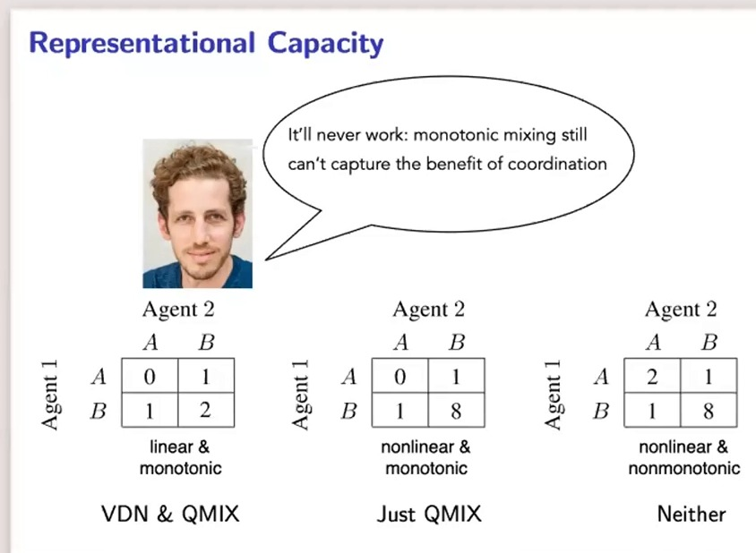
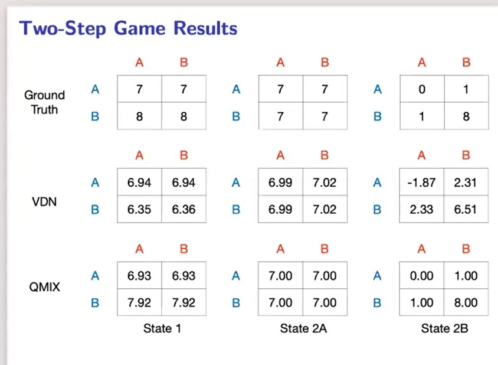
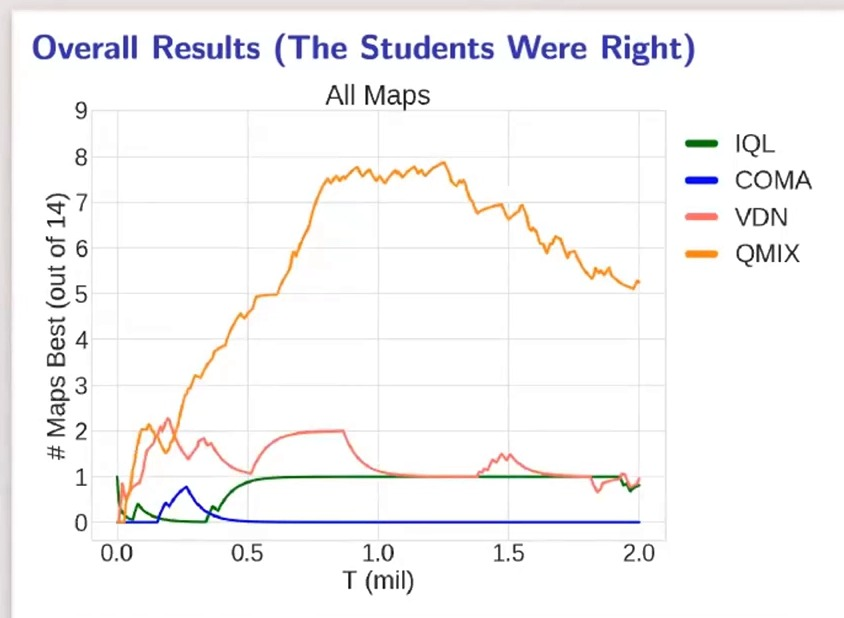
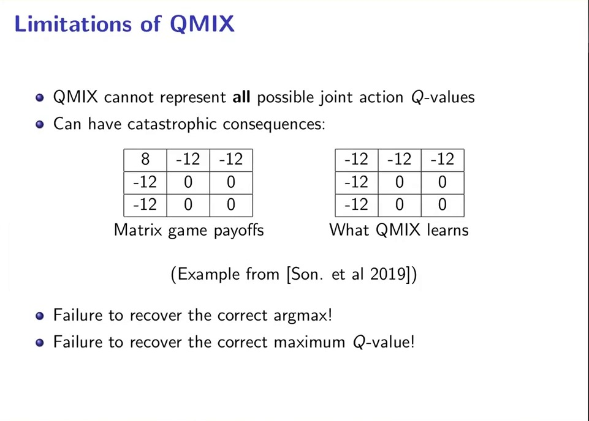
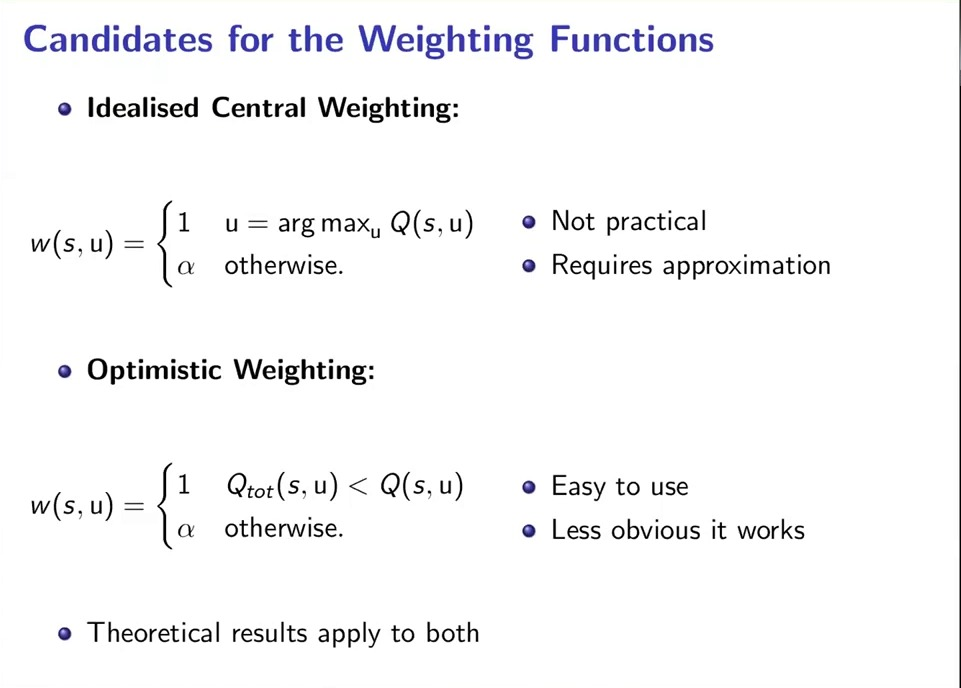
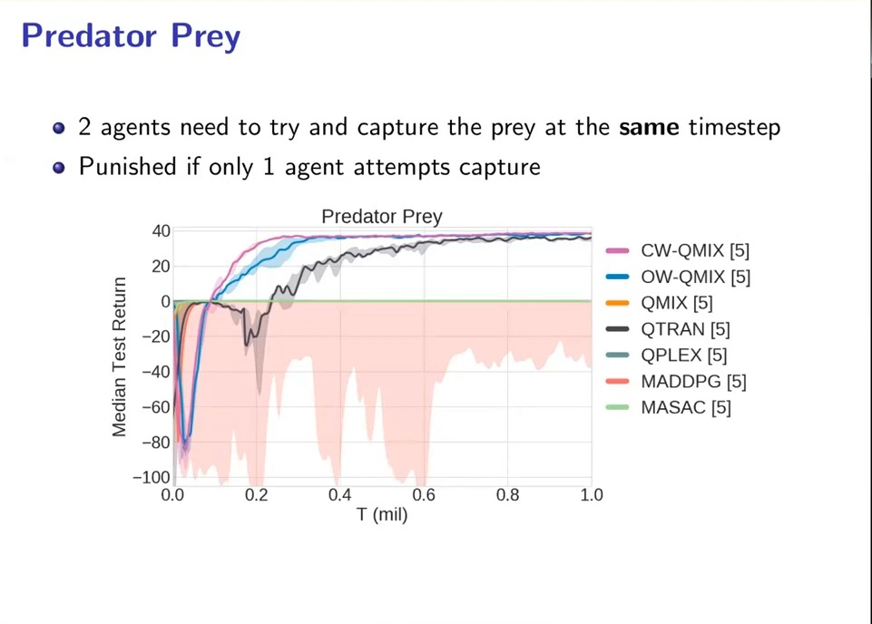

# 价值分解：从 VDN 的加性分解到 QMIX 的单调性约束

> 13.3 把 CTDE 的三种形态并排摆了出来，其中第二种叫**集中式价值分解**：只学一个全局的 $Q_{tot}$，再把它拆成各智能体的 $Q_i$，让"各自取最大"与"整体取最大"重合。本篇讲这个形态的**具体实现**——VDN 与 QMIX，以及它们共同的理论核心 **IGM 条件**。范式层面的论述（两个矛盾需求、三种架构、一致性 gap）不再重复，请回看 13.3。

## 本讲要解决的核心问题（SCQA）

**背景**：完全合作的多智能体任务里，所有智能体拿的是**同一个**团队奖励。CTDE 允许训练时用全局信息，于是最直接的想法是学一个全局动作价值 $Q_{tot}(s,\mathbf{a})$——它吃全局状态和所有人的联合动作，能准确说出"这个联合动作整体有多好"。

> **记号说明**：本系列用 $R_i$ 表示智能体 $i$ 的奖励，完全合作意味着 $R_1=\cdots=R_n=R$，即大家共享同一个奖励。视频与幻灯片里把动作写成 $u$、观测历史写成 $\tau$，本篇统一用 $a$ 与 $\tau$，智能体编号用上标（$o^i, a^i, \tau^i$），与 13.3 一致；联合量用粗体（$\mathbf{a}, \boldsymbol{\tau}$）。

**冲突**：这个 $Q_{tot}$ 在执行时**用不了**。执行阶段每个智能体只有自己的局部观测 $o^i$，也拿不到别人的动作，而要从 $Q_{tot}$ 里取出最优联合动作 $\arg\max_{\mathbf{a}} Q_{tot}$，需要枚举所有智能体动作的组合——规模是 $\prod_i \vert A_i \vert$，指数爆炸；更糟的是，这个 $\arg\max$ 的结果是一个**联合**动作，执行时没有任何一个智能体有能力算出它。于是出现一个尴尬局面：**能学的函数不能用，能用的函数（各自的 $Q_i$）又不知道该怎么学**。

**疑问**：能不能让学到的全局价值函数天生就"可拆"——拆成 $n$ 个只吃自己观测和动作的 $Q_i$，使得**每个智能体各自取 $\arg\max$，拼起来正好等于整体的 $\arg\max$**？

**回答（中心思想）**：能，这个要求叫 **IGM 条件**（Individual-Global-Max）。VDN 用**加性分解** $Q_{tot}=\sum_i Q_i$ 满足它，代价是表达能力极弱；QMIX 把要求从"加性"放松到"**单调**"（$\partial Q_{tot}/\partial Q_i \ge 0$），用**非负权重的混合网络**把 $\{Q_i\}$ 非线性地拼成 $Q_{tot}$，从而在保住 IGM 的同时大幅提升表达能力。本篇按"问题设定 → IGM → VDN → QMIX → 两者的实验对比 → 单调性的代价与后续放宽"展开，全部内容来自牛津大学的西蒙·惠特森（Shimon Whiteson）与塔比什·拉希德（Tabish Rashid）在图灵研究所的这场报告。

---

## 一、问题设定：合作、部分可观测、集中训练、分散执行

讲者开篇强调，多智能体强化学习最容易出错的地方不是算法，而是**问题设定**——一旦离开单智能体的简单情形，可能的设定会爆炸式增长，每一种对"能观测什么、能做什么动作、奖励怎么给"都有不同假设。所以他先用一张幻灯片把要讨论的设定钉死。

要讨论的设定有五个关键词：**多智能体**（multi-agent）、**合作**（cooperative）、**部分可观测**（partially observable）、**集中式学习**（centralised learning）、**去中心化执行**（decentralised execution）。

前两个好理解：现实里很多多智能体系统是协作的，比如仓库里的一队机器人，或者一队自动驾驶汽车共享一条有真人司机的公共道路。真正的技术内容在后三个关键词上。

### 1.1 为什么"部分可观测"才是多智能体的分水岭

讲者先讲了一个容易被忽略的事实：**多智能体 MDP 里其实没有"多智能体"**。做法很简单，给每个智能体加一个自己的动作空间，每个智能体都能看到全局状态、但只能选自己的动作。这时转移函数和奖励函数跟单智能体一样，只是以**联合动作** $\mathbf{a}=[a^1,\dots,a^n]$ 为条件（下面的形式化写法是补充，讲者只用文字描述）：

$$
\mathcal{M} = \big\langle S,\ \{A^i\}_{i=1}^{n},\ P,\ R,\ \gamma \big\rangle,\qquad P(s'\mid s,\mathbf{a}),\quad R(s,\mathbf{a})
$$

这样的模型等价于**一个单智能体 MDP，只是动作空间被分解了**：采取一个动作意味着指定一整个向量，就好像有一个"木偶师"（puppeteer）从上面操纵所有机器人。既然只有一个决策者，那它就不是多智能体问题。

**部分可观测性**改变了这一点。加上观测函数之后，每个智能体只看到全局状态的一部分，而且看到的都不一样：

$$
o^i \sim O(\cdot \mid s, i), \qquad o^i \ne s
$$

于是问题必须用 **Dec-POMDP**（去中心化的部分可观测马尔可夫决策过程）来建模，每个智能体要根据自己的观测历史 $\tau^i = (o^i_1, a^i_1, \dots, o^i_t)$ 决策。**正是"看不到全局、且彼此看到的不同"这件事，让协调成为真问题。**

### 1.2 去中心化执行的两类动机，与"集中式学习"这张免费牌

去中心化执行这个约束有两种动机：

- **自然去中心化**：现实世界里通信或感知受限，只能去中心化；
- **人为去中心化**：本身没有这种限制，但我们作为设计者主动加上，比如强制每个智能体只用局部视野。

与此同时，讲者强调了一个关键假设：**学习过程本身可以集中**。因为训练发生在模拟器或实验室里，训练时智能体之间可以共享参数、共享观测、共享梯度，"想共享什么都可以，没有限制"，**只要最终得到的策略满足去中心化执行的约束**。

> 讲者在这里说了一句方法论味道很重的话：要在困难问题上取得进展，必须做出**正确的假设**——这种假设要能带来很大的杠杆，同时在现实世界里仍然基本成立。CTDE 恰好符合这个标准：训练可以慢慢做、可以集中，执行必须实时、必须分布。

这也顺带解释了后面所有的算法设计原则。讲者有一句很精辟的总结：**任何能在部署前扔掉的东西，都是集中化的好候选**。集中式 critic 只在训练期存在，部署时丢掉，所以它吃全局信息是"免费"的。

### 1.3 最朴素的做法：独立学习，以及它为什么不行

算法上最简单的一步叫**独立学习**（independent learning），最早是 1993 年提出的独立 Q 学习：每个智能体用自己的 Q 函数独立学习，

$$
Q_i\big(\tau^i, a^i\big)
$$

只依赖自己的观测历史和个人动作。没有任何集中：没有去学以联合动作为条件的联合价值函数，每个智能体都把其他智能体当成环境的一部分。用 actor-critic 做同样的事也可以，每个智能体有自己的 actor 和 critic。如果再允许集中式学习，一个明显的改进是**跨智能体共享参数**，能加快学习、提高泛化——智能体仍然可以有不同行为，因为输入不同（输入里甚至可以带智能体编号）。

讲者指出独立学习有两个致命限制：

1. **环境不平稳**：因为每个智能体都把其他智能体当环境的一部分，而那些智能体**也在学习**，所以从这个智能体的角度看，环境一直在变，收敛保证随之消失（这就是 13.1 讲的非平稳性）。
2. **协调的协同价值没有被表达**：因为根本没有联合价值函数，"一起做某件事带来的额外收益"无处安放，于是学不出协调行为。

第二条是价值分解的出发点：**要学一个联合价值函数，但要让它在执行时可用。**

---

## 二、IGM 条件：什么时候"各自最优"等于"整体最优"

### 2.1 从集中式 critic 到因子化价值函数

修好第一条限制的办法是 CTDE 的经典做法：把 critic 集中起来，让它以全局状态、联合观测历史、甚至联合动作为条件。集中式 critic 只在训练时需要，部署时扔掉。

但这条路有个新麻烦。actor-critic 之所以在这里必要，是因为"关于值函数求贪婪动作"变得不平凡——单智能体里连续动作空间是典型例子，而这里我们有另一种"不平凡"：**有一个集中式价值函数，却要从中导出去中心化的策略**。actor-critic 能绕开它（让每个 actor 独立更新，梯度来自同一个集中式 critic），但**在复杂的联合动作空间上学一个集中式价值函数本身也很难**。

于是有了关键想法：学**因子化价值函数**（factored value functions）。它在强化学习里历史悠久，在决策理论规划里更久。思想是把价值函数写成**局部价值函数之和**，每个局部价值函数只依赖一个智能体子集的观测和动作：

$$
Q_{tot}(\boldsymbol{\tau}, \mathbf{a};\theta) = \sum_{e=1}^{E} Q_e\big(\tau^{e}, \mathbf{a}^{e};\theta^{e}\big)
$$

其中 $e$ 索引智能体的一个子集。这种结构可以用**协调图**（coordination graph）表示——它就是一个因子图，因子是局部价值函数、变量是智能体，很像概率图模型，刻画了条件独立性。

[【跳转到 12:40】](https://www.bilibili.com/video/BV18841137GS/?t=760)

协调图的好处有两条：一是**减少需要学习的参数**，加快学习、提高泛化；二是**让联合动作空间上的最大化变得可处理**——图模型里做 MAP 推理的消息传递算法可以直接复用，高效地找到最大化联合动作。举例来说，如果智能体 1 知道智能体 2 的动作，它就可以选自己的动作，而不必关心智能体 3 做什么。

### 2.2 IGM：把"可拆"写成一条等式

协调图只是"结构"，还没回答最要紧的问题：**什么样的分解，才能在执行时真正去中心化地取动作？**

答案是一条等式，也就是**IGM 条件**（Individual-Global-Max，个体-全局最优一致）：

$$
\arg\max_{\mathbf{a}} Q_{tot}(s, \mathbf{a}) = \left(\arg\max_{a^1} Q_1(o^1, a^1),\ \dots,\ \arg\max_{a^n} Q_n(o^n, a^n)\right)
$$

读法是：**全局最优的联合动作，恰好等于"每个智能体各自最优动作"拼起来的那个向量**。

这条等式为什么是整个子领域的核心，值得拆开讲三层：

- **它保证不损失最优性**。如果 IGM 成立，那么执行时每个智能体只管最大化自己的 $Q_i$，拼起来就是全局最优——**分散执行与集中决策得到同一个结果**，CTDE 才不是"用一个近似换速度"。
- **它把指数复杂度降到线性**。求 $\arg\max_{\mathbf{a}} Q_{tot}$ 要枚举 $\prod_i \vert A_i \vert$ 个联合动作；IGM 成立时，只需要 $n$ 次各自的动作空间最大化，复杂度随智能体数**线性**增长。
- **它让"硬贪婪化"消失**。一旦 $\max$ 和 $\arg\max$ 都能去中心化，就不再需要 actor 去逼近贪婪策略——**可以直接用 Q 学习**，不必被迫走 actor-critic。这是值函数路线与策略梯度路线分家的地方（13.3 第六节的两条路径）。

> 注意 IGM 是一个**要求**，不是定理。它不会自动成立，需要我们在函数结构上**构造**出来。VDN 和 QMIX 的区别，就是"用哪种结构去满足它"。

---

## 三、VDN：最极端的分解，加性求和

### 3.1 结构：每个智能体一个因子

**VDN**（Value Decomposition Networks，价值分解网络）由 DeepMind 提出，用的是因子化最极端的形式：**每个智能体一个因子**，于是协调图完全不连通，每个 $Q_i$ 只看自己的观测历史和动作：

$$
Q_{tot}(\boldsymbol{\tau}, \mathbf{a}) = \sum_{i=1}^{n} Q_i\big(\tau^i, a^i\big)
$$

讲者直言这是一个限制性很强的因子化，但它有一个重要的副作用：**$\max$ 与 $\arg\max$ 可以完全去中心化**。

### 3.2 为什么加性天然满足 IGM

因为求和里每一项只涉及一个智能体，两项之间没有耦合，所以"对整体求最大"可以拆成"对每一项分别求最大再相加"：

$$
\max_{\mathbf{a}} Q_{tot}(\boldsymbol{\tau}, \mathbf{a}) = \sum_{i=1}^{n} \max_{a^i} Q_i\big(\tau^i, a^i\big)
$$

$\arg\max$ 同理，把各自的 $\arg\max$ 拼成向量即可：

$$
\arg\max_{\mathbf{a}} Q_{tot}(\boldsymbol{\tau}, \mathbf{a}) = \begin{pmatrix} \arg\max_{a^1} Q_1(\tau^1, a^1) \\ \vdots \\ \arg\max_{a^n} Q_n(\tau^n, a^n) \end{pmatrix}
$$

[【跳转到 14:20】](https://www.bilibili.com/video/BV18841137GS/?t=860)

这两行式子就是 IGM 条件在加性结构下的**证明**：因为求和是单调的，而且每项独立，所以"各自最优"必然"整体最优"。讲者的说法是：在 VDN 的因子化下，"关于值函数求贪婪动作"这个难题消失了，于是**不再被迫使用 actor-critic，可以直接用 Q 学习**。

### 3.3 训练目标

VDN 的训练和 DQN 完全一样，只是把 $Q$ 换成 $Q_{tot}$，端到端最小化 TD 误差：

$$
\mathcal{L}(\theta) = \sum_{k} \Big( y_k - Q_{tot}\big(\boldsymbol{\tau}, \mathbf{a};\theta\big) \Big)^2,\qquad
y_k = R + \gamma \max_{\mathbf{a}'} Q_{tot}\big(\boldsymbol{\tau}', \mathbf{a}';\theta^{-}\big)
$$

其中 $k$ 索引 batch 里的样本，$R$ 是团队奖励，$\theta^{-}$ 是目标网络参数（幻灯片上把样本索引写成 $i$、把奖励写成 $r_i$，这里为避免和智能体编号冲突改成了 $k$ 与 $R$）。注意目标里的 $\max_{\mathbf{a}'}$ 也可以去中心化地算——这正是 3.2 那两行式子的用处。

### 3.4 VDN 的代价：只能表示"可加"的世界

加性分解的表达能力非常弱。用讲者的三档博弈来说明（下一节会详细用这张图）：

- **线性且单调**的博弈，VDN 能表示；
- **非线性但仍单调**的博弈，VDN **不能**表示；
- **既非线性也非单调**的博弈，VDN 更不能表示。

直观地说，加性分解假设"每个智能体的贡献可以单独相加"，于是**智能体之间的互补/协同无法表达**——比如"两个人必须同时按下按钮才有奖励"这种关系，在 $\sum_i Q_i$ 里无处安放。

---

## 四、QMIX：把"加性"放松成"单调"

### 4.1 核心洞察：要的是 IGM，不是加性

QMIX（Rashid 等，2018）的想法是：**保留"arg max 可以去中心化"这个方便的性质，同时放松 VDN 极端因子化带来的表达限制**。

关键洞察是——**我们要的其实是 IGM 这条等式，而加性只是满足它的一个（过强的）充分条件**。讲者给出的更弱的充分条件是：对所有智能体强制

$$
\frac{\partial Q_{tot}}{\partial Q_i} \ge 0, \qquad \forall i
$$

也就是**单调性**：$Q_{tot}$ 对每个个体 $Q_i$ 单调不减。

[【跳转到 15:10】](https://www.bilibili.com/video/BV18841137GS/?t=910)

### 4.2 为什么单调性也满足 IGM

证明只用一句话：如果 $Q_{tot}$ 对每个 $Q_i$ 都单调递增，那么**单独提高某个 $Q_i$ 绝不会降低 $Q_{tot}$**。于是：

- 若某个联合动作 $\mathbf{a}$ 的每个分量都是各自 $Q_i$ 的最大值，那么任何其他联合动作 $\mathbf{a}'$ 都不可能得到更大的 $Q_{tot}$——因为把任一分量换成别的值都只会让 $Q_{tot}$ 不变或变小；
- 反过来，如果 $Q_{tot}$ 在每个分量上严格递增，那么任何使 $Q_{tot}$ 最大的联合动作，其每个分量也必须是各自 $Q_i$ 的最大值（弱单调时可能出现并列，但并列不会让 $Q_{tot}$ 更差）。

所以"各自贪心"与"全局贪心"重合，IGM 成立，而分解**不必是加性的**。

这里有个容易混淆的技术细节，讲者专门解释了：我们考虑的是**离散动作空间**，个体 $Q_i$ 只在一组离散点上取值，"求偏导"是什么意思？答案是——QMIX 在实现上把混合函数看成**接受实值连续输入**的函数，个体 Q 值只是被喂进这个连续函数的一些点；单调性约束加在函数本身上，而这些离散点由于单调性可以**逐个智能体单独最大化**。

### 4.3 三个网络：智能体网络、混合网络、超网络

[【跳转到 20:15】](https://www.bilibili.com/video/BV18841137GS/?t=1215)

QMIX 用三个网络实现这套约束：

| 部件 | 作用 | 输入 |
| :--- | :--- | :--- |
| 智能体网络（agent network） | 表示个体价值 $Q_i(\tau^i, a^i;\theta^i)$，各智能体共享参数 | 当前观测 $o^i_t$ 与上一时刻动作 $a^i_{t-1}$ |
| 混合网络（mixing network） | 把 $\{Q_i\}$ 合成 $Q_{tot}$，**权重非负** | 所有个体 Q 值 |
| 超网络（hypernetwork） | 生成混合网络的权重 | 全局状态 $s_t$ |

三个要点：

1. **非负权重保证单调性**。混合网络每一层的权重都限制为非负（实现上用绝对值激活），于是它作为多变量函数对每个输入单调不减。偏置项不受这个限制——偏置只做平移，不影响单调性。
2. **VDN 是它的特例**。在 VDN 里，满足单调性的混合函数就是**求和**；但关键是任何单调函数都可以。所以 QMIX 严格包含 VDN。
3. **全局状态走超网络，而不是直接拼进混合网络**。这是 QMIX 用全局信息的方式，也是它比 VDN 强的原因之一。为什么要绕这一道？因为如果把 $s$ 直接拼进混合网络的输入，$Q_{tot}$ 对 $s$ 的依赖也会被单调性约束住；而通过超网络生成权重，$Q_{tot}$ 可以**以任意（非单调）方式依赖状态**，同时保持对 $\{Q_i\}$ 的单调性。讲者的说法是：有超网络给出的非负权重，QMIX 原则上可以为**每个状态**指定任意不同的混合函数。

执行阶段把混合网络和超网络整个丢掉，每个智能体对自己的 $Q_i$ 取 $\arg\max$ 即可——又回到 1.2 那句"能在部署前扔掉的东西都是集中化的好候选"。

### 4.4 表达能力：三档博弈

讲者用三个 $2\times2$ 的正规形式博弈，把 VDN 与 QMIX 的表达能力划成三档：

[【跳转到 16:55】](https://www.bilibili.com/video/BV18841137GS/?t=1015)

- **线性且单调**（左）：VDN 与 QMIX 都能表示；
- **非线性但仍单调**（中）：只有 QMIX 能表示；
- **既非线性也非单调**（右）：两者都不能表示。

### 4.5 一个被学生推翻的论证：为什么"能表示"真的重要

这一段是整场报告里最有意思的部分，因为它讲的是一个**理论直觉出错**的故事。

讲者起初是怀疑 QMIX 的，他确信这个想法"永远不会奏效"。推理是：如果你保持 arg max 的去中心化，你就仍然背着 VDN 的关键限制——**它不能表示协调带来的好处**。按定义，如果每个智能体都能"在真空里"选自己的动作，那么和其他智能体协调就没有任何好处了。只有右边那种既非线性也非单调的博弈才真正涉及协调，因为只有那里一个智能体的选择取决于另一个智能体的选择。所以他的结论是：中间这些博弈"不重要"，因为即使 VDN 不能精确表示它们，它也能用左边那种博弈的值函数去近似，做贪婪动作选择时会得到和 QMIX 相同的结果。

学生们的反驳抓住了一个他忽略的事实：**值函数不只用于动作选择，它还用于自举**（bootstrapping）。TD 损失是 Q 值与目标之间的均方误差，而目标里含有下一状态的 $\max Q$（幻灯片上把这一项标成了红色）：

$$
\mathcal{L}(\theta) = \sum_{k}\Big( y_k - Q_{tot}(\boldsymbol{\tau},\mathbf{a};\theta)\Big)^2,\qquad
y_k = R + \gamma \max_{\mathbf{a}'} Q_{tot}\big(\boldsymbol{\tau}',\mathbf{a}';\theta^{-}\big)
$$

所以即使单调混合函数在某个状态下**选出的动作**和线性混合函数一样，它也可能**把那个状态的价值估得更准**，从而带来更少的自举误差，以及在更早状态上更好的动作选择。

讲者用一个**两步博弈**把这件事演示出来：

- 第一步，红色智能体的行为无关紧要，蓝色智能体的动作决定第二步进入状态 2A 还是 2B；
- 状态 2A：不管怎么动作，收益都是 7；
- 状态 2B：收益是 8，但前提是两个智能体选对了动作。

[【跳转到 19:25】](https://www.bilibili.com/video/BV18841137GS/?t=1165)

把三种方法学到的值并排看，故事就完整了：

- **VDN** 能准确表示 2A 的值（6.99/7.02 ≈ 7），但**不能**准确表示 2B——它正确识别了最佳动作，却把价值低估成 6.51（真值 8）。关键在于，2B 的这个误差会**通过自举传回去**，让第一步的值函数也出错：状态 1 里 VDN 认为走 A 值 6.94、走 B 只有 6.35，于是次优地选择进入 2A，最终收敛到 7 分。
- **QMIX** 能正确表示 2A 和 2B（2B 学到 8.00），自举没有引入这个偏差，状态 1 里它认为走 B 值 7.92、走 A 只有 6.93，于是最优地选择进入 2B，拿到 8 分。

这就是"表达能力"的**实证价值**：它不是"能不能选出不同动作"的问题，而是"能不能把价值估准"的问题，而后者会通过自举影响所有更早的状态。

---

## 五、VDN 与 QMIX 的对比

把上面的内容收成一张表（"典型实验结果"一行来自讲者的两组实验，见 5.1、5.2）：

| 维度 | VDN | QMIX |
| :--- | :--- | :--- |
| 分解形式 | 加性：$Q_{tot}=\sum_i Q_i$ | 单调：$\partial Q_{tot}/\partial Q_i \ge 0$，由非负权重混合网络实现 |
| 表达能力 | 只能表示可加的联合价值 | 可表示任意单调的联合价值（含非线性、非加性的协同） |
| 是否用全局状态 | 不用 | 用：全局状态经超网络生成混合网络权重，且可以非单调地依赖状态 |
| 满足 IGM 的方式 | 求和天然满足 | 单调性保证"各自贪心 = 全局贪心" |
| 训练方式 | Q 学习（DQN 损失） | 同左，端到端最小化 TD 损失 |
| 典型实验结果 | 14 张 SMAC 地图上最多只有约 2 张能拿到最佳策略 | 同一组地图上最多约 8 张拿到最佳策略，且学得更快 |

### 5.1 先看一个受控检查：九个随机矩阵博弈

在用大基准之前，讲者先做了一个"合理性检查"：在九个随机矩阵博弈上，比较 QMIX 与 VDN 估计出来的**最大 Q 值**与真实最大值的差距。结论是 QMIX 一直比 VDN 更接近真值。为什么只看最大 Q 值？因为**最大 Q 值正是序列决策里用于自举的量**——4.5 的两步博弈已经说明了这一点。

### 5.2 主实验：星际争霸多智能体挑战 SMAC

为了真正评估，他们创建了 **SMAC**（StarCraft Multi-Agent Challenge）——基于《星际争霸 II》的合作式多智能体基准，同时开源了软件框架 PyMARL。讲者特意把它和 AlphaStar 区分开：

| | AlphaStar | SMAC |
| :--- | :--- | :--- |
| 范围 | 整局游戏 | 只做**微观操作**（对单个单位的精细操控） |
| 决策者 | 一个集中式策略，"木偶师"指挥所有单位 | **没有木偶师**，每个单位由一个独立智能体控制 |
| 对手 | 自我对弈，对手不断进化 | 对手 AI 固定，环境完全合作 |
| 部分可观测 | — | 通过限制每个智能体的视野范围引入 |

SMAC 由多种地图组成：对称地图（双方类型与数量相同）、同类型但对手更多的地图、非对称地图（双方类型不同）。原始 QMIX 论文只报告了几张地图，这场报告用的是 **14 张地图**。

[【跳转到 24:24】](https://www.bilibili.com/video/BV18841137GS/?t=1464)

这张图有个容易被误读的地方，现场就有听众追问（见第八节）：曲线**先升后降**，看着像"性能在退化"。讲者的解释是——纵轴不是绝对性能，而是"有多少张地图上该方法拥有最佳策略"：

- **中间的隆起**代表早期的优势，纯粹来自**学得更快**；
- **后面的下降**代表其他方法逐渐追上来，排名发生变化；
- **右端点**才是最终性能的差别，而到那时所有方法都停滞不前，排名不再变动。

所以这张图的正确读法是"QMIX 学得更快、最终也常常更好"，而不是"越训练越差"。

### 5.3 消融：到底是什么在起作用

讲者做了一组消融，把 QMIX 拆成零件看：

| 变体 | 改动 | 结果 |
| :--- | :--- | :--- |
| QMIX-S | 混合函数不以全局状态为条件 | 明显变差，在部分地图上退化到与 VDN 相当 |
| VDN-S | 在 VDN 的线性混合里加一个依赖状态的偏置 | 比 VDN 好，但仍不如 QMIX 那种"用超网络灵活调节状态"的做法 |
| 单层线性混合的 QMIX | 混合函数限制成一个线性层 | 明显变差 |
| QMIX-2L | 混合函数两层，但**全是线性层** | 与完整 QMIX 表现相近 |

前两行说明：**以状态为条件是性能的重要因素**，而且"灵活地调节状态"比"加一个状态相关的偏置"更有效。第三、四行引出一个反直觉的发现：单层线性混合不行，但**两层线性**混合就够了——尽管线性层叠起来在数学上并不增加表达能力。讲者的解释是，增加这样的层会极大影响**学习动态**（他用一个预测固定 Q 值的回归任务演示：两层线性学得比一层快得多，甚至能匹配非线性混合）。把激活函数从 ELU 换掉确实能让学到的混合函数更非线性，但对性能的影响"最多只能算中等"。

所以这组实验的收获是三条：**值函数因子化非常有效**；**灵活地以状态为条件很重要**；**丰富混合函数的参数化很重要**。而"非线性"本身，至少在这些任务上，并不像人们以为的那么关键。

---

## 六、单调性的代价：有些协调它表示不了

### 6.1 反例：一个 3×3 矩阵博弈

报告的后半段由塔比什·拉希德接手，专门讲单调性的代价。他先重申了惠特森提出的问题：QMIX 的单调混合**不能捕捉、也不能表示协调**，这有多重要？

"表示协调"的含义是：**一个智能体的最优行为依赖其他智能体的行为**。QMIX 不能表示所有可能的联合动作 Q 值——这不是训练不充分，而是结构决定的。

[【跳转到 29:59】](https://www.bilibili.com/video/BV18841137GS/?t=1799)

这个例子来自 QTRAN 那篇论文（Son 等，2019）。真值里左上角那个联合动作值 8，其余位置是 0 或 $-12$；QMIX 学到的却是左上角 $-12$、其余照旧。后果有两条，都很严重：

- **无法恢复正确的 $\arg\max$**：最优联合动作被埋掉了；
- **无法恢复正确的最大 Q 值**：用于自举的那个量是错的。

### 6.2 为什么"换个更大的网络"救不了

拉希德强调，这个限制**深植于算法之中**，它是因子化的直接结果，是我们**有意选择**使用的基本结构。所以它不能靠更大的网络、更好的优化器、更聪明的学习率、更多训练或更多算力绕过去——**QMIX 根本不能表示所有联合动作 Q 值**。

为了搞清楚它到底在哪里失败，他把两种混合都写成**算子**：先算目标（贝尔曼最优算子），再**投影**到"QMIX 能表示的函数空间"里。这个投影算子是 QMIX 特有的关键东西。而投影在做什么？它在**平等地对待所有联合动作的误差**。

于是对 6.1 那个矩阵博弈，因为“$-12$”的条目有 4 个、“$0$”的条目有 4 个，而最优动作只有 1 个，让那 8 个条目算对，比把最优动作的 Q 值算对**更能降低总误差**——投影就把最优动作的值牺牲掉了。这就是单调性表达上限的机制:**它不是学不到,而是"学错了更划算"**。

---

## 七、放宽单调性：Weighted QMIX 与它的邻居

### 7.1 思路：给损失加一个加权函数

既然问题出在"投影平等对待所有联合动作"，修法就是**在目标里引入一个加权函数**，调整误差对特定联合动作的重要性：

$$
\mathcal{L}(\theta) = \sum_{k} w(s,\mathbf{a})\Big( y_k - Q_{tot}(\boldsymbol{\tau},\mathbf{a};\theta)\Big)^2
$$

注意加权只改变"投影返回的 Q 值有多重要"，我们**仍然在同一个函数类里工作**，仍然受 QMIX 能表示的东西的限制；但通过加权，可以改变学到的 Q 值，让它们具备两个重要性质：**返回正确的 $\arg\max$**，以及**学到正确的最大 Q 值**。

[【跳转到 34:59】](https://www.bilibili.com/video/BV18841137GS/?t=2099)

- **理想化的中心加权**：给真正的最优联合动作权重 1，其余给一个小权重 $\alpha$。它不是实际可用的加权，因为需要访问真正的 $\arg\max$——而我们没有。所以它只是理论分析工具，实验中要适当地近似（近似办法：如果某个动作是当前的 $\arg\max$，或者它的目标值大于集中式 Q 的估计，就给它高权重）。
- **乐观加权**：如果 $Q_{tot}$ 低于它要表示的目标，就给权重 1；如果估计高估了目标，就给小权重 $\alpha$。它好实现，但"不那么显然正确"。

论文证明了这两者都能恢复正确的 $\arg\max$，以及（$\alpha$ 足够小时）正确的最大 Q 值。

### 7.2 三个组件

**Weighted QMIX** 可以整体描述成三个部分：

1. **$Q_{tot}$**：分解出来的值，产生去中心化策略，并让最大化可以高效执行；
2. **加权损失**：改变 QMIX 学到的 Q 值，确保能恢复正确的 $\arg\max$ 和最大 Q 值；
3. **集中式的、不受限制的 Q 值估计**：一个和 QMIX 结构相同、但只是简单前馈网络（没有超网络）的 $Q$，用来给出准确的 Q 值估计，不受 QMIX 结构限制。只有 $Q_{tot}$ 的损失被加权，它的损失不加权。

一个有意思的观察：Weighted QMIX 很像一个**离策略 actor-critic**——actor 是 QMIX 那个贪婪的确定性策略，critic 是同时学到的集中式 Q。它和其他 actor-critic 算法的巨大差别在于**actor 怎么训练**：Weighted QMIX 通过加权 Q 学习损失**间接**训练，而策略梯度方法用确定性策略梯度定理。

### 7.3 效果：捕食者-猎物任务

[【跳转到 40:49】](https://www.bilibili.com/video/BV18841137GS/?t=2449)

这个任务专门用来暴露表达限制：**两个智能体必须在完全相同的时间步尝试抓捕猎物，只有一个尝试就会受罚**。这种"必须同时"的 Q 值里对协调有很重的惩罚，正是单调结构表示不了的东西。结果是 QMIX 和 VDN 完全失败，两种加权版本都成功。

### 7.4 邻居：QTRAN 与 QPLEX

讲者把两条相关工作放进了同一个框架：

- **QTRAN** 可以看成 Weighted QMIX 三个组件的一种**具体选择**：它用 VDN 而不是 QMIX 来学习，加权函数也和 Weighted QMIX 不同。它在捕食者-猎物上表现相当不错，说明某种加权在这类任务上真的很有用。
- **QPLEX** 在理论上可以表示**所有**联合动作 Q 值，因此没有 QMIX 或 VDN 那样的表达限制；关键在于它做到这一点的同时，还保持了和 VDN、QMIX 一样的"一致性"——$\arg\max$ 仍然容易算，能得到正确的最优联合动作。理论上它把所有条件都满足了。**但**在捕食者-猎物任务上它仍然失败了：虽然理论上能表示所有联合动作 Q 值，实践中学习其中一些可能很困难。这是拉希德留给大家的一个开放问题。

### 7.5 一个更深的差别：隐式权重 vs 显式权重

拉希德还讲了一个不太显眼但很重要的点：**在深度强化学习设定里，QMIX 其实有一个隐式的加权函数**，它由行为策略收集到的数据决定。所以 QMIX 学到的东西对数据的类型和探索范围非常敏感——你采的随机动作越多，就越接近均匀分布，而这可能导致不好的结果。

而 Weighted QMIX 的加权是**显式**的、由你控制的。这就是它能在"额外探索其实并不必要"的任务上更鲁棒的原因：它能利用高度探索性的行为策略收集到的数据。反过来，在探索确实有帮助的地图上，只有 Weighted QMIX 能利用这些探索，而 QMIX 用得越多似乎越糟。

代价也要说清楚：Weighted QMIX 多了集中式 Q 和加权函数两部分复杂度，在 SMAC 的 corridor 这类最困难的地图上，它的性能**可能回退**。

---

## 八、价值分解的局限

把两位讲者的内容合起来，再加上本系列的整理，价值分解的局限可以归成四条：

1. **IGM 是强假设，单调性更是**。IGM 要求"各自最优 = 整体最优"，很多合作任务并不满足——尤其是那些"一个智能体的最优动作取决于别人同一时刻的动作"的情形（补充：典型例子是"必须同时按下按钮"或"必须牺牲一个智能体"）。QMIX 进一步用单调性去保证 IGM，把不满足单调性的价值函数整体排除在外（6.1 的反例）。而且这个限制**不能靠更大的网络绕开**，它是结构性的。
2. **表达能力的天花板，以及放宽之后的新麻烦**。QMIX 之后有一系列工作放宽单调性：Weighted QMIX 用加权损失改变投影、QTRAN 换一套分解与加权、QPLEX 理论上能表示所有联合 Q 值。但放宽之后并不自动变好——QPLEX 理论上完备，实践中却在捕食者-猎物上失败。
3. **依赖团队奖励**。整条路线建立在"所有智能体共享一个奖励"上，联合价值函数才有意义；如果每个智能体有各自的奖励，需要另一套框架。
4. **信用分配解决了，探索没解决**。价值分解把"这份团队奖励里谁的功劳"变成了结构化的分解问题，但它对**探索**无能为力（这一条是本系列的整理，不是讲者原话）：所有智能体可能一起陷入局部最优，而 7.5 讲的"隐式权重"说明 QMIX 学到的 Q 值还对探索范围很敏感——探索多了可能反而让它学不准。

> 顺带记一个现场问答的细节：有听众问"如果 x 轴从训练步数换成实际耗时，排名会不会变？"拉希德的回答是——他们没做明确的实际耗时比较，Weighted QMIX 只是稍微慢一点；而且如果真关心实际耗时，最有效的做法是**并行地用一堆环境收集经验**，那个加速会让方法之间这点差别相形见绌。

---

## 九、与 13.5 的分工：值函数路线 vs 策略梯度路线

价值分解走的是**值函数路线**：学 $Q_{tot}$、分解成 $Q_i$、执行时各取 $\arg\max$。这条路的前提是"$\arg\max$ 便宜"，而它便宜的原因正是 IGM——所以它天然适合**离散动作**（SMAC 的动作空间就是"移动、攻击、停止、空操作"这样的离散集合）。一旦动作连续，$\arg\max_{a^i} Q_i$ 本身就变成一个优化问题，IGM 带来的便利消失，这时就该换 13.5 的**策略梯度路线**（MADDPG、MAPPO）：让 actor 直接输出动作，用集中式 critic 提供梯度。

一句话：**离散动作用值分解，连续动作用策略梯度；两者都是 CTDE，区别只在"执行时靠什么选动作"。**

---

## 小结

- **问题**：完全合作任务里学一个全局 $Q_{tot}$ 容易，但执行时用它取 $\arg\max$ 要枚举指数级的联合动作，而且没有任何一个智能体算得出来。所以要学一个**可拆**的 $Q_{tot}$。
- **IGM 条件**是价值分解的理论核心：$\arg\max_{\mathbf{a}} Q_{tot}$ 必须等于各 $Q_i$ 的 $\arg\max$ 拼成的向量。它保证不损失最优性、把指数复杂度降到线性、并让"硬贪婪化"消失（于是可以直接用 Q 学习）。
- **VDN** 用加性分解 $Q_{tot}=\sum_i Q_i$ 天然满足 IGM，训练稳定、实现极简，但只能表示"各智能体贡献可加"的世界。
- **QMIX** 把加性放松为**单调性** $\partial Q_{tot}/\partial Q_i \ge 0$：用非负权重的**混合网络**把 $\{Q_i\}$ 非线性地组合，权重由**超网络**根据全局状态生成（这样 $Q_{tot}$ 可以非单调地依赖状态）。表达能力从"线性"扩到"任意单调"。
- **单调性为什么真的重要**：不只是"能不能选出不同动作"，而是"能不能把价值估准"——两步博弈里 VDN 把 2B 的价值从 8 低估到 6.51，误差通过自举传回去，最终只拿到 7 分。
- **单调性的代价**：不能表示"一个智能体的最优动作依赖别人动作"的协调，3×3 反例里连最优 $\arg\max$ 都恢复不了，且换更大的网络也救不回来。
- **后续放宽**：Weighted QMIX 用加权损失改变投影（中心加权 / 乐观加权），QTRAN 是它的一个特例选择，QPLEX 理论上能表示所有联合 Q 值。捕食者-猎物任务上，QMIX/VDN 完全失败而加权版本成功。
- **局限**：IGM 是强假设、单调性限制表达且换更大的网络也救不回来、依赖团队奖励、只解决信用分配不解决探索。

## 关键术语速查

| 术语 | 一句话解释 |
| :--- | :--- |
| 价值分解（value decomposition） | 把全局 $Q_{tot}$ 拆成各智能体的 $Q_i$，使执行时可以各自取 $\arg\max$ |
| IGM 条件 | Individual-Global-Max：全局 $\arg\max$ 等于各自 $\arg\max$ 拼成的向量 |
| VDN | 用加性求和 $Q_{tot}=\sum_i Q_i$ 做分解，天然满足 IGM，表达力最弱 |
| QMIX | 用非负权重混合网络实现单调分解，表达力介于 VDN 与"任意联合价值"之间 |
| 单调性约束 | $\partial Q_{tot}/\partial Q_i \ge 0$，保证"各自贪心 = 全局贪心" |
| 混合网络（mixing network） | 把个体 Q 值合成 $Q_{tot}$ 的网络，权重被约束为非负 |
| 超网络（hypernetwork） | 根据全局状态生成混合网络权重的网络，让 $Q_{tot}$ 能非单调地依赖状态 |
| 硬贪婪化（hard greedification） | 从值函数里求贪婪动作；能去中心化地做它，就可以不用 actor-critic |
| 自举（bootstrapping） | 用下一状态的价值估计构造 TD 目标；价值估不准会沿自举链向前传播 |
| Dec-POMDP | 去中心化部分可观测马尔可夫决策过程，真正的多智能体问题设定 |
| SMAC | 星际争霸多智能体挑战，基于《星际争霸 II》微观操作的合作 MARL 基准 |
| Weighted QMIX | 在损失里加加权函数，让投影更看重好的联合动作，从而恢复正确的 $\arg\max$ |
| QTRAN / QPLEX | 放宽单调性的后续工作；QPLEX 理论上能表示所有联合动作 Q 值 |

## 参考视频

- 西蒙·惠特森、塔比什·拉希德《Factored Value Functions for Cooperative MARL》，艾伦·图灵研究所系列报告，[BV18841137GS](https://www.bilibili.com/video/BV18841137GS/)。前半场由惠特森讲问题设定、因子化价值函数、VDN、QMIX 的单调性约束与两步博弈，并给出 SMAC 上的整体结果与消融；后半场由拉希德讲 QMIX 的表达限制、Weighted QMIX 的加权损失与捕食者-猎物实验，以及 QTRAN、QPLEX 的位置。字幕为机器翻译，本篇已按原文术语逐句校正（如把"代理"统一为"智能体"、"权力下放"统一为"去中心化"、"弧形最大"统一为 $\arg\max$）。