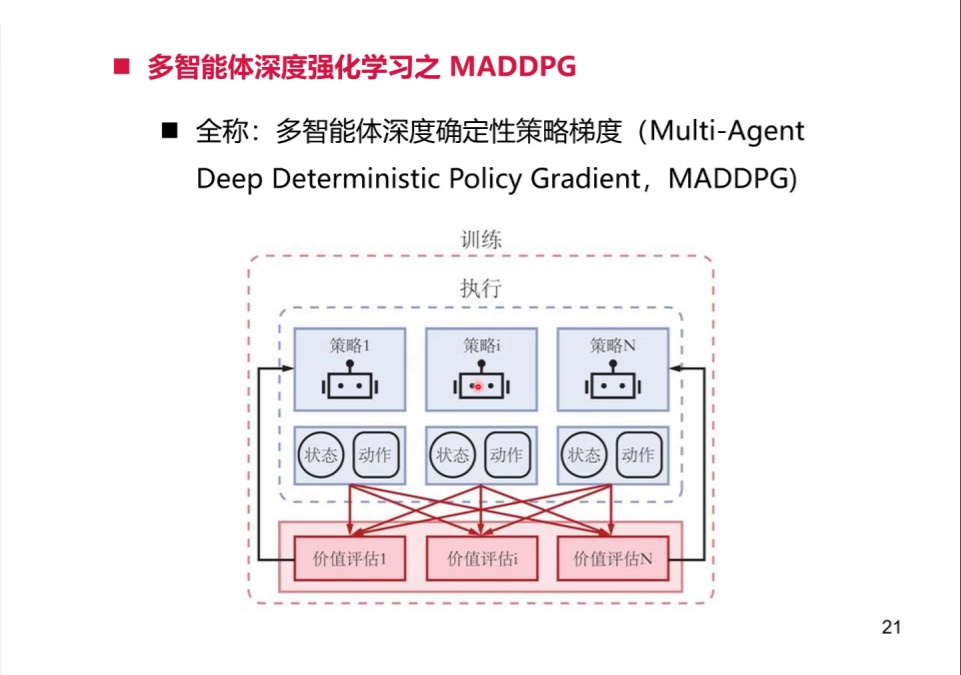
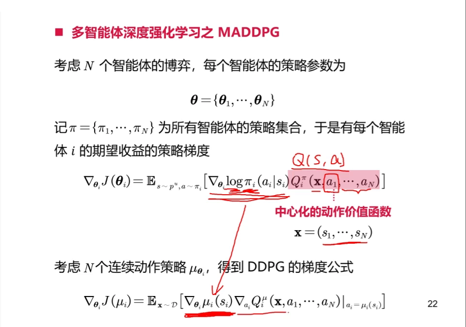
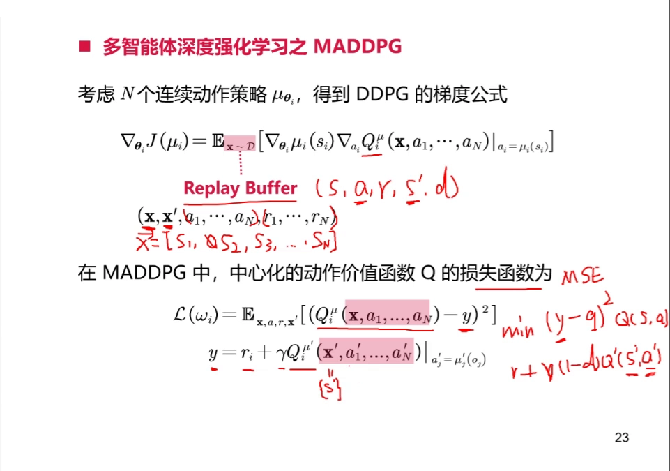
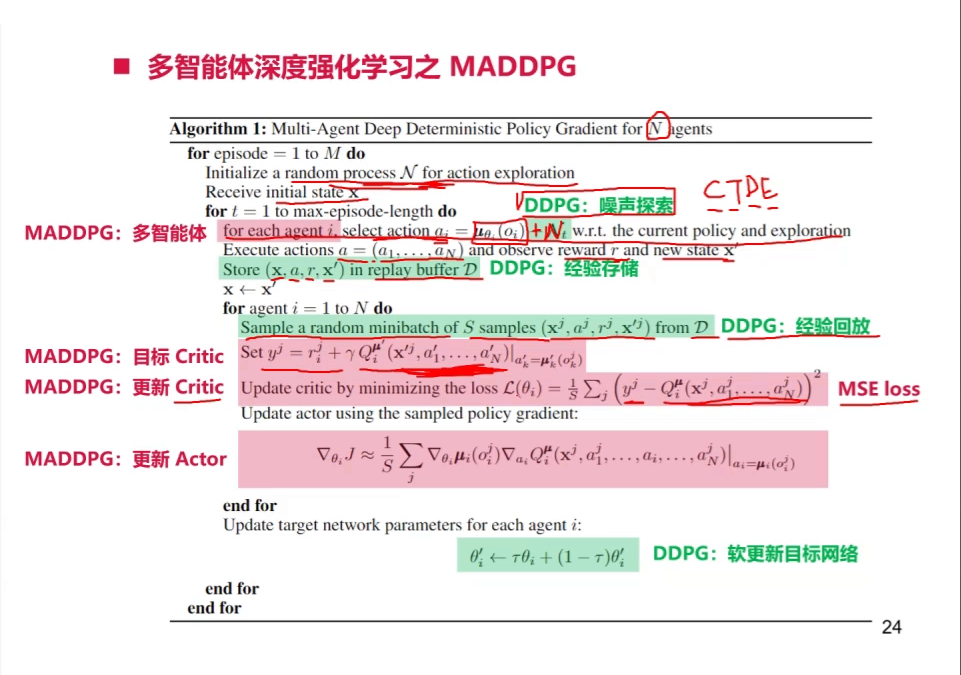
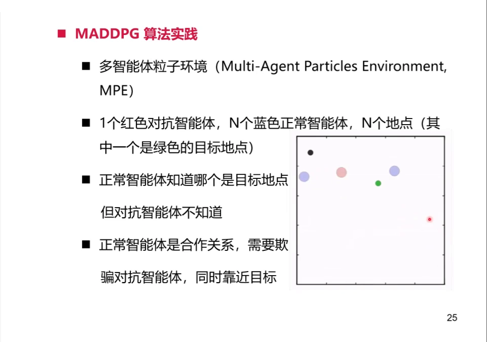
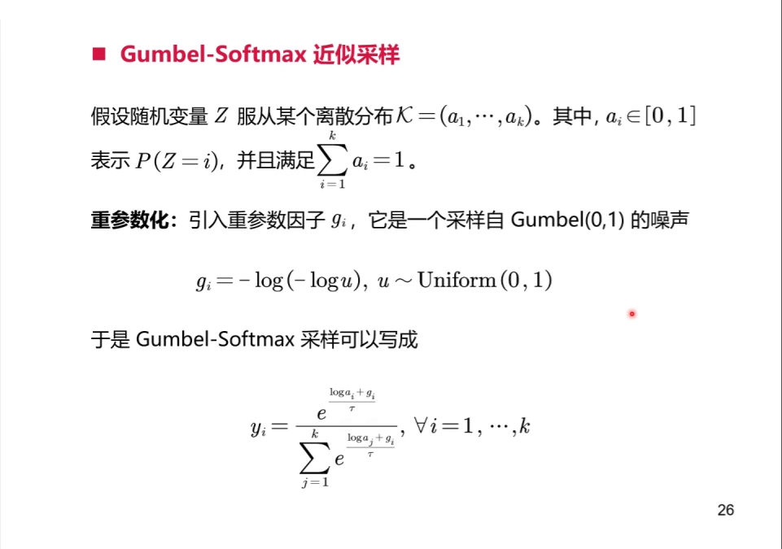
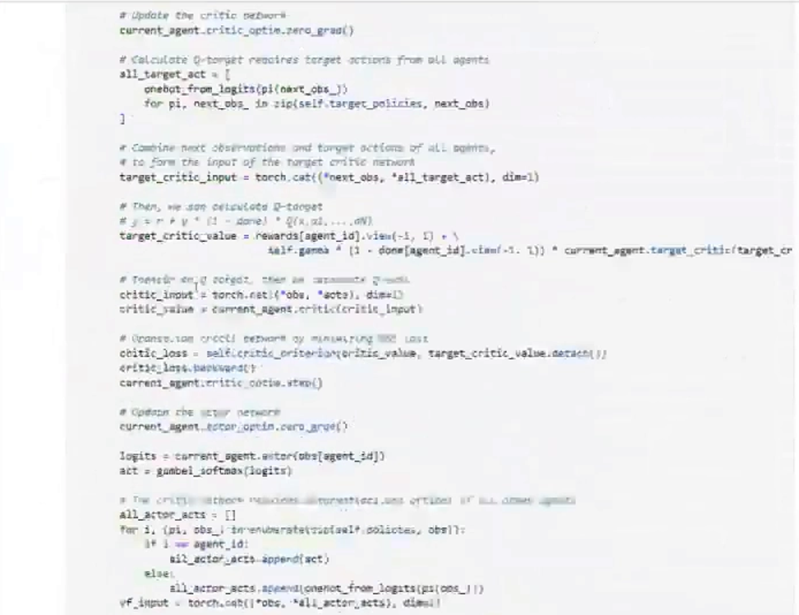
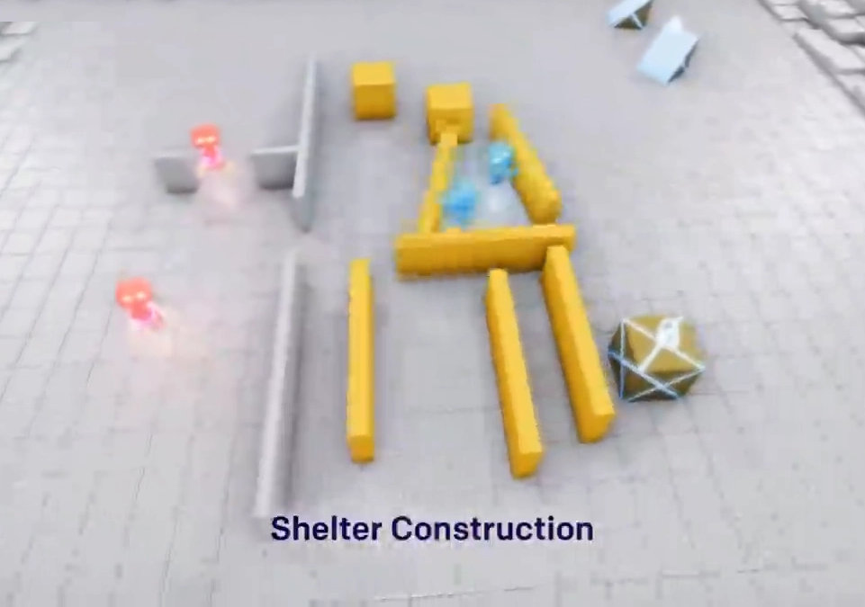

# MADDPG：把集中式 critic 装进每个智能体的 DDPG

> 13.3 把 CTDE 的三种形态并排摆了出来，其中第一种叫**集中式 critic + 分布式 actor**：critic 吃全局的 $\mathbf{o},\mathbf{a}$，actor 只吃自己的 $o^i$。13.4 讲完了第二条路线（值分解，离散动作友好）。本篇讲**第一条路线的具体算法**：MADDPG。范式层面的论述（两个矛盾需求、三种架构、一致性 gap）不再重复，请回看 13.3。

## 本讲要解决的核心问题（SCQA）

**背景**：DDPG（第 8 章 8.4）已经是单智能体连续控制的标准解法——一个 actor 输出确定性动作，一个 critic 评估它，配上经验回放和目标网络。多智能体任务里最省事的做法，就是把 DDPG 复制 $n$ 份，每个智能体各学各的。

**冲突**：这份"省事"是假的。每个智能体眼中的环境都包含**其他正在学习的智能体**，别人的策略一变，同一个观测对应的最优动作就变了——环境是**移动靶**。讲者对这种做法的评价很直接：这就是独立强化学习，它"没有办法很好地处理环境不稳定的问题"。

**疑问**：能不能让每个智能体的 critic 在训练时**看见别人在干什么**，从而把"别人也在变"这件事从噪声变成已知条件？

**回答（中心思想）**：能。MADDPG 的做法是：**actor 留在本地，critic 搬到中央**。每个智能体 $i$ 有自己的 actor $\mu_i(o^i)$，但它的 critic 吃的是所有人的观测与所有人的动作 $Q_i(\mathbf{o}, a^1,\dots,a^n)$。这样 critic 面对的不再是移动靶，而是一个"给定联合动作后转移就确定"的平稳问题。整篇算法相对 DDPG **只改了一处**：critic 与 target critic 的输入从单个智能体变成联合量。

---

## 一、结构：actor 在本地，critic 在中央

讲者用一张图把 MADDPG 的部署结构画清楚了：虚线框"执行"里是 $N$ 个策略网络（策略 1 … 策略 N），每个策略下面挂着自己的"状态/动作"；虚线框"训练"里多出一排**价值评估 1 … 价值评估 N**，并且每个价值评估都同时连着**所有**智能体的状态与动作。



[【跳转到 11:20】](https://www.bilibili.com/video/BV1Fd4y1L7ZU/?t=680)

具体地，每个智能体本地只存两样东西：**actor 网络和 target actor 网络**；critic 网络和 target critic 网络则放在"中央"，训练时对每个智能体的 actor 给出指导。执行的时候，每个智能体用自己本地的 actor 独立决策，彼此不干涉——讲者强调，这一步正是 CTDE 里"去中心化的执行"（D 的那一半）。

> **记号说明**：本系列用 $R_i$ 表示智能体 $i$ 的奖励，联合量用粗体（$\mathbf{o},\mathbf{a}$），智能体编号用上标（$o^i,a^i$），与 13.3、13.4 一致。视频里把联合观测记作 $\mathbf{x}$、把智能体 $i$ 的局部观测记作 $s_i$、把奖励记作 $r_i$，本篇统一成上面的记号。

### 1.1 为什么 MADDPG 只适用于完全合作

这是本篇最容易被跳过、却最影响适用边界的一点。critic 要吃 $Q_i(\mathbf{o},a^1,\dots,a^n)$，就意味着训练时**必须拿到其他智能体的动作**；而更新 actor 时，梯度里还要出现其他智能体的策略。讲者的原话是：

> 这些东西，如果你在一个非常复杂的或者竞争的环境里，是拿不到对手的策略的。所以 MADDPG 主要建立在完全合作的基础上：你能拿到同伴的动作，或者说他们的策略。

也就是说，MADDPG 的"全局信息"是靠**队友之间的信息共享**兑现的。讲者举了一个工程上真实存在的例子：王者荣耀里的"觉悟"AI 控制五个人机，这五个人机的状态、动作、策略都放在同一台（云端的）机器上，彼此完全可见，于是"五个人机 vs 五个人类"这种看似对抗的局面，可以被简化成"一组完全合作的 MADDPG 去对抗环境"。

后面 Q&A 环节有同学直接问："双方多智能体对抗的场景，MADDPG 能同时体现一方内部协同和与另一方的对抗吗？"讲者的回答是**不能**：MADDPG 有一个前提——所有智能体的策略或动作你是已知的，而"你的对手不会告诉你他的策略"。所以它主要用在完全合作场景。

---

## 二、策略梯度：critic 的梯度告诉 actor 往哪改

### 2.1 从随机策略到确定性策略

讲者先给出随机策略版本。设 $N$ 个智能体，策略参数集合 $\boldsymbol{\theta}=\{\theta_1,\dots,\theta_N\}$，策略集合 $\pi=\{\pi_1,\dots,\pi_N\}$，那么智能体 $i$ 的期望收益的策略梯度是

$$
\nabla_{\theta_i} J(\theta_i) = \mathbb{E}_{\mathbf{o}\sim p^{\boldsymbol{\mu}},\, a\sim\pi}\Big[\nabla_{\theta_i}\log \pi_i(a^i\mid o^i)\; Q_i^{\pi}(\mathbf{o},a^1,\dots,a^n)\Big]
$$

这个式子和单智能体的 actor-critic 长得一模一样，唯一的变化在最后那个 $Q$：它不再是 $Q(o^i,a^i)$，而是**中心化的动作价值函数** $Q_i^{\pi}(\mathbf{o},a^1,\dots,a^n)$，其中 $\mathbf{o}=(o^1,\dots,o^n)$ 是联合观测。



[【跳转到 18:25】](https://www.bilibili.com/video/BV1Fd4y1L7ZU/?t=1105)

DDPG 用的是**确定性策略** $\mu_{\theta_i}$，于是 score function 那一项换成确定性策略梯度的形式，得到 MADDPG 实际使用的式子：

$$
\nabla_{\theta_i} J(\mu_i) = \mathbb{E}_{\mathbf{o},\mathbf{a}\sim\mathcal{D}}\Big[\nabla_{\theta_i}\mu_i(o^i)\;\nabla_{a^i}Q_i^{\boldsymbol{\mu}}(\mathbf{o},a^1,\dots,a^n)\big|_{a^i=\mu_i(o^i)}\Big]
$$

[【跳转到 19:15】](https://www.bilibili.com/video/BV1Fd4y1L7ZU/?t=1155)

### 2.2 这个梯度在说什么

把式子拆成两半看，含义就清楚了：

- $\nabla_{\theta_i}\mu_i(o^i)$：actor 自己的参数梯度，**只依赖 $o^i$**。它回答"参数往哪个方向动，输出动作会往哪个方向变"。
- $\nabla_{a^i}Q_i^{\boldsymbol{\mu}}(\mathbf{o},a^1,\dots,a^n)$：critic 对**智能体 $i$ 这个动作**的梯度，回答"动作往哪个方向变，全局价值会升高"。

两者相乘，就是"**把动作朝 critic 认为更值钱的方向挪一点**"。关键在于：这个 critic 是看着**所有人的动作**打分的，所以它知道"我把动作往这边挪"会怎样改变与队友的配合——这正是单智能体 critic 做不到的事。13.3 里那个"全局信息只用来打分、不用来决策"的论证，在这里落到了具体的一行公式上。

### 2.3 为什么这就缓解了非平稳性

（这一小节的因果解释是**本系列的整理**，讲者只说了"独立学习处理不了环境不稳定"与"critic 对多个智能体做联合建模"两句。）

单智能体视角下，环境转移是 $P(o'^{i}\mid o^i,a^i)$——但真实的多智能体动力学是 $P(\mathbf{o}'\mid\mathbf{o},\mathbf{a})$，别人的动作 $a^j\ (j\ne i)$ 被悄悄边缘化掉了。别人在学习、在变，这个边缘分布就一直在漂移，于是同一对 $(o^i,a^i)$ 的价值估计目标不断变化，这就是"移动靶"。

MADDPG 的 critic 把 $\mathbf{a}$ 整个吃进来，于是它拟合的是

$$
Q_i(\mathbf{o},a^1,\dots,a^n) \approx \mathbb{E}\Big[\textstyle\sum_{t}R_i^{(t)}\ \Big|\ \mathbf{o},a^1,\dots,a^n\Big]
$$

在**给定联合动作**的条件下，转移 $P(\mathbf{o}'\mid\mathbf{o},\mathbf{a})$ 由环境本身决定，与"别人正在学什么"无关，因此是平稳的。非平稳性没有被消灭，而是被**搬进了输入**：它从"目标自己在动"变成了"输入里多了一维"。这是 13.3 那句"把'环境在变'换成'critic 的目标在变'"的算法级落实。

---

## 三、critic 怎么学：联合输入、TD 目标、经验回放

### 3.1 Q 网络的输入维度变了

讲者用一个具体的网络图说明改动：原来 DDPG 的 $Q$ 输入是 $(s,a)$，现在要考虑 $s_1,a^1,s_2,a^2,\dots,s_N,a^N$，**输入神经元的数量随智能体数线性增长**。用代码里的写法就是

$$
\dim(\text{输入}) = \sum_{i=1}^{n}\dim(o^i) + \sum_{i=1}^{n}\dim(a^i)
$$

讲者的总结是：Q 网络和 DDPG 的 Q 网络"有一点点不一样，不一样的地方主要在于它输入神经元的维度"——不再由单个智能体的观测空间与动作空间决定，而由全局的联合观测空间与联合动作决定。

### 3.2 损失函数与 TD 目标

中心化动作价值函数的损失函数，形式与 DDPG 完全一致，只是输入换成了联合量：

$$
\mathcal{L}(\omega_i) = \mathbb{E}_{\mathbf{o},\mathbf{a},R_i,\mathbf{o}'}\Big[\big(Q_i^{\boldsymbol{\mu}}(\mathbf{o},a^1,\dots,a^n) - y\big)^2\Big]
$$

$$
y = R_i + \gamma\, Q_i^{\boldsymbol{\mu}'}\big(\mathbf{o}',a'^{1},\dots,a'^{n}\big)\Big|_{a'^{j}=\mu'_j(o'^{j})}
$$



[【跳转到 29:15】](https://www.bilibili.com/video/BV1Fd4y1L7ZU/?t=1755)

讲者特别解释了 $y$ 的计算顺序：要得到 $n$ 个智能体的**目标动作**，得在 $n$ 个智能体上分别跑各自的 target actor 网络，得到 $a'^{1},\dots,a'^{n}$，把它们拼起来送进中心化的 target critic，才得到 $Q'$，再加上奖励就得到 $y$。也就是说，**一次 critic 更新要跑 $n$ 次 target actor**——这是多智能体带来的实打实的计算开销。

### 3.3 经验回放里存的是"向量"

梯度式里的 $\mathbb{E}_{\mathbf{o},\mathbf{a}\sim\mathcal{D}}$ 说明 MADDPG 里有 replay buffer（DDPG 从 DQN 那里继承了经验回放，从而成为 off-policy 方法）。但存进去的东西变了：原来存 $(s,a,r,s')$，现在每一项都变成 $n$ 个智能体的集合——

$$
(\mathbf{o},\ \mathbf{a},\ \mathbf{R},\ \mathbf{o}') = \Big((o^1,\dots,o^n),\ (a^1,\dots,a^n),\ (R_1,\dots,R_n),\ (o'^{1},\dots,o'^{n})\Big)
$$

讲者的说法是：Q 网络、梯度更新公式、replay buffer 这三样"都会演变成多个智能体的联合观测空间、联合动作，以及它们的奖赏"。**所有智能体共用一个 buffer**，因为每个 critic 都需要全局信息。

### 3.4 伪代码：红绿标注下的"唯一改动"

讲者用红绿两色标注了 MADDPG 的伪代码：绿色是 DDPG 原本就有的，红色是 MADDPG 相比 DDPG 的改动。他让学生先自己找"唯一的改动是什么"，答案是——**Q 与 target Q 的输入变成了联合量**。



[【跳转到 39:15】](https://www.bilibili.com/video/BV1Fd4y1L7ZU/?t=2355)

按伪代码走一遍，整个流程是：

```text
for episode = 1 to M:
    初始化随机过程 N（动作噪声），接收初始联合观测 x
    for t = 1 to 回合长度:
        每个智能体 i 独立选动作 a_i = mu_i(o_i) + 噪声
        执行联合动作 a = (a_1, ..., a_N)，得到奖励 r 与新联合观测 x'
        把 (x, a, r, x') 存入 replay buffer D；x <- x'
        for agent i = 1 to N:
            从 D 采样一个 minibatch
            用所有智能体的 target actor 算出联合目标动作，得到 y
            最小化 MSE 损失，更新 critic_i
            用采样到的策略梯度，更新 actor_i
        for agent i = 1 to N:
            软更新 target 网络：theta'_i <- tau*theta_i + (1-tau)*theta'_i
```

讲者反复强调的一句是：**除了 Q 的输入，其他一切照旧**。探索方式照旧（确定性策略探索能力弱，所以要在动作上加噪声，避免过早陷入局部极小）；经验回放照旧；软更新照旧。

---

## 四、一个真实实验：MPE 的对抗环境

讲者用的环境是 **MPE（Multi-Agent Particles Environment，多智能体粒子环境）**，一批面向多智能体交互的二维粒子世界。实验任务是其中的对抗场景：**1 个红色对抗智能体、N 个蓝色正常智能体、N 个地点（其中一个是绿色目标地点）**。



[【跳转到 44:15】](https://www.bilibili.com/video/BV1Fd4y1L7ZU/?t=2655)

规则是：蓝色智能体知道哪个是目标地点，红色不知道；两个蓝色智能体是合作关系，只要有一个靠近绿色点，两个都拿到相同奖励；但它们又不想让红色靠近绿色点，于是会**分散开**——一个去绿色点、一个去黑色点，让红色无法判断哪个才是目标。这就是多智能体文献里的"物理欺骗"（physical deception）任务。

训练配置：回合长度 25 步（人为截断，否则粒子可以在目标附近无限抖动、回合结束不了）、500 个回合、replay buffer 10 万、四层全连接（三个隐藏层各 128 个神经元）、actor 与 critic 学习率 0.001、每 50 或 100 个 transition 更新一次、buffer 里攒够 4000 条才开始训练。

结果方面，讲者因为时间有限只跑了不充分的训练：两个合作智能体的回报曲线完全重合（奖励函数相同），最终保持正向回报，说明它们通过合作成功占住了两个不同地点、让对抗智能体无法判断目标。讲者自己也说明这次训练"不是很充分"，属于演示性质。

### 4.1 一个绕不开的工程坑：离散动作

MPE 里这个对抗环境的动作空间其实是**离散**的，而 DDPG 要求连续动作。讲者的处理是用 **Gumbel-Softmax 近似采样**：把离散分布重参数化成连续分布再采样，从而让梯度能回传。



[【跳转到 46:45】](https://www.bilibili.com/video/BV1Fd4y1L7ZU/?t=2805)

讲者对这个技巧的评价很坦率：它**不是 DDPG 的核心**，之所以出现在这里，是因为"多智能体强化学习可用的环境非常少"，这个环境本身设计上有缺陷，只好用近似采样把离散动作变成连续动作。如果换到动作本来就连续的环境，就不需要它。

---

## 五、代码里长什么样

讲者的实现（PyTorch）把"联合"这件事写得非常直白：**用 torch.cat 把 $n$ 个智能体的观测和动作拼成一个向量**，再喂给 critic。



[【跳转到 49:25】](https://www.bilibili.com/video/BV1Fd4y1L7ZU/?t=2965)

几个值得注意的实现细节：

- **all_target_act**：先用 self.target_policies 对每个智能体的 next_obs 求目标动作，收集成列表；再用 torch.cat((*next_obs, *all_target_act), dim=1) 得到 target critic 的输入。这就是 3.2 里"跑 $n$ 次 target actor"那句的代码形态。
- **(1 - done)**：终止标志。讲者说这个环境不会终止，所以这一项恒为 1，"相当于被短路，你也可以直接忽略它"。
- **actor 的损失**：actor_loss = -critic(vf_input).mean()。最大化 Q 等价于最小化负的 Q，这就是 2.1 那条确定性策略梯度的落地写法。
- **梯度清零**：每次更新前手动 zero_grad()，讲者专门提了一句——不清零会把历史梯度累加上去，是 PyTorch 里常见的坑。

---

## 六、MADDPG 的局限

把讲者散落在各处的评价收拢，MADDPG 的局限集中在四条：

1. **critic 的输入维度随智能体数线性增长。** 输入维度是 $\sum_i\dim(o^i)+\sum_i\dim(a^i)$，智能体一多，critic 既难训练也难扩展。13.3 第七节已经指出过这一点，MADDPG 是它最直接的例子。
2. **必须能拿到其他智能体的动作与策略。** 这条把 MADDPG 限制在**完全合作**（或至少信息可共享）的场景，真正的对抗场景不满足前提——讲者在 Q&A 里明确否掉了"用 MADDPG 做双方对抗"的设想。
3. **确定性策略探索不足。** 这是 DDPG 的通病：网络输出唯一确定的动作，探索能力弱，必须靠外加动作噪声，否则容易过早陷入局部极小。讲者在讲伪代码第一行时就点出了这一点。
4. **一次 critic 更新要跑 $n$ 次 target actor。** 计算开销随智能体数增长，是"联合"这件事的隐性成本。

（补充一句本系列的观察：MADDPG 论文原文还给了三个工程技巧——用学到的策略网络**推断**其他智能体的动作、每个智能体训练**策略集成**以避免过拟合到某个对手、以及**共享经验回放**。讲者这一讲只展开了第三条，前两条未涉及，这里不作展开。）

---

## 七、讲者用它引出的前沿：OpenAI 捉迷藏

课程最后，有同学问"能不能推荐一些多智能体强化学习的前沿研究"，讲者放了一段 OpenAI 的 **Hide and Seek（捉迷藏）** 演示视频作为回答。



[【跳转到 72:23】](https://www.bilibili.com/video/BV1Fd4y1L7ZU/?t=4343)

讲者点出的关键现象是：这个环境里同时存在**合作与竞争**——一队内部要协同，两队之间要对抗；而且随着一队学会新技能，另一队面对的挑战就被动地变了（躲藏方学会锁箱子，追捕方就学会用斜坡翻墙，躲藏方再学会把斜坡也锁走）。讲者由此引出一个区分：这类"同时包含合作与竞争"的画面属于**多智能体强化学习**，而把成千上万个这样的环境并行起来跑，则属于他下一讲要讲的**分布式强化学习**。

> 这里也顺带解释了 13.2 讲过的关系设定为什么重要：MADDPG 天生只覆盖"完全合作"这一格，而捉迷藏这类任务落在"混合"那一格，需要别的机制（自博弈、种群训练）来处理，本篇不展开。

---

## 八、本篇在 13.5 里的位置

13.3 第六节把 CTDE 的落地分成两条路线。本篇是**策略梯度路线**的第一个代表：

| | 值函数路线（13.4） | 策略梯度路线（本篇） |
| :--- | :--- | :--- |
| 学什么 | 全局 $Q_{tot}$，再分解成各 $Q_i$ | 每个智能体一个中心化 critic $Q_i(\mathbf{o},\mathbf{a})$ |
| 执行时靠什么选动作 | 各自的 $Q_i$ 取 $\arg\max$ | actor 直接输出动作，critic 整个删掉 |
| 动作空间 | 天然适合**离散**（$\arg\max$ 便宜） | 天然适合**连续**（DDPG 的确定性策略） |
| 关系设定 | 完全合作 | 完全合作（需拿到队友动作） |

一句话记住分工：**离散动作用值分解，连续动作用策略梯度**。下一篇 MAPPO 走的是同一条策略梯度路线，但把 DDPG 换成 PPO、把"每个智能体一套参数"换成"全体共享一套参数"，因此能吃离散动作、也更稳。

---

## 小结

- **结构**：actor 在本地（只吃 $o^i$），critic 在中央（吃 $\mathbf{o},\mathbf{a}$），训练时用中央 critic 指导所有 actor，执行时把中央整个删掉。
- **策略梯度**：$\nabla_{\theta_i}J=\mathbb{E}[\nabla_{\theta_i}\mu_i(o^i)\,\nabla_{a^i}Q_i(\mathbf{o},a^1,\dots,a^n)]$——critic 的梯度告诉 actor"动作往哪挪更值钱"，而 critic 看得见所有人的动作，所以知道这一挪如何影响配合。
- **非平稳性**：单智能体 critic 拟合的是把别人动作边缘化掉的目标，别人一变它就漂；中心化 critic 在给定联合动作后面对的是平稳转移，非平稳性被搬进了输入。
- **相对 DDPG 只改一处**：Q 与 target Q 的输入从 $(s,a)$ 变成 $(\mathbf{o},\mathbf{a})$；探索、回放、软更新全部照旧。
- **代价**：critic 输入维度随 $n$ 线性增长、一次更新要跑 $n$ 次 target actor、必须能拿到队友动作（只能完全合作）、确定性策略探索不足。
- **工程细节**：离散动作环境要靠 Gumbel-Softmax 近似采样把动作连续化，这是环境缺陷带来的 trick，不是算法核心。

## 关键术语速查

| 术语 | 一句话解释 |
| :--- | :--- |
| MADDPG | 多智能体深度确定性策略梯度：DDPG 的多智能体扩展，中心化 critic + 分布式 actor |
| 中心化动作价值函数 | $Q_i(\mathbf{o},a^1,\dots,a^n)$，输入所有智能体的观测与动作，只在训练期使用 |
| 联合观测 / 联合动作 | $\mathbf{o}=(o^1,\dots,o^n)$、$\mathbf{a}=(a^1,\dots,a^n)$，replay buffer 里存的就是这两个向量 |
| 确定性策略 | actor 直接输出唯一确定的动作，靠外加动作噪声探索 |
| 移动靶 | 其他智能体在学习，导致单个智能体面对的环境分布随时间漂移 |
| 完全合作前提 | 训练时必须能拿到其他智能体的动作/策略，MADDPG 因此不适用于真正对抗 |
| MPE | 多智能体粒子环境，二维粒子世界，常用于合作与混合任务的基准 |
| 物理欺骗（physical deception） | 合作方分散站位以迷惑不知道目标位置的对抗方 |
| Gumbel-Softmax | 把离散分布重参数化成连续分布再采样，使梯度可回传的技巧 |
| 软更新 | $\theta'\leftarrow\tau\theta+(1-\tau)\theta'$，target 网络缓慢跟随在线网络 |

## 参考视频

- 《深度强化学习与多智能体强化学习》第八课（下）多智能体强化学习 MADDPG，[BV1Fd4y1L7ZU](https://www.bilibili.com/video/BV1Fd4y1L7ZU/)（UP：-xurunnan-）。讲者从 DDPG 出发，用一页页手写标注的幻灯片讲清中心化 critic 的梯度、联合输入的 Q 网络、损失函数与 TD 目标，再逐行走一遍 PyTorch 实现，最后用 MPE 的对抗环境做演示，并回答了"MADDPG 能否做对抗"这个关键问题。