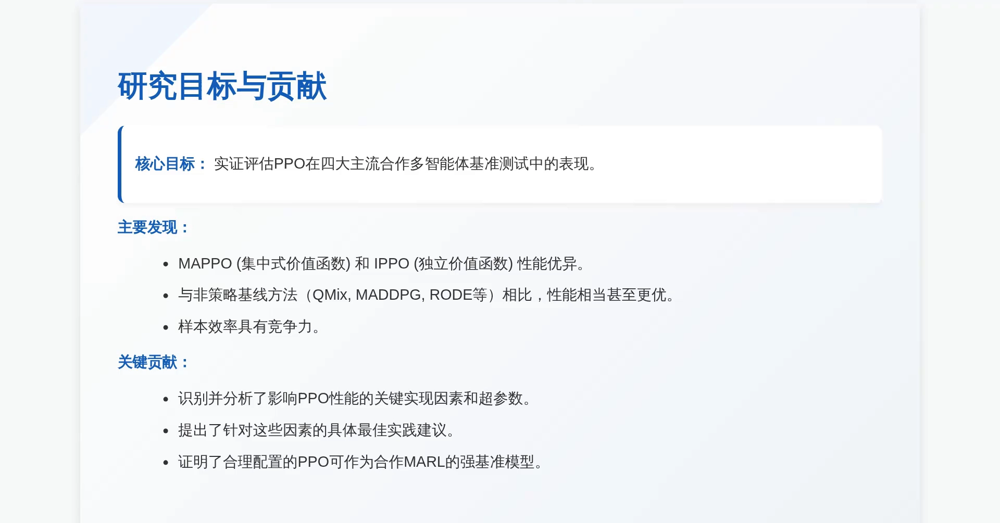
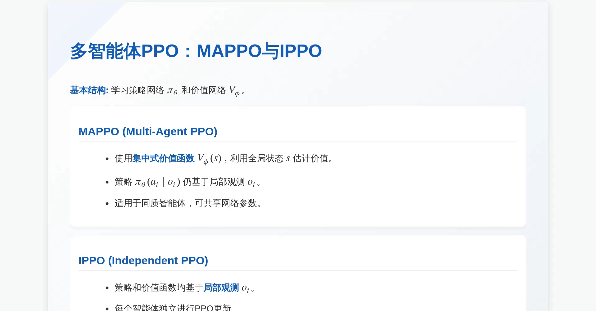
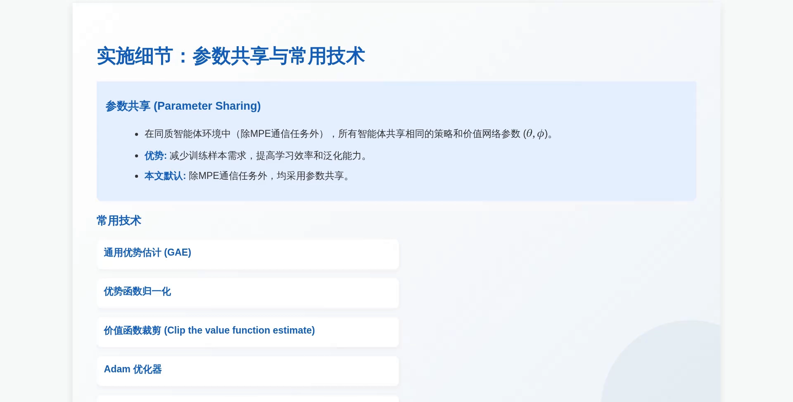
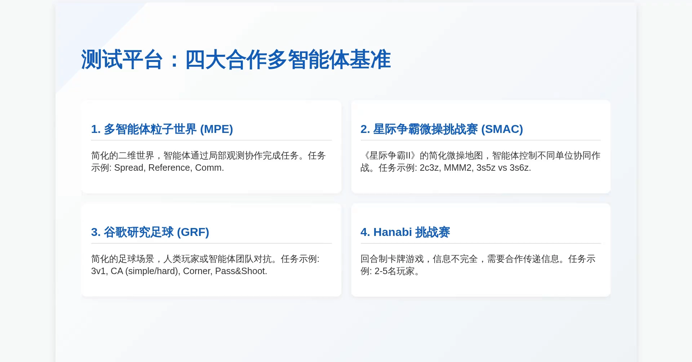
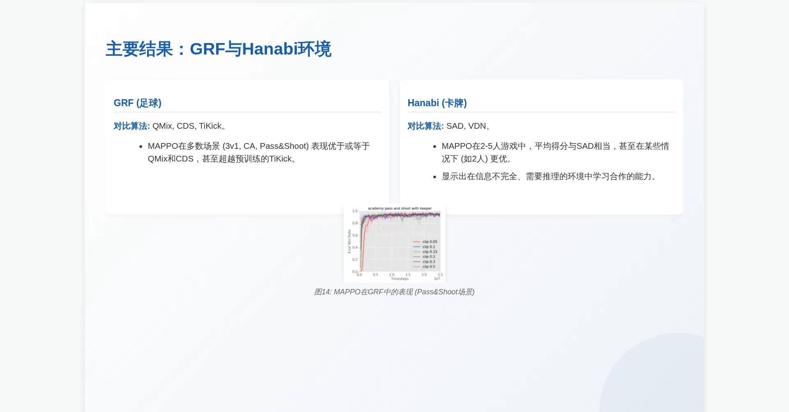
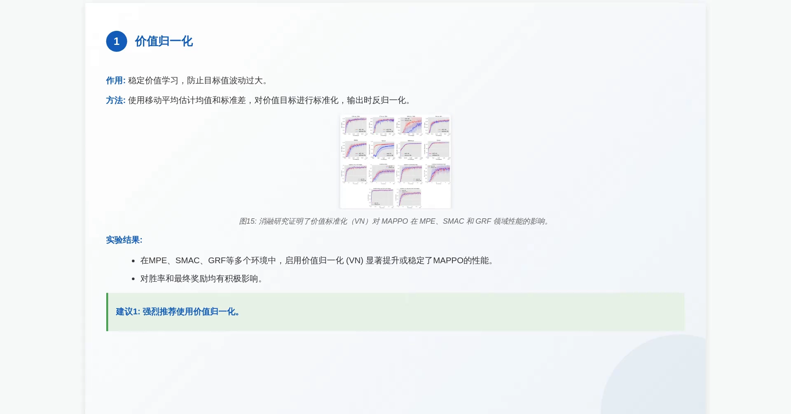
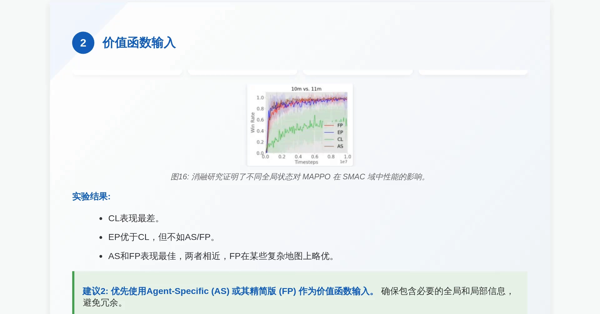
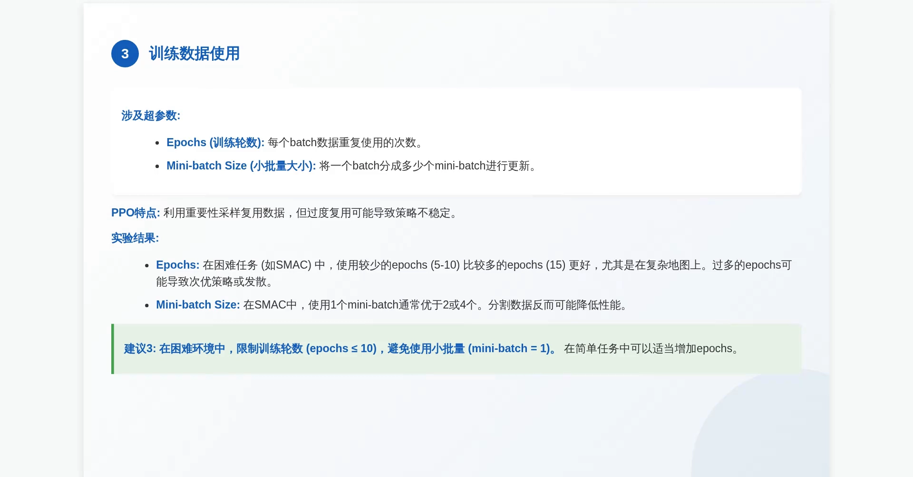
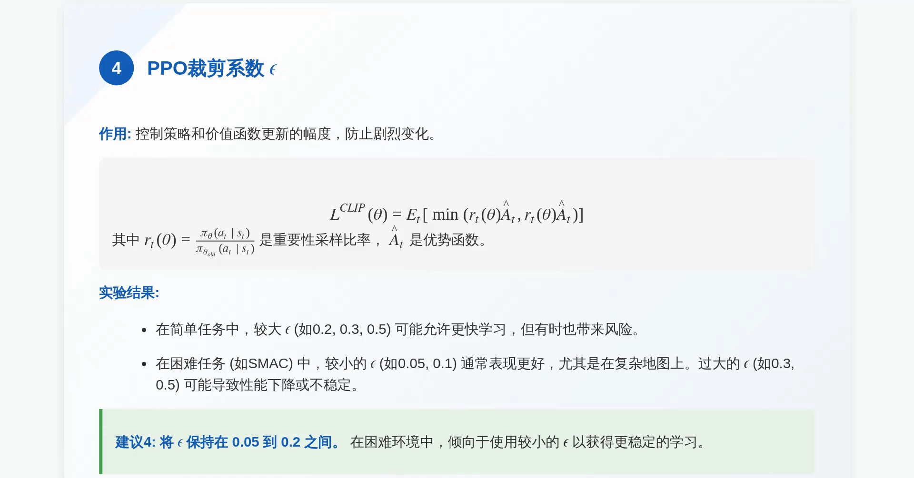

# MAPPO：简单 PPO 加上正确细节，为什么能打赢复杂方法

> 上一篇 MADDPG 走的是策略梯度路线的"确定性策略"分支：每个智能体一套 actor、一个中心化 critic。本篇走同一条路线的另一条分支——把 PPO（第 9 章 9.3）搬进多智能体，得到 **MAPPO**。它没有新算法，只有**一个结构改动加五个实现细节**，却在四大合作基准上追平甚至超过了专门为多智能体设计的复杂方法。

## 本讲要解决的核心问题（SCQA）

**背景**：多智能体强化学习（MARL）的主流是 off-policy 方法——值分解的 QMIX、中心化 critic 的 MADDPG。它们样本效率高、在星际争霸这类任务上成绩亮眼。相比之下，PPO 这类 on-policy 方法长期被认为"样本效率低、调参难、效果一般"。

**冲突**：这个印象可能来自**实现细节没做对**，而不是 PPO 本身不行。PPO 的 clip 机制天然限制每次策略更新的幅度——这恰恰是多智能体最需要的性质，因为多智能体环境里"非平稳"是常态，更新一猛就容易崩。

**疑问**：如果把 PPO 的实现细节认真调对，它在合作多智能体任务上到底能到什么水平？

**回答（中心思想）**：能到 SOTA 水平。MAPPO（Yu 等人 2021，论文标题就是 *The Surprising Effectiveness of PPO in Cooperative Multi-Agent Games*）在 MPE、SMAC、GRF、Hanabi 四大基准上，与 QMIX、MADDPG、RODE 等强基线**性能相当甚至更优**，样本效率也有竞争力。它的结构改动只有一处：**把价值函数换成吃全局状态的集中式价值函数**；真正决定成败的是五个实现细节——价值归一化、价值函数输入、训练轮数与小批量、裁剪系数、批量大小。

[【跳转到 00:50】](https://www.bilibili.com/video/BV19xqUBJEiW/?t=50)

---

## 一、MAPPO 是什么：IPPO 加一个"全局裁判"

MAPPO 和 IPPO 只差一个字母，差别也只有一处：**价值函数看什么**。

[【跳转到 02:30】](https://www.bilibili.com/video/BV19xqUBJEiW/?t=150)

- **MAPPO**：价值函数用**集中式**的 $V_\phi(s)$，用全局状态 $s$ 估计价值；策略 $\pi_\theta(a^i\mid o^i)$ 仍然只吃局部观测 $o^i$；适用于同质智能体，**可以共享网络参数**。
- **IPPO**（Independent PPO）：策略和价值函数**都只基于局部观测** $o^i$，每个智能体独立做 PPO 更新。

这就是 13.3 里"集中式训练 + 参数共享"那一格的算法形态。一句话概括：**MAPPO 就是 IPPO 加一个站在上帝视角的裁判**——执行时各打各的，训练时由裁判给整局打分；策略结构、更新逻辑都没变，只是价值函数的输入从 $o^i$ 换成了 $s$。

> **记号说明**：本系列用 $R_i$ 表示智能体 $i$ 的奖励，完全合作时 $R_1=\cdots=R_n$；智能体编号用上标（$o^i,a^i$），联合量用粗体（$\mathbf{o},\mathbf{a}$），与 13.3、13.4 一致。视频里把策略写成 $\pi_\theta(a_i\mid o_i)$、价值写成 $V_\phi(s)$，本篇统一成 $\pi_\theta(a^i\mid o^i)$ 与 $V_\phi(s)$。

### 1.1 参数共享：把 $O(n)$ 套参数压成 $O(1)$ 套

MAPPO 的第二个结构特征是**参数共享**：在同质智能体环境里（MPE 的通信任务除外），所有智能体共享同一套策略参数 $\theta$ 和价值参数 $\phi$。视频给出的理由是三条：减少训练样本需求、提高学习效率与泛化能力；论文的默认设置就是"除 MPE 通信任务外，均采用参数共享"。

[【跳转到 03:00】](https://www.bilibili.com/video/BV19xqUBJEiW/?t=180)

参数共享和 13.3 讲过的"可互换性"判据是同一件事：**功能同构才共享**。MPE 的通信任务里有一个"说话者"和一个"倾听者"，角色不同、不可互换，所以那里不共享。

除了参数共享，MAPPO 还沿用了 PPO 社区公认的一批标配：**GAE 优势估计、优势函数归一化、价值函数裁剪、Adam 优化器、正交初始化**。这些不是 MAPPO 的发明，但少了它们，后面五个旋钮的效果就无从谈起。

---

## 二、四大基准与主要结果

论文在四个合作多智能体基准上做系统评测，覆盖了从简单到复杂、从完全信息到部分信息的各种合作场景。

[【跳转到 03:20】](https://www.bilibili.com/video/BV19xqUBJEiW/?t=200)

| 基准 | 是什么 | 任务示例 |
| :--- | :--- | :--- |
| MPE | 简化的二维粒子世界，智能体靠局部观测协作 | Spread、Reference、Comm |
| SMAC | 《星际争霸 II》的简化微操地图，控制不同单位协同作战 | 2c3z、MMM2、3s5z vs 3s6z |
| GRF | 简化的足球场景，人类玩家或智能体团队对抗 | 3v1、CA（simple/hard）、Corner、Pass&Shoot |
| Hanabi | 回合制卡牌游戏，信息不完全，需要合作传递信息 | 2–5 名玩家 |

结果可以概括成一句话：**MAPPO 在每个基准上都进入了第一梯队**。

- **MPE**：MAPPO 与 IPPO 的表现都非常抢眼，几乎和 QMIX 不相上下，某些阶段收敛更快。这说明即使没有全局信息，IPPO 也能学到不错的协作策略；而 MAPPO 利用全局信息，表现更稳。
- **SMAC**：这是硬骨头。MAPPO（FP/AS 输入）在多数地图上表现强劲，胜率与 RODE 等 SOTA 方法相当；与 QMix 相比，MAPPO 在几乎所有地图上都更胜一筹；IPPO 略逊于 MAPPO，但依然出色。
- **GRF 与 Hanabi**：在 GRF 足球场上，MAPPO 在多数场景（3v1、CA、Pass&Shoot）表现优于或等于 QMix 与 CDS，甚至超越**预训练过**的 TiKick；在 Hanabi 这个信息极其有限的卡牌游戏里，MAPPO 在 2–5 人游戏中平均得分与 SAD 相当，2 人时更优。

[【跳转到 05:20】](https://www.bilibili.com/video/BV19xqUBJEiW/?t=320)

Hanabi 这一项尤其值得注意：它是一个**信息不完全、需要推理队友意图**的游戏。MAPPO 在这里能打，说明"集中式价值函数 + PPO"这套简单组合具备一定的推理与间接沟通能力，而不只是会做低层控制。

---

## 三、五个关键旋钮：论文真正的贡献

论文最有价值的部分不是"PPO 也能用"，而是**通过消融实验找出了哪五个因素真正决定 PPO 在多智能体里的成败**，并给出可执行的建议。视频把这一节称为"五个关键旋钮"。

### 3.1 旋钮一：价值归一化（强烈推荐）

训练过程中奖励可能忽高忽低，导致价值函数的目标值波动很大，学习因此不稳定。做法是用 **PopArt** 式的动态标准化：用移动平均估计均值与标准差，对价值目标做标准化，**输出时再反归一化**回来。

[【跳转到 06:40】](https://www.bilibili.com/video/BV19xqUBJEiW/?t=400)

消融结果很干净：在 MPE、SMAC、GRF 等多个环境里，启用价值归一化（图中红线）都明显优于禁用（蓝线），对胜率和最终奖励都有正面影响。视频的类比是"给高速行驶的汽车装上稳定器"。**建议一：务必使用价值归一化。**

### 3.2 旋钮二：价值函数看什么（AS 或 FP 最好）

集中式 critic 要输入什么，是 MAPPO 最需要设计的一处。论文试了四种组合：

| 记号 | 输入是什么 | 问题 |
| :--- | :--- | :--- |
| CL | 把所有智能体的局部观测直接拼接 | 维度爆炸，效果最差 |
| EP | 环境提供的全局状态 | 可能丢失重要的局部细节 |
| AS | EP + 当前智能体自己的局部观测 | 效果好 |
| FP | 在 AS 基础上剔除重复的冗余特征 | 效果最好，复杂地图上略优于 AS |

[【跳转到 07:30】](https://www.bilibili.com/video/BV19xqUBJEiW/?t=450)

结论是"既要看得全，也要看得精"：CL 表现最差，EP 优于 CL 但不如 AS/FP，AS 和 FP 表现最佳、两者相近，FP 在某些复杂地图上略优。**建议二：优先用 Agent-Specific（AS）或其精简版 FP 作为价值函数输入。**

> 这一条其实是 13.3 那个"一致性 gap"的工程版本：critic 看的信息越多，越可能与执行时的真实情况脱节；看的信息越少，越可能漏掉关键上下文。AS/FP 是在这两端之间找的一个平衡点。

### 3.3 旋钮三：训练数据怎么用（少即是多）

涉及两个超参数：**epochs**（每个 batch 的数据重复使用几次）和 **mini-batch size**（把一个 batch 切成多少份做更新）。PPO 的特点是可以借重要性采样复用数据，但**过度复用会让策略跑得太远**，在多智能体环境里尤其危险。

[【跳转到 08:20】](https://www.bilibili.com/video/BV19xqUBJEiW/?t=500)

实验结果：在困难任务（如 SMAC）里，用较少的 epochs（5–10）比较多的 epochs（15）更好，过多会导致次优策略甚至发散；使用 1 个 mini-batch 通常优于 2 或 4 个，分割数据反而降低性能。**建议三：困难环境里限制 epochs ≤ 10，且不要切小批量（mini-batch = 1）；简单任务可以适当增加 epochs。**

### 3.4 旋钮四：裁剪系数 $\epsilon$（困难任务要更保守）

$\epsilon$ 是 PPO 的裁剪系数，控制策略与价值函数每次更新的幅度，防止剧烈变化。PPO-Clip 的目标是

$$
L^{\text{CLIP}}(\theta) = \mathbb{E}_t\Big[\min\big(r_t(\theta)\hat{A}_t,\ \text{clip}(r_t(\theta),1-\epsilon,1+\epsilon)\hat{A}_t\big)\Big]
$$

其中 $r_t(\theta)=\dfrac{\pi_\theta(a_t\mid s_t)}{\pi_{\theta_{\text{old}}}(a_t\mid s_t)}$ 是重要性采样比率，$\hat{A}_t$ 是优势函数。

[【跳转到 09:10】](https://www.bilibili.com/video/BV19xqUBJEiW/?t=550)

实验显示：简单任务里较大的 $\epsilon$（0.2、0.3、0.5）可能允许更快学习，但有时也带来风险；困难任务（如 SMAC）里较小的 $\epsilon$（0.05、0.1）通常表现更好，过大的 $\epsilon$ 可能导致性能下降或不稳定。**建议四：$\epsilon$ 保持在 0.05 到 0.2 之间，困难环境倾向取小值。**

### 3.5 旋钮五：批量大小（存在一个临界点）

批量大小影响梯度估计的方差和更新的稳定性。实验发现存在一个**临界批量大小**：低于它性能不佳，高于它性能提升有限或趋于饱和。

[【跳转到 10:00】](https://www.bilibili.com/video/BV19xqUBJEiW/?t=600)

在 SMAC 中，增大 batch size 通常能提高最终胜率和样本效率（达到高胜率所需的步数更少），但并非越大越好——过大的 batch size 可能因为其他因素（如优化器调整）而略微降低效率。**建议五：用足够大的 batch size 拿到最佳性能与样本效率，再按算力和目标（极致性能 vs 极致效率）微调。**

---

## 四、为什么这套简单组合能 work

把五个旋钮背后的机制抽出来，MAPPO 之所以成立有三条原因（前两条是**本系列的整理**，视频只给了结论性的说法）：

1. **clip 天然限制更新幅度。** 多智能体环境里，$n$ 个策略同时在变，critic 要追的目标一直在漂。一次更新迈太大，critic 立刻失真，下一轮梯度就指错方向。PPO 的 clip 把"每次走多远"钉住，等于给非平稳环境加了一个阻尼器——这也解释了 3.4 里"困难任务要用小 $\epsilon$"的结论。
2. **参数共享把样本效率拉起来。** 同质智能体共享一套参数，等价于把 $n$ 个智能体的经验合并成一份训练数据；参数量还从 $O(n)$ 降到 $O(1)$。这是 MAPPO 能在 on-policy 的低样本效率下仍与 off-policy 方法打平的直接原因。
3. **集中式价值函数压掉队友噪声。** 用 $V_\phi(s)$ 而不是各自的 $V(o^i)$，队友的随机性不再被误当成环境噪声，优势估计的方差下降——这正是 13.3 讲的"缓解非平稳性"在 PPO 上的体现。

---

## 五、MADDPG 与 MAPPO：同一条路线的两个分支

两者都属于 13.3 说的"策略梯度路线"（执行时 actor 直接输出动作，critic 训练完就扔），差别在策略类型、参数规模与学习范式。

| 维度 | MADDPG | MAPPO |
| :--- | :--- | :--- |
| 学习范式 | off-policy（经验回放，可重复利用旧数据） | on-policy（当前策略采样，用完即弃） |
| 策略类型 | 确定性策略 $\mu_i(o^i)$ | 随机策略 $\pi_\theta(a^i\mid o^i)$ |
| 动作空间 | 天然适合连续；离散要靠 Gumbel-Softmax 近似 | 离散、连续都能直接用 |
| 价值函数 | 每个智能体一个中心化 $Q_i(\mathbf{o},\mathbf{a})$ | 一个共享的集中式 $V_\phi(s)$ |
| 参数量 | 每个智能体一套 actor + critic，$O(n)$ | 同质智能体共享一套，$O(1)$ |
| 样本效率 | 高（回放复用） | 低，但论文实测有竞争力 |
| 训练稳定性 | 对超参敏感，确定性策略探索弱 | clip 限制更新幅度，实践中更稳 |
| 典型场景 | 小规模、连续动作、完全合作 | 大规模同质智能体合作（SMAC、GRF、Hanabi） |
| 信用分配 | 每个 $Q_i$ 按个体打分，较强 | 只有一个团队 $V$，最弱 |

一句话概括两者的取舍：**MADDPG 用"每个智能体一个全局 critic"换来精细的个体评价，代价是参数量与输入维度随 $n$ 线性增长；MAPPO 用"一个共享的全局 critic"换来可扩展与稳定，代价是放弃了按个体的信用分配。**

---

## 六、三条路线的本质区别

13.3 把 CTDE 的落地分成三种形态，13.4 讲了值分解，本篇讲了策略梯度的两个分支。把三者放在一张表里，区别就落在两个问题上：**全局信息被塞进什么函数**，以及**参数量怎么随 $n$ 增长**。

| | 值分解（VDN/QMIX，13.4） | 集中 critic + 分散 actor（MADDPG） | 参数共享 + 集中 critic（MAPPO） |
| :--- | :--- | :--- | :--- |
| 全局信息的载体 | 一个 $Q_{tot}(\mathbf{o},\mathbf{a})$，再分解成各 $Q_i$ | 每个智能体一个 $Q_i(\mathbf{o},\mathbf{a})$ | 一个共享的 $V_\phi(s)$ |
| 执行时靠什么选动作 | 各自的 $Q_i$ 取 $\arg\max$ | actor 直接输出动作 | actor 直接输出动作 |
| 参数量随 $n$ | $O(n)$ 个 $Q_i$ 网络 | $O(n)$ 套 actor + critic | $O(1)$ 套（共享） |
| 动作空间 | 离散（$\arg\max$ 便宜） | 连续 | 两者皆可 |
| 一致性要求 | 需要 IGM 条件 | 不需要（actor 直接出动作） | 不需要 |
| 信用分配 | 由分解结构决定 | 每个 $Q_i$ 按个体打分 | 只有团队 $V$，最弱 |
| 主要弱点 | 表达能力受分解结构限制 | critic 输入随 $n$ 线性增长、只能完全合作 | 样本效率靠参数共享撑、信用分配靠 GAE 隐式完成 |

三条路线的本质区别可以压成一句话：**值分解把全局信息压进一个可拆的标量，MADDPG 把全局信息复制到 $n$ 个 critic 里，MAPPO 把全局信息只放进一个 critic 并把参数压成一份。** 它们都是 CTDE，区别只在"全局信息最终落到哪个函数上"。

---

## 七、一个反直觉的结论

论文标题里的 *Surprising* 值得单独说：**一个通用算法（PPO），配上正确的实现细节，就能追平甚至超过一批专门为多智能体设计的复杂方法（QMIX、MADDPG、RODE 等）。**

这件事的启示不在"PPO 很强"，而在两处：

1. **工程细节的权重被长期低估。** 五个旋钮里没有一个是新算法——价值归一化是 PopArt、GAE 是 Schulman 2015 的工作、参数共享是更早的实践。但把它们调对与调错，结果差一个档位。这也是为什么论文的贡献被概括成"识别并分析关键实现因素与超参数，并提出具体最佳实践建议"。
2. **基线的可靠性比新颖性更重要。** 论文的结论之一是"合理配置的 PPO 可作为合作 MARL 的强基准模型"。一个稳、简单、可复现的 baseline，比一个只在特定任务上赢的新算法更有长期价值——后续工作要证明自己更好，都得先过这一关。

> 这条结论和 13.4 里"单调性到底在不在起作用"的消融是同一类方法论：**先确认是哪个部件在起作用，再谈算法优越性。**

---

## 小结

- **MAPPO = IPPO + 一个全局裁判**：策略 $\pi_\theta(a^i\mid o^i)$ 仍看局部观测，价值函数换成集中式 $V_\phi(s)$；同质智能体共享一套参数。
- **四大基准**：MPE、SMAC、GRF、Hanabi。MAPPO 在每个基准上都进入第一梯队，与 QMix、MADDPG、RODE 等强基线相当或更优，样本效率有竞争力。
- **五个旋钮**：价值归一化（必用）、价值函数输入（AS/FP 最优）、训练轮数与小批量（难任务 epochs ≤ 10、mini-batch = 1）、裁剪系数（0.05–0.2，难任务取小）、批量大小（存在临界点，够大即可）。
- **为什么 work**：clip 限制更新幅度（对非平稳环境的阻尼）、参数共享提升样本效率、集中式价值函数压掉队友噪声。
- **与 MADDPG 的分工**：MADDPG 是确定性策略 + 每智能体一个全局 critic，连续动作友好但参数量随 $n$ 增长；MAPPO 是随机策略 + 一个共享全局 critic，可扩展且稳，但信用分配最弱。
- **反直觉结论**：论文的 *Surprising* 说明工程细节的权重被低估——简单算法 + 正确细节，可以打赢复杂算法。

## 关键术语速查

| 术语 | 一句话解释 |
| :--- | :--- |
| MAPPO | Multi-Agent PPO：PPO 的多智能体版本，集中式价值函数 + 参数共享 |
| IPPO | Independent PPO：每个智能体独立跑 PPO，策略与价值函数都只看局部观测 |
| 集中式价值函数 | $V_\phi(s)$ 吃全局状态而非局部观测，只在训练期使用 |
| 参数共享 | 同质智能体共用同一套 $\theta,\phi$，把参数量从 $O(n)$ 压到 $O(1)$ |
| 价值归一化 | 用 PopArt 式移动平均对价值目标做标准化，输出时反归一化 |
| AS / FP | Agent-Specific 全局状态及其去冗余版本，MAPPO 推荐的价值函数输入 |
| CL / EP | 局部观测拼接 / 环境提供的全局状态，两种较差的价值函数输入 |
| 裁剪系数 $\epsilon$ | PPO-Clip 里限制策略更新幅度的超参数，多智能体里宜取小值 |
| GAE | 广义优势估计，用 $\lambda$ 在偏差与方差之间折中 |
| TiKick | GRF 上的预训练基线方法，MAPPO 在部分场景超过它 |

## 参考视频

- 《MAPPO：多智能体任务中使用集中价值函数的强化 PPO baseline》，[BV19xqUBJEiW](https://www.bilibili.com/video/BV19xqUBJEiW/)（UP：科羚AI深度学堂）。这是一支对 MAPPO 论文的口播式综述，画面为配套幻灯片：先讲 MAPPO 与 IPPO 的结构差异、参数共享与常用技术，再给出四大基准上的主要结果，最后逐个展开五个关键旋钮的消融结果与实践建议。字幕为 B 站 AI 字幕，个别地图名与方法名识别模糊，本篇已按幻灯片画面校正（如 10m vs 11m、TiKick、SAD/VDN）。