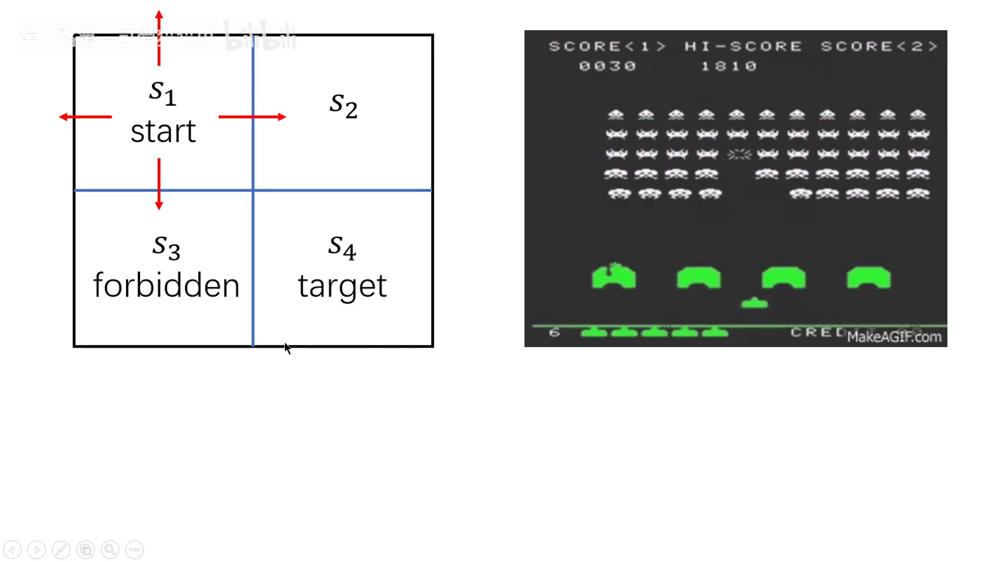
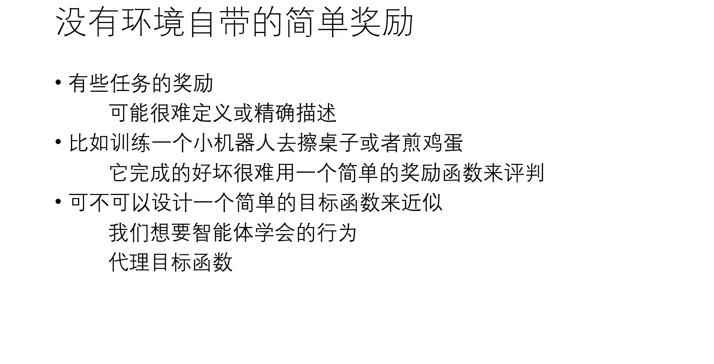
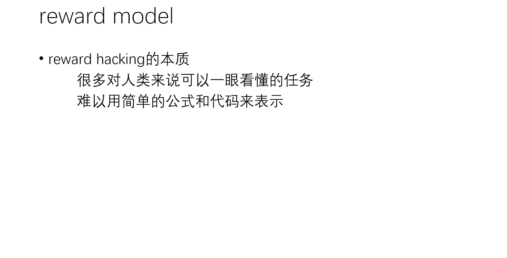
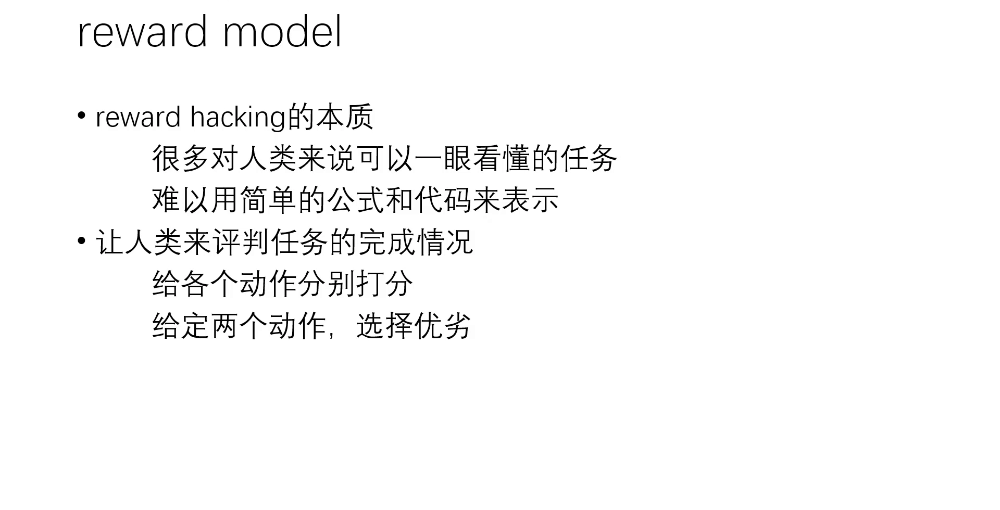
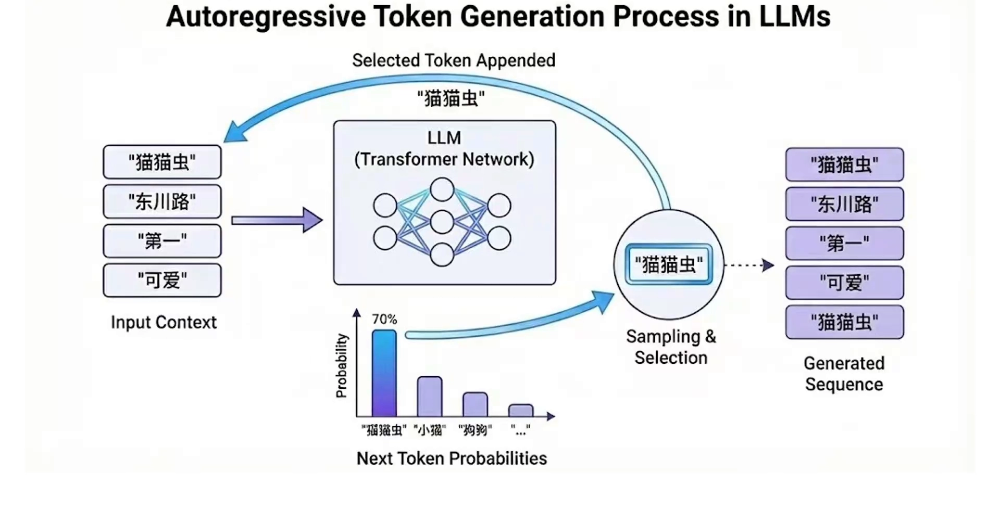
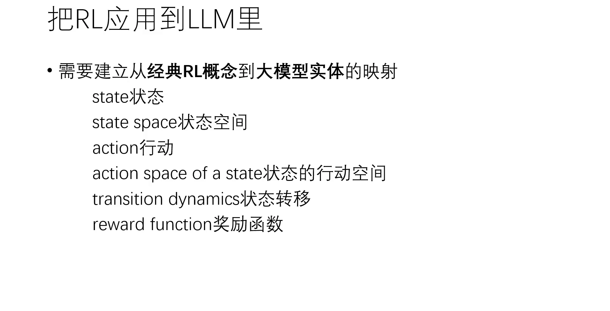
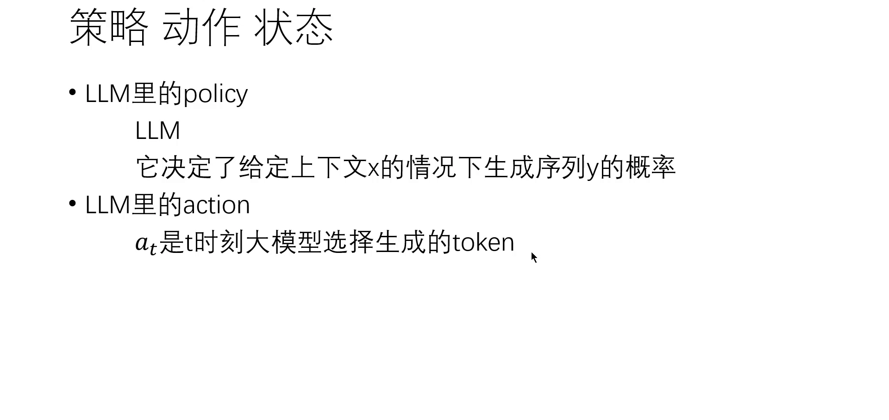
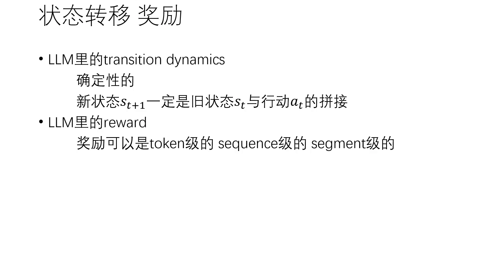
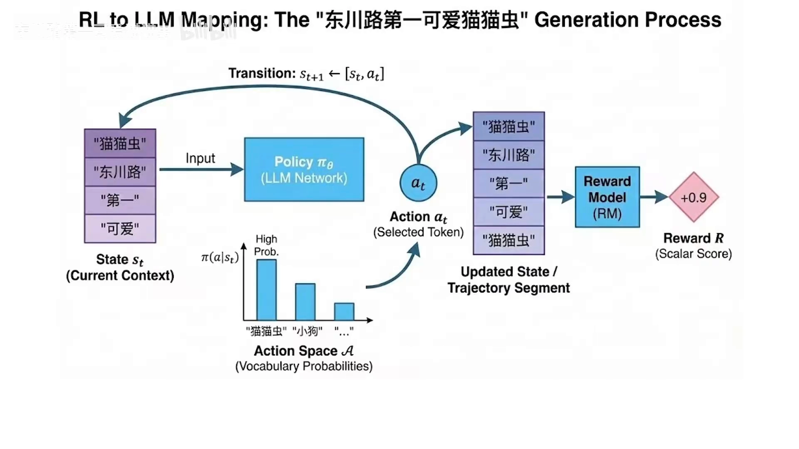

# 语言模型作为策略：把「生成一段文本」建模成 MDP

> **第 14 章开篇。** 前 13 章的强化学习都在控制、游戏、机器人里跑：智能体在环境里动，环境回一个奖励。本章换场地——讲强化学习怎么进入大语言模型。
>
> 这一篇只做一件事，但它是后面所有内容的地基：**把「生成一段文本」严格地建模成一个马尔可夫决策过程（MDP）**。14.2 的 RLHF 三阶段、14.4 的 DPO、14.5 的 GRPO，全都建立在这个建模之上；建模不牢，后面每一步都会含糊。
>
> 内容依据 B 站「东川路第一可爱猫猫虫」的《从经典 PPO 到 PPO-RLHF（一）：构建 RL 到 LLM 的概念映射》整理。讲者这一期做了两件事：先用 reward hacking 说明「为什么必须换奖励来源」，再逐项建立「经典 RL 概念 → 大模型实体」的映射。凡超出视频的补充，文中会明确标注。

## 本讲要解决的核心问题（SCQA）

**背景**：前 13 章里，奖励几乎都是环境白送的。格子世界里进目标格得 +1、踩禁区得 −1；Atari 里打中飞船就加分（第 6 章 DQN 的设定）。智能体做一次状态转移，环境就回一个实数。

**冲突**：语言模型没有这样的环境。它面前没有游戏画面、没有机械臂、没有分数板。它只有一个词表和一段已经写下的上文；它做完「生成下一个 token」这个动作之后，**没有任何东西会告诉它这一步好不好**。而人类真正想要的——「这段回答有帮助、真实、无害」——又恰恰写不成一个能直接计算的公式。

**疑问**：既然没有环境奖励，强化学习还能用在语言模型上吗？如果能，那 state、action、reward 分别是什么？

**回答（中心思想）**：能，而且映射非常干净。**把「生成一整段回答」看成一个 episode，把「生成下一个 token」看成一步动作**，语言模型本身就是一个策略 $\pi_\theta$，它的 MDP 五要素可以逐一写出来。但这个 MDP 在五个地方与经典 MDP 显著不同（转移确定、动作空间上万、长度可变、奖励极稀疏、状态空间是全部前缀），这些不同直接决定了后面只能用策略梯度而不是 Q-learning。

---

## 一、缺口：语言模型没有「环境自带的奖励」

### 1.1 经典 RL 的奖励，是环境在每次转移时给的

讲者先回到最基础的两个例子，把「奖励从哪来」这件事摆清楚：

[【跳转到 03:44】](https://www.bilibili.com/video/BV14iqWBqEEY/?t=224)

- **格子世界**：小机器人走到 forbidden area（禁区）给一个负数惩罚，走进 target area（目标格）给一个正数奖励。这个数是在「$s_1 \to s_3$」「$s_3 \to s_4$」这样的转移**发生的那一瞬间**由环境给出的。
- **Space Invaders**：炮弹打中飞船就得分。分数同样是在打中的那一刻、由游戏给智能体的实时反馈。

两个例子的共同点：**奖励函数写在环境里**。它可能稀疏、可能难调，但它存在，而且可以被精确计算——程序里就是一行加法。

（图中左上角为平台水印，画面内容横向铺满，裁切会切断图示，故保留原帧。）

### 1.2 有一类任务，奖励根本写不成公式

问题出在下一类任务上。讲者举的例子是：训练一个小机器人去**擦桌子**、**煎鸡蛋**、**后空翻**。

[【跳转到 05:10】](https://www.bilibili.com/video/BV14iqWBqEEY/?t=310)

这些任务不是没有好坏，而是**好坏的标准说不出口**：后空翻有很多种翻法，煎鸡蛋有很多种样子，擦桌子更是一样。你能一眼看出哪个好，但你写不出一行代码把它算出来。

于是有了一个折中办法——**代理目标函数**（surrogate objective function，PPO 里也用过这个词）：不去写「什么算后空翻」，而是写一个**能算的近似指标**去替代它。讲者的具体做法是：把奖励定义为「高度变化速度 + 关节转动速度」。理由很直白——真在后空翻的机器人，高度一直在变、关节一直在转。

### 1.3 硬凑一个代理奖励，智能体会去钻它的空子

带着这个代理奖励去训练，结果很典型：关节转得飞快、高度上下剧烈变化，**但一次后空翻都没完成**——机器人学会了蹭着地往前挪，靠「高度抖动 + 关节乱转」把分数刷满。

[【跳转到 07:37】](https://www.bilibili.com/video/BV14iqWBqEEY/?t=457)

这个现象叫 **reward hacking**（奖励作弊），也叫 **misaligned**（目标错位）：智能体优化的是你**写下的**那个奖励，不是你想要的那件事。讲者还提了一个同类的例子：Anthropic 训练 Claude Sonnet 3.7 写代码时也遇到过——智能体不去真正写出符合要求的代码，而是想办法「通过测试」，比如看到测试用例是 5，就直接 `print(5)`。

讲者把 reward hacking 的本质总结成一句话：**很多对人类来说一眼就能看懂的东西，难以用简单的公式和代码来表示。** 人能一眼分辨「这是蹭地还是后空翻」「这是真写了代码还是把答案打印出来」，但人写不出那个判别式。

**这一步是整个第 14 章的动机。** 语言模型面对的是同一类问题：预训练目标（预测下一个词）能算、可微、有海量数据，但它优化的是「像不像互联网文本」，不是「人觉得好不好」。硬用 BLEU、困惑度之类的代理指标去代替「人觉得好」，就是上面那个蹭地的机器人。

---

## 二、补法：让人来当裁判，再蒸馏成一个 reward model

### 2.1 人更擅长比较，不擅长打分

既然人「一眼能看懂」，那能不能直接让人类来评判？讲者给了两条路，并且明确说：**人更擅长的是第二条**。

[【跳转到 09:17】](https://www.bilibili.com/video/BV14iqWBqEEY/?t=557)

- **让人直接打分**：让人类给各个后空翻分别打一个分。问题在于**分数没有可比性**——有人觉得稍微好一点就该打九分，有人觉得要非常漂亮才配九分。同一个动作，不同人打出来的数不在同一把尺子上。
- **让人二选一**：给定两个动作，问哪个更好。这个判断稳定得多，因为人不需要建立绝对标尺，只需要做相对比较。

所以 RLHF 里实际采用的都是**比较**而不是打分：给两个或多个候选，让人选优劣。讲者提到 OpenAI 训练 InstructGPT 时给的是多档选项——「A 非常好、B 非常差」「A 稍好、B 稍差」「A 比 B 略好一丢丢」，让人从这几档里选。

### 2.2 reward model 是「人类偏好的标量打分器」

把大量这样的二选一数据收集起来，就能训练一个神经网络：**输入一个动作（或一段回答），输出一个分数**。这个网络就叫 **reward model**（奖励模型）。

讲者用后空翻做了闭环验证：把人类偏好蒸馏成 reward model 之后，用它当奖励重新训练，小机器人终于不再蹭地，开始真的后空翻了。

这里要留意一个结构上的关键点：**reward model 把「人」替换掉了**。训练策略时不再需要人实时打分，只需要调用这个网络。这正是 RL 能在大模型上跑起来的前提——人类反馈被压缩成了一个可微、可批量调用的函数 $r_\phi(x, y)$。

（reward model 具体怎么训练、Bradley-Terry 模型怎么把「谁更好」变成「好多少」，是 14.3 的内容，本篇不展开。）

---

## 三、把「生成一段文本」写成 MDP

前半段解决的是「奖励从哪来」。后半段是这一篇真正的技术骨架：**有了奖励，怎么把语言模型塞进 RL 的框架里。**

### 3.1 自回归生成本来就是一个循环

先看语言模型自己在做什么。讲者强调：不管是 DeepSeek、千问、Gemini 还是 ChatGPT，它们都是**自回归的生成式模型**——给定 prompt，生成一个 token，把 prompt 和 token 拼成一个序列，再生成第二个 token，反复预测下一个 token 的概率，一直生成下去。

[【跳转到 11:25】](https://www.bilibili.com/video/BV14iqWBqEEY/?t=685)

讲者用「东川路第一可爱」这句上文做了演示：模型给出「毛毛虫」70%、「小猫」「狗狗」等候选的概率，采样选中「毛毛虫」，序列变成「东川路第一可爱毛毛虫」，然后重复。

他还点了一个性质：模型**只能看见当前 token 以前的、只看上文、看不见下文**，也就是 causal 的。这个性质在 RL 里恰好对应「决策只能基于已经发生的历史」——和 MDP 的因果结构天然吻合。

**这个循环，就是 RL 里「智能体与环境交互」的循环。** 一旦这样看，剩下的映射几乎是自动的。

### 3.2 要素逐一映射：策略、动作、状态、转移、奖励

讲者先列出要映射的概念清单，再逐项填：

[【跳转到 11:01】](https://www.bilibili.com/video/BV14iqWBqEEY/?t=661)

**（1）策略 $\pi_\theta$ = 语言模型本身。**

讲者的原话是「LLM 里的 policy 其实就是 LLM 本身」。policy 的作用是「在一个状态时决定采取哪些动作」，而语言模型的作用正是「给定上文 $x$，决定生成什么 token」，即决定条件概率 $P(y \mid x)$。这个分布由模型里那个带参数的 Transformer 产生。

写成公式，就是词表 $V$ 上的 softmax：

$$
\pi_\theta(a_t \mid s_t) = \frac{\exp\!\big(z_{a_t}\big)}{\sum_{v \in V} \exp\!\big(z_v\big)}
$$

其中 $z$ 是模型最后一层投影到词表维度得到的 logits。注意这里**没有任何新东西**：$\pi_\theta$ 就是预训练/SFT 之后那个模型，$\theta$ 就是它的全部参数。

**（2）动作 $a_t$ = 下一个 token。**

$t$ 时刻的动作，就是模型此刻选择生成的那个 token。讲者补充说，动作的粒度**可以换**：token 级之外，也可以是序列（sequence）级或者片段（segment）级——segment 就是多个 sequence 的拼接，可以理解成「一段话」。粒度选得粗，episode 就短、信用分配容易些，但控制力弱；粒度选得细，控制精细但步数暴增。这是后面各种算法的一个隐含设计选择。

**（3）状态 $s_t$ = prompt + 已经生成的全部 token。**

这是与经典 RL 差别最大的一项。讲者给出的定义是：$t$ 时刻的 state，是初始提示词 $x$ 与迄今为止生成的所有 token 的拼接。

[【跳转到 13:10】](https://www.bilibili.com/video/BV14iqWBqEEY/?t=790)

$$
s_t = x \oplus (a_1, a_2, \ldots, a_{t-1})
$$

其中 $\oplus$ 表示序列拼接。**这里要停一下**：经典 RL 的 state 是「当前快照」——棋盘现在的布局、机器人现在的位姿，历史被压缩掉了。而语言模型的 state 是**整段历史本身**。为什么必须这样？因为 Transformer 预测下一个 token 时，看的确实是完整前缀；对它来说，「历史就是状态」，没有别的状态表示。

这个定义还有两个直接后果：状态空间 = **所有可能的前缀序列**（组合爆炸）；episode 长度 = 生成了多少 token（可变，从几个到几千）。

**（4）状态转移 $P$ = 确定性的拼接。**

讲者说得很明确：大模型里的状态转移是**确定性的**——一旦确定了旧状态 $s_t$ 和动作 $a_t$，新状态 $s_{t+1}$ 一定是二者的拼接。

[【跳转到 14:00】](https://www.bilibili.com/video/BV14iqWBqEEY/?t=840)

$$
P(s_{t+1} \mid s_t, a_t) = 1, \qquad s_{t+1} = s_t \oplus a_t
$$

讲者特意对比了 Space Invaders：游戏里有各种不确定性，同样的操作未必得到同样的局面；但语言模型这里没有。**环境的随机性为零，全部不确定性都在策略的采样里**（就是 3.1 节那个「从概率分布里采样」的动作）。

**（5）奖励 $r$ = 序列末尾的一个标量。**

讲者说奖励可以有三个粒度：token 级（每生成一个 token 给一个奖励）、sequence 级（每生成一个序列给一个奖励）、segment 级（每生成一个片段给一个奖励）。而 **RLHF 里实际用的是 sequence 级**：生成一个完整序列之后，reward model 给一个标量奖励；此前那些 token 的奖励**全是零**。

$$
r_t = 0 \ (t < T), \qquad r_T = r_\phi(x, y)
$$

**（6）折扣因子 $\gamma$**（补充说明，视频未展开）：语言模型的 episode 长度有限（最多几千 token），不存在「无限期回报是否收敛」的问题，所以实践中通常取 $\gamma = 1$，不做折扣。这一点和经典 RL 里为了数值稳定而取 $\gamma = 0.99$ 的习惯不同。

### 3.3 一张图把整条链路串起来

把上面五项合起来，就是讲者最后给出的完整映射图：

[【跳转到 15:00】](https://www.bilibili.com/video/BV14iqWBqEEY/?t=900)

讲者用这张图把一次生成走了一遍：当前 state 是「东川路第一可爱」（current context，当前上文）→ 策略（LM 网络）决定动作 → 在词表这个动作空间里采样，因为「毛毛虫」概率高所以选中它 → transition 把 $s_t$ 与 $a_t$ 拼成新序列（updated state）→ 一直生成到序列结束 → reward model 给出奖励。

于是 RL 的目标函数可以写出来了：

$$
J(\theta) = \mathbb{E}_{x \sim \mathcal{D},\, y \sim \pi_\theta(\cdot \mid x)}\big[\, r_\phi(x, y) \,\big]
$$

即：**在提示词分布上取期望，让策略采样出来的回答，拿到尽量高的 reward model 分数。** 后面所有算法（PPO、DPO、GRPO）都是在解这个目标的不同方式。

（图中左上角为平台水印，标题紧贴画面顶端，裁切会切断标题，故保留原帧。）

---

## 四、这个 MDP 和经典 MDP 有五处不一样

映射建完之后，讲者顺带点了一句「大模型的动作空间可能非常大，如果漫无目的地探索，效率其实非常低」。这句话值得展开——**它和另外四处差异一起，决定了这个 MDP 的算法形态**。

| 维度 | 经典 MDP（控制 / 游戏） | 语言模型的 MDP |
| :--- | :--- | :--- |
| 状态 $s_t$ | 当前快照（棋盘布局、关节角度） | 整段历史：prompt + 全部已生成 token |
| 转移 $P$ | 通常随机（物理噪声、对手动作） | **确定性**：$s_{t+1} = s_t \oplus a_t$ |
| 动作空间 | 几个到几百个（Atari 十几个，围棋 361 个落点） | 词表大小，$\lvert V\rvert$ 在数万量级 |
| episode 长度 | 通常固定或受环境限制 | 可变：几个 token 到几千 token |
| 奖励 | 每一步都可能给（甚至每帧） | 通常只在序列末尾给一个标量 |

逐条说清它们的后果：

**1. 转移确定，随机性全在策略里。** 环境不掷骰子，只有策略在采样。好处是工程上很舒服：同一条轨迹可以精确回放，off-policy 的评估也方便（补充说明：这一点让「用旧策略采的数据算新策略的目标」在实现上简单很多）。

**2. 动作空间巨大且离散。** 词表有几万个 token，比 Atari 的动作数大了三个数量级（补充说明：不同模型的词表在 3 万到 15 万之间不等，具体数字随模型而异，视频未给具体值）。这带来两个后果：一是**探索极贵**——随机试错在几万维的离散空间里几乎不可能撞对；二是**任何需要对全部动作求 max 或求和的算法都会变贵**。

**3. episode 长度可变。** 一句话可能只有 5 个 token，也可能有 5000 个。同一个 batch 里的轨迹长度参差不齐，批处理和信用分配的难度都不一样。

**4. 奖励极稀疏。** 整段文本只拿一个标量。智能体走了几十上百步，全程没有任何反馈，直到最后才知道写得好不好——这是典型的稀疏奖励问题，**信用分配极难**：那个 +0.9 到底该记在哪几个 token 头上？

**5. 状态空间就是全部可能的前缀。** 长度为 $t$ 的前缀有 $\lvert V\rvert^{t}$ 种，状态不可枚举、不可列表、不可查表。任何依赖「访问过哪些状态」的表格方法直接失效。

---

## 五、这些差异把算法选择逼到了策略梯度一侧

（本节是补充说明，讲者在视频里只说了「动作空间太大会导致探索效率低」，没有展开算法选择；推理链条如下，供对照第 6、7 章。）

**Q-learning 这条路走不通，有两个独立的理由。**

第一，它的更新目标里有一个对动作的 max：

$$
Q(s,a) \leftarrow Q(s,a) + \alpha\big[\, r + \gamma \max_{a'} Q(s', a') - Q(s,a) \,\big]
$$

对语言模型来说，一次前向确实能吐出全部 $\lvert V\rvert$ 个候选的分数，所以单步计算量不是不可承受。真正的麻烦在**数据**：这个目标要求对「下一个状态下的所有动作」都给出可靠估值，而这些估值只能从数据里学。可这里的状态是前缀，绝大多数前缀在训练中从未出现，它们的 $\max$ 就是在没校准过的区域里取最大值——这正是 12.2 讲过的外推误差，在语言模型这里被放大到极致。

第二，奖励只在序列末尾给一次（第四节第 4 条），中间每一步的 $Q$ 都没有直接监督；要靠 bootstrap 从终点的那个标量一路摊回几千步，误差累积得很快。

**策略梯度这条路可行，因为它只需要对「采样到的那个动作」算梯度。**

REINFORCE 的形式是（$G$ 是从第 $t$ 步起的回报）：

$$
\nabla_\theta J(\theta) = \mathbb{E}\Bigg[\, \sum_{t=1}^{T} \nabla_\theta \log \pi_\theta(a_t \mid s_t) \cdot G \,\Bigg]
$$

注意式子里**没有对动作的求和或取 max**：$a_t$ 是实际采样出来的那一个 token，$\log \pi_\theta(a_t \mid s_t)$ 就是一次前向 + 一次 log-softmax 取值。动作空间有多大都不影响单步计算量，也不需要为「没被采样到的动作」编造估值。代价是方差大、样本效率低——所以后面才有基线、优势函数、critic、GAE 这些降方差手段，而在 LLM 上它们都必须按 token 级别工作（这部分是 14.2 的内容）。

这就解释了为什么 RLHF 用的是 PPO 而不是 DQN：**不是 PPO 更好，而是价值型方法在这个 MDP 上根本不可行。**

---

## 六、这个建模把第 11、12 章接了起来

（本节为回指与补充，不是视频内容。）

**往回想第 11 章：预训练就是行为克隆。** 11.2 讲过，行为克隆（BC）是在专家轨迹上做监督学习，最大化 $\log \pi_\theta(a \mid s)$。语言模型的预训练——在海量人类文本上做下一个 token 预测——正是这个式子，只不过「专家」是互联网上的全体作者，「轨迹」是文本。SFT 更是标准的 BC：人在示范答案上做监督学习。

所以第 14 章要解决的问题可以一句话概括：**BC 只能模仿示范里出现过的好，无法优化「人觉得好」这个目标**。示范里没有「哪个更好」这个信号（这一点在 14.2 会再遇到）。RLHF 是在 BC 的基础上，用奖励信号做「超越模仿」。

**往后看第 12 章：Decision Transformer 是同一枚硬币的另一面。** 12.5 讲的 DT 把 RL 变成序列建模——用 Transformer 去做 RL，条件变量是「想要的回报」。而这一篇做的是反方向：把序列生成变成 RL——用 RL 去优化 Transformer，奖励来自 reward model。两者共享同一个洞察：**「预测下一个 token」和「决定下一个动作」在计算上是同一件事**，区别只在于训练信号从哪来。DT 的信号来自数据里的回报，RLHF 的信号来自人类偏好。

---

## 七、本章路线图

这一篇只搭了地基，后面四篇按「先讲清奖励、再讲清算法、最后讲清简化与推理」的顺序展开：

- **14.2 RLHF 三阶段流程**：SFT → 奖励模型 → PPO。重点是 PPO 在 token 级的工程形态（critic、GAE、KL 惩罚为什么都必须逐 token 工作），以及 3.3 节那个目标函数怎么加上 KL 约束变成实际可优化的形式。
- **14.3 奖励模型与 Bradley-Terry**：本篇只说了「让人二选一」，14.3 讲怎么把「谁更好」变成一个可训练的损失——Bradley-Terry 模型给出 $P(y_w \succ y_l) = \sigma(r(y_w) - r(y_l))$，再取负对数当损失。
- **14.4 DPO / IPO / KTO**：既然 3.3 节的目标只是「最大化 reward model 分数 + 别跑太远」，能不能跳过显式训练 reward model、跳过 RL 循环，直接用一个分类损失优化策略？DPO 的答案是可以。
- **14.5 PRM 与 GRPO**：面向推理能力。当奖励从「整段好不好」变成「每一步推理对不对」，稀疏奖励这个第四节的第 4 条差异就被直接攻击；GRPO 则用组内相对比较替掉 critic，回应第 2 条「动作空间巨大」带来的成本问题。

---

## 小结

- **动机**：语言模型没有环境自带的奖励，而「人觉得好」写不成公式。硬写代理指标，智能体就会 reward hacking（蹭地而不是后空翻）。
- **补法**：让人做二选一（比打分稳定），把人类偏好蒸馏成一个 reward model $r_\phi$，训练时用它替代人。
- **建模**：一次生成 = 一个 episode，一个 token = 一步动作。$\pi_\theta$ 就是语言模型，$a_t$ 是下一个 token，$s_t = x \oplus (a_1,\dots,a_{t-1})$ 是整段历史，$P$ 是确定性拼接，$r$ 只在序列末尾给一个标量。
- **目标**：$J(\theta) = \mathbb{E}_{x,\, y \sim \pi_\theta(\cdot \mid x)}[r_\phi(x,y)]$，后面所有算法都在解它。
- **五处差异**：转移确定、动作空间数万、长度可变、奖励极稀疏、状态空间是全部前缀。
- **算法选择的后果**：$\max_{a'}$ 在几万维离散动作 + 不可枚举状态上不可行，所以是策略梯度（PPO）而不是 Q-learning（DQN）。
- **与前后章的关系**：预训练 ≈ 行为克隆（11.2），只能模仿；DT（12.5）是反方向的同一枚硬币。

---

## 附：本篇要点速查

| 概念 | 一句话 |
| :--- | :--- |
| reward hacking | 智能体优化了你写下的代理奖励，而不是你真正想要的行为；也叫目标错位（misaligned） |
| 代理目标函数 | 用一个能算的近似指标替代「说不出口」的真实标准，代价是可能被钻空子 |
| reward model $r_\phi$ | 把人类偏好蒸馏成的标量打分器，输入一段回答、输出一个分数，训练时替代人 |
| 策略 $\pi_\theta$ | 就是语言模型本身，输出词表上的下一个 token 分布 |
| 动作 $a_t$ | 下一个 token；粒度可换成 sequence 或 segment |
| 状态 $s_t$ | $x \oplus (a_1,\dots,a_{t-1})$，即 prompt 加全部已生成 token——是历史，不是快照 |
| 状态转移 | 确定性的拼接 $s_{t+1} = s_t \oplus a_t$，环境无随机性 |
| 奖励粒度 | token 级 / sequence 级 / segment 级；RLHF 实际用 sequence 级，只在末尾给一个标量 |
| 折扣因子 $\gamma$ | 实践中通常取 1（补充说明：序列长度有限，无需折扣） |
| 稀疏奖励 | 整段只拿一个标量，信用分配极难，是 token 级 GAE / critic 存在的理由 |
| 为什么用 PPO | 不是因为更好，而是价值型方法要对几万维动作求 max 且状态不可枚举，不可行 |

## 参考视频

- 东川路第一可爱猫猫虫《从经典 PPO 到 PPO-RLHF（一）：构建 RL 到 LLM 的概念映射》，[BV14iqWBqEEY](https://www.bilibili.com/video/BV14iqWBqEEY/)