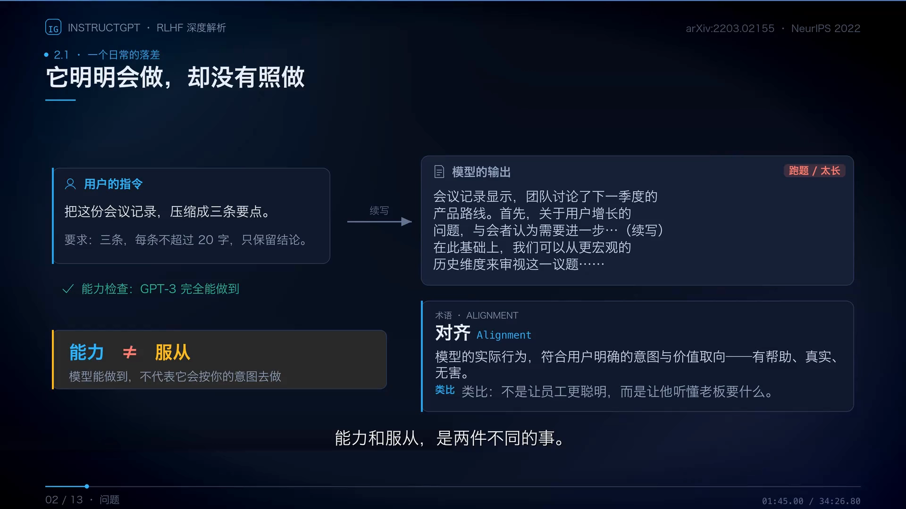
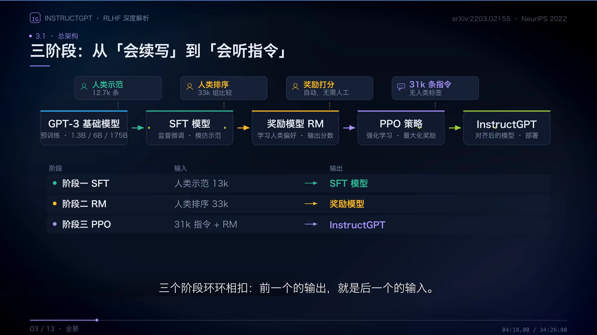
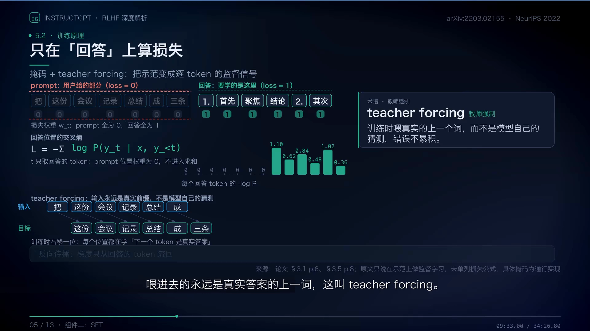
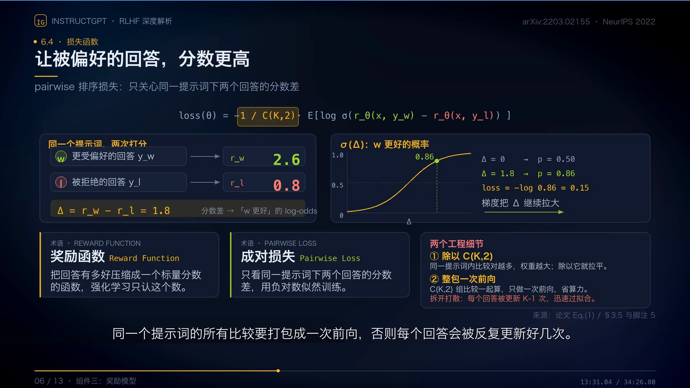
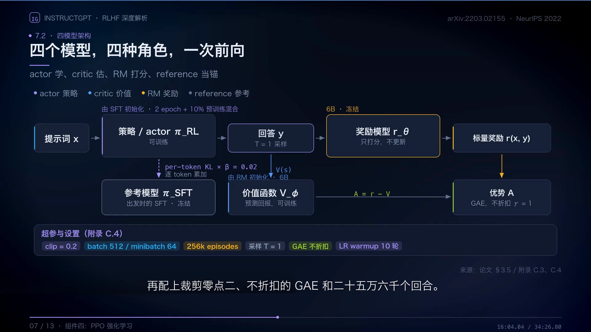
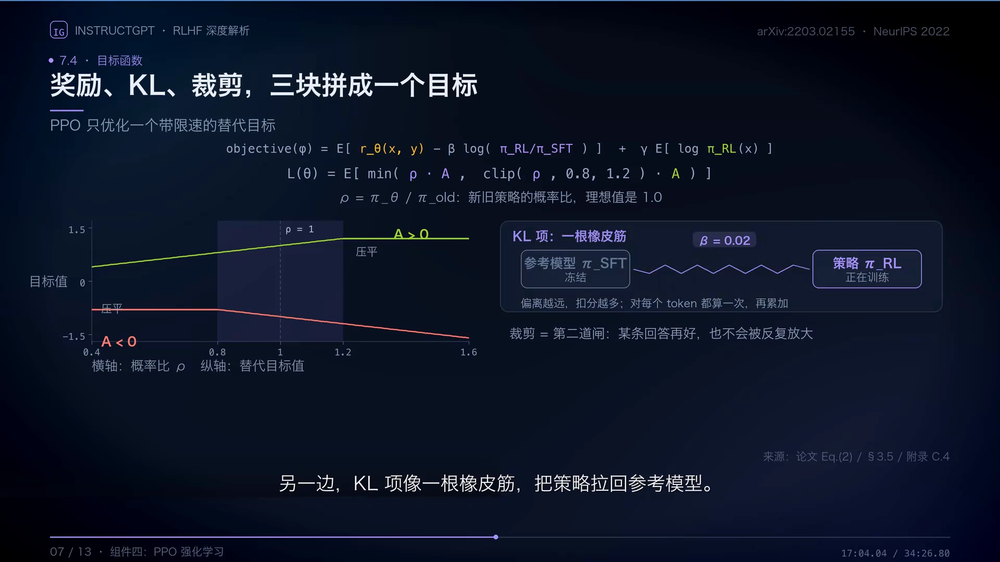
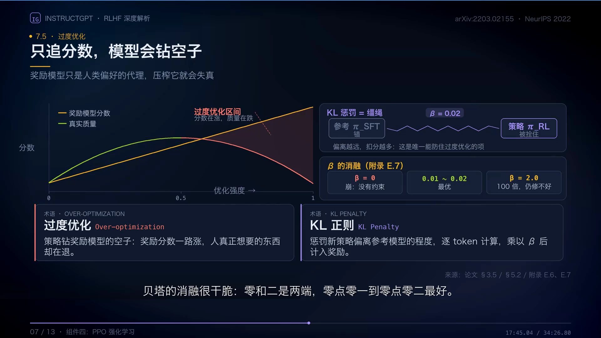
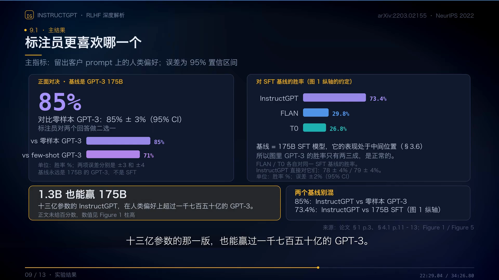
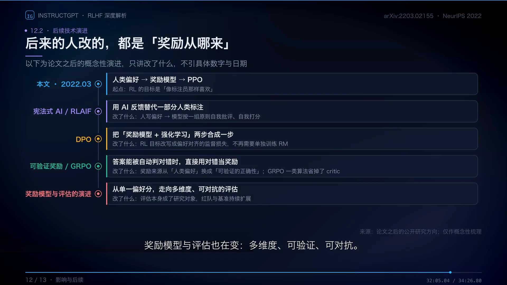
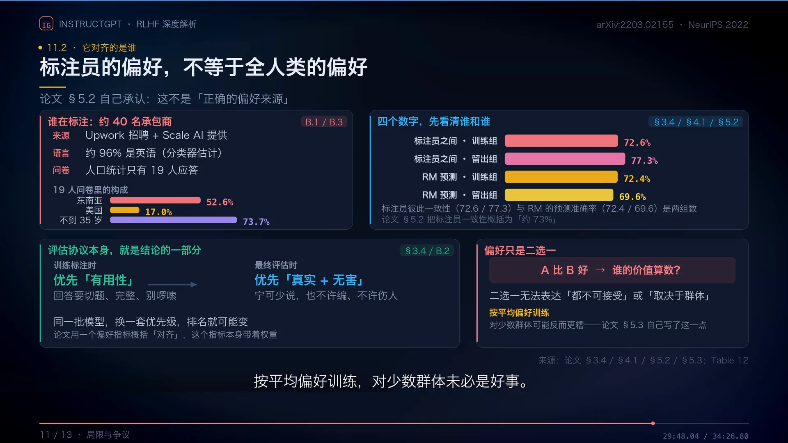

# RLHF 三阶段：从 SFT 到奖励模型再到 PPO

> 上一篇（14.1）把「生成一段文本」建模成了 MDP：策略 $\pi_\theta$ 就是语言模型本身，状态 $s_t$ 是 prompt 加全部已生成 token，动作 $a_t$ 是下一个 token，转移是确定性拼接，奖励只在序列末尾由奖励模型 $r_\phi(x,y)$ 给出一个标量。建模立好之后，剩下的事就是**怎么把奖励模型造出来、怎么用它更新策略**。
>
> 本篇讲的就是这条流水线本身——**RLHF 的三个阶段：SFT → 奖励模型 → PPO**。每一阶段都按「输入、输出、损失函数、为什么需要这一步」拆开讲，重点落在两个地方：奖励模型的成对排序损失，以及 PPO 目标里那个 KL 惩罚项到底在防什么。
>
> 内容依据 B 站「KianLee」的《InstructGPT 如何让大模型听懂指令？34 分钟图解 RLHF、奖励模型与 PPO》整理，数字与结论均可在视频与 InstructGPT 论文（arXiv:2203.02155）中核对。凡超出视频的补充，文中会明确标注。

## 本讲要解决的核心问题（SCQA）

**背景**：14.1 已经说清，预训练模型只会「预测下一个 token」。它在互联网文本上学会了语言规律和知识，但它的行为模式是**续写**——给它一条指令，它可能接着往下编，而不是照着做。

**冲突**：这种错位不能靠「加参数」解决。更大的模型知识更多，但回答方式仍然被续写模式支配。而人类真正想要的「有帮助、真实、无害」，又写不成一行能算的代码——14.1 里那个蹭地而不是后空翻的机器人，就是硬写代理奖励的下场。

**疑问**：既然目标说不出口，能不能让人来判断？可人也不可能陪着模型训练几百万步。那人类的判断怎么变成一个能自动调用、能求导的训练信号？

**回答（中心思想）**：分三步走。**第一步让人写示范**，把「怎么回答」教给模型（SFT）；**第二步让人只做比较**，把「哪个回答更好」蒸馏成一个打分网络（奖励模型）；**第三步用这个打分网络当奖励**，跑强化学习把策略往高分方向推（PPO）。三步合起来就是 RLHF，它的本质是**把人类的判断变成一条可复制的流水线**。

---

## 一、为什么需要 RLHF：能力不等于服从

讲者用一个日常场景开场：你给模型一条清晰的指令——「把这份会议记录，压缩成三条要点」，要求三条、每条不超过 20 字、只保留结论。

[【跳转到 01:45】](https://www.bilibili.com/video/BV1QVxn65E2y/?t=105)

模型**有能力**做这件事，但它没有**照做**。讲者把这两件事分开：

- **能力**：模型能做到，不代表它会按你的意图去做。
- **服从**：模型的实际行为，符合用户明确的意图与价值取向——有帮助、真实、无害。这就是**对齐**（alignment）。

讲者的类比很直白：对齐不是让员工更聪明，而是让他听懂老板要什么。

### 1.1 错位出在训练目标上

为什么会错位？回到预训练的目标函数：预测下一个词。在互联网文本里，「下一个词」可以是任何东西——维基百科的下一句、论坛的下一楼、代码的下一行，全都被当成正确答案。但部署的时候，我们要的是「有帮助、真实、无害地完成用户的指令」。**训练目标和部署目标并不一致**，这就是 14.1 讲过的目标错位。

论文的解法不是换网络结构，而是**换训练信号**：把人类反馈变成可以优化的目标。

### 1.2 SFT 能教格式，教不了「哪个更好」

最直接的想法是：人把标准答案写一遍，让模型照着学。这就是 SFT（监督微调），它确实能把一台「续写机器」变成「会答题的助手」。

但 SFT 有一个天花板：**它只告诉你什么是好答案，不告诉你哪个更好**。示范里只有「正确」，没有「更好」这个信号。遇到示范里没出现过的指令类型，模型还是会退回续写。所以 SFT 只是起点——下一步要让人类只做比较，把偏好变成奖励模型。

（SFT 为什么只是模仿、为什么模仿有上限，11.2 讲行为克隆时已经展开过，这里不再重复。）

---

## 二、三阶段全景：三个环节，三种人类参与方式

在拆开每个零件之前，先看整台机器。

[【跳转到 04:18】](https://www.bilibili.com/video/BV1QVxn65E2y/?t=258)

三个阶段环环相扣，**前一个的输出就是后一个的输入**：

| 阶段 | 输入 | 输出 | 人类在做什么 |
| :--- | :--- | :--- | :--- |
| 阶段一 SFT | 人类示范 12.7k 条 | SFT 模型 | 亲手写出理想答案 |
| 阶段二 RM | 人类排序 33k 组比较 | 奖励模型 $r_\phi$ | 给几个候选回答排个序 |
| 阶段三 PPO | 31k 条指令 + 奖励模型 | InstructGPT | 不参与，只提供指令 |

注意最后一行：**PPO 阶段的数据没有任何人类标签**，人只提供指令，对错由奖励模型判断。这正是整条流水线的意义所在——人类的判断被「压缩」进了一个可以无限次调用的网络里。

讲者把三个阶段的目标串成一句话：**人类偏好无法直接求导，所以先把它蒸馏成一个奖励模型，再把奖励变成策略的更新方向。** 但只追奖励会走火入魔（模型会钻奖励模型的空子），所以目标里还有一项 KL 惩罚，拉住模型别离原来的 SFT 太远。奖励负责往哪走，KL 负责别走太远。

---

## 三、阶段一 SFT：用交叉熵做行为克隆

**输入**：prompt 与人工示范回答组成的配对数据。**输出**：一个会模仿人写回答的模型。**为什么需要**：把 base model 变成 instruct model，同时为后面两个阶段提供起点（RM 从 SFT 之后的语言模型出发，PPO 的参考策略也是这个 SFT 模型）。

### 3.1 数据从哪来

标注员自己写 prompt、再写一份理想回答；另一批 prompt 来自 API 客户，回答由标注员补写。合起来是 **12,725 条**训练 prompt，其中 11,295 条来自标注员、1,430 条来自客户；清洗去重、划分之后验证集是 1,653 条。

### 3.2 损失函数：只在「回答」上算交叉熵

SFT 的做法像临摹：把人类示范拆成 prompt 和回答两段，拼成一条序列，模型一次读完、并行算出每个位置的预测。损失就是标准的交叉熵，但**只对回答的 token 算**：

$$
L_{SFT}(\theta) = -\sum_{t \in \text{回答}} \log \pi_\theta\big(a_t \mid s_t\big)
$$

prompt 部分的权重是 0，不进入求和。原因很直白：**要学的是怎么答，不是怎么问**。

[【跳转到 09:33】](https://www.bilibili.com/video/BV1QVxn65E2y/?t=573)

图中还标了另一个细节：**teacher forcing**。训练时喂进去的永远是真实答案的上一词，而不是模型自己的猜测，所以错误不会累积。代价是训练分布和推理分布不一致——推理时模型只能吃到自己生成的 token，一旦前面错了，后面就一路错下去。这一点在第七节还会再提。

### 3.3 这一步本质是行为克隆

把上面的式子换个写法就清楚了：$\log \pi_\theta(a_t \mid s_t)$ 在专家数据上取期望——这正是 11.2 讲的行为克隆（BC）。SFT 就是标准的 BC：**「专家」是标注员，「轨迹」是示范答案**。

所以 SFT 的局限也是 BC 的局限：它只能复刻示范里出现过的好，无法优化「人觉得好」这个说不出口的目标。讲者的原话是「SFT 有一个天花板，他只学会了模仿示范的样子」。

---

## 四、阶段二奖励模型：把「谁更好」压成一个标量

**输入**：同一个 prompt 下多个回答的人类排序。**输出**：一个输入「prompt + 回答」、输出一个标量的打分网络 $r_\phi$。**为什么需要**：人类偏好是离散的、没有梯度，无法直接优化；需要把它变成一个可微的标量函数，才能当强化学习的奖励。

### 4.1 数据：排序，不是打分

偏好数据的第一步，是从同一个 prompt 采样多个回答。论文每个问题生成 **4~9 个**候选，记作 $K$。标注员能看到这些回答，但看不到它们出自哪个模型；他的任务不是打分，而是把这几张卡片**整体排序**。

排完序，系统自动拆成两两比较：5 个回答就是 10 组。质量相当可以打平，平局会被直接丢掉。最后得到 **33,207 个 prompt**，比较对多一个数量级。

（为什么用比较而不是打分——14.1 已经讲过：分数没有可比性，而「哪个更好」人一秒就能判断。这里不再重复。）

### 4.2 网络结构：把词表投影换成一个线性头

奖励模型的骨架就是 SFT 之后的那个语言模型。关键改动只有一处：**把最后的词表投影层拿掉，换成一个线性头**，把最后一个 token 的隐状态压成一个标量。

输入是「prompt + 回答」，输出一个分数，越大代表越受偏好。所有尺寸的策略（1.3B / 6B / 175B）**共用同一个 6B 的奖励模型**。

### 4.3 损失函数：Bradley-Terry 的成对排序损失

训练目标只有一句话：**让更好的回答得到更高的分**。两个回答分别打分，被偏好的记为 $y_w$、被拒绝的记为 $y_l$，两个分数相减再过 sigmoid，就是「$y_w$ 更好」的概率；损失取负对数：

$$
L_{RM}(\phi) = -\mathbb{E}_{(x,\,y_w,\,y_l) \sim \mathcal{D}} \Big[ \log \sigma\big( r_\phi(x, y_w) - r_\phi(x, y_l) \big) \Big]
$$

[【跳转到 13:31】](https://www.bilibili.com/video/BV1QVxn65E2y/?t=811)

分数相等时概率是 0.5，差距越大越接近 1，损失越小。所以梯度会推着模型**拉大这个差值**。

图里还标了两个工程细节，都值得记：

- **除以 $\binom{K}{2}$**：同一个提示词下比较对越多，权重越大；除以它就拉平了不同 $K$ 的提示词之间的权重。
- **整包一次前向**：同一个提示词的所有比较要打包成一次前向，否则每个回答会被反复更新 $K-1$ 次，迅速过拟合。

这个损失为什么长这样、Bradley-Terry 模型的前提假设是什么，是 **14.3** 的内容，本篇只给出形式。

### 4.4 训练完有多准

论文报告：预测训练标注员的偏好准确率 **72.4%**，换成没参与训练的留出标注员还有 **69.6%**；而标注员彼此之间的一致性只有 **72.6%**。

这三个数要分清：**72.6% 是「人类自己都不知道自己」的上限**。奖励模型的准确率已经贴到这条线上——它不是在学一个客观标准，而是在学一群具体的人的口味。

另外两个设计选择也值得记：只用 6B 而不是更大，是因为**更大的奖励模型训练更不稳定**，而且它还要拿去当价值函数；奖励只看分数差，所以整体平移不变，论文用偏置把示范的平均分调成零。

---

## 五、阶段三 PPO：用奖励模型当奖励做策略梯度

**输入**：31k 条指令 + 冻结的奖励模型。**输出**：对齐后的策略。**为什么需要**：SFT 只能模仿，奖励模型只能打分，只有强化学习能**在模型自己生成的样本上**优化那个分数。

### 5.1 一次生成就是一个回合

换一个角度看生成：给它一个提示词，它吐出一个回答——**这整个回答就是强化学习里的一个回合**。模型本身叫策略，它决定每个位置输出每个词的概率；按当前策略完整采样一遍，这个动作叫 rollout；回合结束时，奖励模型给一个分数作为这一回合的奖励。

数据由当前策略自己产生，所以这是 **on-policy** 的方法。目标很直白：让期望奖励尽量高，同时别离原来的自己太远。

### 5.2 同时摆四个模型

这是全篇最重要的一张图。

[【跳转到 16:04】](https://www.bilibili.com/video/BV1QVxn65E2y/?t=964)

| 模型 | 角色 | 参数是否更新 |
| :--- | :--- | :--- |
| 策略（actor）$\pi_\theta$ | 生成回答 | 可训练，由 SFT 初始化 |
| 价值函数（critic）$V_\psi$ | 预测回报，算优势 | 可训练，由奖励模型初始化 |
| 奖励模型 $r_\phi$ | 给整条回答打分 | 冻结 |
| 参考模型 $\pi_{ref}$ | 算 KL，当锚 | 冻结，就是出发时的 SFT |

讲者用一句话概括四者分工：**actor 学、critic 估、RM 打分、reference 当锚**。奖励模型告诉你回答得多少分，价值函数帮你判断这次生成比预期好多少——两者的差就是优势 $A$。

一次 PPO 迭代是一个闭环：先抽 512 条提示词，让当前策略各生成一个回答（rollout）→ 奖励模型逐条打分 → 价值函数给出预期分数 → 奖励减去预期分，再用 GAE 摊到每个 token 上得到优势 → 算新旧策略的概率比、裁剪到 0.8~1.2 之间更新。更新完数据立刻作废，500 轮就是 256k 个回合。

### 5.3 目标函数：奖励、KL、裁剪，三块拼成一个目标

[【跳转到 17:04】](https://www.bilibili.com/video/BV1QVxn65E2y/?t=1024)

先把奖励这一项写清楚。策略实际优化的不是裸的奖励模型分数，而是**扣掉 KL 惩罚之后**的奖励：

$$
R(x,y) = r_\phi(x,y) - \beta \log \frac{\pi_\theta(y \mid x)}{\pi_{ref}(y \mid x)}
$$

工程上这个 KL 是**逐 token 算一次再累加**的，所以更贴近实现的写法是：

$$
R(x,y) = r_\phi(x,y) - \beta \sum_{t=1}^{T} \log \frac{\pi_\theta(a_t \mid s_t)}{\pi_{ref}(a_t \mid s_t)}
$$

外层再套上 PPO 的裁剪替代目标，其中 $\rho$ 是新旧策略的概率比：

$$
L(\theta) = \mathbb{E}\Big[\, \min\big(\rho\, A,\ \mathrm{clip}(\rho,\, 0.8,\, 1.2)\, A\big) \,\Big], \qquad \rho = \frac{\pi_\theta(a_t \mid s_t)}{\pi_{old}(a_t \mid s_t)}
$$

**KL 项有两个作用，缺一不可。**

**第一，限制策略不要离 SFT 模型太远，保住语言能力。** 强化学习只认奖励模型的分数，它不管语法、不管连贯、不管事实——那些能力是预训练学来的，不在奖励里。一旦策略跑远，它可能为了拿分把语言能力一起丢掉。KL 项像一根橡皮筋，偏离参考模型越远扣分越多。

**第二，防止 reward hacking。** 这是更要紧的一条。奖励模型只是人类偏好的**有损压缩**，它有漏洞；只让策略去最大化这个分数，它一定会找到漏洞。讲者的原话是「奖励模型只是人类偏好的代理，压榨它就会失真」。

### 5.4 只追分数，模型会钻空子

[【跳转到 17:45】](https://www.bilibili.com/video/BV1QVxn65E2y/?t=1065)

这个现象叫**对奖励模型的过度优化**（over-optimization），也就是 14.1 讲过的 reward hacking 在 RLHF 里的具体形态。讲者点出的两个典型症状是：**答案越来越长、越来越顺着人说**。这两件事都能骗到奖励模型的分数，但不等于人真正想要的帮助。

KL 惩罚就是这根缰绳。$\beta$ 的消融很干脆：

- $\beta = 0$：崩，等于没有约束；
- $\beta$ 在 **0.01 ~ 0.02**：最优，默认取 0.02；
- $\beta = 2.0$（默认值的 100 倍）：学不动，公开数据集的回归依然修不好。

（人类偏好为什么会偏向长回答、偏向顺着说的答案，第九节会正面讨论，并标明哪些是讲者原话、哪些是补充。）

### 5.5 PPO-ptx：给对齐「减税」

论文还试了一个补丁：**PPO-ptx**。思路很朴素——别把预训练学过的东西忘了。在 PPO 的梯度里再混入一份「把预训练文本继续预测对」的梯度，系数 $\gamma$ 取 27.8，预训练样本是回合数的 8 倍。

讲者特意强调了一个反直觉的结论：**它并不让人更喜欢**——论文原话是「标注员偏好没有大变化」。它真正修的是对 SQuAD、DROP 这些考试上的回归，代价是训练时间翻倍。

---

## 六、InstructGPT 的关键发现：对齐比规模更重要

[【跳转到 22:29】](https://www.bilibili.com/video/BV1QVxn65E2y/?t=1349)

这张图有两个基线，别混：

- **85%**：InstructGPT 175B 对**零样本 GPT-3**，标注员二选一。
- **73.4%**：InstructGPT 对 **175B SFT 基线**（图 1 纵轴的约定）。

最值得点明的是那行小字：**十三亿参数的 InstructGPT，在人类偏好上超过了一千七百五十亿的 GPT-3。** 参数少了一百多倍，人反而更喜欢它。

讲者的结论是：**对齐带来的收益，可以和规模带来的收益相提并论。** 这句话是 RLHF 出圈的根本原因——它说明「把模型调教得听话」是一条独立于「把模型做大」的进步路线。

### 6.1 代价也是真的

对齐不是免费的午餐。真实性和幻觉确实大幅改善（TruthfulQA 上 GPT-3 只有 25.1%，纯 PPO 做到 75.2%；封闭域任务幻觉从 41% 降到 21%），但公开 NLP 基准上会掉分：SQuADv2 从 64.3 掉到 59.9，DROP 从 27.5 掉到 15.2，翻译也掉了 4.6。

讲者给了一句很值得记的话：**分数不等于有用**——开放生成和头脑风暴占真实用例的 57%，而公开基准测不到这块大头。

毒性和偏见则只在特定条件下变好，甚至可能更糟：不给任何指令时两者几乎一样，而**要求它尽量有偏见时，它反而更毒**（0.285 → 0.4）。这正是第九节要讨论的「它对齐的是偏好，不是正确性」的一个侧面。

### 6.2 对齐的成本

讲者最后给了一个数字：InstructGPT 的 PPO 训练算力约 **60 petaflops-day**，对比 GPT-3 预训练的 3,640 petaflops-day，**只占 1.65%**。也就是说，对齐很便宜——贵的是预训练。

---

## 七、RLHF 的工程复杂性：为什么后来大家想绕开它

三阶段听起来很清爽，但真正落地时，麻烦集中在第三阶段。讲者的评价是「这是整条流水线里最不稳定的一步」。把麻烦拆开，有五条。

**（1）要同时加载四个模型，显存开销巨大。** 策略、参考策略、奖励模型、价值函数——四个都是语言模型量级。哪怕奖励模型只有 6B，四份参数加四份优化器状态，显存是单模型的好几倍。这也是为什么工程实现里要费很大劲做 offload、切分和共享。

**（2）PPO 本身不稳定、超参敏感。** 光看论文公开的设置就知道旋钮有多少：clip 0.2、$\beta$ 0.02、batch 512 / minibatch 64、采样温度 1、GAE 不折扣、LR warmup 10 轮、256k 回合。而且 $\beta$ 的消融是「0 就崩、100 倍就学不动」，可用区间只有 0.01~0.02 这么窄。

**（3）奖励模型是「人类偏好的有损压缩」，会被 exploit。** 这是 5.4 讲的过度优化。它的准确率上限就是标注员之间的一致性（约 73%），你没法指望它比人更可靠。

**（4）训练与推理不一致。** 3.2 提到的 teacher forcing 在这里变成实际问题：训练时模型吃的是真实前缀，推理时吃的是自己生成的前缀；一旦某一步采到低概率 token，后续分布就和训练时完全不同。RL 又恰恰是在**自己生成的**样本上优化，这个偏差会被放大。

**（5）人类反馈本身是一条生产线。** 讲者专门用一章讲这件事：约 40 名经过筛选的标注员，来自 Upwork 与 Scale AI；入选要过四道考核，软门槛是一致率 75%、示范分 6/7；每个任务配一份详细说明书。这批人决定了模型最后学到的是什么口味。

**这五条加起来，就是 DPO 的动机。** 既然奖励模型和 PPO 两个环节又贵又不稳，能不能跳过它们，直接用偏好数据优化策略？14.4 会给出答案。

---

## 八、变体与演进：后来的人改的都是「奖励从哪来」

[【跳转到 32:05】](https://www.bilibili.com/video/BV1QVxn65E2y/?t=1925)

讲者的概括很到位：**三阶段的骨架没变，变的是一层一层的材料；后来的人改的，几乎都是「奖励从哪来」。**

- **宪法式 AI（Constitutional AI）/ RLAIF**：用 AI 反馈替代一部分人类标注。改了「人写偏好」这一步——变成模型按一组原则自我批评、自我打分。
- **DPO**：把「奖励模型 + 强化学习」两步合成一步，把 RL 目标改写成偏好对齐的监督损失，不再需要单独训练 RM。这是 14.4 的主题。
- **可验证奖励 / GRPO**：当答案能被自动判对错（数学、代码），直接用对错当奖励，奖励来源从「人类偏好」换成「可验证的正确性」；GRPO 一类算法还省掉了 critic。这是 14.5 的主题。
- **奖励模型与评估的演进**：从单一偏好分走向多维度、可验证、可对抗的评估，红队与基准持续扩展。

（补充说明：视频未展开的另一条线是**在线迭代 RLHF**——不是一次性收集偏好就固定奖励模型，而是多轮「采样 → 收偏好 → 重训奖励模型 → 再优化策略」，让奖励模型跟着策略一起更新，缓解分布偏移。它同样属于「改奖励从哪来」这一族。）

---

## 九、一个诚实的讨论：RLHF 优化的是偏好，不是正确性

前面讲的都是它做对了什么。这一节讲它做不到什么——而且这一节的结论，比前面任何一张结果图都更值得记住。

[【跳转到 29:48】](https://www.bilibili.com/video/BV1QVxn65E2y/?t=1788)

论文 §5.2 自己承认：这**不是「正确的偏好来源」**。三层问题：

**第一层，偏好只是二选一。** 「A 比 B 好」这个信号无法表达「都不可接受」，也无法表达「取决于群体」。按平均偏好训练，对少数群体可能反而更糟——论文 §5.3 自己写了这一点。

**第二层，评估协议本身就是结论的一部分。** 训练标注时优先「有用性」（回答要切题、完整、别啰嗦），最终评估时却优先「真实 + 无害」（宁可少说，也不许编、不许伤人）。同一批模型，换一套优先级，排名就可能变。讲者的结论是：**论文用一个偏好指标概括「对齐」，这个指标本身带着权重。**

**第三层，标注员的偏好不等于全人类的偏好。** 40 个人、96% 英语、问卷只有 19 人应答——这样的样本显然不能代表全部人类。

### 9.1 于是 RLHF 会放大偏好的偏置

把这几层叠起来，就得到一个不太好听但必须说清的结论：**RLHF 优化的是「人类偏好」，不是「正确性」。** 而人类偏好本身有偏——喜欢长回答、喜欢自信的语气、喜欢顺着自己说的答案。5.4 里「答案越来越长、越来越顺着人说」这两个症状，本质上就是**reward hacking 的社会版本**：模型学的不是「什么是对的」，而是「什么能让人打勾」。

（补充说明：视频在这里只点了「标注员偏好不等于全人类价值」和「协议自带权重」，没有展开「长回答偏好」「自信语气偏好」这类具体偏置；这两条是后续对齐研究里被反复观察到的现象，列在这里作为背景，不是讲者原话。）

讲者最后用一句话收束整章：**能力决定模型能做什么，对齐决定它愿不愿意按你的意图去做。** 但「愿不愿意」的标准，目前仍然由一小群标注员代笔。

---

## 十、路线图：14.3 / 14.4 / 14.5 各讲什么

本篇把三阶段流程走完了，但有三处只给了形式、没给推导，后面三篇分别补上：

- **14.3 奖励模型与 Bradley-Terry**：第四节那个 $-\log\sigma(r_\phi(x,y_w) - r_\phi(x,y_l))$ 是怎么来的？Bradley-Terry 模型的前提假设、它和 Elo 的关系、以及奖励模型训练的工程细节（为什么除以 $\binom{K}{2}$、为什么整包前向），都在那里展开。
- **14.4 DPO / IPO / KTO**：第七节的五条工程复杂性指向同一个问题——能不能跳过奖励模型和 PPO？DPO 的答案是：把 RL 目标解析地反解出一个隐式奖励，代回去就得到一个纯监督的损失。
- **14.5 PRM 与 GRPO**：本篇的奖励是「整段回答一个标量」，这是 14.1 说的稀疏奖励。面向推理任务时，奖励可以细到「每一步推理对不对」（过程奖励模型 PRM）；GRPO 则用组内相对比较替掉 critic，回应「四个模型太贵」这个成本问题。

---

## 小结

- **动机**：预训练只教「预测下一个 token」，模型有能力但不服从；SFT 能教格式，教不了「哪个更好」。RLHF 用一个学出来的奖励模型来优化这个说不出口的目标。
- **阶段一 SFT**：人工示范上做交叉熵，只对回答 token 算损失，本质是行为克隆（11.2）。作用是把 base model 变成 instruct model，并为后两步提供起点和参考策略。
- **阶段二 RM**：同一 prompt 采 4~9 个回答让人排序，拆成两两比较，用 $-\log\sigma(r_\phi(x,y_w)-r_\phi(x,y_l))$ 训练一个打分网络。作用是把人类偏好压缩成一个可微的标量函数。
- **阶段三 PPO**：用 RM 当奖励做策略梯度，**必须加 KL 惩罚**——既限制策略别离 SFT 太远（保住语言能力），又防止 reward hacking（RM 只是有损压缩）。
- **关键发现**：1.3B 的 InstructGPT 在人类偏好上赢过 175B 的 GPT-3，说明对齐的收益可以和规模相提并论；代价是公开基准掉分，而对齐本身只花预训练 1.65% 的算力。
- **工程复杂性**：四个模型同台、PPO 超参敏感、RM 会被 exploit、训练与推理分布不一致、人类反馈是一条 40 人的生产线。这五条直接催生了 DPO。
- **诚实的结论**：RLHF 优化的是偏好而不是正确性，而偏好有偏（二选一无法表达「都不可接受」、标注员不代表全人类、协议自带权重），所以它会放大这些偏置。

---

## 附：本篇要点速查

| 概念 | 一句话 |
| :--- | :--- |
| 对齐 alignment | 模型的实际行为符合用户明确的意图与价值取向：有帮助、真实、无害 |
| 能力与服从 | 模型能做到，不代表它会按你的意图去做；这是两件事 |
| SFT | 在人工示范上做交叉熵，只对回答 token 算损失，本质是行为克隆 |
| teacher forcing | 训练时喂真实答案的上一词而非模型自己的猜测，错误不累积，但训练与推理分布不一致 |
| 奖励模型 $r_\phi$ | 输入 prompt + 回答、输出一个标量；把人类偏好压成可微函数 |
| 成对排序损失 | $-\log\sigma(r_\phi(x,y_w)-r_\phi(x,y_l))$，推着模型拉大偏好回答与被拒回答的分数差 |
| 除以 $\binom{K}{2}$ | 让同一提示词下比较对多的样本不占更大权重 |
| 四个模型 | 策略（学）、价值函数（学）、奖励模型（冻结）、参考模型（冻结） |
| KL 惩罚 | $-\beta\log\frac{\pi_\theta}{\pi_{ref}}$，逐 token 算再累加；既保语言能力，又防 reward hacking |
| $\beta$ 的取值 | 0 就崩、0.01~0.02 最优（默认 0.02）、100 倍就学不动 |
| 过度优化 | 奖励分数一路上涨、真实质量先涨后跌；症状是答案越来越长、越来越顺着人说 |
| PPO-ptx | 在 PPO 梯度里混入预训练梯度，修的是公开基准回归，不让人更喜欢 |
| 1.3B 赢 175B | 对齐带来的收益可以和规模带来的收益相提并论 |
| 对齐税 | 公开 NLP 基准掉分（SQuADv2 64.3→59.9、DROP 27.5→15.2） |
| 对齐成本 | PPO 约 60 petaflops-day，只有 GPT-3 预训练的 1.65% |
| 它对齐的是谁 | 约 40 名标注员、96% 英语、一致性约 73%——不是全人类的价值 |

## 参考视频

- **InstructGPT 如何让大模型听懂指令？34 分钟图解 RLHF、奖励模型与 PPO**（KianLee，B 站 [BV1QVxn65E2y](https://www.bilibili.com/video/BV1QVxn65E2y/)）