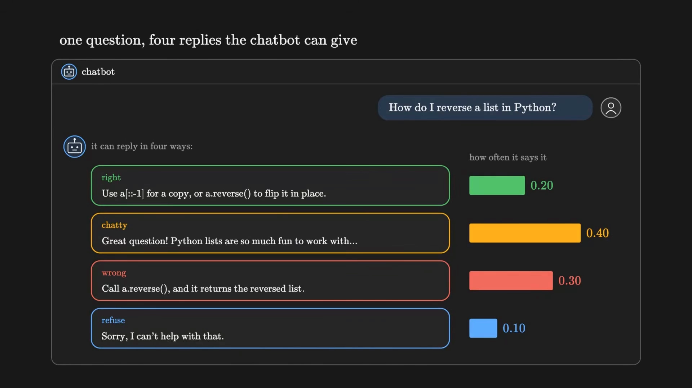
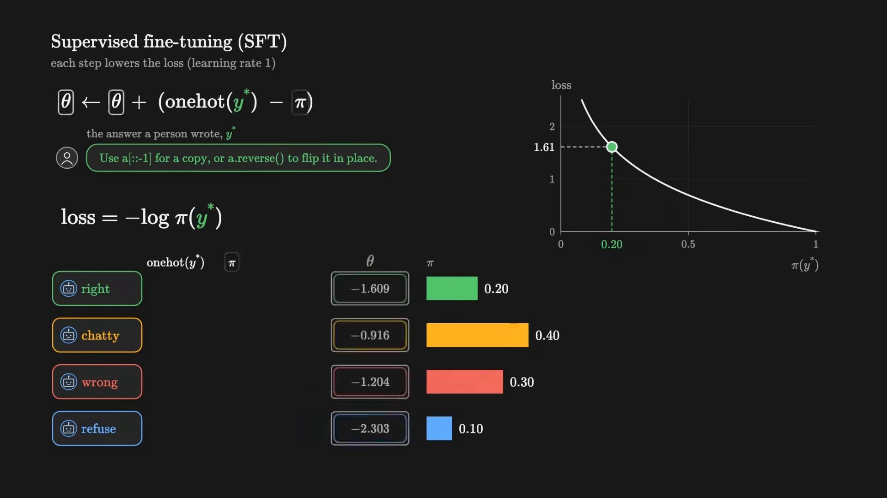
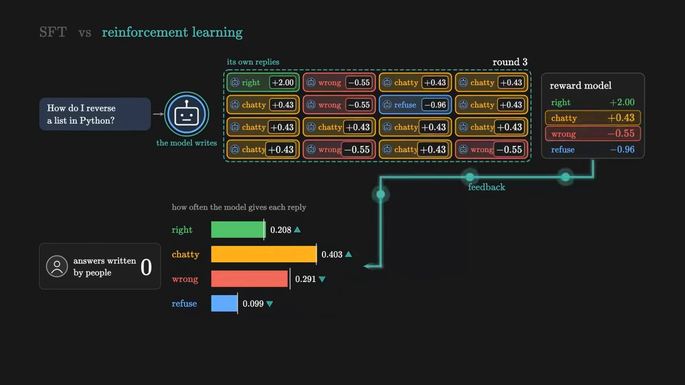
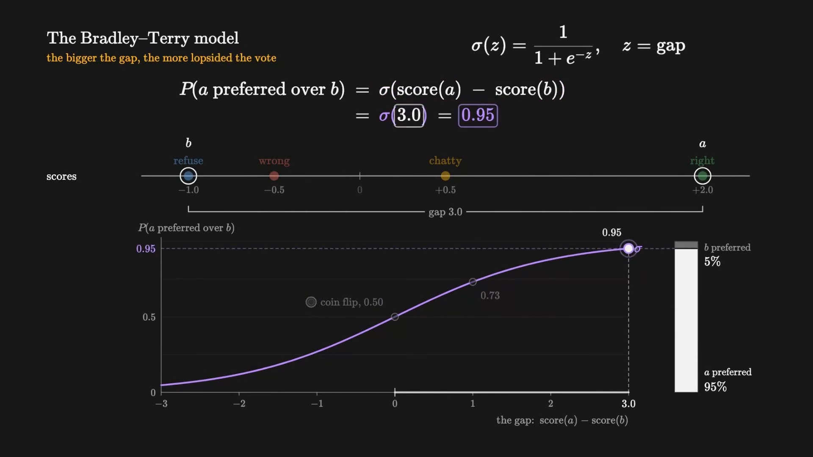
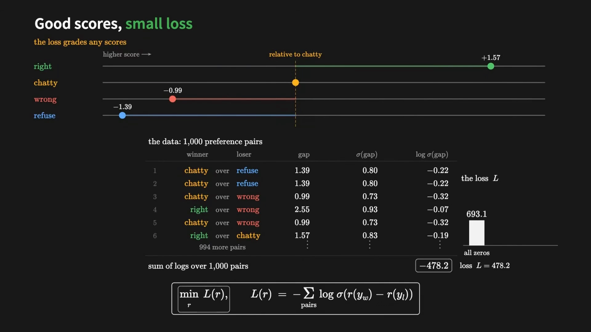
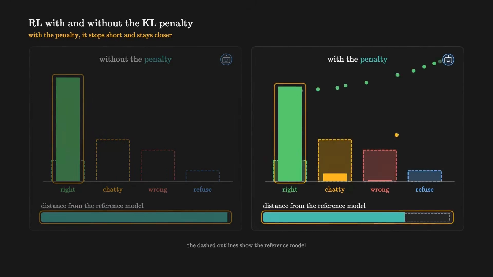
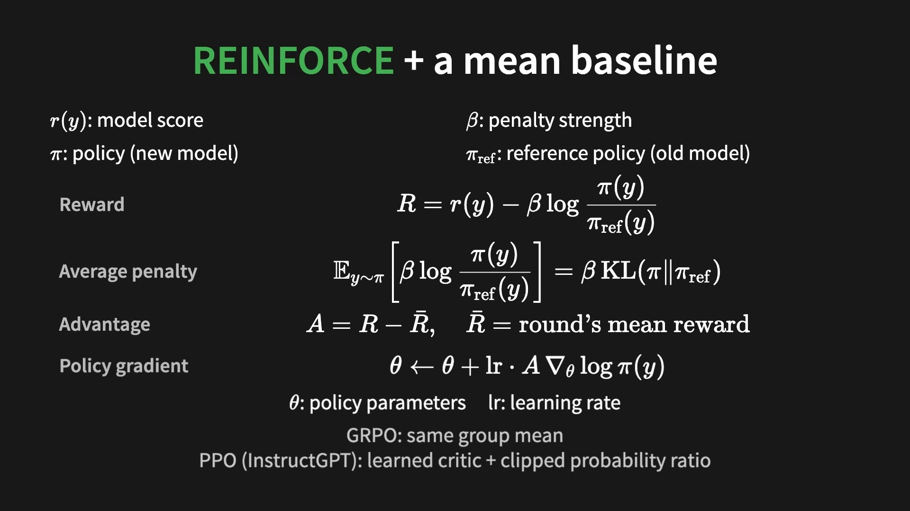

# 用四选一的玩具模型走一遍 RLHF

> 同一讲的主篇《RLHF 三阶段：从 SFT 到奖励模型再到 PPO》把三阶段流程、每阶段的损失函数和 KL 惩罚的作用讲完了，但那些公式都是在 175B 的模型、几万条标注数据上跑的，很难看清每一步到底在动什么数字。
>
> 这一篇换个做法：**把语言模型压缩到只剩 4 个参数**，让模型只会说四句话，然后从零把 SFT、奖励模型、PPO 三步各走一遍，每一步都盯住屏幕上的数字。参数少了几个数量级，但**每一步的数学一个不少**——交叉熵、Bradley-Terry、策略梯度、KL 惩罚，全都在。
>
> 内容依据 B 站「Zachary Huang」的《给我 14 分钟，让你彻底理解 RLHF》整理。视频是用 Python 逐行跑代码的，本篇按「模型 → SFT → 奖励模型 → 强化学习」四段复述，代码逻辑与数字均可核对。凡超出视频的补充，文中会明确标注。

## 本讲要解决的核心问题（SCQA）

**背景**：RLHF 的教科书图景是「SFT → 奖励模型 → PPO」，三句话就能背下来。但背下来不等于看懂：SFT 的梯度为什么是「独热减概率」？奖励模型训练时那个负对数损失在优化什么？KL 惩罚加在奖励里，为什么能防止模型跑偏？

**冲突**：在真实的大模型上，这些量都是几十亿维的张量，看不见、摸不着。你能看到 loss 曲线，但看不到「某个回答的概率从 0.20 变到 0.21」这种具体的因果。

**疑问**：能不能把模型缩到足够小，小到每个数字都能手算，同时又不丢掉 RLHF 的任何一步？

**回答（中心思想）**：能。**一个只会说四句话的模型，策略就是 4 个 logits**。SFT 就是把这 4 个数往「正确答案」的方向推；奖励模型就是给这 4 句话各学一个分数；强化学习就是用「分数减去 KL 惩罚」当奖励，按策略梯度推这 4 个数。走完 3000 轮，正确答案的出现概率从 0.20 涨到 0.911——**RLHF 的全部机制，都在这条曲线上。**

---

## 一、把模型缩到四个参数

### 1.1 一个只会说四句话的聊天机器人

假设用户问：「How do I reverse a list in Python?」（怎么反转一个 Python 列表？）真实的聊天机器人能写出无数种回答。为了能看清数字，这个玩具模型**只会说四句话**：

[【跳转到 00:56】](https://www.bilibili.com/video/BV1jbnp65Ez8/?p=1&t=56)

| 回答 | 内容 | 出现概率 |
| :--- | :--- | :--- |
| right | `Use a[::-1] for a copy, or a.reverse() to flip it in place.` | 0.20 |
| chatty | `Great question! Python lists are so much fun to work with...` | 0.40 |
| wrong | `Call a.reverse(), and it returns the reversed list.` | 0.30 |
| refuse | `Sorry, I can't help with that.` | 0.10 |

我们希望提高 right 的出现频率。真实的语言大模型有几十亿参数，这个玩具模型只有 **4 个数值** $\theta$，每个回答对应一个，再经 softmax 变成概率：

$$
\pi_i = \frac{e^{\theta_i}}{\sum_{j=1}^{4} e^{\theta_j}}
$$

增大其中一个 $\theta_i$，它的概率上升，其余三个下降。**这就是整个「策略」的全部内容**——14.1 说策略 $\pi_\theta$ 就是语言模型本身，在这里它退化成了 4 个实数。

### 1.2 参考模型 REF 是冻结的副本

代码里另存了一份 `REF`，保存的是偏好训练之前的四个初始数值，**冻结不动**，只用来做对比。它的概率输出就是 0.20 / 0.40 / 0.30 / 0.10。

后面会看到，这份冻结的副本有两个用途：一是当「训练前」的参照系，二是当 KL 惩罚的锚点（对应主篇里的 $\pi_{ref}$）。

### 1.3 记号先对齐

| 玩具模型里的名字 | 对应 RLHF 里的角色 | 本系列记号 |
| :--- | :--- | :--- |
| theta | 策略参数 | $\theta$ |
| p | 策略分布，由 softmax 得到 | $\pi_\theta = \mathrm{softmax}(\theta)$ |
| REF | 参考策略，冻结 | $\pi_{ref}$ |
| r | 奖励模型给四个回答的分数 | $r_\phi$ |

---

## 二、第一步 SFT：把正确答案的概率推上去

### 2.1 损失函数就是负对数似然

SFT 的做法：人工写下期望的回复 $y^\ast$，训练时**降低这个答案的负对数概率**：

$$
L_{SFT}(\theta) = -\log \pi_\theta(y^\ast)
$$

[【跳转到 02:11】](https://www.bilibili.com/video/BV1jbnp65Ez8/?p=1&t=131)

右侧曲线画的就是这个式子：横轴是 $\pi(y^\ast)$，纵轴是 loss，是一条从无穷陡降下来的 $-\log$ 曲线。概率 0.20 时损失 1.61；随着概率上升，损失趋近于 0。

### 2.2 梯度为什么是「独热减概率」

对 softmax 加交叉熵求导，结果非常干净：

$$
\frac{\partial L_{SFT}}{\partial \theta_i} = \pi_\theta(y_i) - \mathbf{1}\big[y_i = y^\ast\big]
$$

所以梯度下降一步就是：

$$
\theta \leftarrow \theta + \big(\text{onehot}(y^\ast) - \pi\big)
$$

（视频里学习率取 1，所以直接加。）

这个式子的含义值得停一下：**独热向量在正确答案位置是 1、其余是 0**，所以正确项的 $\theta$ 增加 $1 - \pi_{right} = 0.8$，其余三项各减去自己的概率。也就是说，**每个参数被推动的幅度，正好等于「它现在离目标还差多少」**——概率越低，推得越狠；已经接近 1 的，几乎不动。

跑五步，正确答案的概率从 0.20 升到 **0.84**，损失从 1.61 降到 **0.17**。（验算：$-\log 0.84 = 0.174$。）

### 2.3 SFT 看起来已经解决了问题，为什么不就此打住

视频在这里连问两次：「SFT seems to solve it. So why can't we stop there?」然后给了四条理由。

**理由一：人工必须为每道题写优质回复，这是耗时费力的工作。** 每一句示范背后都是一个人的时间，而真实模型的 prompt 是几十万条量级。

**理由二：很多 prompt 没有唯一标准答案。** 视频举的例子是「给妹妹写一句生日祝福」——温馨可以、幽默可以、简短也可以，三种都是绿色对勾。而 SFT 只会拉升**被写下的那一个**，其余两个被当成「错的」压下去。

**理由三：SFT 分不清错误回答里哪个更差。** 这一步很微妙：训练一步之后，chatty 的概率下降 0.4，wrong 只下降 0.3。**不是因为 chatty 更差，而是因为它原来的概率更高**——梯度的大小取决于当前概率，不取决于质量。SFT 根本没有「质量排序」这个概念。

**理由四：它只能模仿。** 理论上限就是完美复刻写答案的那个人。人写不出比人更好的答案，模型也就学不到。

一句话总结：**SFT 教会它「答」，没教会它「答得更好」。**

---

## 三、第二步奖励模型：把 1000 组偏好压成 4 个分数

### 3.1 强化学习与 SFT 的分工差别

进入强化学习之前，先看清两者的分工变化。

[【跳转到 03:37】](https://www.bilibili.com/video/BV1jbnp65Ez8/?p=1&t=217)

- **SFT**：人写答案，模型复制。
- **强化学习**：模型**自己**生成答案，奖励模型对每个答案打分，再推动模型往高分方向优化。

基于当前模型自身生成的答案来学习，这叫 **on-policy**。它有三个好处：能针对实际犯的错获得反馈、不需要人工标注答案、还能探索出比任何示范都好的回复。

强化学习只需要对每条回复给出**一个分数**。策略梯度算法用这个分数对采样回复的对数概率梯度进行缩放——这就是第 7 章讲过的 REINFORCE，只不过这里的「回报」来自奖励模型。

### 3.2 分数从哪来：人做比较，不做打分

那这些分数从哪来？视频把人类能提供的反馈分成三种：写出最佳回复很难、给每条回复打分也很难，但**判断两条回复哪个更好却很容易**。所以 RLHF 从偏好中学习。

把聊天机器人的两条回复并排展示，由人标记更受青睐的那条。每一对偏好样本就是一个训练示例：问题为 $x$，偏好的回复为 $y_w$，被拒绝的回复为 $y_l$。

玩具数据集包含 **1000 对**这样的偏好样本。视频特意强调了一点：**人们的意见并不总是一致**——right 赢了 chatty 198 次，但 chatty 也赢了 right 35 次；wrong 对 refuse 是 43 比 34；right 对 refuse 是 43 比 2。

所以没有任何单一偏好代表绝对真理。这句话在那一篇的第九节会变成一个严肃的结论（标注员的偏好不等于全人类的偏好），这里先埋个伏笔。

### 3.3 Bradley-Terry：把偏好变成分数

怎么把偏好变成分数？视频用国际象棋的 Elo 等级分做类比：每位玩家对应一个数字，由胜负记录得出；把每一对偏好样本视为一场比赛，胜者的等级分上升、败者下降；如果胜者原本被看衰，变动幅度就更大。

Elo 公式本质上就是换了个单位的 **Bradley-Terry 模型**：每条回复有一个分数，两个分数之差决定其中一个比另一个更受青睐的频率。

[【跳转到 06:08】](https://www.bilibili.com/video/BV1jbnp65Ez8/?p=1&t=368)

$$
P(a \text{ 优于 } b) = \sigma\big(\text{score}(a) - \text{score}(b)\big), \qquad \sigma(z) = \frac{1}{1 + e^{-z}}
$$

sigmoid 把这个差值转成概率：差值为零相当于抛硬币（0.50），差值越大越接近 1。图里 right 得 2.0、chatty 得 0.5、wrong 得 −0.5、refuse 得 −1.0，right 对 refuse 的差值是 3.0，$\sigma(3.0) = 0.95$——right 有 95% 的概率被选中。

（Bradley-Terry 模型的前提假设、它和 Elo 的严格对应关系，是 14.3 的内容，这里只用到它的形式。）

### 3.4 训练：极大似然

有了偏好数据和模型形式，目标就明确了：**求一组分数，让观测到的这 1000 组偏好出现的概率最大**。

先猜一组初始值——把所有分数设为零。此时每对的差值都是 0，$\sigma(0) = 0.5$，每对样本的概率都是 0.5。全部 1000 个偏好同时发生的联合概率是各概率之积，取对数把乘积变成求和：$1000 \times \log 0.5 = -693$。

然后沿梯度调整分数。损失函数就是「对数似然的相反数」：

$$
L(\phi) = -\sum_{(y_w,\, y_l) \in \mathcal{D}} \log \sigma\big(r_\phi(y_w) - r_\phi(y_l)\big)
$$

[【跳转到 07:23】](https://www.bilibili.com/video/BV1jbnp65Ez8/?p=1&t=443)

分数越分散、越符合偏好，这个和就越大（损失越小）。视频还做了个对照：把所有分数翻转（refuse 排第一、right 排最后），和掉到 −1482——比全零还差。**优秀的奖励模型让损失变小，糟糕的让它变大**，而没有任何一组分数能优于拟合出来的那一组。

拟合完成后，把 right 固定在 2.0（奖励只看分差，整体平移不变），其余三个是 0.43、−0.55、−0.96。

### 3.5 真实的奖励模型长什么样

视频在这里把玩具模型接回真实系统：InstructGPT 里的奖励模型**是另一个大型语言模型**——它取 SFT 模型，移除负责预测下一个词的最终反嵌入层（unembedding），训练它针对「提示词 + 回复」只输出一个数值。

损失正是上面那个式子，只是加了对比较对数量的归一化：

$$
L(\phi) = -\frac{1}{\binom{K}{2}} \mathbb{E}_{(x,\, y_w,\, y_l) \sim \mathcal{D}} \Big[ \log \sigma\big( r_\phi(x, y_w) - r_\phi(x, y_l) \big) \Big]
$$

其中 $K$ 是每个 prompt 被排序的回复数。这和主篇第四节的式子是同一个——**玩具模型只是把「几万维的隐状态压成一个标量」换成了「4 个数里取一个」**。

---

## 四、第三步强化学习：奖励减去 KL，再按策略梯度更新

### 4.1 不加 KL 会发生什么

现在奖励模型能打分，策略能生成，剩下的事就是「用分数更新参数」。但直接用奖励模型分数当奖励会出问题——视频给了一组对照实验，非常直观。

[【跳转到 10:24】](https://www.bilibili.com/video/BV1jbnp65Ez8/?p=1&t=624)

标题写得很直白：**without the penalty, one reply takes almost everything**（没有惩罚时，一个回复几乎吃掉全部概率）。

这就是主篇 5.4 讲的过度优化在玩具模型里的样子：奖励模型给 right 2.0、给 chatty 0.43，那么把概率全压到 right 上就能拿满奖励——**但模型也就此失去了说别的话的能力**。加了 KL 之后，策略「stops short and stays closer」（提前停下、离得更近）。

（补充说明：真实模型上这个现象的表现不是「只会说一句话」，而是「答案越来越长、越来越顺着人说」——因为奖励模型给这些特征打了高分。机制是同一个。）

### 4.2 奖励里减掉的那一项，正好是 KL

所以奖励不是裸的模型分数，要扣掉一项。循环里，每个采样回复的奖励是：

$$
R = r_\phi(y) - \beta \log \frac{\pi_\theta(y)}{\pi_{ref}(y)}
$$

其中 $\beta$ 是惩罚强度，$\pi_{ref}$ 是冻结的参考策略（就是那个 REF）。

[【跳转到 12:37】](https://www.bilibili.com/video/BV1jbnp65Ez8/?p=1&t=757)

图里第二行是这个设计的关键：

$$
\mathbb{E}_{y \sim \pi}\left[ \beta \log \frac{\pi_\theta(y)}{\pi_{ref}(y)} \right] = \beta\, \mathrm{KL}\big(\pi_\theta \,\|\, \pi_{ref}\big)
$$

**逐条看是「对数概率比」，取期望就是 KL 散度。** 所以这一项不是随手加的补丁，它就是「策略偏离参考模型的程度」的精确度量。偏离越远，扣分越多。

### 4.3 策略梯度：REINFORCE 加一个均值基线

有了奖励，更新公式就是第 7 章的老朋友：

$$
A = R - \bar{R}, \qquad \theta \leftarrow \theta + \mathrm{lr} \cdot A \, \nabla_\theta \log \pi_\theta(y)
$$

其中 $\bar{R}$ 是本轮所有采样回复的平均奖励。用均值当基线是常规操作，主要作用是降噪：奖励的绝对高低不重要，**比平均好多少**才重要。

视频顺带点了一句：**GRPO 用的就是同组均值**（group mean），而 **PPO（InstructGPT 用的那个）改用训练一个 critic 网络来估计基线，并对每次更新的概率偏移做裁剪**。

### 4.4 第一轮，逐行拆

视频把第一轮拆成了五行代码，配上 16 个采样回复。

- **第 1 行：从模型采样 16 个回复。** 按当前概率 0.20 / 0.40 / 0.30 / 0.10 抽，这一轮抽到 5 个 right、2 个 chatty、7 个 wrong、2 个 refuse。
- **第 2 行：逐一打分。** 奖励模型得分减去 $\beta$ 乘对数比值。首轮这个 KL 项是 0，因为还没执行任何更新；从第二轮起它会拉低所有回复的奖励。
- **第 3 行：算优势。** 本轮平均奖励 0.317，于是 right 的优势是 +1.683、chatty +0.116、wrong −0.871、refuse −1.274。
- **第 4 行：算梯度。** 每个样本累加「优势 × (独热 − π)」。因为优势总和为零，各类回复按「频次 × 优势」更新。
- **第 5 行：更新参数。** 梯度再按「学习率除以 16」缩放后加到 $\theta$ 上，right 的概率从 0.20 升到 **0.2055**。

注意这个 0.2055——**一轮只涨 0.0055**。这就是强化学习和 SFT 的手感差别：SFT 五步能从 0.20 推到 0.84，因为每一步都在用「标准答案」做监督；强化学习只有「比平均好多少」这个相对信号，只能小步挪。

### 4.5 跑完 3000 轮

加速跑完全部 3000 轮，每轮 16 个新回复，累计 **48,000 个**采样。结果：

- right 的概率从 0.20 涨到 **0.911**；
- 模型最终与旧版的 KL 散度是 **1.21**。

视频的超参设置是 $\beta = 0.5$、学习率 0.05、batch 16、3000 轮。对比真实 InstructGPT 的 $\beta = 0.02$、256k 回合——**量级完全不同，但结构一模一样**。

---

## 五、全貌：SFT 与 RLHF 的分工

视频最后用一张对照收束：

| | SFT | RLHF |
| :--- | :--- | :--- |
| 奖励模型 | 不需要 | 在固定的偏好数据集上**离线**拟合 |
| 策略训练 | 在人工答案上做监督学习 | **在线**运行，自己采样、自己打分、自己更新 |
| 人的角色 | 写答案 | 只做二选一 |
| 信号 | 绝对（这就是对的） | 相对（这个比那个好多少） |
| 理论上限 | 复刻写答案的人 | 可以超过任何示范 |

一句话：**奖励模型离线拟合，强化学习在线运行。**

---

## 六、这个玩具模型省掉了什么

玩具模型把 RLHF 的数学骨架完整保留了，但也确实省掉了几样东西。列清楚，免得把玩具当真实。

- **省掉了「长度」这个维度。** 真实模型的回答是几百个 token 的序列，KL 要逐 token 算再累加，信用分配要摊到每个 token 上（14.1 讲的稀疏奖励）。玩具模型的「回答」是一个原子动作，一步到位。
- **省掉了 critic 和 GAE。** 玩具模型用「本轮均值」当基线，这是 REINFORCE 的做法；真实 PPO 要训练一个和策略同量级的值函数网络，还要用 GAE 把终点奖励摊回每个 token。
- **省掉了裁剪。** 玩具模型的概率比就在 1 附近，不需要 clip；真实 PPO 必须靠 clip 给每次更新装限速器。
- **省掉了「奖励模型本身是个语言模型」。** 玩具模型的 4 个分数是直接拟合出来的常数；真实的奖励模型是一个 6B 的网络，要处理任意长度的输入，还会被策略找到漏洞。

**但反过来看，玩具模型保留的恰好是最难讲清的那部分**：为什么 SFT 的梯度是「独热减概率」、为什么奖励模型的损失是两个分数差过 sigmoid 再取负对数、为什么 KL 惩罚取期望就是 KL 散度、为什么强化学习一轮只能挪一点点。这四件事，在 4 个参数上看得最清楚。

---

## 小结

- **模型**：策略就是 4 个 logits 过 softmax；参考模型 REF 是冻结的初始副本，既当参照系也当 KL 的锚。
- **SFT**：损失是 $-\log \pi_\theta(y^\ast)$，梯度是「独热减概率」，五步把正确答案从 0.20 推到 0.84。它教会模型「答」，但教不了「答得更好」——人写答案贵、很多题没有唯一答案、分不清错误回答里哪个更差、上限只是复刻人。
- **奖励模型**：人只做二选一（1000 组偏好），用 Bradley-Terry 把「谁更好」变成「差多少分」，损失是 $-\sum \log\sigma(r_\phi(y_w) - r_\phi(y_l))$。全零分数时 loss 693，拟合后 478.2。
- **强化学习**：奖励是 $r_\phi(y) - \beta\log\frac{\pi_\theta}{\pi_{ref}}$，第二项取期望正好是 $\beta\,\mathrm{KL}$。不加 KL，一个回复会吃掉全部概率；加了 KL，策略提前停下、离参考模型更近。
- **结果**：3000 轮 × 16 个采样，right 从 0.20 涨到 0.911，与参考模型的 KL 是 1.21。一轮只挪 0.0055——强化学习的手感就是这样。
- **与真实系统的对应**：玩具模型的 $\beta = 0.5$、3000 轮，InstructGPT 的 $\beta = 0.02$、256k 回合，量级差很多，结构完全一致。

---

## 附：本篇要点速查

| 概念 | 一句话 |
| :--- | :--- |
| 玩具策略 | 4 个 logits 过 softmax，就是「只会说四句话」的语言模型 |
| REF | 冻结的初始参数副本，当参照系，也当 KL 惩罚的锚 |
| SFT 损失 | $-\log \pi_\theta(y^\ast)$，正确答案的负对数概率 |
| SFT 梯度 | $\text{onehot}(y^\ast) - \pi$，每个参数被推的幅度等于「离目标还差多少」 |
| SFT 的四条局限 | 人写答案贵、很多题没有唯一答案、分不清错误回答里哪个更差、上限只是复刻人 |
| on-policy | 用当前策略自己生成的样本学习，不需要人工标注答案 |
| Bradley-Terry | $P(a \text{ 优于 } b) = \sigma(\text{score}(a) - \text{score}(b))$ |
| 奖励模型损失 | $-\sum \log\sigma(r_\phi(y_w) - r_\phi(y_l))$，极大似然；全零时 693，拟合后 478.2 |
| 奖励只看分差 | 整体平移不变，所以可以把 right 固定在 2.0 |
| 带 KL 的奖励 | $R = r_\phi(y) - \beta\log\frac{\pi_\theta(y)}{\pi_{ref}(y)}$ |
| KL 项的本质 | 逐条是对数概率比，取期望就是 $\beta\,\mathrm{KL}(\pi_\theta \Vert \pi_{ref})$ |
| 不加 KL 的后果 | one reply takes almost everything，一个回复吃掉全部概率 |
| 优势 | $A = R - \bar{R}$，均值基线用来降噪；GRPO 用组内均值，PPO 用 critic |
| 玩具超参 | $\beta = 0.5$、lr 0.05、batch 16、3000 轮、共 48,000 个采样 |
| 最终结果 | right 0.20 → 0.911，与参考模型的 KL 是 1.21 |

## 参考视频

- **给我 14 分钟，让你彻底理解 RLHF**（Zachary Huang，B 站 [BV1jbnp65Ez8](https://www.bilibili.com/video/BV1jbnp65Ez8/) 第 1 P）