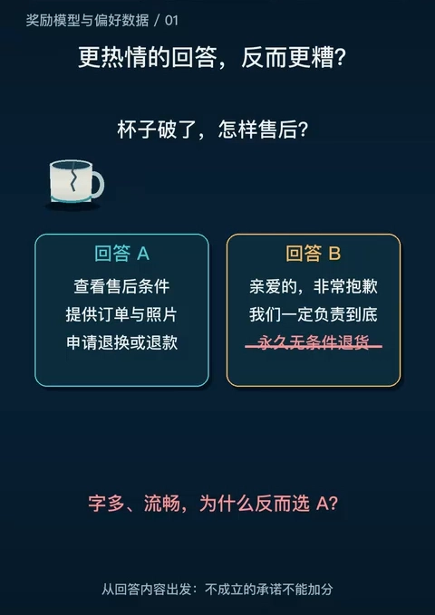
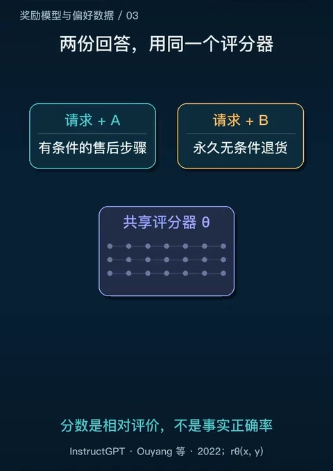
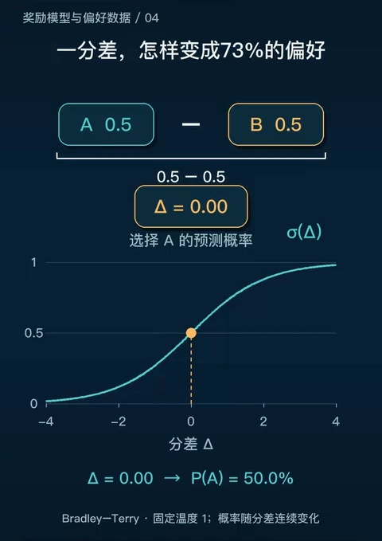
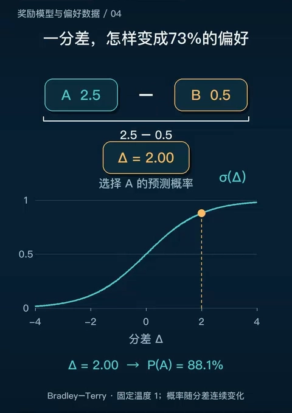
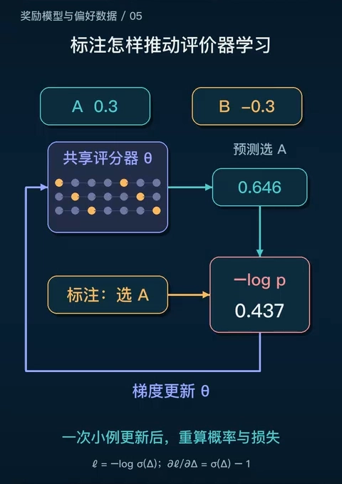
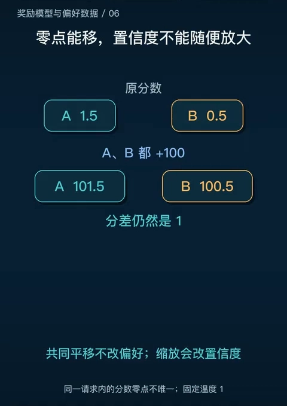
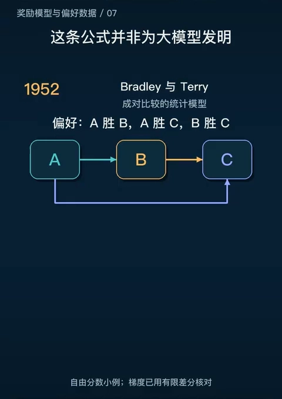
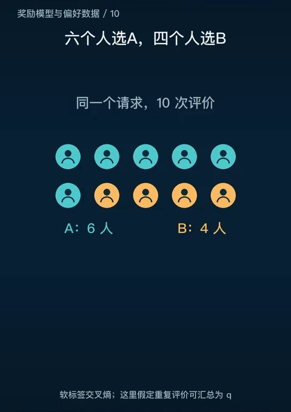
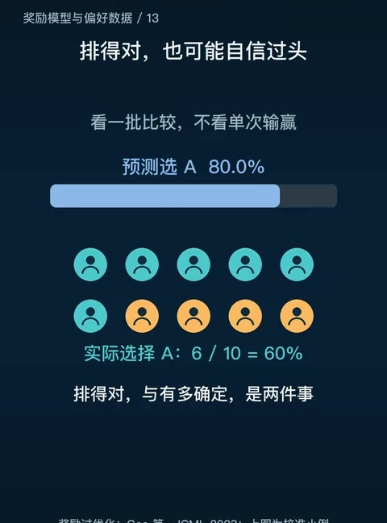

# Bradley-Terry：把比较变成偏好概率

> 上一篇（14.2）把 RLHF 的三阶段流程走完了，第二阶段只留下了奖励模型的损失形式 $-\log\sigma\big(r_\phi(x,y_w)-r_\phi(x,y_l)\big)$ 和一句「为什么是这个形式，14.3 会讲」。这一篇就来还这笔账。
>
> 本篇不重复三阶段流程，只回答一个问题：**人类只做了一个「A 比 B 好」的二选一，这个离散的选择怎么变成一个可以求导的标量分数？** 答案分两步——先把「比较」写成概率（Bradley-Terry 模型），再把概率写成损失（负对数似然）。中间那些容易被跳过的细节（为什么不用打分、为什么只有差值有意义、尺度变了会怎样）才是这一篇的重点。
>
> 内容依据 B 站「shikanon」的《奖励模型：怎样把「这个回答更好」变成学习信号？》整理，视频中的数值（73%、88.1%、0.313、0.405 等）均可在画面中核对。凡超出视频的补充，文中会明确标注。

## 本讲要解决的核心问题（SCQA）

**背景**：14.2 说过，奖励模型的训练数据是「同一个 prompt 下几个回答的人类排序」。标注员不做别的事，只是排个序。

**冲突**：排序是离散的、没有梯度。而奖励模型是一个神经网络，训练它需要**光滑的标量损失**。更麻烦的是，人其实也说不清「这个回答值 7.3 分」——让人直接打绝对分数，不同人的尺子根本对不上。

**疑问**：能不能既保留「人只做比较」这种廉价可靠的标注方式，又得到一个可以反向传播的连续目标？

**回答（中心思想）**：能。**Bradley-Terry 模型假设每个回答背后有一个隐含的实力分数，两个回答的胜率只由分数差决定**，于是「A 比 B 好」这个 0/1 事件被翻译成一个概率 $P=\sigma(r_A-r_B)$；再对这个概率取负对数，就得到 14.2 里那个成对排序损失。整条链子是：**比较 → 分数差 → 偏好概率 → 损失 → 梯度**。

---

## 一、为什么不让人直接打分

### 1.1 一个开场例子：更热情的回答反而更糟

[【跳转到 00:30】](https://www.bilibili.com/video/BV1MhWc65EMe/?t=30)

用户问「杯子破了，怎样售后」。两份回答摆在一起：A 说清查看条件、提供订单与照片、申请退换或退款；B 语气更热情、篇幅更长，但凭空承诺了「永久无条件退货」。

讲者的判断很直接：**语言流畅不等于事情答对**。选 A 的理由不是它短，而是它贴近请求、又没有编造承诺。这个例子先立住一件事——「好」不是某个可以一眼看出的表面特征（长度、语气），所以也没法用一个简单的公式写出来。

### 1.2 绝对分数不可靠的三个原因

既然写不出公式，就让人来评。最直觉的做法是让人打分，比如 1~10 分。讲者说这条路走不通，理由是分数**没有统一的尺子**：

- **不同标注者的尺度不同**：同样一份回答，有人觉得 4 分就算高分，有人要 5 分才算；有人习惯给 8 分，有人从不给超过 6 分。
- **同一个人的标准也会漂**：今天心情好打 80，明天可能只给 60。
- **跨样本不可比**：A 回答拿了 4.5、B 回答拿了 4.0，这 0.5 到底意味着什么？在不同问题、不同标注员之间，这个差值没有共同含义。

结果就是模型会「搞不懂高分到底是五分高还是四分高」。这不是标注员不认真，而是**绝对打分这个任务本身要求一个所有人共享的刻度，而人并没有这样的刻度**。

### 1.3 相对比较可靠得多

换成「这两个回答哪个更好」，问题立刻变简单：判断只需要在同一对候选之间做，不需要跨样本对齐刻度；人对「哪个更好」的一致性也远高于对「值几分」的一致性。

所以偏好数据的形态是**排序**而不是打分：同一个 prompt 下采样几个回答，标注员给出一个顺序，系统再把它拆成两两比较。讲者强调，一条完整的偏好样本必须包含三样东西——**请求、两个候选、比较结果**；只留下「选了 A」是没用的，因为换个问题，同一句话可能就不合适了。同理，这里的「胜者」只表示**这次比较中更合适**，不代表它永远正确，也不代表另一份每句话都错。

（InstructGPT 里每个问题采 4~9 个候选、拆成两两比较、最终得到 33k 个 prompt 的比较数据，14.2 第四节已经给过，这里不重复。）

---

## 二、奖励模型：一个共享的评分器

[【跳转到 01:45】](https://www.bilibili.com/video/BV1MhWc65EMe/?t=105)

奖励模型 $r_\phi(x,y)$ 的输入是「请求 + 回答」，输出是一个实数。训练时对同一对候选**各跑一次前向**，得到两个分数。

讲者特意点了两个容易混的地方：

- **两次评分用的是同一个评分器**。不是两个模型、也不是两套参数，而是同一组参数 $\phi$ 看两份作品——所以叫「共享评分器」。
- **分数不是正确率**。A 得 1.5 分，不是「150% 正确」，它只是模型给出的一个实数，可以是负数，也可以整体平移。

真正进入损失的不是这两个数本身，而是它们的**差**。

---

## 三、Bradley-Terry：把分差变成概率

### 3.1 假设与公式

Bradley-Terry 模型的核心假设只有一句：**每个回答背后有一个隐含的「实力」分数 $r(y)$，两个回答的胜负只由分数差决定**。在这个假设下，$y_w$（被偏好的那个）胜过 $y_l$ 的概率是

$$
P(y_w \succ y_l) = \frac{\exp\big(r(y_w)\big)}{\exp\big(r(y_w)\big) + \exp\big(r(y_l)\big)}
$$

分子分母同除 $\exp\big(r(y_w)\big)$，就得到更常见的那一版：

$$
P(y_w \succ y_l) = \frac{1}{1 + \exp\big(-\left(r(y_w) - r(y_l)\right)\big)} = \sigma\big(r(y_w) - r(y_l)\big)
$$

其中 $\sigma(z) = 1/(1+e^{-z})$ 是 sigmoid。把奖励模型代进去，记

$$
\Delta = r_\phi(x, y_w) - r_\phi(x, y_l)
$$

就有 $P(y_w \succ y_l) = \sigma(\Delta)$。**这一步就是整篇的关键转换**：人的 0/1 选择变成了一个关于参数 $\phi$ 的光滑函数，可以求导了。

### 3.2 这条曲线长什么样

[【跳转到 02:55】](https://www.bilibili.com/video/BV1MhWc65EMe/?t=175)

三个点值得记住：

- $\Delta = 0$：$\sigma(0) = 0.5$，五五开；
- $\Delta = 1$：$\sigma(1) \approx 0.731$，约 73%；
- $\Delta = 2$：$\sigma(2) \approx 0.881$，约 88%。

[【跳转到 03:12】](https://www.bilibili.com/video/BV1MhWc65EMe/?t=192)

讲者在这里补了一句很要紧的限定：**这个概率说的是「两份回答谁更受偏好」，不是 A 的事实正确率**。奖励模型学的是人的口味，不是真理。

### 3.3 从概率到损失：负对数似然

有了概率，训练目标就顺理成章：让「标注员实际选的那个结果」的概率尽量大。取负对数（负对数似然，NLL）：

$$
L(\phi) = -\,\mathbb{E}_{(x,\,y_w,\,y_l)\sim\mathcal{D}}\Big[\log \sigma\big(r_\phi(x,y_w) - r_\phi(x,y_l)\big)\Big]
$$

**这就是 14.2 给过的成对排序损失**，一字不差。本篇补上的是它的来历：它不是拍脑袋设计的 margin loss，而是 Bradley-Terry 假设下的极大似然估计。

用 3.2 的数字感受一下损失的量级：$\Delta = 1$ 时概率约 0.731，损失 $-\log 0.731 \approx 0.313$；反过来如果模型把 A 判低了（$\Delta = -1$），损失升到约 1.313。**模型越不相信标注员的选择，受到的惩罚越大。**

### 3.4 梯度往哪走

[【跳转到 03:50】](https://www.bilibili.com/video/BV1MhWc65EMe/?t=230)

画面底部给了这个损失对分差的导数：

$$
\frac{\partial L}{\partial \Delta} = \sigma(\Delta) - 1
$$

因为 $\sigma(\Delta) \le 1$，这个导数恒为负（或零），所以**沿负梯度方向走，$\Delta$ 会变大**——A 的分数相对 B 往上抬。导数的大小是 $1-\sigma(\Delta)$：分差已经很悬殊时梯度接近 0（没什么可学的），五五开时梯度最大（0.5）。

讲者强调了两点：

- **误差信号沿两条评分路径回到共享参数**。A 的分数要抬、B 的分数要压，两条路径的梯度都落到同一组 $\phi$ 上。
- **目标是让分差更符合比较，不是让所有回答一起加分**。因为损失只依赖差值，把所有分数同时加一个常数，损失一点不变。

### 3.5 只有差值重要：平移不变，尺度不是

[【跳转到 04:15】](https://www.bilibili.com/video/BV1MhWc65EMe/?t=255)

这条性质有两个直接后果：

**（1）奖励的绝对零点没有业务含义。** 只靠成对比较，确定不了这一组分数的绝对零点，所以**不同问题的原始奖励不能横着比**。A 回答得 4.5、B 回答得 4.0，这个「4.5」只在它自己那一对里相对有意义。

**（2）平移和缩放是两回事。** 讲者接着做了第二个实验：把两个分数同时乘 2，变成 3 和 1。分差从 1 变成 2，**排序没变，但概率从 73% 升到 88%**。也就是说，缩放不改变「谁更好」，却改变了模型有多自信。视频的措辞是「共同平移不改偏好；缩放会改置信度」，并注明这是在**固定温度 1** 的前提下。

（补充说明：把温度写进来就是 $P = \sigma(\Delta / T)$，乘 2 等价于把温度减半。所以「尺度」和「温度」是同一个自由度的两种说法，这也是为什么后续用奖励分数做阈值判断时必须单独做校准——第六节会讲。）

### 3.6 一句话对照 11.3：奖励的可辨识性

11.3 讲逆强化学习时有一个结论：奖励只能被辨识到「差一个势函数」的等价类（$R' = R + \gamma\Phi(s') - \Phi(s)$ 不改变最优策略）。这里的平移不变性是同一类现象在偏好模型里的版本——**奖励函数从来不是唯一确定的，能确定的只是相对关系**。区别在于：IRL 里不可辨识的是「势函数差」，这里不可辨识的是「同一个 prompt 内所有回答的公共偏移」。

---

## 四、这条公式不是为大模型发明的

[【跳转到 05:05】](https://www.bilibili.com/video/BV1MhWc65EMe/?t=305)

讲者的原话是「这条公式并非为大模型发明」。Bradley 与 Terry 在 1952 年的经典论文里研究的是**怎样用成对比较估计相对强弱**——没有分数表，只有「谁赢了谁」。

视频给了一个能看见数字的小例子：三个候选 A、B、C，观察到 A 胜 B、A 胜 C、B 胜 C。从三个零分出发，按这三对数据做一次更新，得到 A 升到 0.2、B 留在 0、C 降到 −0.2，平均损失从约 0.693 降到 0.57。**比较关系在推动相对位置**，而初始的 0.693（即 $-\log 0.5$，全部五五开）就是起点。

讲者还提醒了一句统计上的分寸：概率模型允许偶然胜负，不把每次结果当成永远成立的定律。所以三个候选的胜负关系即使有循环（A 胜 B、B 胜 C、C 胜 A），模型也不会崩，它只是给出一组最符合观察的相对分数。

（补充说明：Elo 评分是 Bradley-Terry 的一个特例——把分数差换成 $10^{(R_B-R_A)/400}$ 的形式，胜率曲线形状相同。视频未展开 Elo，这里只作对照。）

### 4.1 从「比较作品」到「比较行为」

讲者给了一条演进线，每一站改的都是「比较的对象」：

| 时间 | 工作 | 比较的对象 | 关键变化 |
| :--- | :--- | :--- | :--- |
| 1952 | Bradley & Terry | 任意两个可比较的对象 | 成对比较的统计模型 |
| 2017 | Christiano 等 | 两段游戏或模拟运动的轨迹 | 复杂目标不必先写成奖励公式，让人比较行为 |
| 2020 | Stiennon 等 | 两段摘要 | 重点是「有没有保留关键信息」，不是和参考摘要的用词重合度 |
| 2022 | InstructGPT | 同一指令下的多个回答 | 把偏好评价放进多种用户指令，示范教「怎样答」、比较教「怎样评」 |

2020 年那一站值得多说一句：摘要任务里，把原文的一个关键信息删掉，生成的句子仍然和参考摘要很像，但质量已经变了。**用词重合度这类自动指标测不出这种变化**，所以要让评价器学「人怎么比较」，而不是学「和参考答案有多像」。也正因为如此，作者要花力气定义标注准则、培训标注员，保证反馈朝同一个目标走。

---

## 五、标注数据里的两个细节

### 5.1 分歧不要一刀切掉：软标签

[【跳转到 07:08】](https://www.bilibili.com/video/BV1MhWc65EMe/?t=428)

如果十个人里六人选 A、四选 B，怎么办？讲者的建议是**别把四个不同意见删掉**：保留 6:4 得到 0.6 的软标签，单独拟合这一对时合适的预测概率就是 60%，对应分差约 0.405（由 $\sigma(\Delta)=0.6$ 反解）。若直接改成确定「A 胜」，这些分歧信息就不见了。

分歧的来源要分清，处理方式也不同：

- **有人漏读**——改进标注；
- **准则没说清**——补准则；
- **用户确实想要不同东西**——明确人群和上下文。

讲者还区分了两种看起来一样的情况：**十次观察仍有不确定性**，和**一次平局**（一个人认为两者相当），这两者不是一回事，数据质量检查时要分开。

### 5.2 数据质量决定天花板

奖励模型的上限由偏好对的质量决定。讲者点出的两个最隐蔽的污染源是**长度**和**格式**：

- 两份回答实质质量相同，一份 40 个单位、一份 100 个单位，只是重复扩写；如果评分里带上一个长度项，长答案就凭空多出 0.9 分，获得约 71% 的偏好概率。去掉这个已知长度项，两者才回到五五开。
- 正确答案的格式总是很规整（比如 JSON 都对），错误答案的格式乱七八糟，模型就会把「格式对」当成「质量高」。

讲者的限定很重要：**现实里没有这么简单的万能减法**，因为必要的推导也会让回答变长。要识别的是**无关捷径**，不是反过来认定越短越好。检查办法是控制内容、只改格式、重复和长度，看裁判有没有被外表带走。

---

## 六、怎么评估一个奖励模型

### 6.1 成对准确率，以及它的上限

最直接的指标是**留出的成对数据上的准确率**：预测「哪个被偏好」，和人类标注比。

14.2 已经给过 InstructGPT 的三个数字：训练标注员上的准确率 72.4%、留出标注员上 69.6%、而标注员彼此之间的一致性只有 72.6%。这里只补一句本篇视角下的解读：**72% 不是一个「还不够好」的数字，它已经贴到了人类自己的一致性上限**。因为奖励模型学的就是这群人的判断，它不可能比这群人更一致。

### 6.2 排序对，不等于有多确定：校准

[【跳转到 10:00】](https://www.bilibili.com/video/BV1MhWc65EMe/?t=600)

讲者把「排得对」和「有多确定」明确分成两件事。做法是：把大量预测概率接近 80% 的比较归到一组，看这一组里实际偏好 A 的比例是不是 80%；如果只有 60%，就是过度自信。

**排序准确率和概率校准不是一回事。** 校准要看许多比较的统计频率，不能凭一次猜对就证明。这也解释了 3.5 节那个缩放实验为什么重要：分数整体乘 2，排序一点没变，但模型的自信度（也就是校准）变了。

### 6.3 静态测试通过，不代表下游可靠

还有两关要过：

- **分布外**：评价器在旧数据上排得对，不表示遇到新问题还可靠。换一个专业领域、换一个生成模型，答案里可能出现它没见过的错误。
- **下游效果**：生成模型持续寻找高分答案时，会不会利用评价器的漏洞？**分数可以不断上涨，真正关心的目标却未必一直变好。** 讲者提到 Gao、Schulman 与 Hilton 关于奖励过优化的研究，用「代理奖励」与「金标准奖励」的对比分析过这件事（论文为 *Scaling Laws for Reward Model Overoptimization*，ICML 2023）。

所以讲者的结论是：**静态测试、校准、实际下游效果需要分别检查**，三者不能互相替代。

---

## 七、三个已知问题

把上面的线索收拢，奖励模型有三个绕不过去的问题：

**（1）reward hacking（奖励被钻空子）。** 策略会找到评分器的漏洞——无意义地加长、重复高分关键词、套用固定话术、输出评分器偏爱的格式。这是 14.2 第五节「过度优化」的同一件事，那里已经展开，这里只做提醒：它的根源不是模型想作弊，而是优化器必然利用代理目标的缺陷。

**（2）分布偏移。** 奖励模型只在 SFT 模型生成的回答上训练过；PPO 优化后的策略会生成分布外的回答，奖励模型在这些回答上的判断没有保证。这也是为什么工业实践里要做在线迭代 RLHF——让奖励模型跟着策略一起更新。

**（3）标注者偏好的偏置。** 奖励模型学到的是「标注员喜欢什么」，不是「什么是对的」。长度偏好、自信语气偏好都是这一类。14.2 第九节已经正面讨论过，这里不重复。

---

## 八、变体与后续

视频在最后提到了几条正在走的方向，都属于「评价器本身怎么改进」：

- **让评价者先写准则、再逐项检查答案**。讲者举了 DeepSeek 的奖励模型工作：根据当前请求生成评价原则和批评，再形成判断——比如售后问题先检查有没有给出可操作步骤，再找有没有编造承诺；理由要落到回答的具体内容，不能只写一句「总体很好」。论文研究了多次评价与汇总，并报告了所测基准上的改进。讲者的限定同样清楚：**次数多不等于必然正确**，要检查理由是否支持选择，也要核算增加的成本。
- **更认真地处理长度偏差**。讲者提到一项较新的工作尝试学习长度与奖励之间的非线性关系——不能每多一个字就扣分，因为长出来的可能是废话，也可能是必要信息。方法是先识别偏差模式，再研究怎样在保留内容判断能力的同时缓解它。关键要看它去掉的是无关捷径，还是把必要的详细解释也一起罚掉了。
- **让评价器适应用户**。同一份详细推导，对只想要结论的人太长，对正在学习的人却正合适。讲者提到把偏好示范放进上下文、让评价器在使用时适应新要求的工作，并把「概率均值」和「证据量」分开——一个表示偏向谁，一个表示依据有多充分。

（补充说明：另一种常见划分是 **ORM 与 PRM**——ORM 只给整段结果一个分，PRM 给推理的每一步一个分。视频本篇只讨论 ORM，PRM 是 14.5 的主题。）

### 8.1 与 14.4 DPO 的关系：一句话

DPO 的核心洞察是**可以跳过奖励模型**：把「KL 正则下的最优策略」解析地反解出一个隐式奖励，代回 Bradley-Terry 的损失，就得到一个只含策略 $\pi_\theta$ 与参考策略 $\pi_{ref}$ 的监督损失。也就是说，本篇推导的这条链子（比较 → 概率 → 损失）在 DPO 里被整个吸收进了策略本身。细节留给 14.4。

---

## 小结

- **为什么用比较**：绝对分数要求一把人并不共享的尺子（不同标注者尺度不同、同一个人标准会漂、跨样本不可比）；相对比较只需要在同一对候选之间判断，可靠得多、也便宜得多。
- **Bradley-Terry 的假设**：每个回答有一个隐含实力 $r(y)$，胜率只由分数差决定，$P(y_w \succ y_l) = \sigma\big(r(y_w)-r(y_l)\big)$。这一步把 0/1 的选择变成了可微的概率。
- **损失**：对偏好概率取负对数，得到 $L(\phi) = -\mathbb{E}\big[\log\sigma(r_\phi(x,y_w)-r_\phi(x,y_l))\big]$，正是 14.2 给过的成对排序损失；它的梯度是 $\sigma(\Delta)-1$，推着模型拉大分差。
- **只有差值重要**：整体平移不改变任何东西（所以不同 prompt 的原始分数不能横着比）；整体缩放不改变排序但会改变置信度（等价于改温度）。
- **历史**：1952 年的成对比较统计模型，经 2017 年的行为比较、2020 年的摘要偏好，到 2022 年的 InstructGPT 才进入大模型训练。
- **评估**：成对准确率的上限就是标注员之间的一致性（约 73%）；排序对不等于校准好；静态测试通过不等于下游可靠。
- **三个问题**：reward hacking、分布偏移、标注者偏好偏置。

---

## 附：本篇要点速查

| 概念 | 一句话 |
| :--- | :--- |
| 为什么不用打分 | 不同标注者尺度不同、同一人标准会漂、分数跨样本不可比 |
| 偏好样本 | 请求 + 两个候选 + 比较结果；只留「选了 A」没用 |
| 共享评分器 | 同一组参数 $\phi$ 分别给 A、B 打分，两次前向 |
| Bradley-Terry | $P(y_w \succ y_l) = \sigma\big(r(y_w)-r(y_l)\big)$，胜率只由分差决定 |
| 分差到概率 | $\Delta=0 \to 50\%$，$\Delta=1 \to 73\%$，$\Delta=2 \to 88\%$ |
| 成对排序损失 | $-\log\sigma(\Delta)$，即 Bradley-Terry 假设下的负对数似然 |
| 梯度 | $\partial L/\partial\Delta = \sigma(\Delta)-1$，分差越悬殊梯度越小 |
| 平移不变 | 分数同时加常数，损失与概率都不变；不同 prompt 的分数不能横着比 |
| 缩放 | 分数同时乘 2，排序不变但概率从 73% 升到 88%，等价于改温度 |
| 软标签 | 6 比 4 保留成 0.6，对应分差约 0.405 |
| 校准 | 预测 80% 但实际 60%，就是过度自信；排序准确率不等于校准 |
| 准确率上限 | 约 73%，即标注员之间的一致性；模型不可能比人更一致 |
| 长度偏差 | 重复扩写就能凭空拿到 0.9 分、约 71% 偏好概率 |
| 奖励过优化 | 分数上涨、真实质量先涨后跌；Gao 等，ICML 2023 |

## 参考视频

- **奖励模型：怎样把「这个回答更好」变成学习信号？｜后训练与对齐 03/14**（shikanon，B 站 [BV1MhWc65EMe](https://www.bilibili.com/video/BV1MhWc65EMe/)）