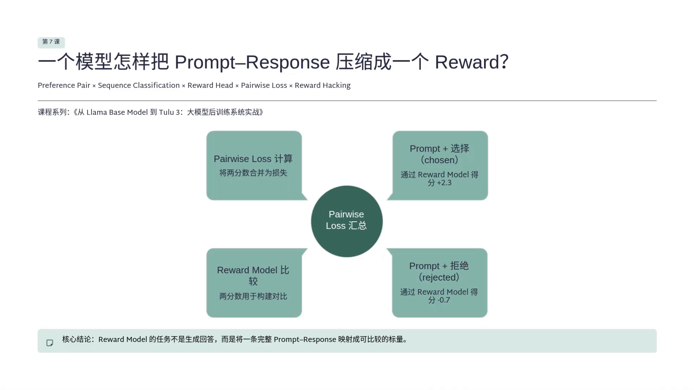
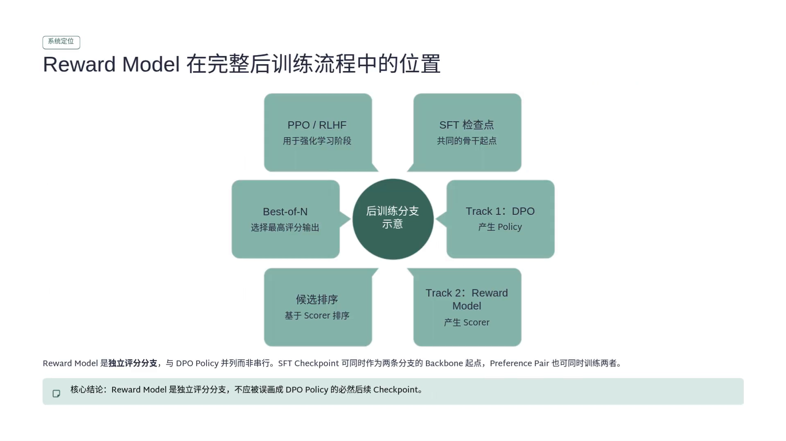
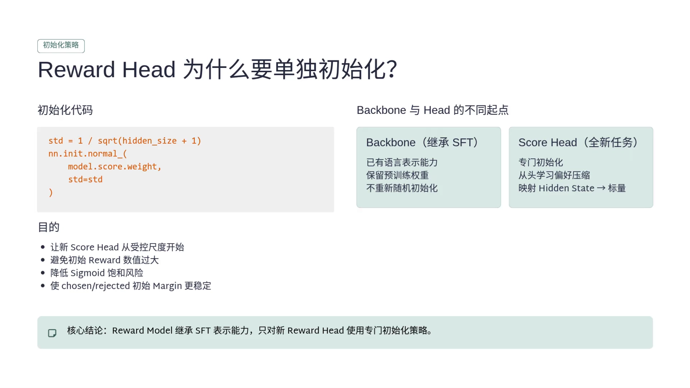
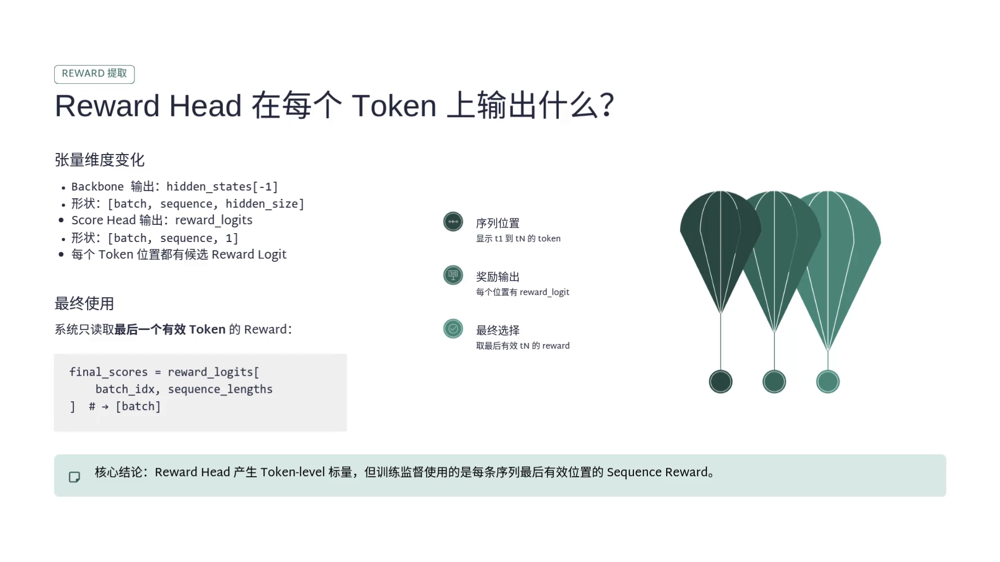
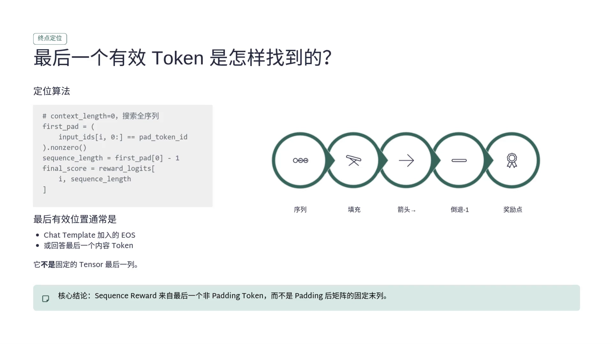
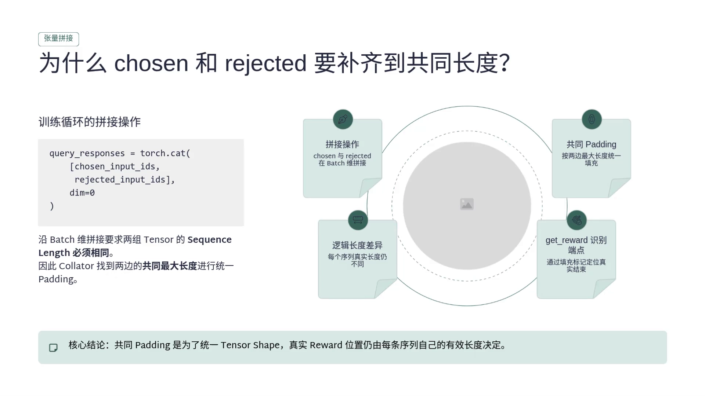
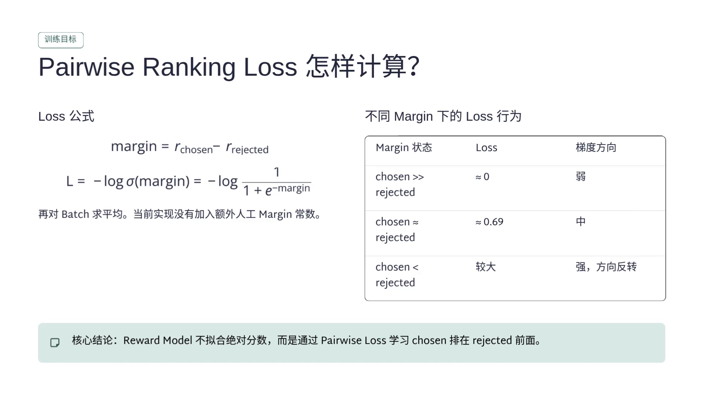
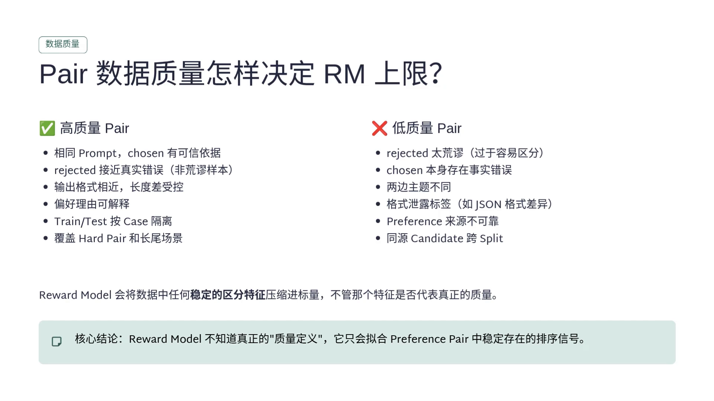
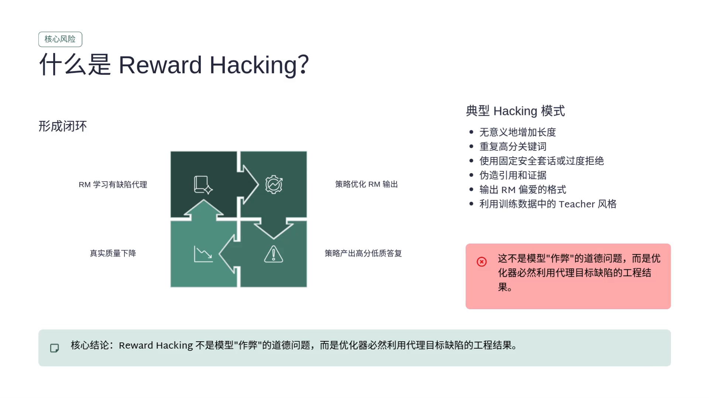

# 奖励模型的实现：reward head、最后一个 token 与成对损失

> 上一篇《Bradley-Terry：把比较变成偏好概率》讲清了奖励模型**为什么**长成 $-\log\sigma(\Delta)$ 这个样子。这一篇换个角度，讲它**在代码里到底怎么搭起来**：主干从哪来、头接在哪、分数从哪个位置取、batch 怎么拼、梯度更新谁、哪些地方最容易错。
>
> 公式只有一行，工程细节却有十几处。这一篇的价值就在这里——**奖励模型的 bug 大多不是数学错，而是取错了位置、拼错了张量、或者让模型学会了数长度。**
>
> 内容依据 B 站「wdkns」的《Reward Model：一个模型怎样把 Prompt–Response 压缩成一个 Reward？》整理（该讲属于《从 Llama Base Model 到 Tulu 3：大模型后训练系统实战》第 7 课），配置数字与代码片段均可在画面中核对。凡超出视频的补充，文中会明确标注。

## 本讲要解决的核心问题（SCQA）

**背景**：14.2 说过「奖励模型就是把 SFT 模型最后的词表投影换成一个线性头」。一句话就讲完了，但真正动手时，这一句话背后是一整套工程。

**冲突**：一段几百 token 的对话，要变成**一个**标量。中间隔着分词、补齐、注意力掩码、位置编码、取哪个位置、两条序列怎么进同一个 batch、梯度回传到哪一层——任何一处错了，训练照样能跑、loss 照样下降，但学到的东西是错的。

**疑问**：一个能打分的模型，从数据到损失到底要经过哪些环节？哪些环节是「错了也不报错」的隐形陷阱？

**回答（中心思想）**：链路是**偏好对 → 分词与补齐 → 主干编码完整序列 → reward head 把 hidden size 压成 1 → 取最后一个有效 token 的分数 → 两个分数做差过 sigmoid → 负对数损失**。本篇按这条链路走一遍，并在每一站标出那个「最容易错的地方」。

---

## 一、先定位：奖励模型在后训练流程里的哪一格

### 1.1 它和生成模型的唯一区别

生成模型接收 prompt，然后**继续往下写**，每个位置输出词表上的一个分布。奖励模型接收**完整的 prompt + response**，不往下写，只做一件事：给这条回答一个分。



[【跳转到 00:38】](https://www.bilibili.com/video/BV1dHgF6WEeN/?t=38)

讲者把这一课的核心问题概括成一句话：**一整段复杂的文本，究竟怎么被 transformer 压缩成一个标量？**

### 1.2 为什么不能只靠 DPO

一个自然的疑问是：DPO 不是已经能用偏好数据了吗，为什么还要单独训一个打分模型？讲者的回答很干脆：

- **DPO 的产物是策略**，它不会额外留下一个独立的打分器；
- 所以「我有十个回答，想给它们排个序」「我想从候选里挑最好的那个」这类需求，DPO 帮不上忙。

奖励模型学的是一个**函数** $r_\phi(x,y)$：随便给一个 prompt + response，它吐一个标量。这个标量可以拿去排序、选 top-1、挖 hard negative，也可以在 PPO 里直接当 reward 的来源。

代价是它得**单独训练、单独部署**，而且有学歪的风险。讲者把它的价值概括成一句：**花更多的工程成本，换一个独立可复用的评分器。**

### 1.3 它和 DPO 是兄弟，不是上下游



[【跳转到 03:18】](https://www.bilibili.com/video/BV1dHgF6WEeN/?t=198)

讲者纠正了一个常见画法。很多人把流程画成「SFT → DPO → Reward Model → PPO」，这不对。更准确的理解是：**SFT 之后分成两条支路**，一条走 DPO 得到新策略，另一条走奖励模型得到打分器。

**两者吃的是同一类数据（偏好对），产物完全不同**：DPO 得到「会生成的 policy」，奖励模型得到「会评分的 scorer」。只有后面要做 PPO 时，奖励模型才进入 RL 的 reward 链路。

---

## 二、模型结构：SFT 主干 + 一个标量头

### 2.1 主干从 SFT 继承，头是全新的



[【跳转到 17:32】](https://www.bilibili.com/video/BV1dHgF6WEeN/?t=1052)

结构上分成两块：

- **transformer 主干**：输入完整的 prompt + response，输出 $[\text{batch},\ \text{seq},\ \text{hidden}]$；
- **reward head（score head）**：把 hidden size 压成 1，输出 $[\text{batch},\ \text{seq},\ 1]$。

这里就是生成模型与评分模型的**分叉点**：生成模型的 lm head 是 $\text{hidden} \to \text{vocab}$，回答的是「下一个 token 是谁」；reward head 是 $\text{hidden} \to 1$，回答的是「这个位置对应的序列值多少分」。

**主干从 SFT 继承**（它已经会语言、会跟随指令），**head 必须单独随机初始化**——因为 SFT 阶段压根没做过这件事。讲者强调了初始化的尺度：不能太大，否则**一下子就把 sigmoid 干饱和了**。代码用的是

```python
std = 1 / sqrt(hidden_size + 1)
nn.init.normal_(model.score.weight, std=std)
```

目的是让新 head 从受控的尺度开始：初始 reward 数值不会过大、sigmoid 不容易饱和、chosen 与 rejected 的初始 margin 更稳定。

还有一个细节：这个 recipe **主动关掉了 dropout**。理由很实在——奖励模型是一把尺，**尺不能一会长一会短**。如果同一个回答这次 2.1、下次 1.8、再来 2.4，排序就不稳定了。

### 2.2 每个 token 都有分数，但只读最后一个



[【跳转到 17:07】](https://www.bilibili.com/video/BV1dHgF6WEeN/?t=1027)

因为 head 是逐位置作用的，`reward_logits` 的形状是 $[\text{batch},\ \text{seq},\ 1]$——**每个 token 位置都有一个候选分数**。但训练时不会把这些位置全拿出来算损失，只读最后一个有效 token 那一个。

讲者要求区分两个概念：

- **reward head 的输出是 token-level 的**；
- **监督使用的是 sequence-level 的 reward**。

代码里就是一行索引：

```python
final_scores = reward_logits[batch_idx, sequence_lengths]  # -> [batch]
```



[【跳转到 20:27】](https://www.bilibili.com/video/BV1dHgF6WEeN/?t=1227)

「最后一个有效 token」不是「张量的最后一列」——右侧 padding 之后，最后一列几乎永远是 pad。代码的做法是**从头往后找第一个 pad token，把它前一位当作序列末尾**，再读这个位置的 reward logit。所以每条序列读的都是**它自己**的最后一个非 pad token，长度各不相同也没关系。

### 2.3 为什么「只看最后一个 token」不等于「只看最后一个字」

这是最容易被误解的一处。讲者的解释是：**最后一个 token 的 hidden state，在很多层 self attention 之后，已经整合了 system prompt、user prompt 以及前面所有 assistant token 的信息。**

所以更准确的说法是：**读取的是一个位置，但这个位置已经汇总了整个 prompt 和 response。** 这正是 causal transformer 的性质，不是偷懒。

### 2.4 为什么不用现成的 sequence classification 接口

代码没有把 `AutoModelForSequenceClassification` 当黑盒直接调用，而是拆成「主干 + score head」，先拿到所有 token 最后一层的 hidden state，再自己调用 `model.score`。讲者解释了这一圈折腾的意义：**要保留每个 token 位置的 reward logit，自己控制从哪个位置取最终 reward**——padding 在哪、position 是多少、最后一个有效位置在哪，这些必须精确控制；一旦取到了非有效 token，分数就是错的。

---

## 三、输入与批处理：三处「错了也不报错」的陷阱

### 3.1 prompt 必须完全一致

偏好对里，chosen 和 rejected 的 prompt **必须一致**——包括 system prompt、user prompt、工具上下文。区别只应该在回答那一段。原因很简单：**只有在相同输入条件下，才能判断哪个回答更好**。

讲者提醒：当前这条 tokenization 路径**并不会强制检查 prompt 是否一致**，代码默认你给的数据是对的。线上生产必须额外加一层 prompt 前缀校验。

### 3.2 超长样本要过滤，不要静默截断

遇到超长样本怎么办？讲者的答案是**过滤**，而不是一刀切截断。原因：偏好对最怕语义被破坏——如果 chosen 的最后一句话才是关键的正确结论，截掉之后 label 还写着 chosen，这个 pair 就已经名不副实了，模型会学偏。

（顺带一个实现差异：这里的 cache 缓存的是 **chat template + tokenization 之后的数据**，也就是分词后的 pair 和长度过滤结果；而 DPO 里缓存的是 reference 模型的 logprob 推理结果。一个是缓存数据变换，一个是缓存模型推理，完全不同。）

### 3.3 右侧补齐，以及为什么必须是右侧



[【跳转到 14:31】](https://www.bilibili.com/video/BV1dHgF6WEeN/?t=871)

一个 batch 里，chosen 可能 300 token、rejected 500 token，另一个 pair 又是 900 token——没法直接组成二维张量。collator 的职责就是**对齐**：找到两边共同的最大长度，**右侧** padding，输出 batch 和长度。

为什么必须右侧？因为**终点定位逻辑依赖它**：`get_reward` 的做法是「从前往后找第一个 pad token，它的前一个位置就是最后一个有效 token」。如果改成左侧 padding，这个定位逻辑就不成立了。

为什么 chosen 和 rejected 必须补齐到**相同**长度？因为训练循环后面要 `torch.cat` 沿 batch 维把两者拼起来，长度不一致根本拼不上。

还有两处配套的重建：

- **attention mask 不在 collator 里输出**，而是在 `get_reward` 里根据 pad token 动态构造（非 pad 为 1，pad 为 0）；
- **position ids 要重新算**。padding 出现之后，物理矩阵位置和真实 token 位置不再一致——对有效 token，position 应该是 0、1、2、3……代码利用 attention mask 的累积和重新构造 position ids，目标是**不同长度的句子进入主干时仍保持正确的位置语义**。

讲者还点了一个隐蔽的坑：**如果 pad token 的 id 等于 eos token 的 id**，而定位逻辑又是靠「第一个 pad」找终点，定位就会出错，reward 会取到前面某个位置上去。

---

## 四、损失与梯度：pairwise ranking loss

### 4.1 损失怎么算



[【跳转到 23:22】](https://www.bilibili.com/video/BV1dHgF6WEeN/?t=1402)

$$
\text{margin} = r_\phi(x, y_{\text{chosen}}) - r_\phi(x, y_{\text{rejected}})
$$

$$
L(\phi) = -\,\mathbb{E}\Big[\log \sigma(\text{margin})\Big] = -\,\mathbb{E}\left[\log \frac{1}{1 + e^{-\text{margin}}}\right]
$$

再对 batch 求平均。讲者注明当前实现**没有额外加人工 margin 常数**——就是最朴素的 Bradley-Terry 负对数似然（推导见上一篇）。

三种 margin 状态下的行为：

| margin 状态 | 损失 | 梯度方向 |
| :--- | :--- | :--- |
| chosen 远大于 rejected | 约 0 | 弱 |
| chosen 约等于 rejected | 约 0.69 | 中 |
| chosen 小于 rejected | 较大 | 强，方向反转 |

0.69 就是 $-\log 0.5$：五五开时损失最大，也最有得学。

视频给了一个具体数值例子：chosen 得 1.2、rejected 得 0.4，margin 为 0.8，$\sigma(0.8) \approx 0.69$，损失约 0.37，方向是对的。讲者顺带强调：**chosen 的分数完全可以是负数**，损失只看差距，不看正负。

### 4.2 梯度更新的是谁

pairwise loss 算出来之后，梯度同时经过 chosen 和 rejected 两条分支反向传播，再通过 score head 传到 transformer 主干。当前 recipe 默认优化的是**整个模型**的参数，不是只训最后那个 reward head。

也就是说，**模型的语​言表示本身也在为了更容易区分偏好而变化**。讲者的结论是：**奖励模型的训练不是「在 SFT 后面接一个线性层就完事」。**

### 4.3 reward 不是绝对质量分

和上一篇一样，这里也强调平移不变性：偏好数据只说了「A 大于 B」，没说「A 等于多少」。同时给两个 reward 加十分，margin 还是 1，完全不变。

所以**reward 的零点天然没有业务含义**：不同 checkpoint、不同训练数据、不同模型产生的 reward，不能直接拿绝对值互相比。

### 4.4 训练循环与显存估算

训练循环本身很朴素：每个 batch 把 chosen 和 rejected 拼起来，调用**一次** `get_reward` 得到 sequence reward，再拆成两个分数，算 accuracy 和 margin，算 pairwise loss，反向传播，optimizer step，梯度清零。讲者的评价是：**基础设施和 SFT 没有本质变化，只是 forward 的输出变成了一个标量 reward，loss 变成了 pairwise ranking loss。**

（「同一个 prompt 的所有比较打包成一次前向」这个设计动机，14.2 第四节已经讲过，这里不重复。）

显存估算有一个容易忽略的点：**pair batch = 4 不代表前向只有 4 条序列**——每条 pair 里有两个回答，实际是 8 条。极端情况下就是 $8 \times 4096$ 个 token；再乘梯度累积 4、GPU 16 张，才是 global pair batch。讲者的提醒很直白：**只看 batch=4 就跑，一跑就内存溢出。**

另外，梯度累积期间前几个 micro step 只累积梯度，**到真正更新的边界才 step optimizer 和 scheduler、汇总窗口指标**；不能每处理一个 pair batch 就把 scheduler 往前走一步，否则学习率的时间轴会跑太快。

---

## 五、评估：准确率、margin 与「亲眼看」

### 5.1 评估必须复用同一套 reward 提取逻辑

评估阶段基本复用训练阶段的逻辑：`model.eval()`、torch.no_grad()、拼起来、用**同一个** `get_reward`、再拆开、算 pairwise loss 和 accuracy。

讲者反复强调「同一个 `get_reward`」的原因：**如果训练和评估连 reward 的终点定位方式都不一样，这个 eval 就没有意义了。**

### 5.2 accuracy 和 margin 是两件事

- **accuracy** 只回答方向对不对：只要 chosen 的分数大于 rejected 就算对；
- **margin** 回答有多确定：超过 0.1 是超过，超过 10 也是超过。

两个一起看才更准确。除此之外还可以监控：训练 loss、两个序列各自的 reward、reward 标准差、分数分桶、梯度范数、GPU 内存。

### 5.3 一定要 decode 出真实文本看

讲者给了一个很有说服力的例子：两个模型的 accuracy 都是 80%，但模型 A 错的是困难的事实推理，模型 B 错的全是短回答——**同样的准确率，完全不是一回事**。

所以要把 prompt、chosen 与 rejected 的 reward、排序结果**decode 出来抽查**，亲眼看高 reward 的回答到底好不好，检查长度、格式、模板有没有问题。讲者的结论是：**模型评分最终还是要回归到 case 级别。**

---

## 六、数据质量决定天花板



[【跳转到 32:05】](https://www.bilibili.com/video/BV1dHgF6WEeN/?t=1925)

讲者的判断是：**偏好对的质量决定了奖励模型的天花板。** 高质量的 pair 应该满足：

- 同一个 prompt，chosen 有确定可信的理由更好；
- rejected 比较接近真实模型会犯的错误，而不是离谱答案；
- 输出格式相近、长度差受控；
- 训练集与测试集按 case 隔离。

低质量 pair 的典型形态：rejected 太荒谬（太容易区分，学不到细粒度）、chosen 本身有事实错误、两边主题不同、**格式泄露标签**（比如正确答案永远是规整 JSON）、偏好来源不可靠。

这一页最值得记的是那句总结：**奖励模型不知道真正的「质量定义」，它只会拟合偏好对中稳定存在的排序信号。** 数据里有什么稳定的区分特征，它就学什么——不管那个特征是否代表质量。

**长度偏好**就是这么来的：如果 chosen 和 rejected 的平均 token 数差异很大，模型很可能发现「字多就是好」。讲者的分寸拿捏得很好：**长度和质量可以相关，但不能被模型学成等号**，否则模型就没有精准的判别能力了。格式同理。

---

## 七、可信性：reward hacking 与校准

### 7.1 reward hacking 是一个优化问题，不是道德问题



[【跳转到 33:31】](https://www.bilibili.com/video/BV1dHgF6WEeN/?t=2011)

讲者的定义很清楚：**不是模型突然产生「我要作弊」的想法，而是优化问题的必然结果。**

- 真正的目标是回答的质量，但质量没法直接量化；
- 所以只能用代理目标（reward model）；
- 优化器没有道德概念，它只会拼命最大化目标函数；
- 只要奖励模型有漏洞，策略最终会找到它。

更要紧的是：**静态数据集没法完全发现 reward hacking**，因为策略在进化，进化过程中会不断冒出新问题。所以要额外加诊断环节——on-policy 采样、抽查高 reward 的 case、引入外部裁决、定期重训奖励模型。

（奖励分数一路上涨、真实质量先涨后跌的曲线，14.2 第五节已经给过，这里不重复。）

### 7.2 校准：reward 是标量，不是概率

如果业务上有一个「分数大于多少才放行」的阈值，就必须做校准：按阈值把 reward 切分，看达到多少分对应的答案才真的可信。**不能拍一个阈值**——因为 reward 的绝对尺度没有语义（4.3 节的平移不变性）。

### 7.3 复用前的三条检查

奖励模型最大的价值是**可复用**：选 top、排序、当 PPO 的 reward、做数据过滤。但复用之前必须检查三件事：

1. 目标分数分布是否一致；
2. 校准是否需要重新验证；
3. 奖励模型与策略的版本是否匹配。

原因还是那一句：**分数横向不可比。**

---

## 八、和 DPO、LLM judge、verifier 的分工

讲者最后做了一张对照，很实用：

| 对比对象 | 输出 | 核心机制 | 适合什么 |
| :--- | :--- | :--- | :--- |
| DPO | policy checkpoint | 策略与参考策略的 logprob 比值 | 把偏好直接写进策略 |
| 奖励模型 | 一个标量打分器 | hidden state → 分数 | 高吞吐的候选排序 |
| LLM judge | 判断加理由 | 生成式推理 | 复杂规则违背、需要解释 |
| verifier | 通过或不通过 | 规则或真实执行结果 | 硬约束（答案对不对、JSON 合不合法） |

讲者的分工总结是：**verifier 管硬约束，奖励模型做高吞吐的软排序，LLM judge 做复杂的抽检判断。** 奖励模型的前向比 LLM judge 快得多、输出是标量，所以适合大规模候选排序；但它读不出复杂的规则违背，也解释不了为什么。

---

## 九、保存什么，以及一份故障清单

要把一次奖励模型训练从 0 到 1 恢复出来，需要保存：模型权重、model config、tokenizer、chat template、优化器状态、scheduler 状态、transformer 主干的版本、以及偏好数据集。

讲者最后给了一份「可能出现的问题」清单，正好对应本篇各节：

1. **定位错了**（最后一节取错位置、pad 与 eos 冲突）；
2. **prompt 不一致**（同一对里的两个回答不是同一个输入条件）；
3. **长度和格式引发的 reward hacking**；
4. **reward score 漂移**——准确率没变，但分数的绝对值越来越大；
5. **策略分布漂移**——奖励模型面对的输入已经不在训练分布里。

---

## 小结

- **定位**：奖励模型和 DPO 是**并列的两条支路**，吃同一类偏好数据，一个产出 policy、一个产出 scorer；它的价值是「花工程成本换一个独立可复用的评分器」。
- **结构**：SFT 主干 + 一个 $\text{hidden} \to 1$ 的 reward head；主干继承权重，head 单独初始化且尺度受控（否则 sigmoid 饱和）；关掉 dropout，让这把尺稳定。
- **取分**：head 在每个 token 上都输出分数，但只读**最后一个有效 token**——因为那个位置的 hidden state 已经汇总了整段 prompt 与 response。
- **批处理**：同一对里 prompt 必须一致；超长样本过滤而非截断；右侧 padding 是终点定位的前提；attention mask 与 position ids 要在 `get_reward` 里重建。
- **损失**：$-\log\sigma\big(r_{\text{chosen}} - r_{\text{rejected}}\big)$，对 batch 求平均；梯度同时更新主干与 head，所以它不是「接一个线性层就完事」。
- **评估**：accuracy 看方向、margin 看把握；必须 decode 真实文本抽查；训练与评估必须共用同一套 reward 提取逻辑。
- **可信性**：数据质量决定天花板（长度、格式是最常见的捷径）；reward hacking 是优化问题的必然结果；reward 是标量不是概率，用之前要校准。

---

## 附：本篇要点速查

| 概念 | 一句话 |
| :--- | :--- |
| 与生成模型的分叉点 | lm head 是 hidden → vocab，reward head 是 hidden → 1 |
| 主干来源 | 从 SFT 继承；只有 reward head 是新加的、需单独初始化 |
| head 初始化 | $\text{std} = 1/\sqrt{\text{hidden} + 1}$，防止初始 reward 过大、sigmoid 饱和 |
| dropout | 主动关闭，让同一个回答的分数稳定 |
| token-level vs sequence-level | head 每个位置都出分，监督只读最后一个有效 token |
| 为什么读最后一个 | causal transformer 的最后一个 hidden state 已汇总整段 prompt 与 response |
| 右侧 padding | 终点定位靠「第一个 pad 的前一位」，左 padding 会让逻辑失效 |
| position ids 重建 | padding 后物理位置不等于真实位置，要用 attention mask 累积和重算 |
| 超长样本 | 过滤，不要静默截断（截断会破坏 pair 的语义） |
| pairwise loss | $-\log\sigma(r_{\text{chosen}}-r_{\text{rejected}})$，batch 求平均，无额外 margin 常数 |
| 损失量级 | margin 约 0 时损失约 0.69；margin 越大损失越接近 0 |
| 梯度更新谁 | 整个模型，包括主干；语言表示本身也在变 |
| pair batch | 4 条 pair = 8 条序列，显存要按 8 × 4096 token 估 |
| accuracy vs margin | 方向对不对 vs 有多确定 |
| 数据质量 | 决定 RM 天花板；RM 只拟合 pair 中稳定存在的排序信号 |
| 长度偏差 | chosen 与 rejected 平均长度差太大，模型会学成「字多就是好」 |
| reward hacking | 优化器必然利用代理目标缺陷，不是模型想作弊 |
| 复用三检查 | 分数分布、校准、与策略版本是否匹配 |

## 参考视频

- **Reward Model：一个模型怎样把 Prompt–Response 压缩成一个 Reward？**（wdkns，B 站 [BV1dHgF6WEeN](https://www.bilibili.com/video/BV1dHgF6WEeN/)）