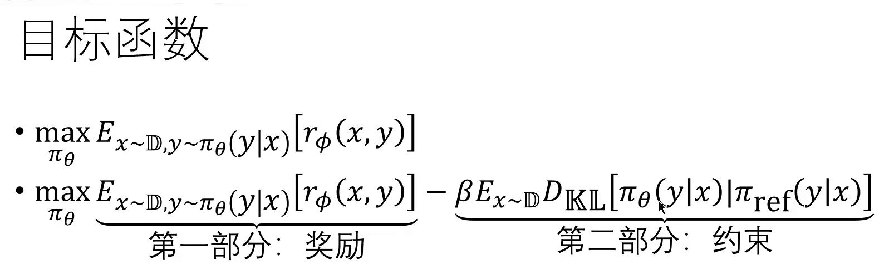
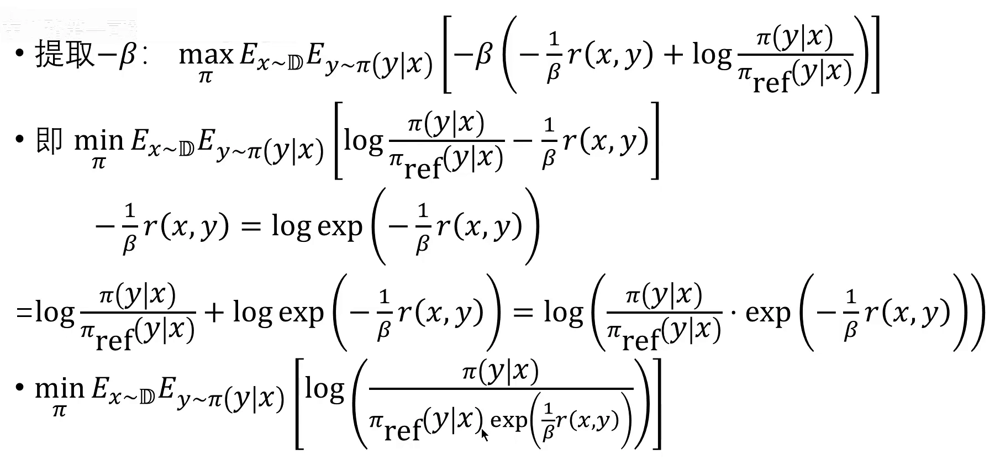
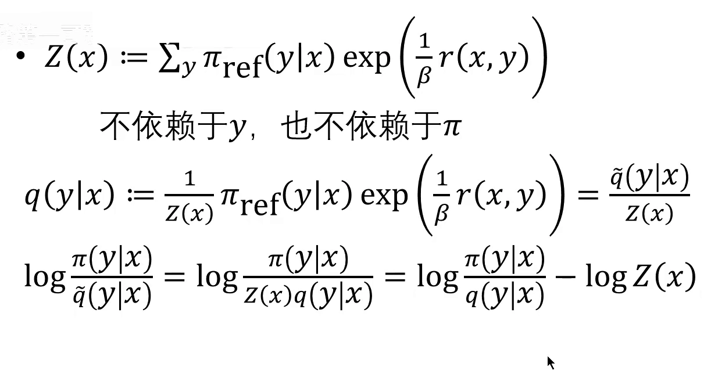
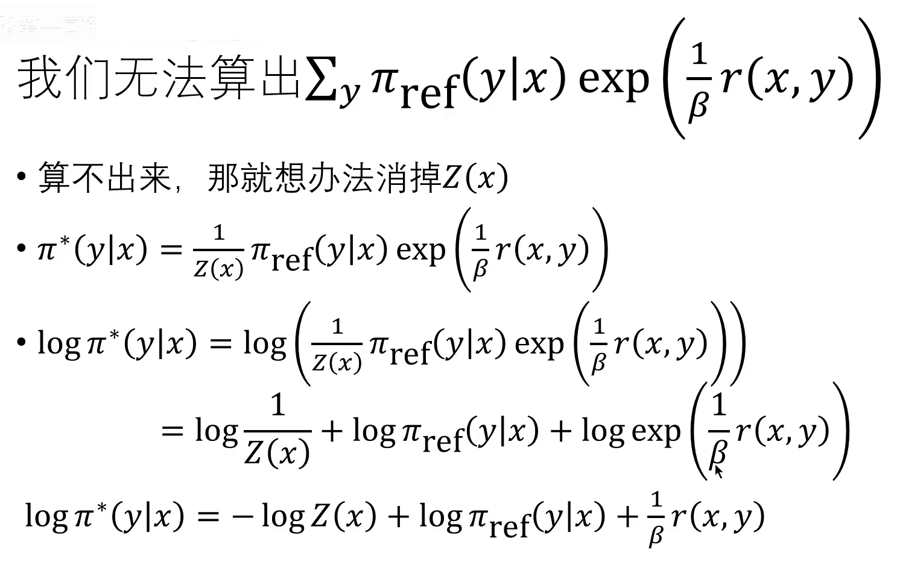
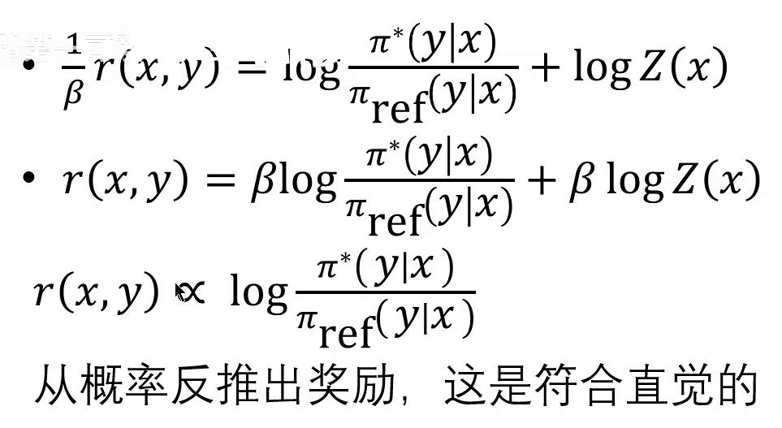
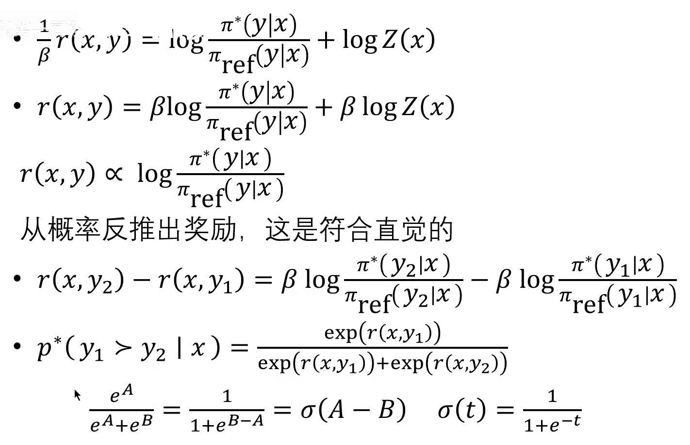
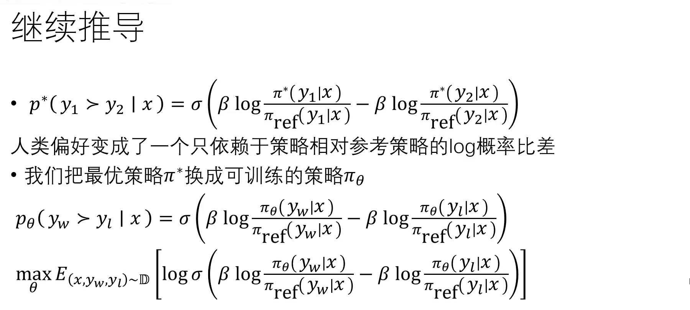
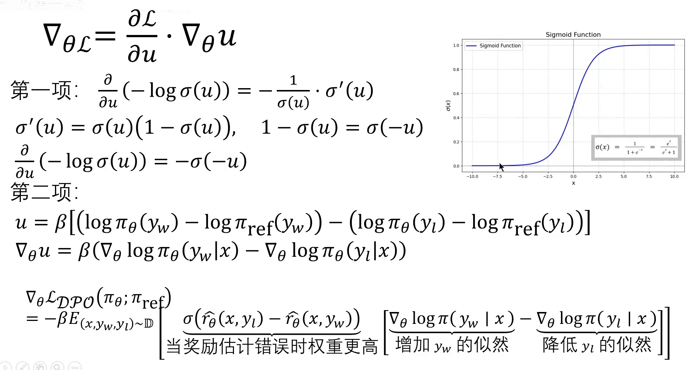
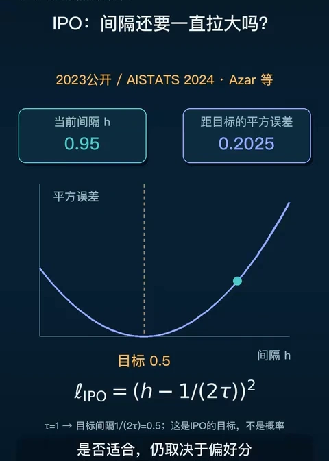
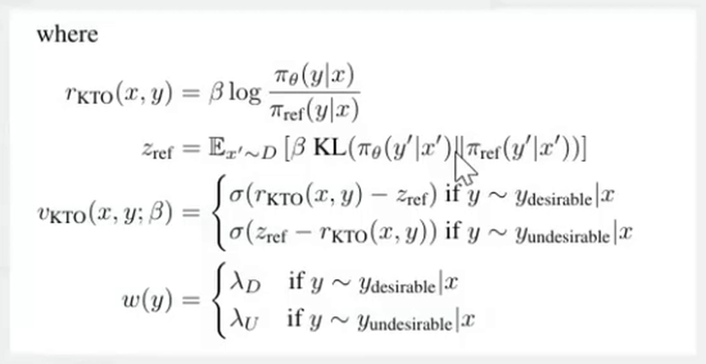

# DPO：从 KL 约束的闭式解到纯策略损失

> 上一篇（14.2）把 RLHF 的三阶段走完了，也把它的工程麻烦摆清了三件：PPO 阶段要**同时加载四个语言模型量级的网络**（策略、参考模型、奖励模型、价值函数），显存是单模型的好几倍；PPO 自己的旋钮多且敏感（clip 0.2、$\beta$ 只有 0.01~0.02 这么窄的可用区间、GAE、minibatch……）；奖励模型只是人类偏好的有损压缩，压得越狠越会被钻空子。
>
> 这三件事指向同一个问题：**能不能既不要奖励模型，也不要 PPO？** 本篇讲的就是这个答案——DPO（Direct Preference Optimization，直接偏好优化）。它的做法不是「换一个更稳的强化学习算法」，而是**把带 KL 约束的 RL 目标解析地解出来，再反解出一个「隐式奖励」，代回偏好损失，于是整个损失里只剩下策略本身**。推导走完，训练就变成了一个二分类问题。
>
> 内容依据三支视频整理：B 站「【DPO】直接偏好优化 详细原理推导」（BV1m8FnzpEXm，完整推导）、「DPO：不另训奖励模型，怎样直接学习回答偏好」（BV1bbWc61Eyc，局限与变体）、「DPO 变体：IPO、KTO」（BV11i421a7KE，两个变体的损失与数据）。公式与结论可对照 DPO 原论文（arXiv:2305.18290）、IPO 论文（arXiv:2310.12036）与 KTO 论文（arXiv:2402.01306）。凡超出视频的补充，文中会明确标注。

## 本讲要解决的核心问题（SCQA）

**背景**：14.2 的流水线里，人类偏好先被蒸馏成一个奖励模型 $r_\phi$，再由 PPO 拿这个分数去推策略。奖励模型负责「说出什么更好」，PPO 负责「照着这个说法改模型」。

**冲突**：这条流水线有两个昂贵的中转站。奖励模型要单独训练、单独存一份参数；PPO 要在训练时反复采样、反复打分，还要再养一个价值函数当基线。而且这两个中转站都在**近似**同一件事——奖励模型近似人类偏好，PPO 近似「对这个奖励做最优」。两次近似叠加，误差不可控，稳定性也差。

**疑问**：既然 RLHF 的目标函数写得那么清楚，能不能**直接对它求解**，把「奖励模型」和「PPO」这两步一起省掉，只留下一个能对偏好数据做梯度下降的损失？

**回答（中心思想）**：能，而且解是闭式的。带 KL 约束的 RL 目标存在**解析最优解** $\pi^\ast \propto \pi_{ref}\exp(r/\beta)$；把这个式子反过来，就能用策略本身表示奖励。代回 Bradley-Terry 偏好模型后，那个算不出来的归一化常数 $Z(x)$ 在成对相减时**自动抵消**，剩下的损失只含 $\pi_\theta$ 与 $\pi_{ref}$ 的对数概率比。**DPO 的全部魔力就在这一步换元。**

---

## 一、先把要绕开的东西说清楚

DPO 的出发点和 PPO 是同一个目标函数，这一点讲者反复强调：**不管 PPO 还是 DPO，优化的都是同一个东西**。所以先把它写出来。

[【跳转到 03:34】](https://www.bilibili.com/video/BV1m8FnzpEXm/?t=214)

$$
\max_{\pi_\theta}\ \mathbb{E}_{x\sim\mathcal{D},\ y\sim\pi_\theta(\cdot\mid x)}\big[r_\phi(x,y)\big] \;-\; \beta\,\mathbb{E}_{x\sim\mathcal{D}}\, D_{\mathrm{KL}}\big[\pi_\theta(y\mid x)\,\|\,\pi_{ref}(y\mid x)\big]
$$

记号沿用前两篇：$x$ 是提示词，$y$ 是整段回答，$\pi_\theta$ 是要训练的策略（就是语言模型本身），$\pi_{ref}$ 是冻结的参考模型（SFT 之后的那个），$r_\phi$ 是奖励模型，$\beta$ 是 KL 惩罚系数。

这个式子里有两个麻烦：

- $r_\phi$ 是**另一个网络**。要先用偏好数据把它训出来（14.2 第四节），训练时还要把它一起加载进来打分。
- 期望是对 $y\sim\pi_\theta$ 取的，也就是**在线采样**。PPO 因此必须一边生成一边更新，还要一个价值函数 $V_\psi$ 来算优势、一个裁剪项来限制步长。四模型同台、超参敏感，都从这里来。

DPO 的思路是：**先别急着用梯度下降去逼近这个目标，先看看它能不能直接解出来。**

---

## 二、第一步：把目标改写成 KL 散度的形状

推导的第一段是纯代数，目标是把「奖励 + KL」揉成「一个 KL 散度加一个常数」。

先把 KL 的定义代进去，把期望拆开：

$$
\max_{\pi_\theta}\ \mathbb{E}_{x\sim\mathcal{D}}\,\mathbb{E}_{y\sim\pi_\theta}\left[r_\phi(x,y) - \beta\log\frac{\pi_\theta(y\mid x)}{\pi_{ref}(y\mid x)}\right]
$$

然后把中括号里的 $-\beta$ 提出来。**这一步要留神符号**：$\beta>0$，所以 $-\beta<0$，对一个「乘了负数」的式子求 $\max$，等价于对括号里的内容求 $\min$：

$$
\min_{\pi_\theta}\ \mathbb{E}_{x\sim\mathcal{D}}\,\mathbb{E}_{y\sim\pi_\theta}\left[\log\frac{\pi_\theta(y\mid x)}{\pi_{ref}(y\mid x)} - \frac{1}{\beta}r_\phi(x,y)\right]
$$

接着用一个恒等式把奖励项也写成 log：$-\frac{1}{\beta}r = \log\exp\left(-\frac{1}{\beta}r\right)$。两个 log 相加等于 log 里面相乘，于是整个式子收成一个 log：

[【跳转到 06:29】](https://www.bilibili.com/video/BV1m8FnzpEXm/?t=389)

$$
\min_{\pi_\theta}\ \mathbb{E}_{x\sim\mathcal{D}}\,\mathbb{E}_{y\sim\pi_\theta}\left[\log\frac{\pi_\theta(y\mid x)}{\pi_{ref}(y\mid x)\exp\left(\frac{1}{\beta}r_\phi(x,y)\right)}\right]
$$

到这里，式子的形状已经和 KL 散度一模一样了：外面是「对 $\pi_\theta$ 采样取期望」，里面是「$\pi_\theta$ 除以某个东西的 log」。但**分母不是概率分布**——$\pi_{ref}(y\mid x)$ 本身对 $y$ 求和为 1，可它乘上 $\exp(r_\phi/\beta)$ 之后就不一定归一了。KL 散度只对两个真正的概率分布有定义，所以还差一步。

---

## 三、第二步：归一化，得到闭式最优解

差的那一步就是**归一化**。把分母记作 $\tilde q(y\mid x)$，把它的求和记作 $Z(x)$：

$$
\tilde q(y\mid x) := \pi_{ref}(y\mid x)\exp\left(\frac{1}{\beta}r_\phi(x,y)\right),
\qquad
Z(x) := \sum_{y}\tilde q(y\mid x)
$$

$q(y\mid x) := \tilde q(y\mid x)/Z(x)$ 就是一个合法的概率分布了。把 $Z(x)$ 从 log 里提出来（$\log(\pi/\tilde q) = \log(\pi/(Z\cdot q)) = \log(\pi/q) - \log Z(x)$），目标变成：

[【跳转到 07:44】](https://www.bilibili.com/video/BV1m8FnzpEXm/?t=464)

$$
\min_{\pi_\theta}\ \mathbb{E}_{x\sim\mathcal{D}}\Big[\underbrace{\mathbb{E}_{y\sim\pi_\theta}\log\frac{\pi_\theta(y\mid x)}{q(y\mid x)}}_{=\,D_{\mathrm{KL}}(\pi_\theta\,\|\,q)} \;-\; \log Z(x)\Big]
$$

关键观察：**$Z(x)$ 只依赖 $x$，不依赖 $y$，也不依赖 $\pi_\theta$**。对优化变量来说它是个常数，可以直接不管。剩下那一项就是 $\pi_\theta$ 与 $q$ 的 KL 散度，而 KL 散度非负、且**当且仅当两个分布相等时取到 0**（这条叫吉布斯不等式，Gibbs' inequality）。

于是最优解不用求导、不用迭代，直接读出来：

$$
\pi^\ast(y\mid x) \;=\; q(y\mid x) \;=\; \frac{1}{Z(x)}\,\pi_{ref}(y\mid x)\exp\left(\frac{1}{\beta}r_\phi(x,y)\right)
$$

这就是 DPO 推导里最核心的一步：**带 KL 约束的奖励最大化，其最优策略是「参考策略乘上奖励的指数权重，再归一化」**。直观理解：奖励高的回答，概率按指数放大；$\beta$ 越小，放大越激进（越敢偏离参考）；$\beta$ 越大，越贴近参考策略。

---

## 四、第三步：反解——把奖励用策略表示出来

最优解是有了，但**没法直接用**。因为 $Z(x)=\sum_y \pi_{ref}(y\mid x)\exp(r_\phi(x,y)/\beta)$ 要对**所有可能的回答**求和——回答空间是词表的长度次方，这个求和根本算不出来。讲者的原话是「这是几乎不可能实现的」。

算不出来，那就想办法把它消掉。做法是**把最优解反过来解出奖励**。对 $\pi^\ast$ 两边取 log：

$$
\log\pi^\ast(y\mid x) = -\log Z(x) + \log\pi_{ref}(y\mid x) + \frac{1}{\beta}r_\phi(x,y)
$$

移项、两边乘 $\beta$：

[【跳转到 09:24】](https://www.bilibili.com/video/BV1m8FnzpEXm/?t=564)

$$
r_\phi(x,y) \;=\; \beta\log\frac{\pi^\ast(y\mid x)}{\pi_{ref}(y\mid x)} \;+\; \beta\log Z(x)
$$

这一步的意义很大：**奖励不再是一个独立的网络，它可以由「策略相对参考策略的对数概率比」表示出来**。DPO 论文标题里那句「your language model is secretly a reward model」说的就是这件事——一个训练好的策略，本身就是一个奖励函数。

[【跳转到 11:04】](https://www.bilibili.com/video/BV1m8FnzpEXm/?t=664)

为什么符合直觉？看两个方向：

- $y$ 是模型**不想要**的回答：最优策略给它的概率应当低于参考模型，$\pi^\ast(y\mid x)<\pi_{ref}(y\mid x)$，对数比为负，$r_\phi$ 就低。
- $y$ 是**好**回答：$\pi^\ast(y\mid x)>\pi_{ref}(y\mid x)$，对数比为正，$r_\phi$ 就高。

注意这里说的是**比值**而不是绝对概率。一个回答的绝对概率可以很低，但只要它相对参考模型被提升了，它的隐式奖励就是正的。这一点在后面讲局限时会变成问题（第九节的「似然位移」）。

---

## 五、第四步：代回 Bradley-Terry，$Z(x)$ 抵消

现在把这个「隐式奖励」代回偏好模型。14.2 已经给过 Bradley-Terry 的形式（它的前提与推导是 14.3 的内容，这里只用到结论）：同一个提示词下的两个回答，人类更偏好 $y_w$ 的概率是

$$
p(y_w \succ y_l \mid x) = \sigma\big(r_\phi(x,y_w) - r_\phi(x,y_l)\big),
\qquad \sigma(t)=\frac{1}{1+e^{-t}}
$$

所以要先算奖励的**差**。把 $r_\phi(x,y_w)$ 与 $r_\phi(x,y_l)$ 分别写出来相减：

$$
r_\phi(x,y_w) - r_\phi(x,y_l) = \beta\log\frac{\pi^\ast(y_w\mid x)}{\pi_{ref}(y_w\mid x)} - \beta\log\frac{\pi^\ast(y_l\mid x)}{\pi_{ref}(y_l\mid x)}
$$

**$\beta\log Z(x)$ 消失了。** 这是整个推导的枢纽，值得单独说清楚：

> $Z(x)$ 是「对同一个提示词 $x$ 下所有回答求和」得到的量，所以它只跟 $x$ 有关。$y_w$ 和 $y_l$ 共享同一个 $x$，因此两项带的是**同一个** $\beta\log Z(x)$，相减必然抵消。

也就是说，那个算不出来的归一化常数**根本不需要算**——它只在「单个回答的绝对奖励」里出现，而在「两个回答谁更好」这个比较里不出现。DPO 之所以能从「不可计算的闭式解」走到「可实现的损失」，全靠这一点。

[【跳转到 11:54】](https://www.bilibili.com/video/BV1m8FnzpEXm/?t=714)

再把 exp 的比值化成 sigmoid。$\dfrac{e^{A}}{e^{A}+e^{B}}$ 上下同除 $e^{A}$ 就是 $\dfrac{1}{1+e^{B-A}}=\sigma(A-B)$，于是

$$
p(y_w \succ y_l \mid x) = \sigma\left(\beta\log\frac{\pi^\ast(y_w\mid x)}{\pi_{ref}(y_w\mid x)} - \beta\log\frac{\pi^\ast(y_l\mid x)}{\pi_{ref}(y_l\mid x)}\right)
$$

到这里，**人类偏好概率变成了一个只依赖策略与参考策略的对数概率比之差的函数**，奖励模型彻底不见了。

---

## 六、第五步：把 $\pi^\ast$ 换成 $\pi_\theta$，得到 DPO 损失

$\pi^\ast$ 是「最优策略」，我们手上只有一个待训练的策略 $\pi_\theta$。把 $\pi^\ast$ 换成 $\pi_\theta$，就得到「当前策略认为 $y_w$ 比 $y_l$ 好的概率」：

$$
p_\theta(y_w \succ y_l \mid x) = \sigma\left(\beta\log\frac{\pi_\theta(y_w\mid x)}{\pi_{ref}(y_w\mid x)} - \beta\log\frac{\pi_\theta(y_l\mid x)}{\pi_{ref}(y_l\mid x)}\right)
$$

训练目标就是让这个概率在偏好数据上尽量大——也就是对这个概率取负对数、求最小：

[【跳转到 13:09】](https://www.bilibili.com/video/BV1m8FnzpEXm/?t=789)

$$
\boxed{\;
L_{\mathrm{DPO}}(\theta) = -\,\mathbb{E}_{(x,\,y_w,\,y_l)\sim\mathcal{D}}\left[\log\sigma\left(\beta\log\frac{\pi_\theta(y_w\mid x)}{\pi_{ref}(y_w\mid x)} - \beta\log\frac{\pi_\theta(y_l\mid x)}{\pi_{ref}(y_l\mid x)}\right)\right]
\;}
$$

把括号里的东西记作 $u$（讲者叫它 reward margin），它就是「隐式奖励的差」：

$$
u = \hat r_\theta(x,y_w) - \hat r_\theta(x,y_l),
\qquad
\hat r_\theta(x,y) := \beta\log\frac{\pi_\theta(y\mid x)}{\pi_{ref}(y\mid x)}
$$

于是 $L_{\mathrm{DPO}} = -\mathbb{E}[\log\sigma(u)]$——**一个标准的二分类交叉熵**：把「$y_w$ 比 $y_l$ 好」当成标签 1，把 $u$ 当成 logit。这就是为什么 DPO 训练起来像监督学习：没有采样循环、没有价值函数、没有裁剪，一次前向算四个对数概率（$\pi_\theta$ 两个、$\pi_{ref}$ 两个），算 loss、反传、结束。

---

## 七、梯度在做什么：一个权重乘一个方向

光看损失不够直观，讲者又把梯度完整推了一遍。令 $u$ 为上面的 margin，$L=-\log\sigma(u)$，用链式法则：

$$
\nabla_\theta L = \frac{\partial L}{\partial u}\cdot\nabla_\theta u
$$

第一项用 $\sigma$ 的两个性质化简：$\sigma'(u)=\sigma(u)\big(1-\sigma(u)\big)$，以及对称性 $1-\sigma(u)=\sigma(-u)$，得到 $\dfrac{\partial}{\partial u}\big(-\log\sigma(u)\big) = -\sigma(-u)$。第二项里 $\pi_{ref}$ 是冻结的，只有两个 $\pi_\theta$ 对 $\theta$ 有梯度：

$$
\nabla_\theta u = \beta\big(\nabla_\theta\log\pi_\theta(y_w\mid x) - \nabla_\theta\log\pi_\theta(y_l\mid x)\big)
$$

两项相乘：

$$
\nabla_\theta L_{\mathrm{DPO}} = -\beta\,\mathbb{E}\left[\underbrace{\sigma\big(\hat r_\theta(x,y_l)-\hat r_\theta(x,y_w)\big)}_{\text{权重}}\ \underbrace{\Big(\nabla_\theta\log\pi_\theta(y_w\mid x) - \nabla_\theta\log\pi_\theta(y_l\mid x)\Big)}_{\text{方向}}\right]
$$

[【跳转到 16:29】](https://www.bilibili.com/video/BV1m8FnzpEXm/?t=989)

讲者的比喻很好用：**后面那块是向量的方向，前面那块是向量的模长。**

- **方向**：提高 $y_w$ 的对数概率、降低 $y_l$ 的对数概率。注意是对数概率（也就是似然），不是奖励本身。
- **模长**：$\sigma\big(\hat r_\theta(x,y_l)-\hat r_\theta(x,y_w)\big)$。如果好回答的奖励已经远高于坏回答，这个值接近 0，这一步几乎不更新；如果模型把坏回答排得比好回答还高（奖励估计错了），这个值接近 1，更新幅度最大。

也就是说，**DPO 自动把力气花在「模型还判断错的地方」**，判断对的地方就少动。这一点让它在实践里比「每对样本推同样大一步」稳得多。

---

## 八、工程上到底省了什么

推导走完，回头看它省掉的成本，就明白 DPO 为什么会在 2023 年下半年迅速铺开。

**（1）模型从四个减到两个。** 训练时只需要策略 $\pi_\theta$ 与参考 $\pi_{ref}$，不需要奖励模型、不需要价值函数。而且 $\pi_{ref}$ 是冻结的，参考侧的对数概率在静态数据和固定参考下**可以预先算好缓存**（代价是存储与读取，但省掉重复前向）。生成时更彻底：只用更新后的策略，不需要把两份回答拿去打分才能输出。

**（2）不需要在线采样。** PPO 的每个 batch 都要先让当前策略生成回答（rollout）、再打分、再更新，数据用完即弃；DPO 直接用离线的偏好三元组 $(x,y_w,y_l)$，训练像监督学习一样一遍遍过数据。

**（3）不需要 PPO 的那一堆超参。** clip ratio、GAE 的 $\lambda$、minibatch 大小、epoch 数、KL 的动态调节……这些在 DPO 里都不存在，只剩一个 $\beta$。14.2 里那张「$\beta=0$ 就崩、0.01~0.02 最优、100 倍就学不动」的消融表，在 DPO 里同样适用，但至少旋钮只有这一个。

**（4）参考模型可以事先算好、也可以省掉。** 讲者提到，参考模型本质上只是计算上的固定开销——要么多占显存，要么把参考对数概率缓存下来。后面第十三节会看到，有些变体干脆把参考模型整个去掉。

---

## 九、代价：DPO 的四个隐含假设

DPO 的推导很漂亮，但它是**在几个假设下成立的**。这一节把假设摊开，因为这是最容易被跳过、也最容易在实践里翻车的地方。

### 9.1 假设一：偏好数据能代表新策略会犯的错

DPO 的期望是对**固定的离线数据集** $\mathcal{D}$ 取的。PPO 是 on-policy 的：策略变成什么样，就用新策略采样、让奖励模型评判新样本。DPO 没有这个回路——数据收集完之后，模型再怎么变，看到的还是那批 $(x,y_w,y_l)$。

讲者的说法是「静态偏好对未必覆盖新模型会犯的错」。他提到 Xiong 等人 2024 年的工作把离线、在线、混合三种设置放进同一个框架研究：一旦允许在线或迭代式地重新采样、重新评价，评价成本就又回到回路里了。**所以「DPO 完全不用采样」这句话只在纯离线设定下成立。**

### 9.2 假设二：压低被拒回答，不会伤到别的回答

这是更隐蔽的一条。DPO 的梯度只保证「$y_w$ 相对 $y_l$ 的对数概率比在变大」，它**不保证 $y_w$ 的绝对概率在上升**。因为语言模型的参数是共享的，压低 $y_l$ 的似然会连带影响很多别的回答。

这个现象叫**似然位移**（likelihood displacement）。讲者引了 Razin 等人在 ICLR 2025 的论文：在对照例子里，A 的概率从 20% 降到 15%、B 从 10% 降到 3%，A 的绝对概率掉了，但它相对参考的倍率比 B 改善得更多，偏好损失依然在下降——**少掉的那部分概率流向了第三类回答**，而那类回答未必是我们想要的。

讲者自己跑的实验也能看出这一点：训练曲线里 margin 一路上涨、accuracy 一路上升、loss 一路下降，但**被拒回答的奖励在下降，被选回答的奖励基本持平**。也就是说，间隔是靠「把坏的压下去」拉开的，而不是靠「把好的抬起来」。

（补充说明：视频没有展开「为什么被选回答的绝对概率会掉」，只给了现象与引文。一个直觉解释是：DPO 只约束「相对差」，而共享参数让压低 $y_l$ 顺带压低了与 $y_l$ 相似的其他序列，包括部分 $y_w$。）

### 9.3 假设三：$\beta$ 好调

$\beta$ 在推导里的身份很明确：**它就是 KL 约束的强度**。$\beta$ 小，最优解允许策略大幅偏离参考（更激进地追偏好，也更容易跑飞）；$\beta$ 大，最优解被拉回参考附近（学不动）。14.2 里 PPO 的 $\beta$ 消融（0 就崩、0.01~0.02 最优、100 倍就学不动）说明这个旋钮本来就窄，DPO 并没有让它变宽——只是从「一堆旋钮」变成「一个旋钮」。

### 9.4 假设四：Bradley-Terry 是对的

整个推导的等价性是**数学上的**：给定一个奖励 $r$，DPO 的最优解与 KL 约束 RL 的最优解相同。但实践里有两处会破：

- **奖励模型本身有偏**。14.2 讲过，奖励模型的准确率上限就是标注员之间的一致性（约 73%），它学的是「一群具体的人的口味」。DPO 跳过奖励模型，不等于跳过这个偏差——偏差只是从奖励模型搬到了偏好数据里。
- **参考模型可能错配**。讲者提到 2026 年一项工作追问「参考错配」：如果参考模型本来就偏爱坏回答，新模型只是「没有那么偏爱它」，DPO 的相对间隔就已经改善，但实际生成的排序还没纠正。比如参考给 A 10%、B 40%，新策略给 A 20%、B 30%——A 进步了，B 却仍然更常出现。这篇工作提出 hybrid DPO，在参考排序悲观时条件性地调整参考间隔。

所以那句「DPO 在数学上等价于一个特定的奖励模型」要补完后半句：**等价成立，但这个隐式奖励受参考策略与数据分布的限制，它未必是你能训出来的最好的那个奖励。**

---

## 十、IPO：把间隔钉在一个有限的目标上

第一个被广泛讨论的变体是 **IPO**（Identity Preference Optimization，Azar 等人，2023 年公开、AISTATS 2024 发表）。

**动机**：DPO 的损失是 $-\log\sigma(u)$，只要 $u$ 一直变大，损失就一直变小、没有下界。如果偏好数据是**确定性的**（同一个 $x$ 下 $y_w$ 永远赢），模型就会把 $u$ 无限推大，把 $\pi_\theta(y_w\mid x)/\pi_{ref}(y_w\mid x)$ 推到极端——这就是过拟合。讲者的另一支视频里说得更直白：DPO 很容易过拟合，实践中不得不靠 early stopping 来兜，而 early stopping 本身又很难调（曲线是抖的，你在这里停了，后面它可能又降回去）。

**做法**：不再让间隔无限增大，而是让它去**拟合一个有限的目标间隔**，用平方损失：

$$
\ell_{\mathrm{IPO}} = \left(h - \frac{1}{2\tau}\right)^2,
\qquad
h = \log\frac{\pi_\theta(y_w\mid x)}{\pi_{ref}(y_w\mid x)} - \log\frac{\pi_\theta(y_l\mid x)}{\pi_{ref}(y_l\mid x)}
$$

[【跳转到 08:47】](https://www.bilibili.com/video/BV1bbWc61Eyc/?t=527)

这里 $\tau$ 是间隔超参，和 DPO 的 $\beta$ 一样控制「允许偏离参考多少」：$\tau$ 越大，目标间隔 $1/(2\tau)$ 越小，越保守。图上 $\tau=1$ 时目标间隔是 $0.5$；当前间隔 $h=0.95$ 时，平方误差是 $(0.95-0.5)^2=0.2025$。

**它解决什么**：间隔有界，模型不会为了「再赢一点」而把概率比推到无穷，确定性偏好下的过拟合被压住。代价是它把「偏好强度」也一起压平了——如果数据里确实存在强弱之分，平方损失会把它们都拉向同一个目标间隔。

**实践上如何**：讲者对 IPO 的评价很直接——理论上可以，但实际测试「有点问题」；加了正则之后性能不太好。所以它更多是「指出 DPO 的问题并给出一个理论解」，而不是工程上的默认选择。

---

## 十一、KTO：从「成对比较」退到「好 / 不好」

第二个变体换的是另一条轴：**主要改数据**——从「成对比较」退到「单条回答好 / 不好」。

**动机**：成对偏好数据很贵。要凑齐「同一个问题的两个回答」，还要人分出高下，标注成本高、周期长。而现实世界里大量存在的是**二元反馈**：这条回答可以接受 / 不可以接受，点赞 / 点踩。讲者举的例子很传神：下班很累，问怎么回家，一个回答是打车、一个是坐公交——哪个更好其实因人而异，但「打车可以接受」「坐公交也可以接受」是容易判断的。再比如「今天吃了馄饨还是饺子」，根本没必要分出高下。

**做法**：KTO（Kahneman-Tversky Optimization）把数据格式从 $(x, y_w, y_l)$ 换成 $(x,\ y,\ \text{if\_can\_accept})$——一个提示词、一个回答、一个「这个回答可不可接受」的标签。损失仍然建立在同一个隐式奖励上，但对「好」和「坏」两支分别处理：

[【跳转到 08:40】](https://www.bilibili.com/video/BV11i421a7KE/?t=520)

$$
r_{\mathrm{KTO}}(x,y) = \beta\log\frac{\pi_\theta(y\mid x)}{\pi_{ref}(y\mid x)},
\qquad
z_{ref} = \mathbb{E}_{x'\sim\mathcal{D}}\big[\beta\,\mathrm{KL}\big(\pi_\theta(y'\mid x')\,\|\,\pi_{ref}(y'\mid x')\big)\big]
$$

$$
v_{\mathrm{KTO}}(x,y;\beta)=
\begin{cases}
\sigma\big(r_{\mathrm{KTO}}(x,y)-z_{ref}\big), & y\sim y_{\mathrm{desirable}}\mid x\\[4pt]
\sigma\big(z_{ref}-r_{\mathrm{KTO}}(x,y)\big), & y\sim y_{\mathrm{undesirable}}\mid x
\end{cases}
\qquad
w(y)=
\begin{cases}
\lambda_D, & y\sim y_{\mathrm{desirable}}\mid x\\
\lambda_U, & y\sim y_{\mathrm{undesirable}}\mid x
\end{cases}
$$

三处和 DPO 不一样，都值得说清：

- **一支变两支**：好回答要「奖励高于参考点」，坏回答要「奖励低于参考点」，方向相反，所以 sigmoid 里的符号相反。这跟 DPO 的成对比较是同一个精神的两种写法——DPO 比较的是「$y_w$ 减 $y_l$」，KTO 比较的是「$y$ 减一个基准」。
- **$z_{ref}$ 是这个基准**：它不是 0，而是「当前策略相对参考策略的平均 KL」。含义是：一个回答的奖励要**超过模型整体已经偏离参考的程度**才算好，否则「好」的门槛会被整体漂移带偏。
- **$w(y)$ 是非对称权重**：好回答乘 $\lambda_D$、坏回答乘 $\lambda_U$，两者可以不相等。这正是 KTO 名字里 Kahneman-Tversky 的来处——前景理论（prospect theory）的效用函数对收益与损失并不对称。

（补充说明：视频只讲到「用受前景理论启发的效用函数学习」，没有展开 $\lambda_D$ 与 $\lambda_U$ 的取值。按前景理论的损失厌恶，损失比同等大小的收益更重，对应到 KTO 就是让坏回答那一支更重（$\lambda_U>\lambda_D$）。这一条是按 KTO 论文的设定补充的，不是讲者原话。）

**它放宽了什么**：不需要成对数据，只需要「这个回答好 / 不好」的二元标签。讲者特别强调这在工程上意味着一条**能自动流动的数据管线**：聊天应用本来就有赞和踩，这些信号可以直接进数据库、直接进下一轮训练，不需要再整理成偏好对的格式。他管这叫「永动机」式的数据流。

**代价**：标签变粗了。「可以接受」不携带「比另一个更好」的信息，偏好强度丢失；而且它对标签质量敏感——错误的好评会被当成正样本强化。

---

## 十二、三者放在一起看

| 方法 | 数据形式 | 损失形式 | 主要解决的问题 | 关键超参 | 典型场景 |
| :--- | :--- | :--- | :--- | :--- | :--- |
| **DPO** | 成对 $(x,y_w,y_l)$ | $-\log\sigma(u)$，$u=\hat r(y_w)-\hat r(y_l)$ | 跳过奖励模型与 PPO，把 RL 目标变成二分类 | $\beta$ | 有现成偏好对、算力与工程人力有限 |
| **IPO** | 成对 $(x,y_w,y_l)$ | $\big(h-\frac{1}{2\tau}\big)^2$ | 确定性偏好下间隔无界、过拟合 | $\tau$ | 偏好分歧小、标注噪声低 |
| **KTO** | 单条 $(x,y,\text{好/坏})$ | 两支 sigmoid，各乘 $\lambda_D$ / $\lambda_U$ | 成对数据难收集、二元反馈易得 | $\beta,\lambda_D,\lambda_U$ | 点赞点踩、用户反馈流、数据不平衡 |

一句话概括三者的关系：**DPO 改的是「奖励从哪来」（换成隐式奖励），IPO 改的是「间隔要不要有界」，KTO 改的是「标签长什么样」。** 讲者的提醒很到位：方法名字都叫偏好优化，不代表它们在优化同一个损失。

---

## 十三、DPO 家族的其他变体

除了 IPO 和 KTO，这条线上还有一串名字。它们大多只改一个零件，这里只列一句，不展开：

- **cDPO（conservative DPO）**：承认标注有噪声，把偏好标签做 label smoothing——不再假设「$y_w$ 一定赢」，而是「$y_w$ 以某个概率赢」。讲者演示的 TRL 代码里，这个分支就是一行 `label_smoothing` 参数。
- **ORPO**：把「优选回答的监督学习项」和「劣选风格的 odds ratio 偏好项」放进同一次训练，**不需要单独的参考模型**。注意它的 odds ratio 来自特定的长度归一化序列概率，不能直接拿普通词概率套。
- **RSO**：用配对数据的统计量做正则，把「偏好学习」往「统计上可复现」的方向拉（视频未展开）。
- **SimPO**：同样去掉参考模型，用长度归一化的平均对数似然当隐式奖励，并加一个目标间隔（视频未展开）。

（补充说明：RSO 与 SimPO 两条不在本次三支视频的讲解范围内，只作列举，细节请对照各自论文。）

---

## 十四、与 14.5 的关系：偏好奖励与可验证奖励

DPO 解决的是「**人类偏好**」这个场景：好坏说不出口，只能靠人（或 AI 评委）比较。14.5 讲的是另一个场景：**答案能被自动判对错**——数学题有标准答案、代码能跑测试。这时候奖励不必再靠偏好模型去猜，可以直接用「对 / 错」当奖励；过程奖励模型（PRM）把奖励细到每一步推理，GRPO 则用组内相对比较替掉价值函数，回应「四个模型太贵」这个成本问题。

两者是互补的：**偏好数据能覆盖「什么算好回答」，可验证奖励能覆盖「什么算正确答案」**，而后者恰恰是 DPO 的隐式奖励最不可靠的地方——它没有任何机制保证事实正确。

---

## 小结

- **动机**：14.2 的 RLHF 有两个昂贵中转站——奖励模型与 PPO。DPO 问的是：能不能直接对 RLHF 的目标函数求解，把这两步一起省掉。
- **推导五步**：① 把「奖励 + KL」改写成 KL 散度的形状；② 归一化得到闭式最优解 $\pi^\ast\propto\pi_{ref}\exp(r_\phi/\beta)$；③ 反解出隐式奖励 $r_\phi=\beta\log(\pi^\ast/\pi_{ref})+\beta\log Z(x)$；④ 代回 Bradley-Terry，**$Z(x)$ 因只依赖 $x$ 而在成对相减时抵消**；⑤ 把 $\pi^\ast$ 换成 $\pi_\theta$，得到只含策略的损失。
- **损失是一个二分类交叉熵**：$-\log\sigma(\beta\log\frac{\pi_\theta(y_w)}{\pi_{ref}(y_w)}-\beta\log\frac{\pi_\theta(y_l)}{\pi_{ref}(y_l)})$。训练像监督学习：四个对数概率、一次反传。
- **梯度是「权重 × 方向」**：方向是提高 $y_w$ 的似然、降低 $y_l$ 的似然；权重是 $\sigma(\hat r(y_l)-\hat r(y_w))$，模型判断错得越厉害，这一步越用力。
- **工程优势**：四模型变两模型、不用在线采样、不用 PPO 的一堆超参、参考侧对数概率可缓存。
- **代价**：离线数据覆盖不到新策略的错、似然位移（压低坏回答会连带压低别的回答）、$\beta$ 依然敏感、Bradley-Terry 与参考模型都可能错配。
- **IPO** 把间隔钉在有限目标 $1/(2\tau)$ 上，治确定性偏好下的过拟合；**KTO** 把成对标签换成二元标签，用前景理论的非对称权重治数据难收集。
- **一句话**：DPO 不是「更简单的强化学习」，而是**把强化学习问题解析地换元成监督学习问题**——代价是所有在线探索的能力，都换掉了。

---

## 附：本篇要点速查

| 概念 | 一句话 |
| :--- | :--- |
| DPO 的核心动作 | 对带 KL 约束的 RL 目标求闭式解，再反解出隐式奖励，代回偏好损失 |
| 闭式最优解 | $\pi^\ast(y\mid x)=\frac{1}{Z(x)}\pi_{ref}(y\mid x)\exp(\frac{1}{\beta}r_\phi(x,y))$ |
| 配分函数 $Z(x)$ | $\sum_y\pi_{ref}\exp(r_\phi/\beta)$，要对所有回答求和，算不出来 |
| 隐式奖励 | $r_\phi(x,y)=\beta\log\frac{\pi^\ast(y\mid x)}{\pi_{ref}(y\mid x)}+\beta\log Z(x)$ |
| $Z(x)$ 为什么能消 | 只依赖 $x$；成对相减时两项带同一个 $\beta\log Z(x)$，必然抵消 |
| DPO 损失 | $-\log\sigma(\beta\log\frac{\pi_\theta(y_w)}{\pi_{ref}(y_w)}-\beta\log\frac{\pi_\theta(y_l)}{\pi_{ref}(y_l)})$，本质是二分类交叉熵 |
| reward margin $u$ | 两个隐式奖励之差，就是 sigmoid 里的 logit |
| 梯度的权重 | $\sigma(\hat r(y_l)-\hat r(y_w))$：模型判断错得越多，更新越大 |
| 工程收益 | 四模型变两模型、离线数据、无 PPO 超参、参考对数概率可缓存 |
| 似然位移 | 压低 $y_l$ 会连带压低别的回答；$y_w$ 的绝对概率可能不升反降 |
| IPO | 把对数倍率差向 $1/(2\tau)$ 拟合，平方损失，治确定性偏好下的过拟合 |
| KTO | 数据换成 $(x,y,\text{好/坏})$，两支 sigmoid 加非对称权重，治成对数据难收集 |
| cDPO | 给偏好标签做 label smoothing，承认标注有噪声 |
| ORPO / SimPO | 去掉参考模型的路线；ORPO 联合 SFT 项与 odds ratio 项 |

## 参考视频

- **【DPO】直接偏好优化：详细原理推导 + 快速上手实战**（BV1m8FnzpEXm，B 站 [BV1m8FnzpEXm](https://www.bilibili.com/video/BV1m8FnzpEXm/)）——完整推导：目标函数变形、闭式解、隐式奖励、$Z(x)$ 抵消、DPO 损失与梯度。
- **DPO：不另训奖励模型，怎样直接学习回答偏好（后训练与对齐 05/14）**（BV1bbWc61Eyc，B 站 [BV1bbWc61Eyc](https://www.bilibili.com/video/BV1bbWc61Eyc/)）——局限与变体：离线/在线、似然位移、参考错配、IPO/KTO/ORPO。
- **DPO 变体：IPO、KTO——无需偏好数据实现对齐**（BV11i421a7KE，B 站 [BV11i421a7KE](https://www.bilibili.com/video/BV11i421a7KE/)）——IPO 的正则思路与 KTO 的数据格式、损失两支与代码。