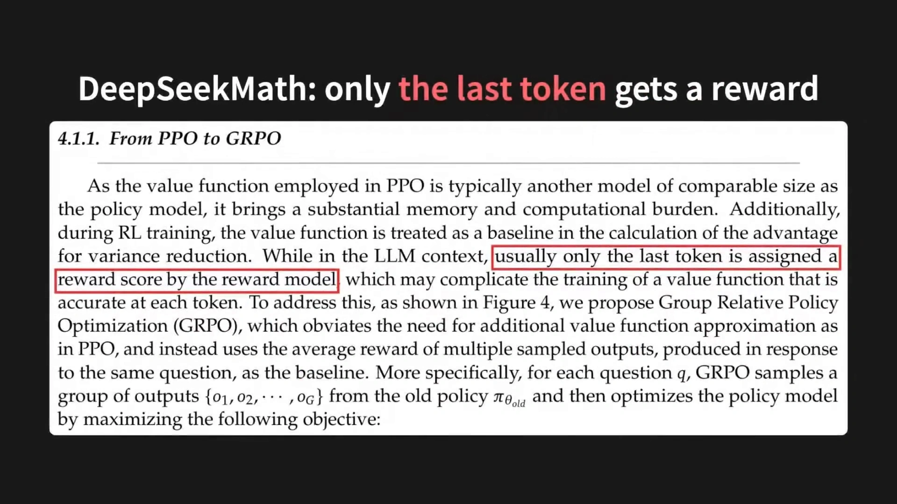
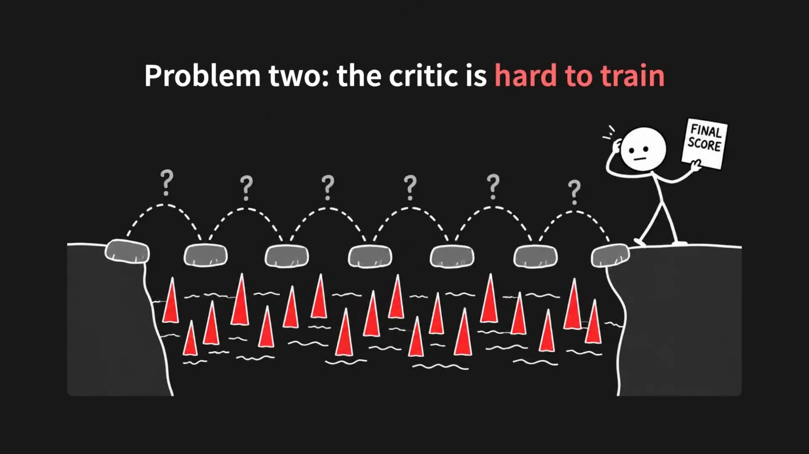
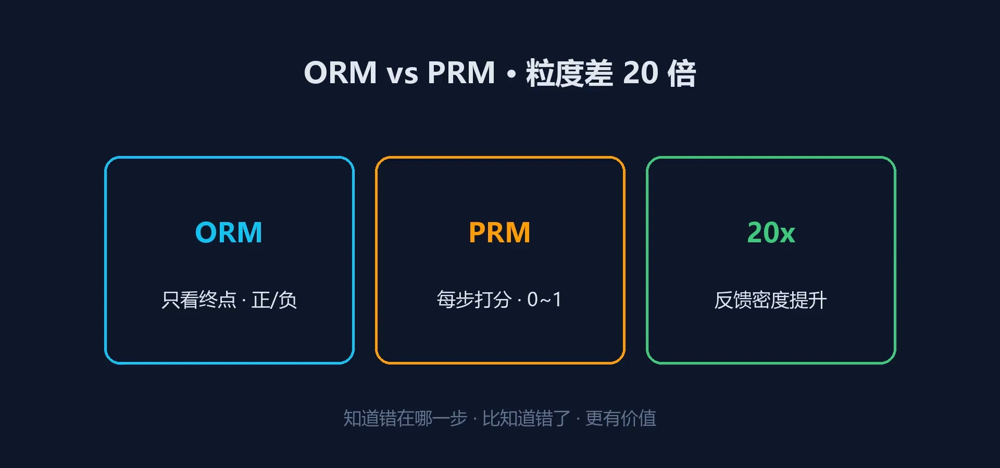
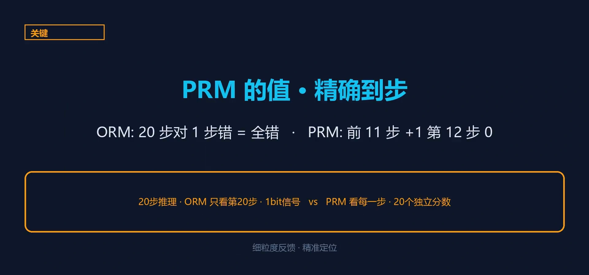
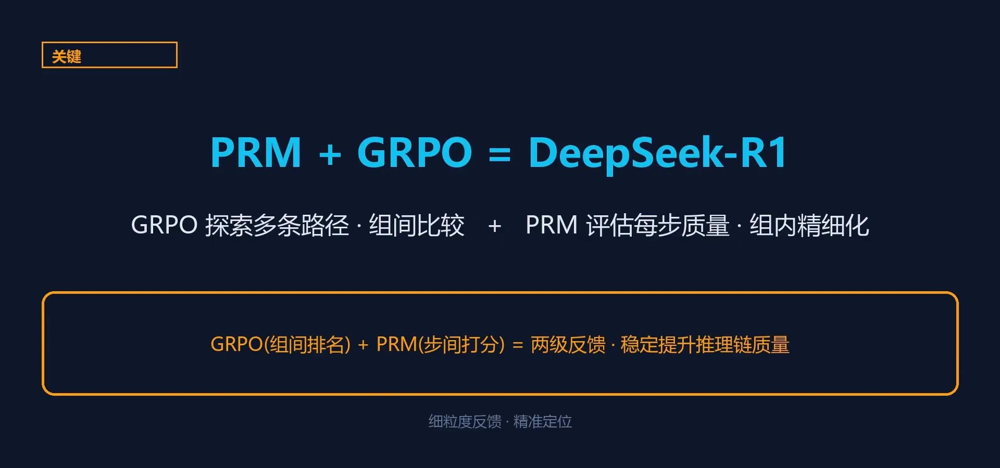
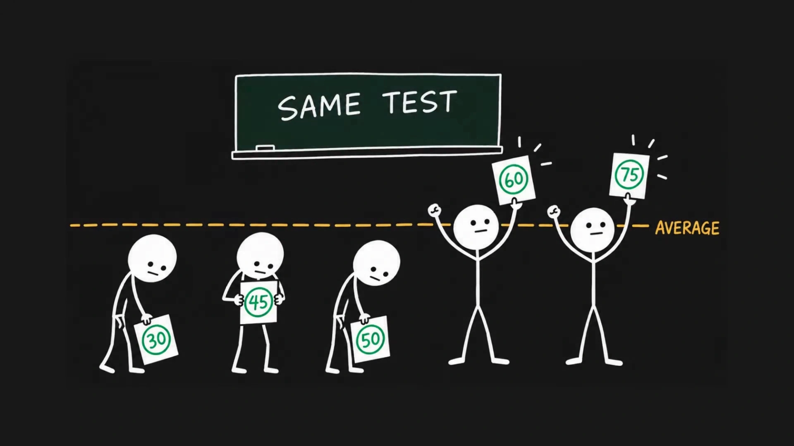
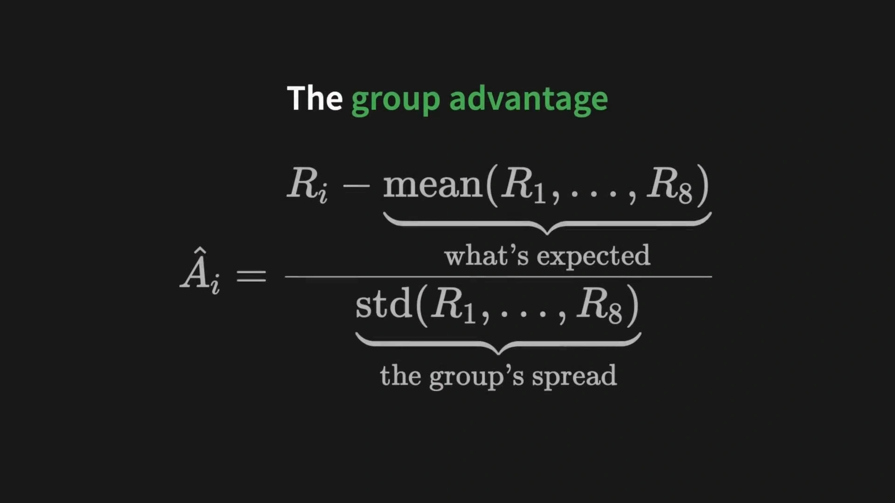
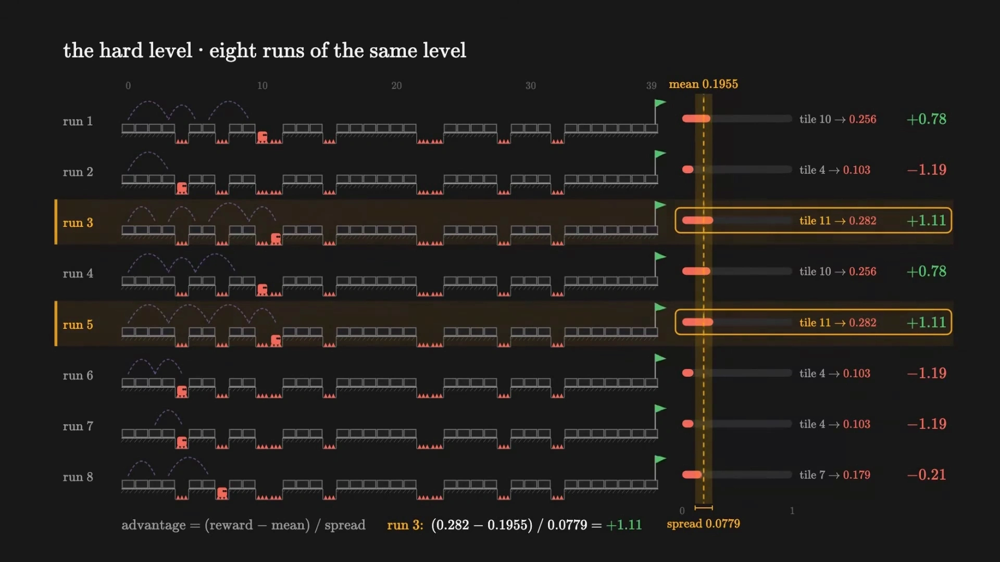
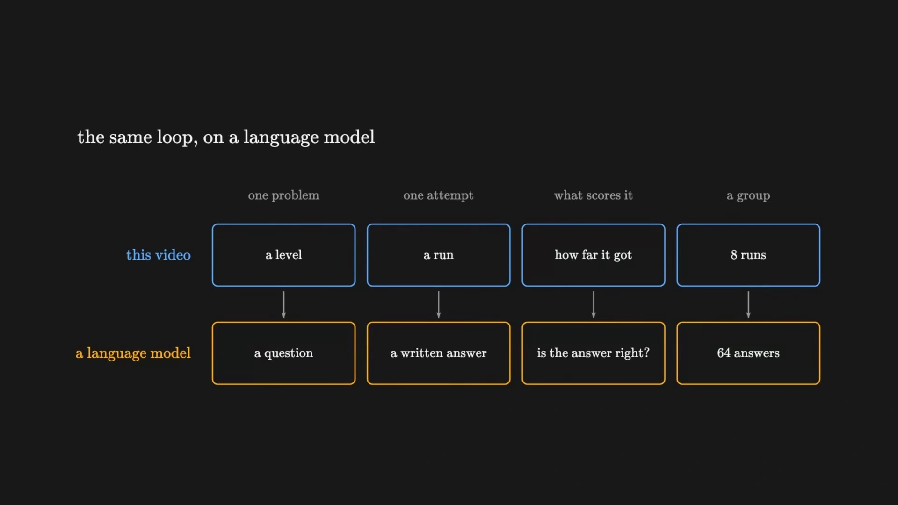

# 面向推理的强化学习：从过程奖励模型（PRM）到 GRPO

> 14.3 讲的是奖励模型：把整段回答压成一个标量分数，用 Bradley-Terry 从成对比较里学出来，它的输入是**人类偏好**。14.4 讲的是 DPO：连这个分数都省掉，直接对偏好数据做梯度下降，输入仍然是**人类偏好**。两条路线的共同前提是——好坏说不清，只能靠人去比较。
>
> 本篇换一个场景。数学题有标准答案，代码题能跑单元测试：**对错可以被程序判出来**。这时候既不需要人类偏好，也不需要学一个奖励模型，直接把「对 / 错」当奖励就行。但新的麻烦随之而来：整段推理只拿到一个 0/1 的信号——答对了，是哪一步推理的功劳？本篇讲围绕这个问题长出来的两条路线：**过程奖励模型（PRM）** 把奖励切细到每一步，**GRPO** 则把「和谁比」从价值网络换成了同一道题的一组采样。
>
> 内容依据三支视频整理：B 站「给我 16 分钟，我让你彻底搞懂 GRPO」（BV1UEHA6VEWM，Zachary Huang 的动画讲解，中文配音版；它用一个小游戏把 GRPO 每一步的数值都摊在屏幕上）、「过程奖励模型 PRM：从结果奖励的缺陷到蒙特卡洛自动标注」（BV1SYga6KEtA）、「GRPO、DAPO、GSPO 三代强化学习算法到底改了什么」（BV1oRMP6hE7f）。公式与结论可对照 DeepSeekMath 论文（arXiv:2402.03300）、DeepSeek-R1 论文（arXiv:2501.12948）、Let's Verify Step by Step（arXiv:2305.20050）、Math-Shepherd（arXiv:2312.08935）与 DAPO（arXiv:2503.14476）。凡超出视频的补充，文中会明确标注。

## 本讲要解决的核心问题（SCQA）

**背景**：14.2 的 RLHF 与 14.4 的 DPO，优化对象都是「人类觉得哪个回答更好」。奖励来自偏好，而偏好要靠人去标。

**冲突**：推理任务不吃这一套。一道数学题的答案对不对，不需要人来判断，程序就能判；而且人类偏好在这里反而是噪声——解题过程是否严谨，标注员未必看得懂。可一旦把奖励换成「最终答案对 / 错」，信号就从「整段话的每个 token」塌缩成「整段话一个标量」，而且这个标量只在末尾出现。**奖励既稀疏又晚到，信用分配（credit assignment）无从下手**：答对了，是哪一步的功劳？答错了，又是哪一步开始错的？

**疑问**：既然奖励的粒度是瓶颈，能不能**把奖励切细**？如果不能切细，能不能**换一种估计优势的方式**，把「和谁比」这件事做得更便宜？

**回答（中心思想）**：两条路线各答一半。**PRM** 直接改奖励：给推理的每一步打分，把「一个 0/1」变成「每步一个分数」，代价是标注成本极高，于是有了蒙特卡洛 rollout 自动标注。**GRPO** 不改奖励、改优势：把价值网络（critic）整个删掉，改用「同一道题采样一组回答、组内互相比较」来估计优势——组内均值当基线，组内标准差做归一化。

---

## 一、推理任务为什么不一样

### 1.1 奖励可以「算」出来，不必「学」出来

14.3 花了一整篇讲怎么训一个奖励模型，是因为「什么算好回答」没有客观标准。推理任务不一样：数学题有标准答案，代码题有单元测试。于是奖励函数可以写成几行代码：

- 答案和标准答案一致 → $r=1$，否则 $r=0$；
- 代码通过全部测试用例 → $r=1$，否则 $r=0$；
- 再加一条格式奖励（比如必须把推理过程包在思考标签里）→ 满足给一点分。

这类奖励叫**可验证奖励**（verifiable reward），整条路线叫 **RLVR**（Reinforcement Learning with Verifiable Rewards）。它把 14.3 的奖励模型整个省掉了：**没有 $r_\phi$，没有 Bradley-Terry，没有偏好数据**。

### 1.2 代价：奖励稀疏，而且只在最后一个 token 上

省掉奖励模型的代价立刻显现。DeepSeekMath 论文 4.1.1 节把这句话写得很直白：在语言模型的场景里，**通常只有最后一个 token 会被奖励模型给出分数**。

[【跳转到 06:32】](https://www.bilibili.com/video/BV1UEHA6VEWM/?p=2&t=392)

这句话原本是用来解释「为什么 PPO 的价值网络在语言模型上不好训」的，但它同时点出了本篇所有麻烦的源头：一段几百个 token 的推理，只有一个位置有监督信号。

### 1.3 信用分配：一个分数要摊到每一步上

PPO 的解法是养一个价值网络 $V_\psi$，让它预测「从这一步往后大概能拿多少分」，再用 $r - V_\psi$ 算优势。讲者用游戏里的小人把这个过程画了出来：六次跳跃，每次跳跃头顶都是问号，而终点只有一个「FINAL SCORE」。

[【跳转到 06:23】](https://www.bilibili.com/video/BV1UEHA6VEWM/?p=2&t=383)

讲者把 critic 的毛病总结成两条，两条都值得记住：

- **它太贵**。语言模型里策略本身就是模型，critic 是另一个同规模的模型，要跟策略并行训练，显存和算力都翻倍。DeepSeekMath 论文的原话是「带来可观的内存与计算负担」。
- **它太难训准**。critic 必须从终点的一个分数反推每一步的价值。讲者的说法是：六次跳跃只给一个数值，critic 无从知晓哪一次跳跃不稳。

### 1.4 两条改进路线

于是有了两条互不冲突的路线，本篇各讲一条：

| 路线 | 改的是什么 | 具体做法 | 代价 |
| :--- | :--- | :--- | :--- |
| **过程奖励模型（PRM）** | 改**奖励**的粒度 | 给推理的每一步打分，把 1 个标量变成 $T$ 个分数（$T$ 为推理步数） | 标注成本极高 |
| **GRPO** | 改**优势**的估计方式 | 删掉 critic，用同一道题的一组采样做组内比较 | 优势变成整段共享，信号更粗 |

下面两节依次展开。

---

## 二、ORM 与 PRM：奖励的粒度之争

### 2.1 两个名字

- **ORM（Outcome Reward Model，结果奖励模型）**：只看最终答案给奖励。对给高分，错给低分，中间那一长串推理一眼都不看。
- **PRM（Process Reward Model，过程奖励模型）**：给推理的每一步单独打分。这一步对不对、有没有往正确方向走。

[【跳转到 01:00】](https://www.bilibili.com/video/BV1SYga6KEtA/?t=60)

视频把两者的差别总结成一句话：**知道错在哪一步，比知道错了更有价值。**

### 2.2 ORM 的问题：奖励了错误的推理

ORM 最大的优点是便宜——很多题的答案可以自动对照，不需要人。但它的缺陷是结构性的：**整份解答只在最末端得到一个分数，中间几十步全是黑箱**。模型只知道结果好坏，压根不知道自己哪一步走对了、哪一步走歪了。

更糟的是「侥幸正确」。视频举了一个经典例子：

> 计算 $\frac{64}{16}$，有人图省事把两个 6 划掉，得到 $\frac{1}{4}$——而 $\frac{1}{4}$ 竟然真的是正确答案。可这个约分方法纯属瞎猫碰上死耗子。

ORM 只盯最后那个答案，一看是对的，大手一挥给了高分。它等于在明晃晃地奖励一套完全错误的推理，模型还以为自己找到了捷径，越学越歪。

（补充说明：这个例子在过程监督的讨论里常被引用，本次候选视频中有一支专门用它做开场；入选的三支视频里没有逐字讲它，此处作为 ORM 缺陷的直观说明补充。）

### 2.3 PRM 的问题：每一步都要标

PRM 治的正是这个病。视频给的对照是：一条 20 步的推理，第 12 步把除号写成了乘号，后面八行全错。

[【跳转到 01:28】](https://www.bilibili.com/video/BV1SYga6KEtA/?t=88)

- **ORM 看到的**：20 行里只有一个「错」，给整条路径负分。
- **PRM 看到的**：前 11 步各 $+1$，第 12 步骤降到 0，标注出「这里开始错了」。

有了这个信号，强化学习就精确到了具体步骤：模型学会了在第 11 步做什么是对的、在第 12 步应该避免什么。视频的说法是——**让 RL 的奖励信号不再是一刀切**。

代价也很直接：要标「第 N 步做对了吗」，而不是「这道题做对了」。每一步都要标注员读懂数学推导再判断，**贵到离谱**。

---

## 三、PRM 怎么训出来：人工标注与蒙特卡洛自动标注

### 3.1 路线一：人工逐步标注

2023 年 OpenAI 在 **Let's Verify Step by Step** 里系统提出过程监督：不只给最终答案打分，而是给推理路径上的每一步一个分数。视频的比喻是阅卷老师批数学大题——不给全卷一个大分，而是每步推导都打小分。

这条路的成本是硬成本。视频提到，OpenAI 做这项工作花了几十万美元雇数学专家标注。（补充说明：这份数据集就是后来公开的 PRM800K，约 80 万条步骤级标签；视频只讲了成本量级，没提数据集名字。）

### 3.2 路线二：蒙特卡洛 rollout 自动标注

2023 年 Wang 等人提出的 **Math-Shepherd** 换了个思路：**不需要人来判断每一步对不对，让模型自己往后跑很多遍，看这一步能通向正确答案的概率。**

[【跳转到 02:21】](https://www.bilibili.com/video/BV1SYga6KEtA/?t=141)

具体做法（视频口述 + 论文原式）：

1. 取一条推理路径里的某一步 $s_t$；
2. 以这一步为起点，让模型继续生成 $N$ 条后续推理（rollout）；
3. 数一数这 $N$ 条里有多少条最终走到正确答案；
4. 用这个比例当这一步的标签。

写成式子就是：

$$
\hat y_t \;=\; \frac{1}{N}\sum_{i=1}^{N}\mathbb{1}\big[\text{rollout}_i \text{ 的最终答案正确}\big]
$$

视频给的经验判据是：如果 80% 的展开都算对了，说明这一步靠谱，标注为 $+1$；如果只有 10% 算对，说明这一步可能在挖坑，标注为 $-1$。（补充说明：Math-Shepherd 原文用的是「硬标签 + 软标签」两套估计，硬标签按成功率阈值给 0/1，软标签直接用成功率当连续值；视频只讲了阈值这一种。）

这条路线的意义在于：**完全自动化，不需要人工，靠模型自己展开来验证每一步**。视频说它跟合成数据的 self-play 思想一脉相承——用模型来判断模型。

### 3.3 PRM 的两种用途

视频把 PRM 的用途拆成两类，这个区分很关键：

- **当奖励信号做 RL**：把每步分数累加成回报，喂给策略梯度。粒度细，但训练时要反复调用 PRM，成本高。
- **当 verifier 在推理时做重排序 / 搜索**：模型一次采样 $N$ 条完整解答，用 PRM 给每条打分，挑最高的那条（best-of-N）；或者边走边剪枝（树搜索）。这时 PRM 不参与训练，只在推理时当裁判。（补充说明：best-of-N 与树搜索这两种具体形式是 PRM 文献里的标准做法，视频只讲到「PRM 是 self-play 的裁判」，没有展开。）

视频用的说法是：PRM 是 self-play 的裁判，是 GRPO 的奖励员，是推理能力的教练。

### 3.4 三种变体与一个基准

| 变体 | 粒度 | 特点 |
| :--- | :--- | :--- |
| **step-level PRM** | 每个推理步骤一个分数 | 最常用，OpenAI 与 DeepSeek 都采用 |
| **token-level PRM** | 每个 token 一个分数 | 粒度最细，但标注成本极高，实际应用较少 |
| **auto-PRM** | 自动生成标签 | Math-Shepherd 路线，不依赖人工，开源社区的主要方向 |

评测方面，视频提到 **ProcessBench**（2024）：给定一条在某个步骤出错的推理，看 PRM 能不能准确指出错在哪。它评的不是「谁打分更高」，而是「谁找错更准」。

### 3.5 一个必须说清的矛盾

视频把 DeepSeek-R1 的成功概括成「PRM + GRPO」：

[【跳转到 03:02】](https://www.bilibili.com/video/BV1SYga6KEtA/?t=182)

这个概括需要打一个折扣。**DeepSeek-R1 论文自己写的是：他们试过过程奖励模型，但帮助不大。** 原因有两个——一是步骤级标签太难规模化地拿到，二是 PRM 容易引出 reward hacking（模型学会骗过 PRM，而不是真的把题做对）。R1 最终采用的是**规则验证的结果奖励**（答案对不对 + 格式对不对），配合 GRPO。DeepSeekMath 论文里过程监督确实报告了收益，但用法是训一个 PRM 给候选答案做重排序（best-of-N），不是把它当 RL 的奖励。

所以本篇的结论应该这么写：**PRM 是一条真实有效但昂贵的路线，它在推理时当 verifier 比在训练时当奖励更常见；而 R1 证明了「规则奖励 + GRPO」这条更便宜的路已经够用。** 上面那张图代表的是这支视频的概括，不是 R1 论文的原话。

---

## 四、GRPO：把 critic 换成一组采样

### 4.1 动机：删掉那个同规模的网络

PPO 在语言模型上要同时跑四个模型：策略 $\pi_\theta$、参考模型 $\pi_{ref}$、奖励模型 $r_\phi$、价值网络 $V_\psi$。GRPO（Group Relative Policy Optimization，DeepSeekMath 2024）要删的就是最后一个。

讲者的推理链很短：**critic 唯一的作用是提供一个「预期基准」，好让 $r - V_\psi$ 变成优势。那这个基准能不能不靠网络预测，直接从采样里算出来？**

能。同一道题采样多个回答，这些回答的平均分，天然就是这道题的「预期表现」。

[【跳转到 07:59】](https://www.bilibili.com/video/BV1UEHA6VEWM/?p=2&t=479)

视频的类比是曲线评分（grading on a curve）：所有人都考同一套题，高于平均分是好消息，低于则是坏消息，**无论题目有多难**。这句话的后半句是重点——它顺手解决了 1.3 节里 critic 分不清难易关卡的毛病。

### 4.2 做法：四步

1. 对同一个 prompt $q$，用旧策略 $\pi_{\theta_{old}}$ 采样 $G$ 个回答 $\{o_1,\dots,o_G\}$（DeepSeekMath 里 $G=64$，视频的玩具例子用 8）。
2. 每个回答拿到一个奖励 $r_1,\dots,r_G$（规则判对错，所以是 0/1）。
3. **组内标准化**，得到每个回答的优势：

$$
\hat A_i \;=\; \frac{r_i - \operatorname{mean}(r_1,\dots,r_G)}{\operatorname{std}(r_1,\dots,r_G)}
$$

4. 用这个 $\hat A_i$ 替代 PPO 的 GAE 优势，做策略梯度更新。

第 3 步就是 GRPO 的全部新意，视频专门给它做了一页：

[【跳转到 08:07】](https://www.bilibili.com/video/BV1UEHA6VEWM/?p=2&t=487)

分子是「实际得分减预期得分」，分母是「这一组的离散程度」。前者是基线的老思路，后者是 GRPO 加的。

### 4.3 一组真实数字

视频在困难关卡上跑了八次，全部掉进坑里，但掉的位置不同（第 10、4、11、10、11、4、4、7 块地砖）。把地砖位置换算成奖励，就得到 $0.256, 0.103, 0.282, 0.256, 0.282, 0.103, 0.103, 0.179$ 这八个数；组内均值 $0.1955$、标准差 $0.0779$。代进公式：

[【跳转到 08:57】](https://www.bilibili.com/video/BV1UEHA6VEWM/?p=2&t=537)

$$
\hat A_{\text{run 3}} = \frac{0.282 - 0.1955}{0.0779} = +1.11,
\qquad
\hat A_{\text{run 2}} = \frac{0.103 - 0.1955}{0.0779} = -1.19
$$

于是**八次全失败的一组里，仍然有四次拿到正优势**（$+0.78, +1.11, +0.78, +1.11$）——都是跑得比群体平均距离更远的那几个。视频在这里插了一道随堂测验：「困难关卡八次运行全部掉坑，谁会得到正优势？」答案是「走得最远的那几个」，因为它们跑得比群体平均距离更远。

而对简单关卡（八次里只有一次跑到终点、五次在第 22 块地砖处掉坑、两次停在第 28 块），组内均值 $0.6571$、标准差 $0.1450$，同样的绝对分数换算出的优势完全不同：跑到终点的那次拿到 $+2.36$，掉坑的五次拿到 $-0.64$，停在半路的两次拿到 $+0.42$。**两个关卡的评分都正确反映了相对水平**——这正是 critic 做不到的事。

### 4.4 为什么这样能 work

两个理由，一个来自强化学习的老结论，一个是 GRPO 新加的：

- **组内均值就是一个基线**。7.4 讲过，策略梯度里减去一个与状态有关的基线 $b(s)$，不改变梯度的期望、只降低方差。在「一道题 = 一个状态」的设定下，组内均值正是这个 $b(s)$ 的蒙特卡洛估计。**所以 GRPO 没有发明新东西，它只是把「学一个网络来估基线」换成了「采样一组来估基线」。**
- **除以标准差进一步抹平了题目难度**。均值只把中心移到 0，标准差还把尺度归一了：简单题和难题的奖励分布宽度不同，除完之后优势都落在同一个量级上，梯度不会因为某道题特别难而爆炸或消失。

**代价也在这里**：如果一组回答全对或者全错，组内标准差为 0，优势全是 0，这一组算例就白跑了。这个问题在 5.1 节还会回来。

### 4.5 目标函数

把上面几步拼起来，就是 DeepSeekMath 论文里的 GRPO 目标：

$$
\mathcal{J}_{\mathrm{GRPO}}(\theta)=\mathbb{E}\left[\frac{1}{G}\sum_{i=1}^{G}\frac{1}{\lvert o_i\rvert}\sum_{t=1}^{\lvert o_i\rvert}\Big(\min\big(\rho_{i,t}\hat A_i,\ \operatorname{clip}(\rho_{i,t},1-\epsilon,1+\epsilon)\hat A_i\big)-\beta\,D_{\mathrm{KL}}\Big)\right]
$$

其中重要性采样比是

$$
\rho_{i,t}=\frac{\pi_\theta(o_{i,t}\mid q,o_{i,<t})}{\pi_{\theta_{old}}(o_{i,t}\mid q,o_{i,<t})}
$$

逐项拆开看：

| 项 | 含义 | 来自哪里 |
| :--- | :--- | :--- |
| $\rho_{i,t}$ | 新策略与旧策略在第 $t$ 个 token 上的概率比 | PPO 的重要性采样 |
| $\hat A_i$ | 第 $i$ 个回答的**组内标准化**优势，**整段共享同一个值** | GRPO 的新东西 |
| $\min(\rho_{i,t}\hat A_i,\ \operatorname{clip}(\rho_{i,t},1-\epsilon,1+\epsilon)\hat A_i)$ | 裁剪目标：比率偏出 $[1-\epsilon,1+\epsilon]$ 后不再给额外收益，防止一步走太远 | PPO-Clip（见 9.3） |
| $\frac{1}{\lvert o_i\rvert}\sum_t$ | 按回答长度做平均 | 视频特别提示：这一项有副作用，见 5.1 |
| $\beta D_{\mathrm{KL}}$ | 与参考策略的 KL 约束，防止模型跑离 $\pi_{ref}$ | 14.2 的 KL 惩罚 |

（补充说明：视频只讲到「实际实现中还包含 KL 散度项作为正则化约束」，没有写 KL 的具体估计式。论文里用的是无偏的 $k_3$ 估计：$D_{\mathrm{KL}}=\frac{\pi_{ref}}{\pi_\theta}-\log\frac{\pi_{ref}}{\pi_\theta}-1$，逐 token 计算。这一条是按论文补的。）

### 4.6 一个容易被忽略的细节：优势是整段共享的

PPO 的 critic 为**每一个 token** 给出独立预测，所以每一步各有其优势。GRPO 没有 critic，只有一个整段的奖励，于是**整段回答共享同一个 $\hat A_i$**。

视频把这个后果讲得很清楚：第三次运行的全部六步都拿到 $+1.11$，**包括最后那次掷硬币失败的跳跃**。所以 GRPO 同样无法识别出那一次不稳定的跳跃——它只是不再训练模型去猜、为每一步分配独立奖励。

这句话把本篇的两条路线接上了：**GRPO 省掉了 critic，也就放弃了步骤级的信用分配；要拿回步骤级信号，就得回到 PRM。** 两者的关系不是替代，而是「便宜」与「细」的取舍。

### 4.7 从游戏到语言模型

视频最后把玩具循环逐项映射到语言模型上，这张表值得记住：

[【跳转到 15:34】](https://www.bilibili.com/video/BV1UEHA6VEWM/?p=2&t=934)

视频给出的实测数字：DeepSeek-R1-Zero 用同一个循环，在未经例题预训练的模型上跑，AIME 2024 的首次尝试正确率从 15.6% 提升到 71.0%。

### 4.8 与 PPO 的对比

| 维度 | PPO（9.3） | GRPO（DeepSeekMath） |
| :--- | :--- | :--- |
| 是否需要 critic | 需要，与策略同规模的价值网络 $V_\psi$ | **不需要** |
| 同时加载的模型数 | 策略 + 参考 + 奖励 + 价值 = 4 个 | 策略 + 参考 + 奖励 = 3 个 |
| 优势怎么估 | GAE：$\sum_l (\gamma\lambda)^l \delta_{t+l}$，逐 token | 组内 z 分数：$(r_i-\operatorname{mean})/\operatorname{std}$，整段共享 |
| 优势的粒度 | 每个 token 一个 | 每个回答一个 |
| 显存开销 | 高（多一个同规模网络） | 低（省掉 critic） |
| 额外开销 | 无 | 每个 prompt 要采样 $G$ 个回答（$G=64$） |
| 适用场景 | 通用 RLHF、奖励连续且稠密 | 可验证奖励、同一 prompt 能反复采样 |

一句话：**PPO 用「一个学出来的基线」换「每一步的优势」，GRPO 用「一组采样出来的基线」换「整段的优势」。**

---

## 五、GRPO 的代价，以及它之后的两代改进

### 5.1 三个坑

视频（BV1oRMP6hE7f）总结了 2025 年大家跑了几千步之后踩到的三个坑：

- **熵坍塌**：没几步模型就把某种回答方式的概率锁死到接近 100%，不再探索新写法，生成的东西越来越千篇一律。
- **梯度消失**：如果一组答案全对或全错，组内奖励完全一样，减去均值后优势全是零，这一整组算例白算。这就是 4.4 节末尾提到的那个代价。
- **长度稀释**：GRPO 原本是「先在每份答案内部按 token 平均、再跨答案平均」，于是短答案里每个 token 的权重被放大、长答案被摊薄，学习信号并不公平。

### 5.2 DAPO：四个工程补丁

2025 年 3 月，字节跳动与清华的团队针对这三个坑一口气打了四个补丁，取名 **DAPO**：

| 补丁 | 改什么 | 治哪个坑 |
| :--- | :--- | :--- |
| **clip higher** | 概率裁剪上下对称改成不对称：上限从 0.2 放宽到 0.28，下限不变 | 熵坍塌（低概率但有潜力的 token 能涨得更猛） |
| **动态采样** | 一组全对或全错就直接扔掉重采样，直到组里有对有错 | 梯度消失 |
| **token-level 损失** | 不再先按答案内部平均，改成整个批次所有 token 一起平均 | 长度稀释 |
| **超长回答的奖励塑形** | 被截断的答案不再粗暴打零分，改成软性惩罚区；也可直接屏蔽被截断样本的损失 | 长度失控 |

四个补丁叠加，在 DeepSeek-R1-Zero Qwen-32B 同款设置下，AIME 2024 的成绩从 30 分涨到 50 分。

### 5.3 GSPO：把逐词比值换成序列级比值

2025 年 7 月，通义千问团队指出一个更深的问题：**GRPO 的重要性采样是逐个 token 算比值的，但奖励是整段回答只打一次分，两者的颗粒度根本不对齐。**

这个问题在混合专家（MoE）结构里被放大：同一个 token，模型更新一步之后可能被路由到不同的专家网络。视频给的实测数字是，在 Qwen3 上一次梯度更新后，大约一成的 token 专家路由就变了——这意味着 GRPO 的比值比较的**根本不是同一套参数**，噪声可以让训练直接不可逆地崩溃。

**GSPO** 的解法是不再逐 token 比较，而是把整段回答的似然比取几何平均、按长度归一化，变成一个**序列级**的比值，与整段的奖励颗粒度对齐：

$$
s_i(\theta)=\left(\frac{\pi_\theta(o_i\mid q)}{\pi_{\theta_{old}}(o_i\mid q)}\right)^{1/\lvert o_i\rvert}
$$

（补充说明：这个式子是 GSPO 论文的定义，视频只讲了「取几何平均、按长度归一化」这层意思，没有写出式子。）用了这个方法之后，Qwen3 甚至不再需要专门为 MoE 结构打的补丁——路由重放。

视频的收尾很传神：**GRPO 把价值模型的债转成了训练稳定性的债，DAPO 用四个补丁分期还债，GSPO 换了个记账的粒度，直接不欠了。**

---

## 六、第 14 章收官：四种方法放在一起

这是第 14 章的最后一个条目，把 14.2 到 14.5 的四条路线排成一张表：

| 方法 | 奖励来源 | 是否需要 RM | 是否需要 critic | 数据形式 | 典型场景 |
| :--- | :--- | :--- | :--- | :--- | :--- |
| **RLHF**（14.2） | 人类偏好 → 训一个 $r_\phi$ | 是 | 是 | 成对偏好 | 通用对齐 |
| **DPO**（14.4） | 人类偏好（隐式奖励） | 否 | 否 | 成对偏好 | 通用对齐 |
| **PRM + RL** | 过程标注 / 蒙特卡洛估计 | 是（PRM 本身就是 RM） | 视实现 | 逐步标签 | 数学、推理 |
| **GRPO**（14.5） | 规则验证（对 / 错） | 否 | 否 | 同一 prompt 的多个采样 | 数学、代码 |

读这张表可以看出一条主线：**每一代都在砍掉一个「中间商」。** RLHF 砍不掉奖励模型，DPO 把奖励模型换成隐式奖励，GRPO 把 critic 换成组内比较，而 PRM 走的是反方向——它主动加回一个模型，因为推理任务真正缺的不是「省」，而是「细」。

还有一条更隐蔽的线索：**奖励的可验证性决定了能砍掉多少东西。** 只有当答案能被程序判对错时，才敢完全不要奖励模型；一旦回到「什么算好回答」这种说不清的问题，14.3 的 Bradley-Terry 和 14.4 的偏好数据仍然是必需的。RLHF 与 RLVR 不是替代关系，是两个不同的问题域。

---

## 七、整个系列的收尾

> **本节是本系列的整理总结，不是任何一支视频的原话。**

从第 1 章的多臂赌博机，到第 14 章的大模型 RL，中间隔了十三个章节、几十种算法。回头看，主线其实只有一条：

**强化学习始终在做同一件事——用有限的交互或数据，估计并优化长期回报。**

变的只是三样东西：

- **状态空间**：从「几台老虎机」到「网格世界」，到「连续控制的高维观测」，再到「一段文本前缀」。14.1 做的事，就是把语言模型的序列生成硬塞进 MDP 的框子里。
- **动作空间**：从「拉哪根杆」到「选哪个离散动作」，到「输出哪个连续力矩」，再到「词表里的哪个 token」。
- **奖励来源**：这是第 14 章真正在演化的东西。手工设计的奖励（第 1~13 章）→ 人类偏好学出来的奖励（14.2、14.3）→ 隐式奖励（14.4）→ 程序可验证的规则奖励（14.5）。

而几个老问题一直在换皮重演：

| 老问题 | 出现在哪 | 在大模型 RL 里的样子 |
| :--- | :--- | :--- |
| 探索与利用 | 第 1 章 $\epsilon$-贪婪 | 熵坍塌（5.1）：策略过早锁死在一种写法上 |
| 方差与基线 | 7.4 的 baseline | GRPO 的组内均值（4.4） |
| 信用分配 | 第 5 章的 TD 误差 | PRM 的逐步打分（第二、三节） |
| 奖励塑形与投机 | 第 11 章的稀疏奖励 | reward hacking、ORM 被「侥幸正确」骗（2.2） |
| 分布偏移 | 第 12 章的 OOD 动作 | 重要性采样比 $\rho_{i,t}$ 与 clip（4.5） |

如果只带走一句话：**新算法往往不是新原理，而是把老原理放到一个更贵、更稀疏、更难验证的场景里，重新算一遍成本账。** GRPO 删掉 critic，用的是 7.4 的基线；PRM 切细奖励，用的是第 5 章的信用分配；DPO 换元成监督学习，用的是 14.3 的 Bradley-Terry。看懂这些「旧瓶装新酒」的对应关系，比记住任何一个公式都管用。

---

## 小结

- **推理任务的不同**：答案可验证，所以不需要人类偏好、也不需要学奖励模型，规则直接判对错。代价是奖励稀疏——只有最后一个 token 有信号。
- **两条路线**：PRM 改**奖励的粒度**（每步一个分数），GRPO 改**优势的估计方式**（组内比较替代 critic）。
- **ORM vs PRM**：ORM 便宜但信用分配粗，会被「错误推理 + 侥幸正确」骗；PRM 细但标注成本极高。视频的总结是「知道错在哪一步，比知道错了更有价值」。
- **PRM 的两种训法**：人工逐步标注（Let's Verify Step by Step，几十万美元）与蒙特卡洛 rollout 自动标注（Math-Shepherd，从某步往后采 $N$ 条，用最终正确率当标签）。
- **PRM 的两种用途**：当训练时的奖励信号，或当推理时的 verifier 做 best-of-N / 树搜索。后者更常见也更稳。
- **GRPO 的核心动作**：删掉 critic，同一 prompt 采样 $G$ 个回答，用组内 z 分数 $\hat A_i=(r_i-\operatorname{mean})/\operatorname{std}$ 当优势。均值是基线（7.4），除以标准差是归一化题目难度。
- **GRPO 的代价**：优势整段共享，所以它同样定位不到「哪一步错了」；全对 / 全错时标准差为 0，整组白算。
- **后续两代**：DAPO 用四个工程补丁（clip higher、动态采样、token-level 损失、超长回答塑形）治熵坍塌 / 梯度消失 / 长度稀释；GSPO 把逐 token 比值换成序列级比值，治 MoE 里的路由抖动。
- **一句话**：PRM 和 GRPO 回答的是同一个问题的两半——**奖励太粗怎么办**（切细它）和**基线太贵怎么办**（采样估它）。

---

## 附：本篇要点速查

| 概念 | 一句话 |
| :--- | :--- |
| ORM | 结果奖励模型，只看最终答案，信号 1 bit |
| PRM | 过程奖励模型，给每一步打分，信号 $T$ 个分数 |
| 可验证奖励 / RLVR | 用程序判对错当奖励，不需要人类偏好，也不需要奖励模型 |
| 信用分配 | 一个最终分数怎么摊到每一步上；ORM 摊不了，PRM 靠逐步打分解决 |
| Let's Verify Step by Step | OpenAI 2023，过程监督的代表作，人工标注几十万美元 |
| Math-Shepherd | Wang 等 2023，蒙特卡洛 rollout 自动生成步骤标签 |
| 蒙特卡洛标注 | 从某步往后采 $N$ 条，用最终正确率当这一步的标签 |
| ProcessBench | 2024 年的 PRM 评测基准，评的是「找错准不准」 |
| GRPO | 去掉 critic 的 PPO，用组内相对比较估优势 |
| 组内优势 | $\hat A_i=(r_i-\operatorname{mean}(r_1..r_G))/\operatorname{std}(r_1..r_G)$，即 z 分数 |
| 为什么均值是基线 | 7.4：减去与状态有关的基线不改变梯度期望，只降方差 |
| 为什么要除以标准差 | 把不同 prompt 的奖励尺度归一，优势落在同一量级 |
| 整段共享优势 | GRPO 每个回答只有一个 $\hat A_i$，所以定位不到具体哪一步错 |
| 熵坍塌 | 策略过早锁死在一种写法上，不再探索 |
| 梯度消失（GRPO） | 一组全对或全错时标准差为 0，优势全零 |
| 长度稀释 | 先按答案内部平均会放大短答案的 token 权重 |
| DAPO | 四个工程补丁：clip higher、动态采样、token-level 损失、超长回答塑形 |
| GSPO | 把逐 token 的比值换成按长度归一化的序列级比值，治 MoE 路由抖动 |

## 参考视频

- **给我 16 分钟，我让你彻底搞懂 GRPO - Zachary Huang**（BV1UEHA6VEWM，B 站 [BV1UEHA6VEWM](https://www.bilibili.com/video/BV1UEHA6VEWM/)）——用一个「跨越 40 格、跳过坑洞」的小游戏，把 GRPO 的组内标准化优势、critic 的两个毛病、八次运行的实数换算、以及从游戏到语言模型的映射逐项摊开。本篇第二、四节主要依据这一支。
- **PRM 过程奖励模型：从结果奖励的缺陷到蒙特卡洛自动标注**（BV1SYga6KEtA，B 站 [BV1SYga6KEtA](https://www.bilibili.com/video/BV1SYga6KEtA/)）——ORM 与 PRM 的粒度对比、20 步推理的逐步打分示例、Let's Verify Step by Step 的标注成本、Math-Shepherd 的蒙特卡洛标注、三种 PRM 变体与 ProcessBench。本篇第二、三节依据这一支；它把 R1 概括成「PRM + GRPO」，本篇按 R1 论文做了更正。
- **GRPO、DAPO、GSPO 三代强化学习算法到底改了什么**（BV1oRMP6hE7f，B 站 [BV1oRMP6hE7f](https://www.bilibili.com/video/BV1oRMP6hE7f/)）——GRPO 的三个坑（熵坍塌、梯度消失、长度稀释）、DAPO 的四个工程补丁与 AIME 2024 从 30 到 50、GSPO 的序列级比值与 MoE 路由抖动。本篇第五节依据这一支。
