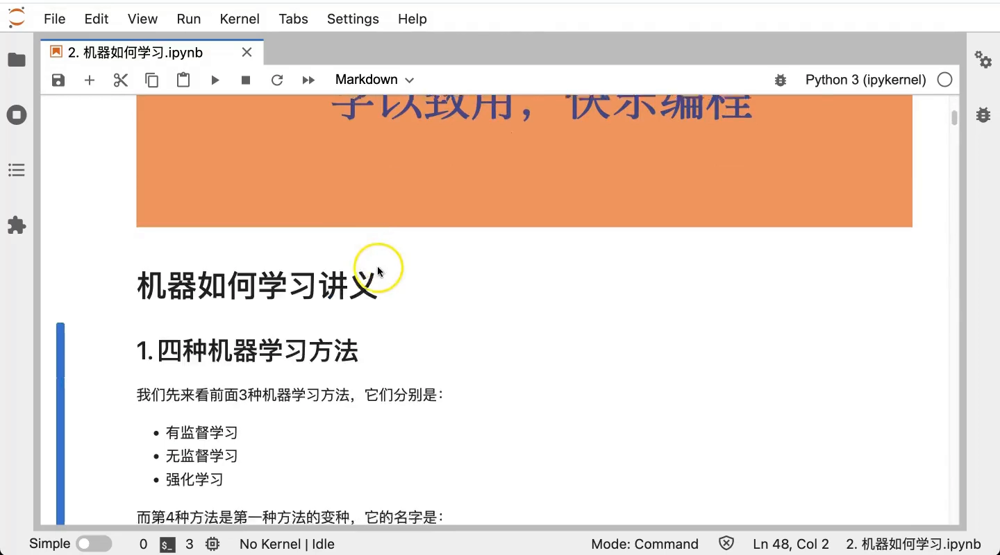
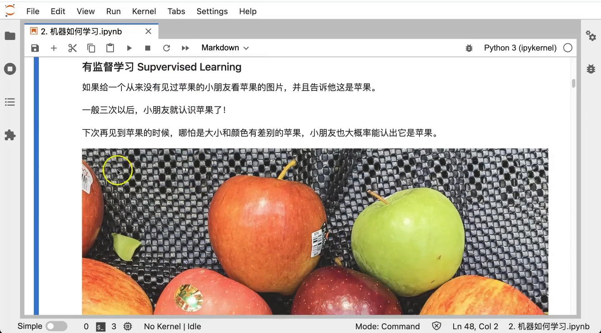
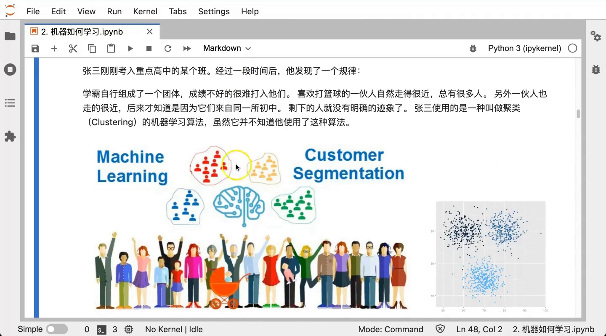
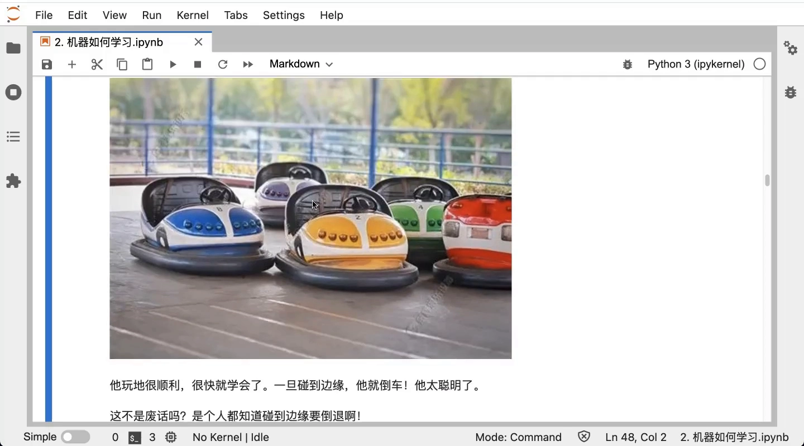
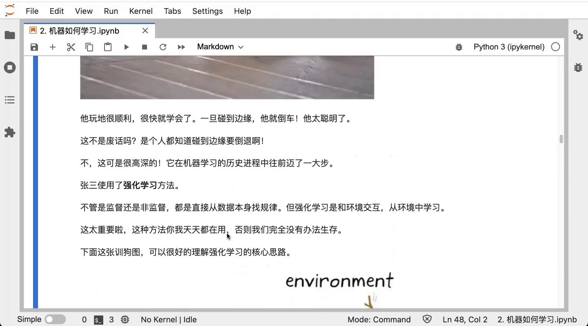
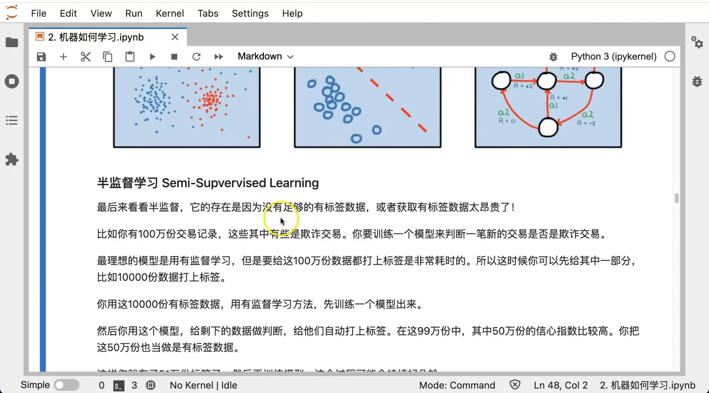
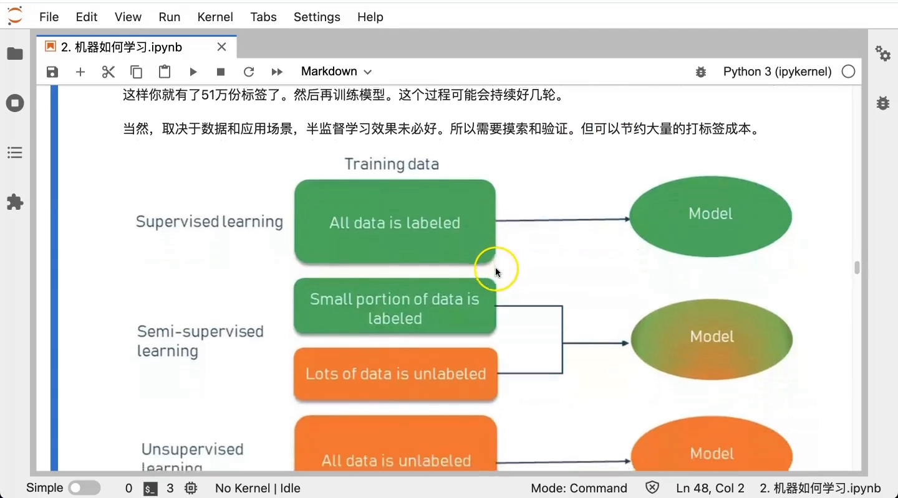

# 有监督学习、无监督学习、半监督学习和强化学习的区别

> 视频来源：[有监督学习、无监督学习、半监督学习和强化学习的区别](https://www.bilibili.com/video/BV1pW4y197Jn/)｜时长：约 12 分钟
>
> 这是一支用生活例子讲「学习方法边界」的课：它用「教小孩认苹果」「新班级自发分小团体」「玩碰碰车」三个例子，把有监督学习、无监督学习、强化学习讲得直观；再用「给 100 万份交易数据打标签」的例子引出半监督学习这条中间地带。本文按视频内容重写为中文，并纠正了自动字幕里的错拼（如 `麦叔`、`labeldata`→**label data**、`unsupervisedlearning`→**unsupervised learning**、`onclassroom`→**clustering**、`7789十一千为`→**乃至上千维**、`群主`→**群组**、`semi semmy 一半`→**semi（一半）**）。与同系列 1.2 的姊妹篇《机器学习类型》搭配阅读：那一篇给出三大分支的全景，这一篇用「**答案 / 距离 / 奖励**」三种反馈机制，把它们的**区别**抠得更细。

## 本讲要解决的核心问题（SCQA）

**背景**：机器学习最常见的方法有三种——有监督学习、无监督学习、强化学习；第四种「半监督学习」则是第一种的一个加强或变化。

**冲突**：这三种方法的名字都带「学习」，中文读起来差不多，但它们的**运作前提完全不同**：一个有答案、一个没答案、一个靠奖励。如果只记名字，很容易混淆。

**疑问**：这三类方法到底各自的**关键点**在哪？它们「靠什么反馈来调整自己」？半监督学习又站在什么位置？

**回答（中心思想）**：区分的钥匙在于两件事——**数据有没有标签**，以及**它靠什么信号来调整自己**。有监督学习靠**答案**（有标签数据）、无监督学习靠**距离**（无标签数据）、强化学习靠**奖励**（与环境交互）；半监督学习则是「一小部分有标签 + 大部分无标签」折中出来的方法。

---

## 一、有监督学习：有标签、有答案

有监督学习（supervised learning）最容易理解。视频用「教小孩认苹果」打比方：给一个从没见过苹果的小朋友看苹果的图片，告诉他「这是苹果」，看几次之后，下次哪怕大小、颜色和他以前见过的不一样，他也能大概认出「这就是苹果」。[【跳转到 00:39】](https://www.bilibili.com/video/BV1pW4y197Jn/?t=39)

放到机器学习里，这个过程就是：我们给学习者（小朋友，或一个算法模型）提供**数据 / 样本**，并**告诉他正确的答案**。学习者从中总结出对象的特征，以后再见类似对象就能正确判断。[【跳转到 01:20】](https://www.bilibili.com/video/BV1pW4y197Jn/?t=80)

关键在于：这里给的数据是**有标签的数据（label data）**——标签，就是「答案」。所以有监督学习有一个很关键的前提：**必须使用有标签的数据，它必须「有答案」才学得会**。

### 1.1 打标签是一件昂贵的事

视频特别强调了一个现实约束：**给数据打标签非常昂贵**。[【跳转到 02:15】](https://www.bilibili.com/video/BV1pW4y197Jn/?t=135) 甚至有一个坊间传言说，国内某人口大省的数十万车间工人改行去做人工智能——做的工作就是给数据打标签：给一张图片标出「这是什么」，或者标记一份数据里有没有错误。

由此引出一句业内说法：**「人工智能有多少人工，就有多少智能」**——你打好了标签，人工智能才学得会、才有智能。[【跳转到 02:45】](https://www.bilibili.com/video/BV1pW4y197Jn/?t=165)

另一个对比也很扎心：人类学得飞快，大脑只要几个样本就能学会；而机器学习算法通常要**几千、上万、几十万条有标签的数据**才学得会。

---

## 二、无监督学习：没有标签，靠「距离」

无监督学习（unsupervised learning）正好相反：**数据是没有标签的**。[【跳转到 03:43】](https://www.bilibili.com/video/BV1pW4y197Jn/?t=223)

视频用「新班级自发分成小团体」打比方：一个新同学加入班级，很快会发现学生自然分成几伙——学习好的走得近、爱运动的走得近、来自同一所初中的又走得近。这其实就是**聚类算法（clustering）**。[【跳转到 03:58】](https://www.bilibili.com/video/BV1pW4y197Jn/?t=238)

### 2.1 没有答案，靠什么判断？——距离

聚类虽然需要人先确定「分几类」，但**哪个样本属于哪一类是不知道的、没有答案的**，需要机器自己去学习、摸索——所以它是典型的无监督学习。[【跳转到 04:40】](https://www.bilibili.com/video/BV1pW4y197Jn/?t=280)

那没有答案怎么学？**靠自己总结和观察，靠「距离」**。[【跳转到 05:17】](https://www.bilibili.com/video/BV1pW4y197Jn/?t=317) 在张三的例子里，就是看「谁和谁走得比较近」——经常在一起，自然就知道是同一种人。

映射到机器学习：数据一般是一个一个**点**（可能是平面上的点、三维空间的点，也可能是四维、五维、乃至上千维空间的点），我们通过**点与点之间的距离**判断它们近不近。常见的距离算法有**欧几里得距离**，还有曼哈顿距离、切比雪夫距离等等（视频不展开）。[【跳转到 06:05】](https://www.bilibili.com/video/BV1pW4y197Jn/?t=365)

---

## 三、强化学习：与环境交互，靠「奖励」

强化学习（reinforcement learning）用「玩碰碰车」打比方：碰碰车不断碰撞，碰到别人就倒退，一旦出问题就去调整——这就是强化学习。[【跳转到 06:29】](https://www.bilibili.com/video/BV1pW4y197Jn/?t=389)

它和前两者有一个很大的区别：**有监督学习和无监督学习都是从数据里找规律**（靠数据的答案、或者数据之间的距离），而**强化学习是和环境交互、从环境中学习**。[【跳转到 07:11】](https://www.bilibili.com/video/BV1pW4y197Jn/?t=431)

再看训狗那个经典图：训狗的人是**环境**，狗是**算法**，狗采取动作，环境就给它 **reward（奖励）**——负的奖励就是惩罚——狗发现奖惩后会调整自己的行为。[【跳转到 07:37】](https://www.bilibili.com/video/BV1pW4y197Jn/?t=457)

视频接着点出了三者最精炼的对照：**强化学习本质上就是建立一种奖励机制**。因为——

- **有监督学习**：通过**答案**来判断对错、调整自己；
- **无监督学习**：通过**距离**来判断；
- **强化学习**：算法里必须有一种**奖励机制**，告诉它你做对了还是做错了，才能不断试错、不断改善。[【跳转到 08:41】](https://www.bilibili.com/video/BV1pW4y197Jn/?t=521)

视频还用「扫地机器人」「自动驾驶」说明强化学习的适用场景——那些人类和动物必须**向环境学习**才能应对的复杂环境。

---

## 四、半监督学习:夹在中间的第四种

最后讲第四种——**半监督学习（semi-supervised learning）**，它本质上还是 supervised learning，是第一种方法的一个**加强或变化**。[【跳转到 09:16】](https://www.bilibili.com/video/BV1pW4y197Jn/?t=556)

用一个例子说明它为什么存在：假设有 **100 万份交易数据**，其中一些是欺诈交易，要训练一个模型判断新交易是否欺诈。理想情况当然用有监督学习，但**给 100 万份都打标签成本太高**。怎么办？

1. **先人工标注一小部分**：比如只给 1 万份打上标签（1%）；
2. **用它训练一个基础模型**；
3. **用这个模型去给剩下的 99 万份自动打标签**——结果不一定准，但有一部分会「很有信心」，比如有 50 万份信心指数较高（如 90% 把握）；
4. **把这 50 万份也当成有标签数据**，于是手上就有了 51 万份有标签数据，再去训练、优化模型；
5. 这个过程**可能持续好几轮**。[【跳转到 10:07】](https://www.bilibili.com/video/BV1pW4y197Jn/?t=607)

它适用的前提是「有标签数据比较少、打标签非常昂贵」。但视频也提醒了它的**风险**：效果取决于数据和应用场景——有可能那 50 万份虽然信心指数看着高，实际并不准。所以半监督学习**仍需要人为进一步验证、摸索**；但如果效果好，它能**节约大量打标签的成本**。[【跳转到 10:56】](https://www.bilibili.com/video/BV1pW4y197Jn/?t=656)

---

## 五、总结：一张图看清区别

视频最后用一张对比图收尾，把四类方法按「训练数据里标签的比例」排开：[【跳转到 11:19】](https://www.bilibili.com/video/BV1pW4y197Jn/?t=679)

| 方法 | 数据标签 | 靠什么调整 | 典型例子 |
| :--- | :--- | :--- | :--- |
| **有监督学习** | 全部有标签 | 答案 | 认苹果、房价预测 |
| **半监督学习** | 一小部分有标签，大部分无标签 | 答案 + 自动打标迭代 | 交易欺诈检测 |
| **无监督学习** | 全部无标签 | 距离 | 客户分群、聚类 |
| **强化学习** | 与环境的交互 | 奖励（reward） | 碰碰车、自动驾驶 |

记住这条主线就够了：**有监督靠「答案」，无监督靠「距离」，强化学习靠「奖励」，半监督是「答案 + 自动打标」的折中**。
