# 机器学习类型：监督学习、无监督学习、强化学习

> 视频来源：[机器学习类型：监督学习、非监督学习、强化学习](https://www.bilibili.com/video/BV1n3fzBsEu6/)｜时长：约 17 分钟
>
> 这是一支「机器学习总览」课：它先用一张「房子数据表」把数据集、样本、特征、维度、标签这几个基础概念讲清，再把机器学习拆成监督学习、无监督学习、强化学习三大分支，逐个说明它们各用什么数据、各解决什么问题、各自的代表算法。本文按视频内容重写为中文，并纠正了自动字幕里的错拼（如 `继续学习`→**机器学习**、`无干的不相干`→**不相干**、`DIGC`/`AIJC`→**AIGC**、`纳诺 banana`→**Nano Banana**、`GN`→**GAN**、`killlearning`→**Q-Learning**、`OOL`→**MOBA**、`zerogo`→**ZeroGo**）。与同系列 1.1《什么是强化学习》互补：那一篇讲强化学习本身是什么，这一篇把强化学习放回整个机器学习的坐标系里，看清它与监督学习、无监督学习的**边界**在哪。

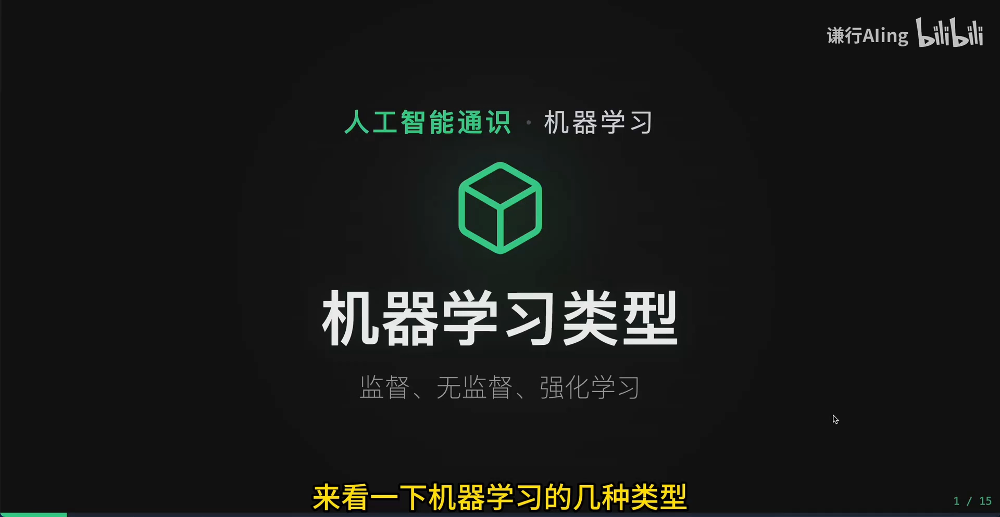

## 本讲要解决的核心问题（SCQA）

**背景**：刚接触机器学习的人常常困惑——要学的范围到底有多大？这节课讲回归、下节课讲聚类，它们之间是什么关系？怎样才算「学会了」？

**冲突**：机器学习应用到的地方五花八门，预测房价、识别垃圾邮件、人脸识别、下围棋、开自动驾驶……看起来毫不相干。但仔细看会发现，很多问题的解决手段其实非常相似。

**疑问**：这些看似不同的任务，能不能被归到少数几类「学习方式」里？如果能，它们各自的前提假设、用的数据、要达到的目标又有什么不同？

**回答（中心思想）**：按「数据是否带标签」以及「学习方式」划分，机器学习可以分成三大分支——**监督学习**（用带标签的数据学「特征→标签」的映射）、**无监督学习**（用无标签数据自己发现结构）、**强化学习**（在动态环境中试错，学一个最大化长期奖励的策略）。前两者本质上都是在**现成的静态数据集**上做预测，而强化学习必须**与环境实时交互、边做边学**——这条区别，就是本讲要讲的「边界」。

---

## 一、先打地基：数据集、样本、特征、维度、标签

在讲分类之前，视频先花了大量篇幅讲清「数据」到底是什么，因为后面三个分支的区别全都建立在「有没有标签」上。

### 1.1 什么是数据

数据，说到底是用来训练和测试机器学习模型的原始信息。日常应用中最常见的是**结构化数据**：它可以用表格的形式存储，无论是 Excel 还是数据库里的表——每一行代表一个实体，每一列代表一种属性。[【跳转到 01:17】](https://www.bilibili.com/video/BV1n3fzBsEu6/?t=77)

比如一套房子：每一行是一套房的信息，每一列是它的一个属性（面积、卧室数量、地段评分、房龄……），而我们要预测的房价，就藏在最后一列里。

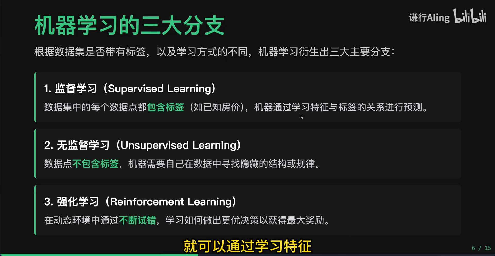

### 1.2 五个天天要说的概念

围绕上面这张表，视频定义了五个基础概念。[【跳转到 02:07】](https://www.bilibili.com/video/BV1n3fzBsEu6/?t=127)

- **数据集（dataset）**：整张完整的数据表格；
- **数据点 / 样本（sample）**：表中的每一行，也就是单条记录；
- **特征（feature）**：表中的每一列，表示数据的一个属性或性质；
- **维度（dimension）**：数据集有多少列，就叫多少维（房子例子里 6 列中前 5 列是特征，所以是「五维数据」）；
- **标签（label）**：最后一列、也就是我们要预测的那个结果变量，它不算特征。

一句话概括「预测」的本质：**让机器学习这些特征，然后去推算数据中的标签**。

---

## 二、三大分支总览

有了「标签」这个概念，机器学习三大分支的分法就顺理成章了。[【跳转到 03:22】](https://www.bilibili.com/video/BV1n3fzBsEu6/?t=202)

| 分支 | 数据 | 学习方式 | 目标 |
| :--- | :--- | :--- | :--- |
| **监督学习** | 每个数据点都带标签 | 学「特征 → 标签」的对应关系 | 预测标签 |
| **无监督学习** | 数据点没有标签 | 自己在特征中发现隐藏结构 | 发现规律 |
| **强化学习** | 动态环境中的交互数据 | 智能体不断试错 | 学最优策略 |

视频给了一个非常精炼的对照：**监督学习和无监督学习本质上用的都是现成的静态数据集**，都是「通过历史数据学会了，就能预测新数据」；而**强化学习是让智能体在动态环境中不断试错，来学习一个最优策略**。[【跳转到 03:47】](https://www.bilibili.com/video/BV1n3fzBsEu6/?t=227) 这条「静态预测 vs 动态决策」的对照，是本讲的主线。

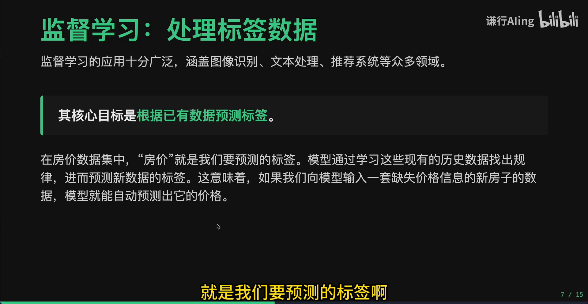

---

## 三、监督学习：处理带标签的数据

监督学习处理的是**带标签的数据**，应用极其广泛——图像识别、文本处理、推荐系统等都在用。它的核心目标是「根据已有的数据来预测」，也就是**根据特征预测标签**。在房价数据集里，模型学习已有的历史数据，找到特征和房价之间的对应关系与背后的规律；之后再输入一套缺失价格的新房子，模型就能自动推测出它的价格——这个房价，就是我们要预测的标签。[【跳转到 04:12】](https://www.bilibili.com/video/BV1n3fzBsEu6/?t=252)

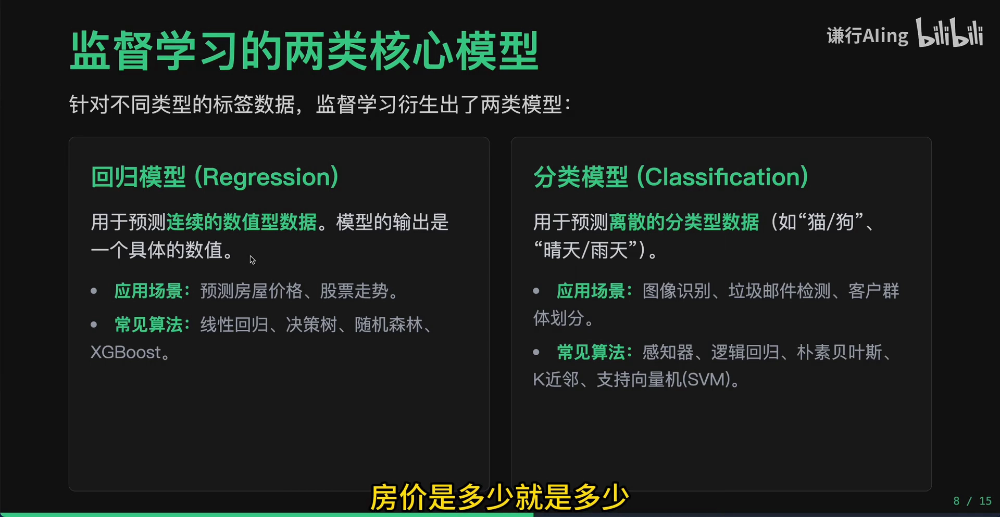

### 3.1 再细分成两类：回归与分类

按标签的数据类型，监督学习还能分成两种。[【跳转到 05:02】](https://www.bilibili.com/video/BV1n3fzBsEu6/?t=302)

- **回归模型（regression）**：标签是**连续的数值**。比如房价——100 万和 200 万就是不一样，数字本身有意义。输出也是预测出来的一个数字。最常见的代表算法就是**线性回归**。
- **分类模型（classification）**：标签是**离散的类别**。比如一张图是猫还是狗，只有这两类，我们在数字上把它定义成 0 或 1。

这里有一个容易被忽略的要点：分类里的数字只是「代号」，背后并没有意义——猫定义成 0、狗定义成 1，也可以定义成 10 和 20，都无所谓，只是计算机更擅长处理数字而已；而房价的数字后面是有意义的。[【跳转到 05:52】](https://www.bilibili.com/video/BV1n3fzBsEu6/?t=352) 常见的分类任务还有：垃圾邮件检测（是 / 不是）、客户群体划分（1/2/3/4/5 类都行，只要分得清）。

---

## 四、无监督学习：处理无标签的数据

无监督学习处理的是**没有标签的数据**。既然没有「正确答案」，它的目标就不再是预测某个具体数值或类别，而是**让模型自己探索这些特征，去发现数据内部隐藏的结构、模式或规律**。[【跳转到 06:58】](https://www.bilibili.com/video/BV1n3fzBsEu6/?t=418)

为什么需要它？因为现实中带标签的数据成本非常高——打标签要依赖人工，甚至存在一个专门的行业叫「数据标注」，只要依赖人工，价格就很高。而我们手中绝大部分数据其实是没有标签的。[【跳转到 07:23】](https://www.bilibili.com/video/BV1n3fzBsEu6/?t=443) 无监督学习主要有三个方向。

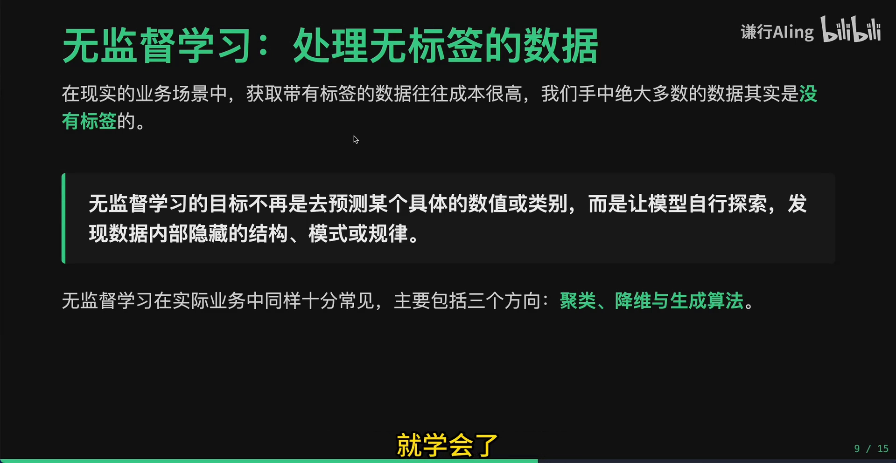

### 4.1 聚类（clustering）

给一个数据集做分组，实现「物以类聚」。面对海量数据、又没有标签时，可以用聚类算法计算数据之间的相似度，把行为模式特别相似的数据自动分到一组。[【跳转到 08:03】](https://www.bilibili.com/video/BV1n3fzBsEu6/?t=483)

典型例子是电商网站的**用户分群**：每天有 100 万用户的访问与交易数据，不可能对每个人都人工分类；用聚类就能根据行为把用户自动分成「价格敏感型」「品牌忠诚型」等几类，得到清晰的用户画像，从而做精准推荐。代表算法是 **K-means**。[【跳转到 08:28】](https://www.bilibili.com/video/BV1n3fzBsEu6/?t=508)

顺便点一下它和监督学习中分类的区别：分类是让你**猜某个具体数据点属于哪一类**，聚类则是给你海量数据、**分成几组**就可以，更像是对数据的预处理。[【跳转到 08:53】](https://www.bilibili.com/video/BV1n3fzBsEu6/?t=533)

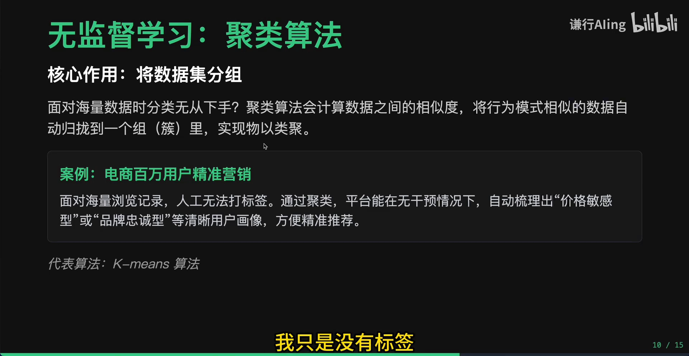

### 4.2 降维（dimensionality reduction）

数据集的列数就是特征数量，也就是维度。复杂数据的维数往往太高，而且很多特征并不都有用：有的是噪声、有的和目标不直接相关、有的在表达相似含义。全拿去训练会非常消耗计算资源。[【跳转到 09:43】](https://www.bilibili.com/video/BV1n3fzBsEu6/?t=583)

降维的目标是：**在尽量不丢失关键信息的前提下极大简化数据集**——删掉不相干的特征，或把相似的特征合并成一个。比如房价预测里，「距地铁站多远」「周边学校数量」「商场个数」等几十列其实都在描述同一个东西：地段好不好；用降维把它们压缩成一个「综合地段评分」，几十个特征变一个，关键信息不丢，后续训练效率高很多。代表算法是 **PCA**。[【跳转到 10:33】](https://www.bilibili.com/video/BV1n3fzBsEu6/?t=633)

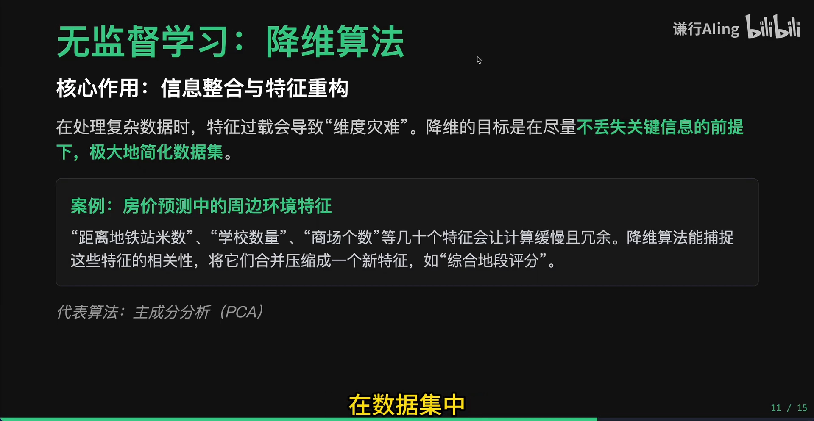

### 4.3 生成（generation）

第三类是生成算法，也就是今天非常常见的 **AIGC**：从数据中创作全新的内容。它在数据匮乏时尤其有用——比如医疗 AI 中，病人隐私数据不能随便分享，就可以用生成算法造出逼真的病理切片，作为扩充训练集。[【跳转到 11:23】](https://www.bilibili.com/video/BV1n3fzBsEu6/?t=683)

视频也顺便梳理了它的技术脉络：现在接触的 Nano Banana、ChatGPT 之类的效果，可能都是 Transformer 训练出来的；而在更早之前，机器学习里也有 **GAN** 能做到类似效果。生成的数据不只是给人消费，也可以反过来给监督学习当训练集。

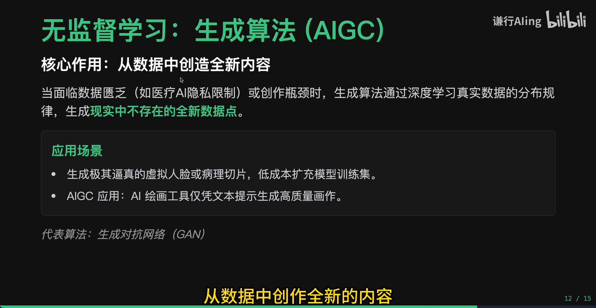

---

## 五、强化学习：在动态环境中试错

机器学习还有第三种类型——**强化学习**。它和前两者的根本区别是：监督学习与无监督学习用的都是现成的静态数据集，是「你学会了就能预测新数据」；而像自动驾驶、实时下围棋这样的复杂场景，**并不能完全根据历史来预测新的**，它必须**根据当前环境做一些实时的决策**。[【跳转到 12:31】](https://www.bilibili.com/video/BV1n3fzBsEu6/?t=751)

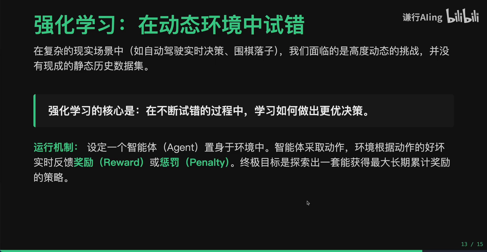

### 5.1 核心机制：智能体与环境

强化学习的核心是：**在训练时让智能体不断试错，在这个过程中学会做出一个最优策略**。就像人学开车，渐渐地你就学会了应对突然冲出的行人要踩刹车、遇到红灯要停，也就能到全新路段去驾驶。[【跳转到 13:21】](https://www.bilibili.com/video/BV1n3fzBsEu6/?t=801)

它的运行机制可以概括成：把一个**智能体（agent）**放进**环境（environment）**里——无论下棋还是智能驾驶——智能体去**采取动作**，环境就根据动作的好坏给它**实时反馈**：奖励或惩罚。比如智能驾驶转弯撞上墙就给惩罚，拐弯没闯红灯、还稳稳待在车道里就给奖励。渐渐地，智能体就学会开车了。它的**终极目标**，是探索出一套能最大化「长期累计奖励」的策略。[【跳转到 13:46】](https://www.bilibili.com/video/BV1n3fzBsEu6/?t=826)

### 5.2 里程碑与应用

强化学习最典型的里程碑是 **2016 年 AlphaGo 击败人类围棋世界冠军李世石**。它通过左右互搏、并借鉴人类棋谱，渐渐试错学会了下围棋，而且能超越人类。之后还有 **ZeroGo**：连人类棋谱都没看过，只告诉它规则让它自己学，训练两个月就下了 1000 盘、全部战胜了 AlphaGo——只要给它环境和清晰的规则就行。[【跳转到 14:11】](https://www.bilibili.com/video/BV1n3fzBsEu6/?t=851)

应用也极其广泛：复杂的棋牌、MOBA（如王者荣耀）里跟 AI 打游戏，工厂里的机器人姿态控制、工业机械臂调度，量化交易的策略定制，都靠强化学习训练。今天的大语言模型天天在用——训练完之后，最后一步也是要经过强化学习，和人类意图做对齐。[【跳转到 15:01】](https://www.bilibili.com/video/BV1n3fzBsEu6/?t=901)

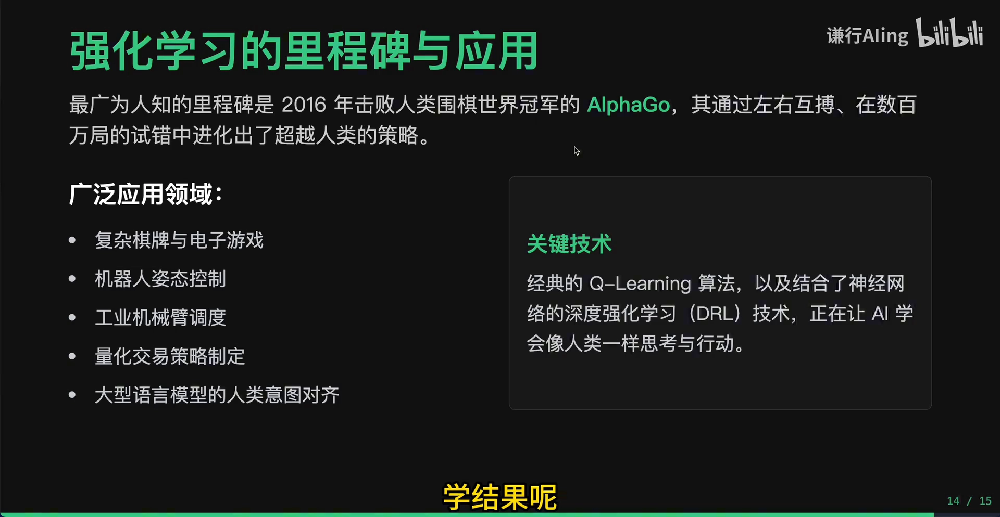

---

## 六、总结：三大分支各自的坐标

视频最后用一张总结图收束。[【跳转到 15:26】](https://www.bilibili.com/video/BV1n3fzBsEu6/?t=926)

- **监督学习**：处理带标签数据；按标签是连续数值还是离散类别，分成**回归**和**分类**；
- **无监督学习**：专门探索无标签数据，包含**聚类、降维、生成**三个方向；
- **强化学习**：在动态环境中不断试错，学习最优决策。

一句话记住边界：**有标签就用监督学习，没标签就用无监督学习，需要在动态环境中不断试错学最优决策就用强化学习**。

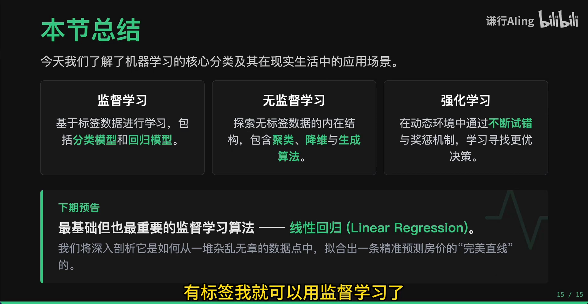

> 下一篇（1.2 配套）：《有监督学习、无监督学习、半监督学习和强化学习的区别》会换一个角度，用「答案 / 距离 / 奖励」三种反馈机制，以及半监督学习这条「中间地带」，把这几类学习方法的边界讲得更细。
